

 

  

Universidad Peruana de Ciencias Aplicadas

Carrera de Ingeniería de Software 
Ciclo: 5to 
1ASI0730 - Aplicaciones Web 
NRC: 8168

Docente 
Sanchez Ponce, Alex Humberto

Informe de Trabajo Final

Nombre del startup: InventiaStock 
Nombre del producto: SmartStock

Integrantes

<table style="margin:auto;font-size:13pt;">
<tr><td style="font-size:13pt;padding:6px 12px;"><strong>Código</strong></td><td style="font-size:13pt;padding:6px 12px;"><strong>Apellidos y Nombres</strong></td></tr>
<tr><td style="font-size:13pt;padding:6px 12px;">U20241F946</td><td style="font-size:13pt;padding:6px 12px;">Lopez Rimachi, Sebastian Leonardo</td></tr>
<tr><td style="font-size:13pt;padding:6px 12px;">U202421125</td><td style="font-size:13pt;padding:6px 12px;">Montañez Salinas, Lorena Ariana</td></tr>
<tr><td style="font-size:13pt;padding:6px 12px;">U20241C626</td><td style="font-size:13pt;padding:6px 12px;">Sanchez Osorio, Ruth Yanira</td></tr>
<tr><td style="font-size:13pt;padding:6px 12px;">U20241C804</td><td style="font-size:13pt;padding:6px 12px;">Suarez Chinga, Geraldine</td></tr>
<tr><td style="font-size:13pt;padding:6px 12px;">U20241F205</td><td style="font-size:13pt;padding:6px 12px;">Vizcarra Mamani, Candy Milagros</td></tr>
</table>

 
 
 
 
 
 

Noviembre, 2026

**Registro de Versiones del Informe**

<table>

<tbody>
<tr class="header">
<th><strong>Versión</strong></th>
<th><strong>Fecha</strong></th>
<th><strong>Autor</strong></th>
<th><strong>Descripción de modificación</strong></th>
</tr>
<tr class="odd">
<td>1</td>
<td>06/09/2026</td>
<td><ul>
<li>

Lopez Rimachi, Sebastian Leonardo

</li>
<li>

Montañez Salinas, Lorena Ariana

</li>
<li>

Sanchez Osorio, Ruth Yanira

</li>
<li>

Suarez Chinga, Geraldine

</li>
<li>

Vizcarra Mamani, Candy Milagros

</li>
</ul></td>
<td>
<strong>Adición de secciones:</strong>

Project Report Collaboration Insights

Contenido

Student Outcome

<strong>Capítulo I: Introducción</strong>

1.1. Startup Profile

1.1.1. Descripción de la Startup

1.1.2. Perfiles de integrantes del equipo

1.2. Solution Profile

1.2.1 Antecedentes y problemática

1.2.2 Lean UX Process

1.2.2.1. Lean UX Problem Statements

1.2.2.2. Lean UX Assumptions

1.2.2.3. Lean UX Hypothesis Statements

1.2.2.4. Lean UX Canvas

1.3. Segmentos objetivo

<strong>Capítulo II: Requirements Elicitation &amp;
Analysis</strong>

2.1. Competidores

2.1.1. Análisis competitivo

2.1.2. Estrategias y tácticas frente a competidores

2.2. Entrevistas

2.2.1. Diseño de entrevistas

2.2.2. Registro de entrevistas

2.2.3. Análisis de entrevistas

2.3. Needfinding

2.3.1. User Personas

2.3.2. User Task Matrix

2.3.3. User Journey Mapping

2.3.4. Empathy Mapping

2.4. Big Picture Event Storming

2.5. Ubiquitous Language

<strong>Capítulo III: Requirements Specification</strong>

3.1. User Stories

3.2. Impact Mapping

3.3. Product Backlog

<strong>Capítulo IV: Product Design</strong>

4.1. Style Guidelines

4.1.1. General Style Guidelines

4.1.2. Web Style Guidelines

4.2. Information Architecture

4.2.1. Organization Systems

4.2.2. Labeling Systems

4.2.3. SEO Tags and Meta Tags

4.2.4. Searching Systems

4.2.5. Navigation Systems

4.3. Landing Page UI Design

4.3.1. Landing Page Wireframe

4.3.2. Landing Page Mock-up

4.4. Web Applications UX/UI Design

4.4.1. Web Applications Wireframes

4.4.2. Web Applications Wireflow Diagrams

4.4.2. Web Applications Mock-ups

4.4.3. Web Applications User Flow Diagrams

4.5. Web Applications Prototyping

4.6. Domain-Driven Software Architecture

4.6.1. Design-Level Event Storming

4.6.2. Software Architecture Context Diagram

4.6.3. Software Architecture Container Diagrams

4.6.4. Software Architecture Components Diagrams

4.7. Software Object-Oriented Design

4.7.1. Class Diagrams

4.8. Database Design

4.8.1. Database Diagrams

<strong>Capítulo V: Product Implementation, Validation &amp;
Deployment</strong>

5.1. Software Configuration Management.

5.1.1. Software Development Environment Configuration

5.1.2. Source Code Management

5.1.3. Source Code Style Guide &amp; Conventions

5.1.4. Software Deployment Configuration

5.2. Landing Page, Services &amp; Applications Implementation

5.2.1. Sprint 1

5.2.1.1. Sprint Planning 1

5.2.1.2. Aspect Leaders and Collaborators

5.2.1.3. Sprint Backlog 1

5.2.1.4. Development Evidence for Sprint Review

5.2.1.5. Execution Evidence for Sprint Review

5.2.1.6. Services Documentation Evidence for Sprint Review

5.2.1.7. Software Deployment Evidence for Sprint Review

5.2.1.8. Team Collaboration Insights during Sprint

Conclusiones

Bibliografía

Anexos
</td>
</tr>
<tr class="header">
<td>2</td>
<td>06/10/2026</td>
<td><ul>
<li>

Lopez Rimachi, Sebastian Leonardo

</li>
<li>

Montañez Salinas, Lorena Ariana

</li>
<li>

Sanchez Osorio, Ruth Yanira

</li>
<li>

Suarez Chinga, Geraldine

</li>
<li>

Vizcarra Mamani, Candy Milagros

</li>
</ul></td>
<td><strong>Adición de secciones: 
 
Capítulo V: Product Implementation, Validation &amp;
Deployment</strong> 
5.2.2. Sprint 2 
5.2.2.1. Sprint Planning 2 
5.2.2.2. Aspect Leaders and Collaborators 
5.2.2.3. Sprint Backlog 2 
5.2.2.4. Development Evidence for Sprint Review 
5.2.2.5. Execution Evidence for Sprint Review 
5.2.2.6. Services Documentation Evidence for Sprint Review 
5.2.2.7. Software Deployment Evidence for Sprint Review 
5.2.2.8. Team Collaboration Insights during Sprint 
 
Conclusiones 
Bibliografía 
Anexos</td>
</tr>
<tr class="odd">
<td>3</td>
<td>11/11/2026</td>
<td><ul>
<li>

Lopez Rimachi, Sebastian Leonardo

</li>
<li>

Montañez Salinas, Lorena Ariana

</li>
<li>

Sanchez Osorio, Ruth Yanira

</li>
<li>

Suarez Chinga, Geraldine

</li>
<li>

Vizcarra Mamani, Candy Milagros

</li>
</ul></td>
<td>
<strong>Adición de secciones: 
 
Capítulo V: Product Implementation, Validation &amp;
Deployment</strong> 
5.2.3. Sprint 3

5.2.3.1.Sprint Planning 3.

5.2.3.2. Aspect Leaders and Collaborators.

5.2.3.3. Sprint Backlog 3.

5.2.3.4.Development Evidence for Sprint Review.

5.2.3.5.Execution Evidence for Sprint Review.

5.2.3.6.Services Documentation Evidence for Sprint Review.

5.2.3.7.Software Deployment Evidence for Sprint Review.

5.2.3.8.Team Collaboration Insights during Sprint.

5.3. Validation Interviews.

5.3.1. Diseño de Entrevistas.

5.3.2. Registro de Entrevistas.

5.3.3. Evaluaciones según heurísticas.

5.4. Video About-the-Product.

<strong>Conclusiones 
</strong>Conclusiones y recomendaciones 
Video About-the-Team

<strong>Bibliografía</strong>

<strong>Anexos 
</strong>Anexo C, Anexo D y Anexo E 
 
<strong>Corrección de secciones:</strong>

2.1.1. Análisis competitivo y 2.1.2. Estrategias y tácticas frente a
competidores (M03)

3.1. User Stories (M02)

4.6.4. Software Architecture Components Diagrams y 4.8.1. Database
Diagrams (M07, M08 y M17)

5.1.1. Software Development Environment Configuration, 5.1.2. Source
Code Management y 5.1.4. Software Deployment Configuration (M04 a
M06)

README del repositorio de documentación (M01)
</td>
</tr>
</tbody>
</table>

**Project Report Collaboration Insights**

**Repositorio de la documentación del proyecto:**
<a href="https://github.com/InventiaStock**" style="color:#2563eb">https://github.com/InventiaStock</a>

A continuación, se detallan las actividades realizadas en cada entrega,
la participación de los integrantes del equipo y las evidencias
correspondientes.

**AV1:**

Durante la primera entrega (AV1), se registran las actividades iniciales de colaboración del equipo, evidenciando la organización, coordinación y participación de los integrantes en el desarrollo del proyecto.
 
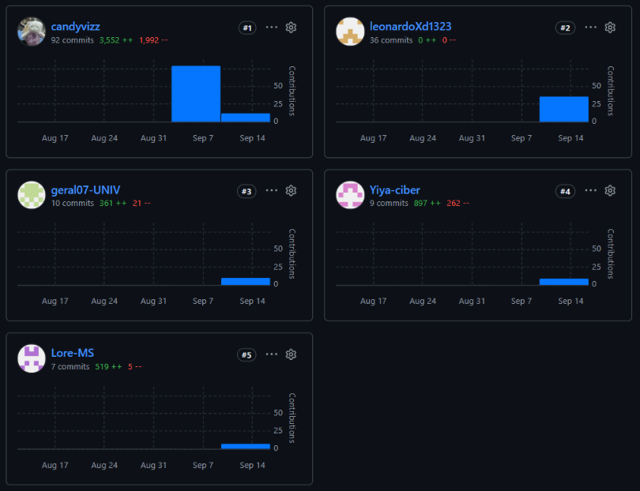
 
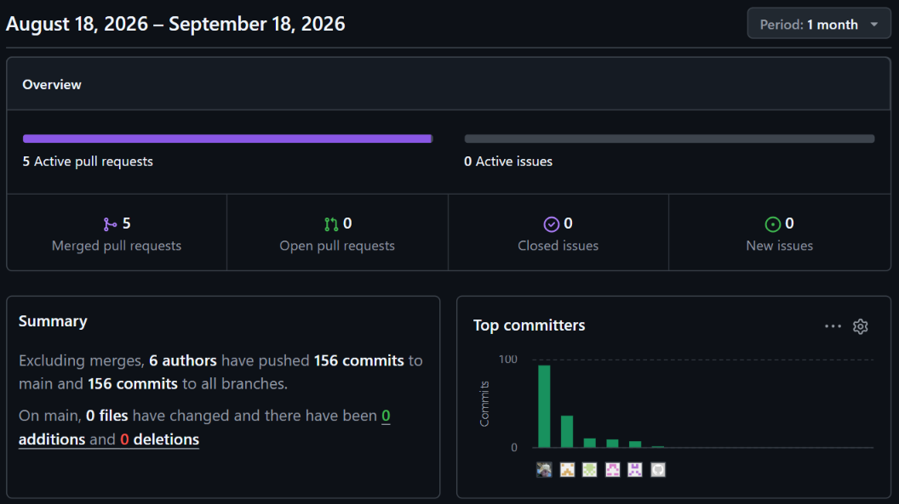
 

**TB**

En esta etapa (TB), se presentan las evidencias del trabajo colaborativo realizado por los integrantes, reflejando la continuidad de las actividades y la coordinación para cumplir con los objetivos
establecidos.
 
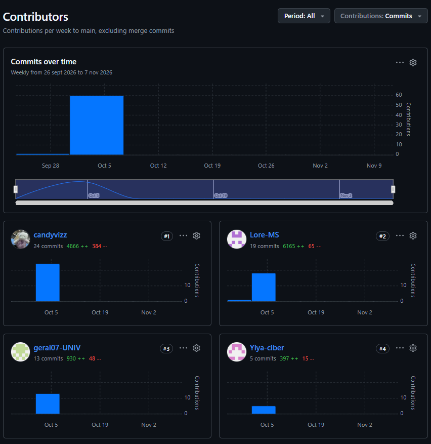
 

**AV2**

Durante la segunda entrega (AV2), se evidencia la continuidad del trabajo en equipo, la participación de los integrantes y el avance de las actividades correspondientes al desarrollo del proyecto SmartStock.
 
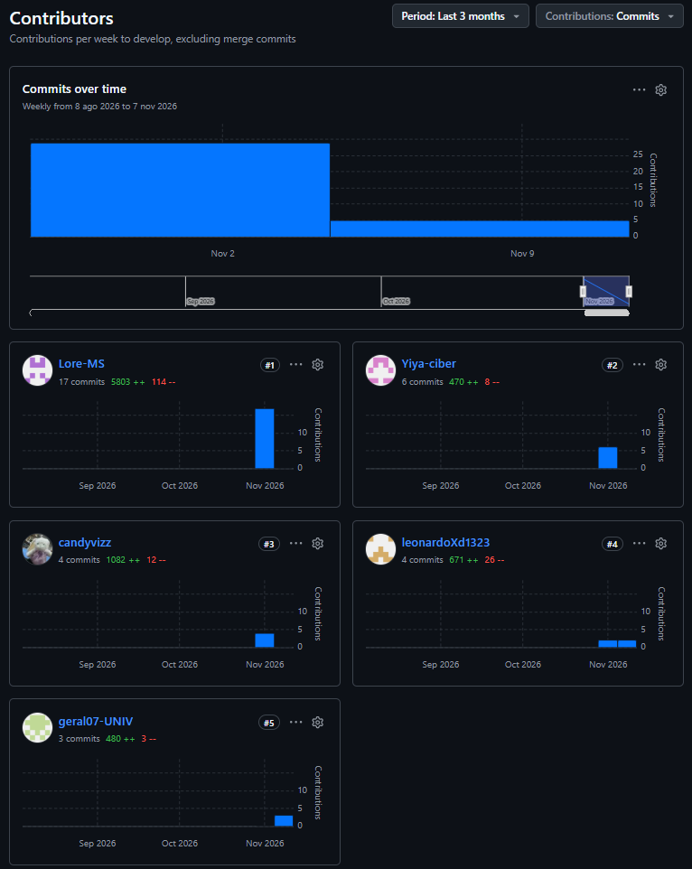
 
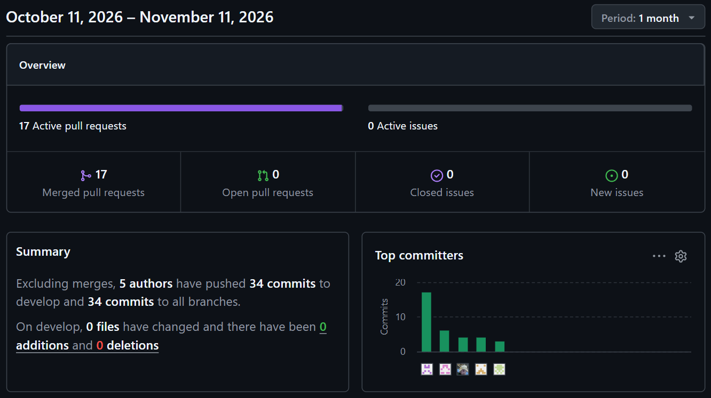
 

## Tabla de contenidos

- <a href="#capítulo-i-introducción" style="color:#111;text-decoration:none">Capítulo I: Introducción</a>
  - <a href="#11-startup-profile" style="color:#111;text-decoration:none">1.1. Startup Profile</a>
    - <a href="#111-descripción-de-la-startup" style="color:#111;text-decoration:none">1.1.1. Descripción de la Startup</a>
  - <a href="#12-solution-profile" style="color:#111;text-decoration:none">1.2. Solution Profile</a>
    - <a href="#121-antecedentes-y-problemática" style="color:#111;text-decoration:none">1.2.1 Antecedentes y problemática</a>
    - <a href="#122-lean-ux-process" style="color:#111;text-decoration:none">1.2.2 Lean UX Process</a>
      - <a href="#1221-lean-ux-problem-statements" style="color:#111;text-decoration:none">1.2.2.1. Lean UX Problem Statements</a>
      - <a href="#1222-lean-ux-assumptions" style="color:#111;text-decoration:none">1.2.2.2. Lean UX Assumptions</a>
      - <a href="#1223-lean-ux-hypothesis-statements" style="color:#111;text-decoration:none">1.2.2.3. Lean UX Hypothesis Statements</a>
      - <a href="#1224-lean-ux-canvas" style="color:#111;text-decoration:none">1.2.2.4. Lean UX Canvas</a>
  - <a href="#13-segmentos-objetivo" style="color:#111;text-decoration:none">1.3. Segmentos objetivo</a>
- <a href="#capítulo-ii-requirements-elicitation-analysis" style="color:#111;text-decoration:none">**Capítulo II: Requirements Elicitation & Analysis**</a>
  - <a href="#21-competidores" style="color:#111;text-decoration:none">2.1. Competidores</a>
    - <a href="#211-análisis-competitivo" style="color:#111;text-decoration:none">2.1.1. Análisis competitivo</a>
    - <a href="#212-estrategias-y-tácticas-frente-a-competidores" style="color:#111;text-decoration:none">2.1.2. Estrategias y tácticas frente a competidores</a>
  - <a href="#22-entrevistas" style="color:#111;text-decoration:none">2.2. Entrevistas</a>
    - <a href="#221-diseño-de-entrevistas" style="color:#111;text-decoration:none">2.2.1. Diseño de entrevistas</a>
    - <a href="#222-registro-de-entrevistas" style="color:#111;text-decoration:none">2.2.2. Registro de entrevistas</a>
    - <a href="#223-análisis-de-entrevistas" style="color:#111;text-decoration:none">2.2.3. Análisis de entrevistas</a>
  - <a href="#23-needfinding" style="color:#111;text-decoration:none">2.3. Needfinding</a>
    - <a href="#231-user-personas" style="color:#111;text-decoration:none">2.3.1. User Personas</a>
    - <a href="#232-user-task-matrix" style="color:#111;text-decoration:none">2.3.2. User Task Matrix</a>
    - <a href="#233-user-journey-mapping" style="color:#111;text-decoration:none">2.3.3. User Journey Mapping</a>
    - <a href="#234-empathy-mapping" style="color:#111;text-decoration:none">2.3.4. Empathy Mapping</a>
  - <a href="#24-big-picture-event-storming" style="color:#111;text-decoration:none">2.4. Big Picture Event Storming</a>
  - <a href="#25-ubiquitous-language" style="color:#111;text-decoration:none">2.5. Ubiquitous Language</a>
  - <a href="#capítulo-iii-requirements-specification" style="color:#111;text-decoration:none">Capítulo III: Requirements Specification</a>
  - <a href="#31-user-stories" style="color:#111;text-decoration:none">3.1. User Stories</a>
  - <a href="#32-impact-mapping" style="color:#111;text-decoration:none">3.2. Impact Mapping</a>
  - <a href="#33-product-backlog" style="color:#111;text-decoration:none">3.3. Product Backlog</a>
- <a href="#capítulo-iv-product-design" style="color:#111;text-decoration:none">Capítulo IV: Product Design</a>
  - <a href="#41-style-guidelines" style="color:#111;text-decoration:none">4.1. Style Guidelines</a>
    - <a href="#411-general-style-guidelines" style="color:#111;text-decoration:none">4.1.1. General Style Guidelines</a>
    - <a href="#412-web-style-guidelines" style="color:#111;text-decoration:none">4.1.2. Web Style Guidelines</a>
  - <a href="#42-information-architecture" style="color:#111;text-decoration:none">4.2. Information Architecture</a>
    - <a href="#421-organization-systems" style="color:#111;text-decoration:none">4.2.1. Organization Systems</a>
    - <a href="#422-labeling-systems" style="color:#111;text-decoration:none">4.2.2. Labeling Systems</a>
    - <a href="#423-seo-tags-and-meta-tags" style="color:#111;text-decoration:none">4.2.3. SEO Tags and Meta Tags</a>
    - <a href="#424-searching-systems" style="color:#111;text-decoration:none">4.2.4. Searching Systems</a>
    - <a href="#425-navigation-systems" style="color:#111;text-decoration:none">4.2.5. Navigation Systems</a>
  - <a href="#43-landing-page-ui-design" style="color:#111;text-decoration:none">4.3. Landing Page UI Design</a>
    - <a href="#431-landing-page-wireframe" style="color:#111;text-decoration:none">4.3.1. Landing Page Wireframe</a>
    - <a href="#432-landing-page-mock-up" style="color:#111;text-decoration:none">4.3.2. Landing Page Mock-up</a>
  - <a href="#44-web-applications-uxui-design" style="color:#111;text-decoration:none">4.4. Web Applications UX/UI Design</a>
    - <a href="#441-web-applications-wireframes" style="color:#111;text-decoration:none">4.4.1. Web Applications Wireframes</a>
    - <a href="#442-web-applications-wireflow-diagrams" style="color:#111;text-decoration:none">4.4.2. Web Applications Wireflow Diagrams</a>
    - <a href="#443-web-applications-mock-ups" style="color:#111;text-decoration:none">4.4.3. Web Applications Mock-ups</a>
    - <a href="#444-web-applications-user-flow-diagrams" style="color:#111;text-decoration:none">4.4.4. Web Applications User Flow Diagrams</a>
  - <a href="#45-web-applications-prototyping" style="color:#111;text-decoration:none">4.5. Web Applications Prototyping</a>
  - <a href="#46-domain-driven-software-architecture" style="color:#111;text-decoration:none">4.6. Domain-Driven Software Architecture</a>
    - <a href="#461-design-level-event-storming" style="color:#111;text-decoration:none">4.6.1. Design-Level Event Storming</a>
    - <a href="#462-software-architecture-context-diagram" style="color:#111;text-decoration:none">4.6.2. Software Architecture Context Diagram</a>
    - <a href="#463-software-architecture-container-diagrams" style="color:#111;text-decoration:none">4.6.3. Software Architecture Container Diagrams</a>
    - <a href="#464-software-architecture-components-diagrams" style="color:#111;text-decoration:none">4.6.4. Software Architecture Components Diagrams</a>
  - <a href="#47-software-object-oriented-design" style="color:#111;text-decoration:none">4.7. Software Object-Oriented Design</a>
    - <a href="#471-class-diagrams" style="color:#111;text-decoration:none">4.7.1. Class Diagrams</a>
  - <a href="#48-database-design" style="color:#111;text-decoration:none">4.8. Database Design</a>
    - <a href="#481-database-diagrams" style="color:#111;text-decoration:none">4.8.1. Database Diagrams</a>
- <a href="#capítulo-v-product-implementation-validation-deployment" style="color:#111;text-decoration:none">Capítulo V: Product Implementation, Validation & Deployment</a>
  - <a href="#51-software-configuration-management" style="color:#111;text-decoration:none">5.1. Software Configuration Management</a>
    - <a href="#511-software-development-environment-configuration" style="color:#111;text-decoration:none">5.1.1. Software Development Environment Configuration</a>
    - <a href="#512-source-code-management" style="color:#111;text-decoration:none">5.1.2. Source Code Management</a>
    - <a href="#513-source-code-style-guide-conventions" style="color:#111;text-decoration:none">5.1.3. Source Code Style Guide & Conventions</a>
    - <a href="#514-software-deployment-configuration" style="color:#111;text-decoration:none">5.1.4. Software Deployment Configuration</a>
  - <a href="#52-landing-page-services-applications-implementation" style="color:#111;text-decoration:none">5.2. Landing Page, Services & Applications Implementation</a>
    - <a href="#521-sprint-1" style="color:#111;text-decoration:none">5.2.1. Sprint 1</a>
      - <a href="#5211-sprint-planning-1" style="color:#111;text-decoration:none">5.2.1.1. Sprint Planning 1</a>
      - <a href="#5212-aspect-leaders-and-collaborators" style="color:#111;text-decoration:none">5.2.1.2. Aspect Leaders and Collaborators</a>
      - <a href="#5213-sprint-backlog-1" style="color:#111;text-decoration:none">5.2.1.3. Sprint Backlog 1</a>
      - <a href="#5214-development-evidence-for-sprint-review" style="color:#111;text-decoration:none">5.2.1.4. Development Evidence for Sprint Review</a>
      - <a href="#5215-execution-evidence-for-sprint-review" style="color:#111;text-decoration:none">5.2.1.5. Execution Evidence for Sprint Review</a>
      - <a href="#5216-services-documentation-evidence-for-sprint-review" style="color:#111;text-decoration:none">5.2.1.6. Services Documentation Evidence for Sprint Review</a>
      - <a href="#5217-software-deployment-evidence-for-sprint-review" style="color:#111;text-decoration:none">5.2.1.7. Software Deployment Evidence for Sprint Review</a>
      - <a href="#5218-team-collaboration-insights-during-sprint" style="color:#111;text-decoration:none">5.2.1.8. Team Collaboration Insights during Sprint</a>
    - <a href="#522-sprint-2" style="color:#111;text-decoration:none">5.2.2. Sprint 2</a>
      - <a href="#5221-sprint-planning-2" style="color:#111;text-decoration:none">5.2.2.1. Sprint Planning 2</a>
      - <a href="#5222-aspect-leaders-and-collaborators" style="color:#111;text-decoration:none">5.2.2.2. Aspect Leaders and Collaborators</a>
      - <a href="#5223-sprint-backlog-2" style="color:#111;text-decoration:none">5.2.2.3. Sprint Backlog 2</a>
      - <a href="#5224-development-evidence-for-sprint-review" style="color:#111;text-decoration:none">5.2.2.4. Development Evidence for Sprint Review</a>
      - <a href="#5225-execution-evidence-for-sprint-review" style="color:#111;text-decoration:none">5.2.2.5. Execution Evidence for Sprint Review</a>
      - <a href="#5226-services-documentation-evidence-for-sprint-review" style="color:#111;text-decoration:none">5.2.2.6. Services Documentation Evidence for Sprint Review</a>
      - <a href="#5227-software-deployment-evidence-for-sprint-review" style="color:#111;text-decoration:none">5.2.2.7. Software Deployment Evidence for Sprint Review</a>
      - <a href="#5228-team-collaboration-insights-during-sprint" style="color:#111;text-decoration:none">5.2.2.8. Team Collaboration Insights during Sprint</a>
    - <a href="#523-sprint-3" style="color:#111;text-decoration:none">5.2.3. Sprint 3</a>
      - <a href="#5231sprint-planning-3" style="color:#111;text-decoration:none">5.2.3.1.Sprint Planning 3</a>
      - <a href="#5232-aspect-leaders-and-collaborators" style="color:#111;text-decoration:none">5.2.3.2. Aspect Leaders and Collaborators</a>
      - <a href="#5233sprint-backlog-3" style="color:#111;text-decoration:none">5.2.3.3.Sprint Backlog 3</a>
      - <a href="#5234development-evidence-for-sprint-review" style="color:#111;text-decoration:none">5.2.3.4.Development Evidence for Sprint Review</a>
      - <a href="#5235execution-evidence-for-sprint-review" style="color:#111;text-decoration:none">5.2.3.5.Execution Evidence for Sprint Review</a>
      - <a href="#5236services-documentation-evidence-for-sprint-review" style="color:#111;text-decoration:none">5.2.3.6.Services Documentation Evidence for Sprint Review</a>
      - <a href="#5237software-deployment-evidence-for-sprint-review" style="color:#111;text-decoration:none">5.2.3.7.Software Deployment Evidence for Sprint Review</a>
      - <a href="#5238team-collaboration-insights-during-sprint" style="color:#111;text-decoration:none">5.2.3.8.Team Collaboration Insights during Sprint</a>
  - <a href="#53-validation-interviews" style="color:#111;text-decoration:none">5.3. Validation Interviews</a>
    - <a href="#531-diseño-de-entrevistas" style="color:#111;text-decoration:none">5.3.1. Diseño de Entrevistas</a>
    - <a href="#532-registro-de-entrevistas" style="color:#111;text-decoration:none">5.3.2. Registro de Entrevistas.</a>
    - <a href="#533-evaluaciones-según-heurísticas" style="color:#111;text-decoration:none">5.3.3. Evaluaciones según heurísticas</a>
  - <a href="#54-video-about-the-product" style="color:#111;text-decoration:none">5.4. Video About-the-Product</a>
- <a href="#conclusiones" style="color:#111;text-decoration:none">Conclusiones</a>
- <a href="#bibliografía" style="color:#111;text-decoration:none">Bibliografía</a>
- <a href="#anexos" style="color:#111;text-decoration:none">Anexos</a>

**Student Outcome**

**ABET – EAC - Student Outcome 5**

**Criterio:** La capacidad de funcionar efectivamente en un equipo cuyos
miembros juntos proporcionan liderazgo, crean un entorno de colaboración
e inclusivo, establecen objetivos, planifican tareas y cumplen
objetivos.

El curso contribuye al cumplimiento del Student Outcome ABET – EAC -
Student Outcome 5. En el siguiente cuadro se describen las acciones
realizadas por cada integrante y las conclusiones obtenidas por el grupo
durante el AV1, TB1 y AV2. Estas evidencias permiten relacionar el
trabajo desarrollado en el proyecto SmartStock con las capacidades de
liderazgo compartido, colaboración, comunicación, planificación,
responsabilidad y cumplimiento de objetivos dentro de un equipo de
desarrollo de software.

**Tabla 1**

*Acciones realizadas y conclusiones por criterio específico del Student
Outcome*

<table>

<tbody>
<tr class="header">
<th><strong>Criterio específico</strong></th>
<th><strong>Acciones realizadas</strong></th>
<th><strong>Conclusiones</strong></th>
</tr>
<tr class="odd">
<td>Trabaja en equipo para proporcionar liderazgo en forma conjunta</td>
<td>
<strong>Lopez Rimachi, Sebastian Leonardo
(U20241F946)</strong>

<strong>AV1:</strong> Durante el desarrollo del AV1, contribuyó al
liderazgo compartido mediante la coordinación de sus aportes en
Requirements Elicitation, Requirements Specification, User Stories,
Impact Mapping, Product Backlog, prototipado y arquitectura. Su
participación requirió integrar información proveniente del trabajo de
otros integrantes, comunicar avances y adaptar sus entregables a las
decisiones tomadas por el equipo, favoreciendo la construcción conjunta
de los artefactos del proyecto.

<strong>TB1:</strong> Durante el Sprint 2 asumió el liderazgo del
contexto Alerts &amp; Restocking, coordinando sus funcionalidades con
los módulos de inventario y compras. La integración de las alertas de
stock bajo con el proceso de registro de compras requirió comunicación
con los responsables de Product Catalog, Compras e Inventory Monitoring.
De esta manera, ejerció liderazgo desde su contexto sin trabajar de
forma aislada, facilitando la integración de funcionalidades
dependientes dentro del flujo general de SmartStock.

<strong>AV2:</strong> Durante el Sprint 3 continuó liderando el
contexto Alerts &amp; Restocking, siendo responsable de implementar las
reglas de alertas R19, R20 y R21 mediante AlertsFacade, así como los
servicios de notificación por correo electrónico utilizando SMTP y
WhatsApp mediante Twilio. También participó en la implementación de
consultas de alertas y configuración de canales de notificación. Estas
actividades requirieron coordinación con los responsables de Product
Catalog, Inventory Monitoring e IoT Device, debido a que las alertas
dependen de los movimientos de inventario, las lecturas de sensores y
las compras registradas. Su participación permitió integrar las
funcionalidades de notificación con los demás contextos del sistema.

<strong>Montañez Salinas, Lorena Ariana (U202421125)</strong>

<strong>AV1:</strong> Contribuyó al liderazgo conjunto al participar
en actividades de investigación, análisis del problema, entrevistas,
modelado y arquitectura, así como en la planificación del Sprint 1. Su
participación permitió articular información de distintas secciones del
proyecto y coordinar entregables con otros miembros del equipo,
promoviendo una visión compartida sobre el producto y sus objetivos.

<strong>TB1</strong>: Durante el Sprint 2 lideró el contexto IAM y
asumió el desarrollo de las funcionalidades relacionadas con Ventas.
Debido a que Ventas forma parte del flujo central de inventario,
coordinó su trabajo con los responsables de Inventory Monitoring,
Product Catalog, Compras y otros módulos relacionados. Esta interacción
permitió alinear las funcionalidades de autenticación y ventas con el
objetivo común de entregar una versión navegable del frontend,
fortaleciendo el liderazgo distribuido dentro del equipo.

<strong>AV2</strong>: Durante el Sprint 3 lideró las actividades
relacionadas con IAM y participó en la implementación de las
funcionalidades de ventas, incluyendo el registro de operaciones, la
validación de productos y stock disponible, así como las consultas de
historial y detalle de ventas. También asumió responsabilidades
relacionadas con la estructura de datos, las entidades y las relaciones
entre los diferentes contextos del backend. Su participación en la
coordinación del trabajo documental y la integración de los aportes del
equipo contribuyó a mantener una visión conjunta de la arquitectura y
los objetivos del producto.

<strong>Sanchez Osorio, Ruth Yanira (U20241C626)</strong>

<strong>AV1</strong>: Durante el AV1 aportó al trabajo conjunto
mediante el desarrollo y coordinación de actividades relacionadas con
entrevistas, Style Guidelines, Information Architecture y Landing Page.
Su participación exigió compartir criterios de diseño y estructura con
el resto del equipo para mantener consistencia entre los diferentes
artefactos del producto.

<strong>TB1</strong>: En el Sprint 2 lideró el contexto IoT Device y
colaboró además en la preparación de elementos compartidos y del entorno
de simulación utilizado por los demás módulos. Este trabajo tuvo impacto
transversal sobre el equipo, por lo que requirió anticipar necesidades
comunes, comunicar cambios y proporcionar una base técnica que pudiera
ser utilizada por los demás integrantes sin generar conflictos. De esta
manera, contribuyó al liderazgo conjunto mediante soporte técnico y
coordinación entre contextos.

<strong>AV2</strong>: Durante el Sprint 3 continuó liderando el
contexto IoT Device, desarrollando funcionalidades relacionadas con la
recepción de lecturas, consulta del estado de los sensores y vinculación
de sensores con productos. También asumió la implementación de los
endpoints del dashboard y reportes, integrando información procedente de
ventas, compras, alertas y niveles de inventario. Adicionalmente,
participó en la configuración del entorno de ejecución, integración
continua y despliegue del backend en Render y la base de datos MySQL en
Aiven. Estas responsabilidades exigieron coordinación con los demás
contextos para asegurar que la solución funcionara de manera
integrada.

<strong>Suarez Chinga, Geraldine (U20241C804)</strong>

<strong>AV1</strong>: Participó en la construcción de la identidad
visual y la experiencia de usuario mediante actividades relacionadas con
entrevistas, Style Guidelines, Information Architecture y Landing Page
Design. Su trabajo requirió coordinar decisiones de diseño con otros
integrantes y adaptar sus propuestas a las necesidades definidas durante
la investigación del usuario, contribuyendo a la integración del trabajo
grupal.

<strong>TB1</strong>: Durante el Sprint 2 asumió el liderazgo de
Inventory Monitoring y Analytics &amp; Reporting, contextos directamente
relacionados con la información generada por ventas, compras, sensores y
movimientos de stock. Debido a estas dependencias, coordinó sus avances
con los integrantes responsables de dichos módulos para mantener
consistencia en la visualización y análisis de la información. Su
participación permitió articular datos provenientes de diferentes
funcionalidades y contribuir a una experiencia integrada del
producto.

<strong>AV2</strong>: Durante el Sprint 3 continuó liderando el
contexto Inventory Monitoring, desarrollando el motor de movimientos de
stock y los servicios de consulta del nivel de inventario y detalle de
productos. También implementó las funcionalidades de comparación de
inventario y participó en la elaboración de pruebas unitarias de las
reglas de negocio mediante xUnit. Asimismo, colaboró con la
documentación de los endpoints relacionados con movimientos, stock y
comparación de inventario. Estas actividades requirieron coordinación
con Product Catalog, IoT Device y Alerts &amp; Restocking, ya que los
movimientos de stock y las lecturas de sensores influyen directamente en
la información que presenta el sistema.

<strong>Vizcarra Mamani, Candy Milagros (U20241F205)</strong>

<strong>AV1</strong>: Durante el AV1 contribuyó al liderazgo
compartido mediante la elaboración y coordinación de contenidos
relacionados con Startup Profile, Solution Profile, Lean UX Process,
segmentos objetivo, análisis competitivo, entrevistas y Needfinding.
Asimismo, colaboró con artefactos UX/UI y de arquitectura, integrando
información proveniente de distintas actividades del equipo y
manteniendo comunicación con los demás integrantes para conservar
coherencia entre el problema identificado, los usuarios y la solución
propuesta.

<strong>TB1</strong>: Durante el Sprint 2 lideró el contexto Product
Catalog y asumió además las funcionalidades de Proveedores y Compras. La
implementación de estos flujos requirió coordinación con los
responsables de Ventas, Inventory Monitoring, Alerts &amp; Restocking e
IoT Device, debido a que los movimientos de compra modifican el
inventario y pueden originarse a partir de necesidades de reposición.
Esta interacción fortaleció su capacidad para comunicar dependencias,
integrar aportes de otros miembros y asumir responsabilidad sobre
funcionalidades que forman parte del flujo central de SmartStock.

<strong>AV2</strong>: Durante el Sprint 3 continuó liderando el
contexto Product Catalog, siendo responsable de implementar los
servicios de registro y edición de productos, así como las validaciones
correspondientes a las reglas de negocio. También desarrolló las
funcionalidades de proveedores y compras, incluyendo el registro de
compras pendientes, su recepción y las consultas de historial y detalle.
Estas actividades requirieron coordinación con los responsables de
Inventory Monitoring, Alerts &amp; Restocking y Ventas, debido a que la
recepción de compras genera movimientos de entrada que modifican el
stock y las alertas pueden originar necesidades de reposición. Además,
asumió la documentación de los endpoints de productos, sensores,
proveedores y compras mediante Scalar, contribuyendo a la integración
técnica y documental del proyecto.
</td>
<td>
<strong>AV1</strong>: El equipo evidenció liderazgo compartido al
distribuir responsabilidades según las fortalezas y tareas asignadas a
cada integrante, manteniendo coordinación para integrar investigación,
UX/UI, arquitectura y documentación en un único proyecto. El liderazgo
no se concentró en una sola persona, sino que cada integrante asumió
responsabilidad sobre determinadas áreas y colaboró con los demás para
mantener coherencia entre los entregables.

<strong>TB1:</strong> Durante el Sprint 2 el liderazgo compartido se
fortaleció mediante la distribución del frontend en contextos
funcionales. Cada integrante lideró uno o más módulos y, al mismo
tiempo, tuvo que coordinar dependencias con los demás. La integración
entre Ventas, Compras, Product Catalog, Inventory Monitoring, Alerts
&amp; Restocking, IAM, IoT Device y Analytics &amp; Reporting evidenció
que el cumplimiento del objetivo del sprint dependía de la comunicación,
cooperación y toma de decisiones conjunta, y no únicamente del trabajo
individual.

<strong>AV2:</strong> Durante el Sprint 3, el liderazgo compartido se
evidenció mediante la distribución de responsabilidades por contextos
funcionales del backend. Cada integrante asumió la implementación de
servicios, reglas de negocio, endpoints y funcionalidades específicas,
manteniendo coordinación con los responsables de otros contextos. La
integración entre Product Catalog, Ventas, Compras, Inventory
Monitoring, IoT Device, Alerts &amp; Restocking e IAM permitió construir
una solución conectada en la que las operaciones de un módulo podían
generar cambios en otros. De esta manera, el equipo fortaleció su
capacidad de liderazgo conjunto, comunicación técnica y toma de
decisiones para alcanzar los objetivos comunes del proyecto.
</td>
</tr>
<tr class="header">
<td>Crea un entorno colaborativo e inclusivo, establece metas, planifica
tareas y cumple objetivos</td>
<td>
<strong>Lopez Rimachi, Sebastian Leonardo
(U20241F946)</strong>

<strong>AV1:</strong> Participó en la planificación y ejecución de
las actividades asignadas, coordinando sus avances con los demás
integrantes y adaptando sus entregables a las necesidades del proyecto.
Esto permitió mantener continuidad entre Requirements Elicitation,
Requirements Specification, prototipado y arquitectura, contribuyendo al
cumplimiento de los objetivos establecidos para la entrega.

<strong>TB1:</strong> Organizó las tareas correspondientes a Alerts
&amp; Restocking de acuerdo con las historias asignadas y las
dependencias existentes con inventario y compras. Mantuvo comunicación
con los integrantes involucrados en dichos flujos y respetó los acuerdos
de trabajo establecidos por el equipo para el uso de ramas, Pull
Requests e integración de cambios, contribuyendo a una ejecución
ordenada del sprint.

<strong>AV2:</strong> Organizó el desarrollo de las funcionalidades
de alertas y notificaciones de acuerdo con las historias y tareas
asignadas en el Sprint Backlog 3. Coordinó la implementación de las
reglas de negocio con los responsables de movimientos de stock, sensores
y compras, considerando las dependencias necesarias para generar y
resolver alertas correctamente. Asimismo, participó en el trabajo
colaborativo mediante la gestión de ramas y Pull Requests, facilitando
la revisión e integración de los cambios del backend.

<strong>Montañez Salinas, Lorena Ariana (U202421125)</strong>

<strong>AV1</strong>: Participó activamente en la organización de
actividades de investigación, diseño, arquitectura y planificación,
coordinando entregables y manteniendo comunicación con los integrantes
para avanzar de manera ordenada hacia los objetivos definidos para el
AV1.

<strong>TB1</strong>: Participó en la planificación del Sprint 2 y
organizó el desarrollo de IAM y las pantallas de Ventas considerando las
dependencias con otros contextos. La coordinación con los responsables
de inventario y otros módulos permitió mantener alineados los avances y
contribuir al objetivo común de obtener una versión funcional del
frontend con los flujos principales del negocio.

<strong>AV2</strong>: Participó en la planificación y organización de
las actividades del Sprint 3, coordinando el desarrollo de IAM, ventas y
los componentes compartidos del backend. La implementación de las
operaciones de ventas requirió considerar las validaciones de stock y su
relación con los movimientos de inventario. También colaboró en la
organización de los entregables documentales, la recopilación de
evidencias y la integración de los aportes del equipo para cumplir con
los objetivos establecidos en la entrega.

<strong>Sanchez Osorio, Ruth Yanira (U20241C626)</strong>

<strong>AV1</strong>: Cumplió las actividades asignadas relacionadas
con investigación, diseño y arquitectura de información, compartiendo
resultados con el equipo y ajustando sus entregables para facilitar su
integración con el trabajo de los demás integrantes.

<strong>TB1</strong>: Organizó las actividades relacionadas con IoT
Device y los elementos compartidos requeridos para el Sprint 2. Al
tratarse de componentes utilizados por diferentes contextos, coordinó
sus cambios para evitar interferencias con el trabajo de otros miembros
y facilitar el desarrollo paralelo. Esta forma de trabajo favoreció un
entorno colaborativo en el que los recursos comunes pudieron ser
utilizados de manera organizada por todo el equipo.

<strong>AV2</strong>: Organizó las tareas de IoT Device, Analytics
&amp; Reporting y despliegue de acuerdo con las prioridades del Sprint
Backlog 3. Coordinó la configuración del entorno local, la integración
continua y la publicación del backend y la base de datos en sus
respectivos servicios. También compartió las evidencias del despliegue y
los resultados de los endpoints de sensores, dashboard y reportes,
facilitando que los demás integrantes pudieran validar la integración de
sus funcionalidades con la infraestructura común.

<strong>Suarez Chinga, Geraldine (U20241C804)</strong>

<strong>AV1</strong>: Desarrolló las tareas asignadas de entrevistas,
Style Guidelines, Information Architecture y Landing Page Design
manteniendo coordinación con los integrantes del equipo. La comunicación
de sus avances permitió integrar las decisiones de diseño con los demás
artefactos y cumplir los objetivos establecidos para la entrega.

<strong>TB1</strong>: Planificó y ejecutó las funcionalidades
correspondientes a Inventory Monitoring y Analytics &amp; Reporting,
coordinando la información proveniente de compras, ventas, sensores y
otros movimientos del inventario. Debido a la relación entre estos
contextos, fue necesario mantener comunicación con diferentes
integrantes y ajustar la integración de datos para conservar
consistencia entre las funcionalidades desarrolladas.

<strong>AV2</strong>: Planificó y desarrolló las tareas
correspondientes al contexto Inventory Monitoring, priorizando la
implementación del motor de movimientos de stock, las consultas de nivel
de inventario, el detalle de productos y la comparación de cantidades.
También participó en la elaboración de pruebas unitarias para verificar
las reglas de negocio y colaboró con las evidencias de los endpoints
correspondientes. Para cumplir con estas actividades mantuvo
coordinación con los responsables de Product Catalog e IoT Device,
permitiendo integrar los datos de productos, sensores y movimientos de
inventario.

<strong>Vizcarra Mamani, Candy Milagros (U20241F205)</strong>

<strong>AV1</strong>: Participó en la planificación y seguimiento de
las tareas relacionadas con Startup Profile, Solution Profile, Lean UX,
Requirements Elicitation, UX/UI y arquitectura. Coordinó sus avances con
el equipo, integró observaciones y mantuvo alineadas las secciones bajo
su responsabilidad con los demás artefactos del proyecto, contribuyendo
al cumplimiento de los objetivos del AV1.

<strong>TB1</strong>: Participó en la planificación y ejecución de
las tareas correspondientes a Product Catalog, Proveedores y Compras,
organizando su desarrollo según las prioridades y dependencias definidas
por el equipo. Mantuvo coordinación con los responsables de Ventas,
Inventory Monitoring y Alerts &amp; Restocking para asegurar que los
flujos relacionados con movimientos de inventario pudieran integrarse
correctamente. Asimismo, respetó los acuerdos de GitFlow, Conventional
Commits y revisión mediante Pull Requests, contribuyendo a una dinámica
ordenada de colaboración y al cumplimiento del objetivo común del
sprint.

<strong>AV2</strong>: Organizó sus actividades de acuerdo con las
tareas asignadas en el Sprint Backlog 3, priorizando la implementación
de productos, proveedores y compras. Coordinó las reglas de registro y
recepción de compras con los responsables de Inventory Monitoring y
Alerts &amp; Restocking, teniendo en cuenta que las compras recibidas
actualizan las cantidades disponibles y pueden resolver necesidades de
reposición. También asumió la elaboración de evidencias de las pantallas
de catálogo, proveedores y compras, así como la documentación de los
endpoints correspondientes en Scalar. Estas actividades permitieron
mantener alineados los entregables técnicos y documentales con los
objetivos del Sprint 3.
</td>
<td>
<strong>AV1</strong>: El equipo desarrolló un entorno
colaborativo mediante la distribución organizada de tareas, la
comunicación de avances y la integración progresiva de los diferentes
artefactos. La planificación permitió que cada integrante conociera sus
responsabilidades y, al mismo tiempo, pudiera coordinar con los demás
cuando existían dependencias entre actividades. Esto favoreció el
cumplimiento de los objetivos establecidos para el AV1.

<strong>TB1</strong>: En el Sprint 2, el equipo fortaleció su
capacidad de planificación y colaboración mediante la definición de
responsabilidades por contexto, el uso de un Sprint Backlog y la
aplicación de un flujo de trabajo común basado en GitFlow, Conventional
Commits y Pull Requests. Las dependencias entre Compras, Ventas,
Inventario, Alertas, Sensores, IAM y Analítica exigieron comunicación
continua entre los integrantes. Esta organización permitió desarrollar
los módulos de forma paralela, revisar los aportes individuales e
integrarlos progresivamente hacia el objetivo común de obtener una
versión navegable y funcional de SmartStock.

<strong>AV2</strong>: Durante el Sprint 3, el equipo organizó sus
actividades mediante un Sprint Backlog con tareas, responsables y
estimaciones definidas. La distribución por contextos permitió trabajar
paralelamente en los módulos del backend, mientras que la integración se
realizó mediante ramas y Pull Requests. La colaboración entre los
responsables de productos, compras, ventas, inventario, sensores,
alertas y autenticación permitió mantener la coherencia de los procesos
del negocio. Además, la configuración del entorno de ejecución, las
pruebas unitarias, la documentación de endpoints y el despliegue
facilitaron la validación progresiva de los componentes. En conjunto,
estas actividades fortalecieron la planificación, responsabilidad
individual, comunicación y cumplimiento de objetivos del
equipo.
</td>
</tr>
</tbody>
</table>

Nota, Elaboración propia

# Capítulo I: Introducción
## 1.1. Startup Profile 

Actualmente, muchas bodegas y minimarkets realizan el control de sus
productos mediante registros manuales o sistemas que no reflejan de
manera inmediata la cantidad física disponible en sus estantes. Esta
situación puede generar diferencias entre el inventario registrado y el
inventario real, dificultando la identificación de productos agotados o
con niveles bajos de stock y afectando la planificación del
abastecimiento.

La falta de información actualizada también puede provocar pérdidas de
ventas, compras innecesarias, acumulación de productos y dificultades
para coordinar oportunamente la reposición con los proveedores. Además,
los administradores deben dedicar tiempo a realizar verificaciones
manuales para conocer qué productos necesitan ser reabastecidos.

Frente a esta problemática surge **InventiaStock**, una startup
orientada al desarrollo de soluciones tecnológicas para mejorar la
gestión de inventarios en bodegas y minimarkets mediante tecnologías web
e Internet de las Cosas (IoT). Nuestro propósito es facilitar el
monitoreo del inventario físico y proporcionar información que permita
tomar decisiones de abastecimiento de manera más rápida y organizada.

Como parte de esta propuesta, desarrollamos **SmartStock**, una
plataforma web que utiliza sensores de peso conectados a dispositivos
IoT para obtener información sobre la cantidad física disponible de
determinados productos. El sistema permite comparar estos datos con el
stock registrado, detectar diferencias o niveles bajos de inventario y
generar alertas para apoyar la reposición de productos.

Además, SmartStock busca mejorar el proceso de reposición mediante
alertas automáticas y notificaciones. A partir de las alertas generadas
por la plataforma, los propietarios y administradores podrán identificar
los productos que requieren abastecimiento y recibir un aviso oportuno
(por correo o WhatsApp) para coordinar externamente la reposición con
sus proveedores.

### 1.1.1. Descripción de la Startup 

**InventiaStock** es una startup tecnológica orientada al desarrollo de
soluciones digitales para mejorar la gestión de inventarios en bodegas y
minimarkets. Nuestra propuesta integra tecnologías web e Internet de las
Cosas (IoT) para conectar la información registrada en el sistema con la
cantidad física de productos disponible en los establecimientos.

Como parte de esta iniciativa, desarrollamos **SmartStock**, una
plataforma web que utiliza sensores de peso conectados a dispositivos
IoT para monitorear el inventario en tiempo real. La información
obtenida permite comparar el stock físico con el registrado, detectar
productos con niveles bajos de existencia, identificar diferencias de
inventario y generar alertas para facilitar una reposición oportuna.

Asimismo, la plataforma permite consultar información sobre la rotación
de productos, mermas y comportamiento histórico del inventario, apoyando
a los administradores en la toma de decisiones. Además, SmartStock
incorpora funcionalidades orientadas a facilitar la reposición de
productos. Los propietarios y administradores podrán identificar
necesidades de abastecimiento mediante las alertas del sistema y recibir
notificaciones automáticas (correo electrónico o WhatsApp) que les
permitan actuar de manera oportuna frente a sus proveedores.

De esta manera, **InventiaStock** busca contribuir a una gestión de
inventarios más eficiente, reducir pérdidas económicas y mejorar la
coordinación entre los pequeños comercios y sus proveedores.

A continuación, se presentan la misión, visión y valores que guían a
nuestra startup:

**Tabla 2**

*Misión, visión y valores de InventiaStock*

<table>

<tbody>
<tr class="header">
<th><strong>Misión</strong></th>
<th><strong>Visión</strong></th>
<th><strong>Valores</strong></th>
</tr>
<tr class="odd">
<td>Brindar soluciones tecnológicas que permitan a bodegas y minimarkets
gestionar sus inventarios de manera eficiente mediante tecnologías web e
IoT, facilitando el monitoreo de productos y el envío de alertas
oportunas para su reposición.</td>
<td>Convertirnos en una startup referente en soluciones inteligentes
para la gestión de inventarios en pequeños comercios, contribuyendo a su
transformación digital, eficiencia operativa y crecimiento
sostenible.</td>
<td><ul>
<li>
<strong>Innovación:</strong> buscamos mejorar continuamente
nuestras soluciones tecnológicas.
</li>
<li>
<strong>Confianza:</strong> brindamos información clara y
confiable para la toma de decisiones.
</li>
<li>
<strong>Eficiencia:</strong> promovemos una mejor gestión de
recursos e inventarios.
</li>
<li>
<strong>Responsabilidad:</strong> desarrollamos soluciones
orientadas a las necesidades reales de los usuarios.
</li>
<li>
<strong>Colaboración:</strong> fomentamos una mejor comunicación
entre los comercios y sus proveedores mediante información
oportuna.
</li>
</ul></td>
</tr>
</tbody>
</table>

Nota. Elaboración propia

**1.1.2. Perfiles de integrantes del equipo**

## 1.2. Solution Profile 

Nuestra solución, **SmartStock**, es una plataforma web inteligente
orientada a mejorar la gestión de inventarios en bodegas y minimarkets
mediante el uso de tecnologías web e Internet de las Cosas (IoT). La
plataforma utiliza sensores de peso conectados a dispositivos IoT para
obtener información sobre la cantidad física disponible de determinados
productos y compararla con el stock registrado en el sistema.

A partir de esta información, SmartStock permite detectar productos con
niveles bajos de existencia, diferencias entre el inventario físico y el
registrado y posibles necesidades de reposición. Asimismo, el sistema
genera alertas que permiten a los administradores identificar
oportunamente qué productos requieren abastecimiento y consultar
información relacionada con la rotación, mermas y comportamiento
histórico del inventario para apoyar la toma de decisiones.

Además, la plataforma incorpora funcionalidades orientadas a la gestión
de la reposición. Los propietarios y administradores podrán visualizar
las necesidades de abastecimiento de los productos, generar alertas ante
posibles faltantes y recibir notificaciones automáticas por correo
electrónico o WhatsApp que les permitan actuar con anticipación frente a
sus proveedores. De esta manera, se busca reducir el tiempo necesario
para identificar y atender necesidades de abastecimiento.

El principal valor diferencial de **SmartStock** radica en integrar el
monitoreo del inventario físico mediante dispositivos IoT con una
plataforma web que centraliza la información y facilita su consulta. A
diferencia de los métodos tradicionales basados principalmente en
revisiones manuales o registros que pueden no reflejar inmediatamente la
cantidad física disponible, SmartStock busca proporcionar información
actualizada que contribuya a reducir pérdidas económicas, mejorar la
disponibilidad de productos y facilitar una gestión de inventarios más
eficiente.

### 1.2.1 Antecedentes y problemática 

En el contexto de las bodegas y minimarkets, el control de inventarios
constituye una actividad crítica para garantizar la disponibilidad de
productos, reducir pérdidas y coordinar de manera oportuna el
abastecimiento. Sin embargo, en muchos pequeños comercios el seguimiento
del stock todavía depende de conteos manuales, registros parciales o
verificaciones periódicas que no siempre reflejan con precisión la
cantidad física disponible en los estantes o zonas de almacenamiento.

Esta situación puede generar diferencias entre el inventario registrado
y el inventario físico, lo que dificulta detectar a tiempo productos con
niveles bajos de existencia, faltantes no identificados o reposiciones
pendientes. Como consecuencia, los negocios pueden enfrentar quiebres de
stock, pérdida de ventas, acumulación innecesaria de mercadería y uso
ineficiente del tiempo del personal encargado del control.

Asimismo, la problemática no solo afecta a los administradores de los
establecimientos, sino también a los proveedores, ya que una
comunicación tardía sobre la falta de stock retrasa la reposición y
reduce la capacidad de respuesta ante la demanda. Por ello, el proceso
de inventario requiere no solo mayor precisión, sino también una mejor
articulación entre los actores involucrados.

A nivel nacional, esta problemática también se refleja en la
disponibilidad de productos en el punto de venta. Según Ñaupari et al.
(2021), con datos registrados en 2014, el 61.76% de los productos no
repuestos en góndola se relaciona con responsabilidades internas de la
cadena, mientras que el 38.24% corresponde a responsabilidades del
proveedor. Esto evidencia que los problemas de disponibilidad no
dependen únicamente del abastecimiento externo, sino también de los
procesos internos de control y reposición del establecimiento.

Frente a esta necesidad surge SmartStock, producto desarrollado por la
startup InventiaStock, como una plataforma web inteligente orientada a
mejorar la gestión del inventario físico en bodegas y minimarkets
mediante sensores de peso conectados a dispositivos IoT. La solución
busca comparar automáticamente la cantidad física disponible con el
stock registrado, detectar diferencias o niveles bajos de inventario y
generar alertas que faciliten la reposición. Estas alertas permitirán a
los responsables de minimarkets y bodegas de barrio identificar
oportunamente las necesidades de abastecimiento y recibir un aviso a
tiempo para gestionar la reposición con sus proveedores.

El análisis de la responsabilidad en la falta de reposición de
productos, presentado en la Figura 1, permite dimensionar con mayor
precisión el origen del problema dentro del sector retail peruano,
evidenciando la necesidad de mecanismos de monitoreo interno como el que
propone SmartStock.

**Figura 1**  
*Responsabilidad de los productos no repuestos en góndola en el Perú.*

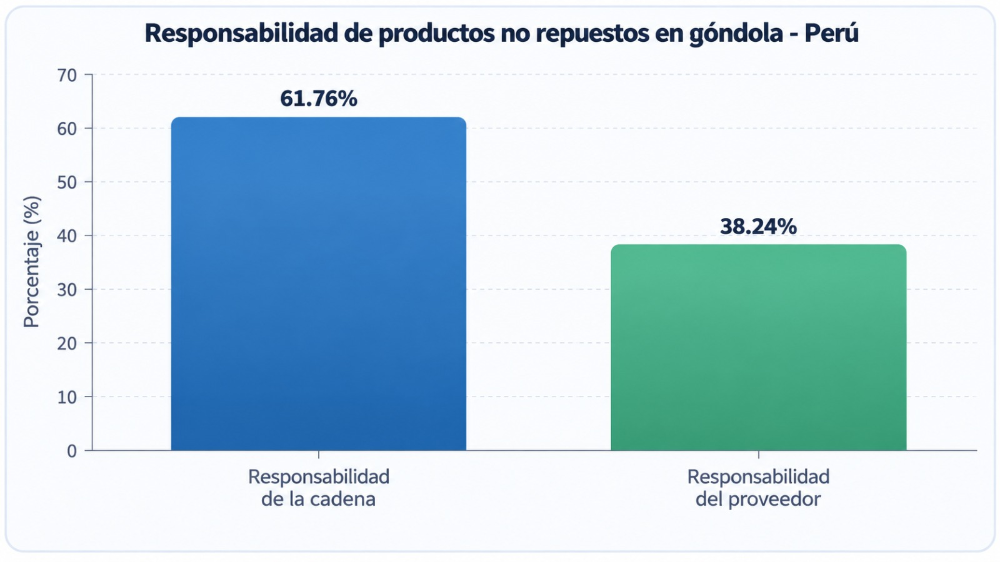

Nota. Fuente: Ñaupari et al. (2021), con datos nacionales de 2014.
Elaboración propia.

**Conclusiones a partir de la Figura 1:**

- El 61.76% de los productos no repuestos en góndola se relaciona con responsabilidades internas de la cadena, mientras que el 38.24% corresponde a responsabilidades del proveedor.
- Esto evidencia que los problemas de disponibilidad no dependen únicamente del abastecimiento externo, sino también de los procesos internos de control y reposición del establecimiento.
- Una mejor coordinación entre los comercios y sus proveedores puede contribuir a reducir los faltantes y mejorar la disponibilidad de productos.

Complementariamente, el siguiente gráfico muestra cómo la mejora de los
procesos de recepción y reposición puede incrementar la disponibilidad
de productos en góndola, evidenciando la importancia de contar con
mecanismos adecuados de control y abastecimiento.

**Figura 2**

*Evolución de la disponibilidad en góndola (OSA) después de mejorar los
procesos de recepción y reposición.*

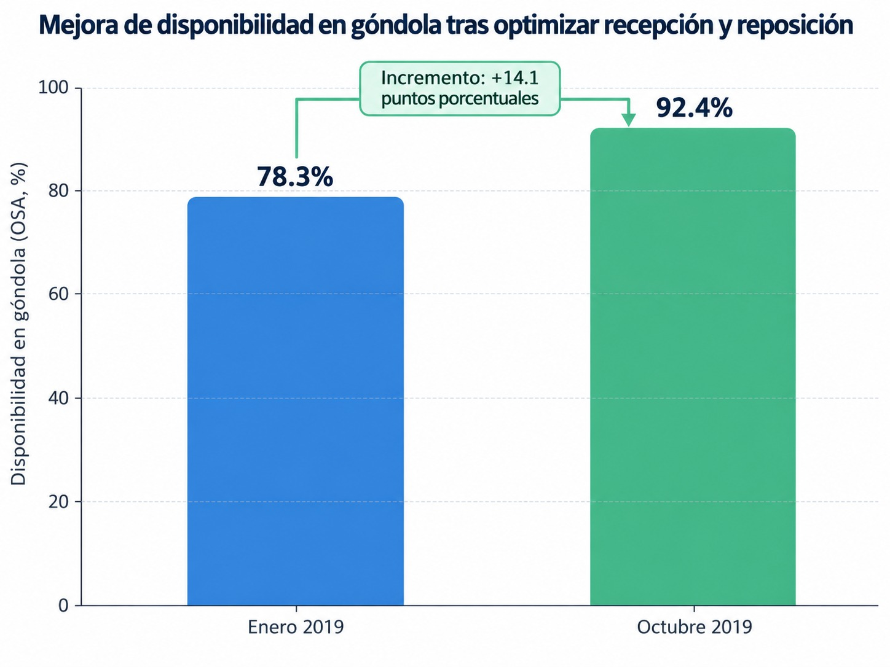

*Nota.* Fuente: Ñaupari et al. (2021). Elaboración propia.

**Conclusiones a partir de la Figura 2:**

- La disponibilidad en góndola aumentó de 78.3% en enero de 2019 a 92.4% en octubre de 2019.
- Esto representa una mejora de 14.1 puntos porcentuales en la disponibilidad de productos.
- Los resultados evidencian que mejorar los procesos de recepción, control y reposición puede reducir los problemas de falta de productos y favorecer una gestión más eficiente del inventario.

En conjunto, ambos gráficos evidencian que los problemas de
disponibilidad de productos están relacionados tanto con los procesos
internos de los establecimientos como con la participación de los
proveedores. Asimismo, se observa que una gestión adecuada de la
recepción y reposición puede mejorar significativamente la
disponibilidad en góndola. Desde una perspectiva causal, el siguiente
Diagrama de Ishikawa sintetiza las principales causas de la
problemática.

**Figura 3**

*Diagrama de Ishikawa sobre las causas de la gestión ineficiente del
inventario en bodegas y minimarkets. (2026)*

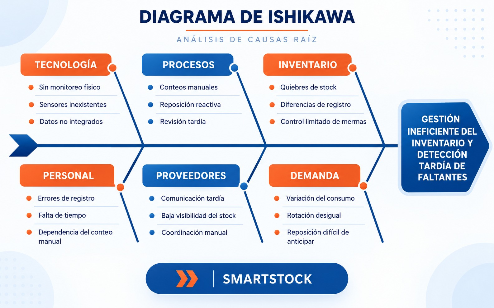

*Nota.* Elaboración propia.

**Conclusiones a partir de la Figura 3:**

- La problemática del inventario es multifactorial, ya que intervienen factores tecnológicos, operativos, humanos, de coordinación con proveedores y de comportamiento de la demanda.
- La dimensión tecnológica resulta crítica, debido a que la ausencia de monitoreo físico automatizado y de integración entre datos limita la visibilidad del inventario real.
- La coordinación con proveedores constituye un factor relevante, puesto que una detección tardía de faltantes también retrasa el proceso de reposición y afecta la disponibilidad de productos.

El flujo del problema puede describirse de la siguiente manera: durante
la operación diaria se producen ventas y salidas de productos, pero si
no existe un mecanismo de monitoreo automático del stock físico, las
diferencias entre lo registrado y lo realmente disponible pueden pasar
desapercibidas. Esto lleva a revisiones tardías, quiebres de stock y una
reposición demorada. El siguiente diagrama resume este ciclo e indica el
punto en el que SmartStock interviene.

**Figura 4**

*Diagrama de flujo sobre el ciclo de detección tardía y reposición del
inventario en bodegas y minimarkets. (2026)*

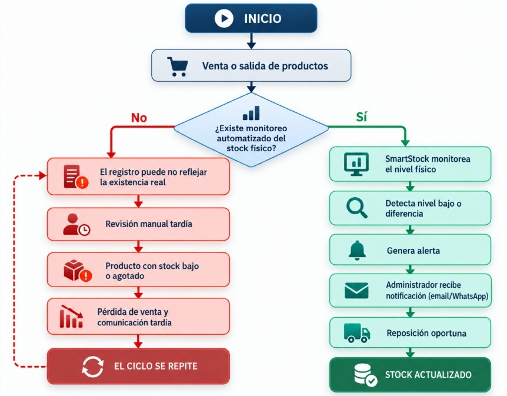

*Nota*. Elaboración propia.

**Conclusiones a partir de la Figura 4:**

- Sin un sistema de monitoreo automatizado, el negocio entra en un ciclo repetitivo de desactualización del inventario, revisión tardía y reposición reactiva.
- SmartStock actúa como punto de quiebre al detectar niveles bajos de stock o diferencias entre el inventario físico y el registrado antes de que se produzca una afectación mayor.
- La generación de alertas y la visibilidad compartida con administradores y proveedores permiten transformar un proceso reactivo en uno preventivo y mejor coordinado.

**The 5W’s and 2H’s**

1.  **What – ¿Cuál es el problema?**

El problema consiste en la dificultad de bodegas y minimarkets para
mantener actualizado el control de su inventario físico, lo que puede
generar diferencias con el stock registrado y provocar que los productos
con niveles bajos o agotados sean identificados de manera tardía.

2.  **When – ¿Cuándo ocurre?**

La problemática se presenta durante las operaciones diarias del
establecimiento, especialmente cuando se realizan ventas, recepción de
mercadería, reposiciones o movimientos frecuentes que modifican
continuamente las existencias disponibles.

3.  **Where – ¿Dónde ocurre?**

Se presenta principalmente en bodegas y minimarkets donde el control del
inventario físico depende de verificaciones manuales o de sistemas que
no están conectados directamente con las existencias reales en estantes
o zonas de almacenamiento.

4.  **Who – ¿Quiénes están involucrados?**

Los principales involucrados son los propietarios o administradores de
bodegas y minimarkets, encargados del control y reposición del
inventario, así como los proveedores responsables de abastecer los
productos comercializados por estos establecimientos.

5.  **Why – ¿Por qué ocurre?**

Ocurre debido a la dependencia de conteos manuales, errores durante el
registro de movimientos, falta de sincronización entre inventario físico
y digital, variaciones en la demanda y una comunicación que puede darse
tardíamente entre comercios y proveedores.

6.  **How – ¿Cómo se puede solucionar?**

La solución propuesta, SmartStock, plantea utilizar sensores de peso
conectados a dispositivos IoT para monitorear las existencias físicas de
determinados productos. La plataforma web procesa estos datos para
compararlos con el inventario registrado, detectar niveles bajos de
stock, generar alertas y facilitar la coordinación de reposición.

7.  **How much – ¿Cuánto impacto genera / cuánto cuesta la solución?**

La falta de un control adecuado del inventario puede generar pérdidas
por quiebres de stock, compras innecesarias, exceso de existencias y
tiempo empleado en verificaciones manuales. En cuanto a la solución, el
costo dependerá de la escala de implementación, cantidad de sensores y
alcance del servicio; sin embargo, su propósito es reducir costos
operativos y mejorar la disponibilidad de productos.

**Figura 5**

Equipo InventiaStock. The 5 W’s y 2H’s sobre la problemática de la
gestión de inventarios en bodegas y minimarkets. (2026)

*Nota*. Elaboración propia.

### 1.2.2 Lean UX Process

#### 1.2.2.1. Lean UX Problem Statements

Actualmente, la gestión de inventarios en **minimarkets y bodegas de
barrio** depende en gran medida de conteos manuales, registros
realizados por los administradores y verificaciones periódicas de los
productos disponibles. Esta forma de trabajo puede generar diferencias
entre el inventario registrado y el inventario físico, dificultando la
detección oportuna de productos con niveles bajos de stock o agotados.

Asimismo, los propietarios y administradores necesitan conocer
constantemente qué productos requieren reposición para mantener una
adecuada disponibilidad de mercadería. Sin embargo, cuando la
información del inventario no se encuentra actualizada, la
identificación de faltantes puede realizarse de manera tardía, generando
quiebres de stock, pérdida de oportunidades de venta y mayor tiempo
dedicado a verificaciones manuales.

**Propósito**

InventiaStock busca mejorar la gestión de inventarios de pequeños
comercios mediante el desarrollo de soluciones tecnológicas orientadas
al monitoreo y control de existencias. Como parte de esta propuesta, su
producto SmartStock integra una plataforma web con sensores de peso
conectados mediante tecnologías IoT, permitiendo monitorear las
existencias físicas de determinados productos, compararlas con el stock
registrado y generar alertas ante niveles bajos o diferencias de
inventario.

El propósito de SmartStock es facilitar a los propietarios y
administradores una gestión más oportuna del inventario, reducir la
dependencia de verificaciones manuales y proporcionar información que
permita mejorar la planificación de la reposición y la coordinación con
los proveedores.

**Mercado**

El mercado objetivo está conformado por propietarios y administradores
de minimarkets y bodegas de barrio que requieren mejorar el control de
sus existencias y la reposición de productos.

Dentro del mercado objetivo, los minimarkets constituyen el segmento
principal debido al mayor volumen de productos y movimientos de
inventario. Asimismo, las bodegas de barrio representan un segmento
relevante con necesidades similares de control y reposición, aunque
pueden operar a una menor escala y con procesos de gestión más simples.

**Oportunidad**

Existe una oportunidad para ofrecer una solución accesible y adaptada a
pequeños establecimientos comerciales que permita automatizar
parcialmente el monitoreo del inventario físico.

Las diferencias entre el inventario registrado y el inventario real
pueden ocasionar productos agotados, quiebres de stock, compras
innecesarias, acumulación de mercadería y pérdida de oportunidades de
venta. Además, algunas soluciones de gestión de inventarios se
concentran principalmente en registrar entradas y salidas de productos,
sin incorporar necesariamente mecanismos automáticos para conocer la
cantidad física disponible en tiempo real.

Asimismo, algunas soluciones tecnológicas existentes están orientadas a
operaciones de retail de mayor escala, lo que puede dificultar su
adopción en pequeños establecimientos debido a su complejidad o costos
de implementación. Frente a ello, SmartStock representa una oportunidad
para atender este segmento mediante una solución basada en IoT que
facilite el monitoreo del stock físico y apoye la toma de decisiones de
abastecimiento.

Consideraremos que la solución es exitosa cuando los usuarios de ambos
segmentos puedan detectar con mayor rapidez productos con bajo stock,
identificar diferencias entre el inventario físico y el registrado,
reducir el tiempo dedicado a verificaciones manuales y mejorar la
planificación de la reposición de productos.

**De acuerdo con lo anterior, planteamos el siguiente Problem
Statement:**

¿De qué manera podríamos mejorar la gestión de inventarios en minimarkets y bodegas de barrio para que sus propietarios y administradores puedan conocer oportunamente los niveles reales de stock, detectar faltantes y diferencias de inventario, y gestionar la reposición de productos mediante una solución automatizada basada en tecnologías IoT?

#### 1.2.2.2. Lean UX Assumptions

Para abordar la problemática relacionada con la gestión de inventarios
en minimarkets y bodegas de barrio, se han definido una serie de
supuestos que orientan el desarrollo y validación de SmartStock,
producto desarrollado por InventiaStock. Estos supuestos consideran las
necesidades de los segmentos objetivo, los resultados esperados del
negocio, los beneficios para los usuarios, las funcionalidades
propuestas y los criterios que permitirán evaluar posteriormente si la
solución responde adecuadamente al problema identificado.

**Business Assumptions**

- Creemos que los minimarkets necesitan mejorar el control de su inventario físico debido al volumen de productos y movimientos que gestionan diariamente.
- Suponemos que los propietarios y administradores de minimarkets valorarán una solución que reduzca el tiempo dedicado a conteos y verificaciones manuales.
- Creemos que las bodegas de barrio también presentan dificultades para mantener actualizado su inventario y requieren una solución sencilla y de bajo esfuerzo operativo.
- Suponemos que los minimarkets constituirán inicialmente el segmento principal de SmartStock debido a su mayor volumen de operaciones y necesidad de control continuo del inventario.
- Creemos que las bodegas de barrio representan también un segmento relevante, aunque pueden presentar una mayor sensibilidad al costo de adopción y una menor escala operativa.
- Suponemos que un modelo de suscripción escalable, acompañado de una implementación gradual de sensores, puede adaptarse a las posibilidades de ambos segmentos.
- Creemos que los usuarios estarán dispuestos a adoptar SmartStock si perciben una reducción en el esfuerzo requerido para controlar el inventario y organizar la reposición de productos.

**Business Outcome Assumptions**

- Creemos que SmartStock permitirá reducir las diferencias entre el inventario físico y el inventario registrado.
- Suponemos que las alertas de stock bajo permitirán disminuir los casos en los que un producto se agota sin ser detectado oportunamente.
- Creemos que la plataforma permitirá reducir el tiempo destinado a verificaciones manuales del inventario.
- Suponemos que la información generada por SmartStock facilitará una reposición más oportuna de productos.
- Creemos que una interfaz sencilla favorecerá la adopción de SmartStock por parte de propietarios y administradores de minimarkets y bodegas de barrio.
- Suponemos que una propuesta escalable permitirá implementar inicialmente la solución en minimarkets y ampliar posteriormente su adopción en bodegas de barrio.
- Creemos que una mejor disponibilidad de información sobre el inventario puede contribuir a reducir compras innecesarias y mejorar la planificación del abastecimiento.

**User Assumptions**

- Creemos que uno de los principales grupos de usuarios estará conformado por propietarios y administradores de minimarkets responsables del control de inventario y la reposición.
- Suponemos que otro grupo importante estará conformado por propietarios y administradores de bodegas de barrio que realizan directamente el control de sus productos.
- Creemos que los responsables de minimarkets necesitan visualizar rápidamente el estado de un inventario con una mayor cantidad de productos y movimientos.
- Suponemos que los responsables de bodegas de barrio necesitan una solución simple, fácil de aprender y que no incremente significativamente su carga operativa.
- Creemos que ambos grupos necesitan información clara y actualizada para identificar productos con bajo stock y posibles diferencias de inventario.
- Suponemos que los usuarios pueden presentar distintos niveles de experiencia tecnológica, por lo que la plataforma debe ser intuitiva, accesible y fácil de utilizar.
- Creemos que los usuarios valorarán especialmente las funcionalidades que les permitan anticipar necesidades de reposición y reducir verificaciones manuales.

**User Outcome and Benefit Assumptions**

- Creemos que los responsables de minimarkets podrán identificar con mayor rapidez los productos que requieren reposición.
- Suponemos que los responsables de bodegas de barrio podrán reducir el tiempo empleado en conteos y verificaciones manuales.
- Creemos que ambos segmentos podrán detectar con mayor facilidad diferencias entre las existencias físicas y las registradas.
- Suponemos que los usuarios podrán tomar decisiones de reposición utilizando información más actualizada.
- Creemos que las alertas permitirán anticipar faltantes antes de que determinados productos se agoten.
- Suponemos que los reportes y la información histórica ayudarán a comprender mejor la rotación y el comportamiento del inventario.
- Creemos que los usuarios tendrán una mejor visión del estado general de sus existencias mediante un dashboard centralizado.
- Suponemos que una mejor visualización de la información facilitará la coordinación de las necesidades de abastecimiento con los proveedores.

**Feature Assumptions**

- Creemos que el monitoreo mediante sensores de peso IoT permitirá obtener información sobre las existencias físicas de determinados productos.
- Creemos que la comparación automática entre el stock físico y el stock registrado permitirá identificar diferencias de inventario.
- Creemos que las alertas automáticas de stock bajo ayudarán a detectar oportunamente necesidades de reposición.
- Suponemos que la configuración de niveles mínimos de stock permitirá adaptar las alertas a las necesidades de cada establecimiento.
- Creemos que un dashboard de inventario facilitará la visualización del estado general de los productos.
- Suponemos que el historial de alertas, movimientos y reportes de rotación permitirá realizar un mejor seguimiento del inventario.
- Creemos que una función de gestión de reposición permitirá registrar necesidades de abastecimiento y facilitar la coordinación posterior con los proveedores.
- Suponemos que las notificaciones automáticas por correo electrónico o WhatsApp, mediante servicios externos, permitirán informar oportunamente sobre productos que requieran atención.
- Creemos que la posibilidad de editar información de los productos y sus niveles mínimos permitirá mantener actualizado el catálogo y adaptar el sistema a las necesidades de cada negocio.

**Objetivos de Validación**

A partir de los supuestos planteados, se establecen los siguientes
objetivos de validación para SmartStock:

- Determinar si los usuarios comprenden con facilidad la información presentada sobre el estado de su inventario.
- Evaluar si los usuarios pueden identificar productos con bajo stock de manera rápida y sencilla.
- Comprobar si la comparación entre el inventario físico y el inventario registrado facilita la identificación de diferencias.
- Evaluar si las alertas permiten reconocer oportunamente necesidades de reposición.
- Determinar si los usuarios pueden configurar correctamente niveles mínimos de stock.
- Evaluar si el dashboard y el historial permiten realizar un seguimiento adecuado del inventario.
- Identificar si SmartStock contribuye a reducir el tiempo dedicado a verificaciones manuales.
- Evaluar la facilidad de uso y comprensión de las principales funcionalidades de la plataforma.
- Obtener evidencia que permita validar o rechazar los principales supuestos de negocio, usuario y funcionalidades.

**Métricas**

Para evaluar los supuestos y objetivos planteados se considerarán las
siguientes métricas:

- Porcentaje de usuarios que logran identificar correctamente productos con bajo stock.
- Tiempo promedio requerido para localizar un producto que necesita reposición.
- Porcentaje de diferencias detectadas correctamente entre el inventario físico y el inventario registrado.
- Tiempo promedio dedicado a verificaciones manuales antes y después del uso de SmartStock.
- Número de alertas de stock bajo generadas y atendidas oportunamente.
- Porcentaje de usuarios que logran configurar correctamente un nivel mínimo de stock.
- Porcentaje de usuarios que completan las principales tareas de gestión de inventario sin asistencia.
- Número de errores cometidos durante la ejecución de tareas principales.
- Nivel de satisfacción de los usuarios respecto a la facilidad de uso de la plataforma.
- Porcentaje de usuarios que consideran útil la información mostrada en el dashboard.
- Frecuencia de consulta del historial de movimientos, alertas o reportes.
- Porcentaje de usuarios que manifiestan que SmartStock facilita la planificación de la reposición.

**Definition of Done (DoD)**

Los supuestos planteados se considerarán suficientemente validados
cuando se obtenga evidencia de que SmartStock permite a los usuarios
objetivo realizar las principales actividades de gestión de inventario
de manera comprensible y funcional.

Para este propósito, se considerará como Definition of Done el
cumplimiento de los siguientes criterios:

- Los propietarios y administradores pueden visualizar el estado actual de los productos registrados en la plataforma.
- El sistema permite registrar, consultar y actualizar la información principal de los productos.
- Los usuarios pueden configurar niveles mínimos de stock.
- El sistema permite visualizar información relacionada con las existencias físicas de los productos monitoreados.
- La plataforma permite comparar el stock físico con el stock registrado.
- El sistema genera alertas cuando se detectan niveles bajos de stock de acuerdo con los valores configurados.
- Los usuarios pueden identificar qué productos requieren reposición a partir de la información mostrada en SmartStock.
- El dashboard presenta información comprensible sobre el estado general del inventario.
- Los usuarios pueden consultar información histórica relacionada con movimientos, alertas o comportamiento del inventario.
- Las principales funcionalidades pueden ser utilizadas por los usuarios objetivo sin requerir conocimientos técnicos especializados.
- Las pruebas realizadas con usuarios permiten recopilar evidencia suficiente para validar o rechazar los principales supuestos de negocio, usuario y funcionalidades.

#### 1.2.2.3. Lean UX Hypothesis Statements 

De acuerdo con los supuestos definidos previamente, se plantean las
siguientes hipótesis con el propósito de validar si las funcionalidades
propuestas de SmartStock, producto desarrollado por InventiaStock,
generan beneficios para los propietarios y administradores de
minimarkets y bodegas de barrio.

Las hipótesis han sido formuladas tomando como referencia los Business
Assumptions, User Assumptions, User Outcome and Benefit Assumptions y
Feature Assumptions definidos previamente. Para su formulación se
utilizará el siguiente template de Lean UX:

Creemos que [resultado esperado] para [usuario o segmento] se
logrará mediante [funcionalidad o solución]. Sabremos que nuestra
hipótesis es válida cuando [resultado medible].

A continuación, se plantean los Hypothesis Statements correspondientes a
las principales funcionalidades y resultados esperados de SmartStock.

**Hipótesis de negocio**

1.  **Monitoreo del inventario físico mediante sensores IoT**

Creemos que reducir las diferencias entre el inventario físico y el inventario registrado para los propietarios y administradores de minimarkets y bodegas de barrio se logrará mediante el monitoreo de determinados productos utilizando sensores de peso conectados mediante tecnologías IoT.

Sabremos que nuestra hipótesis es válida cuando al menos el 80 % de los productos monitoreados presente información consistente entre las existencias físicas detectadas por los sensores y las registradas en la plataforma durante las pruebas de validación.

2.  **Comparación entre stock físico y stock registrado**

Creemos que identificar con mayor rapidez las diferencias de inventario para los propietarios y administradores se logrará mediante una funcionalidad que permita comparar la información del stock físico con el stock registrado en SmartStock.

Sabremos que nuestra hipótesis es válida cuando al menos el 75 % de los usuarios logre identificar correctamente una diferencia de inventario mediante la plataforma sin necesidad de realizar previamente un conteo manual completo.

3.  **Alertas automáticas de stock bajo**

Creemos que anticipar las necesidades de reposición antes de que un producto se agote para los propietarios y administradores se logrará mediante alertas automáticas de stock bajo.

Sabremos que nuestra hipótesis es válida cuando al menos el 80 % de los usuarios considere que las alertas le permiten identificar oportunamente productos que requieren reposición antes de alcanzar un nivel de agotamiento.

4.  **Configuración de niveles mínimos de stock**

Creemos que mejorar la planificación preventiva de la reposición para los propietarios y administradores se logrará permitiendo configurar niveles mínimos de stock de acuerdo con las necesidades de cada establecimiento.

Sabremos que nuestra hipótesis es válida cuando al menos el 75 % de los usuarios logre configurar correctamente los niveles mínimos de sus productos y utilizar las alertas asociadas para determinar cuáles requieren reposición.

5.  **Gestión de necesidades de reposición**

Creemos que organizar de manera más eficiente las necesidades de abastecimiento para los propietarios y administradores se logrará mediante una funcionalidad que permita registrar, consultar y dar seguimiento a las necesidades de reposición.

Sabremos que nuestra hipótesis es válida cuando al menos el 75 % de los usuarios logre identificar un producto que requiere reposición, registrar la necesidad de abastecimiento y consultar posteriormente su estado dentro de SmartStock.

**Hipótesis de usuario**

1.  **Dashboard de inventario**

Creemos que consultar con mayor rapidez el estado general del inventario para los propietarios y administradores de minimarkets y bodegas de barrio se logrará mediante un dashboard que presente información clara sobre los productos registrados.

Sabremos que nuestra hipótesis es válida cuando al menos el 85 % de los usuarios logre identificar correctamente productos con stock suficiente, stock bajo o agotado desde el dashboard sin requerir asistencia.

2.  **Historial de movimientos, alertas y reportes**

Creemos que comprender mejor el comportamiento del inventario y apoyar la toma de decisiones de reposición para los propietarios y administradores se logrará mediante el acceso a información histórica de movimientos, alertas y reportes.

Sabremos que nuestra hipótesis es válida cuando al menos el 70 % de los usuarios considere que la información histórica presentada por SmartStock resulta útil para analizar el comportamiento de sus productos y planificar su abastecimiento.

3.  **Notificaciones automáticas**

Creemos que informar oportunamente sobre eventos relevantes del inventario para los propietarios y administradores se logrará mediante notificaciones automáticas enviadas por correo electrónico o WhatsApp utilizando servicios externos.

Sabremos que nuestra hipótesis es válida cuando al menos el 75 % de los usuarios identifique correctamente una alerta recibida, comprenda el motivo de la notificación y determine la acción correspondiente sin necesidad de ingresar previamente al sistema para detectar el problema.

4.  **Gestión y actualización de productos**

Creemos que mantener información confiable y actualizada del catálogo para los propietarios y administradores se logrará mediante funcionalidades que permitan registrar y editar la información de los productos y sus parámetros de inventario.

Sabremos que nuestra hipótesis es válida cuando al menos el 80 % de los usuarios logre registrar o modificar correctamente la información de un producto, incluyendo sus datos principales y nivel mínimo de stock, sin requerir asistencia.

**Criterio general de validación**

Las hipótesis serán evaluadas mediante pruebas con usuarios
pertenecientes a los segmentos objetivo, considerando las métricas
definidas previamente para SmartStock. Los resultados permitirán
determinar qué supuestos pueden considerarse validados, cuáles requieren
ajustes y qué funcionalidades deben ser mejoradas antes de continuar con
las siguientes etapas de desarrollo del producto.

#### 1.2.2.4. Lean UX Canvas 

**Figura 6**

*Lean UX Canvas de SmartStock*

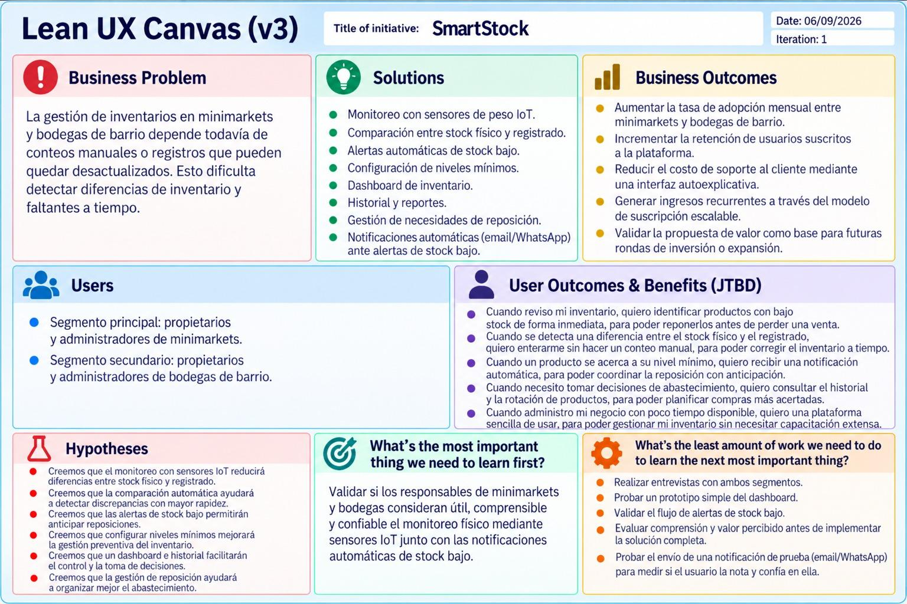

*Nota*. Elaboración propia

## 1.3. Segmentos objetivo

- **Propietarios y administradores de minimarkets**

Son personas responsables de gestionar las operaciones diarias de
minimarkets, incluyendo el control del inventario, revisión de
existencias, reposición de productos y coordinación del abastecimiento.
Debido al mayor volumen de productos y movimientos que suelen manejar
estos establecimientos, necesitan identificar con rapidez diferencias
entre el stock registrado y las existencias físicas.

Para el proyecto, este segmento se prioriza como principal por su
volumen de operación y por una mayor capacidad de pago mensual esperada
para adoptar una solución tecnológica de monitoreo de inventario. Buscan
contar con información actualizada que facilite la reposición, reduzca
los quiebres de stock y disminuya el tiempo dedicado a verificaciones
manuales.

Los hallazgos obtenidos durante las entrevistas muestran que este
segmento presenta preocupación por las diferencias entre el stock
registrado y las cantidades disponibles físicamente, especialmente en
productos de alta rotación. Asimismo, las revisiones y conteos manuales
representan una fuente de esfuerzo y posibles errores. Por ello, valoran
una solución sencilla, clara y organizada que les permita conocer
rápidamente las unidades disponibles, identificar productos próximos a
agotarse y recibir alertas cuando se alcance un nivel mínimo de stock.

Como contexto empresarial, PRODUCE reporta que en 2024 existían 2 331
173 Mipyme formales en el Perú, equivalentes al 99,3 % de las empresas
formales operativas. Este dato permite dimensionar la importancia de las
micro y pequeñas empresas dentro de la actividad empresarial nacional.

Fuente: Ministerio de la Producción (2025). *Las Mipyme en cifras 2024*.
<a href="https://www.producempresarial.pe/las-mipyme-en-cifras-2024/" style="color:#2563eb">https://www.producempresarial.pe/las-mipyme-en-cifras-2024/</a>

- **Propietarios y administradores de bodegas de barrio**

Son personas responsables de gestionar las operaciones diarias de
bodegas de barrio, incluyendo el control de productos, revisión de
existencias y reposición. Este segmento se considera secundario debido a
que, aunque representa un mercado amplio para la solución, se espera una
menor capacidad de pago mensual y una mayor sensibilidad al costo de
implementación.

En muchos casos, el control de inventario depende de conteos manuales,
inspecciones visuales, cuadernos o registros simples, lo que puede
generar diferencias entre el stock registrado y el real y dificultar la
identificación oportuna de productos agotados o próximos a agotarse.

Los resultados obtenidos durante las entrevistas muestran que los
responsables de bodegas de barrio necesitan conocer rápidamente qué
productos están disponibles, cuáles presentan niveles bajos de stock y
cuáles requieren reabastecimiento. Asimismo, prefieren una herramienta
sencilla, rápida y fácil de aprender que permita reducir el tiempo
empleado en revisiones manuales y evitar pérdidas ocasionadas por la
falta de productos de alta demanda.

Este segmento también valora la posibilidad de recibir alertas
automáticas cuando un producto se encuentra próximo a agotarse y
considera importante que la solución mantenga un costo accesible acorde
con las características y escala de una pequeña bodega.

Como contexto del sector comercial, el INEI señala que en Lima
Metropolitana y Callao, durante el cuarto trimestre de 2024, el 42,6 %
de las nuevas empresas registradas correspondió a comercio y reparación
de vehículos, lo que evidencia la relevancia de las actividades
comerciales dentro de la dinámica empresarial.

Fuente: <a href="https://www.gob.pe/institucion/inei/informes-publicaciones/6550169-demografia-empresarial-en-el-peru-iv-trimestre-2024" style="color:#2563eb">https://www.gob.pe/institucion/inei/informes-publicaciones/6550169-demografia-empresarial-en-el-peru-iv-trimestre-2024</a>

**Relación con los User Personas**

A partir de estos dos segmentos objetivo se desarrollaron los User
Personas del proyecto, utilizando como base los hallazgos obtenidos
durante las entrevistas a propietarios y administradores de minimarkets
y bodegas de barrio.

Estos perfiles permiten representar de manera más concreta sus
necesidades, frustraciones, comportamientos, expectativas y nivel de
familiaridad con herramientas tecnológicas. Asimismo, sirven como base
para la elaboración de los User Journey Maps, User Task Matrix, Empathy
Maps y demás artefactos de Needfinding.

De esta manera, las decisiones de diseño y desarrollo de SmartStock
buscan mantenerse alineadas con las características reales de ambos
segmentos, priorizando una experiencia de uso sencilla, información
clara sobre el inventario, alertas oportunas y mecanismos que faciliten
la planificación de la reposición.

# **Capítulo II: Requirements Elicitation & Analysis** 

## 

## 2.1. Competidores 

- **FacilVenta:**

FacilVenta es una solución orientada a la gestión comercial y al control
de operaciones de pequeños y medianos negocios. Su propuesta incluye
funcionalidades relacionadas con ventas, productos, clientes e
inventario, permitiendo centralizar información básica del
establecimiento y facilitar el seguimiento de las operaciones diarias.
Frente a SmartStock, FacilVenta se enfoca principalmente en la gestión
administrativa y comercial, mientras que SmartStock incorpora monitoreo
físico del inventario mediante sensores IoT, alertas de stock y
funcionalidades orientadas a mejorar la reposición de productos.

- **Adiasoft:**

Adiasoft ofrece soluciones de software para la administración de
negocios, incluyendo funcionalidades vinculadas con ventas, inventario,
facturación y control de productos. Su plataforma busca mejorar la
organización de la información comercial y facilitar el registro de
operaciones dentro del establecimiento. A diferencia de SmartStock,
Adiasoft se orienta principalmente al control administrativo del
inventario, mientras que SmartStock propone complementar el registro
digital con información proveniente del stock físico mediante sensores
de peso IoT y alertas automáticas. .

- **PACAY:**

PACAY es una solución tecnológica orientada a la gestión de negocios y
al control de procesos comerciales e inventario. Sus funcionalidades
permiten registrar productos, operaciones y movimientos relacionados con
la actividad del establecimiento, ofreciendo herramientas para organizar
y consultar información del negocio. En comparación con SmartStock,
PACAY se concentra en la gestión digital de las operaciones, mientras
que SmartStock busca diferenciarse mediante la integración con sensores
IoT, la comparación entre stock físico y registrado, y la generación de
alertas para apoyar decisiones de reposición.

A partir del análisis de estas soluciones, se observa que los
competidores ofrecen funcionalidades relevantes para la gestión
comercial y el control de inventarios. Sin embargo, SmartStock busca
diferenciarse mediante la integración del monitoreo físico del stock con
sensores IoT, la detección de diferencias entre inventario físico y
registrado, la generación de alertas y el apoyo a los procesos de
reposición en bodegas de barrio y minimarkets.

### 2.1.1. Análisis competitivo 

**Competitive Analysis Landscape**

*¿Por qué llevar a cabo este análisis?*

Permite identificar cómo funcionan las soluciones actuales de gestión de
inventarios, reconocer sus limitaciones y diferenciar a SmartStock
mediante el monitoreo con sensores IoT, alertas de stock y una mejor
coordinación con proveedores.

**Tabla 3**

*Logos de SmartStock y de sus competidores*

| **SmartStock**                                 | **FacilVenta**                                | **Adiasoft**                                   | **PACAY**                                      |
|------------------------------------------------|-----------------------------------------------|------------------------------------------------|------------------------------------------------|
| 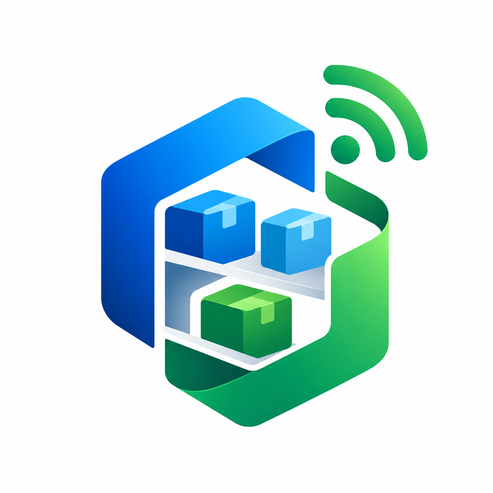     |     |      |      |

*Nota*. Elaboración propia

**Tabla 4**

*Perfil general y ventaja competitiva de SmartStock y de sus
competidores*

<table>
<tbody>
<tr class="header">
<th></th>
<th><strong>SmartStock</strong></th>
<th><strong>FacilVenta</strong></th>
<th><strong>Adiasoft</strong></th>
<th><strong>PACAY</strong></th>
</tr>
<tr class="odd">
<td>Overview</td>
<td>SmartStock es una plataforma web orientada a bodegas y minimarkets
que utiliza sensores de peso IoT para monitorear el inventario físico,
compararlo con el stock registrado y generar alertas ante faltantes o
niveles bajos. Además, incorpora funcionalidades para facilitar la
coordinación con proveedores.</td>
<td>FacilVenta es un sistema POS con facturación electrónica e
inventario orientado a bodegas, minimarkets y tiendas en Perú. Permite
gestionar ventas, compras, proveedores, stock, productos, caja y
facturación, además de trabajar con lectores de código de barras.</td>
<td>Adiasoft es un ERP orientado, entre otros sectores , a minimarkets,
bodegas y comercios retail. Integra ventas, compras, inventario, POS,
facturación, Kardex, almacenes y reportes. También contempla
integraciones opcionales con balanzas, lectores de código de barras y
cámaras.</td>
<td>PACAY es un ERP dirigido a MYPE peruanas que integra ventas,
compras, inventario, caja, bancos, contabilidad, producción y reportes
en una sola plataforma. Está orientado a emprendedores y negocios
peruanos.</td>
</tr>
<tr class="header">
<td>Ventaja competitiva ¿Qué valor ofrece a los clientes?</td>
<td>
• Monitoreo mediante sensores de peso IoT.

• Alertas de stock bajo.

• Comparación entre inventario físico y registrado.

• Gestión de reposición mediante alertas y notificaciones
automáticas

• Enfoque específico en bodegas y minimarkets.
</td>
<td>
• POS para ventas rápidas.

• Control de inventario en tiempo real.

• Compras y proveedores.

• Alertas de stock mínimo y vencimientos.

• Facturación electrónica SUNAT.

• Contabilidad con lectores de código de barras.
</td>
<td>
• Gestión integrada de ventas, compras e inventario.

• POS con código de barras.

• Stock en tiempo real.

• Reposición automática.

• Kardex valorizado.

• Predicción de demanda y reposición con IA en planes superiores.

• Integración IoT opcional con balanzas, lectores y cámaras
</td>
<td>
• Integración de ventas, compras e inventario.

• Stock en tiempo real.

• Alertas de reorden.

• Facturación electrónica SUNAT.

• Gestión de caja, bancos y contabilidad.

• Acceso desde cualquier dispositivo
</td>
</tr>
</tbody>
</table>

*Nota*. Elaboración propia

**Tabla 5**

*Perfil de marketing de SmartStock y de sus competidores*

<table>
<tbody>
<tr class="header">
<th></th>
<th><strong>SmartStock</strong></th>
<th><strong>FacilVenta</strong></th>
<th><strong>Adiasoft</strong></th>
<th><strong>PACAY</strong></th>
</tr>
<tr class="odd">
<td>Mercado Objetivo</td>
<td>Propietarios y administradores de minimarkets como segmento
principal y propietarios y administradores de bodegas de barrio como
segmento secundario. Ambos requieren mejorar el control del inventario
físico y detectar oportunamente productos con bajo stock.</td>
<td>Propietarios y administradores de bodegas, minimarkets, tiendas y
pequeños comercios en Perú que necesitan gestionar ventas, inventario,
compras y facturación</td>
<td>Propietarios y administradores de minimarkets, bodegas y comercios
retail que requieren una solución integrada para ventas, compras,
inventario y administración del negocio.</td>
<td>Emprendedores y propietarios de MYPE peruanas que buscan centralizar
ventas, compras, inventario, facturación y administración financiera en
una sola plataforma.</td>
</tr>
<tr class="header">
<td>Estrategias de Marketing</td>
<td>
• Marketing digital mediante redes sociales y contenido sobre
gestión de inventarios.

•Demostraciones del producto.

• Pruebas piloto en establecimientos.

• Alianzas con proveedores y distribuidores.

• Modelo de suscripción adaptable al tamaño del negocio.
</td>
<td>
.• Marketing digital dirigido a negocios peruanos.

• Pruebas gratuitas.

• Contenido orientado a bodegas, minimarkets y comercios.

• Prueba/demo del sistema.

• Soporte local y comunicación mediante WhatsApp.
</td>
<td>
• Marketing B2B.

• Pruebas comerciales.

• Segmentación por rubro.

• Oferta de planes según tamaño del negocio.

• Postura como ERP multirubro.

• Soporte y asesoría comercial.
</td>
<td>
• Prueba gratuita de 15 días.

• Marketing digital dirigido a emprendedores.

• Pruebas de los módulos.

• Propuesta de planes según el régimen tributario.

• Comunicación directa mediante WhatsApp y correo.
</td>
</tr>
</tbody>
</table>

*Nota*. Elaboración propia

**Tabla 6**

*Perfil de producto de SmartStock y de sus competidores*

<table>
<tbody>
<tr class="header">
<th></th>
<th><strong>SmartStock</strong></th>
<th><strong>FacilVenta</strong></th>
<th><strong>Adiasoft</strong></th>
<th><strong>PACAY</strong></th>
</tr>
<tr class="odd">
<td>Productos y Servicios</td>
<td>Plataforma web para monitorear inventarios mediante sensores de peso
IoT. Incluye niveles de stock, comparación entre inventario físico y
registrado, alertas, historial de movimientos, reportes de rotación y
mermas, y funcionalidades para gestionar la reposición y coordinar
pedidos con proveedores externos.</td>
<td>Sistema POS y de gestión para bodegas y minimarkets. Incluye ventas,
compras y proveedores, inventario, kardex, stock mínimo, control de
vencimientos, caja, facturación electrónica SUNAT y compatibilidad con
lectores de código de barras.</td>
<td>ERP para minimarkets, bodegas y retail que incluye POS, ventas,
compras, inventario, kardex, almacenes, facturación, promociones,
reportes y reposición. En planes superiores contempla predicción de
demanda, control de balanza e integración IoT opcional.</td>
<td>ERP para MYPE que incluye ventas, compras, inventario, caja, bancos,
cuentas por cobrar y pagar, contabilidad, producción, facturación SUNAT
y reportes. También ofrece POS y alertas de reorden del inventario.</td>
</tr>
<tr class="header">
<td>Precios y costos</td>
<td>SmartStock se vende por suscripción mensual por tienda, con tres
planes: Starter S/ 49 (hasta 20 productos monitoreados, alertas por
correo y panel en tiempo real), Growth S/ 129 (hasta 120 productos,
alertas por correo y WhatsApp, comparación de inventario físico contra
registrado y dashboard) y Business S/ 279 (productos ilimitados, varias
tiendas en una cuenta y acceso completo a la API). Los sensores se pagan
una sola vez.</td>
<td>
Plan Lite: S/140/mes.

Plan Pro: S/210/mes.

Plan Enterprise: S/380/mes.

Los precios incluyen IGV. El plan Pro incorpora compras y
proveedores, inventario completo, kardex valorizado y control de stock
mínimo.
</td>
<td>
Plan Elemental: desde S/150/mes.

Plan Pyme: desde S/350/mes.

Plan Corporativo: desde S/750/mes.

La integración IoT se cotiza según los equipos y operación de la
empresa.
</td>
<td>Planes publicados desde S/29/mes. Cuenta con prueba gratuita de 15
días y permite contratar módulos adicionales según las necesidades del
negocio.</td>
</tr>
<tr class="odd">
<td>Canales de distribución (Web y/o móvil)</td>
<td>
Web: plataforma principal para propietarios y administradores de
minimarkets y bodegas de barrio.

IoT: sensores instalados físicamente en los
establecimientos.
</td>
<td>
Web/POS: sistema de gestión y punto de venta.

Hardware: lectores de códigos de barras y dispositivos compatibles.
También ofrece funcionamiento offline.
</td>
<td>
Web/Cloud: plataforma ERP y POS.

Móvil: aplicación móvil disponible según plan/integración.

Hardware/IoT: balanzas, lectores de código de barras y cámaras
mediante integración opcional.
</td>
<td>Web/Cloud: plataforma ERP accesible desde dispositivos conectados a
Internet. La empresa indica acceso desde cualquier dispositivo.</td>
</tr>
</tbody>
</table>

*Nota*. Elaboración propia

**Tabla 7**

*Análisis SWOT de SmartStock y de sus competidores*

<table>
<tbody>
<tr class="header">
<th></th>
<th><strong>SmartStock</strong></th>
<th><strong>FacilVenta</strong></th>
<th><strong>Adiasoft</strong></th>
<th><strong>PACAY</strong></th>
</tr>
<tr class="odd">
<td>Fortalezas</td>
<td>
• Sensores IoT para monitorear directamente cambios en el
inventario físico.

• Enfoque específico en bodegas y minimarkets.

• Alertas automáticas de stock bajo.

• Integración entre inventario físico y digital. • Coordinación con
proveedores durante el proceso de reposición.

• Plataforma web sencilla y accesible
</td>
<td>
•Especialización en bodegas y minimarkets.

• Compras, ventas e inventario integrados.

• Modo offline.

• Alertas de stock mínimo y vencimientos.

• Facturación SUNAT integrada.

• Compatible con lectores de códigos de barras.
</td>
<td>
• Amplia integración de módulos empresariales.

• Compras, ventas e inventario.

• POS y código de barras.

• Stock en tiempo real y reposición automática.

• Integración IoT opcional.

• Multisucursal.
</td>
<td>
• Amplia cobertura administrativa.

• Ventas, compras e inventario integrados.

• Facturación SUNAT.

• Contabilidad, caja y bancos.

• Alertas de reorden.

• Orientación específica al mercado peruano.
</td>
</tr>
<tr class="header">
<td>Debilidades</td>
<td>
• Dependencia de sensores físicos.

• Necesidad de instalación y calibración adecuada.

• No todos los tipos de productos pueden monitorearse fácilmente
mediante peso.

• Menor experiencia y volumen de datos al ser una propuesta
nueva.
</td>
<td>
• El monitoreo del stock depende principalmente del registro de
operaciones comerciales.

• No se identifica un sistema propio de sensores de peso IoT para
verificar automáticamente el stock físico.

• Algunas funciones de compras y gestión avanzada requieren planes
superiores.
</td>
<td>
• La propuesta puede resultar más amplia de lo necesario para
negocios pequeños.

• Algunas funciones avanzadas requieren planes superiores.

• La integración IoT depende de equipos y una implementación
adicional.

• El costo puede aumentar según las necesidades de
implementación.
</td>
<td>
• Su alcance como ERP puede incluir funciones que no todos los
pequeños negocios necesitan.

• La propuesta está más orientada a la administración integral que al
monitoreo físico mediante sensores.

• No se identifica una funcionalidad propia equivalente al monitoreo
de peso IoT de SmartStock.
</td>
</tr>
<tr class="odd">
<td>Oportunidades</td>
<td>
• Crecimiento de la digitalización de bodegas y minimarkets.

• Mayor disponibilidad y reducción de costos de dispositivos IoT.

• Necesidad de mejorar el control de inventarios en pequeños
negocios.

• Alianzas con distribuidores y proveedores.

• Expansión futura hacia recomendaciones automáticas y análisis
predictivo.

• Integración con nuevos tipos de sensores
</td>
<td>
• Crecimiento de la digitalización de pequeños comercios.

• Mayor adopción de facturación electrónica.

• Expansión hacia nuevos tipos de negocios.

• Incorporación de nuevas herramientas de análisis e
inventario.
</td>
<td>
• Crecimiento del comercio digital y la gestión omnicanal.

• Mayor adopción de soluciones ERP en pequeños negocios.

• Integración de nuevas tecnologías IoT e IA.

• Expansión hacia nuevos mercados y sectores.
</td>
<td>
• Crecimiento de la digitalización de las MYPE peruanas.

• Mayor necesidad de automatización contable y tributaria.

• Expansión de módulos especializados.

• Mayor adopción de soluciones de gestión en la nube.
</td>
</tr>
<tr class="header">
<td>Amenazas</td>
<td>
• Aparición de nuevas soluciones de inventario IoT a bajo
costo.

• Competidores consolidados con mayor capacidad tecnológica y
financiera.

• Resistencia de pequeños comerciantes a invertir en dispositivos
adicionales.

• Fallos o deterioro de sensores.

• Rápida evolución de tecnologías de visión artificial que podrían
ofrecer alternativas sin sensores de peso.
</td>
<td>
• Aparición de soluciones gratuitas o de menor costo.

• Evolución de tecnologías de automatización e IoT.

• Cambios en las necesidades de pequeños comercios.
</td>
<td>
• Competencia de otros ERP y plataformas especializadas.

• Rápida evolución de soluciones de IA e IoT.

• Costos de implementación para empresas pequeñas.

• Aparición de soluciones más simples y económicas.
</td>
<td>
• Alta competencia entre ERP y sistemas de gestión para MYPE.

• Aparición de soluciones gratuitas o de bajo costo.

• Cambios en requisitos tributarios y tecnológicos.

• Necesidad de mantener actualizados múltiples módulos y
servicios.
</td>
</tr>
</tbody>
</table>

*Nota*. Elaboración propia

### 2.1.2. Estrategias y tácticas frente a competidores 

1.  **Gestión integrada de compras, ventas e inventario como núcleo de la solución:** Smartstock tendrá como núcleo la gestión de las operaciones que generan el movimiento del stock: compras y ventas. Las compras permitirán incrementar las existencias registradas, mientras las ventas disminuirán el stock disponible. De esta manera, el sistema mantendrá un sistema actualizado.

Esta información se puede observar en soluciones como FácilVenta, Adiasoft Y PACAY, que integran módulos de ventas, compras e inventario dentro de sus plataformas.

SmartStock completará este núcleo con las siguientes caracteristicas:

- Registro y seguimiento de compras.

- Registro de ventas y actualización automática del stock.

- Integración posterior con información obtenida mediante sensores IoT.

- Consulta del stock registrado en tiempo real.

De esta manera, la solución no se limita al monitoreo físico de productos, sino que aparte de la gestión que origina el movimiento del stock y posteriormente incorpora el monitoreo físico mediante IoT.

2.  **Diferenciación mediante sensores IoT y comparación del inventario físico:** Aunque las soluciones analizadas ofrecen funcionalidades de gestión de ventas, compras e inventario, SmartStock busca diferenciarse mediante el monitoreo físico del inventario utilizando sensores de peso IoT.

Los sensores estarán instalados en espacios destinados al almacenamiento o exhibición de determinados productos y permitirán obtener información sobre las existencias físicas. Esta información podrá compararse con el stock registrado en la plataforma.

SmartStock permitirá:

- Monitorear las existencias físicas mediante sensores de peso.

- Obtener información del inventario físico.

- Comparar el stock físico con el stock registrado.

- Detectar posibles diferencias o faltantes.

- Generar alertas cuando se identifiquen niveles críticos.

Así, el IoT funcionará como una capa complementaria al sistema de compras, ventas e inventario, permitiendo contrastar lo que el sistema registra con lo que realmente existe físicamente en el negocio.

3.  **Solución accesible y escalable para pequeños comercios:** Smartstock estará orientado principalmente a bodegas y minimarkets, considerando que estos negocios requieren controlar sus compras ventas e inventario sin incorporar procesos tecnológicos excesivamente complejos.

La estrategia consiste en permitir una implementación progresiva de la
solución:

- Inicio con una cantidad limitada de productos y sensores

- Incorporación gradual de nuevos sensores IoT.

- Ampliación de números de productos monitoreados.

- Adaptación de la solución al tamaño del establecimiento.

- Crecimiento progresivo de las funcionalidades utilizadas.

Este enfoque busca facilitar la adopción de SmartStock por pequeños comercios, manteniendo como base las operaciones de compras, ventas e inventario y permitiendo incorporar capacidades IoT conforme me aumenten las necesidades del negocio.

4.  **Experiencia de usuario centrada en información inmediata:** La plataforma busca facilitar la toma de decisiones mediante una interfaz web sencilla e intuitiva que permita consultar rápidamente:

- Productos con stock suficiente, bajo o agotado.

- Alertas pendientes de reposición.

- Diferencias entre el inventario físico y el registrado.

- Estado de los dispositivos IoT.

- Información relevante según el tipo de usuario.

De esta manera, los propietarios y administradores de minimarkets y bodegas de barrio podrán acceder a la información necesaria sin realizar procesos complejos de consulta.

5.  **Gestión preventiva del inventario mediante alertas**: SmartStock busca reemplazar un modelo reactivo de reposición por uno preventivo mediante la detección anticipada de niveles bajos de inventario. El sistema permitirá:

- Configurar niveles mínimos de stock por producto.

- Generar alertas cuando las existencias alcancen dichos niveles.

- Identificar diferencias entre el inventario registrado y el físico.

- Anticipar necesidades de reposición antes de que un producto se agote.

Este enfoque puede contribuir a reducir quiebres de stock y mejorar la disponibilidad de productos en bodegas y minimarkets.

6.  **Analítica de inventario y apoyo a la toma de decisiones**: SmartStock incorporará información histórica que permita a los administradores analizar el comportamiento de sus productos mediante:

- Reportes de rotación de productos.

- Registro de mermas.

- Historial de alertas y movimientos.

- Identificación de productos con mayor necesidad de reposición.

- Seguimiento del comportamiento del inventario.

Esta información permitirá complementar el monitoreo en tiempo real con datos que apoyen la planificación del abastecimiento y la toma de decisiones.

En precio, el plan de entrada de SmartStock, Starter (S/ 49 al mes),
queda por debajo de los planes iniciales de los sistemas POS y ERP para
minimarkets analizados (S/ 140 y S/ 150 al mes), cuya integración con
sensores es opcional y se cotiza aparte. Solo el ERP general para MYPE
tiene un plan inicial menor (desde S/ 29 al mes), pero no ofrece
monitoreo con sensores ni comparación del stock físico con el
registrado. Los sensores de SmartStock se pagan una sola vez, por lo que
el costo mensual recurrente se mantiene bajo. La ventaja de precio se
orienta por segmento: Starter para bodegas de barrio, que necesitan un
control simple de pocos productos; y Growth (S/ 129) para minimarkets,
que requieren alertas por WhatsApp y comparación de inventario físico
contra registrado, a un precio menor que los planes intermedios de los
competidores (S/ 210 y S/ 350).

## 

## 2.2. Entrevistas 

### 

### 2.2.1. Diseño de entrevistas 

Las guías de entrevista para ambos segmentos combinan preguntas
demográficas con preguntas sobre gestión del inventario y comportamiento
del negocio, orientadas a sustentar la construcción de los User Persona.

**Primer Segmento Objetivo (Propietarios y administradores de
minimarkets)**

**Preguntas demográficas**

1.  ¿Cuál es su nombre completo?

2.  ¿Qué edad tiene?

3.  ¿En qué distrito reside?

4.  ¿Cuál es su estado civil?

5.  ¿A qué se dedica usted (ocupación) y qué rol cumple en el negocio (dueño, administrador, etc.)?

6.  ¿Hace cuánto tiempo tiene o administra el negocio?

7.  ¿Qué dispositivo usa con más frecuencia para temas del negocio (celular, laptop, computadora de escritorio)?

8.  ¿Qué aplicaciones o redes sociales usa habitualmente?

**Preguntas sobre gestión del inventario / comportamiento del negocio**

9.  ¿Cómo realiza actualmente el control del inventario de los productos de su minimarket?

10. ¿Con qué frecuencia revisa físicamente las existencias disponibles?

11. ¿Qué dificultades encuentra al mantener actualizado el inventario?

12. ¿Con qué frecuencia encuentra diferencias entre el stock registrado y la cantidad física disponible?

13. ¿Qué problemas se presentan cuando un producto se agota sin ser detectado a tiempo?

14. ¿Cómo determina cuándo debe realizar una reposición de productos?

15. ¿Qué productos o categorías son más difíciles de controlar por su rotación?

16. ¿Cómo se comunica actualmente con sus proveedores para solicitar reposiciones?

17. ¿Qué herramientas o sistemas utiliza actualmente para gestionar el inventario?

18. ¿Qué limitaciones encuentra en esas herramientas o métodos?

19. ¿Qué información considera más importante visualizar al revisar el inventario?

20. ¿Qué tipo de alertas le resultarían útiles para detectar productos con bajo stock?

21. ¿Qué importancia tendría para usted saber en todo momento si existen diferencias entre lo que su sistema registra y lo que realmente tiene en tienda?

22. ¿Qué le gustaría que una herramienta de inventario le resuelva o facilite, sin importar la tecnología que use?

23. ¿Qué haría que usted decida invertir en una nueva herramienta para gestionar su negocio?

**Segundo Segmento Objetivo (Propietarios y administradores de bodegas
de barrio)**

**Preguntas demográficas**

1.  ¿Cuál es su nombre completo?

2.  ¿Qué edad tiene?

3.  ¿En qué distrito reside?

4.  ¿Cuál es su estado civil?

5.  ¿A qué se dedica y qué rol cumple en la bodega?

6.  ¿Hace cuánto tiempo tiene o administra la bodega?

7.  ¿Atiende sola/o o con apoyo? Más o menos, ¿cuántos productos tiene?

8.  ¿Qué hace con el celular en su bodega?

**Preguntas sobre gestión del inventario / comportamiento del negocio**

9.  ¿Cómo controla actualmente los productos disponibles en su bodega?

10. ¿Utiliza cuaderno, Excel, sistema digital u otro método para registrar su inventario?

11. ¿Con qué frecuencia realiza conteos o revisiones manuales de sus productos?

12. ¿Qué dificultades tiene para saber qué productos están por agotarse?

13. ¿Le ha ocurrido que el stock registrado no coincida con la cantidad real disponible? ¿Con qué frecuencia?

14. ¿Qué problemas genera en su negocio quedarse sin un producto de alta demanda?

15. ¿Cómo decide qué productos debe reponer y en qué momento?

16. ¿Cómo realiza actualmente sus pedidos a proveedores?

17. ¿Qué parte del control de inventario le toma más tiempo o le resulta más complicada?

18. ¿Qué tan cómodo se siente utilizando aplicaciones o plataformas web para gestionar su negocio?

19. ¿Qué información le gustaría ver en una pantalla para conocer rápidamente el estado de sus productos?

20. ¿Qué tipo de alerta le sería útil cuando un producto está por agotarse?

21. ¿Qué tan importante sería para usted enterarse automáticamente cuando un producto está por agotarse, sin tener que revisarlo usted mismo?

22. ¿Qué beneficio tendría que ofrecer una herramienta de inventario para que usted la use de manera frecuente?

23. ¿Qué haría que usted decida invertir en una nueva herramienta para gestionar su negocio?

### 2.2.2. Registro de entrevistas

**Needfinding Interviews Link:**
<a href="https://upcedupe-my.sharepoint.com/%3Av%3A/g/personal/u20241f205_upc_edu_pe/IQA4IrqakYdsTrXGXwgxBfpMAeXZO4Qjy8iYst_cz5SgEwQ?nav=eyJyZWZlcnJhbEluZm8iOnsicmVmZXJyYWxBcHAiOiJTdHJlYW1XZWJBcHAiLCJyZWZlcnJhbFZpZXciOiJTaGFyZURpYWxvZy1MaW5rIiwicmVmZXJyYWxBcHBQbGF0Zm9ybSI6IldlYiIsInJlZmVycmFsTW9kZSI6InZpZXcifX0%3D&e=WkYEGd" style="color:#2563eb">https://upcedupe-my.sharepoint.com/%3Av%3A/g/personal/u20241f205_upc_edu_pe/IQA4IrqakYdsTrXGXwgxBfpMAeXZO4Qjy8iYst_cz5SgEwQ?nav=eyJyZWZlcnJhbEluZm8iOnsicmVmZXJyYWxBcHAiOiJTdHJlYW1XZWJBcHAiLCJyZWZlcnJhbFZpZXciOiJTaGFyZURpYWxvZy1MaW5rIiwicmVmZXJyYWxBcHBQbGF0Zm9ybSI6IldlYiIsInJlZmVycmFsTW9kZSI6InZpZXcifX0%3D&e=WkYEGd</a>

Entrevista 01: 0:06 - 17:16

Entrevista 02: 17:21 - 23:46

Entrevista 03: 23:51 - 31:07

Entrevista 04: 31:14 - 37:51

Entrevista 05: 37:58 - 43:05

Entrevista 06: 43:10 - 51:37

**Figura 7**

*Video de las entrevistas de Needfinding del Sprint 1*

*Nota.* Elaboración propia

**Primer Segmento Objetivo (Propietarios y administradores de
minimarkets)**

**Tabla 8**

*Registro de la entrevista 1 a propietarios y administradores de
minimarkets*

<table>
<tbody>
<tr><td>Screenshot:</td><td></td></tr>
<tr><td>Inicia:</td><td>00:00</td></tr>
<tr><td>Duración:</td><td>17:10</td></tr>
<tr><td>Nombre completo:</td><td>José Martín Montañez</td></tr>
<tr><td>Edad:</td><td>52 años</td></tr>
<tr><td>Distrito:</td><td>Pueblo Libre</td></tr>
<tr><td>Resumen:</td><td>José nos indica que está a cargo de la administración de un mini market desde hace aproximadamente 1 año. Utiliza principalmente el celular y la laptop, y actualmente cuenta con un sistema de inventario adaptado a las necesidades de su negocio. Realiza revisiones físicas del stock semanalmente y también de manera aleatoria durante la semana para mantener un mayor control. Entre las principales dificultades menciona posibles fallas de hardware o software, problemas logísticos y diferencias entre el stock registrado y el stock físico, las cuales dependen de la rotación de los productos y del manejo del personal. Cuando se agota un producto de alta rotación, puede afectar las ventas y generar molestias en los clientes, especialmente cuando se trata de productos que generan venta cruzada. Para decidir las reposiciones utiliza reportes del sistema sobre consumos diarios, semanales y productos de alta rotación, contrastándolos con el stock físico. Los pedidos a proveedores se realizan principalmente mediante WhatsApp y llamadas. Los productos más difíciles de controlar son los pequeños, como caramelos y chocolates, debido a que están al alcance de los clientes. Considera importante visualizar el stock y los productos de alta rotación, además de contar con alertas de bajo stock y reportes de consumos máximos y mínimos. También considera muy importante detectar diferencias entre el stock registrado y el físico para evitar compras innecesarias. Finalmente, señala que una nueva herramienta debería ser amigable, eficiente, accesible desde diferentes plataformas, permitir consultar información y reportes en cualquier momento, facilitar la comunicación con proveedores y ayudar a controlar el stock de manera eficiente.</td></tr>
</tbody>
</table>

*Nota*. Elaboración propia

**Tabla 9**

*Registro de la entrevista 2 a propietarios y administradores de
minimarkets*

<table>
<tbody>
<tr><td>Screenshot:</td><td></td></tr>
<tr><td>Inicia:</td><td>17:16</td></tr>
<tr><td>Duración:</td><td>06:25</td></tr>
<tr><td>Nombre completo:</td><td>Cristopher Benavides</td></tr>
<tr><td>Edad:</td><td>23 años</td></tr>
<tr><td>Distrito:</td><td>Jesus Maria</td></tr>
<tr><td>Resumen:</td><td>Cristopher nos indica que la gestión del inventario se realiza principalmente de manera manual, mediante revisiones físicas y anotaciones, complementandose con Excel, aunque este no siempre se encuentra actualizado. Señala que las principales dificultades aparecen cuando las ventas no se registran inmediatamente o se cometen errores al anotar las cantidades, generando diferencias entre el stock registrado y el físico, especialmente en productos de alta rotación. Las bebidas, snacks y productos de consumo son los más difíciles de controlar debido a su rápida salida. Para realizar reposiciones, se comunica con sus proveedores mediante WhatsApp y llamadas, enviándoles la lista de productos necesarios. Considera útil contar con alertas cuando un producto llegue a una cantidad mínima de stock y poder detectar diferencias entre el inventario registrado y el real. Finalmente, considera importante que una nueva herramienta sea fácil de usar, ahorre tiempo, tenga un precio accesible y ayude a evitar el agotamiento de productos.</td></tr>
</tbody>
</table>

*Nota*. Elaboración propia

**Tabla 10**

*Registro de la entrevista 3 a propietarios y administradores de
minimarkets*

<table>
<tbody>
<tr><td>Screenshot:</td><td></td></tr>
<tr><td>Inicia:</td><td>23:46</td></tr>
<tr><td>Duración:</td><td>07:16</td></tr>
<tr><td>Nombre completo:</td><td>Yngrid Ruiz</td></tr>
<tr><td>Edad:</td><td>23 años</td></tr>
<tr><td>Distrito:</td><td>Pueblo Libre</td></tr>
<tr><td>Resumen:</td><td>Yngrid nos indica que es administradora de un minimarket y cuenta con aproximadamente 2 años de experiencia en el negocio. Actualmente controla el inventario comparando los productos disponibles en tienda con las ventas registradas en el sistema y realizando conteos manuales. Revisa físicamente el inventario una o dos veces por semana, dando mayor atención a los productos de mayor venta. Señala que la gran cantidad de productos y el movimiento diario pueden generar diferencias entre el inventario registrado y el físico, especialmente en productos de alta rotación. Las bebidas, snacks, productos de limpieza y alimentos básicos son los más difíciles de controlar. Para comunicarse con los proveedores utiliza principalmente WhatsApp y llamadas, mediante las cuales consulta precios, disponibilidad y realiza pedidos. Considera importante visualizar las unidades disponibles y los productos próximos a agotarse, además de recibir alertas cuando lleguen a una cantidad mínima. Finalmente, considera que una herramienta de inventario debería ayudar a ahorrar tiempo, reducir errores, detectar productos que necesitan reposición y mostrar información clara y ordenada. Estaría dispuesta a invertir si la herramienta permite reducir pérdidas, ahorrar tiempo y evitar quiebres de stock, siempre que tenga un precio razonable.</td></tr>
</tbody>
</table>

*Nota*. Elaboración propia

**Segundo Segmento Objetivo (Propietarios y administradores de bodegas
de barrio)**

**Tabla 11**

*Registro de la entrevista 1 a propietarios y administradores de bodegas
de barrio*

<table>
<tbody>
<tr><td>Screenshot:</td><td></td></tr>
<tr><td>Inicia:</td><td>31:08</td></tr>
<tr><td>Duración:</td><td>06:39</td></tr>
<tr><td>Nombre completo:</td><td>Lincoln Bruno</td></tr>
<tr><td>Edad:</td><td>49 años</td></tr>
<tr><td>Distrito:</td><td>Comas</td></tr>
<tr><td>Resumen:</td><td>Lincoln nos indica que es dueño de una bodega y cuenta con 10 años de experiencia en el negocio. Actualmente utiliza un sistema de caja, pero mantiene gran parte del control del inventario de manera manual. Los productos de mayor venta son revisados casi todos los días, mientras que los demás se revisan durante la semana. Señala que pueden existir diferencias entre el stock registrado y la cantidad real debido a errores durante las ventas o al registrar los productos. Cuando un producto de alta demanda se agota, se pueden perder ventas y afectar la atención al cliente. Los pedidos a proveedores se realizan mediante WhatsApp o llamadas. Considera que lo que más tiempo requiere es contar y verificar los productos con lo registrado, especialmente cuando existe bastante movimiento. Le gustaría visualizar el stock disponible, los productos con bajo stock y aquellos que necesitan reposición, además de recibir alertas cuando un producto esté por agotarse. Finalmente, considera importante que una nueva herramienta sea fácil de usar, tenga un precio accesible, permita ahorrar tiempo, reducir pérdidas y muestre la información de manera clara y sencilla.</td></tr>
</tbody>
</table>

*Nota*. Elaboración propia

**Tabla 12**

*Registro de la entrevista 2 a propietarios y administradores de bodegas
de barrio*

<table>
<tbody>
<tr><td>Screenshot:</td><td></td></tr>
<tr><td>Inicia:</td><td>37:52</td></tr>
<tr><td>Duración:</td><td>05:07</td></tr>
<tr><td>Nombre completo:</td><td>Marleny Araujo</td></tr>
<tr><td>Edad:</td><td>42 años</td></tr>
<tr><td>Distrito:</td><td>San Juan de Lurigancho</td></tr>
<tr><td>Resumen:</td><td>Marleny nos indica que es técnica en enfermería y dueña de una bodega, la cual administra desde hace 2 años. Actualmente utiliza principalmente su celular para temas del negocio y controla el inventario de manera manual mediante un cuaderno. Realiza revisiones mensualmente, lo que le toma bastante tiempo debido a que debe revisar los productos uno por uno. También señala que en ocasiones existen diferencias entre el stock registrado y la cantidad real, además de tener productos próximos a vencer. Para decidir qué productos reponer, considera principalmente aquellos que tienen mayor demanda. Los pedidos a proveedores los realiza mediante el celular, de manera manual o con apoyo del personal que visita el negocio. Considera que una aplicación facilitaría y haría más efectivo el control del inventario, siempre que sea didáctica, sencilla y fácil de utilizar. Le gustaría recibir alertas notorias, incluso con sonido, que indiquen cuándo un producto está por agotarse o próximo a vencer. Finalmente, considera importante que la herramienta sea automática debido a la gran cantidad de productos que maneja y que cumpla con sus expectativas.</td></tr>
</tbody>
</table>

*Nota*. Elaboración propia

**Tabla 13**

*Registro de la entrevista 3 a propietarios y administradores de bodegas
de barrio*

<table>
<tbody>
<tr><td>Screenshot:</td><td></td></tr>
<tr><td>Inicia:</td><td>43:05</td></tr>
<tr><td>Duración:</td><td>08:27</td></tr>
<tr><td>Nombre completo:</td><td>Ruth Osorio</td></tr>
<tr><td>Edad:</td><td>42 años</td></tr>
<tr><td>Distrito:</td><td>San Juan de Lurigancho</td></tr>
<tr><td>Resumen:</td><td>Ruth nos indica que es dueña de una bodega y se encarga de atender a los clientes, revisar productos y realizar pedidos a proveedores. Utiliza principalmente el celular y WhatsApp para sus actividades del negocio. Actualmente controla el inventario de manera visual y mediante un cuaderno, registrando productos faltantes, pedidos, entradas y productos fiados. Realiza revisiones prácticamente todos los días, aunque de manera gradual, y señala que a veces no detecta a tiempo cuando un producto está por agotarse. También ha tenido diferencias entre el stock registrado y la cantidad real disponible. Cuando un producto de alta demanda se agota, existe el riesgo de perder clientes, ya que pueden acudir a otra tienda. Los pedidos a proveedores los realiza mediante WhatsApp, indicando la marca y cantidad que necesita. Considera que lo más complicado es tener un registro del inventario en tiempo real. Estaría dispuesta a utilizar una aplicación siempre que sea sencilla y fácil de aprender. Le gustaría visualizar rápidamente los productos disponibles, los que tienen bajo stock, los agotados y los de mayor venta. También considera útil recibir alertas cuando queden pocas unidades para poder realizar nuevos pedidos antes de quedarse sin productos. Finalmente, considera que una herramienta de inventario debería ahorrarle tiempo, mostrar rápidamente qué productos debe reponer, ser fácil de usar y tener un precio accesible para una bodega pequeña.</td></tr>
</tbody>
</table>

*Nota*. Elaboración propia

### 

### 2.2.3. Análisis de entrevistas

**Primer Segmento Objetivo (Propietarios y administradores de
minimarkets)**

En este segmento se entrevistó a José Martín Montañez, Cristopher
Benavides y Yngrid Ruiz, con edades de 52, 23 y 23 años,
respectivamente. Los entrevistados pertenecen a los distritos de Pueblo
Libre u Jesús Maria. En la muestra, el 66.7% tiene 23 años y el 66,7%
reside en Pueblo Libre. Asimismo, el segmento está conformado por
personas que participan directamente en la administración y control del
minimarket.

Respecto a las herramientas utilizadas, se identificó una combinación de
medios digitales y métodos manuales. Los entrevistados utilizan
principalmente celular, y también recurren a laptop, sistema de
inventario o ventas, excel y registros manuales, dependiendo de las
características de cada negocio. Para comunicarse con los proveedores
utilizan principalmente WhatsApp y llamadas telefónicas.

Las características subjetivas identificadas en los propietarios y
administradores de minimarkets fueron las siguientes:

- **Preocupaciones:** Existe preocupación por las diferencias entre el stock registrado y las cantidades disponibles físicamente, especialmente en productos de alta rotación.

- **Frustraciones:** Las revisiones y conteos manuales requieren tiempo y pueden generar errores o diferencias en el inventario.

- **Necesidades:** Necesitan conocer rápidamente las unidades disponibles y detectar productos próximos a agotarse.

- **Preferencias:** Prefieren una herramienta sencilla, clara, organizada y fácil de utilizar.

- **Expectativas:** Esperan que la herramienta permita ahorrar tiempo, reducir errores y facilitar la identificación de productos que necesitan reposición.

- **Motivaciones:** Existe interés en utilizar una solución que permita reducir pérdidas y evitar quiebres de stock.

- **Valoración de alertas:** Consideran útil recibir alertas cuando un producto alcanza un nivel mínimo de stock.

- **Percepción del precio:** Existe disposición a invertir en una herramienta si genera beneficios para el negocio y mantiene un precio razonable.

En conclusión los resultados muestran que las principales
características subjetivas de los propietarios y administradores de
minimarkets están relacionadas con la preocupación por las diferencias
de inventario y los quiebres de stock, así como con la necesidad de
ahorrar tiempo, reducir errores y facilitar la renovación de los
productos. El 100% de los entrevistados manifestaron necesidades
relacionadas con estos aspectos. Por ello, Smartstock debe proporcionar
información clara y actualizada, acompañada de alertas que permitan el
reabastecimiento y disminuir las pérdidas ocasionadas por productos
agotados.

**Segundo Segmento Objetivo (Propietarios y administradores de bodegas
de barrio)**

Se entrevistó a Lincoln Bruno, Marleny Araujo y Ruth Osorio, con edades
de 49, 42 y 42 años respectivamente. En la muestra, el 66.7% tiene 42
años y el 66.7% reside en San Juan de Lurigancho.

En cuanto a las características objetivas, los entrevistados utilizan
principalmente el celular y presentan una mayor dependencia de
herramientas manuales como cuadernos, inspección visual y conteos
físicos, aunque también se identificó el uso de un sistema de caja. La
comunicación con proveedores se realiza principalmente mediante WhatsApp
y llamadas.

Las características subjetivas identificadas en los propietarios y
administradores de bodegas de barrio fueron las siguientes:

- **Preocupaciones:** Existen preocupaciones por detectar tarde los productos próximos a agotarse y por las diferencias entre el inventario registrado y el físico.

- **Frustraciones:** El control manual y la revisión de los productos uno por uno pueden consumir una cantidad considerable de tiempo.

- **Necesidades:** Necesitan conocer rápidamente qué productos están disponibles, cuáles tienen bajo stock y cuales requieren reabastecimiento.

- **Preferencias:** Prefieren una herramienta sencilla, didáctica, rápida y fácil de aprender.

- **Expectativas:** Esperan que la solución facilite el control del inventario y reduzca el tiempo dedicado a revisiones manuales.

- **Motivaciones:** Buscan reducir pérdidas y evitar quedarse sin productos de alta demanda que puedan ocasionar pérdida de ventas.

- **Valoración de alertas:** Consideran útiles las alertas automáticas para conocer cuándo un producto está próximo a agotarse.

- **Percepción del precio:** Consideran importante que la solución tenga un precio accesible para las características de una pequeña bodega.

En conclusión, los resultados muestran que el 100% de los entrevistados
presentan preocupación por las diferencias entre el stock registrado y
el físico, consideran útiles las alertas de bajo stock, prefieren una
herramienta sencilla y fácil de aprender y buscan ahorrar tiempo durante
el control del inventario. Además, el 66.7% manifestó preocupación por
las pérdidas ocasionadas por productos agotados o de alta demanda y
consideró importante que la solución tenga un precio accesible.

## 2.3. Needfinding 

### 

### 2.3.1. User Personas

**Primer Segmento Objetivo (Propietarios y administradores de
minimarkets)**

**Figura 8**

*User Persona 1 (propietarios y administradores de minimarkets)  
*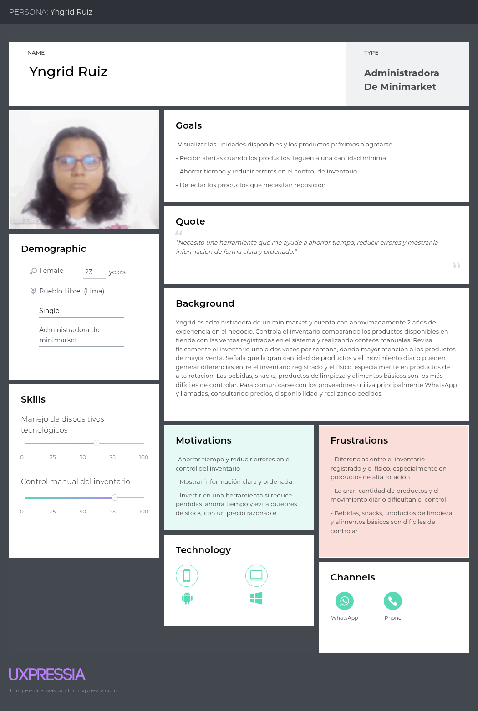

*Nota*. Elaboración propia

**Segundo Segmento Objetivo (Propietarios y administradores de bodegas
de barrio)**

**Figura 9**

*User Persona 2 (propietarios y administradores de bodegas de barrio)*

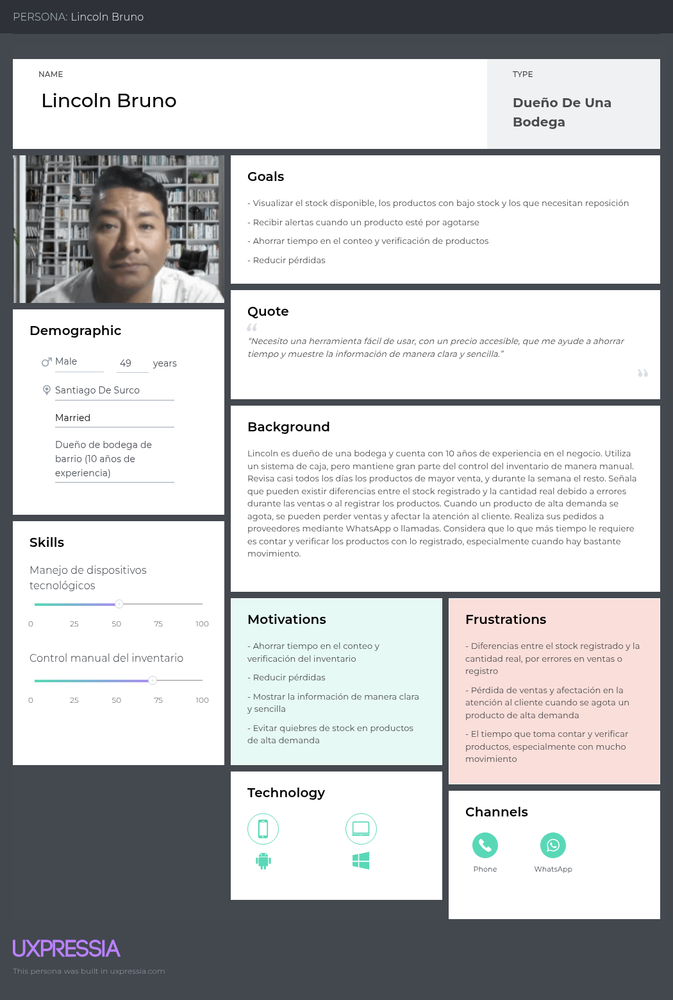

*Nota*. Elaboración propia

### 2.3.2. User Task Matrix 

**Primer Segmento Objetivo (Propietarios y administradores de
minimarkets)**

**Primer Segmento Objetivo (Propietarios y administradores de
minimarkets)**

**Tabla 14**

*User Task Matrix 1 (propietarios y administradores de minimarkets)*

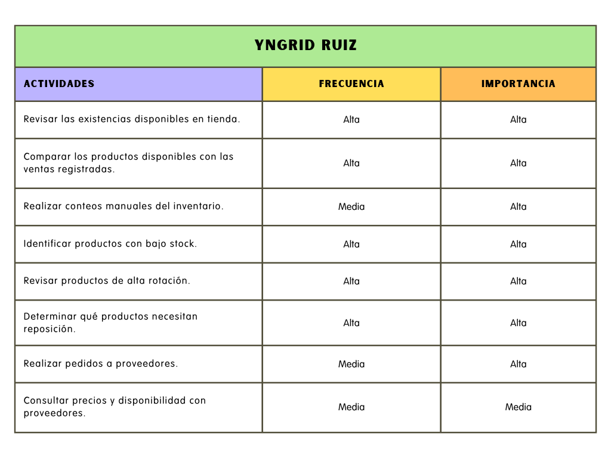

*Nota*. Elaboración propia

En este segmento las tareas más frecuentes e importantes son revisar
existencias, registrar movimientos e identificar productos con bajo
stock. Aunque cuentan con sistemas o Excel, siguen contrastando
manualmente lo registrado con lo físico.

**Segundo Segmento Objetivo (Propietarios y administradores de bodegas
de barrio)**

**Tabla 15**

*User Task Matrix 2 (propietarios y administradores de bodegas de
barrio)*

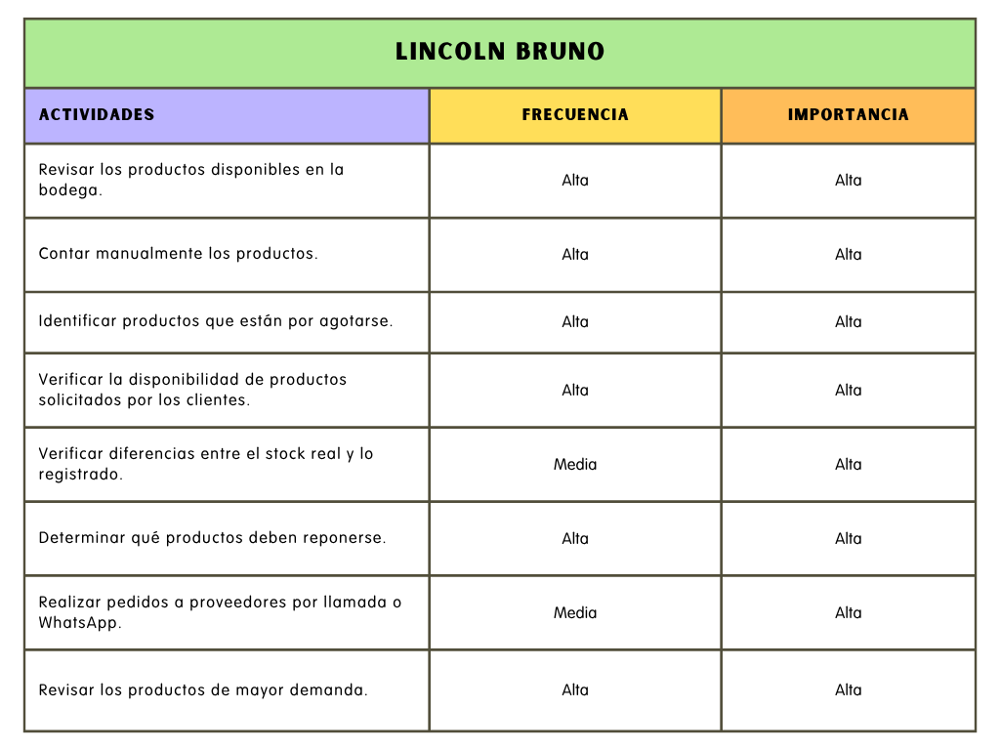

*Nota*. Elaboración propia

### 2.3.3. User Journey Mapping 

**Primer Segmento Objetivo (Propietarios y administradores de
minimarkets)**

**Figura 10**

*User Journey Map 1 (propietarios y administradores de minimarkets)*

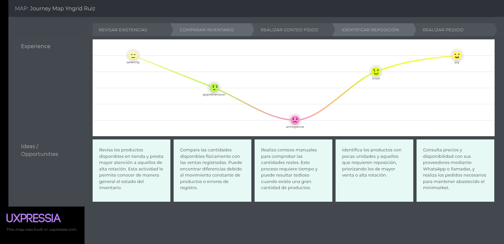

*Nota*. Elaboración propia

**Segundo Segmento Objetivo (Propietarios y administradores de bodegas
de barrio)**

**Figura 11**

*User Journey Map 2 (propietarios y administradores de bodegas de
barrio)*

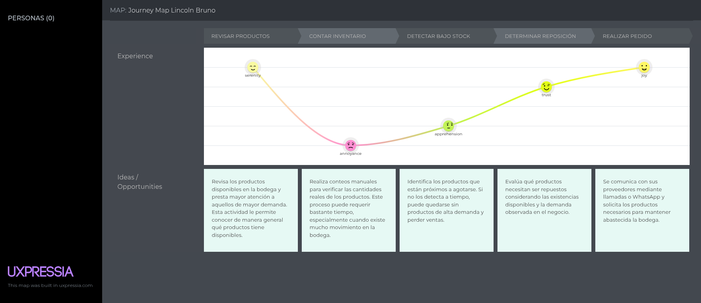

*Nota*. Elaboración propia

### 2.3.4. Empathy Mapping 

**Figura 12**

*Empathy Map 1 (propietarios y administradores de minimarkets)*

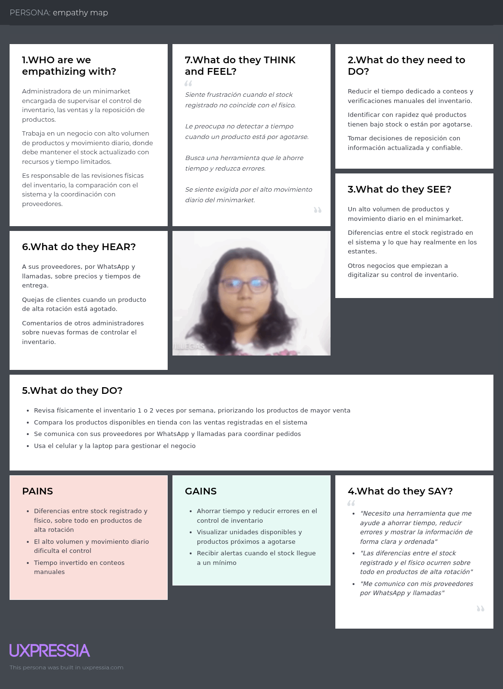

*Nota*. Elaboración propia

**Figura 13**

*Empathy Map 2 (propietarios y administradores de bodegas de barrio)*

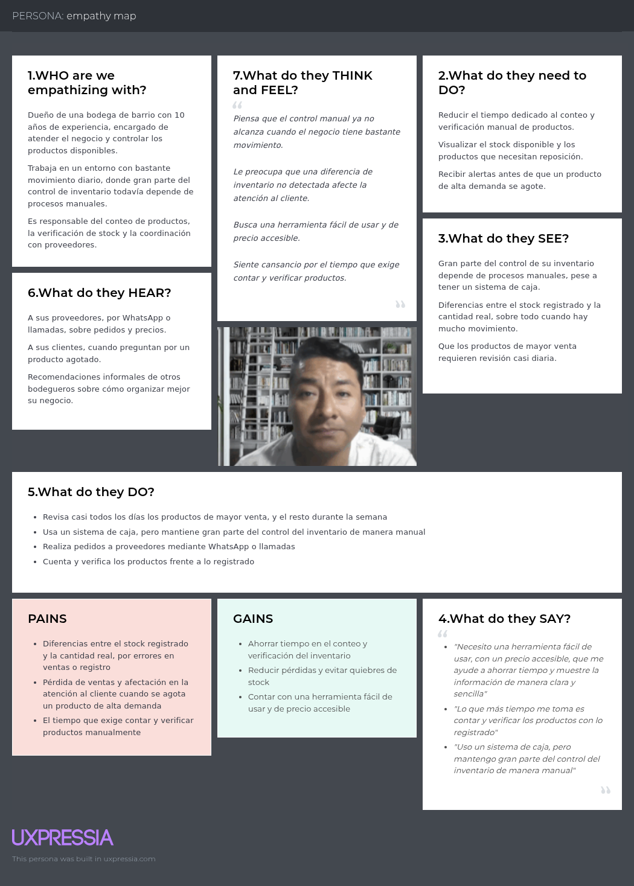

*Nota*. Elaboración propia

## 2.4. Big Picture Event Storming 

Para el desarrollo del Big Picture Event Storming se aplicó la guía
*Step-by-Step Guide* de Philippe Bourgault, indicada en la rúbrica del
Final Problem Statement, siguiendo sus tres etapas:

- Open

- Explore

- Close

**Enlace al tablero de Miro:**
<a href="https://miro.com/welcomeonboard/UHk1SzhpUVZrN1hGMDFlMnpHa2NUOUJMbHBId2xlc2YydGhaYmxUcC96S2hnOWpMWmdwaUVkbGRMWHFlSkhiS0t2TXR6V0JXWEhDU0JKWUNhRWFWRncyeXpmaS84aTEyUHJyU1VmcDNrWWhLd1BTZ09xNlphNUFlVWsxb1h1UXVNakdSWkpBejJWRjJhRnhhb1UwcS9BPT0hdjE=?share_link_id=472690857440" style="color:#2563eb">https://miro.com/welcomeonboard/UHk1SzhpUVZrN1hGMDFlMnpHa2NUOUJMbHBId2xlc2YydGhaYmxUcC96S2hnOWpMWmdwaUVkbGRMWHFlSkhiS0t2TXR6V0JXWEhDU0JKWUNhRWFWRncyeXpmaS84aTEyUHJyU1VmcDNrWWhLd1BTZ09xNlphNUFlVWsxb1h1UXVNakdSWkpBejJWRjJhRnhhb1UwcS9BPT0hdjE=?share_link_id=472690857440</a>

**Figura 14**

*Big Picture Event Storming de SmartStock*

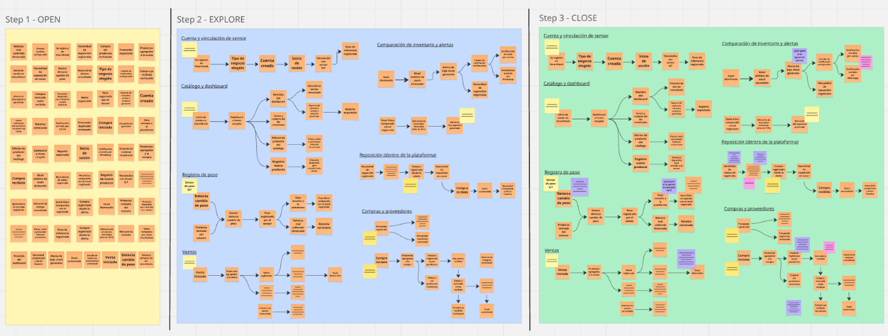

Nota. Elaboración propia

## 

## 2.5. Ubiquitous Language

- **IoT Weight Sensor (Sensor de peso IoT):** Dispositivo físico instalado bajo un producto en el punto de venta que mide su peso de forma continua y envía esa lectura a la plataforma SmartStock para inferir el nivel de existencias disponibles.

- **Physical Stock (Stock físico):** Cantidad real de un producto presente físicamente en el minimarket o bodega en un momento determinado, obtenida a partir de la lectura del Sensor de peso IoT.

- **Registered Stock (Stock registrado):** Cantidad de un producto que figura almacenada en el sistema como existencia disponible, la cual puede o no coincidir con el Physical Stock.

- **Inventory Discrepancy (Diferencia de inventario):** Desajuste detectado entre el Physical Stock y el Registered Stock de un producto, que evidencia un posible error de conteo, venta no registrada o pérdida.

- **Minimum Stock Level (Nivel mínimo de stock):** Umbral configurado por el propietario o administrador para cada producto, a partir del cual el sistema considera que las existencias son insuficientes y debe generarse una alerta.

- **Low-Stock Alert (Alerta de bajo stock):** Notificación automática generada por SmartStock cuando el Physical Stock de un producto alcanza o desciende por debajo de su Minimum Stock Level.

- **Restocking Need (Necesidad de reposición):** Registro que identifica que un producto requiere ser abastecido nuevamente, generado a partir de una Low-Stock Alert o de la revisión del Inventory Dashboard por parte del usuario.

- **Inventory Dashboard (Panel de inventario):** Interfaz web principal donde el propietario o administrador visualiza el estado general de sus productos, las alertas activas y las diferencias de inventario detectadas.

- **Rotation Report (Reporte de rotación):** Informe generado por la plataforma que muestra el comportamiento histórico de un producto (frecuencia de venta o consumo) para apoyar la toma de decisiones de reposición.

- **Alert and Movement History (Historial de alertas y movimientos):** Registro histórico de todas las alertas generadas y los cambios de stock detectados para un producto, utilizado como respaldo analítico dentro del dashboard.

- **Store Owner / Manager (Propietario/Administrador):** Usuario principal de SmartStock, responsable del control del inventario, la revisión de alertas y la coordinación de la reposición en un minimarket o bodega de barrio.

- **Supplier (Proveedor):** Actor externo a la plataforma con quien el Store Owner coordina manualmente el reabastecimiento de productos una vez identificada una Restocking Need; esta coordinación ocurre fuera de SmartStock.

- **Third-Party Notification Service (Servicio de notificaciones de terceros):** Sistema externo (correo electrónico o WhatsApp) mediante el cual SmartStock envía las Low-Stock Alerts al Store Owner fuera de la propia plataforma web.

## Capítulo III: Requirements Specification 

## 3.1. User Stories

Nota sobre roles: SmartStock cuenta con un único actor real, el Store
Owner/Manager (Propietario/Administrador del negocio). Por ello, las
historias cuyo comportamiento es idéntico para bodega de barrio y
minimarket usan el rol superior “administrador de mi negocio”, evitando
mezclar segmentos en una misma historia. Las historias cuyo
comportamiento sí difiere por segmento (US11, US25) especifican el rol
concreto (“administrador de minimarket”). Las historias del sitio web
estático (US16 a US24) usan el rol “visitante”, y las Technical Stories
(TS01 a TS15) usan el rol “developer”, porque describen trabajo técnico
que sostiene a las User Stories.

- **Epics:**

**Tabla 16**

*Epics de SmartStock*

| **Epic ID** | **Título**                                      | **Descripción**                                                                                                                                                                                                                                                                                                                                                             |
|-------------|-------------------------------------------------|-----------------------------------------------------------------------------------------------------------------------------------------------------------------------------------------------------------------------------------------------------------------------------------------------------------------------------------------------------------------------------|
| **EP01**    | Gestión de cuenta y autenticación de usuarios   | **Como** administrador de mi negocio, **quiero** registrarme, iniciar sesión y recuperar el acceso a mi cuenta de forma segura, **para** gestionar mi inventario en SmartStock en cualquier momento.                                                                                                                                                                        |
| **EP02**    | Configuración y vinculación de sensores IoT     | **Como** administrador de mi negocio, **quiero** vincular y configurar mis sensores de peso IoT sobre cada producto, **para** que el sistema monitoree automáticamente mi inventario físico.                                                                                                                                                                                |
| **EP03**    | Monitoreo de inventario en tiempo real          | **Como** administrador de mi negocio, **quiero** visualizar el nivel de stock de mis productos en tiempo real a partir de las lecturas de los sensores, **para** tomar decisiones oportunas de reposición.                                                                                                                                                                  |
| **EP04**    | Alertas y notificaciones de stock bajo          | **Como** administrador de mi negocio, **quiero** recibir notificaciones automáticas por correo electrónico o WhatsApp cuando el stock de un producto llegue al umbral mínimo, **para** coordinar su reposición a tiempo.                                                                                                                                                    |
| **EP05**    | Comparación de inventario físico vs. registrado | **Como** administrador de minimarket, **quiero** comparar el peso físico detectado por los sensores con la cantidad registrada en el sistema, **para** detectar mermas o errores de conteo a tiempo. Para bodegas de barrio, esta detección se resuelve de forma automática mediante alertas de discrepancia (EP04), sin necesidad de una pantalla de comparación dedicada. |
| **EP06**    | Gestión de catálogo de productos                | **Como** administrador de mi negocio, **quiero** registrar y editar los productos de mi catálogo, **para** mantener actualizada la información monitoreada por SmartStock.                                                                                                                                                                                                  |
| **EP07**    | Reportes y dashboard de inventario              | **Como** administrador de mi negocio, **quiero** visualizar un dashboard con el resumen general del estado de mi inventario y, en el caso de minimarkets, generar reportes de consumo, ventas, compras y movimientos de inventario, **para** tener una vista rápida de mi negocio y tomar mejores decisiones de reposición y compra.                                        |
| **EP08**    | Sitio web estático (Landing Page)               | **Como** visitante del sitio web de SmartStock, general o de un segmento específico (bodegas de barrio o minimarkets), **quiero** conocer la propuesta de valor, casos de uso, planes y evidencia social del producto, **para** decidir si me registro o solicito una demostración.                                                                                         |
| **EP09**    | Servicios RESTful de la API                     | **Como** developer, **quiero** exponer los servicios RESTful necesarios para la recepción de lecturas de sensores, autenticación, consulta de stock, estado de sensores, notificaciones, comparación de inventario, ventas, compras, proveedores y movimientos de stock, **para** soportar el funcionamiento de las aplicaciones web y de los dispositivos IoT.             |
| **EP10**    | Gestión de ventas                               | **Como** administrador de mi negocio, **quiero** registrar y consultar mis ventas, **para** controlar lo que sale de mi inventario y mantener mi stock registrado actualizado.                                                                                                                                                                                              |
| **EP11**    | Gestión de compras y proveedores                | **Como** administrador de mi negocio, **quiero** registrar a mis proveedores y las compras que les hago, **para** controlar lo que entra a mi inventario y reponer a tiempo los productos con stock bajo.                                                                                                                                                                   |

Nota. Elaboración propia

**Tabla 17**

*User Stories y Technical Stories de SmartStock*

<table>

<tbody>
<tr class="header">
<th><strong>Story ID</strong></th>
<th><strong>Título</strong></th>
<th><strong>Descripción</strong></th>
<th><strong>Criterios de Aceptación</strong></th>
<th><strong>Relacionado con (Epic ID)</strong></th>
</tr>
<tr class="odd">
<td><strong>US01</strong></td>
<td>Registro de cuenta</td>
<td><strong>Como</strong> administrador de mi negocio,
<strong>quiero</strong> registrarme en la plataforma SmartStock con mi
correo electrónico, los datos de mi negocio y el tipo de negocio (bodega
de barrio o minimarket), <strong>para</strong> poder acceder a los
servicios de monitoreo de inventario adecuados a mi negocio.</td>
<td>
<strong>Scenario 1: Registro exitoso</strong>

<strong>Given</strong> el usuario ingresa un correo electrónico
válido, una contraseña y los datos de su negocio,

<strong>When</strong> el usuario confirma el registro,

<strong>Then</strong> el sistema crea la cuenta y la asocia al
negocio registrado,

<strong>And</strong> envía un correo de confirmación de registro.

<strong>Scenario 2: Correo ya registrado</strong>

<strong>Given</strong> el correo electrónico ingresado ya está
registrado en el sistema,

<strong>When</strong> el usuario intenta completar el registro,

<strong>Then</strong> el sistema rechaza el registro e indica que el
correo ya se encuentra en uso.

<strong>Scenario 3: Selección de tipo de negocio</strong>

<strong>Given</strong> el usuario selecciona el tipo de negocio
(bodega de barrio o minimarket) durante el registro,

<strong>When</strong> el usuario confirma el registro,

<strong>Then</strong> el sistema asocia el tipo de negocio a la
cuenta y habilita el conjunto de funcionalidades correspondiente a dicho
tipo de negocio.
</td>
<td><strong>EP01</strong></td>
</tr>
<tr class="header">
<td><strong>US02</strong></td>
<td>Inicio de sesión</td>
<td><strong>Como</strong> administrador de mi negocio,
<strong>quiero</strong> iniciar sesión con mi correo electrónico y
contraseña, <strong>para</strong> acceder al panel de monitoreo de mi
inventario.</td>
<td>
<strong>Scenario 1: Inicio de sesión exitoso</strong>

<strong>Given</strong> el usuario cuenta con una cuenta registrada y
activa,

<strong>When</strong> el usuario ingresa su correo y contraseña
correctos,

<strong>Then</strong> el sistema lo autentica y otorga acceso al
panel de monitoreo.

<strong>Scenario 2: Credenciales incorrectas</strong>

<strong>Given</strong> el usuario ingresa una contraseña
incorrecta,

<strong>When</strong> el usuario intenta iniciar sesión,

<strong>Then</strong> el sistema rechaza el inicio de sesión e indica
que las credenciales son incorrectas.
</td>
<td><strong>EP01</strong></td>
</tr>
<tr class="odd">
<td><strong>US03</strong></td>
<td>Recuperación de contraseña</td>
<td><strong>Como</strong> administrador de mi negocio,
<strong>quiero</strong> recuperar mi contraseña mediante un enlace
enviado a mi correo electrónico, <strong>para</strong> volver a acceder
a mi cuenta cuando la olvide.</td>
<td>
<strong>Scenario 1: Solicitud de recuperación válida</strong>

<strong>Given</strong> el usuario ingresa el correo electrónico
asociado a su cuenta,

<strong>When</strong> el usuario solicita la recuperación de
contraseña,

<strong>Then</strong> el sistema envía un enlace de restablecimiento
al correo registrado, el cual expira transcurridas 24 horas desde su
generación. 
 
<strong>Escenario 2: Restablecimiento con enlace vigente 
Given</strong> el usuario abre el enlace de restablecimiento antes de
que transcurran 24 horas desde su generación, 
<strong>When</strong> ingresa una nueva contraseña válida y la
confirma, 
<strong>Then</strong> el sistema actualiza la contraseña y permite
iniciar sesión con ella.

<strong>Scenario 3: Enlace vencido 
Given</strong> el enlace de restablecimiento fue generado hace más de 24
horas, 
<strong>When</strong> el usuario intenta usarlo, 
<strong>Then</strong> el sistema rechaza el restablecimiento e indica
que el enlace expiró.
</td>
<td><strong>EP01</strong></td>
</tr>
<tr class="header">
<td><strong>US04</strong></td>
<td>Vinculación de sensor IoT a un producto</td>
<td><strong>Como</strong> administrador de mi negocio,
<strong>quiero</strong> vincular un sensor de peso IoT a un producto
específico de mi inventario, <strong>para</strong> que el sistema
registre su peso de referencia.</td>
<td>
<strong>Scenario 1: Vinculación exitosa</strong>

<strong>Given</strong> el usuario selecciona un sensor disponible y
un producto sin sensor asignado,

<strong>When</strong> el usuario confirma la vinculación,

<strong>Then</strong> el sistema asocia el sensor al producto y
registra el peso inicial detectado como referencia.

<strong>Scenario 2: Sensor ya vinculado</strong>

<strong>Given</strong> el sensor seleccionado ya está vinculado a
otro producto,

<strong>When</strong> el usuario intenta vincularlo a un nuevo
producto,

<strong>Then</strong> el sistema rechaza la vinculación e indica que
el sensor ya se encuentra en uso.
</td>
<td><strong>EP02</strong></td>
</tr>
<tr class="odd">
<td><strong>US05</strong></td>
<td>Configuración de umbral mínimo de stock</td>
<td><strong>Como</strong> administrador de mi negocio,
<strong>quiero</strong> configurar el umbral mínimo de stock para cada
producto vinculado a un sensor, <strong>para</strong> que el sistema me
alerte cuando el nivel sea bajo.</td>
<td>
<strong>Scenario 1: Validación de umbral máximo permitido (Regla
de negocio)</strong>

<strong>Given</strong> el usuario intenta configurar un umbral mínimo
mayor a la capacidad máxima registrada para el producto,

<strong>When</strong> el usuario guarda la configuración,

<strong>Then</strong> el sistema rechaza la configuración e indica
que el umbral no puede superar la capacidad máxima del producto.

<strong>Scenario 2: Configuración válida</strong>

<strong>Given</strong> el usuario ingresa un valor numérico mayor a
cero y menor o igual a la capacidad máxima del producto,

<strong>When</strong> el usuario guarda la configuración,

<strong>Then</strong> el sistema almacena el umbral y lo aplica para
la generación de futuras alertas.
</td>
<td><strong>EP02</strong></td>
</tr>
<tr class="header">
<td><strong>US06</strong></td>
<td>Visualización del estado de conexión de sensores</td>
<td><strong>Como</strong> administrador de mi negocio,
<strong>quiero</strong> ver el estado de conexión de cada sensor IoT
instalado, <strong>para</strong> saber si alguno requiere revisión
técnica.</td>
<td>
<strong>Scenario 1: Sensor conectado</strong>

<strong>Given</strong> un sensor envió una lectura en los últimos 5
minutos,

<strong>When</strong> el usuario consulta el estado de sus
sensores,

<strong>Then</strong> el sistema muestra el sensor con estado "en
línea".

<strong>Scenario 2: Sensor desconectado</strong>

<strong>Given</strong> un sensor no envió ninguna lectura en los
últimos 5 minutos,

<strong>When</strong> el usuario consulta el estado de sus
sensores,

<strong>Then</strong> el sistema muestra el sensor con estado
"desconectado".
</td>
<td><strong>EP02</strong></td>
</tr>
<tr class="odd">
<td><strong>US07</strong></td>
<td>Visualización del peso actual de un producto</td>
<td><strong>Como</strong> administrador de mi negocio,
<strong>quiero</strong> visualizar el peso actual registrado por el
sensor de cada producto, <strong>para</strong> conocer el nivel de stock
físico en tiempo real.</td>
<td>
<strong>Scenario 1: Lectura disponible</strong>

<strong>Given</strong> el sensor de un producto envió al menos una
lectura de peso,

<strong>When</strong> el usuario consulta el nivel de stock del
producto,

<strong>Then</strong> el sistema muestra el peso más reciente
recibido y su cantidad equivalente en unidades.
</td>
<td><strong>EP03</strong></td>
</tr>
<tr class="header">
<td><strong>US08</strong></td>
<td>Listado de productos por nivel de stock</td>
<td><strong>Como</strong> administrador de mi negocio,
<strong>quiero</strong> visualizar un listado de todos mis productos
monitoreados junto con su nivel de stock actual, <strong>para</strong>
identificar cuáles necesitan reposición.</td>
<td>
<strong>Scenario 1: Listado con productos en distintos
niveles</strong>

<strong>Given</strong> el usuario tiene productos con sensores
vinculados,

<strong>When</strong> el usuario consulta el listado de
productos,

<strong>Then</strong> el sistema muestra cada producto con su nivel
de stock clasificado como bajo, normal o sin datos.

<strong>Scenario 2: Stock registrado actualizado por
movimientos</strong>

<strong>Given</strong> el usuario registró una venta o una compra
recibida de un producto,

<strong>When</strong> consulta el listado de productos,

<strong>Then</strong> el sistema muestra el stock registrado
actualizado junto con el nivel de stock del producto.
</td>
<td><strong>EP03</strong></td>
</tr>
<tr class="odd">
<td><strong>US09</strong></td>
<td>Notificación por correo electrónico de stock bajo</td>
<td><strong>Como</strong> administrador de mi negocio,
<strong>quiero</strong> recibir una notificación por correo electrónico
cuando el stock de un producto llegue al umbral mínimo,
<strong>para</strong> coordinar su reposición con mi proveedor a
tiempo.</td>
<td>
<strong>Scenario 1: Stock alcanza el umbral mínimo</strong>

<strong>Given</strong> el nivel de stock de un producto es igual o
menor al umbral mínimo configurado,

<strong>And</strong> el usuario tiene configurado el correo
electrónico como canal de notificación,

<strong>When</strong> el sistema detecta la condición de stock
bajo,

<strong>Then</strong> el sistema envía una notificación por correo
electrónico a la dirección registrada y registra la necesidad de
reposición del producto.
</td>
<td><strong>EP04</strong></td>
</tr>
<tr class="header">
<td><strong>US10</strong></td>
<td>Notificación por WhatsApp de stock bajo</td>
<td><strong>Como</strong> administrador de mi negocio,
<strong>quiero</strong> recibir una notificación por WhatsApp cuando el
stock de un producto llegue al umbral mínimo, <strong>para</strong>
gestionar la reposición sin estar frente al sistema.</td>
<td>
<strong>Scenario 1: Stock alcanza el umbral mínimo</strong>

<strong>Given</strong> el nivel de stock de un producto es igual o
menor al umbral mínimo configurado,

<strong>And</strong> el usuario tiene configurado WhatsApp como canal
de notificación,

<strong>When</strong> el sistema detecta la condición de stock
bajo,

<strong>Then</strong> el sistema envía una notificación por WhatsApp
al número registrado y registra la necesidad de reposición del
producto.
</td>
<td><strong>EP04</strong></td>
</tr>
<tr class="odd">
<td><strong>US11</strong></td>
<td>Comparación entre inventario físico y registrado</td>
<td><strong>Como</strong> administrador de minimarket,
<strong>quiero</strong> comparar el peso físico detectado por los
sensores con la cantidad registrada en el sistema (actualizada por
ventas, compras y ajustes), <strong>para</strong> detectar diferencias
por mermas o errores de conteo.</td>
<td>
<strong>Scenario 1: Diferencia detectada</strong>

<strong>Given</strong> existe una cantidad registrada manualmente
para un producto,

<strong>When</strong> el sistema recibe una nueva lectura del sensor
asociado al producto,

<strong>Then</strong> el sistema calcula la diferencia porcentual
entre el peso físico y la cantidad registrada,

<strong>And</strong> muestra el resultado al usuario.

<strong>Scenario 2: Comparación con ventas y compras
registradas</strong>

<strong>Given</strong> el producto tiene ventas o compras recibidas
registradas,

<strong>When</strong> el sistema recibe una nueva lectura del sensor
asociado al producto,

<strong>Then</strong> el sistema calcula la diferencia entre el peso
físico y el stock registrado actualizado por los movimientos,

<strong>And</strong> muestra el resultado al usuario.
</td>
<td><strong>EP05</strong></td>
</tr>
<tr class="header">
<td><strong>US12</strong></td>
<td>Alerta por discrepancia de inventario</td>
<td><strong>Como</strong> administrador de mi negocio,
<strong>quiero</strong> recibir una alerta automática cuando exista una
discrepancia mayor al 10% entre el inventario físico y el registrado,
<strong>para</strong> investigar la causa de la diferencia sin tener que
revisarlo manualmente.</td>
<td>
<strong>Scenario 1: Discrepancia mayor al umbral</strong>

<strong>Given</strong> la diferencia calculada entre el inventario
físico y el registrado supera el 10%,

<strong>When</strong> el sistema finaliza el cálculo de
comparación,

<strong>Then</strong> el sistema genera una alerta de discrepancia,
notifica al usuario por su canal configurado y registra la necesidad de
reposición del producto.
</td>
<td><strong>EP05</strong></td>
</tr>
<tr class="odd">
<td><strong>US13</strong></td>
<td>Registro de nuevo producto en el catálogo</td>
<td><strong>Como</strong> administrador de mi negocio,
<strong>quiero</strong> registrar un nuevo producto en mi catálogo con
su nombre, categoría y peso unitario, <strong>para</strong> empezar a
monitorear su stock con un sensor IoT.</td>
<td>
<strong>Scenario 1: Registro exitoso</strong>

<strong>Given</strong> el usuario ingresa un nombre, categoría y peso
unitario válidos para el producto,

<strong>When</strong> el usuario confirma el registro,

<strong>Then</strong> el sistema agrega el producto al catálogo del
negocio y queda disponible para ser vinculado a un sensor.
</td>
<td><strong>EP06</strong></td>
</tr>
<tr class="header">
<td><strong>US14</strong></td>
<td>Edición de producto del catálogo</td>
<td><strong>Como</strong> administrador de mi negocio,
<strong>quiero</strong> editar la información de un producto existente
en mi catálogo, <strong>para</strong> mantener actualizados sus
datos.</td>
<td>
<strong>Scenario 1: Edición exitosa</strong>

<strong>Given</strong> el usuario modifica uno o más datos de un
producto existente,

<strong>When</strong> el usuario confirma los cambios,

<strong>Then</strong> el sistema actualiza la información del
producto y conserva el historial de lecturas asociado.

<strong>Scenario 2: Edición de precios y proveedor
habitual</strong>

<strong>Given</strong> el usuario modifica el precio de venta, el
costo de compra o el proveedor habitual de un producto,

<strong>When</strong> confirma los cambios,

<strong>Then</strong> el sistema actualiza esos datos para las
próximas ventas y compras,

<strong>And</strong> conserva intactas las ventas y compras ya
registradas.
</td>
<td><strong>EP06</strong></td>
</tr>
<tr class="odd">
<td><strong>US15</strong></td>
<td>Visualización de dashboard resumen de inventario</td>
<td><strong>Como</strong> administrador de mi negocio,
<strong>quiero</strong> visualizar un resumen con el estado general de
mi inventario (productos en stock bajo, normal y sin sensor asignado),
<strong>para</strong> tener una vista rápida de mi negocio sin revisar
producto por producto.</td>
<td>
<strong>Scenario 1: Dashboard con datos disponibles</strong>

<strong>Given</strong> el negocio tiene al menos un producto
registrado,

<strong>When</strong> el usuario consulta el dashboard,

<strong>Then</strong> el sistema muestra la cantidad de productos en
stock bajo, stock normal y sin sensor asignado.

<strong>Scenario 2: Dashboard con ventas y compras</strong>

<strong>Given</strong> existen ventas o compras registradas en el
día,

<strong>When</strong> el usuario consulta el dashboard,

<strong>Then</strong> el sistema muestra el total vendido y el total
comprado del día.
</td>
<td><strong>EP07</strong></td>
</tr>
<tr class="header">
<td><strong>US16</strong></td>
<td>Información general de SmartStock</td>
<td><strong>Como</strong> visitante, <strong>quiero</strong> conocer en
la página de inicio qué es SmartStock y qué problema resuelve,
<strong>para</strong> evaluar rápidamente si el producto es útil para mi
negocio.</td>
<td>
<strong>Scenario 1: Consulta de la página de inicio</strong>

<strong>Given</strong> un visitante ingresa al sitio web de
SmartStock,

<strong>When</strong> accede a la página de inicio,

<strong>Then</strong> el sistema muestra una descripción del producto
y del problema de control de inventario que resuelve.

<strong>Scenario 2:</strong> <strong>Consulta de la sección de
problemática</strong>

<strong>Given</strong> un visitante navega la página de inicio,

<strong>When</strong> llega a la sección de problemática,

<strong>Then</strong> el sistema muestra los tres problemas
principales del control manual de inventario (quiebres de stock
detectados tarde, registros que no coinciden con la realidad, y tiempo
perdido revisando estantes).
</td>
<td><strong>EP08</strong></td>
</tr>
<tr class="odd">
<td><strong>US17</strong></td>
<td>Casos de uso para bodegas de barrio</td>
<td><strong>Como</strong> visitante del segmento bodegas de barrio,
<strong>quiero</strong> ver una sección con casos de uso enfocados en
negocios pequeños, <strong>para</strong> identificar si SmartStock se
ajusta al tamaño de mi negocio.</td>
<td>
<strong>Scenario 1: Consulta de la sección de casos de
uso</strong>

<strong>Given</strong> un visitante del segmento bodegas de barrio
navega el sitio web,

<strong>When</strong> accede a la sección de casos de uso,

<strong>Then</strong> el sistema muestra, dentro de dicha sección, un
apartado con contenido dirigido a negocios de tipo bodega de barrio,
presentado junto al apartado de minimarkets.
</td>
<td><strong>EP08</strong></td>
</tr>
<tr class="header">
<td><strong>US18</strong></td>
<td>Casos de uso para minimarkets</td>
<td><strong>Como</strong> visitante del segmento minimarkets,
<strong>quiero</strong> ver una sección con casos de uso enfocados en
negocios de mayor volumen, <strong>para</strong> evaluar si SmartStock
puede manejar la escala de mi minimarket.</td>
<td>
<strong>Scenario 1: Consulta de la sección de casos de
uso</strong>

<strong>Given</strong> un visitante del segmento minimarkets navega
el sitio web,

<strong>When</strong> accede a la sección de casos de uso,

<strong>Then</strong> el sistema muestra, dentro de dicha sección, un
apartado con contenido dirigido a negocios de tipo minimarket,
presentado junto al apartado de bodegas de barrio.
</td>
<td><strong>EP08</strong></td>
</tr>
<tr class="odd">
<td><strong>US19</strong></td>
<td>Planes y precios</td>
<td><strong>Como</strong> visitante, <strong>quiero</strong> ver una
sección con los planes y precios de SmartStock, <strong>para</strong>
decidir cuál se ajusta a mi presupuesto antes de contactar al equipo
comercial.</td>
<td>
<strong>Scenario 1: Consulta de planes</strong>

<strong>Given</strong> un visitante navega el sitio web,

<strong>When</strong> el visitante accede a la sección de planes y
precios,

<strong>Then</strong> el sistema muestra los planes disponibles con
sus características y costos.
</td>
<td><strong>EP08</strong></td>
</tr>
<tr class="header">
<td><strong>US20</strong></td>
<td>Formulario de contacto para solicitar demostración</td>
<td><strong>Como</strong> visitante, <strong>quiero</strong> completar
un formulario con mi nombre, negocio, correo electrónico y tipo de
negocio, <strong>para</strong> solicitar una demostración del
producto.</td>
<td>
<strong>Scenario 1: Envío exitoso del formulario</strong>

<strong>Given</strong> un visitante completa el nombre, el negocio,
un correo electrónico válido y selecciona el tipo de negocio (bodega de
barrio o minimarket) en el formulario de contacto,

<strong>When</strong> el visitante envía el formulario,

<strong>Then</strong> el sistema registra la solicitud de
demostración incluyendo el tipo de negocio y envía una confirmación al
correo ingresado.

<strong>Scenario 2: Datos incompletos</strong>

<strong>Given</strong> un visitante deja al menos un campo
obligatorio vacío en el formulario de contacto,

<strong>When</strong> el visitante intenta enviar el formulario,

<strong>Then</strong> el sistema rechaza el envío e indica qué campos
faltan por completar.
</td>
<td><strong>EP08</strong></td>
</tr>
<tr class="odd">
<td><strong>US21</strong></td>
<td>Preguntas frecuentes sobre instalación de sensores</td>
<td><strong>Como</strong> visitante, <strong>quiero</strong> ver una
sección de preguntas frecuentes sobre la instalación de los sensores
IoT, <strong>para</strong> resolver mis dudas técnicas antes de
contratar el servicio.</td>
<td>
<strong>Scenario 1: Consulta de preguntas frecuentes</strong>

<strong>Given</strong> un visitante navega el sitio web,

<strong>When</strong> el visitante accede a la sección de preguntas
frecuentes,

<strong>Then</strong> el sistema muestra las preguntas relacionadas
con la instalación de sensores IoT junto con sus respuestas.
</td>
<td><strong>EP08</strong></td>
</tr>
<tr class="header">
<td><strong>US22</strong></td>
<td>Testimonios de dueños de bodega</td>
<td><strong>Como</strong> visitante del segmento bodegas de barrio,
<strong>quiero</strong> ver testimonios de otros dueños de bodega que
usan SmartStock, <strong>para</strong> generar confianza antes de
registrarme.</td>
<td>
<strong>Scenario 1: Consulta de testimonios</strong>

<strong>Given</strong> un visitante del segmento bodegas de barrio
navega el sitio web,

<strong>When</strong> el visitante accede a la sección de
testimonios,

<strong>Then</strong> el sistema muestra, dentro de dicha sección,
testimonios de clientes del segmento bodegas de barrio, presentados
junto a los testimonios de minimarkets.
</td>
<td><strong>EP08</strong></td>
</tr>
<tr class="odd">
<td><strong>US23</strong></td>
<td>Comparación frente a otras soluciones</td>
<td><strong>Como</strong> visitante del segmento minimarkets,
<strong>quiero</strong> ver una comparación de SmartStock frente a otras
soluciones de control de inventario, <strong>para</strong> justificar la
elección frente a mis socios o jefes.</td>
<td>
<strong>Scenario 1: Consulta de comparación</strong>

<strong>Given</strong> un visitante del segmento minimarkets navega
el sitio web,

<strong>When</strong> el visitante accede a la sección de comparación
de soluciones,

<strong>Then</strong> el sistema muestra una tabla comparativa entre
SmartStock y otras soluciones del mercado, visible también para
visitantes de bodegas de barrio.
</td>
<td><strong>EP08</strong></td>
</tr>
<tr class="header">
<td><strong>US24</strong></td>
<td>Acceso a registro desde el sitio web</td>
<td><strong>Como</strong> visitante, <strong>quiero</strong> acceder a
la opción de registro desde cualquier sección del sitio web,
<strong>para</strong> crear mi cuenta sin necesidad de buscarla.</td>
<td>
<strong>Scenario 1: Acceso a la opción de registro</strong>

<strong>Given</strong> un visitante se encuentra en cualquier sección
del sitio web,

<strong>When</strong> el visitante selecciona la opción de
registro,

<strong>Then</strong> el sistema redirige al visitante al formulario
de creación de cuenta.
</td>
<td><strong>EP08</strong></td>
</tr>
<tr class="odd">
<td><strong>US25</strong></td>
<td>Reportes de consumo y movimientos de inventario</td>
<td><strong>Como</strong> administrador de minimarket,
<strong>quiero</strong> generar reportes de consumo, ventas, compras y
movimientos de inventario por periodo, <strong>para</strong> analizar
tendencias y tomar mejores decisiones de reposición y compra.</td>
<td>
<strong>Scenario 1: Reporte con datos disponibles</strong>

<strong>Given</strong> existen movimientos de inventario registrados
en el periodo seleccionado,

<strong>When</strong> el administrador solicita el reporte de
consumo,

<strong>Then</strong> el sistema muestra el consumo total y los
movimientos por producto.

<strong>Scenario 2: Periodo sin movimientos</strong>

<strong>Given</strong> no existen movimientos registrados en el
periodo,

<strong>When</strong> el administrador solicita el reporte,

<strong>Then</strong> el sistema indica que no hay datos disponibles
para dicho periodo.

<strong>Scenario 3: Reporte con ventas y compras</strong>

<strong>Given</strong> existen ventas y compras registradas en el
periodo seleccionado,

<strong>When</strong> el administrador solicita el reporte,

<strong>Then</strong> el sistema muestra el total vendido, el total
comprado y las entradas y salidas de stock por producto.
</td>
<td><strong>EP07</strong></td>
</tr>
<tr class="header">
<td><strong>US26</strong></td>
<td>Registro de venta</td>
<td><strong>Como</strong> administrador de mi negocio,
<strong>quiero</strong> registrar una venta indicando los productos y
las cantidades vendidas, <strong>para</strong> llevar el control de lo
que sale de mi inventario y mantener mi stock actualizado.</td>
<td>
<strong>Scenario 1: Venta registrada con stock
suficiente</strong>

<strong>Given</strong> el usuario selecciona uno o más productos con
precio de venta y cantidades menores o iguales a su stock
registrado,

<strong>When</strong> el usuario confirma la venta,

<strong>Then</strong> el sistema registra la venta con su total,
descuenta las cantidades del stock registrado y deja un movimiento de
salida por cada producto.

<strong>Scenario 2: Rechazo por stock insuficiente</strong>

<strong>Given</strong> la cantidad de un producto supera su stock
registrado,

<strong>When</strong> el usuario confirma la venta,

<strong>Then</strong> el sistema rechaza la venta e indica el
producto y el stock disponible,

<strong>And</strong> no modifica el stock.

<strong>Scenario 3: Producto sin precio de venta</strong>

<strong>Given</strong> un producto seleccionado no tiene precio de
venta configurado,

<strong>When</strong> el usuario intenta agregarlo a la venta,

<strong>Then</strong> el sistema solicita configurar su precio de
venta en el catálogo antes de venderlo.
</td>
<td><strong>EP10</strong></td>
</tr>
<tr class="odd">
<td><strong>US27</strong></td>
<td>Historial de ventas</td>
<td><strong>Como</strong> administrador de mi negocio,
<strong>quiero</strong> consultar el historial de mis ventas por rango
de fechas, <strong>para</strong> revisar lo que vendí y el total del
periodo.</td>
<td>
<strong>Scenario 1: Historial con ventas</strong>

<strong>Given</strong> existen ventas registradas en el rango de
fechas seleccionado,

<strong>When</strong> el usuario consulta el historial,

<strong>Then</strong> el sistema muestra las ventas de la más
reciente a la más antigua, con su fecha, cantidad de productos y total,
junto con el total acumulado del periodo.

<strong>Scenario 2: Periodo sin ventas</strong>

<strong>Given</strong> no existen ventas en el rango de fechas
seleccionado,

<strong>When</strong> el usuario consulta el historial,

<strong>Then</strong> el sistema indica que no hay ventas registradas
en ese periodo.
</td>
<td><strong>EP10</strong></td>
</tr>
<tr class="header">
<td><strong>US28</strong></td>
<td>Detalle de una venta</td>
<td><strong>Como</strong> administrador de mi negocio,
<strong>quiero</strong> ver el detalle de una venta,
<strong>para</strong> verificar qué productos, cantidades y precios se
registraron.</td>
<td>
<strong>Scenario 1: Detalle de venta</strong>

<strong>Given</strong> el usuario selecciona una venta del
historial,

<strong>When</strong> abre su detalle,

<strong>Then</strong> el sistema muestra la fecha, los productos con
su cantidad, precio unitario y subtotal, el total y los movimientos de
stock generados.
</td>
<td><strong>EP10</strong></td>
</tr>
<tr class="odd">
<td><strong>US29</strong></td>
<td>Registro de proveedor</td>
<td><strong>Como</strong> administrador de mi negocio,
<strong>quiero</strong> registrar a mis proveedores con su nombre,
teléfono y correo opcional, <strong>para</strong> asociarlos a mis
compras y a mis productos.</td>
<td>
<strong>Scenario 1: Registro exitoso</strong>

<strong>Given</strong> el usuario ingresa un nombre y un teléfono
válidos,

<strong>When</strong> confirma el registro,

<strong>Then</strong> el sistema agrega al proveedor al listado de
proveedores del negocio.

<strong>Scenario 2: Proveedor duplicado</strong>

<strong>Given</strong> ya existe un proveedor con el mismo nombre y
teléfono en el negocio,

<strong>When</strong> el usuario intenta registrarlo,

<strong>Then</strong> el sistema rechaza el registro e indica que el
proveedor ya existe.
</td>
<td><strong>EP11</strong></td>
</tr>
<tr class="header">
<td><strong>US30</strong></td>
<td>Registro y recepción de compra</td>
<td><strong>Como</strong> administrador de mi negocio,
<strong>quiero</strong> registrar una compra a un proveedor con los
productos, cantidades y costos, y marcarla como recibida,
<strong>para</strong> que mi stock aumente cuando la mercadería
llegue.</td>
<td>
<strong>Scenario 1: Compra registrada</strong>

<strong>Given</strong> el usuario selecciona un proveedor y uno o más
productos con su cantidad y costo unitario,

<strong>When</strong> confirma el registro,

<strong>Then</strong> el sistema guarda la compra en estado pendiente
con su total, sin modificar el stock.

<strong>Scenario 2: Recepción de la compra</strong>

<strong>Given</strong> existe una compra en estado pendiente,

<strong>When</strong> el usuario la marca como recibida,

<strong>Then</strong> el sistema suma las cantidades al stock
registrado y deja un movimiento de entrada por cada producto.

<strong>Scenario 3: Compra sin productos</strong>

<strong>Given</strong> el usuario no ha agregado ningún producto a la
compra,

<strong>When</strong> intenta confirmarla,

<strong>Then</strong> el sistema rechaza el registro e indica que
debe agregar al menos un producto.
</td>
<td><strong>EP11</strong></td>
</tr>
<tr class="odd">
<td><strong>US31</strong></td>
<td>Historial de compras</td>
<td><strong>Como</strong> administrador de mi negocio,
<strong>quiero</strong> consultar el historial de mis compras por rango
de fechas, <strong>para</strong> revisar lo que compré, a qué proveedor
y en qué estado está cada compra.</td>
<td>
<strong>Scenario 1: Historial con compras</strong>

<strong>Given</strong> existen compras registradas en el rango de
fechas seleccionado,

<strong>When</strong> el usuario consulta el historial,

<strong>Then</strong> el sistema muestra las compras con su fecha,
proveedor, estado y total, junto con el total acumulado del periodo.

<strong>Scenario 2: Periodo sin compras</strong>

<strong>Given</strong> no existen compras en el rango de fechas
seleccionado,

<strong>When</strong> el usuario consulta el historial,

<strong>Then</strong> el sistema indica que no hay compras
registradas en ese periodo.
</td>
<td><strong>EP11</strong></td>
</tr>
<tr class="header">
<td><strong>US32</strong></td>
<td>Registro de compra desde una alerta de stock bajo</td>
<td><strong>Como</strong> administrador de mi negocio,
<strong>quiero</strong> registrar una compra directamente desde una
alerta de stock bajo, <strong>para</strong> reponer el producto sin
volver a ingresar sus datos.</td>
<td>
<strong>Scenario 1: Compra iniciada desde la alerta</strong>

<strong>Given</strong> existe una alerta de stock bajo con una
necesidad de reposición pendiente,

<strong>When</strong> el usuario elige registrar una compra desde la
alerta,

<strong>Then</strong> el sistema abre el formulario de compra con el
producto y su proveedor habitual precargados,

<strong>And</strong> al confirmar, marca la necesidad de reposición
como en curso.

<strong>Scenario 2: Cierre de la necesidad de reposición</strong>

<strong>Given</strong> una compra creada desde una alerta se marca
como recibida,

<strong>When</strong> el stock del producto aumenta,

<strong>Then</strong> el sistema marca la necesidad de reposición
como completada y la alerta como resuelta.
</td>
<td><strong>EP11</strong></td>
</tr>
<tr class="odd">
<td><strong>TS01</strong></td>
<td>Endpoint de recepción de lecturas de sensores</td>
<td><strong>Como</strong> developer, <strong>quiero</strong> exponer un
endpoint POST /api/sensores/{id}/lecturas que reciba las lecturas de
peso enviadas por el microcontrolador, <strong>para</strong> almacenar
el dato en la base de datos.</td>
<td>
<strong>Scenario 1: Lectura válida</strong>

<strong>Given</strong> el microcontrolador envía una solicitud POST a
/api/sensores/{id}/lecturas con un valor de peso numérico y un
identificador de sensor existente,

<strong>When</strong> el sistema procesa la solicitud,

<strong>Then</strong> el sistema almacena la lectura asociada al
sensor y responde con el código de estado 201 y el identificador de la
lectura creada.

<strong>Scenario 2: Sensor inexistente</strong>

<strong>Given</strong> el microcontrolador envía una solicitud POST a
/api/sensores/{id}/lecturas con un identificador de sensor que no
existe,

<strong>When</strong> el sistema procesa la solicitud,

<strong>Then</strong> el sistema responde con el código de estado 404
y no almacena ninguna lectura.
</td>
<td><strong>EP09</strong></td>
</tr>
<tr class="header">
<td><strong>TS02</strong></td>
<td>Endpoint de consulta de stock de un producto</td>
<td><strong>Como</strong> developer, <strong>quiero</strong> exponer un
endpoint GET /api/productos/{id}/stock que retorne el nivel de stock
actual de un producto, <strong>para</strong> que el frontend lo muestre
en el panel de monitoreo.</td>
<td>
<strong>Scenario 1: Producto existente con lecturas</strong>

<strong>Given</strong> el cliente envía una solicitud GET a
/api/productos/{id}/stock con un identificador de producto
existente,

<strong>When</strong> el sistema procesa la solicitud,

<strong>Then</strong> el sistema responde con el código de estado 200
y el nivel de stock actual del producto.

<strong>Scenario 2: Producto sin lecturas registradas</strong>

<strong>Given</strong> el producto consultado no tiene lecturas de
sensor asociadas,

<strong>When</strong> el sistema procesa la solicitud GET a
/api/productos/{id}/stock,

<strong>Then</strong> el sistema responde con el código de estado 200
y un nivel de stock indicado como "sin datos".
</td>
<td><strong>EP09</strong></td>
</tr>
<tr class="odd">
<td><strong>TS03</strong></td>
<td>Endpoint de envío de notificaciones de stock bajo</td>
<td><strong>Como</strong> developer, <strong>quiero</strong> exponer un
endpoint POST /api/notificaciones/stock-bajo que dispare el envío de una
alerta cuando el stock de un producto cruce el umbral mínimo,
<strong>para</strong> automatizar las notificaciones del sistema.</td>
<td>
<strong>Scenario 1: Umbral cruzado</strong>

<strong>Given</strong> el sistema recibe una solicitud POST a
/api/notificaciones/stock-bajo con un identificador de producto cuyo
stock es igual o menor al umbral configurado,

<strong>When</strong> el sistema procesa la solicitud,

<strong>Then</strong> el sistema envía la notificación por el canal
configurado por el usuario y responde con el código de estado 200.

<strong>Scenario 2: Umbral no cruzado</strong>

<strong>Given</strong> el sistema recibe una solicitud POST a
/api/notificaciones/stock-bajo con un identificador de producto cuyo
stock es mayor al umbral configurado,

<strong>When</strong> el sistema procesa la solicitud,

<strong>Then</strong> el sistema no envía ninguna notificación y
responde con el código de estado 200 indicando que no se cumple la
condición de alerta.
</td>
<td><strong>EP09</strong></td>
</tr>
<tr class="header">
<td><strong>TS04</strong></td>
<td>Endpoint de autenticación de usuarios <strong>(Sprint
4)</strong></td>
<td><strong>Como</strong> developer, <strong>quiero</strong> exponer un
endpoint POST /api/auth/login que valide las credenciales del usuario y
retorne un token de autenticación, <strong>para</strong> proteger el
acceso a los servicios de la API.</td>
<td>
<strong>Scenario 1: Credenciales válidas</strong>

<strong>Given</strong> el cliente envía una solicitud POST a
/api/auth/login con un correo electrónico y una contraseña que coinciden
con una cuenta registrada,

<strong>When</strong> el sistema valida las credenciales,

<strong>Then</strong> el sistema responde con el código de estado 200
y un token de autenticación.

<strong>Scenario 2: Credenciales inválidas</strong>

<strong>Given</strong> el cliente envía una solicitud POST a
/api/auth/login con una contraseña que no coincide con la cuenta
registrada,

<strong>When</strong> el sistema valida las credenciales,

<strong>Then</strong> el sistema responde con el código de estado 401
y no genera ningún token.
</td>
<td><strong>EP09</strong></td>
</tr>
<tr class="odd">
<td><strong>TS05</strong></td>
<td>Endpoint de estado de conexión de un sensor</td>
<td><strong>Como</strong> developer, <strong>quiero</strong> exponer un
endpoint GET /api/sensores/{id}/estado que retorne si un sensor está en
línea o desconectado, <strong>para</strong> que el frontend muestre el
estado de conexión en tiempo real.</td>
<td>
<strong>Scenario 1: Sensor con lectura reciente</strong>

<strong>Given</strong> el sensor consultado envió una lectura en los
últimos 5 minutos,

<strong>When</strong> el cliente envía una solicitud GET a
/api/sensores/{id}/estado,

<strong>Then</strong> el sistema responde con el código de estado 200
y el estado "en línea".

<strong>Scenario 2: Sensor sin lectura reciente</strong>

<strong>Given</strong> el sensor consultado no envió ninguna lectura
en los últimos 5 minutos,

<strong>When</strong> el cliente envía una solicitud GET a
/api/sensores/{id}/estado,

<strong>Then</strong> el sistema responde con el código de estado 200
y el estado "desconectado".
</td>
<td><strong>EP09</strong></td>
</tr>
<tr class="header">
<td><strong>TS06</strong></td>
<td>Endpoint de comparación de inventario físico y registrado</td>
<td><strong>Como</strong> developer, <strong>quiero</strong> exponer un
endpoint GET /api/inventario/comparacion/{productoId} que retorne la
diferencia entre el peso físico detectado y la cantidad registrada,
<strong>para</strong> que el sistema calcule automáticamente posibles
mermas.</td>
<td>
<strong>Scenario 1: Diferencia calculada
correctamente</strong>

<strong>Given</strong> el producto consultado tiene una cantidad
registrada manualmente y al menos una lectura de sensor,

<strong>When</strong> el cliente envía una solicitud GET a
/api/inventario/comparacion/{productoId},

<strong>Then</strong> el sistema responde con el código de estado 200
y el porcentaje de diferencia entre ambos valores.

<strong>Scenario 2: Producto sin cantidad registrada</strong>

<strong>Given</strong> el producto consultado no tiene una cantidad
registrada manualmente,

<strong>When</strong> el cliente envía una solicitud GET a
/api/inventario/comparacion/{productoId},

<strong>Then</strong> el sistema responde con el código de estado 409
e indica que no puede calcularse la comparación sin una cantidad
registrada.
</td>
<td><strong>EP09</strong></td>
</tr>
<tr class="odd">
<td><strong>TS07</strong></td>
<td>Endpoint de registro de ventas</td>
<td><strong>Como</strong> developer, <strong>quiero</strong> exponer un
endpoint POST /api/ventas que registre una venta con sus ítems,
<strong>para</strong> que la aplicación web pueda guardar las ventas del
negocio.</td>
<td>
<strong>Scenario 1: Venta válida</strong>

<strong>Given</strong> el cliente envía una solicitud POST a
/api/ventas con productos existentes y cantidades menores o iguales a su
stock registrado,

<strong>When</strong> el sistema procesa la solicitud,

<strong>Then</strong> el sistema registra la venta y responde con el
código de estado 201 y el identificador de la venta.

<strong>Scenario 2: Stock insuficiente</strong>

<strong>Given</strong> el cliente envía una solicitud POST a
/api/ventas con una cantidad mayor al stock registrado de un
producto,

<strong>When</strong> el sistema procesa la solicitud,

<strong>Then</strong> el sistema responde con el código de estado
422, no registra la venta y no modifica el stock.
</td>
<td><strong>EP09</strong></td>
</tr>
<tr class="header">
<td><strong>TS08</strong></td>
<td>Endpoints de consulta de ventas</td>
<td><strong>Como</strong> developer, <strong>quiero</strong> exponer los
endpoints GET /api/ventas y GET /api/ventas/{id}, <strong>para</strong>
que la aplicación web muestre el historial y el detalle de las
ventas.</td>
<td>
<strong>Scenario 1: Historial por fechas</strong>

<strong>Given</strong> el cliente envía una solicitud GET a
/api/ventas con un rango de fechas,

<strong>When</strong> el sistema procesa la solicitud,

<strong>Then</strong> el sistema responde con el código de estado
200, la lista de ventas del rango y su total acumulado.

<strong>Scenario 2: Venta inexistente</strong>

<strong>Given</strong> el cliente envía una solicitud GET a
/api/ventas/{id} con un identificador que no existe,

<strong>When</strong> el sistema procesa la solicitud,

<strong>Then</strong> el sistema responde con el código de estado
404.
</td>
<td><strong>EP09</strong></td>
</tr>
<tr class="odd">
<td><strong>TS09</strong></td>
<td>Endpoints de proveedores</td>
<td><strong>Como</strong> developer, <strong>quiero</strong> exponer los
endpoints POST /api/proveedores y GET /api/proveedores,
<strong>para</strong> que la aplicación web registre y liste los
proveedores del negocio.</td>
<td>
<strong>Scenario 1: Proveedor válido</strong>

<strong>Given</strong> el cliente envía una solicitud POST a
/api/proveedores con un nombre y un teléfono válidos,

<strong>When</strong> el sistema procesa la solicitud,

<strong>Then</strong> el sistema registra al proveedor y responde con
el código de estado 201 y su identificador.

<strong>Scenario 2: Datos incompletos</strong>

<strong>Given</strong> el cliente envía una solicitud POST a
/api/proveedores sin nombre o sin teléfono,

<strong>When</strong> el sistema procesa la solicitud,

<strong>Then</strong> el sistema responde con el código de estado 400
y no registra al proveedor.
</td>
<td><strong>EP09</strong></td>
</tr>
<tr class="header">
<td><strong>TS10</strong></td>
<td>Endpoint de registro de compras</td>
<td><strong>Como</strong> developer, <strong>quiero</strong> exponer un
endpoint POST /api/compras que registre una compra con sus ítems,
<strong>para</strong> que la aplicación web pueda guardar las compras a
proveedores, incluidas las iniciadas desde una alerta de stock
bajo.</td>
<td>
<strong>Scenario 1: Compra válida</strong>

<strong>Given</strong> el cliente envía una solicitud POST a
/api/compras con un proveedor existente y productos con cantidad y
costo,

<strong>When</strong> el sistema procesa la solicitud,

<strong>Then</strong> el sistema registra la compra en estado
pendiente, no modifica el stock y responde con el código de estado
201.

<strong>Scenario 2: Proveedor inexistente</strong>

<strong>Given</strong> el cliente envía una solicitud POST a
/api/compras con un proveedor que no existe,

<strong>When</strong> el sistema procesa la solicitud,

<strong>Then</strong> el sistema responde con el código de estado 404
y no registra la compra.
</td>
<td><strong>EP09</strong></td>
</tr>
<tr class="odd">
<td><strong>TS11</strong></td>
<td>Endpoint de recepción de compras</td>
<td><strong>Como</strong> developer, <strong>quiero</strong> exponer un
endpoint PATCH /api/compras/{id}/recepcion que marque una compra como
recibida, <strong>para</strong> aumentar el stock y cerrar la necesidad
de reposición asociada.</td>
<td>
<strong>Scenario 1: Recepción de compra pendiente</strong>

<strong>Given</strong> el cliente envía una solicitud PATCH a
/api/compras/{id}/recepcion de una compra pendiente,

<strong>When</strong> el sistema procesa la solicitud,

<strong>Then</strong> el sistema suma las cantidades al stock
registrado, genera los movimientos de entrada, completa la necesidad de
reposición asociada si existe y responde con el código de estado
200.

<strong>Scenario 2: Compra ya recibida</strong>

<strong>Given</strong> la compra ya fue marcada como recibida,

<strong>When</strong> el cliente envía nuevamente la solicitud,

<strong>Then</strong> el sistema responde con el código de estado 409
y no vuelve a sumar el stock.
</td>
<td><strong>EP09</strong></td>
</tr>
<tr class="header">
<td><strong>TS12</strong></td>
<td>Endpoints de consulta de compras</td>
<td><strong>Como</strong> developer, <strong>quiero</strong> exponer los
endpoints GET /api/compras y GET /api/compras/{id},
<strong>para</strong> que la aplicación web muestre el historial de
compras.</td>
<td>
<strong>Scenario 1: Historial por fechas</strong>

<strong>Given</strong> el cliente envía una solicitud GET a
/api/compras con un rango de fechas,

<strong>When</strong> el sistema procesa la solicitud,

<strong>Then</strong> el sistema responde con el código de estado
200, la lista de compras del rango con su proveedor y estado, y su total
acumulado.

<strong>Scenario 2: Compra inexistente</strong>

<strong>Given</strong> el cliente envía una solicitud GET a
/api/compras/{id} con un identificador que no existe,

<strong>When</strong> el sistema procesa la solicitud,

<strong>Then</strong> el sistema responde con el código de estado
404.
</td>
<td><strong>EP09</strong></td>
</tr>
<tr class="odd">
<td><strong>TS13</strong></td>
<td>Modelo de datos y migraciones de ventas y compras</td>
<td><strong>Como</strong> developer, <strong>quiero</strong> crear las
tablas y columnas de ventas, compras, proveedores y movimientos de stock
mediante migraciones, <strong>para</strong> persistir las operaciones
del negocio de forma consistente.</td>
<td>
<strong>Scenario 1: Migraciones aplicadas</strong>

<strong>Given</strong> la base de datos tiene el esquema actual,

<strong>When</strong> se ejecutan las migraciones,

<strong>Then</strong> existen las tablas sales, sale_items,
purchases, purchase_items, suppliers y stock_movements,

<strong>And</strong> existen las columnas sale_price, purchase_cost y
usual_supplier en products

<strong>Scenario 2: Integridad referencial</strong>

<strong>Given</strong> se intenta guardar un ítem que referencia un
producto inexistente,

<strong>When</strong> el sistema escribe en la base de datos,

<strong>Then</strong> la base de datos rechaza el registro por clave
foránea.
</td>
<td><strong>EP09</strong></td>
</tr>
<tr class="header">
<td><strong>TS14</strong></td>
<td>Registro automático de movimientos de stock</td>
<td><strong>Como</strong> developer, <strong>quiero</strong> que cada
venta registrada, compra recibida o ajuste genere un movimiento de stock
y actualice el stock registrado, <strong>para</strong> mantener la
trazabilidad del inventario y disparar la revisión de alertas.</td>
<td>
<strong>Scenario 1: Movimiento de salida por venta</strong>

<strong>Given</strong> se registra una venta,

<strong>When</strong> el sistema la confirma,

<strong>Then</strong> el sistema crea un movimiento de salida por
cada producto, disminuye el stock registrado y emite el evento
StockDecreased.

<strong>Scenario 2: Movimiento de entrada por compra</strong>

<strong>Given</strong> se marca una compra como recibida,

<strong>When</strong> el sistema la confirma,

<strong>Then</strong> el sistema crea un movimiento de entrada por
cada producto, aumenta el stock registrado y emite el evento
StockIncreased.

<strong>Scenario 3: Ajuste manual</strong>

<strong>Given</strong> el usuario registra manualmente la cantidad de
un producto,

<strong>When</strong> el sistema guarda el valor,

<strong>Then</strong> el sistema crea un movimiento de ajuste con la
diferencia.
</td>
<td><strong>EP09</strong></td>
</tr>
<tr class="odd">
<td><strong>TS15</strong></td>
<td>Endpoint de movimientos de stock</td>
<td><strong>Como</strong> developer, <strong>quiero</strong> exponer un
endpoint GET /api/movimientos-stock con filtro por periodo,
<strong>para</strong> que el dashboard y los reportes muestren las
ventas, compras y ajustes.</td>
<td>
<strong>Scenario 1: Movimientos del periodo</strong>

<strong>Given</strong> existen movimientos de stock en el periodo
consultado,

<strong>When</strong> el cliente envía una solicitud GET a
/api/movimientos-stock con un rango de fechas,

<strong>Then</strong> el sistema responde con el código de estado 200
y los movimientos con su tipo, origen y cantidad.

<strong>Scenario 2: Periodo sin movimientos</strong>

<strong>Given</strong> no existen movimientos en el periodo,

<strong>When</strong> el cliente realiza la consulta,

<strong>Then</strong> el sistema responde con el código de estado 200
y una lista vacía.
</td>
<td><strong>EP09</strong></td>
</tr>
</tbody>
</table>

Nota. Elaboración propia

## 3.2. Impact Mapping

El Impact Mapping de SmartStock relaciona las metas del negocio con las
personas, los cambios esperados en su comportamiento, los entregables y
las historias de usuario.

**Business Goals (¿Por qué?):** Se mantienen cuatro metas propuestas:
alcanzar información consistente entre el stock físico y registrado en
el 80 % de los productos monitoreados durante los primeros tres meses de
cada negocio (BG1); lograr que el 80 % de los usuarios considere que las
alertas permiten anticipar la reposición durante su primer mes de uso
(BG2); y alcanzar 300 minimarkets y 150 bodegas como negocios activos
durante los primeros seis meses de operación (BG3 y BG4). Estas metas
orientan la evaluación futura y no representan resultados alcanzados.

**Actors (¿Quiénes?):** Yngrid Ruiz representa al segmento de
minimarkets y Lincoln Bruno al segmento de bodegas de barrio.

**Impacts (¿Cómo?):** Se busca que los usuarios revisen las alertas y
gestionen la reposición antes de que los productos se agoten, registren
sus ventas y la recepción de compras, y consulten los movimientos de
inventario. Para minimarkets, se contempla también revisar los sensores
y las discrepancias entre el stock físico y registrado. La comunicación
de la propuesta de valor apoya la decisión de registrarse.

**Deliverables (¿Qué?):** Monitoreo de sensores, configuración de
umbrales y notificaciones, comparación de inventario para minimarkets y
Landing Page. Se incorporan el registro y consulta de compras y ventas
(US26–US31), y el inicio de una compra desde una alerta de stock bajo
(US32). Las ventas descuentan el stock registrado; las compras lo
aumentan al confirmar su recepción.

**Figura 15**

*Impact Map de SmartStock*

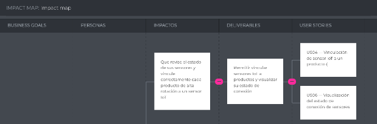
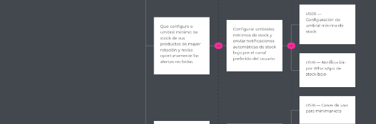
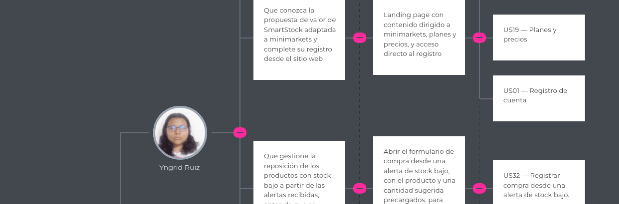
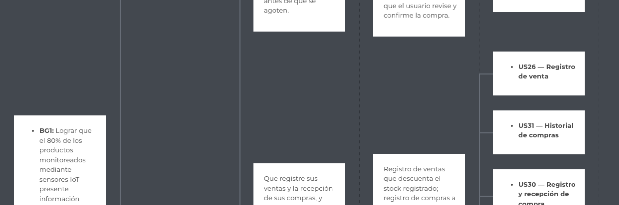
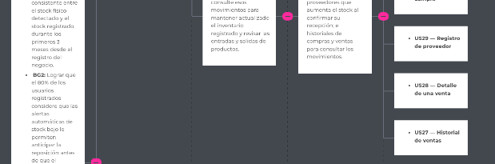
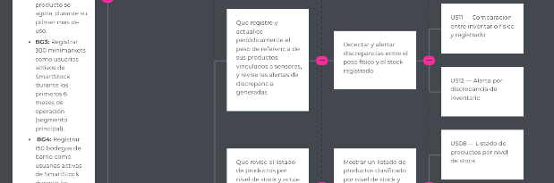
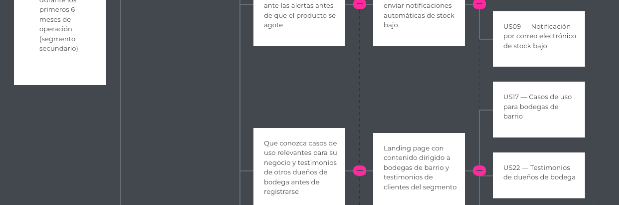
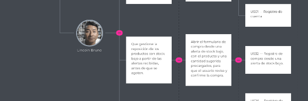

Nota. Impact mapping de SmartStock elaboración propia

**Medición de las metas**

Para BG1, se propone comparar el stock físico y el registrado de los
productos monitoreados, expresados en la misma unidad, y calcular el
porcentaje que presenta coincidencia al finalizar los primeros tres
meses de cada negocio. Para BG2, se aplicará una encuesta al terminar el
primer mes de uso y se calculará el porcentaje de usuarios que afirme
que las alertas le permiten anticipar la reposición. Para BG3 y BG4, se
propone considerar activo a un negocio que registre al menos una compra
o venta durante el último mes, diferenciando minimarkets y bodegas.

**Decisiones eficientes**

Se priorizan Compras y Ventas porque permiten registrar las entradas y
salidas del inventario y explicar sus cambios. La compra iniciada desde
una alerta reutiliza el formulario de Compras y precarga los datos del
producto, reduciendo el ingreso repetido de información. Las alertas
utilizan el stock del sensor cuando está en línea y el stock registrado
cuando no hay sensor o está desconectado, permitiendo operar sin
depender permanentemente del dispositivo. En el Sprint 2 se utiliza una
Fake API para comprobar los flujos del frontend antes de implementar los
Web Services en ASP.NET Core en el Sprint 3.

SmartStock plantea un modelo de suscripción cuyo precio dependerá de las
funcionalidades y la cantidad de sensores contratados. Para evaluar su
viabilidad económica se deberán considerar los costos de alojamiento,
mantenimiento, soporte, notificaciones y adquisición e instalación de
dispositivos IoT. El uso del inventario registrado permite comenzar sin
sensores e incorporarlos posteriormente, reduciendo la inversión inicial
del negocio. El beneficio esperado es disminuir faltantes y tiempo de
control manual. La rentabilidad deberá validarse comparando los ingresos
por suscripción con los costos operativos y la disposición a pagar de
los usuarios; todavía no se cuenta con cifras suficientes para
afirmarla.

## 3.3. Product Backlog

El Product Backlog de SmartStock se estructuró a partir de las User
Stories y las Technical Stories definidas para el proyecto,
organizándolas según sus funcionalidades y prioridades. Para la
estimación del esfuerzo se utilizó Planning Poker, empleando la
secuencia de Fibonacci modificada (1, 2, 3, 5 y 8 puntos), mientras que
la priorización se realizó mediante el Método de los 100 Puntos,
permitiendo identificar y consensuar las historias que tendrían mayor
prioridad dentro del desarrollo del producto.

Las 32 User Stories y las 15 Technical Stories fueron organizadas en el
Product Backlog y registradas en Trello, incluyendo su respectiva
descripción y Story Points. Las historias relacionadas con la
construcción del sitio web estático (Landing Page) fueron consideradas
dentro de las prioridades iniciales debido a que forman parte del
alcance establecido para el Sprint 1. Posteriormente, el equipo
incorporó las historias de Compras y Ventas (US26 a US32) y sus
Technical Stories, y las ubicó en la parte alta del backlog pendiente,
por ser el núcleo funcional del producto: el registro de lo que entra y
sale del inventario, que luego el sensor IoT verifica.

Como evidencia de la organización y gestión del Product Backlog, se
presenta a continuación la captura del tablero utilizado en Trello y el
enlace de acceso correspondiente.

**Enlace del Product Backlog en Trello:**
<a href="https://trello.com/invite/b/6aa988a0941a5fb8c814af43/ATTI5eecabb28fdc9c85d7ba8336b688a97353B8B08C/trello-web" style="color:#2563eb">https://trello.com/invite/b/6aa988a0941a5fb8c814af43/ATTI5eecabb28fdc9c85d7ba8336b688a97353B8B08C/trello-web</a>

**Figura 16**

*Tablero del Product Backlog en Trello*

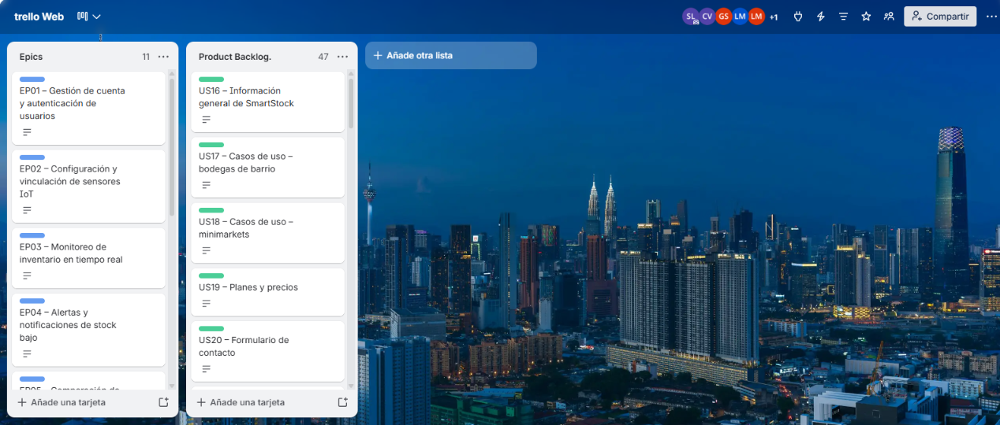

*Nota*. Elaboración propia

**Tabla 18**

*Product Backlog de SmartStock*

| **\#** | **User Story ID** | **Título**                                        | **Descripción**                                                                                                                                                       | **Story Points** |
|--------|-------------------|---------------------------------------------------|-----------------------------------------------------------------------------------------------------------------------------------------------------------------------|------------------|
| **1**  | US16              | Información general de SmartStock                 | Como visitante, deseo conocer qué es SmartStock y qué problema resuelve, para evaluar si es útil para mi negocio.                                                     | **2**            |
| **2**  | US17              | Casos de uso – bodegas de barrio                  | Como visitante del segmento bodegas, deseo ver casos de uso enfocados en negocios pequeños.                                                                           | **2**            |
| **3**  | US18              | Casos de uso – minimarkets                        | Como visitante del segmento minimarkets, deseo ver casos de uso de mayor volumen.                                                                                     | **2**            |
| **4**  | US19              | Planes y precios                                  | Como visitante, deseo ver los planes y precios, para decidir cuál se ajusta a mi presupuesto.                                                                         | **3**            |
| **5**  | US20              | Formulario de contacto                            | Como visitante, deseo completar un formulario para solicitar una demostración.                                                                                        | **3**            |
| **6**  | US21              | FAQ instalación de sensores                       | Como visitante, deseo ver preguntas frecuentes sobre instalación de sensores.                                                                                         | **2**            |
| **7**  | US22              | Testimonios de dueños de bodega                   | Como visitante del segmento bodegas, deseo ver testimonios de otros clientes.                                                                                         | **2**            |
| **8**  | US23              | Comparación frente a otras soluciones             | Como visitante del segmento minimarkets, deseo ver una comparación frente a otras soluciones.                                                                         | **3**            |
| **9**  | US24              | Acceso a registro desde el sitio web              | Como visitante, deseo acceder a la opción de registro desde cualquier sección.                                                                                        | **1**            |
| **10** | US01              | Registro de cuenta                                | Como administrador de mi negocio, deseo registrarme con mi correo y datos de mi negocio.                                                                              | **5**            |
| **11** | US02              | Inicio de sesión                                  | Como administrador de mi negocio, deseo iniciar sesión para acceder al panel.                                                                                         | **3**            |
| **12** | US03              | Recuperación de contraseña                        | Como administrador de mi negocio, deseo recuperar mi contraseña vía correo.                                                                                           | **3**            |
| **13** | TS04              | Endpoint de autenticación (API)                   | Como developer, deseo exponer POST /api/auth/login para validar credenciales.                                                                                         | **3**            |
| **14** | US13              | Registro de nuevo producto                        | Como administrador de mi negocio, deseo registrar un producto con nombre, categoría y peso.                                                                           | **3**            |
| **15** | US14              | Edición de producto del catálogo                  | Como administrador de mi negocio, deseo editar la información de un producto existente, incluido su precio de venta, costo y proveedor habitual.                      | **2**            |
| **16** | US29              | Registro de proveedor                             | Como administrador de mi negocio, deseo registrar a mis proveedores con su nombre, teléfono y correo opcional.                                                        | **2**            |
| **17** | US30              | Registro y recepción de compra                    | Como administrador de mi negocio, deseo registrar una compra a un proveedor y marcarla como recibida para aumentar mi stock.                                          | **5**            |
| **18** | US26              | Registro de venta                                 | Como administrador de mi negocio, deseo registrar una venta con productos y cantidades para mantener mi stock actualizado.                                            | **5**            |
| **19** | TS13              | Modelo de datos y migraciones de ventas y compras | Como developer, deseo crear las tablas de ventas, compras, proveedores y movimientos de stock mediante migraciones.                                                   | **5**            |
| **20** | TS14              | Registro automático de movimientos de stock       | Como developer, deseo que cada venta, compra recibida o ajuste genere un movimiento de stock.                                                                         | **5**            |
| **21** | TS09              | Endpoints de proveedores                          | Como developer, deseo exponer POST y GET /api/proveedores.                                                                                                            | **2**            |
| **22** | TS10              | Endpoint de registro de compras                   | Como developer, deseo exponer POST /api/compras.                                                                                                                      | **3**            |
| **23** | TS11              | Endpoint de recepción de compras                  | Como developer, deseo exponer PATCH /api/compras/{id}/recepcion.                                                                                                      | **3**            |
| **24** | TS07              | Endpoint de registro de ventas                    | Como developer, deseo exponer POST /api/ventas.                                                                                                                       | **3**            |
| **25** | US32              | Registro de compra desde una alerta de stock bajo | Como administrador de mi negocio, deseo registrar una compra desde una alerta de stock bajo, con el producto y proveedor precargados.                                 | **3**            |
| **26** | US27              | Historial de ventas                               | Como administrador de mi negocio, deseo consultar el historial de mis ventas por rango de fechas.                                                                     | **3**            |
| **27** | US28              | Detalle de una venta                              | Como administrador de mi negocio, deseo ver el detalle de una venta.                                                                                                  | **2**            |
| **28** | US31              | Historial de compras                              | Como administrador de mi negocio, deseo consultar el historial de mis compras por rango de fechas.                                                                    | **3**            |
| **29** | TS08              | Endpoints de consulta de ventas                   | Como developer, deseo exponer GET /api/ventas y GET /api/ventas/{id}.                                                                                                 | **3**            |
| **30** | TS12              | Endpoints de consulta de compras                  | Como developer, deseo exponer GET /api/compras y GET /api/compras/{id}.                                                                                               | **2**            |
| **31** | US04              | Vinculación de sensor IoT a un producto           | Como administrador de mi negocio, deseo vincular un sensor de peso a un producto.                                                                                     | **5**            |
| **32** | US05              | Configuración de umbral mínimo de stock           | Como administrador de mi negocio, deseo configurar el umbral mínimo por producto.                                                                                     | **3**            |
| **33** | US06              | Estado de conexión de sensores                    | Como administrador de mi negocio, deseo ver el estado de conexión de cada sensor.                                                                                     | **3**            |
| **34** | TS01              | Endpoint de recepción de lecturas (API)           | Como developer, deseo exponer POST /api/sensores/{id}/lecturas.                                                                                                       | **3**            |
| **35** | TS05              | Endpoint de estado de sensor (API)                | Como developer, deseo exponer GET /api/sensores/{id}/estado.                                                                                                          | **2**            |
| **36** | US07              | Visualización del peso actual                     | Como administrador de mi negocio, deseo ver el peso actual registrado por el sensor.                                                                                  | **3**            |
| **37** | US08              | Listado de productos por nivel de stock           | Como administrador de mi negocio, deseo ver un listado con el nivel de stock de mis productos.                                                                        | **3**            |
| **38** | TS02              | Endpoint de consulta de stock (API)               | Como developer, deseo exponer GET /api/productos/{id}/stock.                                                                                                          | **2**            |
| **39** | US09              | Notificación por correo de stock bajo             | Como administrador de mi negocio, deseo recibir un correo cuando el stock llegue al umbral.                                                                           | **5**            |
| **40** | US10              | Notificación por WhatsApp de stock bajo           | Como administrador de mi negocio, deseo recibir WhatsApp cuando el stock llegue al umbral.                                                                            | **5**            |
| **41** | TS03              | Endpoint de notificación de stock bajo (API)      | Como developer, deseo exponer POST /api/notificaciones/stock-bajo.                                                                                                    | **3**            |
| **42** | US11              | Comparación inventario físico vs. registrado      | Como administrador de minimarket, deseo comparar el peso físico con lo registrado.                                                                                    | **5**            |
| **43** | US12              | Alerta por discrepancia de inventario             | Como administrador de mi negocio, deseo recibir alerta si la discrepancia supera 10%.                                                                                 | **3**            |
| **44** | TS06              | Endpoint de comparación de inventario (API)       | Como developer, deseo exponer GET /api/inventario/comparacion/{productoId}.                                                                                           | **3**            |
| **45** | US15              | Dashboard resumen de inventario                   | Como administrador de mi negocio, deseo ver un dashboard resumen del inventario, con las ventas y compras del día.                                                    | **5**            |
| **46** | US25              | Reportes de consumo y movimientos de inventario   | Como administrador de minimarket, deseo generar reportes de consumo, ventas, compras y movimientos por periodo, para tomar mejores decisiones de reposición y compra. | **5**            |
| **47** | TS15              | Endpoint de movimientos de stock                  | Como developer, deseo exponer GET /api/movimientos-stock con filtro por periodo.                                                                                      | **3**            |

Nota. Corresponde a una tabla a base de la info de US elaboración propia

- **Evidencia de la técnica de priorización - Método de los 100 puntos**

El equipo aplicó Dot Voting mediante el Método de los 100 Puntos en 3
sesiones, una por lote de historias. Cada integrante distribuyó su
propio total de 100 puntos entre las 31 historias vigentes a la fecha de
la votación (25 User Stories y las 6 historias de API que luego se
reclasificaron como TS01–TS06). Las historias de Compras y Ventas
(US26–US32) y las Technical Stories TS07–TS15 se incorporaron después de
la votación y se ubicaron en la parte alta del backlog por ser el núcleo
del producto, por lo que no figuran en los gráficos.  

##
##
##

**Figura 17**

*Lote 1: Método de los 100 puntos (US01–US011)*

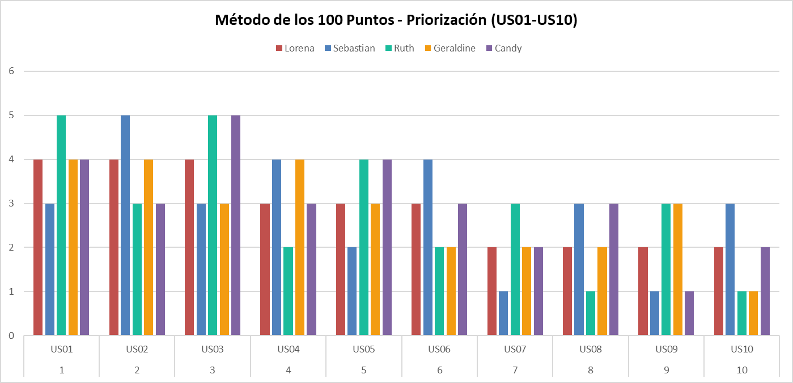

Nota. Evidencia de priorización mediante el Método de los 100 puntos -
Lote 1.

**Figura 18**

*Lote 2: Método de los 100 puntos (US11–US20)*

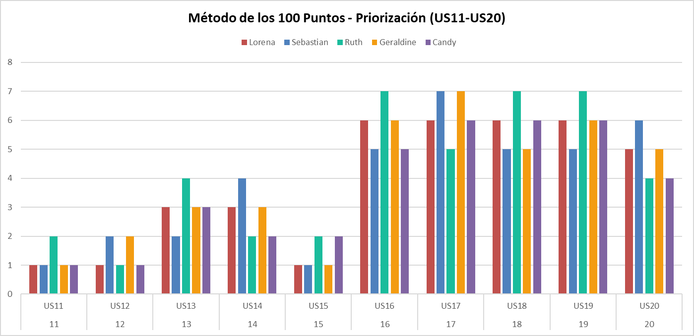

Nota. Evidencia de priorización mediante el Método de los 100 puntos -
Lote 2.

**Figura 19**

*Lote 3: Método de los 100 puntos (US21–US31)*

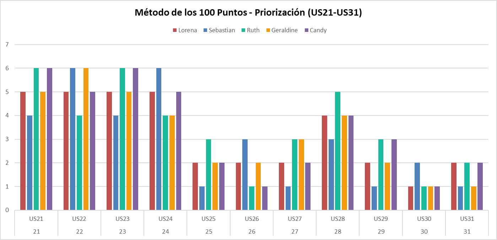

Nota. Evidencia de priorización mediante el Método de los 100 puntos -
Lote 3.

# Capítulo IV: Product Design
## 4.1. Style Guidelines 

En este apartado estableceremos los criterios visuales y de comunicación
que se utilizarán en el diseño del Landing Page y de la Web
Application,. El diseño estará centrado en transmitir una imagen simple,
moderna y confiable, utilizando colores, tipografías, botones e iconos
que permitan entender fácilmente la información. Como SmartStock está
dirigido a propietarios y administradores de minimarkets y bodegas de
barrio, se evitará un diseño demasiado complejo y se priorizará una
interfaz sencilla y fácil de usar para los usuarios

### 4.1.1. General Style Guidelines

**Branding**

SmartStock es operado por InventiaStock. El logo se usa como ícono de 42
x 42px junto al nombre de marca en la cabecera (reducido a 34 x 34px en
pantallas móviles menores a 720px), manteniendo consistencia en todas
las vistas.

**Typography.**

Para la identidad visual del producto, se seleccionó una tipografía que
combine claridad, accesibilidad y un estilo tecnológico.

- **Tipografía:** Manrope, disponible en Google Fonts.
- **Peso 400 (Regular):** utilizado para el texto de cuerpo.
- **Peso 600 (Semibold):** aplicado en labels, botones y elementos de navegación.
- **Peso 700 (Bold):** utilizado en los títulos principales.
- **Estilo:** sans-serif geométrica, elegida para transmitir un tono técnico pero accesible.
- **Enfoque:** busca adaptarse a un producto de monitoreo IoT dirigido a dueños de bodegas, quienes no necesariamente cuentan con conocimientos técnicos.

**Colors**

La paleta se construyó sobre un azul marino como color de marca, con dos
acentos adicionales (cian y verde menta) incorporados para reforzar
puntos de interés visual en etiquetas, testimonios y elementos
decorativos:

**Tabla 19**

*Paleta de colores y tokens de diseño de SmartStock*

<table>
<tbody>
<tr>
<th>Token</th>
<th>Valor</th>
<th>Uso</th>
</tr>
<tr>
<td>--navy</td>
<td>#082b4c</td>
<td>Titulares, marca, botón primario, foco de navegación</td>
</tr>
<tr>
<td>--blue</td>
<td>#1266d4</td>
<td>Enlaces, acentos, estado hover de botones</td>
</tr>
<tr>
<td>--cyan</td>
<td>#0ea5a8</td>
<td>Etiquetas destacadas (eyebrow) y acentos secundarios</td>
</tr>
<tr>
<td>--mint</td>
<td>#2fcf78</td>
<td>Detalles decorativos (blobs de fondo, indicador de tarjeta al hover)</td>
</tr>
<tr>
<td>--ink</td>
<td>#172033</td>
<td>Texto de cuerpo</td>
</tr>
<tr>
<td>--muted</td>
<td>#667085</td>
<td>Texto secundario / descripciones</td>
</tr>
<tr>
<td>--border</td>
<td>#dce6ef</td>
<td>Bordes y separadores</td>
</tr>
<tr>
<td>--soft</td>
<td>#f5f9fd</td>
<td>Fondos alternos de sección</td>
</tr>
</tbody>
</table>

Nota. Elaboración propia

El blanco (#ffffff) es el fondo dominante, reforzando una identidad
limpia y confiable, apropiada para un producto que maneja datos de
inventario de un negocio.

Estas decisiones se sustentan en los principios de claridad, confianza y
accesibilidad: el azul marino como color dominante transmite seriedad y
profesionalismo sin resultar frío; los acentos cian y verde menta se
reservan para elementos puntuales de refuerzo visual (etiquetas,
indicadores de interacción), evitando sobrecargar la interfaz; y el uso
del blanco como fondo dominante prioriza la legibilidad de los datos de
inventario que el producto presenta al usuario.

**Figura 20**

*Paleta de colores de SmartStock*

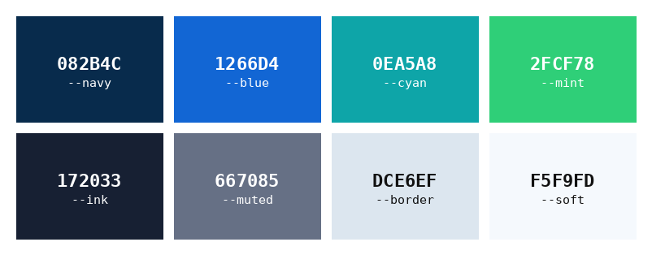
Nota. Elección y elaboración propia

**Spacing**

Para mantener una interfaz consistente y facilitar la lectura, se
establecieron criterios de espaciado y dimensiones para los componentes.

- **Border-radius:** escala de 12px como base (inputs y contenedores generales), 10px en botones y 14px en tarjetas y tablas, dando mayor presencia visual a los elementos interactivos y a los contenedores de datos.
- **Ancho máximo de contenido:** 1040px.
- **Propósito:** mantener líneas de lectura cómodas y evitar que el contenido se extienda demasiado en pantallas grandes.

**Tono de comunicación**

El tono de comunicación definido es cercano, práctico y directo,
priorizando la confianza y la facilidad de comprensión sobre el lenguaje
técnico.

- **Testimonios:** se utilizan testimonios en primera persona para generar identificación con los usuarios.
  - "Antes me enteraba de que el arroz se había acabado cuando un cliente lo pedía…"
- **Llamadas a la acción:** son directas y orientadas a la acción.
  - "Empezar prueba gratuita"
  - "Sin tarjeta · Instalación en menos de un día"
- **Enfoque:** en las cuatro dimensiones de tono definidas para el producto:
  - **Divertido – Serio:** más cerca de Serio, priorizando la confianza sobre el humor, dado que se maneja información de inventario y ventas del negocio.
  - **Formal – Casual:** más cerca de Casual, evitando lenguaje corporativo rígido para conectar con dueños de bodegas y minimarkets.
  - **Respetuoso – Irreverente:** más cerca de Respetuoso, reconociendo que el usuario no necesariamente cuenta con conocimientos técnicos y evitando minimizar sus dudas.
  - **Entusiasta – Sereno:** más cerca de Entusiasta, transmitiendo confianza y motivación para adoptar la solución.
- **Objetivo:** facilitar la comprensión del producto y conectar con los usuarios sin recurrir a tecnicismos innecesarios.

### 4.1.2. Web Style Guidelines 

- **Botones:** se definieron tres variantes: .btn como botón primario, con relleno en degradado de navy y estado hover con elevación (desplazamiento sutil hacia arriba) y sombra reforzada; .btn.ghost como botón secundario, con borde y sin relleno; y .btn.block como botón de ancho completo, utilizado en las tarjetas de planes. Las tres variantes cuentan con un estado hover definido.

**Figura 21**

*Botones del Landing Page: primario, secundario y de selección de plan*

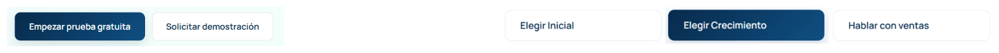 style="width:5.05729in;height:0.56766in" /> style="width:5.01563in;height:0.39646in" />

Nota. Elaboración propia

- **Formularios:** los campos de entrada utilizan un borde de 1px y un radio de 8px. El estado de error se identifica mediante aria-invalid="true", acompañado de un borde rojo \#c0392b y un mensaje de error asociado mediante aria-describedby. La validación se ejecuta en el evento blur, en lugar de realizarse mientras el usuario escribe, evitando marcar como inválido un campo que aún se encuentra en proceso de completarse.

**Figura 22**

*Estado de error de validación en el formulario de demostración del
Landing Page*

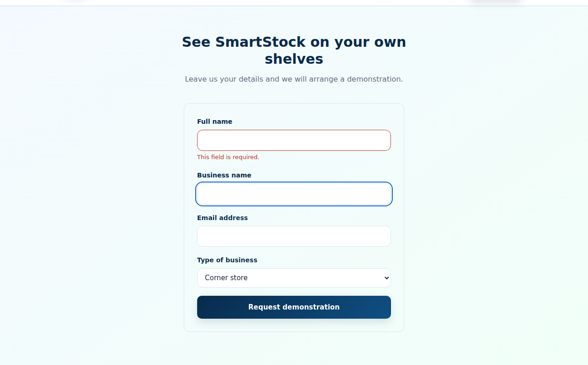
Nota. Elaboración propia

- **Foco visible:** se define :focus-visible con un outline azul de 2px en toda la interfaz, facilitando la navegación mediante teclado como parte de los criterios de accesibilidad.
- **Avatares de testimonios:** cada testimonio incorpora un avatar circular con las iniciales de la persona sobre un fondo en degradado (rosa, azul o verde según el caso), reforzando la identificación visual de cada historia sin depender de fotografías reales.
- **Responsive breakpoints:** se establecen dos puntos de quiebre principales: 900px, donde las grillas de 3 o 2 columnas se reducen a una sola columna; y 720px, donde la barra de navegación se transforma en un menú hamburguesa y el botón "Crear cuenta" se incorpora dentro del menú móvil. Adicionalmente, se definieron puntos de quiebre intermedios (850px, 980px y 1180px) para ajustar con mayor precisión el espaciado y la disposición de secciones específicas como testimonios y tarjetas.
- **Reduced motion:** se respeta la configuración prefers-reduced-motion: reduce, desactivando las transiciones y animaciones para los usuarios que tienen activada esta preferencia en su sistema, como parte del compromiso de accesibilidad e inclusión declarado en el propio sitio (sección 6 de Términos y Condiciones).

## 4.2. Information Architecture 

La arquitectura de información de SmartStock integra tanto el Landing
Page como la Web Application dentro de una misma estructura, debido a
que ambos productos comparten una lógica de navegación coherente, una
misma preferencia de idioma almacenada en el navegador y un lenguaje
visual y de interacción consistente.

Ambos productos utilizan la misma preferencia de idioma mediante
localStorage, utilizando la clave smartstock.lang, lo cual permite
mantener el idioma seleccionado por el usuario al navegar entre ambos
sistemas.

**Mapa de Arquitectura de Información**

**Figura 23**

*Mapa de arquitectura de información de SmartStock*

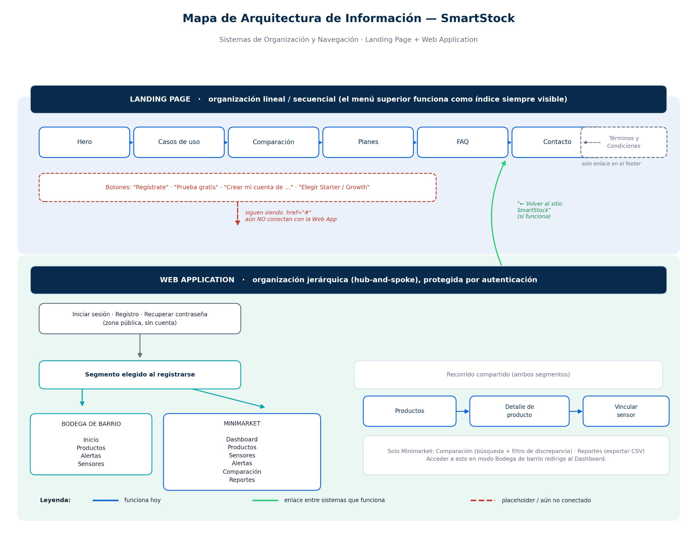
Nota. Elaboración propia

El mapa de arquitectura de información representa la organización de
ambos productos y muestra también las conexiones existentes entre ellos.
Asimismo, permite identificar visualmente la navegación que ya se
encuentra implementada y aquella integración que todavía se encuentra
pendiente.

### 4.2.1. Organization Systems 

Para la organización visual del contenido, SmartStock utiliza diferentes
esquemas dependiendo del tipo de información y del flujo que realiza el
usuario.

**Organización jerárquica**

La organización jerárquica se utiliza principalmente en la Web
Application.

El Dashboard funciona como el punto central de navegación y, desde ahí,
el usuario puede acceder a las principales funcionalidades del sistema.

Dentro de la sección de productos existe una jerarquía más profunda:

**Dashboard → Productos → Detalle de producto → Vincular sensor**

Esto permite que el usuario avance desde una sección general hacia
información cada vez más específica.

Además, dentro del sidebar, las funcionalidades principales se muestran
primero, mientras que opciones secundarias como Configuración y Cerrar
sesión se encuentran ubicadas al final del menú.

**Figura 24**

*Dashboard con barra lateral de la Web Application para minimarkets*

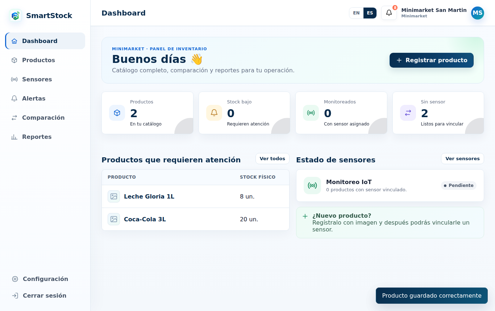
Nota. Elaboración propia

**Figura 25**

*Pantalla de inicio de la Web Application para bodegas de barrio*

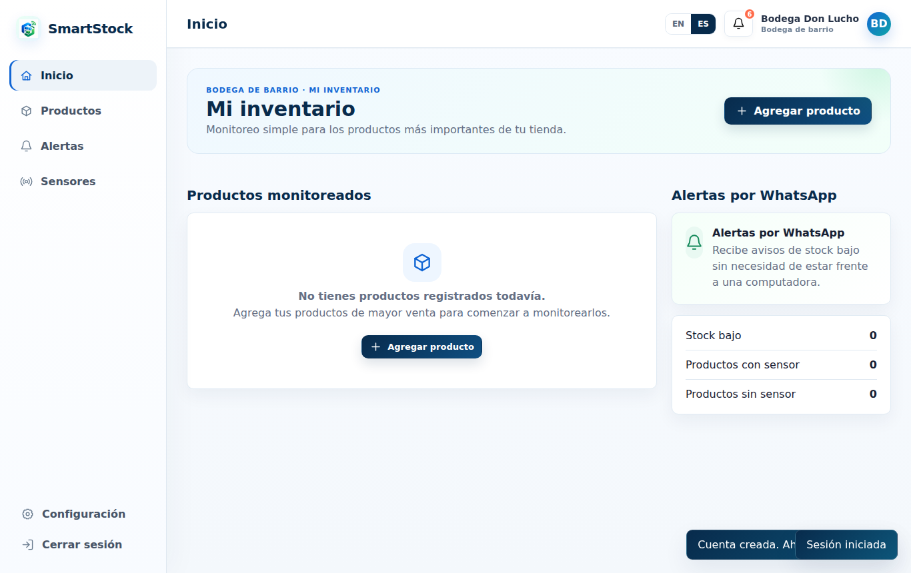
Nota. Elaboración propia

**Organización secuencial**

La organización secuencial se utiliza en los procesos que requieren que
el usuario complete una serie de pasos en un orden determinado.

Por ejemplo, durante el proceso de incorporación del usuario se sigue el
siguiente flujo:

**Registro → Elección de segmento → Inicio de sesión → Registro del
primer producto**

De esta manera, el usuario es guiado paso a paso hasta comenzar a
utilizar el sistema.

Este mismo principio también se aplica en el Landing Page, cuya
información está organizada para ser recorrida de arriba hacia abajo:

**Hero → Casos de uso → Comparación → Planes → FAQ → Contacto**

**Organización matricial**

La organización matricial se utiliza principalmente en las tablas de
Productos y Comparación.

En la sección **Productos**, cada producto se relaciona con diferentes
atributos como:

- Categoría.
- Estado.
- Stock.
- Umbral.
- Sensor.

En la sección **Comparación**, cada producto se relaciona principalmente
con:

- Stock físico.
- Stock registrado.
- Diferencia entre ambos valores.

Este tipo de organización permite visualizar diferentes atributos de un
mismo producto dentro de una sola fila y aplicar filtros sin perder el
contexto de la información.

**Organización por audiencia**

La organización por audiencia representa una de las decisiones más
importantes dentro de SmartStock.

**Figura 26**

*Pantalla de creación de cuenta con selección de segmento*

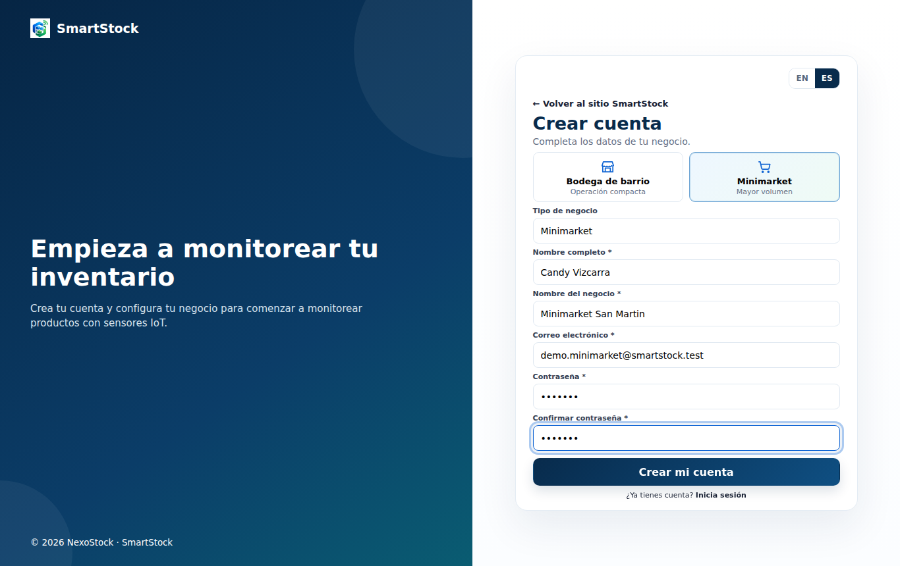
Nota. Elaboración propia

Las funcionalidades disponibles se organizan dependiendo del segmento
seleccionado por el usuario durante el registro.

Los segmentos utilizados son:

- Bodega de barrio.
- Minimarket.

Esta diferenciación se aplica tanto en el menú lateral como en las rutas
disponibles dentro de la aplicación.

De esta manera, cada tipo de usuario visualiza únicamente las
funcionalidades correspondientes a las necesidades de su negocio.

**Organización por tópicos**

El Landing Page utiliza una organización por tópicos.

Cada sección presenta un tema específico dentro de la página, por
ejemplo:

- Casos de uso.
- Comparación.
- Planes.
- FAQ.

Estas secciones pueden ser accedidas directamente desde el menú mediante
enlaces internos.

**Organización cronológica**

La organización cronológica se utiliza en la sección de Alertas.

Los eventos más recientes aparecen primero mediante referencias de
tiempo como:

- Hace 4 min.
- Hace 12 min.
- Hace 30 min.

Esto permite que el usuario pueda identificar primero los eventos más
recientes y atender rápidamente las situaciones que puedan requerir su
atención.

**Organización alfabética**

Actualmente no se utiliza una organización alfabética dentro del
producto.

Debido a que los catálogos manejados durante el alcance actual del
proyecto son relativamente pequeños, se priorizó la organización basada
en el estado de los productos.

Por ejemplo, los productos con stock bajo pueden mostrarse antes que los
productos con niveles normales, ya que esta información resulta más
relevante para la gestión del inventario.

**Limitación actual de integración**

Actualmente existe una limitación de integración entre el Landing Page y
la Web Application.

Desde la Web Application, el usuario puede regresar hacia el Landing
Page utilizando el logo de SmartStock o mediante el enlace:

**“← Volver al sitio SmartStock”**

Sin embargo, actualmente el Landing Page todavía no redirige hacia la
Web Application.

Los siguientes botones continúan utilizando enlaces temporales href="#":

- Regístrate.
- Prueba gratis.
- Crear mi cuenta de bodega.
- Crear mi cuenta de minimarket.
- Elegir Starter.
- Elegir Growth.

Por este motivo, esta funcionalidad se considera una limitación conocida
del alcance actual del proyecto y no una integración completamente
implementada.

### 4.2.2. Labeling Systems 

Las etiquetas utilizadas en SmartStock fueron diseñadas buscando
mantener textos simples, cortos y fáciles de comprender.

**Landing Page**

En el Landing Page, las etiquetas del menú corresponden directamente con
los títulos de las diferentes secciones.

Por ejemplo:

- Casos de uso.
- Comparación.
- Planes.
- FAQ.

Estas etiquetas utilizan una o dos palabras y funcionan al mismo tiempo
como enlaces internos hacia las secciones correspondientes.

Esto evita inconsistencias entre el nombre mostrado en el menú y el
contenido al cual dirige cada opción.

**Web Application**

En la Web Application, los elementos del sidebar combinan un ícono con
una etiqueta corta.

Entre las principales etiquetas se encuentran:

- Dashboard.
- Productos.
- Sensores.
- Alertas.
- Comparación.
- Reportes.

Los íconos ayudan a complementar visualmente el significado de cada
opción, permitiendo mantener textos cortos sin perder claridad.

**Figura 27**

*Pantalla de registro de producto de la Web Application*

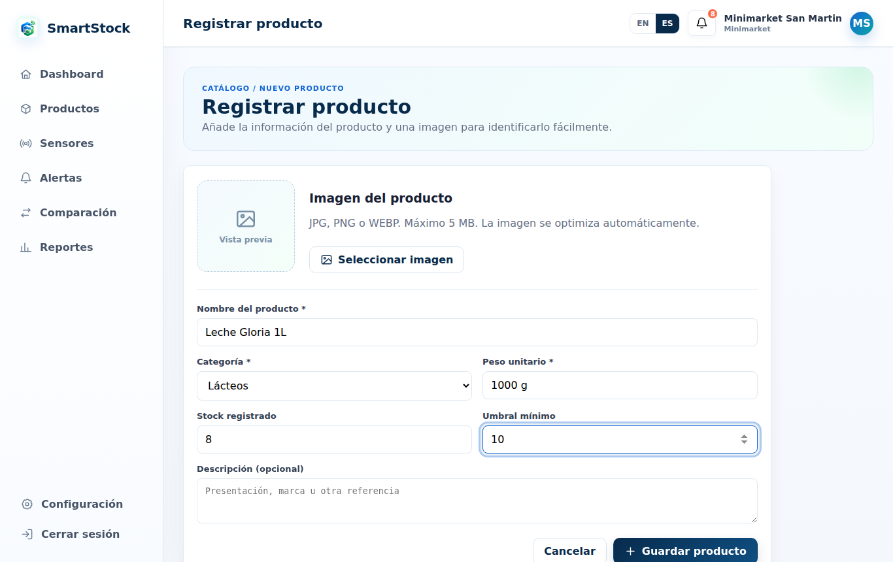
Nota. Elaboración propia

Además, tanto el Landing Page como la Web Application se encuentran
disponibles en inglés y español.

Ambos productos comparten la misma preferencia de idioma mediante:

localStorage

Clave utilizada:

smartstock.lang

Esto permite que el idioma seleccionado por el usuario permanezca activo
al desplazarse entre ambos productos.

**Diferencia de etiquetado según el segmento**

Existe una diferencia intencional en la etiqueta utilizada para la ruta
interna \#dashboard.

Para usuarios del segmento **Bodega de barrio**, esta sección se
denomina:

**Inicio**

Mientras que para los usuarios del segmento **Minimarket**, la misma
sección se denomina:

**Dashboard**

Esta diferencia fue implementada de manera intencional para utilizar una
terminología más sencilla en el segmento de negocio más pequeño.

### 4.2.3. SEO Tags and Meta Tags 

**Landing Page**

El Landing Page incluye las principales etiquetas SEO y Meta Tags
solicitadas.

Tanto index.html como terms-of-service.html cuentan con:

- \<title\>
- \<meta name="description"\>
- \<meta name="keywords"\>
- \<meta name="author"\>

La etiqueta \<title\> contiene un título descriptivo de la página.

La etiqueta \<meta name="description"\> contiene una descripción del
contenido y puede mostrarse de acuerdo con el idioma seleccionado.

La etiqueta \<meta name="keywords"\> contiene términos relacionados con
el proyecto como:

- minimarket.
- corner store.
- SmartStock.
- InventiaStock.

Finalmente, la etiqueta de autor utiliza:

\<meta name="author" content="InventiaStock"\>

**Web Application**

ctualmente, la Web Application cuenta únicamente con la etiqueta
\<title\>. Por ello, se identificó la necesidad de incorporar las
etiquetas de descripción, palabras clave y autor para completar la
configuración de SEO y Meta Tags.

Se propone agregar las siguientes etiquetas:

\<meta name="description" content="SmartStock Web Application — gestiona
tu inventario monitoreado por sensores IoT, alertas y comparaciones de
stock."\>

\<meta name="keywords" content="SmartStock, Inventia, gestión de
inventario, sensores IoT, monitoreo de stock"\>

\<meta name="author" content="Inventia"\>

De manera opcional, también puede utilizarse:

\<meta name="robots" content="noindex"\>

Esta etiqueta puede emplearse para indicar que la Web Application, al
tratarse de un sistema protegido o autenticado, no está destinada a ser
indexada por los motores de búsqueda.

### 4.2.4. Searching Systems 

El sistema de búsqueda de SmartStock se encuentra implementado
principalmente dentro de la Web Application, mientras que el Landing
Page no requiere un mecanismo de búsqueda debido a su estructura de
navegación por secciones.

**Landing Page**

El Landing Page no incorpora un sistema de búsqueda, debido a que
presenta una estructura de una sola página con secciones claramente
diferenciadas y un menú superior que permite acceder directamente a cada
una de ellas.

**Web Application**

La Web Application incorpora sistemas de búsqueda y filtrado en las
secciones de Productos, Comparación y Alertas, permitiendo al usuario
localizar información específica de manera más rápida.

**Productos**

La sección Productos dispone de un campo de búsqueda que filtra los
resultados en tiempo real.

La búsqueda puede realizarse utilizando:

- Nombre del producto.
- Categoría.

Además, el buscador puede combinarse con un filtro de estado que
contiene las siguientes opciones:

- Todos los estados.
- Stock bajo.
- Normal.
- Sin sensor.

**Figura 28**

*Sección Productos con búsqueda y filtro por estado*

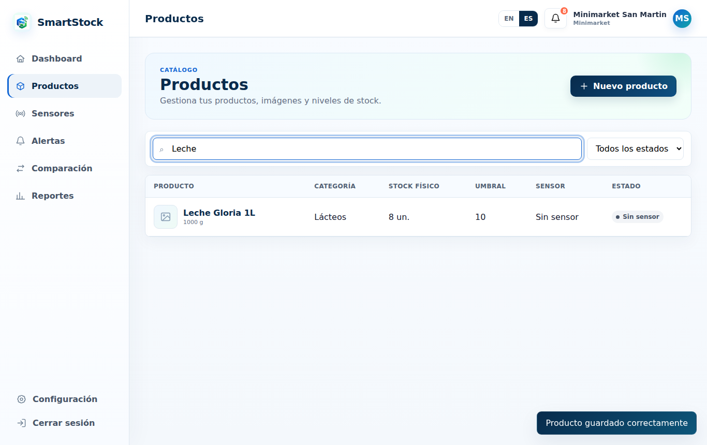
Nota. Elaboración propia

Después de realizar una búsqueda, las filas que no coinciden con los
criterios ingresados se ocultan.

Las filas que sí coinciden continúan mostrando toda su información
correspondiente, como:

- Imagen.
- Categoría.
- Stock.
- Umbral.
- Sensor.
- Estado.

De esta manera, el usuario puede encontrar rápidamente un producto sin
perder información relevante de los resultados encontrados.

**Comparación**

La sección Comparación incorpora un sistema de búsqueda por prefijo y
filtros que permiten organizar los productos según su situación.

Los filtros disponibles son:

- Todos.
- Con discrepancia.
- Sin discrepancia.

Después de realizar una búsqueda o aplicar un filtro, el sistema
recalcula automáticamente:

- El número de productos visibles.
- El número de productos que superan el 10 % de diferencia entre el stock registrado y el stock físico.

Esto permite que los indicadores mostrados se mantengan consistentes con
los resultados actualmente visibles.

**Figura 29**

*Sección Comparación con búsqueda y filtro de discrepancias*

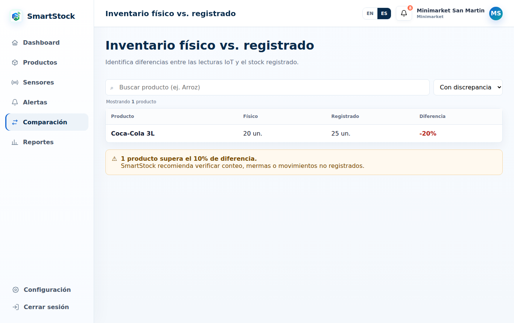
Nota. Elaboración propia

**Alertas**

La sección Alertas utiliza pestañas que funcionan como filtros por
categoría.

Las opciones disponibles son:

- Todas.
- Stock bajo.
- Discrepancias.
- Sensores.

Los contadores de cada categoría se actualizan según las alertas
disponibles. Cada alerta conserva información relevante como:

- Icono.
- Mensaje.
- Tiempo relativo desde su generación

**Figura 30**

*Sección Alertas con pestañas por categoría*

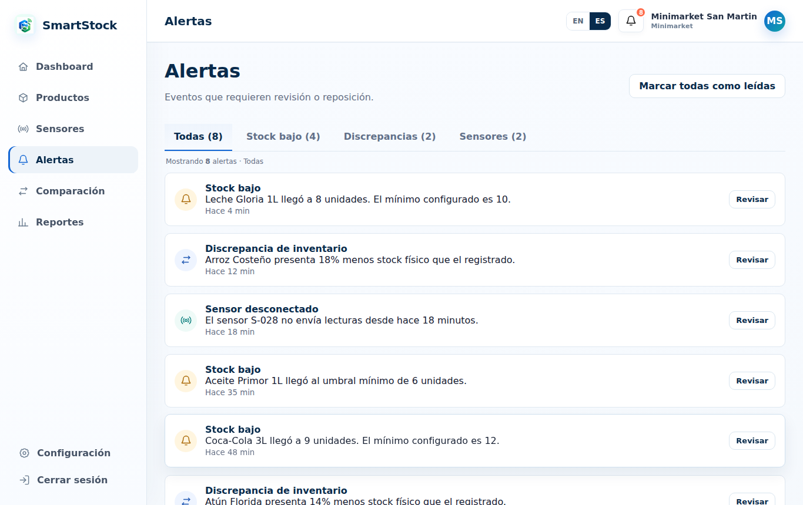
Nota. Elaboración propia

### 4.2.5. Navigation Systems 

SmartStock utiliza diferentes sistemas de navegación para facilitar el
desplazamiento del usuario tanto dentro del Landing Page como dentro de
la Web Application.

**Landing Page**

El Landing Page utiliza un menú superior persistente como sistema de
navegación global. Este menú permite acceder directamente a las
diferentes secciones de la página mediante enlaces internos.

También se cuenta con un pie de página que incorpora navegación
contextual mediante enlaces legales, información secundaria y enlaces a
redes sociales.

La navegación mediante anclas permite acceder directamente a secciones
como:

- Casos de uso.
- Comparación.
- Planes.
- FAQ.
- Contacto.

**Web Application**

La Web Application utiliza un sidebar persistente como sistema de
navegación global.

Las opciones disponibles dentro del sidebar cambian dependiendo del
segmento del usuario.

Para pantallas pequeñas se utiliza un menú hamburguesa que contiene las
mismas opciones disponibles en el menú lateral.

La barra superior también incorpora diferentes elementos de navegación y
orientación, entre ellos:

- Selector de idioma.
- Campana de notificaciones.
- Contador de notificaciones no leídas.
- Nombre del negocio.
- Tipo de negocio.
- Avatar con las iniciales del usuario.

La campana de notificaciones permite acceder directamente hacia la
sección de Alertas.

El bloque que contiene la información del negocio funciona además como
un indicador de identidad, ayudando al usuario a reconocer qué cuenta y
qué tipo de negocio está utilizando.

Dentro del Detalle de producto también se proporciona contexto adicional
mediante una navegación similar a un breadcrumb:

**Figura 31**

*Sección Sensores IoT de la Web Application*

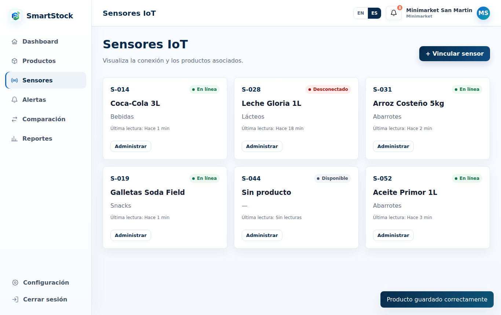
Nota. Elaboración propia

Esto permite identificar la ubicación actual dentro de la aplicación y
regresar hacia niveles anteriores.

**Navegación entre el Landing Page y la Web Application**

Actualmente, la Web Application permite regresar al Landing Page
mediante:

- El logotipo de SmartStock.
- La opción ← Volver al sitio SmartStock.

**Figura 32**

*Pantalla de inicio de sesión de la Web Application*

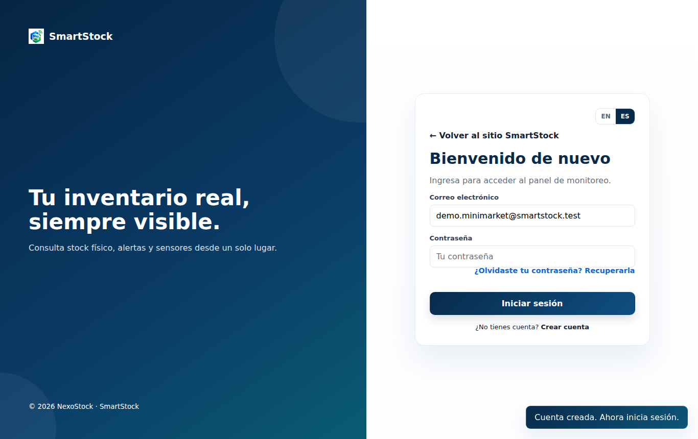
Nota. Elaboración propia

Sin embargo, desde el Landing Page todavía no existe una conexión
funcional hacia la Web Application, debido a que los principales botones
Call to Action continúan utilizando enlaces temporales.

Esta situación se considera una limitación conocida correspondiente al
estado actual del proyecto.

## 4.3. Landing Page UI Design 

El diseño de la interfaz de usuario (UI) de la página de inicio de
SmartStock es clave para captar la atención de los administradores y
propietarios de bodegas y minimarkets, ya que los guía hacia una acción
clara: comprender y adoptar una solución inteligente de gestión de
inventarios. Se ha priorizado una experiencia continua, de modo que cada
elemento de la página sea accesible, interactivo y fácil de usar,
transmitiendo confianza, mientras refleja el compromiso de SmartStock
con la innovación tecnológica y la claridad en la comunicación.

### 4.3.1. Landing Page Wireframe 

El wireframe de SmartStock organiza de forma clara la página de inicio,
mostrando la secuencia lógica de secciones: desde el problema de la
gestión del inventario, pasando por las funcionalidades principales,
hasta los beneficios que ofrece la plataforma.

- **Desktop:**

**Figura 33**

*Interfaz principal de bienvenida del landing page de SmartStock*

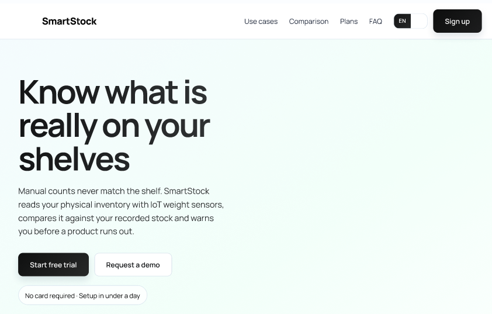
Nota. Wireframe de la estructura principal de inicio del landing page de
SmartStock en versión de escritorio.

**Figura 34**

*Interfaz sección de problemas y beneficios de SmartStock en versión de
escritorio*

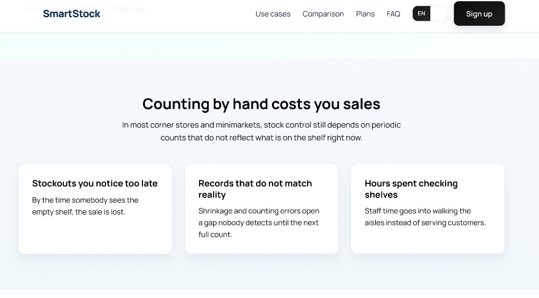
Nota. Wireframe de la estructura de la sección de problemas y beneficios
de SmartStock en versión de escritorio.

**Figura 35**

*Interfaz de la sección de casos de uso de SmartStock en versión de
escritorio*

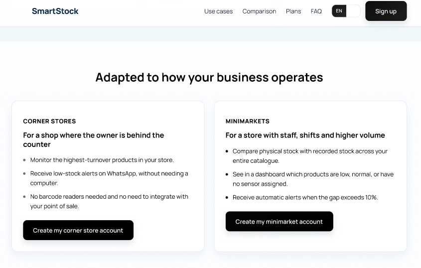
Nota. Wireframe de la estructura de la sección de casos de uso de
SmartStock en versión de escritorio.

**Figura 36**

*Interfaz de la sección comparativa de SmartStock en versión de
escritorio*

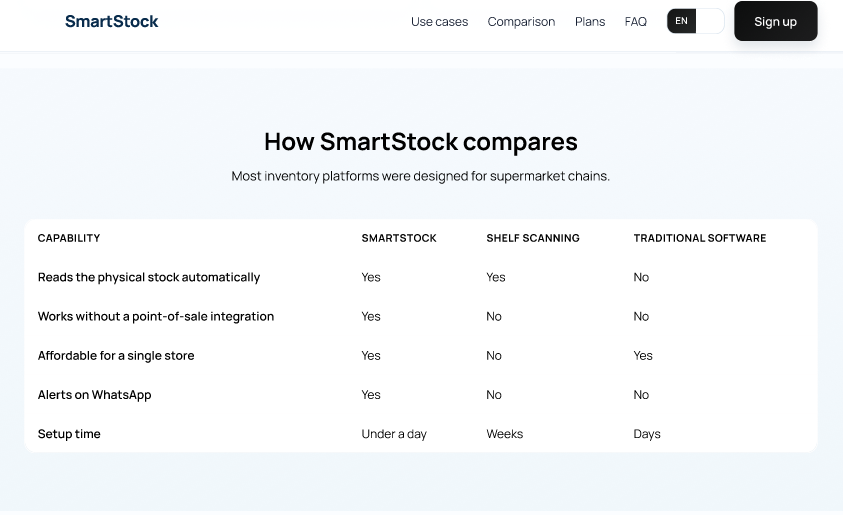
Nota. Estructura de la sección comparativa de SmartStock en versión de
escritorio.

**Figura 37**

*Interfaz de la sección de planes de SmartStock en versión de
escritorio*

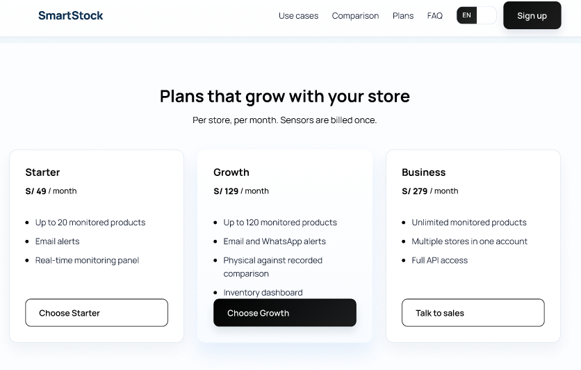
Nota. Estructura de la sección de planes de SmartStock en versión de
escritorio.

**Figura 38**

*Interfaz de la sección de testimonios de SmartStock en versión de
escritorio*

Nota. Wireframe de la estructura de la sección de testimonios de
SmartStock en versión de escritorio.

**Figura 39**

*Interfaz de la sección de preguntas frecuentes de SmartStock en versión
de escritorio*

Nota. Wireframe de la estructura de la sección de preguntas frecuentes
de SmartStock en versión de escritorio.

**Figura 40**

*Interfaz del formulario de demostración de SmartStock en versión de
escritorio*

Nota. Wireframe de la estructura del formulario de demostración de
SmartStock en versión de escritorio.

**Figura 41**

*Pie de página del landing page de SmartStock*

Nota. Wireframe del pie de página del landing page de SmartStock

- **Mobile:**

**Figura 42**

*Interfaz de la interfaz principal de inicio de SmartStock en versión
móvil*

Nota. Wireframe de la estructura principal de inicio del landing page de
SmartStock adaptada para dispositivos móviles.

**Figura 43**

*Interfaz de la sección de problemas y beneficios de SmartStock en
versión móvil*

Nota. Wireframe de la estructura de la sección de problemas y beneficios
de SmartStock adaptada para dispositivos móviles.

**Figura 44**

*Interfaz de la sección de casos de uso de SmartStock en versión móvil*

Nota. Wireframe de la estructura de la sección de casos de uso de
SmartStock adaptada para dispositivos móviles.

**Figura 45**

*Interfazde la sección comparativa de SmartStock en versión móvil*

Nota. Estructura de la sección comparativa de SmartStock adaptada para
dispositivos móviles.

**Figura 46**

*Interfaz de la sección de planes de SmartStock en versión móvil*

Nota. Estructura de la sección de planes de SmartStock adaptada para
dispositivos móviles.

**Figura 47**

*Interfazde la sección de testimonios de SmartStock en versión móvil*

Nota. Wireframe de la estructura de la sección de testimonios de
SmartStock adaptada para dispositivos móviles.

**Figura 48**

*Interfaz de la sección de preguntas frecuentes de SmartStock en versión
móvil*

Nota. Estructura de la sección de preguntas frecuentes adaptada para
dispositivos móviles.

**Figura 49**

*Interfaz del formulario de demostración de SmartStock en versión móvil*

Nota. Estructura del formulario de demostración de SmartStock adaptada
para celulares

**Figura 50**

*Interfaz del menú de navegación de SmartStock en versión móvil*

Nota.Wireframe de la estructura del menú de navegación de SmartStock
adaptado para dispositivos móviles.

### 4.3.2. Landing Page Mock-up 

El mock-up de la página de inicio de SmartStock actúa como un mapa
visual que organiza la estructura y el flujo de la información, mientras
cada sección conduce al usuario desde la identificación del problema
hasta la presentación de las funcionalidades y beneficios de la
plataforma.

- **Desktop:**

**Figura 51**

*Interfaz principal de inicio del landing page de SmartStock en versión
de escritorio*

Nota. Interfaz principal de inicio del landing page de SmartStock en
versión de escritorio.

**Figura 52**

*Interfaz de problemas y beneficios de SmartStock en versión de
escritorio*

Nota. Interfaz de problemas y beneficios de SmartStock en versión de
escritorio.

**Figura 53**

*Interfaz de casos de uso de SmartStock en versión de escritorio*

Nota. Mockup de la interfaz de casos de uso de SmartStock en versión de
escritorio.

**Figura 54**

*Interfaz de planes de SmartStock en versión de escritorio*

Nota. Mockup de la interfaz de planes de SmartStock en versión de
escritorio.

**Figura 55**

*Interfaz principal de bienvenida del landing page de SmartStock*

Nota. Imagen de la interfaz principal de bienvenida del landing page de
SmartStock

**Figura 56**

*Interfaz de testimonios de SmartStock en versión de escritorio*

Nota. Mockup de la interfaz de testimonios de SmartStock en versión de
escritorio.

**Figura 57**

*Interfaz de preguntas frecuentes de SmartStock en versión de
escritorio*

Nota. Mockup de la interfaz de preguntas frecuentes de SmartStock en
versión de escritorio.

**Figura 58**

*Interfaz del formulario de demostración de SmartStock en versión de
escritorio*

Nota. Interfaz del formulario de demostración de SmartStock en versión
de escritorio.

**Figura 59**

*Pie de página de la verizon de escritorio de SmartStock*

*Nota*. Mockup del pie de página de SmartStock

- **Mobile:**

**Figura 60**

*Interfaz principal de inicio del landing page de SmartStock en versión
móvil*

*Nota*. Mockup de la interfaz principal de inicio del landing page de
SmartStock adaptada para dispositivos móviles.

**Figura 61**

*Interfaz de problemas y beneficios de SmartStock en versión de móvil*

*Nota*. Mockup de la interfaz de problemas y beneficios de SmartStock
adaptada para dispositivos móviles.

**Figura 62**

*Interfaz de casos de uso de SmartStock en versión móvil*

*Nota*. Mockup de la interfaz de casos de uso de SmartStock para
dispositivos móviles.

**Figura 63**

*Interfaz comparativa de SmartStock en versión móvil*

*Nota*. Mockup de la interfaz comparativa de SmartStock adaptada para
dispositivos móviles.

**Figura 64**

*Interfaz de planes de SmartStock en versión móvil*

*Nota*. Mockup de la interfaz de planes de SmartStock adaptada para
dispositivos móviles.

**Figura 65**

*Interfaz de testimonios de SmartStock en versión de escritorio*

*Nota*. Mockup de la interfaz de testimonios de SmartStock para
dispositivos móviles.

**Figura 66**

*Interfaz de preguntas frecuentes de SmartStock en versión de
escritorio*

*Nota*. Mockup de la interfaz de preguntas frecuentes de SmartStock
adaptada para dispositivos móviles.

**Figura 67**

*Interfaz del formulario de demostración de SmartStock en versión de
escritorio*

*Nota*. Mockup de la interfaz del formulario de demostración de
SmartStock adaptada para dispositivos móviles.

**Figura 68**

*Interfaz del menú de navegación de SmartStock en versión móvil*

Nota. Mockup del menú de navegación del landing page de SmartStock
adaptado para dispositivos móviles.

## 4.4. Web Applications UX/UI Design 

En esta sección se presentan los wireframes, wireflows, mock-ups y
diagramas de flujo de usuario desarrollados para los dos segmentos
objetivo de SmartStock: propietarios y administradores de minimarkets, y
propietarios y administradores de bodegas de barrio. A través de estos
artefactos visuales, se detalla la arquitectura de la información y la
experiencia de interacción diseñada para optimizar la gestión diaria del
inventario. Asimismo, se evidencia cómo cada interfaz ha sido adaptada a
las necesidades operativas y al nivel de digitalización particular de
cada tipo de negocio, garantizando una navegación intuitiva y eficiente.

### 4.4.1. Web Applications Wireframes 

- **Dueños y administradores de Minimarkets**

**Figura 69**

*Wireframe 1 de la aplicación web para propietarios y administradores de
minimarkets*

*Nota*. Elaboración propia.

**Figura 70**

*Wireframe 2 de la aplicación web para propietarios y administradores de
minimarkets*

Nota. Elaboración propia.

**Figura 71**

*Wireframe 3 de la aplicación web para propietarios y administradores de
minimarkets*

Nota. Elaboración propia.

**Figura 72**

*Wireframe 4 de la aplicación web para propietarios y administradores de
minimarkets*

Nota. Elaboración propia.

**Figura 73**

*Wireframe 5 de la aplicación web para propietarios y administradores de
minimarkets*

Nota. Elaboración propia.

**Figura 74**

*Wireframe 6 de la aplicación web para propietarios y administradores de
minimarkets*

Nota. Elaboración propia.

**Figura 75**

*Wireframe 7 de la aplicación web para propietarios y administradores de
minimarkets*

Nota. Elaboración propia.

**Figura 76**

*Wireframe 8 de la aplicación web para propietarios y administradores de
minimarkets*

Nota. Elaboración propia.

**Figura 77**

*Wireframe 9 de la aplicación web para propietarios y administradores de
minimarkets*

Nota. Elaboración propia.

**Figura 78**

*Wireframe 10 de la aplicación web para propietarios y administradores
de minimarkets*

Nota. Elaboración propia.

**Figura 79**

*Wireframe 11 de la aplicación web para propietarios y administradores
de minimarkets*

Nota. Elaboración propia.

**Figura 80**

*Wireframe 12 de la aplicación web para propietarios y administradores
de minimarkets*

Nota. Elaboración propia.

**Figura 81**

*Wireframe 13 de la aplicación web para propietarios y administradores
de minimarkets*

Nota. Elaboración propia.

**Figura 82**

*Wireframe 14 de la aplicación web para propietarios y administradores
de minimarkets*

Nota. Elaboración propia.

**Figura 83**

*Wireframe 15 de la aplicación web para propietarios y administradores
de minimarkets*

Nota. Elaboración propia.

**Figura 84**

*Wireframe 16 de la aplicación web para propietarios y administradores
de minimarkets*

Nota. Elaboración propia.

**Figura 85**

*Wireframe 17 de la aplicación web para propietarios y administradores
de minimarkets*

Nota. Elaboración propia.

**Figura 86**

*Wireframe 18 de la aplicación web para propietarios y administradores
de minimarkets*

Nota. Elaboración propia.

**Figura 87**

*Wireframe 19 de la aplicación web para propietarios y administradores
de minimarkets*

Nota. Elaboración propia.

- **Dueños y administradores de Bodegas**

**Figura 88**

*Wireframe 1 de la aplicación web para propietarios y administradores de
bodegas de barrio*

Nota. Elaboración propia.

**Figura 89**

*Wireframe 2 de la aplicación web para propietarios y administradores de
bodegas de barrio*

Nota. Elaboración propia.

**Figura 90**

*Wireframe 3 de la aplicación web para propietarios y administradores de
bodegas de barrio*

Nota. Elaboración propia.

**Figura 91**

*Wireframe 4 de la aplicación web para propietarios y administradores de
bodegas de barrio*

Nota. Elaboración propia.

**Figura 92**

*Wireframe 5 de la aplicación web para propietarios y administradores de
bodegas de barrio*

Nota. Elaboración propia.

**Figura 93**

*Wireframe 6 de la aplicación web para propietarios y administradores de
bodegas de barrio*

Nota. Elaboración propia.

**Figura 94**

*Wireframe 7 de la aplicación web para propietarios y administradores de
bodegas de barrio*

Nota. Elaboración propia.

**Figura 95**

*Wireframe 8 de la aplicación web para propietarios y administradores de
bodegas de barrio*

Nota. Elaboración propia.

**Figura 96**

*Wireframe 9 de la aplicación web para propietarios y administradores de
bodegas de barrio*

Nota. Elaboración propia.

**Figura 97**

*Wireframe 10 de la aplicación web para propietarios y administradores
de bodegas de barrio*

Nota. Elaboración propia.

**Figura 98**

*Wireframe 11 de la aplicación web para propietarios y administradores
de bodegas de barrio*

Nota. Elaboración propia.

**Figura 99**

*Wireframe 12 de la aplicación web para propietarios y administradores
de bodegas de barrio*

Nota. Elaboración propia.

**Figura 100**

*Wireframe 13 de la aplicación web para propietarios y administradores
de bodegas de barrio*

Nota. Elaboración propia.

**Figura 101**

*Wireframe 14 de la aplicación web para propietarios y administradores
de bodegas de barrio*

Nota. Elaboración propia.

**Figura 102**

*Wireframe 15 de la aplicación web para propietarios y administradores
de bodegas de barrio*

Nota. Elaboración propia.

**Figura 103**

*Wireframe 16 de la aplicación web para propietarios y administradores
de bodegas de barrio*

Nota. Elaboración propia.

### 4.4.2. Web Applications Wireflow Diagrams 

Los wireflows ilustran las rutas de navegación entre pantallas según
cada segmento. Cada diagrama parte de un objetivo del usuario (User
Goal), identifica las pantallas con su código e indica la ruta esperada
en azul y las alternativas o de error en rojo discontinuo, acompañándose
de una breve explicación y su condición principal.

Se elaboraron wireflows para los dos segmentos objetivo de SmartStock:
propietarios y administradores de minimarkets, y de bodegas de barrio.
Por extensión, este informe incluye únicamente los flujos centrales del
producto (acceso, catálogo, monitoreo de stock con sensores IoT,
compras, ventas y alertas de reposición). El conjunto completo puede
consultarse en el siguiente enlace.

Link:<a href="https://www.figma.com/board/Tdon4igryTEOc1wl7f5I15/Wireflow-diagrams-SmartStock?node-id=0-1&t=ik1xWHtOIA29fNXh-1" style="color:#2563eb">https://www.figma.com/board/Tdon4igryTEOc1wl7f5I15/Wireflow-diagrams-SmartStock?node-id=0-1&t=ik1xWHtOIA29fNXh-1</a>

- **Dueños y administradores de Minimarkets**

Para este segmento se presentan 11 wireflows, que cubren el acceso a la
cuenta, la gestión del catálogo, el monitoreo del stock con sensores
IoT, el registro de compras, ventas y proveedores, y la reposición desde
una alerta de stock bajo. Las pantallas se adaptan al tipo de negocio,
de modo que el menú y las funciones disponibles corresponden al segmento
de bodegas.

**Figura 104**

*Wireflow 1 de la aplicación web para propietarios y administradores de
minimarkets: iniciar sesión (US02)*

Nota. Elaboración propia.

**Figura 105**

*Wireflow 2 de la aplicación web para propietarios y administradores de
minimarkets: registrar una cuenta (US01)*

Nota. Elaboración propia.

**Figura 106**  
*Wireflow 3 de la aplicación web para propietarios y administradores de
minimarkets: consultar el resumen del negocio y navegar a sus módulos
(US15)*

Nota. Elaboración propia.

**Figura 107**

*Wireflow 4 de la aplicación web para propietarios y administradores de
minimarkets: registrar un producto en el catálogo (US13)*

Nota. Elaboración propia.

**Figura 108**

*Wireflow 5 de la aplicación web para propietarios y administradores de
minimarkets: consultar el stock de un producto y su peso en el sensor
(US07, US08, US06)*

Nota. Elaboración propia.

**Figura 109**

*Wireflow 6 de la aplicación web para propietarios y administradores de
minimarkets: vincular un sensor IoT a un producto (US04)*

Nota. Elaboración propia.

**Figura 110**

*Wireflow 7 de la aplicación web para propietarios y administradores de
minimarkets: configurar el umbral mínimo de stock (US05)*

Nota. Elaboración propia.

**Figura 111**

*Wireflow 8 de la aplicación web para propietarios y administradores de
minimarkets: registrar una compra (US30)*

Nota. Elaboración propia.

**Figura 112**

*Wireflow 9 de la aplicación web para propietarios y administradores de
minimarkets: registrar una venta (US26)*

Nota. Elaboración propia.

**Figura 113**

*Wireflow 10 de la aplicación web para propietarios y administradores de
minimarkets: registrar un proveedor (US211)*

Nota. Elaboración propia.

**Figura 114**

*Wireflow 11 de la aplicación web para propietarios y administradores de
minimarkets: reponer un producto desde una alerta de stock bajo (US32)*

Nota. Elaboración propia.

**Figura 115**

*Wireflow 12 de la aplicación web para propietarios y administradores de
minimarkets: comparar el inventario físico con el registrado (US11,
US12)*

Nota. Elaboración propia.

- **Dueños y administradores de Bodegas**

Para este segmento se presentan 11 wireflows. Son los mismos flujos que
en minimarkets, salvo la comparación entre inventario físico y
registrado, que no forma parte del recorrido de este segmento. Las
pantallas se adaptan al tipo de negocio, de modo que cambian el menú y
las funciones disponibles.

**Figura 116**

*Wireflow 1 de la aplicación web para propietarios y administradores de
bodegas de barrio: iniciar sesión (US02)*

Nota. Elaboración propia.

**Figura 117**

*Wireflow 2 de la aplicación web para propietarios y administradores de
bodegas de barrio: registrar una cuenta (US01)*

Nota. Elaboración propia.

**Figura 118**

*Wireflow 3 de la aplicación web para propietarios y administradores de
bodegas de barrio: consultar el resumen del negocio y navegar a sus
módulos (US15)*

Nota. Elaboración propia.

**Figura 119**

*Wireflow 4 de la aplicación web para propietarios y administradores de
bodegas de barrio: registrar un producto en el catálogo (US13)*

Nota. Elaboración propia.

**Figura 120**

*Wireflow 5 de la aplicación web para propietarios y administradores de
bodegas de barrio: consultar el stock de un producto y su peso en el
sensor (US07, US08, US06)*

Nota. Elaboración propia.

**Figura 121**

*Wireflow 6 de la aplicación web para propietarios y administradores de
bodegas de barrio: vincular un sensor IoT a un producto (US04)*

Nota. Elaboración propia.

**Figura 122**

*Wireflow 7 de la aplicación web para propietarios y administradores de
bodegas de barrio: configurar el umbral mínimo de stock (US05)*

Nota. Elaboración propia.

**Figura 123**

*Wireflow 8 de la aplicación web para propietarios y administradores de
bodegas de barrio: registrar una compra (US30)*

Nota. Elaboración propia.

**Figura 124**

*Wireflow 9 de la aplicación web para propietarios y administradores de
bodegas de barrio: registrar una venta (US26)*

Nota. Elaboración propia.

**Figura 125**

*Wireflow 10 de la aplicación web para propietarios y administradores de
bodegas de barrio: registrar un proveedor (US29)*

Nota. Elaboración propia.

**Figura 126**

*Wireflow 11 de la aplicación web para propietarios y administradores de
bodegas de barrio: reponer un producto desde una alerta de stock bajo
(US32)*

Nota. Elaboración propia.

### 4.4.3. Web Applications Mock-ups 

- **Dueños y administradores de minimarkets**

**Figura 127**

*Mock-up 1 de la aplicación web para propietarios y administradores
de minimarkets: registro de cuenta (US01)*

*Nota.* Elaboración propia.

**Figura 128**

*Mock-up 2 de la aplicación web para propietarios y administradores
de minimarkets: inicio de sesión (US02)*

*Nota.* Elaboración propia.

**Figura 129**

*Mock-up 3 de la aplicación web para propietarios y administradores
de minimarkets: inicio de sesión con credenciales incorrectas (US02)*

*Nota.* Elaboración propia.

**Figura 130**

*Mock-up 4 de la aplicación web para propietarios y administradores
de minimarkets: dashboard inicial del negocio (US15)*

*Nota.* Elaboración propia.

**Figura 131**

*Mock-up 5 de la aplicación web para propietarios y administradores
de minimarkets: catálogo de productos sin registros (US07)*

*Nota.* Elaboración propia.

**Figura 132**

*Mock-up 6 de la aplicación web para propietarios y administradores
de minimarkets: formulario para registrar un producto (US13)*

*Nota.* Elaboración propia.

**Figura 133**

*Mock-up 7 de la aplicación web para propietarios y administradores
de minimarkets: catálogo con el producto registrado (US07)*

*Nota.* Elaboración propia.

**Figura 134**

*Mock-up 8 de la aplicación web para propietarios y administradores
de minimarkets: detalle de un producto y nivel de stock (US08)*

*Nota.* Elaboración propia.

**Figura 135**

*Mock-up 9 de la aplicación web para propietarios y administradores
de minimarkets: listado de sensores IoT (US06)*

*Nota.* Elaboración propia.

**Figura 136**

*Mock-up 10 de la aplicación web para propietarios y administradores
de minimarkets: vincular un sensor a un producto (US04)*

*Nota.* Elaboración propia.

**Figura 137**

*Mock-up 11 de la aplicación web para propietarios y administradores
de minimarkets: confirmación de sensor vinculado (US04)*

*Nota.* Elaboración propia.

**Figura 138**

*Mock-up 12 de la aplicación web para propietarios y administradores
de minimarkets: alertas, vista de todas*

*Nota.* Elaboración propia.

**Figura 139**

*Mock-up 13 de la aplicación web para propietarios y administradores
de minimarkets: alertas de stock bajo*

*Nota.* Elaboración propia.

**Figura 140**

*Mock-up 14 de la aplicación web para propietarios y administradores
de minimarkets: alertas de discrepancias de inventario*

*Nota.* Elaboración propia.

**Figura 141**

*Mock-up 15 de la aplicación web para propietarios y administradores
de minimarkets: alertas de sensores*

*Nota.* Elaboración propia.

**Figura 142**

*Mock-up 16 de la aplicación web para propietarios y administradores
de minimarkets: comparación del inventario físico con el registrado
(US11, US12)  

*Nota.* Elaboración propia.

**Figura 143**

*Mock-up 17 de la aplicación web para propietarios y administradores
de minimarkets: reportes de consumo (US25)*

*Nota.* Elaboración propia.

**Figura 144**

*Mock-up 18 de la aplicación web para propietarios y administradores
de minimarkets: configuración del negocio*

*Nota.* Elaboración propia.

**Figura 145**

*Mock-up 19 de la aplicación web para propietarios y administradores
de minimarkets: confirmación de cambios en la configuración*

*Nota.* Elaboración propia.

- **Dueños y administradores de Bodegas**

**Figura 146**

*Mock-up 1 de la aplicación web para propietarios y administradores
de bodegas de barrio: registro de cuenta (US01)  

*Nota.* Elaboración propia.

**Figura 147**

*Mock-up 2 de la aplicación web para propietarios y administradores
de bodegas de barrio: inicio de sesión (US02)  

*Nota.* Elaboración propia.

**Figura 148**

*Mock-up 3 de la aplicación web para propietarios y administradores
de bodegas de barrio: pantalla de inicio “Mi inventario” (US15)  

*Nota.* Elaboración propia.

**Figura 149**

*Mock-up 4 de la aplicación web para propietarios y administradores
de bodegas de barrio: catálogo de productos sin registros (US07)  

*Nota.* Elaboración propia.

**Figura 150**

*Mock-up 5 de la aplicación web para propietarios y administradores
de bodegas de barrio: formulario para registrar un producto (US13)  

*Nota.* Elaboración propia.

**Figura 151**

*Mock-up 6 de la aplicación web para propietarios y administradores
de bodegas de barrio: catálogo con el producto registrado (US07)  

*Nota.* Elaboración propia.

**Figura 152**

*Mock-up 7 de la aplicación web para propietarios y administradores
de bodegas de barrio: detalle de un producto y nivel de stock (US08)  

*Nota.* Elaboración propia.

**Figura 153**

*Mock-up 8 de la aplicación web para propietarios y administradores
de bodegas de barrio: alertas, vista de todas  

*Nota.* Elaboración propia.

**Figura 154**

*Mock-up 9 de la aplicación web para propietarios y administradores
de bodegas de barrio: alertas de stock bajo  

*Nota.* Elaboración propia.

**Figura 155**

*Mock-up 10 de la aplicación web para propietarios y administradores
de bodegas de barrio: alertas de sensores  

*Nota.* Elaboración propia.

**Figura 156**

*Mock-up 11 de la aplicación web para propietarios y administradores
de bodegas de barrio: listado de sensores IoT (US06)  

*Nota.* Elaboración propia.

**Figura 157**

*Mock-up 12 de la aplicación web para propietarios y administradores
de bodegas de barrio: vincular un sensor a un producto (US04)  

*Nota.* Elaboración propia.

**Figura 158**

*Mock-up 13 de la aplicación web para propietarios y administradores
de bodegas de barrio: confirmación de sensor vinculado (US04)  

*Nota.* Elaboración propia.

**Figura 159**

*Mock-up 14 de la aplicación web para propietarios y administradores
de bodegas de barrio: configuración del negocio  

*Nota.* Elaboración propia.

**Figura 160**

*Mock-up 15 de la aplicación web para propietarios y administradores
de bodegas de barrio: confirmación de cambios en la configuración  

*Nota.* Elaboración propia.

### 4.4.4. Web Applications User Flow Diagrams 

Los user flows muestran el recorrido que sigue el usuario para lograr un
objetivo concreto dentro de la aplicación según su segmento. Cada
diagrama parte de un User Goal, identifica las pantallas por código y
diferencia la ruta esperada (línea azul) de las alternativas o de error
(línea roja discontinua), acompañándose de una explicación y su
condición principal.

Se diseñaron flujos para los dos segmentos de SmartStock: propietarios y
administradores de minimarkets, y de bodegas de barrio. Por extensión,
este informe presenta únicamente los que cubren las funciones centrales
(acceso, catálogo, monitoreo de stock con sensores IoT, compras, ventas
y alertas de reposición). El conjunto completo puede consultarse en el
siguiente enlace.

Link:<a href="https://www.figma.com/board/Q4SExEhBOi9wb1iWULW9ce/User-Flow-diagrams-SmartStock?node-id=0-1&t=GD9ioBq6MAOymx5J-1" style="color:#2563eb">https://www.figma.com/board/Q4SExEhBOi9wb1iWULW9ce/User-Flow-diagrams-SmartStock?node-id=0-1&t=GD9ioBq6MAOymx5J-1</a>

- **Dueños y administradores de Minimarkets**

Para este segmento se presentan 12 user flows. Los de acceso
corresponden al inicio de sesión y al registro de la cuenta; los de
gestión, al registro de productos, la consulta del stock, la vinculación
de sensores y la configuración del umbral mínimo; y los de operación, al
registro de compras, ventas y proveedores, la reposición desde una
alerta y la comparación entre el inventario físico y el registrado.

**Figura 161**

*User Flow 1 de la web para propietarios de minimarkets: iniciar sesión
(US02)*

Nota. Elaboración propia.

**Figura 162**

*User Flow 2 de la aplicación web para propietarios y administradores de
minimarkets: registrar una cuenta (US01)*

Nota. Elaboración propia.

**Figura 163**

*User Flow 3 de la aplicación web para propietarios y administradores de
minimarkets: consultar el resumen del negocio y navegar a sus módulos
(US15)*

Nota. Elaboración propia.

**Figura 164**

*User Flow 4 de la aplicación web para propietarios y administradores de
minimarkets: registrar un producto en el catálogo (US13)*

Nota. Elaboración propia.

**Figura 165**

*User Flow 5 de la aplicación web para propietarios y administradores de
minimarkets: consultar el stock de un producto y su peso en el sensor
(US07, US08, US06)*

Nota. Elaboración propia.

**Figura 166**

*User Flow 6 de la aplicación web para propietarios y administradores de
minimarkets: vincular un sensor IoT a un producto (US04)*

Nota. Elaboración propia.

**Figura 167**

*User Flow 7 de la aplicación web para propietarios y administradores de
minimarkets: configurar el umbral mínimo de stock (US05)*

Nota. Elaboración propia.

**Figura 168**

*User Flow 8 de la aplicación web para propietarios y administradores de
minimarkets: registrar una compra (US30)*

Nota. Elaboración propia.

**Figura 169**

*User Flow 9 de la aplicación web para propietarios y administradores de
minimarkets: registrar una venta (US26)*

Nota. Elaboración propia.

**Figura 170**

*User Flow 10 de la aplicación web para propietarios y administradores
de minimarkets: registrar un proveedor (US29)*

Nota. Elaboración propia.

**Figura 171**

*User Flow 11 de la aplicación web para propietarios y administradores
de minimarkets: reponer un producto desde una alerta de stock bajo
(US32)*

Nota. Elaboración propia.

**Figura 172**

*User Flow 12 de la aplicación web para propietarios y administradores
de minimarkets: comparar el inventario físico con el registrado (US11,
US12)*

Nota. Elaboración propia.

- **Dueños y administradores de Bodegas**

Para este segmento se presentan 11 user flows, que cubren el acceso a la
cuenta, la gestión del catálogo, el monitoreo del stock con sensores
IoT, el registro de compras, ventas y proveedores, y la reposición desde
una alerta de stock bajo. Las pantallas se adaptan al tipo de negocio,
de modo que el menú y las funciones disponibles corresponden al segmento
de bodegas.

**Figura 173**

*User Flow 1 de la aplicación web para propietarios y administradores de
bodegas de barrio: iniciar sesión (US02)*

Nota. Elaboración propia.

**Figura 174**

*User Flow 2 de la aplicación web para propietarios y administradores de
bodegas de barrio: registrar una cuenta (US01)*

Nota. Elaboración propia.

**Figura 175**

*User Flow 3 de la aplicación web para propietarios y administradores de
bodegas de barrio: consultar el resumen del negocio y navegar a sus
módulos (US15)*

Nota. Elaboración propia.

**Figura 176**

*User Flow 4 de la aplicación web para propietarios y administradores de
bodegas de barrio: registrar un producto en el catálogo (US13)*

Nota. Elaboración propia.

**Figura 177**

*User Flow 5 de la aplicación web para propietarios y administradores de
bodegas de barrio: consultar el stock de un producto y su peso en el
sensor (US07, US08, US06)*

Nota. Elaboración propia.

**Figura 178**

*User Flow 6 de la aplicación web para propietarios y administradores de
bodegas de barrio: vincular un sensor IoT a un producto (US04)*

Nota. Elaboración propia.

**Figura 179**

*User Flow 7 de la aplicación web para propietarios y administradores de
bodegas de barrio: configurar el umbral mínimo de stock (US05)*

Nota. Elaboración propia.

**Figura 180**

*User Flow 8 de la aplicación web para propietarios y administradores de
bodegas de barrio: registrar una compra (US30)*

Nota. Elaboración propia.

**Figura 181**

*User Flow 9 de la aplicación web para propietarios y administradores de
bodegas de barrio: registrar una venta (US26)*

Nota. Elaboración propia.

**Figura 182**

*User Flow 10 de la aplicación web para propietarios y administradores
de bodegas de barrio: registrar un proveedor (US29)*

Nota. Elaboración propia.

**Figura 183**

*User Flow 11 de la aplicación web para propietarios y administradores
de bodegas de barrio: reponer un producto desde una alerta de stock bajo
(US32)*

Nota. Elaboración propia.

## 4.5. Web Applications Prototyping 

**Prototipo Desktop**

- **Segmento 1 - Propietarios y administradores de minimarkets**

Link:<a href="https://www.figma.com/proto/2LwKTN6fwKJFIL49MOMgnh/Untitled?node-id=77-7527&t=GDY486wi86Ivvvax-1&scaling=min-zoom&content-scaling=fixed&page-id=0%3A1&starting-point-node-id=77%3A6562&show-proto-sidebar=1" style="color:#2563eb">https://www.figma.com/proto/2LwKTN6fwKJFIL49MOMgnh/Untitled?node-id=77-7527&t=GDY486wi86Ivvvax-1&scaling=min-zoom&content-scaling=fixed&page-id=0%3A1&starting-point-node-id=77%3A6562&show-proto-sidebar=1</a>

- **Segmento 2 - Propietarios y administradores de bodegas de barrio**

Link:<a href="https://www.figma.com/proto/2LwKTN6fwKJFIL49MOMgnh/Untitled?node-id=77-11053&p=f&t=sKhI7uDZF4sUaseH-1&scaling=min-zoom&content-scaling=fixed&page-id=77%3A3&starting-point-node-id=77%3A10208&show-proto-sidebar=1" style="color:#2563eb">https://www.figma.com/proto/2LwKTN6fwKJFIL49MOMgnh/Untitled?node-id=77-11053&p=f&t=sKhI7uDZF4sUaseH-1&scaling=min-zoom&content-scaling=fixed&page-id=77%3A3&starting-point-node-id=77%3A10208&show-proto-sidebar=1</a>

**Prototipo Mobile**

Link:<a href="https://www.figma.com/design/ZXJ7Yk6gBQYIItE5B7hcvj/Wireframes-y-mockup-Mobile?node-id=0-1&t=gTdd0STYXGH6kUgr-1" style="color:#2563eb">https://www.figma.com/design/ZXJ7Yk6gBQYIItE5B7hcvj/Wireframes-y-mockup-Mobile?node-id=0-1&t=gTdd0STYXGH6kUgr-1</a>

## 4.6. Domain-Driven Software Architecture 

### 4.6.1. Design-Level Event Storming 

Se utilizó la guía de Philippe Bourgau, proporcionada en la rúbrica del
Final Problem Statement, para llevar a cabo el proceso de Design-Level
EventStorming, con el objetivo de identificar los Bounded Contexts,
siguiendo sus etapas:

- Unstructured Exploration
- Timelines
- Pain Points
- Pivotal Points
- Commands
- Policies
- Read Models
- External Systems
- Aggregates
- Bounded Contexts

**Miro Board Link:**

<a href="https://miro.com/welcomeonboard/WXlEQy9hRngvZnRPQkVlR3pJMDN5M25TTmpLSUY1Rk1kckJOVU15UnczNVNWQURZN3dUVFAxcitFSFJsUXJFaU5ET1JCc2VweWsrNytLZFliMGRLeEU2Y0VkT2ZMMEZSQmZXeXFHL3dBZ1VuR1Y3emdReUdaZHV1WFFLd3BrWDVNakdSWkpBejJWRjJhRnhhb1UwcS9BPT0hdjE=?share_link_id=815705743217" style="color:#2563eb">https://miro.com/welcomeonboard/WXlEQy9hRngvZnRPQkVlR3pJMDN5M25TTmpLSUY1Rk1kckJOVU15UnczNVNWQURZN3dUVFAxcitFSFJsUXJFaU5ET1JCc2VweWsrNytLZFliMGRLeEU2Y0VkT2ZMMEZSQmZXeXFHL3dBZ1VuR1Y3emdReUdaZHV1WFFLd3BrWDVNakdSWkpBejJWRjJhRnhhb1UwcS9BPT0hdjE=?share_link_id=815705743217</a>

**Figura 184**

*Design-Level EventStorming de SmartStock con los seis Bounded
Contexts*

Nota. Elaboración propia.

### 4.6.2. Software Architecture Context Diagram 

**Figura 185**

*Diagrama de contexto C4 de SmartStock*

Nota. Elaboración propia.

**Descripción:** El diagrama de contexto muestra a SmartStock como un
único sistema de software que utiliza el propietario de un minimarket o
bodega para registrar ventas y compras, gestionar su inventario,
vincular sensores IoT y consultar su estado. El microcontrolador con
balanza IoT envía lecturas de peso para verificar el stock físico frente
al registrado, sin modificarlo. SmartStock se comunica con dos sistemas
externos: un servicio de notificaciones que envía alertas por correo o
WhatsApp, y un servicio de correo para la confirmación de cuenta y la
recuperación de contraseña.

### 4.6.3. Software Architecture Container Diagrams 

**Figura 186**

*Diagrama de contenedores C4 de SmartStock*

Nota. Elaboración propia.

**Descripción:** SmartStock se compone de tres contenedores. La interfaz
web, implementada en Vue 3 con PrimeVue, es utilizada por el propietario
del negocio y consume el Backend API mediante solicitudes HTTP. El
Backend API, implementado en ASP.NET Core, es un monolito modular que
integra los seis contextos delimitados (IAM, Product Catalog, Inventory
Monitoring, IoT Device, Alerts & Restocking y Analytics & Reporting) y
expone sus servicios documentados con OpenAPI. La base de datos MySQL,
desplegada en Aiven, almacena usuarios, productos, ventas, compras,
proveedores, movimientos de inventario, sensores y alertas. Los sensores
IoT envían sus lecturas de peso al Backend API y no modifican el stock
registrado. El Backend API envía las alertas por correo (SMTP) y por
WhatsApp (Twilio).

### 4.6.4. Software Architecture Components Diagrams 

**Figura 187**

*Diagrama de componentes C4 de SmartStock, parte 1*

Nota. Elaboración propia.

**Descripción:** IAM es un módulo del Backend API implementado en
ASP.NET Core en el Sprint 3, con la persistencia de negocios, usuarios y
recuperación de contraseña. El registro y la autenticación se completan
en el Sprint 4. Gestiona el registro, la autenticación y la recuperación
de contraseña desde Vue, con persistencia en MySQL y un servicio externo
de correo. BusinessType determina el menú según el negocio. En el Sprint
2 se utiliza una Fake API.

**Leyenda:** Azul oscuro: frontend; azul claro: componentes IAM; verde:
base de datos; amarillo: servicio externo. Los recuadros delimitan el
sistema, contenedor y módulo; las flechas indican sus relaciones.

**Figura 188**

*Diagrama de componentes C4 de SmartStock, parte 2*

Nota. Elaboración propia.

**Descripción:** Product Catalog es un módulo del Backend API
implementado en ASP.NET Core en el Sprint 3. Gestiona los productos, sus
precios de venta, costos de compra, referencias al proveedor habitual y
umbrales mínimos, con persistencia en MySQL. Proporciona información a
Inventory Monitoring para Compras y Ventas, y a IoT Device para vincular
y monitorear sensores. Los proveedores se gestionan en Inventory
Monitoring.

**Leyenda:** Azul oscuro: frontend Vue; azul claro: componentes del
catálogo; morado: módulos relacionados; verde: base de datos MySQL. Los
recuadros delimitan el sistema, el contenedor y los módulos; las flechas
indican solicitudes y dependencias.

**Figura 189**

*Diagrama de componentes C4 de SmartStock, parte 3*

Nota. Elaboración propia.

**Descripción:** IoT Device es un módulo del Backend API implementado en
ASP.NET Core en el Sprint 3. Gestiona la vinculación de sensores con
productos, registra sus lecturas y considera desconectado un sensor tras
cinco minutos sin recibir datos. Consulta el peso unitario en Product
Catalog y comunica las lecturas a Inventory Monitoring para comparar el
stock físico con el registrado, sin modificar este último. Los datos se
almacenan en MySQL.

**Leyenda:** Azul oscuro: frontend Vue; azul claro: componentes IoT;
morado: módulos relacionados; amarillo: sensores externos; verde: base
de datos MySQL. Los recuadros delimitan el sistema, el contenedor y los
módulos; las flechas indican solicitudes, lecturas y eventos internos.

**Figura 190**

*Diagrama de componentes C4 de SmartStock, parte 4*

Nota. Elaboración propia.

**Descripción:** Inventory Monitoring es un módulo del Backend API
implementado en ASP.NET Core en el Sprint 3. Gestiona Compras, Ventas,
Proveedores y movimientos de inventario, con persistencia en MySQL. Las
ventas generan salidas de stock y las compras generan entradas al
confirmar su recepción. Recibe lecturas de IoT Device para comparar el
stock físico con el registrado, sin modificar este último, y comunica
los cambios y discrepancias a Alerts & Restocking.

**Leyenda:** Azul oscuro: frontend Vue; azul claro: componentes de
inventario; morado: módulos relacionados; verde: base de datos MySQL.
Los recuadros delimitan el sistema, el contenedor y los módulos; las
flechas indican solicitudes y eventos internos.

**Figura 191**

*Diagrama de componentes C4 de SmartStock, parte 5*

Nota. Elaboración propia.

**Descripción:** Alerts & Restocking es un módulo del Backend API
implementado en ASP.NET Core en el Sprint 3. Evalúa los umbrales del
catálogo usando el stock físico cuando el sensor está en línea y el
registrado cuando no hay sensor o está desconectado. Gestiona alertas,
notificaciones por correo y WhatsApp y necesidades de reposición
vinculadas con Compras en Inventory Monitoring. El usuario confirma la
compra; su registro y recepción permiten actualizar la reposición y
resolver la alerta asociada. Los datos se almacenan en MySQL.

**Leyenda:** Azul oscuro: frontend Vue; azul claro: componentes de
alertas y reposición; morado: módulos relacionados; amarillo: servicio
externo de notificaciones; verde: base de datos MySQL. Los recuadros
delimitan el sistema, el contenedor y los módulos; las flechas indican
solicitudes y eventos internos.

**Figura 192**

*Diagrama de componentes C4 de SmartStock, parte 6*

Nota. Elaboración propia.

**Analytics** & Reporting es un módulo de consulta del Backend API
implementado en ASP.NET Core en el Sprint 3. Construye el dashboard y
los reportes por periodo con información de stock, Compras, Ventas y
movimientos de Inventory Monitoring, y alertas activas de Alerts &
Restocking. Consulta los datos mediante estos módulos, sin modificar el
inventario ni mantener agregados propios.

**Leyenda:** Azul oscuro: frontend Vue; azul claro: componentes de
análisis y reportes; morado: módulos consultados; verde: base de datos
MySQL. Los recuadros delimitan el sistema, el contenedor y los módulos;
las flechas indican solicitudes y consultas.

## 4.7. Software Object-Oriented Design 

### 4.7.1. Class Diagrams 

**Figura 193**

*Diagrama de clases del Bounded Context 1*

Nota. Elaboración propia

**Figura 194**

*Diagrama de clases del Bounded Context 2*

Nota. Elaboración propia

**Figura 195**

*Diagrama de clases del Bounded Context 3*

Nota. Elaboración propia

**Figura 196**

*Diagrama de clases del Bounded Context 4*

Nota. Elaboración propia

**Figura 197**

*Diagrama de clases del Bounded Context 5*

Nota. Elaboración propia

**Figura 198**

*Diagrama de clases del Bounded Context 6*

Nota. Elaboración propia

En la implementación del Sprint 3 el diseño de dominio se simplificó sin
cambiar las reglas de negocio: por indicación del docente, la
autenticación (login y token JWT) pasa al Sprint 4 y por ahora los
endpoints van abiertos con un negocio fijo (sin entidad AuthSession), la
categoría del producto se guarda como texto, y el umbral mínimo y el
stock registrado viven en el producto. Los diagramas muestran el modelo
de dominio; las tablas reales están en la sección 4.8.

## 4.8. Database Design 

### 4.8.1. Database Diagrams 

**Figura 199**

*Diagrama de base de datos de SmartStock*

Nota. Elaboración propia

El diseño de la base de datos organiza las tablas por bounded context.
Los negocios se relacionan con usuarios, productos, proveedores y
operaciones de inventario. Cada venta y compra contiene sus ítems, que
conservan el precio o costo de la operación: las ventas generan
movimientos de salida y las compras generan entradas al confirmar su
recepción. Los sensores registran lecturas para verificar el stock
físico, sin modificar el registrado. Las alertas se vinculan con
necesidades de reposición y compras asociadas, mientras que las
preferencias y notificaciones permiten gestionar los canales de aviso.
Analytics & Reporting consulta estos datos para construir el dashboard y
los reportes.

# Capítulo V: Product Implementation, Validation & Deployment

En este capítulo se explica y evidencia el proceso de implementar,
comprobar, desplegar y validar la solución de SmartStock, compuesta por
el Landing Page, los RESTful Web Services y la Frontend Web Application,
todos ellos con diseño web responsive. El Landing Page presenta el
modelo de negocio y da acceso a la aplicación web. Los procesos del
negocio digital, tanto los procesos core como los de soporte
(autenticación y autorización, suscripciones, entre otros), están
soportados por la Frontend Web Application y los RESTful Web Services.

## 5.1. Software Configuration Management

En esta sección se establecen las decisiones y convenciones que permiten
mantener la consistencia del producto durante todo su ciclo de vida,
abarcando la configuración del ambiente de desarrollo, la gestión del
código fuente, las convenciones de estilo de código y la configuración
del despliegue.

### 5.1.1. Software Development Environment Configuration 

A continuación se detallan los productos de software que utilizan los
miembros del equipo para colaborar en el ciclo de vida del producto
digital, agrupados por tipo de actividad, indicando el propósito de uso
en el proyecto y la ruta de referencia o de descarga según corresponda.

**Project Management**

**Tabla 20**

*Herramientas de Project Management*

<table>
<tbody>
<tr>
<th>Producto</th>
<th>Propósito de uso en el proyecto</th>
<th>Ruta</th>
</tr>
<tr>
<td>Trello</td>
<td>Gestión del Product Backlog y de los Sprint Backlogs mediante tableros por sprint, con el registro de los work-items y su estado.</td>
<td><a href="https://trello.com/" style="color:#2563eb">https://trello.com/</a></td>
</tr>
<tr>
<td>Microsoft Teams</td>
<td>Realización de las sesiones síncronas del equipo, incluyendo Sprint Planning, Sprint Review y Retrospective.</td>
<td><a href="https://www.microsoft.com/microsoft-teams" style="color:#2563eb">https://www.microsoft.com/microsoft-teams</a></td>
</tr>
</tbody>
</table>

Nota. Elaboración propia

**Requirements Management**

**Tabla 21**

*Herramientas de Requirements Management*

<table>
<tbody>
<tr>
<th>Producto</th>
<th>Propósito de uso en el proyecto</th>
<th>Ruta</th>
</tr>
<tr>
<td>UXPressia</td>
<td>Elaboración de los User Personas, Empathy Maps, User Journey Maps e Impact Maps de los segmentos objetivo.</td>
<td><a href="https://uxpressia.com/" style="color:#2563eb">https://uxpressia.com/</a></td>
</tr>
<tr>
<td>Miro</td>
<td>Realización de las sesiones de Big Picture Event Storming y Design-Level Event Storming.</td>
<td><a href="https://miro.com/" style="color:#2563eb">https://miro.com/</a></td>
</tr>
</tbody>
</table>

Nota. Elaboración propia

**Product UX/UI Design**

**Tabla 22**

*Herramientas de Product UX/UI Design*

<table>
<tbody>
<tr>
<th>Producto</th>
<th>Propósito de uso en el proyecto</th>
<th>Ruta</th>
</tr>
<tr>
<td>Figma</td>
<td>Elaboración de los wireframes, mock-ups y prototipos del Landing Page y de la Web Application, en sus versiones para Desktop y Mobile Web Browser.</td>
<td><a href="https://www.figma.com/" style="color:#2563eb">https://www.figma.com/</a></td>
</tr>
<tr>
<td>FigJam</td>
<td>Elaboración de los Wireflow Diagrams y de los User Flow Diagrams de la Web Application.</td>
<td><a href="https://www.figma.com/figjam" style="color:#2563eb">https://www.figma.com/figjam</a></td>
</tr>
<tr>
<td>LucidChart</td>
<td>Elaboración de los Class Diagrams de UML y de los Database Diagrams de cada bounded context.</td>
<td><a href="https://www.lucidchart.com/" style="color:#2563eb">https://www.lucidchart.com/</a></td>
</tr>
<tr>
<td>Structurizr</td>
<td>Elaboración de los diagramas de C4 Model en sus niveles de Context, Container y Component.</td>
<td><a href="https://structurizr.com/" style="color:#2563eb">https://structurizr.com/</a></td>
</tr>
</tbody>
</table>

Nota. Elaboración propia

**Software Development**

**Tabla 23**

*Herramientas de Software Development*

<table>
<tbody>
<tr>
<th>Producto</th>
<th>Propósito de uso en el proyecto</th>
<th>Ruta</th>
</tr>
<tr>
<td>JetBrains Rider (o Visual Studio 2022)</td>
<td>IDE para implementar los Web Services en C# con ASP.NET Core. Licencia educativa</td>
<td><a href="https://www.jetbrains.com/rider/" style="color:#2563eb">https://www.jetbrains.com/rider/</a></td>
</tr>
<tr>
<td>WebStorm (o Visual Studio Code)</td>
<td>IDE de la Frontend Web Application en Vue y del Landing Page</td>
<td><a href="https://www.jetbrains.com/webstorm/" style="color:#2563eb">https://www.jetbrains.com/webstorm/</a></td>
</tr>
<tr>
<td>.NET 9 SDK</td>
<td>Compilación y ejecución de los Web Services</td>
<td><a href="https://dotnet.microsoft.com/download/dotnet/9.0" style="color:#2563eb">https://dotnet.microsoft.com/download/dotnet/9.0</a></td>
</tr>
<tr>
<td>ASP.NET Core 9 y Entity Framework Core 9</td>
<td>Framework del RESTful API y persistencia de datos</td>
<td><a href="https://learn.microsoft.com/aspnet/core" style="color:#2563eb">https://learn.microsoft.com/aspnet/core</a></td>
</tr>
<tr>
<td>Pomelo.EntityFrameworkCore.MySql</td>
<td>Proveedor de EF Core para MySQL</td>
<td><a href="https://github.com/PomeloFoundation/Pomelo.EntityFrameworkCore.MySql" style="color:#2563eb">https://github.com/PomeloFoundation/Pomelo.EntityFrameworkCore.MySql</a></td>
</tr>
<tr>
<td>MySQL Community Server 8 y MySQL Workbench</td>
<td>Base de datos relacional y diagramas de base de datos</td>
<td><a href="https://dev.mysql.com/downloads/" style="color:#2563eb">https://dev.mysql.com/downloads/</a></td>
</tr>
<tr>
<td>Node.js y npm</td>
<td>Entorno de ejecución del frontend y del simulador IoT</td>
<td><a href="https://nodejs.org/en/download" style="color:#2563eb">https://nodejs.org/en/download</a></td>
</tr>
<tr>
<td>Vue 3 y Vite</td>
<td>Framework y empaquetador de la Frontend Web Application</td>
<td><a href="https://vuejs.org" style="color:#2563eb">https://vuejs.org</a></td>
</tr>
<tr>
<td>PrimeVue</td>
<td>Biblioteca de componentes de interfaz basada en Material Design</td>
<td><a href="https://primevue.org" style="color:#2563eb">https://primevue.org</a></td>
</tr>
<tr>
<td>Postman y archivos .http</td>
<td>Verificación manual de solicitudes y respuestas de los endpoints</td>
<td><a href="https://www.postman.com/downloads" style="color:#2563eb">https://www.postman.com/downloads</a></td>
</tr>
<tr>
<td>xUnit</td>
<td>Pruebas unitarias de las reglas de negocio</td>
<td><a href="https://xunit.net" style="color:#2563eb">https://xunit.net</a></td>
</tr>
</tbody>
</table>

Nota. Elaboración propia

**Software Documentation**

**Tabla 24**

*Herramientas de Software Documentation*

<table>
<tbody>
<tr>
<th>Producto</th>
<th>Propósito de uso en el proyecto</th>
<th>Ruta</th>
</tr>
<tr>
<td>OpenAPI (Microsoft.AspNetCore.OpenApi) y Scalar</td>
<td>Generación y publicación de la documentación del RESTful API bajo la especificación OpenAPI, visualizada con Scalar</td>
<td><a href="https://scalar.com/docs-for/dotnet" style="color:#2563eb">https://scalar.com/docs-for/dotnet</a></td>
</tr>
<tr>
<td>GitHub</td>
<td>Alojamiento del informe en Markdown y de la documentación de cada repositorio</td>
<td><a href="https://github.com/InventiaStock" style="color:#2563eb">https://github.com/InventiaStock</a></td>
</tr>
</tbody>
</table>

Nota. Elaboración propia

**Software Deployment**

**Tabla 25**

*Herramientas de Software Deployment*

<table>
<tbody>
<tr>
<th>Producto</th>
<th>Propósito de uso en el proyecto</th>
<th>Ruta</th>
</tr>
<tr>
<td>GitHub Pages y GitHub Actions</td>
<td>Publicación del Landing Page y de la Frontend Web Application</td>
<td><a href="https://pages.github.com" style="color:#2563eb">https://pages.github.com</a></td>
</tr>
<tr>
<td>Render (Docker)</td>
<td>Despliegue de los Web Services</td>
<td><a href="https://render.com" style="color:#2563eb">https://render.com</a></td>
</tr>
<tr>
<td>Aiven for MySQL</td>
<td>Base de datos MySQL gestionada para los Web Services desplegados</td>
<td><a href="https://aiven.io" style="color:#2563eb">https://aiven.io</a></td>
</tr>
<tr>
<td>Docker</td>
<td>Contenedor de los Web Services y entorno local con MySQL</td>
<td><a href="https://www.docker.com" style="color:#2563eb">https://www.docker.com</a></td>
</tr>
<tr>
<td>Git</td>
<td>Sistema de control de versiones de cada integrante</td>
<td><a href="https://git-scm.com/downloads" style="color:#2563eb">https://git-scm.com/downloads</a></td>
</tr>
</tbody>
</table>

Nota. Elaboración propia

### 5.1.2. Source Code Management 

El equipo utiliza GitHub como plataforma de alojamiento y Git como
sistema de control de versiones. Los repositorios del proyecto
pertenecen a la organización pública InventiaStock y se organizan en un
repositorio por producto, además del repositorio de documentación del
informe.

**Tabla 26**

*Repositorios del proyecto por producto*

<table>
<tbody>
<tr>
<th>Producto</th>
<th>Repositorio</th>
</tr>
<tr>
<td>Project Report</td>
<td><a href="https://github.com/InventiaStock/smartstock-docs.git" style="color:#2563eb">https://github.com/InventiaStock/smartstock-docs.git</a></td>
</tr>
<tr>
<td>Landing Page</td>
<td><a href="https://github.com/InventiaStock/smartstock-landing-page.git" style="color:#2563eb">https://github.com/InventiaStock/smartstock-landing-page.git</a></td>
</tr>
<tr>
<td>Frontend Web Application</td>
<td><a href="https://github.com/InventiaStock/smartstock-frontend" style="color:#2563eb">https://github.com/InventiaStock/smartstock-frontend</a></td>
</tr>
<tr>
<td>Web Services</td>
<td><a href="https://github.com/InventiaStock/smartstock-backend" style="color:#2563eb">https://github.com/InventiaStock/smartstock-backend</a></td>
</tr>
</tbody>
</table>

Nota. Elaboración propia

**GitFlow como workflow de control de versiones**

El equipo aplica GitFlow, siguiendo el modelo de ramificación descrito
por Vincent Driessen. Cada repositorio mantiene las siguientes ramas:

**Tabla 27**

*Ramas de GitFlow y convención de nombres*

<table>
<tbody>
<tr>
<th>Rama</th>
<th>Propósito</th>
<th>Convención de nombre</th>
</tr>
<tr>
<td>main</td>
<td>Rama principal. Contiene únicamente las versiones entregadas y estables del producto. Cada integración a esta rama corresponde a un release etiquetado.</td>
<td>main</td>
</tr>
<tr>
<td>develop</td>
<td>Rama de integración. Concentra el avance acumulado de las features completadas que aún no forman parte de un release.</td>
<td>develop</td>
</tr>
<tr>
<td>Feature branches</td>
<td>Una rama por cada feature o sección en desarrollo. Nace de develop y se integra a develop mediante Pull Request.</td>
<td>feature/\<nombre-en-kebab-case\>, por ejemplo feature/user-stories o feature/sensor-linking</td>
</tr>
<tr>
<td>Release branches</td>
<td>Rama de preparación de una versión a entregar. Nace de develop y se integra tanto a main como a develop.</td>
<td>release/\<major\>.\<minor\>.\<patch\>, por ejemplo release/1.0.0</td>
</tr>
<tr>
<td>Hotfix branches</td>
<td>Rama de corrección urgente sobre una versión ya publicada. Nace de main y se integra tanto a main como a develop.</td>
<td>hotfix/\<nombre-en-kebab-case\>, por ejemplo hotfix/broken-toc-links</td>
</tr>
</tbody>
</table>

Nota. Elaboración propia

**Semantic Versioning**

Los releases se nombran aplicando Semantic Versioning 2.0.0, bajo el
formato MAJOR.MINOR.PATCH. Se incrementa la versión MAJOR ante cambios
incompatibles con versiones previas, la versión MINOR ante la
incorporación de funcionalidad compatible con versiones previas, y la
versión PATCH ante correcciones compatibles con versiones previas. Cada
release se registra como un tag de Git sobre main, bajo el formato
vMAJOR.MINOR.PATCH.

**Conventional Commits**

Los mensajes de commit siguen la especificación de Conventional Commits,
bajo la estructura \<type\>(\<scope\>): \<description\>. Los tipos
utilizados por el equipo son los siguientes:

**Tabla 28**

*Tipos de commit según Conventional Commits*

<table>
<tbody>
<tr>
<th>Tipo</th>
<th>Uso</th>
</tr>
<tr>
<td>feat</td>
<td>Incorporación de una nueva funcionalidad al producto o de una nueva sección al informe.</td>
</tr>
<tr>
<td>fix</td>
<td>Corrección de un defecto en el producto o de un error en el informe.</td>
</tr>
<tr>
<td>docs</td>
<td>Cambios que afectan únicamente a la documentación.</td>
</tr>
<tr>
<td>style</td>
<td>Cambios que no alteran el significado del código, como formato o espaciado.</td>
</tr>
<tr>
<td>refactor</td>
<td>Cambios en el código que no corrigen defectos ni agregan funcionalidad.</td>
</tr>
<tr>
<td>test</td>
<td>Incorporación o corrección de pruebas.</td>
</tr>
<tr>
<td>chore</td>
<td>Cambios en la configuración del proyecto o en las herramientas de soporte.</td>
</tr>
</tbody>
</table>

Nota. Elaboración propia

La descripción se redacta en inglés, en modo imperativo y en minúsculas,
sin punto final. El scope identifica la sección del informe o el módulo
del producto afectado.

### 5.1.3. Source Code Style Guide & Conventions 

El equipo adopta la nomenclatura en inglés para todos los lenguajes
utilizados en la solución, así como las siguientes convenciones estándar
de codificación:

**Tabla 29**

*Convenciones de codificación por lenguaje*

<table>
<tbody>
<tr>
<th>Lenguaje</th>
<th>Convención adoptada</th>
</tr>
<tr>
<td>HTML</td>
<td>HTML Style Guide and Coding Conventions (W3Schools) / Google HTML/CSS Style Guide</td>
</tr>
<tr>
<td>CSS</td>
<td>Google HTML/CSS Style Guide</td>
</tr>
<tr>
<td>JavaScript</td>
<td>Google JavaScript Style Guide / MDN JavaScript Guidelines / Vue Style Guide</td>
</tr>
<tr>
<td>C#</td>
<td>C# Coding Conventions (Microsoft) / Microsoft <a href="http://asp.net" style="color:#2563eb">http://asp.net</a> Core Coding Guidelines</td>
</tr>
<tr>
<td>Gherkin (criterios de aceptación)</td>
<td>Gherkin Conventions for Readable Specifications</td>
</tr>
</tbody>
</table>

Nota. Elaboración propia

### 5.1.4. Software Deployment Configuration 

**Landing Page**

El Landing Page se publica como sitio web estático en GitHub Pages, a
partir del repositorio correspondiente de la organización InventiaStock.
Los pasos de configuración fueron los siguientes:

1.  Se integró a la rama main del repositorio del Landing Page la versión a publicar, mediante el flujo GitFlow (ramas feature/, fix/ y chore/ integradas a develop, y develop integrada a main).

2.  En la configuración del repositorio, se accedió a la sección **Settings → Pages** y se seleccionó como fuente la rama main y el directorio raíz (/root).

3.  Se confirmó la publicación y se verificó el sitio en la URL asignada por GitHub Pages: <a href="https://inventiastock.github.io/smartstock-landing-page/" style="color:#2563eb">https://inventiastock.github.io/smartstock-landing-page/</a>

4.  Se verificó el correcto funcionamiento del selector de idioma, la navegación por anclas y el enlace a los términos y condiciones del footer.

**Figura 200**

*Configuración de GitHub Pages del repositorio smartstock-landing-page*

Nota. Configuración de GitHub Pages para el repositorio smartstock-landing-page, publicando desde la rama main.

**Figura 201**

*Landing Page de SmartStock desplegado en GitHub Pages*

Nota. Landing page de SmartStock desplegada y accesible públicamente

en GitHub Pages.

## 5.2. Landing Page, Services & Applications Implementation

En esta sección se explica y evidencia el proceso de implementación,
pruebas, documentación y despliegue del Landing Page, los Web Services y
la Frontend Web Application, organizado por sprints.

### 5.2.1. Sprint 1 

#### 5.2.1.1. Sprint Planning 1

**Tabla 30**

*Sprint Planning 1*

<table>
<tbody>
<tr>
<th>Campo</th>
<th>Detalle</th>
</tr>
<tr>
<td><b>Sprint #</b></td>
<td>1</td>
</tr>
<tr>
<td><b>Date</b></td>
<td>2026-09-12</td>
</tr>
<tr>
<td><b>Time</b></td>
<td>4:00 PM</td>
</tr>
<tr>
<td><b>Location</b></td>
<td>Reunión virtual</td>
</tr>
<tr>
<td><b>Prepared By</b></td>
<td>Montañez Salinas, Lorena Ariana</td>
</tr>
<tr>
<td><b>Attendees</b></td>
<td>Lopez Rimachi, Sebastian Leonardo; Montañez Salinas, Lorena Ariana; Sanchez Osorio, Ruth Yanira; Suarez Chinga, Geraldine; Vizcarra Mamani, Candy Milagros</td>
</tr>
<tr>
<td><b>Sprint 0 – Review Summary</b></td>
<td>N/A (Primer Sprint del proyecto. Se establecieron las bases de la arquitectura, infraestructura en la nube y repositorios).</td>
</tr>
<tr>
<td><b>Sprint 0 – Retrospective Summary</b></td>
<td>N/A (Primer Sprint. El equipo acordó usar GitFlow y Conventional Commits rigurosamente desde el primer día).</td>
</tr>
<tr>
<td><b>Sprint 1 Goal</b></td>
<td>Our focus is on delivering a fast, static Landing Page (HTML/CSS/JS) with language support to attract clients and validate our value proposition. We believe it delivers a clear, accessible introduction to our product's value proposition to minimarket and bodega owners exploring inventory solutions. This will be confirmed when the Landing Page is deployed and fully navigable by users, in both supported languages.</td>
</tr>
<tr>
<td><b>Sprint 1 Velocity</b></td>
<td>10 Story Points (Velocidad estimada para el primer ciclo del equipo).</td>
</tr>
<tr>
<td><b>Sum of Story Points</b></td>
<td>10</td>
</tr>
</tbody>
</table>

Nota. Elaboración propia

#### 5.2.1.2. Aspect Leaders and Collaborators

A continuación, se presenta la matriz de liderazgo y colaboración
(LACX), cuyo objetivo es facilitar una comunicación clara y organizada
entre los integrantes del equipo durante el desarrollo de las tareas
correspondientes a este Sprint.

**Tabla 31**

*Matriz de liderazgo y colaboración (LACX) del Sprint 1*

<table>

<tbody>
<tr>
<th>Team Member</th>
<th>
GitHub

Username
</th>
<th>
Landing Page

Structure
</th>
<th>
Landing

Page UI/UX
</th>
</tr>
<tr>
<td>Lopez Rimachi, Sebastian Leonardo</td>
<td>@leonardoXd1323</td>
<td>C</td>
<td>C</td>
</tr>
<tr>
<td>Montañez Salinas, Lorena Ariana</td>
<td>@Lore-MS</td>
<td>C</td>
<td>C</td>
</tr>
<tr>
<td>Sanchez Osorio, Ruth Yanira</td>
<td>@Yiya-ciber</td>
<td>L</td>
<td>C</td>
</tr>
<tr>
<td>Suarez Chinga, Geraldine</td>
<td>@geral07-UNIV</td>
<td>C</td>
<td>L</td>
</tr>
<tr>
<td>Vizcarra Mamani, Candy Milagros</td>
<td>@candyvizz</td>
<td>C</td>
<td>C</td>
</tr>
</tbody>
</table>

Nota. Elaboración propia

#### 5.2.1.3. Sprint Backlog 1

El Sprint Backlog 1 se estructuró en torno a la construcción del sitio
web estático (Landing Page) de SmartStock, encargado de comunicar la
propuesta de valor del producto, los casos de uso diferenciados para
bodegas de barrio y minimarkets, los planes y precios, la comparación
frente a otras soluciones del mercado, y el flujo de contacto y registro
de nuevos usuarios. Cada User Story del Epic EP08 se descompuso en
tareas técnicas concretas, asignadas a los integrantes del subequipo de
Landing Page (Ruth Sánchez y Geraldine Suárez) según su rol de diseño y
desarrollo dentro del proyecto."

Trello link:
<a href="https://trello.com/invite/b/6aa988a0941a5fb8c814af43/ATTI5eecabb28fdc9c85d7ba8336b688a97353B8B08C/trello-web" style="color:#2563eb">https://trello.com/invite/b/6aa988a0941a5fb8c814af43/ATTI5eecabb28fdc9c85d7ba8336b688a97353B8B08C/trello-web</a>

**Figura 202**

*Tablero de Trello del Sprint Backlog 1*

Nota. Elaboración propia

**Tabla 32**

*Sprint Backlog 1*

<table style="font-size:10pt;">
<tbody>
<tr>
<th>Story Id</th>
<th>Story Title</th>
<th>Task Id</th>
<th>Task Title</th>
<th>Task Description</th>
<th>Estimation (Hours)</th>
<th>Assigned To</th>
<th>Status</th>
</tr>
<tr>
<td>US16</td>
<td>Información general de SmartStock</td>
<td>T01</td>
<td>Construir sección Hero con información general</td>
<td>Maquetar la propuesta de valor y el problema que resuelve SmartStock en la página de inicio, incluyendo los estilos base del sitio (colores y tipografía).</td>
<td>5</td>
<td>Ruth Sanchez Osorio</td>
<td>Done</td>
</tr>
<tr>
<td>US16</td>
<td>Información general de SmartStock</td>
<td>T02</td>
<td>Rediseñar la sección Hero</td>
<td>Reestructurar el Hero en dos columnas (copy + imagen), agregar el kicker y la imagen del dueño de tienda, junto con los CTA "Start free trial" y "Request a demo".</td>
<td>4</td>
<td>Lorena Montañez Salinas</td>
<td>Done</td>
</tr>
<tr>
<td>US17</td>
<td>Casos de uso para bodegas de barrio</td>
<td>T03</td>
<td>Construir sección de casos de uso — bodegas</td>
<td>Maquetar el contenido dirigido al segmento bodegas de barrio.</td>
<td>3</td>
<td>Ruth Sanchez Osorio</td>
<td>Done</td>
</tr>
<tr>
<td>US17</td>
<td>Casos de uso para bodegas de barrio</td>
<td>T04</td>
<td>Refinar el copy de casos de uso — bodegas</td>
<td>Ajustar la redacción del contenido de bodegas para mayor claridad.</td>
<td>1</td>
<td>Lorena Montañez Salinas</td>
<td>Done</td>
</tr>
<tr>
<td>US18</td>
<td>Casos de uso para minimarkets</td>
<td>T05</td>
<td>Construir sección de casos de uso — minimarkets</td>
<td>Maquetar el contenido dirigido al segmento minimarkets.</td>
<td>3</td>
<td>Ruth Sanchez Osorio</td>
<td>Done</td>
</tr>
<tr>
<td>US18</td>
<td>Casos de uso para minimarkets</td>
<td>T06</td>
<td>Refinar el copy de casos de uso — minimarkets</td>
<td>Ajustar la redacción del contenido de minimarkets para mayor claridad.</td>
<td>1</td>
<td>Lorena Montañez Salinas</td>
<td>Done</td>
</tr>
<tr>
<td>US19</td>
<td>Planes y precios</td>
<td>T07</td>
<td>Construir sección de planes y precios</td>
<td>Maquetar los planes disponibles con sus características y costos.</td>
<td>3</td>
<td>Ruth Sanchez Osorio</td>
<td>Done</td>
</tr>
<tr>
<td>US19</td>
<td>Planes y precios</td>
<td>T08</td>
<td>Agregar botones de selección de plan</td>
<td>Implementar los CTA "Choose Starter" y "Choose Growth" en la sección de planes.</td>
<td>2</td>
<td>Candy Vizcarra Mamani</td>
<td>Done</td>
</tr>
<tr>
<td>US20</td>
<td>Formulario de contacto para solicitar demostración</td>
<td>T09</td>
<td>Construir formulario de contacto y validación</td>
<td>Maquetar el formulario (nombre, negocio, correo) e implementar la validación de campos obligatorios.</td>
<td>4</td>
<td>Ruth Sanchez Osorio</td>
<td>Done</td>
</tr>
<tr>
<td>US21</td>
<td>Preguntas frecuentes sobre instalación de sensores</td>
<td>T10</td>
<td>Construir sección de preguntas frecuentes</td>
<td>Maquetar el listado de preguntas y respuestas sobre instalación de sensores IoT.</td>
<td>2</td>
<td>Ruth Sanchez Osorio</td>
<td>Done</td>
</tr>
<tr>
<td>US22</td>
<td>Testimonios de dueños de bodega</td>
<td>T11</td>
<td>Construir sección de testimonios (base)</td>
<td>Maquetar la sección inicial de testimonios de clientes.</td>
<td>2</td>
<td>Ruth Sanchez Osorio</td>
<td>Done</td>
</tr>
<tr>
<td>US22</td>
<td>Testimonios de dueños de bodega</td>
<td>T12</td>
<td>Rediseñar testimonios como grid de tarjetas</td>
<td>Reestructurar la sección en un grid de tarjetas, con avatares, calificación de 5 estrellas y el rol de cada persona.</td>
<td>4</td>
<td>Geraldine Suarez Chinga</td>
<td>Done</td>
</tr>
<tr>
<td>US22</td>
<td>Testimonios de dueños de bodega</td>
<td>T13</td>
<td>Estilizar el nuevo grid de testimonios</td>
<td>Agregar los estilos CSS del nuevo diseño de testimonios.</td>
<td>2</td>
<td>Geraldine Suarez Chinga</td>
<td>Done</td>
</tr>
<tr>
<td>US23</td>
<td>Comparación frente a otras soluciones</td>
<td>T14</td>
<td>Construir tabla comparativa</td>
<td>Maquetar la tabla comparativa entre SmartStock y otras soluciones del mercado.</td>
<td>3</td>
<td>Ruth Sanchez Osorio</td>
<td>Done</td>
</tr>
<tr>
<td>US24</td>
<td>Acceso a registro desde el sitio web</td>
<td>T15</td>
<td>Agregar acceso a registro permanente en el header</td>
<td>Incorporar el enlace de registro visible desde cualquier sección del sitio.</td>
<td>2</td>
<td>Ruth Sanchez Osorio</td>
<td>Done</td>
</tr>
<tr>
<td>US24</td>
<td>Acceso a registro desde el sitio web</td>
<td>T16</td>
<td>Ajustar logo y etiquetas aria del navbar</td>
<td>Redimensionar el logo (28px→42px) y añadir etiquetas aria descriptivas en la navegación.</td>
<td>2</td>
<td>Candy Vizcarra Mamani</td>
<td>Done</td>
</tr>
<tr>
<td>US24</td>
<td>Acceso a registro desde el sitio web</td>
<td>T17</td>
<td>Dar visibilidad persistente al enlace de registro</td>
<td>Incorporar el enlace "Sign up" visible de forma persistente en el header.</td>
<td>2</td>
<td>Candy Vizcarra Mamani</td>
<td>Done</td>
</tr>
<tr>
<td>US24</td>
<td>Acceso a registro desde el sitio web</td>
<td>T18</td>
<td>Reparar navegación en pantallas angostas</td>
<td>Corregir el comportamiento del menú y el acceso al registro en viewports menores a 720px.</td>
<td>3</td>
<td>Sebastian Lopez Rimachi</td>
<td>Done</td>
</tr>
<tr>
<td>—</td>
<td>Tarea adicional (no ligada a un User Story en particular)</td>
<td>T19</td>
<td>Implementar selector de idioma (inglés/español)</td>
<td>Añadir el switch de idioma con inglés por defecto y diccionario para español (es_419), aplicado a todas las secciones.</td>
<td>4</td>
<td>Ruth Sanchez Osorio</td>
<td>Done</td>
</tr>
<tr>
<td>—</td>
<td>Tarea adicional (no ligada a un User Story en particular)</td>
<td>T20</td>
<td>Redactar términos y condiciones</td>
<td>Elaborar la página de términos y condiciones enlazada desde el footer, siguiendo el código de ética ACM/IEEE y del Colegio de Ingenieros del Perú.</td>
<td>3</td>
<td>Ruth Sanchez Osorio</td>
<td>Done</td>
</tr>
<tr>
<td>—</td>
<td>Tarea adicional (no ligada a un User Story en particular)</td>
<td>T21</td>
<td>Eliminar rutas hardcodeadas del script</td>
<td>Quitar la URL y las rutas de la app hardcodeadas en script.js.</td>
<td>2</td>
<td>Sebastian Lopez Rimachi</td>
<td>Done</td>
</tr>
<tr>
<td>—</td>
<td>Tarea adicional (no ligada a un User Story en particular)</td>
<td>T22</td>
<td>Forzar idioma por defecto (inglés)</td>
<td>Configurar inglés como locale por defecto según requisito del curso.</td>
<td>1</td>
<td>Sebastian Lopez Rimachi</td>
<td>Done</td>
</tr>
<tr>
<td>—</td>
<td>Tarea adicional (no ligada a un User Story en particular)</td>
<td>T23</td>
<td>Documentar el proyecto (README)</td>
<td>Redactar el README con el propósito del proyecto, el stack utilizado y la estructura de archivos.</td>
<td>2</td>
<td>Lorena Montañez Salinas</td>
<td>Done</td>
</tr>
</tbody>
</table>

Nota. Elaboración propia

**Resumen de carga por integrante:** Ruth Sanchez Osorio (11 tasks, 34h)
· Lorena Montañez Salinas (4 tasks, 8h) · Candy Vizcarra Mamani (3
tasks, 6h) · Geraldine Suarez Chinga (2 tasks, 6h) · Sebastian Lopez
Rimachi (3 tasks, 6h).

#### 5.2.1.4. Development Evidence for Sprint Review

Durante el Sprint 1 se implementó la primera versión del sitio web
estático (Landing Page) de SmartStock, cubriendo las secciones de
propuesta de valor, problemática, casos de uso por segmento, comparación
frente a otras soluciones, planes y precios, testimonios, preguntas
frecuentes y formulario de contacto. A continuación se presenta la tabla
de commits relacionados con la implementación, organizados por rama
según GitFlow y redactados bajo la convención de Conventional Commits.

**Tabla 33**

*Commits relacionados con la implementación del Sprint 1*

<table style="font-size:10pt;">
<tbody>
<tr>
<th>Repository</th>
<th>Branch</th>
<th>Commit Id</th>
<th>Commit Message</th>
<th>Commit Message Body</th>
<th>Commited on (Date)</th>
</tr>
<tr>
<td>smartstock-landing-page</td>
<td>feature/landing-page</td>
<td>8f8baff</td>
<td>feat(landing): add base styles</td>
<td>White as the dominant background, navy for headings and actions. Only the tokens the page actually uses are declared.</td>
<td>10/09/2026</td>
</tr>
<tr>
<td>smartstock-landing-page</td>
<td>feature/landing-page</td>
<td>083b61e</td>
<td>feat(landing): add the home page sections</td>
<td>Cover the user stories of the static web site: general information and the problem it solves (US16), use cases for corner stores (US17) and minimarkets (US18), comparison against other solutions (US23), plans and pricing (US19), testimonials (US22), sensor installation FAQ (US21), demonstration request form (US20) and permanent access to sign-up from the header (US24).</td>
<td>10/09/2026</td>
</tr>
<tr>
<td>smartstock-landing-page</td>
<td>feature/landing-page</td>
<td>a3d57f5</td>
<td>feat(landing): add language switch, menu, faq and form validation</td>
<td>English is the default language and its copy lives in the markup, so the page still reads complete if this script fails to load. Spanish (es_419) comes from a flat dictionary. The call-to-action links to the web application are built from a single URL constant.</td>
<td>11/09/2026</td>
</tr>
<tr>
<td>smartstock-landing-page</td>
<td>feature/landing-page</td>
<td>f1fd4da</td>
<td>feat(landing): add terms and conditions linked from the footer</td>
<td>Written following the ACM/IEEE Software Engineering Code of Ethics and the code of ethics of the Colegio de Ingenieros del Perú.</td>
<td>11/09/2026</td>
</tr>
<tr>
<td>smartstock-landing-page</td>
<td>fix/mobile-navbar</td>
<td>519a06f</td>
<td>fix(landing): repair the navigation bar on narrow screens</td>
<td>Below 720px the sign-up button moves into the collapsible menu so the bar keeps only the brand, language switch and menu button. Sign-up stays reachable from every section (US24) and the language switch stays visible.</td>
<td>12/09/2026</td>
</tr>
<tr>
<td>smartstock-landing-page</td>
<td>feature/header-navbar</td>
<td>5dcbdb0</td>
<td>feat(landing): resize brand logo and improve navbar aria labels</td>
<td>Se ajustó el tamaño del logo (28px→42px) y se añadieron etiquetas aria descriptivas en el selector de idioma y la navegación. Aplica en index.html y terms-of-service.html.</td>
<td>12/09/2026</td>
</tr>
<tr>
<td>smartstock-landing-page</td>
<td>feature/header-navbar</td>
<td>e08146f</td>
<td>feat(landing): add persistent sign up link in header</td>
<td>Se agregó el enlace "Sign up" visible en el header.</td>
<td>13/09/2026</td>
</tr>
<tr>
<td>smartstock-landing-page</td>
<td>feature/pricing-cta</td>
<td>4496ea1</td>
<td>feat(landing): add plan selection CTA buttons</td>
<td>Se agregaron los botones "Choose Starter" y "Choose Growth" en la sección de planes.</td>
<td>13/09/2026</td>
</tr>
<tr>
<td>smartstock-landing-page</td>
<td>feature/usecase-content</td>
<td>bc2072c</td>
<td>content: refine corner store and minimarket copy</td>
<td>Se ajustó la redacción de los casos de uso de bodega y minimarket.</td>
<td>14/09/2026</td>
</tr>
<tr>
<td>smartstock-landing-page</td>
<td>feature/hero-redesign</td>
<td>9a8b222</td>
<td>feat(landing): redesign hero section with visual and kicker</td>
<td>Se reestructuró el hero en dos columnas (copy + imagen), añadiendo el kicker y la imagen del dueño de tienda.</td>
<td>14/09/2026</td>
</tr>
<tr>
<td>smartstock-landing-page</td>
<td>feature/hero-redesign</td>
<td>ec752f4</td>
<td>feat(landing): add hero CTAs and supporting copy</td>
<td>Se agregaron los botones "Start free trial" y "Request a demo" junto con el texto de nota.</td>
<td>15/09/2026</td>
</tr>
<tr>
<td>smartstock-landing-page</td>
<td>feature/testimonials-redesign</td>
<td>3ceb77f</td>
<td>feat(landing): rebuild testimonials as card grid</td>
<td>Se reestructuró la sección de testimonios en un grid de tarjetas.</td>
<td>15/09/2026</td>
</tr>
<tr>
<td>smartstock-landing-page</td>
<td>feature/testimonials-redesign</td>
<td>21f1118</td>
<td>feat(landing): add avatars, ratings and roles to testimonials</td>
<td>Se añadieron avatares, calificación de 5 estrellas y el rol de cada persona.</td>
<td>16/09/2026</td>
</tr>
<tr>
<td>smartstock-landing-page</td>
<td>feature/testimonials-redesign</td>
<td>aed1e38</td>
<td>style(landing): add testimonials grid and card styles</td>
<td>Se agregaron los estilos CSS del nuevo diseño de testimonios.</td>
<td>16/09/2026</td>
</tr>
<tr>
<td>smartstock-landing-page</td>
<td>chore/script-cleanup</td>
<td>871c162</td>
<td>chore(landing): remove hardcoded app routes from script</td>
<td>Se eliminaron la URL y las rutas de la app hardcodeadas en script.js.</td>
<td>16/09/2026</td>
</tr>
<tr>
<td>smartstock-landing-page</td>
<td>chore/script-cleanup</td>
<td>eb3dc3c</td>
<td>fix(landing): set English as default locale</td>
<td>Se forzó inglés como idioma por defecto según requisito del curso.</td>
<td>16/09/2026</td>
</tr>
<tr>
<td>smartstock-landing-page</td>
<td>develop</td>
<td>bb44d80</td>
<td>docs: add project README</td>
<td>Se documenta el propósito del proyecto, el stack utilizado y la estructura de archivos del landing page.</td>
<td>16/09/2026</td>
</tr>
</tbody>
</table>

Nota. Elaboración propia

#### 5.2.1.5. Execution Evidence for Sprint Review

Durante el Sprint 1 se implementó y desplegó la primera versión del
Landing Page, que cubre las User Stories del sitio web estático
especificadas en la sección 3.1. El sitio se encuentra accesible en
<a href="https://inventiastock.github.io/smartstock-landing-page/" style="color:#2563eb">https://inventiastock.github.io/smartstock-landing-page/</a>
.

Landing Page Demonstration Video:
<a href="https://upcedupe-my.sharepoint.com/%3Av%3A/g/personal/u20241f205_upc_edu_pe/IQA-Q3weXz9fQKE42Q-KkgoIAadgYrZxWARopglSvgvHunk?e=hNwpTf&nav=eyJyZWZlcnJhbEluZm8iOnsicmVmZXJyYWxBcHAiOiJTdHJlYW1XZWJBcHAiLCJyZWZlcnJhbFZpZXciOiJTaGFyZURpYWxvZy1MaW5rIiwicmVmZXJyYWxBcHBQbGF0Zm9ybSI6IldlYiIsInJlZmVycmFsTW9kZSI6InZpZXcifX0%3D" style="color:#2563eb">https://upcedupe-my.sharepoint.com/&#58;v&#58;/g/personal/u20241f205_upc_edu_pe/IQA-Q3weXz9fQKE42Q-KkgoIAadgYrZxWARopglSvgvHunk?e=hNwpTf&nav=eyJyZWZlcnJhbEluZm8iOnsicmVmZXJyYWxBcHAiOiJTdHJlYW1XZWJBcHAiLCJyZWZlcnJhbFZpZXciOiJTaGFyZURpYWxvZy1MaW5rIiwicmVmZXJyYWxBcHBQbGF0Zm9ybSI6IldlYiIsInJlZmVycmFsTW9kZSI6InZpZXcifX0%3D</a>

A continuación se presentan las principales vistas implementadas.

**Encabezado principal y propuesta de valor (US16, US24)**

El encabezado principal se organiza en dos columnas: a la izquierda la
propuesta de valor, que presenta qué es SmartStock y qué problema
resuelve, y a la derecha una fotografía de un propietario de tienda
utilizando la plataforma junto a sus estantes abastecidos. La imagen
permite que el visitante reconozca el segmento al que se dirige el
producto antes de leer una sola línea, y cuenta con un texto alternativo
descriptivo que se traduce junto con el resto de la página.

La barra superior mantiene visibles de forma permanente el selector de
idioma y la acción de crear cuenta, en cumplimiento de la regla de
negocio de la US24.

**Figura 203**

*Encabezado principal y propuesta de valor del Landing Page (US16,*

US24)

Nota. Elaboración propia

**Figura 204**

*Sección de problemática del Landing Page (US16)*

Nota. Elaboración propia

**Casos de uso por segmento objetivo (US17, US18)**

La sección de casos de uso separa el contenido dirigido a bodegas de
barrio del dirigido a minimarkets. Cada bloque enumera los beneficios
propios del segmento y cierra con un call-to-action que redirige a la
vista de registro de la Web Application transportando el segmento
correspondiente. La captura se presenta con la experiencia conmutada a
español latinoamericano, de modo que evidencie además el alcance de la
traducción sobre el contenido de esta sección.

**Figura 205**

*Sección de casos de uso por segmento objetivo del Landing Page (US17,*

US18)

Nota. Elaboración propia

**Figura 206**

*Sección comparativa frente a otras soluciones del Landing Page (US23)*

Nota. Elaboración propia

**Planes y precios (US19)**

Los tres planes se presentan sobre el mismo conjunto de características,
ordenados de menor a mayor capacidad, y el plan intermedio se destaca
mediante un borde de mayor peso. Cada plan conduce al registro con el
plan preseleccionado. Las tarjetas aplican el refresco visual del design
system: radio de esquina de 14 píxeles, elevación tenue en reposo y un
filete de acento que se revela al pasar el cursor.

**Figura 207**

*Sección de planes y precios del Landing Page (US19)*

Nota. Elaboración propia

**Testimonios de clientes (US22)**

La sección de testimonios presenta las opiniones recogidas durante las
entrevistas, cada una acompañada de una valoración y de un avatar con
las iniciales del entrevistado. La valoración se expone además mediante
aria-label, de modo que un lector de pantalla anuncie la calificación en
lugar de leer una sucesión de símbolos.

**Figura 208**

*Sección de testimonios y preguntas frecuentes del Landing Page (US22)*

Nota. Elaboración propia

**Formulario de solicitud de demostración (US20)**

El formulario valida los campos obligatorios al abandonar cada campo y
expone los mensajes de error mediante role="alert", de modo que un
lector de pantalla los anuncie. Los campos adoptan el radio de esquina y
el color de borde definidos en la sección 4.1, y el botón de envío
emplea el degradado de marca.

**Figura 209**

*Formulario de solicitud de demostración del Landing Page (US20)*

Nota. Elaboración propia

**Internacionalización de la experiencia (en_US / es_419)**

El idioma por defecto del sitio es el inglés, conforme a lo establecido
en el enunciado. El sitio no adopta el idioma del navegador en la
primera visita, precisamente para que el idioma por defecto del producto
sea siempre el inglés; a partir de ahí, la preferencia elegida por el
visitante queda registrada en el navegador.

El selector de idioma de la barra superior conmuta toda la experiencia
al español latinoamericano, incluyendo el título del documento, los
textos de la interfaz, los mensajes de validación del formulario y los
atributos aria-label de la navegación, del selector de idioma y de la
imagen del encabezado principal. El atributo lang del documento se
actualiza en cada conmutación, de modo que un lector de pantalla emplee
la pronunciación correcta.

**Figura 210**

*Formulario de demostración y pie de página del Landing Page*

Nota. Elaboración propia

**Diseño web adaptable (responsive web design)**

La experiencia se adapta a las dimensiones del dispositivo cliente. En
navegador móvil, las rejillas de tarjetas colapsan a una sola columna,
la escala tipográfica de los titulares se reduce y la navegación se
repliega tras un botón de menú.

La barra superior conserva en pantallas estrechas únicamente la marca,
el selector de idioma y el botón de menú. La acción de crear cuenta se
traslada al interior del menú desplegable, de modo que la barra no
compita por el ancho disponible y se mantenga el cumplimiento de la
regla de negocio de la US24, que establece que la opción de registro
está disponible de forma permanente en todas las secciones del sitio web
estático.

**Figura 211**

*Mockup de la pantalla principal del Landing Page en versión móvil*

Nota. Mockup de la interfaz principal de inicio del landing page de SmartStock adaptada para dispositivos móviles.

#### 5.2.1.6. Services Documentation Evidence for Sprint Review

N/A. Durante el Sprint 1 el esfuerzo de desarrollo se enfocó
exclusivamente en la creación del sitio web estático promocional
(Landing Page), por lo que aún no se han implementado APIs RESTful ni
Endpoints backend que requieran ser documentados a través de
Swagger/OpenAPI. Esta documentación se estructurará a partir del Sprint
2.

#### 5.2.1.7. Software Deployment Evidence for Sprint Review

Durante el Sprint 1, el alcance de despliegue correspondió al Landing
Page. El equipo creó el repositorio smartstock-landing-page dentro de la
organización InventiaStock, aplicó sobre él el flujo de trabajo GitFlow
e integró la versión 1.0.0 a la rama main mediante una release branch. A
continuación, habilitó GitHub Pages tomando como fuente dicha rama y el
directorio raíz del repositorio.

**Tabla 34**

*Evidencia de despliegue del Sprint 1*

<table>
<tbody>
<tr>
<th>Producto</th>
<th>Repositorio</th>
<th>URL desplegado</th>
<th>Estado</th>
</tr>
<tr>
<td>Landing Page</td>
<td><a href="https://github.com/InventiaStock/smartstock-landing-page" style="color:#2563eb">https://github.com/InventiaStock/smartstock-landing-page</a></td>
<td><a href="https://inventiastock.github.io/smartstock-landing-page/" style="color:#2563eb">https://inventiastock.github.io/smartstock-landing-page/</a></td>
<td>Desplegado</td>
</tr>
<tr>
<td>Frontend Web Application</td>
<td><a href="https://github.com/InventiaStock/smartstock-frontend" style="color:#2563eb">https://github.com/InventiaStock/smartstock-frontend</a></td>
<td>—</td>
<td>Desplegado</td>
</tr>
<tr>
<td>Web Services</td>
<td>Pendiente de despliegue.</td>
<td>—</td>
<td>Fuera del alcance del Sprint 2</td>
</tr>
</tbody>
</table>

Nota. Elaboración propia

La configuración aplicada en el repositorio se muestra a continuación.
La fuente de publicación es la rama main y el directorio raíz, y GitHub
confirma la publicación del sitio. En el selector de ramas se aprecian
además las ramas main y develop, que evidencian la aplicación de GitFlow
sobre el repositorio.

**Figura 212**

*Configuración de GitHub Pages del repositorio smartstock-landing-page*

Nota. Elaboración propia

**Figura 213**

*Publicación del sitio confirmada en GitHub Pages*

Nota. Elaboración propia

Se verificó que el sitio publicado responde correctamente tanto en la
página de inicio como en la página de términos y condiciones, y que la
hoja de estilos y el archivo de comportamiento se sirven sin errores.

**Figura 214**

*Landing Page de SmartStock publicado en GitHub Pages*

Nota. Elaboración propia

#### 5.2.1.8. Team Collaboration Insights during Sprint

Durante el Sprint 1, el equipo organizó la implementación del Landing
Page según los aspectos definidos en la sección 5.2.1.2. Cada integrante
trabajó sobre el aspecto que lideraba y registró su aporte mediante
commits propios en el repositorio smartstock-landing-page, aplicando
GitFlow y Conventional Commits.

El flujo de trabajo seguido fue el siguiente: la rama develop concentró
el avance acumulado, cada conjunto de cambios se desarrolló en una rama
feature/ que se integró a develop sin avance rápido (--no-ff), de modo
que el historial conserve visible el punto de integración de cada
aporte, y la versión entregada se publicó desde main mediante una
release branch.

**Analíticos de colaboración del repositorio del Landing Page**

La vista de contribuyentes evidencia la participación de los cinco
integrantes del equipo, con el detalle de commits y de líneas agregadas
y eliminadas por cada uno.

**Figura 215**

*Contribuyentes del repositorio smartstock-landing-page*

Nota. Contribuyentes del repositorio smartstock-landing-page, los cinco integrantes del equipo registran commits propios.

**Historial de ramas del repositorio**

El grafo de red muestra la aplicación efectiva de GitFlow: las ramas de
feature nacen de develop, se integran nuevamente a ella y la rama main
recibe únicamente las versiones publicadas.

**Figura 216**

*Historial de commits del repositorio smartstock-landing-page*

Nota. Comparación de commits entre la primera rama de trabajo y main, mostrando la autoría real de cada commit (autor original y quien lo integró).

### 5.2.2. Sprint 2 

#### 5.2.2.1. Sprint Planning 2

En el Sprint Planning 2 el equipo definió como meta entregar la primera
versión desplegada de la Frontend Web Application de SmartStock, con las
historias de Compras y Ventas como núcleo del producto y el IoT como
verificación del stock físico. El sprint incluye las 23 User Stories del
Product Backlog que no son del Landing Page; las 15 Technical Stories
(endpoints y modelo de datos) pasan al Sprint 3, junto con los Web
Services reales.

**Tabla 35**

*Sprint Planning 2*

<table>
<tbody>
<tr>
<th>Campo</th>
<th>Detalle</th>
</tr>
<tr>
<td><b>Sprint #</b></td>
<td>Sprint 2</td>
</tr>
<tr>
<td><b>Date</b></td>
<td>2026-10-01</td>
</tr>
<tr>
<td><b>Time</b></td>
<td>02:00 PM</td>
</tr>
<tr>
<td><b>Location</b></td>
<td>Reunión virtual</td>
</tr>
<tr>
<td><b>Prepared By</b></td>
<td>Montañez Salinas, Lorena Ariana</td>
</tr>
<tr>
<td><b>Attendees</b></td>
<td>Lopez Rimachi, Sebastian Leonardo / Montañez Salinas, Lorena Ariana / Sanchez Osorio, Ruth Yanira / Suarez Chinga, Geraldine / Vizcarra Mamani, Candy Milagros</td>
</tr>
<tr>
<td><b>Sprint 1 – Review Summary</b></td>
<td>Durante el Sprint 1 se implementó y desplegó la primera versión del Landing Page (versión 1.0.0) en GitHub Pages, cubriendo las User Stories US16 a US24 (20 Story Points). En la revisión del Sprint 1, el docente no indicó correcciones pendientes sobre el Landing Page. Para el Sprint 2 se incorpora una actualización del Landing Page, cuyo botón de registro pasa a redirigir a la aplicación web desplegada.</td>
</tr>
<tr>
<td><b>Sprint 1 – Retrospective Summary</b></td>
<td>Durante el Sprint 1 funcionó bien la aplicación de GitFlow, con ramas de feature integradas a develop y la versión 1.0.0 publicada desde main mediante una release branch, así como el uso de Conventional Commits y la organización del trabajo en Trello. Como aspecto a mejorar, el equipo identificó la necesidad de verificar las URLs antes de cada entrega. Para el Sprint 2, el equipo acordó: (1) construir las pantallas de Compras y Ventas desde las historias ya definidas (US26 a US32); (2) identificar las historias como US y TS y las tareas como T-US## y T-TS##; (3) trabajar cada tarea en una rama corta feature/\<contexto\>-\<tarea\> creada desde develop e integrada mediante pull request con merge commit (--no-ff), sin commits directos en main ni en develop; (4) no modificar archivos compartidos (rutas, stores, estilos y modelos) sin avisar al equipo; (5) usar datos simulados mientras los Web Services estén en desarrollo; y (6) actualizar el Landing Page para que el registro redirija a la Frontend Web Application desplegada, en lugar de apuntar a una dirección local.</td>
</tr>
<tr>
<td><b>Sprint 2 Goal</b></td>
<td>Our focus is on delivering the first deployed version of the SmartStock web application, where owners of minimarkets and bodegas register their sales and purchases and see their stock. We believe it delivers control over what enters and leaves their inventory, verified by IoT sensors, to minimarket and bodega owners. This will be confirmed when a user can sign up, register a product, a purchase and a sale, and then see the updated stock, the low-stock alert and the dashboard in the deployed frontend, without help from the development team.</td>
</tr>
<tr>
<td><b>Sprint 2 Velocity</b></td>
<td>84 Story Points</td>
</tr>
<tr>
<td><b>Sum of Story Points</b></td>
<td>84 (todas de User Stories)</td>
</tr>
</tbody>
</table>

Nota. Elaboración propia

Durante el Sprint 1 funcionó bien la aplicación de GitFlow, con ramas de
feature integradas a develop y la versión 1.0.0 publicada desde main
mediante una release branch, así como el uso de Conventional Commits y
la organización del trabajo en Trello. Como aspecto a mejorar, el equipo
identificó la necesidad de verificar las URLs antes de cada entrega.

Para el Sprint 2, el equipo acordó: (1) construir las pantallas de
Compras y Ventas desde las historias ya definidas (US26 a US32); (2)
identificar las historias como US y TS y las tareas como T-US## y
T-TS##; (3) trabajar cada tarea en una rama corta
feature/\<contexto\>-\<tarea\> creada desde develop e integrada mediante
pull request con merge commit (--no-ff), sin commits directos en main ni
en develop; (4) no modificar archivos compartidos (rutas, stores,
estilos y modelos) sin avisar al equipo; (5) usar datos simulados
mientras los Web Services estén en desarrollo; y (6) actualizar el
Landing Page para que el registro redirija a la Frontend Web Application
desplegada, en lugar de apuntar a una dirección local.

#### 5.2.2.2. Aspect Leaders and Collaborators

Los aspectos de este sprint son los seis bounded contexts del frontend:
IAM (registro, inicio de sesión y recuperación de contraseña); IoT
Device (vinculación de sensores y estado de conexión); Alerts &
Restocking (notificaciones de stock bajo, alertas por discrepancia y
compra desde una alerta); Product Catalog (registro y edición de
productos y umbral mínimo); Inventory Monitoring (peso actual, listado
por nivel de stock, comparación físico vs. registrado, y ventas, compras
y proveedores con sus movimientos de stock); y Analytics & Reporting
(dashboard y reportes). Cada integrante lidera el contexto que eligió y
colabora en los demás (L = líder, C = colaborador); esta distribución se
refleja en la selección de tasks de la sección 5.2.2.3 y en la autoría
de los commits. Dentro de Inventory Monitoring, Lorena construye Ventas,
Candy construye Proveedores y Compras, y Leonardo conecta la alerta de
stock bajo con registrar una compra (US32).

**Tabla 36**

*Matriz de liderazgo y colaboración (LACX) del Sprint 2*

<table style="font-size:10pt;">
<tbody>
<tr>
<th>Team Member</th>
<th>GitHub Username</th>
<th>IAM</th>
<th>IoT Device</th>
<th>Alerts & Restocking</th>
<th>Product Catalog</th>
<th>Inventory Monitoring</th>
<th>Analytics & Reporting</th>
</tr>
<tr>
<td>Montañez Salinas, Lorena Ariana</td>
<td>Lore-MS</td>
<td>L</td>
<td>C</td>
<td>C</td>
<td>C</td>
<td>C</td>
<td>C</td>
</tr>
<tr>
<td>Sanchez Osorio, Ruth Yanira</td>
<td>Yiya-ciber</td>
<td>C</td>
<td>L</td>
<td>C</td>
<td>C</td>
<td>C</td>
<td>C</td>
</tr>
<tr>
<td>Lopez Rimachi, Sebastian Leonardo</td>
<td>leonardoXd1323</td>
<td>C</td>
<td>C</td>
<td>L</td>
<td>C</td>
<td>C</td>
<td>C</td>
</tr>
<tr>
<td>Vizcarra Mamani, Candy Milagros</td>
<td>candyvizz</td>
<td>C</td>
<td>C</td>
<td>C</td>
<td>L</td>
<td>C</td>
<td>C</td>
</tr>
<tr>
<td>Suarez Chinga, Geraldine</td>
<td>geral07-UNIV</td>
<td>C</td>
<td>C</td>
<td>C</td>
<td>C</td>
<td>L</td>
<td>L</td>
</tr>
</tbody>
</table>

Nota. Elaboración propia

Geraldine lidera dos aspectos y el resto uno. Ventas y Compras viven
dentro de Inventory Monitoring, pero sus pantallas se reparten: Lorena
construye Ventas, Candy construye Proveedores y Compras, y Leonardo
conecta la alerta de stock bajo con registrar una compra (US32).

#### 5.2.2.3. Sprint Backlog 2

El objetivo del Sprint 2 es entregar la primera versión navegable y
desplegada del frontend de SmartStock, con Compras y Ventas como núcleo.
El sprint contiene las 23 User Stories del Product Backlog que no son
del Landing Page (84 Story Points); las Technical Stories pasan al
Sprint 3 con los Web Services reales, y en este sprint solo se incluyen
sus tareas de simulación (mock), marcadas como "(mock)" y sin Story
Points propios. El tablero del sprint está en Trello y su URL pública es
<a href="https://trello.com/invite/b/6ac4b28dd414f036520b5f47/ATTI194967e117cc1b0e83906e9d86df8680619E986C/sprint-backlog-2-web" style="color:#2563eb">https://trello.com/invite/b/6ac4b28dd414f036520b5f47/ATTI194967e117cc1b0e83906e9d86df8680619E986C/sprint-backlog-2-web</a>

La tabla resume la carga por integrante. Las tareas se identifican como
T-US##.# (historias de usuario), T-TS##.# (contratos simulados, sin
puntos) y T-SH.# (setup compartido, sin historia). Los 84 Story Points
corresponden solo a User Stories.

**Tabla 37**

*Carga de trabajo por integrante en el Sprint 2*

<table>
<tbody>
<tr>
<th>Integrante</th>
<th>Contexto</th>
<th>User Stories</th>
<th>Story Points</th>
</tr>
<tr>
<td>Lorena</td>
<td>IAM y pantallas de Ventas</td>
<td>US01, US02, US03, US26, US27, US28</td>
<td>21</td>
</tr>
<tr>
<td>Ruth</td>
<td>IoT Device</td>
<td>US04, US06</td>
<td>8</td>
</tr>
<tr>
<td>Leonardo</td>
<td>Alerts & Restocking</td>
<td>US09, US10, US12, US32</td>
<td>16</td>
</tr>
<tr>
<td>Candy</td>
<td>Product Catalog, Proveedores y Compras (+ setup y mock server)</td>
<td>US05, US13, US14, US29, US30, US31</td>
<td>18</td>
</tr>
<tr>
<td>Geraldine</td>
<td>Inventory Monitoring y Analytics & Reporting</td>
<td>US07, US08, US11, US15, US25</td>
<td>21</td>
</tr>
<tr>
<td><b>Total</b></td>
<td></td>
<td></td>
<td><b>84</b></td>
</tr>
</tbody>
</table>

Nota. Elaboración propia

**Tabla 38**

*Sprint Backlog 2*

<table style="font-size:10pt;">
<tbody>
<tr>
<th><b>Sprint #</b></th>
<th>Story Id</th>
<th>Story Title</th>
<th>Task Id</th>
<th>Task Title</th>
<th>Task Description</th>
<th>Estimation (Hours)</th>
<th>Assigned To</th>
<th>Status</th>
</tr>
<tr>
<td>2</td>
<td>Soporte</td>
<td>Setup compartido</td>
<td>T-SH.1</td>
<td>Separar traducciones por contexto y ampliar el entorno</td>
<td>Una carpeta de traducciones por bounded context y endpoints del Sprint 2 en el environment.</td>
<td>4</td>
<td>Candy</td>
<td>Done</td>
</tr>
<tr>
<td>2</td>
<td>Soporte</td>
<td>Setup compartido</td>
<td>T-SH.2</td>
<td>Helpers y componentes compartidos</td>
<td>Helpers de error y rango de fechas; alert banner, summary card y page header; estilos compartidos.</td>
<td>6</td>
<td>Candy</td>
<td>Done</td>
</tr>
<tr>
<td>2</td>
<td>Soporte</td>
<td>Setup compartido</td>
<td>T-SH.3</td>
<td>Modelo de movimiento de stock</td>
<td>Entidad StockMovement (R17) usada por ventas, compras y reportes.</td>
<td>4</td>
<td>Candy</td>
<td>Done</td>
</tr>
<tr>
<td>2</td>
<td>TS14</td>
<td>Registro automático de movimientos (mock)</td>
<td>T-TS14.1</td>
<td>Motor de movimientos y reglas de alerta del mock</td>
<td>Movimientos de stock, reglas de alerta R19–R21 y proyección de producto con estado del sensor.</td>
<td>6</td>
<td>Candy</td>
<td>Done</td>
</tr>
<tr>
<td>2</td>
<td>TS01</td>
<td>Recepción de lecturas (mock)</td>
<td>T-TS01.1</td>
<td>Mock POST /sensores/{id}/lecturas</td>
<td>Servidor json-server con token, rutas automáticas y simulador IoT.</td>
<td>5</td>
<td>Candy</td>
<td>Done</td>
</tr>
<tr>
<td>2</td>
<td>TS05</td>
<td>Estado de sensor (mock)</td>
<td>T-TS05.1</td>
<td>Mock GET /sensores/{id}/estado</td>
<td>Estado en línea/desconectado (R11) y endpoints de vinculación.</td>
<td>4</td>
<td>Candy</td>
<td>Done</td>
</tr>
<tr>
<td>2</td>
<td>US04</td>
<td>Vinculación de sensor IoT a un producto</td>
<td>T-US04.1</td>
<td>Diseñar vista de vinculación</td>
<td>Sensores disponibles, flujo de vinculación y caso de sensor ya vinculado.</td>
<td>5</td>
<td>Ruth</td>
<td>Done</td>
</tr>
<tr>
<td>2</td>
<td>US04</td>
<td>Vinculación de sensor IoT a un producto</td>
<td>T-US04.2</td>
<td>Modelo, API y store de dispositivos</td>
<td>Entidades Sensor y LinkableProduct, DevicesApi y store (R9).</td>
<td>6</td>
<td>Ruth</td>
<td>Done</td>
</tr>
<tr>
<td>2</td>
<td>US04</td>
<td>Vinculación de sensor IoT a un producto</td>
<td>T-US04.3</td>
<td>Validar sensor ya en uso</td>
<td>Rechazar vinculación e indicar que el sensor ya está en uso.</td>
<td>3</td>
<td>Ruth</td>
<td>Done</td>
</tr>
<tr>
<td>2</td>
<td>US06</td>
<td>Estado de conexión de sensores</td>
<td>T-US06.1</td>
<td>Vista de listado de estado</td>
<td>Lista de sensores con estado en línea o desconectado.</td>
<td>4</td>
<td>Ruth</td>
<td>Done</td>
</tr>
<tr>
<td>2</td>
<td>US06</td>
<td>Estado de conexión de sensores</td>
<td>T-US06.2</td>
<td>Regla de 5 minutos</td>
<td>Desconectado si no hay lecturas en 5 minutos (R11).</td>
<td>3</td>
<td>Ruth</td>
<td>Done</td>
</tr>
<tr>
<td>2</td>
<td>US01</td>
<td>Registro de cuenta</td>
<td>T-US01.1</td>
<td>Formulario de registro</td>
<td>Datos del negocio y selector de tipo de negocio.</td>
<td>5</td>
<td>Lorena</td>
<td>Done</td>
</tr>
<tr>
<td>2</td>
<td>US01</td>
<td>Registro de cuenta</td>
<td>T-US01.2</td>
<td>Validaciones y correo repetido</td>
<td>Validar campos y mostrar error de correo ya registrado.</td>
<td>4</td>
<td>Lorena</td>
<td>Done</td>
</tr>
<tr>
<td>2</td>
<td>US01</td>
<td>Registro de cuenta</td>
<td>T-US01.3</td>
<td>Estado de registro exitoso</td>
<td>Mensaje de éxito y redirección.</td>
<td>3</td>
<td>Lorena</td>
<td>Done</td>
</tr>
<tr>
<td>2</td>
<td>US02</td>
<td>Inicio de sesión</td>
<td>T-US02.1</td>
<td>Vista de login</td>
<td>Formulario con mensaje de error genérico (R3).</td>
<td>4</td>
<td>Lorena</td>
<td>Done</td>
</tr>
<tr>
<td>2</td>
<td>US02</td>
<td>Inicio de sesión</td>
<td>T-US02.2</td>
<td>Modelo, API y store de IAM</td>
<td>UserSession, IamApi y store con signIn y signUp.</td>
<td>6</td>
<td>Lorena</td>
<td>Done</td>
</tr>
<tr>
<td>2</td>
<td>TS04</td>
<td>Login (mock)</td>
<td>T-TS04.1</td>
<td>Mock POST /auth/login</td>
<td>Endpoints de login, registro y recuperación en el mock.</td>
<td>4</td>
<td>Lorena</td>
<td>Done</td>
</tr>
<tr>
<td>2</td>
<td>US03</td>
<td>Recuperación de contraseña</td>
<td>T-US03.1</td>
<td>Formulario de recuperación</td>
<td>Solicitud con el mismo mensaje neutro para cualquier correo.</td>
<td>4</td>
<td>Lorena</td>
<td>Done</td>
</tr>
<tr>
<td>2</td>
<td>US03</td>
<td>Recuperación de contraseña</td>
<td>T-US03.2</td>
<td>Nueva contraseña y enlace vencido</td>
<td>Confirmación de envío con el aviso de que el enlace vence en 24 horas (R4).</td>
<td>4</td>
<td>Lorena</td>
<td>Done</td>
</tr>
<tr>
<td>2</td>
<td>US26</td>
<td>Registro de venta</td>
<td>T-US26.1</td>
<td>Formulario de nueva venta</td>
<td>Productos, cantidades y total.</td>
<td>6</td>
<td>Lorena</td>
<td>Done</td>
</tr>
<tr>
<td>2</td>
<td>US26</td>
<td>Registro de venta</td>
<td>T-US26.2</td>
<td>Modelo y API de ventas</td>
<td>Sale, SaleItem, SaleProductOption y SalesApi.</td>
<td>5</td>
<td>Lorena</td>
<td>Done</td>
</tr>
<tr>
<td>2</td>
<td>US26</td>
<td>Registro de venta</td>
<td>T-US26.3</td>
<td>Store y validaciones de stock</td>
<td>Store de ventas; stock suficiente (R13) y producto sin precio (R14).</td>
<td>5</td>
<td>Lorena</td>
<td>Done</td>
</tr>
<tr>
<td>2</td>
<td>US27</td>
<td>Historial de ventas</td>
<td>T-US27.1</td>
<td>Listado de ventas</td>
<td>Lista con total del período.</td>
<td>4</td>
<td>Lorena</td>
<td>Done</td>
</tr>
<tr>
<td>2</td>
<td>US27</td>
<td>Historial de ventas</td>
<td>T-US27.2</td>
<td>Filtro por fechas y período vacío</td>
<td>Filtro por rango y estado vacío.</td>
<td>3</td>
<td>Lorena</td>
<td>Done</td>
</tr>
<tr>
<td>2</td>
<td>US28</td>
<td>Detalle de una venta</td>
<td>T-US28.1</td>
<td>Vista de detalle de venta</td>
<td>Detalle con los movimientos de stock generados.</td>
<td>4</td>
<td>Lorena</td>
<td>Done</td>
</tr>
<tr>
<td>2</td>
<td>TS07</td>
<td>Registro de ventas (mock)</td>
<td>T-TS07.1</td>
<td>Mock POST /ventas</td>
<td>Cada venta crea movimientos de salida (R17).</td>
<td>4</td>
<td>Lorena</td>
<td>Done</td>
</tr>
<tr>
<td>2</td>
<td>TS08</td>
<td>Consulta de ventas (mock)</td>
<td>T-TS08.1</td>
<td>Mock GET /ventas y /ventas/{id}</td>
<td>Listado y detalle de ventas.</td>
<td>3</td>
<td>Lorena</td>
<td>Done</td>
</tr>
<tr>
<td>2</td>
<td>US09</td>
<td>Notificación por correo de stock bajo</td>
<td>T-US09.1</td>
<td>Vista de configuración de notificaciones</td>
<td>Canal correo electrónico y textos en inglés y español.</td>
<td>5</td>
<td>Leonardo</td>
<td>Done</td>
</tr>
<tr>
<td>2</td>
<td>US09</td>
<td>Notificación por correo de stock bajo</td>
<td>T-US09.2</td>
<td>Store de alertas</td>
<td>Store con alertas y preferencias.</td>
<td>4</td>
<td>Leonardo</td>
<td>Done</td>
</tr>
<tr>
<td>2</td>
<td>US09</td>
<td>Notificación por correo de stock bajo</td>
<td>T-US09.3</td>
<td>Modelo y API de alertas</td>
<td>Alert, resource, assembler y AlertsApi.</td>
<td>5</td>
<td>Leonardo</td>
<td>Done</td>
</tr>
<tr>
<td>2</td>
<td>US10</td>
<td>Notificación por WhatsApp de stock bajo</td>
<td>T-US10.1</td>
<td>Canal WhatsApp en configuración</td>
<td>Preferencia de canal y número de WhatsApp.</td>
<td>4</td>
<td>Leonardo</td>
<td>Done</td>
</tr>
<tr>
<td>2</td>
<td>TS03</td>
<td>Notificación de stock bajo (mock)</td>
<td>T-TS03.1</td>
<td>Mock POST /notificaciones/stock-bajo</td>
<td>Endpoint de notificaciones en alerts.js.</td>
<td>4</td>
<td>Leonardo</td>
<td>Done</td>
</tr>
<tr>
<td>2</td>
<td>TS14</td>
<td>Registro automático de movimientos (mock)</td>
<td>T-TS14.2</td>
<td>Mock de alertas con movimientos</td>
<td>Alertas activas ligadas a los movimientos de stock.</td>
<td>3</td>
<td>Leonardo</td>
<td>Done</td>
</tr>
<tr>
<td>2</td>
<td>TS15</td>
<td>Consulta de movimientos (mock)</td>
<td>T-TS15.1</td>
<td>Mock GET /movimientos-stock</td>
<td>Listado de movimientos.</td>
<td>3</td>
<td>Leonardo</td>
<td>Done</td>
</tr>
<tr>
<td>2</td>
<td>US12</td>
<td>Alerta por discrepancia de inventario</td>
<td>T-US12.2</td>
<td>Lista de alertas activas</td>
<td>Alertas con discrepancia mayor al 10 %.</td>
<td>5</td>
<td>Leonardo</td>
<td>Done</td>
</tr>
<tr>
<td>2</td>
<td>US32</td>
<td>Registro de compra desde una alerta de stock bajo</td>
<td>T-US32.1</td>
<td>Botón de compra en la alerta</td>
<td>Acción desde la alerta de stock bajo.</td>
<td>3</td>
<td>Leonardo</td>
<td>Done</td>
</tr>
<tr>
<td>2</td>
<td>US32</td>
<td>Registro de compra desde una alerta de stock bajo</td>
<td>T-US32.2</td>
<td>Precarga de producto y proveedor</td>
<td>Enviar producto y proveedor al formulario de compra.</td>
<td>4</td>
<td>Leonardo</td>
<td>Done</td>
</tr>
<tr>
<td>2</td>
<td>US32</td>
<td>Registro de compra desde una alerta de stock bajo</td>
<td>T-US32.3</td>
<td>Marcar necesidad atendida</td>
<td>Actualizar el estado de la alerta tras registrar la compra.</td>
<td>3</td>
<td>Leonardo</td>
<td>Done</td>
</tr>
<tr>
<td>2</td>
<td>US13</td>
<td>Registro de nuevo producto</td>
<td>T-US13.1</td>
<td>Formulario de producto</td>
<td>Validaciones, precio de venta opcional y banner de error.</td>
<td>5</td>
<td>Candy</td>
<td>Done</td>
</tr>
<tr>
<td>2</td>
<td>US13</td>
<td>Registro de nuevo producto</td>
<td>T-US13.2</td>
<td>Modelo, API y store de catálogo</td>
<td>Product, CatalogApi y store (R5, R7).</td>
<td>6</td>
<td>Candy</td>
<td>Done</td>
</tr>
<tr>
<td>2</td>
<td>TS13</td>
<td>Modelo de datos: productos (mock)</td>
<td>T-TS13.2</td>
<td>Mock de productos (GET/POST/PUT /productos)</td>
<td>Validaciones R5 y R7 en el mock.</td>
<td>4</td>
<td>Candy</td>
<td>Done</td>
</tr>
<tr>
<td>2</td>
<td>US14</td>
<td>Edición de producto</td>
<td>T-US14.1</td>
<td>Formulario de edición</td>
<td>Precio de venta, costo de compra y proveedor habitual.</td>
<td>4</td>
<td>Candy</td>
<td>Done</td>
</tr>
<tr>
<td>2</td>
<td>US14</td>
<td>Edición de producto</td>
<td>T-US14.2</td>
<td>Stock de solo lectura</td>
<td>El stock solo cambia por movimientos (R17).</td>
<td>3</td>
<td>Candy</td>
<td>Done</td>
</tr>
<tr>
<td>2</td>
<td>US05</td>
<td>Configuración de umbral mínimo de stock</td>
<td>T-US05.1</td>
<td>Vista de umbral mínimo</td>
<td>Formulario por producto con sensor.</td>
<td>4</td>
<td>Candy</td>
<td>Done</td>
</tr>
<tr>
<td>2</td>
<td>US05</td>
<td>Configuración de umbral mínimo de stock</td>
<td>T-US05.2</td>
<td>Validar capacidad máxima</td>
<td>Rechazar umbral mayor a la capacidad (R7).</td>
<td>3</td>
<td>Candy</td>
<td>Done</td>
</tr>
<tr>
<td>2</td>
<td>US29</td>
<td>Registro de proveedor</td>
<td>T-US29.1</td>
<td>Formulario y listado de proveedores</td>
<td>Alta y lista de proveedores.</td>
<td>5</td>
<td>Candy</td>
<td>Done</td>
</tr>
<tr>
<td>2</td>
<td>US29</td>
<td>Registro de proveedor</td>
<td>T-US29.2</td>
<td>Proveedor duplicado</td>
<td>Error por proveedor repetido (R8).</td>
<td>3</td>
<td>Candy</td>
<td>Done</td>
</tr>
<tr>
<td>2</td>
<td>US30</td>
<td>Registro y recepción de compra</td>
<td>T-US30.1</td>
<td>Formulario de nueva compra</td>
<td>Productos, total y precarga desde reposición.</td>
<td>6</td>
<td>Candy</td>
<td>Done</td>
</tr>
<tr>
<td>2</td>
<td>US30</td>
<td>Registro y recepción de compra</td>
<td>T-US30.2</td>
<td>Modelo y API de compras</td>
<td>Purchase, PurchaseItem, Supplier y PurchasesApi.</td>
<td>5</td>
<td>Candy</td>
<td>Done</td>
</tr>
<tr>
<td>2</td>
<td>US30</td>
<td>Registro y recepción de compra</td>
<td>T-US30.3</td>
<td>Detalle y recepción</td>
<td>Recepción de mercadería que crea movimientos de entrada.</td>
<td>6</td>
<td>Candy</td>
<td>Done</td>
</tr>
<tr>
<td>2</td>
<td>US30</td>
<td>Registro y recepción de compra</td>
<td>T-US30.4</td>
<td>Store de compras</td>
<td>Compras, proveedores y recepción (R15, R16).</td>
<td>4</td>
<td>Candy</td>
<td>Done</td>
</tr>
<tr>
<td>2</td>
<td>US31</td>
<td>Historial de compras</td>
<td>T-US31.1</td>
<td>Listado de compras</td>
<td>Lista con filtro por fechas.</td>
<td>4</td>
<td>Candy</td>
<td>Done</td>
</tr>
<tr>
<td>2</td>
<td>US31</td>
<td>Historial de compras</td>
<td>T-US31.2</td>
<td>Estado vacío</td>
<td>Mensaje cuando no hay compras en el período.</td>
<td>3</td>
<td>Candy</td>
<td>Done</td>
</tr>
<tr>
<td>2</td>
<td>TS09</td>
<td>Proveedores (mock)</td>
<td>T-TS09.1</td>
<td>Mock POST/GET /proveedores</td>
<td>Alta y consulta de proveedores.</td>
<td>3</td>
<td>Candy</td>
<td>Done</td>
</tr>
<tr>
<td>2</td>
<td>TS10</td>
<td>Registro de compras (mock)</td>
<td>T-TS10.1</td>
<td>Mock POST /compras</td>
<td>Alta de compras.</td>
<td>3</td>
<td>Candy</td>
<td>Done</td>
</tr>
<tr>
<td>2</td>
<td>TS11</td>
<td>Recepción de compras (mock)</td>
<td>T-TS11.1</td>
<td>Mock PATCH /compras/{id}/recepcion</td>
<td>Recepción con movimientos de entrada.</td>
<td>3</td>
<td>Candy</td>
<td>Done</td>
</tr>
<tr>
<td>2</td>
<td>TS12</td>
<td>Consulta de compras (mock)</td>
<td>T-TS12.1</td>
<td>Mock GET /compras y /compras/{id}</td>
<td>Listado y detalle.</td>
<td>3</td>
<td>Candy</td>
<td>Done</td>
</tr>
<tr>
<td>2</td>
<td>US15</td>
<td>Dashboard de inventario</td>
<td>T-US15.1</td>
<td>Vista de dashboard</td>
<td>Tarjetas de resumen y Home de bodega.</td>
<td>6</td>
<td>Geraldine</td>
<td>Done</td>
</tr>
<tr>
<td>2</td>
<td>US15</td>
<td>Dashboard de inventario</td>
<td>T-US15.2</td>
<td>Tarjetas de ventas y compras del día</td>
<td>Totales del día en el dashboard.</td>
<td>4</td>
<td>Geraldine</td>
<td>Done</td>
</tr>
<tr>
<td>2</td>
<td>US15</td>
<td>Dashboard de inventario</td>
<td>T-US15.3</td>
<td>Modelo, API y store de analítica</td>
<td>DashboardSummary, Report y AnalyticsApi.</td>
<td>5</td>
<td>Geraldine</td>
<td>Done</td>
</tr>
<tr>
<td>2</td>
<td>US15</td>
<td>Dashboard de inventario</td>
<td>T-US15.4</td>
<td>Traducciones y estados vacíos</td>
<td>Textos en inglés y español.</td>
<td>3</td>
<td>Geraldine</td>
<td>Done</td>
</tr>
<tr>
<td>2</td>
<td>US15</td>
<td>Dashboard de inventario</td>
<td>T-US15.5</td>
<td>Mock GET /dashboard y /reportes</td>
<td>Reportes solo para minimarket.</td>
<td>4</td>
<td>Geraldine</td>
<td>Done</td>
</tr>
<tr>
<td>2</td>
<td>US25</td>
<td>Reportes de consumo y movimientos</td>
<td>T-US25.1</td>
<td>Selector de período</td>
<td>Rango de fechas del reporte.</td>
<td>3</td>
<td>Geraldine</td>
<td>Done</td>
</tr>
<tr>
<td>2</td>
<td>US25</td>
<td>Reportes de consumo y movimientos</td>
<td>T-US25.2</td>
<td>Reporte de consumo</td>
<td>Consumo por producto.</td>
<td>5</td>
<td>Geraldine</td>
<td>Done</td>
</tr>
<tr>
<td>2</td>
<td>US25</td>
<td>Reportes de consumo y movimientos</td>
<td>T-US25.3</td>
<td>Movimientos con ventas y compras</td>
<td>Es una tabla de movimientos con ventas y compras.</td>
<td>5</td>
<td>Geraldine</td>
<td>Done</td>
</tr>
<tr>
<td>2</td>
<td>US25</td>
<td>Reportes de consumo y movimientos</td>
<td>T-US25.4</td>
<td>Reporte sin datos</td>
<td>Estado vacío del período.</td>
<td>3</td>
<td>Geraldine</td>
<td>Done</td>
</tr>
<tr>
<td>2</td>
<td>US11</td>
<td>Comparación inventario físico vs. registrado</td>
<td>T-US11.1</td>
<td>Vista de comparación</td>
<td>Peso del sensor frente al stock registrado.</td>
<td>6</td>
<td>Geraldine</td>
<td>Done</td>
</tr>
<tr>
<td>2</td>
<td>US11</td>
<td>Comparación inventario físico vs. registrado</td>
<td>T-US11.3</td>
<td>Resaltar discrepancia</td>
<td>Diferencia mayor al 10 % resaltada.</td>
<td>4</td>
<td>Geraldine</td>
<td>Done</td>
</tr>
<tr>
<td>2</td>
<td>US11</td>
<td>Comparación inventario físico vs. registrado</td>
<td>T-US11.4</td>
<td>Modelo, API y store de stock</td>
<td>Comparison, SensorReading y StockApi.</td>
<td>5</td>
<td>Geraldine</td>
<td>Done</td>
</tr>
<tr>
<td>2</td>
<td>TS02</td>
<td>Consulta de stock (mock)</td>
<td>T-TS02.1</td>
<td>Mock GET /productos/{id}/stock</td>
<td>Stock y detalle de producto.</td>
<td>3</td>
<td>Geraldine</td>
<td>Done</td>
</tr>
<tr>
<td>2</td>
<td>TS06</td>
<td>Comparación de inventario (mock)</td>
<td>T-TS06.1</td>
<td>Mock GET /inventario/comparacion/{productoId}</td>
<td>Comparación con ventas y compras.</td>
<td>3</td>
<td>Geraldine</td>
<td>Done</td>
</tr>
<tr>
<td>2</td>
<td>US08</td>
<td>Listado de productos por nivel de stock</td>
<td>T-US08.1</td>
<td>Listado con búsqueda</td>
<td>Búsqueda y columna de sensor.</td>
<td>4</td>
<td>Geraldine</td>
<td>Done</td>
</tr>
<tr>
<td>2</td>
<td>US08</td>
<td>Listado de productos por nivel de stock</td>
<td>T-US08.2</td>
<td>Filtro por nivel de stock</td>
<td>Bajo, normal o sin datos.</td>
<td>3</td>
<td>Geraldine</td>
<td>Done</td>
</tr>
<tr>
<td>2</td>
<td>US08</td>
<td>Listado de productos por nivel de stock</td>
<td>T-US08.3</td>
<td>Columna de stock registrado</td>
<td>Stock actualizado por movimientos.</td>
<td>3</td>
<td>Geraldine</td>
<td>Done</td>
</tr>
<tr>
<td>2</td>
<td>US07</td>
<td>Visualización del peso actual de un producto</td>
<td>T-US07.1</td>
<td>Detalle con peso actual</td>
<td>Peso del sensor y unidades equivalentes.</td>
<td>4</td>
<td>Geraldine</td>
<td>Done</td>
</tr>
<tr>
<td>2</td>
<td>US07</td>
<td>Visualización del peso actual de un producto</td>
<td>T-US07.2</td>
<td>Últimas cinco lecturas</td>
<td>Historial corto de lecturas.</td>
<td>3</td>
<td>Geraldine</td>
<td>Done</td>
</tr>
</tbody>
</table>

Nota. Elaboración propia

#### 5.2.2.4. Development Evidence for Sprint Review

Durante el Sprint 2 se implementó la Frontend Web Application de
SmartStock en Vue 3 en el repositorio InventiaStock/smartstock-frontend,
con las vistas, stores y servicios de IAM, IoT Device, Alerts &
Restocking, Product Catalog, Inventory Monitoring (incluidas ventas,
compras y proveedores) y Analytics & Reporting, consumiendo servicios
simulados. Cada tarea del Sprint Backlog se desarrolló en una rama
feature/\<contexto\>-\<tarea\> creada desde develop e integrada mediante
pull request con merge commit.

La tabla presenta los commits relacionados con la implementación,
organizados por rama según GitFlow y redactados bajo Conventional
Commits, en inglés y en minúsculas, con el identificador de la tarea
(por ejemplo T-US02.1) en el cuerpo del mensaje.  

**Tabla 39**

*Commits relacionados con la implementación del Sprint 2*

<table>
<tbody>
<tr>
<th>Repository</th>
<th>Branch</th>
<th>Commit Id</th>
<th>Commit Message</th>
<th>Commit Message Body</th>
<th>Commited on (Date)</th>
</tr>
<tr>
<td>InventiaStock/smartstock-frontend</td>
<td>feature/shared-sprint2-setup</td>
<td>ab4d22a</td>
<td>chore(shared): split translations per bounded context</td>
<td>One translations folder per context; owners edit only their own. Task: T-SH.1</td>
<td>04/10/2026</td>
</tr>
<tr>
<td>InventiaStock/smartstock-frontend</td>
<td>feature/shared-sprint2-setup</td>
<td>8c1e4ab</td>
<td>chore(shared): add sprint 2 endpoints to environment</td>
<td>Notifications, comparison, dashboard and reports endpoints. Task: T-SH.1</td>
<td>04/10/2026</td>
</tr>
<tr>
<td>InventiaStock/smartstock-frontend</td>
<td>feature/shared-sprint2-setup</td>
<td>c787d93</td>
<td>feat(shared): add api error and date range helpers</td>
<td>apiError/apiCode and DateRange helpers. Task: T-SH.2</td>
<td>04/10/2026</td>
</tr>
<tr>
<td>InventiaStock/smartstock-frontend</td>
<td>feature/shared-sprint2-setup</td>
<td>991c9a7</td>
<td>feat(shared): add alert banner, summary card and page header</td>
<td>Reusable presentation components. Task: T-SH.2</td>
<td>04/10/2026</td>
</tr>
<tr>
<td>InventiaStock/smartstock-frontend</td>
<td>feature/shared-sprint2-setup</td>
<td>b418324</td>
<td>refactor(shared): extend date range filter and status tag</td>
<td>Initial input, new status tones and shared styles. Task: T-SH.2</td>
<td>04/10/2026</td>
</tr>
<tr>
<td>InventiaStock/smartstock-frontend</td>
<td>feature/shared-sprint2-setup</td>
<td>7a7f92b</td>
<td>feat(inventory): add stock movement model</td>
<td>StockMovement entity (R17). Task: T-SH.3</td>
<td>04/10/2026</td>
</tr>
<tr>
<td>InventiaStock/smartstock-frontend</td>
<td>feature/shared-mock-server</td>
<td>f08d04c</td>
<td>chore(shared): add json-server mock backend skeleton</td>
<td>Server, helpers, in-memory db and scripts. Refs: T-TS01.1</td>
<td>04/10/2026</td>
</tr>
<tr>
<td>InventiaStock/smartstock-frontend</td>
<td>feature/shared-mock-server</td>
<td>924cf3c</td>
<td>feat(shared): add stock movement, alert rules and product view for the mock</td>
<td>Movement engine, alert rules R19-R21. Refs: T-TS14.1</td>
<td>04/10/2026</td>
</tr>
<tr>
<td>InventiaStock/smartstock-frontend</td>
<td>feature/shared-mock-server</td>
<td>7ac6ec1</td>
<td>feat(devices): add sensor readings and status mock endpoints</td>
<td>Readings, status and IoT simulator. Refs: T-TS01.1, T-TS05.1</td>
<td>04/10/2026</td>
</tr>
<tr>
<td>InventiaStock/smartstock-frontend</td>
<td>feature/catalog-register-product</td>
<td>e1e5428</td>
<td>feat(catalog): add product model and api layer</td>
<td>Task: T-US13.2</td>
<td>04/10/2026</td>
</tr>
<tr>
<td>InventiaStock/smartstock-frontend</td>
<td>feature/catalog-register-product</td>
<td>9820b9d</td>
<td>feat(catalog): add catalog store</td>
<td>Task: T-US13.2</td>
<td>04/10/2026</td>
</tr>
<tr>
<td>InventiaStock/smartstock-frontend</td>
<td>feature/catalog-register-product</td>
<td>cf0a1f9</td>
<td>feat(catalog): add catalog translations</td>
<td>Task: T-US13.1</td>
<td>04/10/2026</td>
</tr>
<tr>
<td>InventiaStock/smartstock-frontend</td>
<td>feature/catalog-register-product</td>
<td>07d8133</td>
<td>feat(catalog): add register product view</td>
<td>Tasks: T-US13.1, T-US13.2</td>
<td>04/10/2026</td>
</tr>
<tr>
<td>InventiaStock/smartstock-frontend</td>
<td>feature/catalog-register-product</td>
<td>8e169d6</td>
<td>feat(catalog): add catalog mock endpoints</td>
<td>Refs: T-TS13.2</td>
<td>04/10/2026</td>
</tr>
<tr>
<td>InventiaStock/smartstock-frontend</td>
<td>feature/inventory-purchases</td>
<td>3732be9</td>
<td>feat(inventory): add purchase and supplier model and api layer</td>
<td>Task: T-US30.2</td>
<td>04/10/2026</td>
</tr>
<tr>
<td>InventiaStock/smartstock-frontend</td>
<td>feature/inventory-purchases</td>
<td>7708a9f</td>
<td>feat(inventory): add purchases store</td>
<td>Task: T-US30.4</td>
<td>04/10/2026</td>
</tr>
<tr>
<td>InventiaStock/smartstock-frontend</td>
<td>feature/inventory-purchases</td>
<td>647e310</td>
<td>feat(inventory): add purchases translations</td>
<td>Task: T-US29.1</td>
<td>04/10/2026</td>
</tr>
<tr>
<td>InventiaStock/smartstock-frontend</td>
<td>feature/inventory-purchases</td>
<td>651a94a</td>
<td>feat(inventory): add supplier list view</td>
<td>Tasks: T-US29.1, T-US29.2</td>
<td>04/10/2026</td>
</tr>
<tr>
<td>InventiaStock/smartstock-frontend</td>
<td>feature/inventory-purchases</td>
<td>0512742</td>
<td>feat(inventory): add purchase list view</td>
<td>Tasks: T-US31.1, T-US31.2</td>
<td>04/10/2026</td>
</tr>
<tr>
<td>InventiaStock/smartstock-frontend</td>
<td>feature/inventory-purchases</td>
<td>1d07274</td>
<td>feat(inventory): add new purchase view</td>
<td>Tasks: T-US30.1, T-US30.2, T-US30.4</td>
<td>04/10/2026</td>
</tr>
<tr>
<td>InventiaStock/smartstock-frontend</td>
<td>feature/inventory-purchases</td>
<td>67767bc</td>
<td>feat(inventory): add purchase details view</td>
<td>Task: T-US30.3</td>
<td>04/10/2026</td>
</tr>
<tr>
<td>InventiaStock/smartstock-frontend</td>
<td>feature/inventory-purchases</td>
<td>5686709</td>
<td>feat(inventory): add purchases and suppliers mock endpoints</td>
<td>Refs: T-TS09.1, T-TS10.1, T-TS11.1, T-TS12.1</td>
<td>04/10/2026</td>
</tr>
<tr>
<td>InventiaStock/smartstock-frontend</td>
<td>feature/devices-sensor-linking</td>
<td>0fcfc02</td>
<td>feat(devices): add sensor domain model and api layer</td>
<td>Task: T-US04.2</td>
<td>05/10/2026</td>
</tr>
<tr>
<td>InventiaStock/smartstock-frontend</td>
<td>feature/devices-sensor-linking</td>
<td>cc49da9</td>
<td>feat(devices): add devices store</td>
<td>Task: T-US04.2</td>
<td>05/10/2026</td>
</tr>
<tr>
<td>InventiaStock/smartstock-frontend</td>
<td>feature/devices-sensor-linking</td>
<td>c8fff55</td>
<td>feat(devices): add devices translations</td>
<td>Task: T-US04.1</td>
<td>05/10/2026</td>
</tr>
<tr>
<td>InventiaStock/smartstock-frontend</td>
<td>feature/devices-sensor-linking</td>
<td>6448432</td>
<td>feat(devices): add sensor linking view</td>
<td>Tasks: T-US04.1, T-US04.2, T-US04.3</td>
<td>05/10/2026</td>
</tr>
<tr>
<td>InventiaStock/smartstock-frontend</td>
<td>feature/analytics-dashboard</td>
<td>ca31c2a</td>
<td>feat(analytics): add dashboard and report model and api layer</td>
<td>Task: T-US15.3</td>
<td>05/10/2026</td>
</tr>
<tr>
<td>InventiaStock/smartstock-frontend</td>
<td>feature/analytics-dashboard</td>
<td>8510857</td>
<td>feat(analytics): add analytics store</td>
<td>Task: T-US15.3</td>
<td>05/10/2026</td>
</tr>
<tr>
<td>InventiaStock/smartstock-frontend</td>
<td>feature/analytics-dashboard</td>
<td>de9d94e</td>
<td>feat(analytics): add analytics translations</td>
<td>Task: T-US15.1</td>
<td>05/10/2026</td>
</tr>
<tr>
<td>InventiaStock/smartstock-frontend</td>
<td>feature/analytics-dashboard</td>
<td>b947557</td>
<td>feat(analytics): add dashboard view</td>
<td>Tasks: T-US15.1, T-US15.2, T-US15.4</td>
<td>05/10/2026</td>
</tr>
<tr>
<td>InventiaStock/smartstock-frontend</td>
<td>feature/analytics-dashboard</td>
<td>98a5d9a</td>
<td>feat(analytics): add dashboard and reports mock endpoints</td>
<td>Refs: T-US15.5</td>
<td>05/10/2026</td>
</tr>
<tr>
<td>InventiaStock/smartstock-frontend</td>
<td>feature/inventory-comparison</td>
<td>de281d6</td>
<td>feat(inventory): add stock comparison model and api layer</td>
<td>Task: T-US11.4</td>
<td>05/10/2026</td>
</tr>
<tr>
<td>InventiaStock/smartstock-frontend</td>
<td>feature/inventory-comparison</td>
<td>05e9775</td>
<td>feat(inventory): add stock store</td>
<td>Task: T-US11.4</td>
<td>05/10/2026</td>
</tr>
<tr>
<td>InventiaStock/smartstock-frontend</td>
<td>feature/inventory-comparison</td>
<td>1231e51</td>
<td>feat(inventory): add stock translations</td>
<td>Task: T-US11.1</td>
<td>05/10/2026</td>
</tr>
<tr>
<td>InventiaStock/smartstock-frontend</td>
<td>feature/inventory-comparison</td>
<td>0d6b028</td>
<td>feat(inventory): add stock comparison view</td>
<td>Tasks: T-US11.1, T-US11.3</td>
<td>05/10/2026</td>
</tr>
<tr>
<td>InventiaStock/smartstock-frontend</td>
<td>feature/inventory-comparison</td>
<td>a8612a5</td>
<td>feat(inventory): add stock and comparison mock endpoints</td>
<td>Refs: T-TS02.1, T-TS06.1</td>
<td>05/10/2026</td>
</tr>
<tr>
<td>InventiaStock/smartstock-frontend</td>
<td>feature/devices-sensor-status</td>
<td>cf52668</td>
<td>feat(devices): add sensor status list view</td>
<td>Tasks: T-US06.1, T-US06.2</td>
<td>05/10/2026</td>
</tr>
<tr>
<td>InventiaStock/smartstock-frontend</td>
<td>feature/catalog-edit-product</td>
<td>38a084d</td>
<td>feat(catalog): add edit product view</td>
<td>Tasks: T-US14.1, T-US14.2</td>
<td>05/10/2026</td>
</tr>
<tr>
<td>InventiaStock/smartstock-frontend</td>
<td>feature/catalog-min-threshold</td>
<td>039ef29</td>
<td>feat(catalog): add minimum threshold view</td>
<td>Tasks: T-US05.1, T-US05.2</td>
<td>05/10/2026</td>
</tr>
<tr>
<td>InventiaStock/smartstock-frontend</td>
<td>feature/alerts-email</td>
<td>09d74f5</td>
<td>feat(alerts): add alert model and api layer</td>
<td>Task: T-US09.3</td>
<td>05/10/2026</td>
</tr>
<tr>
<td>InventiaStock/smartstock-frontend</td>
<td>feature/alerts-email</td>
<td>93adae7</td>
<td>feat(alerts): add alerts store</td>
<td>Task: T-US09.2</td>
<td>05/10/2026</td>
</tr>
<tr>
<td>InventiaStock/smartstock-frontend</td>
<td>feature/alerts-email</td>
<td>58411f9</td>
<td>feat(alerts): add alerts translations</td>
<td>Task: T-US09.1</td>
<td>05/10/2026</td>
</tr>
<tr>
<td>InventiaStock/smartstock-frontend</td>
<td>feature/alerts-email</td>
<td>3d58c28</td>
<td>feat(alerts): add notification settings view</td>
<td>Tasks: T-US09.1, T-US10.1</td>
<td>05/10/2026</td>
</tr>
<tr>
<td>InventiaStock/smartstock-frontend</td>
<td>feature/alerts-email</td>
<td>2707a3d</td>
<td>feat(alerts): add alerts and notifications mock endpoints</td>
<td>Refs: T-TS03.1, T-TS14.2, T-TS15.1</td>
<td>05/10/2026</td>
</tr>
<tr>
<td>InventiaStock/smartstock-frontend</td>
<td>feature/analytics-reports</td>
<td>8c113c5</td>
<td>feat(analytics): add reports view</td>
<td>Tasks: T-US25.1, T-US25.2, T-US25.3, T-US25.4</td>
<td>05/10/2026</td>
</tr>
<tr>
<td>InventiaStock/smartstock-frontend</td>
<td>feature/inventory-product-list</td>
<td>b43a5e6</td>
<td>feat(inventory): add product list view with stock levels</td>
<td>Tasks: T-US08.1, T-US08.2, T-US08.3</td>
<td>05/10/2026</td>
</tr>
<tr>
<td>InventiaStock/smartstock-frontend</td>
<td>feature/inventory-stock-weight</td>
<td>cb46b1f</td>
<td>feat(inventory): add product details view with current weight</td>
<td>Tasks: T-US07.1, T-US07.2</td>
<td>05/10/2026</td>
</tr>
<tr>
<td>InventiaStock/smartstock-frontend</td>
<td>feature/alerts-active-list</td>
<td>0ecbd35</td>
<td>feat(alerts): add active alerts list view</td>
<td>Tasks: T-US12.2, T-US32.1, T-US32.2, T-US32.3</td>
<td>05/10/2026</td>
</tr>
<tr>
<td>InventiaStock/smartstock-frontend</td>
<td>feature/iam-login</td>
<td>dfe5ad4</td>
<td>feat(iam): add user session model and auth api</td>
<td>Task: T-US02.2</td>
<td>05/10/2026</td>
</tr>
<tr>
<td>InventiaStock/smartstock-frontend</td>
<td>feature/iam-login</td>
<td>100a89f</td>
<td>feat(iam): add iam store</td>
<td>Task: T-US02.2</td>
<td>05/10/2026</td>
</tr>
<tr>
<td>InventiaStock/smartstock-frontend</td>
<td>feature/iam-login</td>
<td>dcb278e</td>
<td>feat(iam): add iam translations</td>
<td>Task: T-US02.1</td>
<td>05/10/2026</td>
</tr>
<tr>
<td>InventiaStock/smartstock-frontend</td>
<td>feature/iam-login</td>
<td>067bea8</td>
<td>feat(iam): add login view</td>
<td>Tasks: T-US02.1, T-US02.2</td>
<td>05/10/2026</td>
</tr>
<tr>
<td>InventiaStock/smartstock-frontend</td>
<td>feature/iam-login</td>
<td>3894f21</td>
<td>feat(iam): add auth mock endpoints</td>
<td>Refs: T-TS04.1</td>
<td>05/10/2026</td>
</tr>
<tr>
<td>InventiaStock/smartstock-frontend</td>
<td>feature/inventory-sales</td>
<td>ae1ffeb</td>
<td>feat(inventory): add sale model and api layer</td>
<td>Task: T-US26.2</td>
<td>05/10/2026</td>
</tr>
<tr>
<td>InventiaStock/smartstock-frontend</td>
<td>feature/inventory-sales</td>
<td>0989723</td>
<td>feat(inventory): add sales store</td>
<td>Task: T-US26.3</td>
<td>05/10/2026</td>
</tr>
<tr>
<td>InventiaStock/smartstock-frontend</td>
<td>feature/inventory-sales</td>
<td>75d10bf</td>
<td>feat(inventory): add sales translations</td>
<td>Task: T-US26.1</td>
<td>05/10/2026</td>
</tr>
<tr>
<td>InventiaStock/smartstock-frontend</td>
<td>feature/inventory-sales</td>
<td>2ad80c8</td>
<td>feat(inventory): add sales list view</td>
<td>Tasks: T-US27.1, T-US27.2</td>
<td>05/10/2026</td>
</tr>
<tr>
<td>InventiaStock/smartstock-frontend</td>
<td>feature/inventory-sales</td>
<td>287e64a</td>
<td>feat(inventory): add new sale view</td>
<td>Tasks: T-US26.1, T-US26.2, T-US26.3</td>
<td>05/10/2026</td>
</tr>
<tr>
<td>InventiaStock/smartstock-frontend</td>
<td>feature/inventory-sales</td>
<td>e41b69a</td>
<td>feat(inventory): add sale details view</td>
<td>Task: T-US28.1</td>
<td>05/10/2026</td>
</tr>
<tr>
<td>InventiaStock/smartstock-frontend</td>
<td>feature/inventory-sales</td>
<td>fa72453</td>
<td>feat(inventory): add sales mock endpoints</td>
<td>Refs: T-TS07.1, T-TS08.1</td>
<td>05/10/2026</td>
</tr>
<tr>
<td>InventiaStock/smartstock-frontend</td>
<td>feature/iam-register</td>
<td>c9f6cac</td>
<td>feat(iam): add registration view</td>
<td>Tasks: T-US01.1, T-US01.2, T-US01.3</td>
<td>05/10/2026</td>
</tr>
<tr>
<td>InventiaStock/smartstock-frontend</td>
<td>feature/iam-password-recovery</td>
<td>438616d</td>
<td>feat(iam): add password recovery view</td>
<td>Tasks: T-US03.1, T-US03.2</td>
<td>05/10/2026</td>
</tr>
<tr>
<td>InventiaStock/smartstock-frontend</td>
<td>release/1.0.0</td>
<td>77fbb97</td>
<td>chore(release): set github pages base path</td>
<td>Use /smartstock-frontend/ in build and preview. Task: T-SH.1</td>
<td>06/10/2026</td>
</tr>
<tr>
<td>InventiaStock/smartstock-frontend</td>
<td>release/1.0.0</td>
<td>da7d092</td>
<td>chore(release): add 404 fallback for the vue router</td>
<td>Copy index.html to 404.html after the build. Task: T-SH.1</td>
<td>06/10/2026</td>
</tr>
<tr>
<td>InventiaStock/smartstock-frontend</td>
<td>release/1.0.0</td>
<td>1e95fc0</td>
<td>chore(release): add github pages deployment workflow</td>
<td>Build and publish dist/ when main changes. Task: T-SH.1</td>
<td>06/10/2026</td>
</tr>
<tr>
<td>InventiaStock/smartstock-frontend</td>
<td>release/1.0.0</td>
<td>1cd9852</td>
<td>chore(release): set fake api url for production</td>
<td>The api url is read only from VITE_API_BASE_URL. Task: T-SH.1</td>
<td>06/10/2026</td>
</tr>
<tr>
<td>InventiaStock/smartstock-landing-page</td>
<td>feature/signup-frontend-link</td>
<td>d945662</td>
<td>feat(landing): redirect sign up to deployed frontend</td>
<td>—</td>
<td>07/10/2026</td>
</tr>
</tbody>
</table>

Nota. Elaboración propia

La tabla sigue el orden en que las ramas se integraron a develop:
primero las dos ramas compartidas y luego los contextos. En el
repositorio del frontend son 20 ramas (19 de feature y release/1.0.0) y
66 commits.

En el repositorio InventiaStock/smartstock-landing-page se registró
además un commit en la rama feature/signup-frontend-link, que actualiza
el enlace del botón de registro en index.html (menú de navegación y
encabezado) para que redirija a
<a href="https://inventiastock.github.io/smartstock-frontend/sign-up." style="color:#2563eb">https://inventiastock.github.io/smartstock-frontend/sign-up.</a>
La rama se integró a develop mediante el PR \#1 y develop se integró a
main mediante el PR \#2, con lo que el Landing Page actualizado quedó
publicado como v1.1.0.

#### 5.2.2.5. Execution Evidence for Sprint Review

En este sprint el frontend alcanzó las vistas de los seis contextos
funcionando con datos simulados: registro e inicio de sesión, ventas,
productos, proveedores y compras, sensores, alertas, stock, dashboard y
reportes. Cada captura se rotula con la historia que cubre. El video que
muestra la visualización y la navegación logradas en el sprint está en
<a href="https://upcedupe-my.sharepoint.com/%3Av%3A/g/personal/u202421125_upc_edu_pe/IQA0X9BfccMdRJeE63zaQfNvARW9W4pA0re8x3wlKPuZiqU?e=fPJy8k&nav=eyJyZWZlcnJhbEluZm8iOnsicmVmZXJyYWxBcHAiOiJTdHJlYW1XZWJBcHAiLCJyZWZlcnJhbFZpZXciOiJTaGFyZURpYWxvZy1MaW5rIiwicmVmZXJyYWxBcHBQbGF0Zm9ybSI6IldlYiIsInJlZmVycmFsTW9kZSI6InZpZXcifX0%3D" style="color:#2563eb">https://upcedupe-my.sharepoint.com/&#58;v&#58;/g/personal/u202421125_upc_edu_pe/IQA0X9BfccMdRJeE63zaQfNvARW9W4pA0re8x3wlKPuZiqU?e=fPJy8k&nav=eyJyZWZlcnJhbEluZm8iOnsicmVmZXJyYWxBcHAiOiJTdHJlYW1XZWJBcHAiLCJyZWZlcnJhbFZpZXciOiJTaGFyZURpYWxvZy1MaW5rIiwicmVmZXJyYWxBcHBQbGF0Zm9ybSI6IldlYiIsInJlZmVycmFsTW9kZSI6InZpZXcifX0%3D</a>

**Tabla 40**
*Evidencia de ejecución por contexto e historia de usuario del Sprint 2*

<table>
<tbody>
<tr>
<th>Contexto</th>
<th>Historia</th>
<th>Ruta</th>
<th>La captura debe mostrar</th>
<th>Figura</th>
</tr>
<tr>
<td>IAM</td>
<td>US01 Registro de cuenta</td>
<td>/sign-up</td>
<td>Formulario con tipo de negocio y el error de correo en uso</td>
<td>161</td>
</tr>
<tr>
<td>IAM</td>
<td>US02 Inicio de sesión</td>
<td>/sign-in</td>
<td>Login y el mensaje de credenciales incorrectas</td>
<td>162</td>
</tr>
<tr>
<td>IAM</td>
<td>US03 Recuperación de contraseña</td>
<td>/forgot-password</td>
<td>Solicitud del enlace y restablecimiento</td>
<td>163</td>
</tr>
<tr>
<td>Ventas</td>
<td>US26, US27 y US28</td>
<td>/sales, /sales/new, /sales/:id</td>
<td>Venta registrada, rechazo por stock insuficiente, historial por fechas y detalle</td>
<td>164</td>
</tr>
<tr>
<td>IoT Device</td>
<td>US04 Vinculación de sensor</td>
<td>/sensors/link</td>
<td>Selección de sensor y producto, y error de sensor en uso</td>
<td>165</td>
</tr>
<tr>
<td>IoT Device</td>
<td>US06 y US07 Estado y peso actual</td>
<td>/sensors</td>
<td>Sensores en línea y desconectados, y peso con su equivalente en unidades</td>
<td>166</td>
</tr>
<tr>
<td>Alerts & Restocking</td>
<td>US09 y US10 Notificaciones</td>
<td>/settings</td>
<td>Canales de correo y WhatsApp configurados</td>
<td>167</td>
</tr>
<tr>
<td>Alerts & Restocking</td>
<td>US12 y US32 Alertas y compra desde alerta</td>
<td>/alerts</td>
<td>Alerta de stock bajo o discrepancia y el botón que abre el registro de compra</td>
<td>168</td>
</tr>
<tr>
<td>Product Catalog</td>
<td>US13, US14 y US05 Productos</td>
<td>/products</td>
<td>Registro, edición y umbral mínimo con su error de validación</td>
<td>169</td>
</tr>
<tr>
<td>Proveedores y Compras</td>
<td>US29, US30 y US31</td>
<td>/purchases, /purchases/new, /purchases/suppliers</td>
<td>Proveedor creado, compra pendiente, compra recibida e historial por fechas</td>
<td>170</td>
</tr>
<tr>
<td>Inventory Monitoring</td>
<td>US08 y US11</td>
<td>/products, /comparison</td>
<td>Niveles de stock y comparación físico vs. registrado (solo minimarket)</td>
<td>171</td>
</tr>
<tr>
<td>Analytics & Reporting</td>
<td>US15 y US25</td>
<td>/dashboard, /reports</td>
<td>Tarjetas del día con ventas y compras, y reporte por periodo</td>
<td>172</td>
</tr>
</tbody>
</table>

Nota. Elaboración propia

**Figura 217**

*Registro de cuenta con selección de tipo de negocio (US01)*

  

Nota. Elaboración propia

**Figura 218**

*Inicio de sesión con mensaje de credenciales incorrectas (US02)*

  

Nota. Elaboración propia

**Figura 219**

*Recuperación de contraseña: solicitud del enlace y confirmación de*

envío (US03)
  

Nota. Elaboración propia

**Figura 220**

*Ventas: (a) venta registrada, (b) rechazo por stock insuficiente,*

(c) historial por fechas y (d) detalle con movimiento de salida (US26,
US27, US28)
  
  

Nota. Elaboración propia

**Figura 221**

*Vinculación de sensor a un producto y error de sensor en uso*

(US04)

  
Nota. Elaboración propia

**Figura 222**

*Estado de conexión de sensores en línea y desconectados (US06)*

  

Nota. Elaboración propia

**Figura 223**

*Configuración de notificaciones por correo y WhatsApp (US09, US10)*

  

Nota. Elaboración propia

**Figura 224**

*Alertas activas y botón de compra desde una alerta de stock bajo*

(US12, US32)
  

Nota. Elaboración propia

**Figura 225**

*Catálogo: (a) registro de producto, (b) edición con stock de solo*

lectura (US13, US14)

Nota. Elaboración propia

**Figura 226**

*Proveedores y compras: (a) proveedor creado, (b) compra pendiente,*

(c) compra recibida y (d) historial por fechas (US29, US30, US31)

  
Nota. Elaboración propia

**Figura 227**

*Monitoreo de inventario: (a) productos por nivel de stock, (b)*

detalle con peso actual y (c) comparación físico vs. registrado (US07,
US08, US11)
Nota. Elaboración propia  

**Figura 228**

*Dashboard con ventas y compras del día, y reporte por período (US15,*

US25)

  
Nota. Elaboración propia

**Figura 229**

*Menú lateral según tipo de negocio: (a) bodega y (b) minimarket*

(US01)

  
Nota. Elaboración propia

#### 5.2.2.6. Services Documentation Evidence for Sprint Review

En el Sprint 2 el equipo documentó con OpenAPI los contratos de los
endpoints que las pantallas consumen a través de la Fake API: los de las
Technical Stories TS01 a TS15 y los de autenticación que usan las
pantallas de registro y recuperación (21 operaciones). Los Web Services
reales (ASP.NET Core) se implementarán en el Sprint 3 con el mismo
contrato; por eso aún no existe el repositorio de Web Services ni hay
commits de documentación en este sprint. La especificación de los Web
Services se redactó en formato OpenAPI 3.0.3 utilizando Swagger Editor y
se visualiza mediante Swagger UI (Figuras 174 y 175). Los endpoints
documentados corresponden a los contratos que el frontend consume
actualmente a través de la Fake API; su implementación real en el
backend se realizará en el Sprint 3. . Los contratos se documentan con
el prefijo /api del backend real; la Fake API desplegada los expone en
la raíz, sin ese prefijo (por ejemplo, POST /auth/login).

**Tabla 41**

*Documentación de los endpoints de los Web Services del Sprint 2*

<table style="font-size:8pt; word-break:break-word; table-layout:fixed; width:100%;">
<tbody>
<tr>
<th>Endpoint</th>
<th>Método</th>
<th>Acción</th>
<th>Parámetros</th>
<th>Ejemplo de request</th>
<th>Response y explicación</th>
<th>TS</th>
</tr>
<tr>
<td>/api/auth/register</td>
<td>POST</td>
<td>Registra una cuenta</td>
<td>—</td>
<td>{ "businessName": "Bodega Luna", "email": "ana@bodega.pe", "password": "•••", "businessType": "bodega" }</td>
<td>201 con la sesión { token, email, businessName, businessType }; 400 si faltan datos; 409 si el correo ya está registrado</td>
<td>TS04</td>
</tr>
<tr>
<td>/api/auth/forgot-password</td>
<td>POST</td>
<td>Solicita el enlace de recuperación</td>
<td>—</td>
<td>{ "email": "ana@bodega.pe" }</td>
<td>200 con { sent: true, email, expiresInHours: 24 }; la respuesta es la misma si el correo no existe (R4)</td>
<td>TS04</td>
</tr>
<tr>
<td>/api/auth/login</td>
<td>POST</td>
<td>Valida credenciales</td>
<td>—</td>
<td>{ "email": "ana@bodega.pe", "password": "•••" }</td>
<td>200 con la sesión { token, email, businessName, businessType }; 401 INVALID_CREDENTIALS si las credenciales son incorrectas, sin indicar cuál falló (R3)</td>
<td>TS04</td>
</tr>
<tr>
<td>/api/ventas</td>
<td>POST</td>
<td>Registra una venta</td>
<td>—</td>
<td>{ "items": [{ "productoId": 3, "cantidad": 2, "precioUnitario": 4.5 }] }. Sin precioUnitario el mock responde 422</td>
<td>201 con { id } del comprobante (ej. R-00042); 400 si no hay ítems o la cantidad es inválida; 422 si la cantidad supera el stock (indica producto y stock disponible) o si el producto no tiene precio de venta (R14)</td>
<td>TS07</td>
</tr>
<tr>
<td>/api/ventas</td>
<td>GET</td>
<td>Lista las ventas</td>
<td>desde, hasta (fecha)</td>
<td>—</td>
<td>200 con la lista de ventas del rango</td>
<td>TS08</td>
</tr>
<tr>
<td>/api/ventas/{id}</td>
<td>GET</td>
<td>Detalle de una venta</td>
<td>id (ruta)</td>
<td>—</td>
<td>200 con ítems, precios y total; 404 si no existe</td>
<td>TS08</td>
</tr>
<tr>
<td>/api/proveedores</td>
<td>POST</td>
<td>Registra un proveedor</td>
<td>—</td>
<td>{ "nombre": "Distribuidora Sol", "telefono": "987654321" }</td>
<td>201 con el proveedor; 409 si ya existe el mismo nombre y teléfono</td>
<td>TS09</td>
</tr>
<tr>
<td>/api/proveedores</td>
<td>GET</td>
<td>Lista los proveedores</td>
<td>—</td>
<td>—</td>
<td>200 con la lista de proveedores</td>
<td>TS09</td>
</tr>
<tr>
<td>/api/compras</td>
<td>POST</td>
<td>Registra una compra pendiente</td>
<td>—</td>
<td>{ "proveedorId": 1, "items": [{ "productoId": 3, "cantidad": 24, "costoUnitario": 2.5 }] }</td>
<td>201 con la orden (PO-00031) en estado pendiente, sin cambiar el stock; 422 si no tiene ítems</td>
<td>TS10</td>
</tr>
<tr>
<td>/api/compras</td>
<td>GET</td>
<td>Lista las compras</td>
<td>desde, hasta (fecha)</td>
<td>—</td>
<td>200 con la lista de compras del rango</td>
<td>TS12</td>
</tr>
<tr>
<td>/api/productos</td>
<td>GET</td>
<td>Lista los productos</td>
<td>—</td>
<td>—</td>
<td>200 con la lista de productos, con su stock registrado y su sensor vinculado (si lo tienen)</td>
<td>TS13</td>
</tr>
<tr>
<td>/api/productos</td>
<td>POST</td>
<td>Registra un producto</td>
<td>—</td>
<td>{ "nombre": "Rice 1 kg", "categoria": "Grocery", "pesoUnitario": 1, "precioVenta": 4.5, "costoCompra": 3.2, "umbralMinimo": 5, "capacidadMaxima": 100 }</td>
<td>201 con el producto creado (el stock arranca en 0 y sin sensor); 400 INVALID_PRODUCT con el detalle de errores por campo si incumple R5 o R7</td>
<td>TS13</td>
</tr>
<tr>
<td>/api/compras/{id}</td>
<td>GET</td>
<td>Detalle de una compra</td>
<td>id (ruta)</td>
<td>—</td>
<td>200 con ítems y estado; 404 si no existe</td>
<td>TS12</td>
</tr>
<tr>
<td>/api/compras/{id}/recepcion</td>
<td>PATCH</td>
<td>Recibe la compra</td>
<td>id (ruta)</td>
<td>—</td>
<td>200 con la compra recibida y el stock sumado; 409 si ya fue recibida</td>
<td>TS11</td>
</tr>
<tr>
<td>/api/sensores/{id}/lecturas</td>
<td>POST</td>
<td>Recibe una lectura de peso</td>
<td>id (ruta)</td>
<td>{ "pesoKg": 12.4, "fecha": "2026-10-04T10:15:00" }</td>
<td>201 con el id de la lectura; 404 si el sensor no existe</td>
<td>TS01</td>
</tr>
<tr>
<td>/api/sensores/{id}/estado</td>
<td>GET</td>
<td>Estado del sensor</td>
<td>id (ruta)</td>
<td>—</td>
<td>200 con estado (en línea o desconectado) y última lectura</td>
<td>TS05</td>
</tr>
<tr>
<td>/api/productos/{id}</td>
<td>PUT</td>
<td>Edita un producto</td>
<td>id (ruta)</td>
<td>{ "precioVenta": 5.2, "costoCompra": 3.5, "proveedorHabitual": "Distribuidora Sol" }</td>
<td>200 con el producto actualizado; 400 INVALID_PRODUCT; 404 si no existe. Nunca cambia el stock ni el sensor: el stock solo se mueve por movimientos (R17)</td>
<td>TS13</td>
</tr>
<tr>
<td>/api/productos/{id}/stock</td>
<td>GET</td>
<td>Stock registrado</td>
<td>id (ruta)</td>
<td>—</td>
<td>200 con el stock y su nivel</td>
<td>TS02</td>
</tr>
<tr>
<td>/api/inventario/comparacion/{productoId}</td>
<td>GET</td>
<td>Compara peso físico y registrado</td>
<td>productoId (ruta)</td>
<td>—</td>
<td>200 con ambos valores y la diferencia porcentual</td>
<td>TS06</td>
</tr>
<tr>
<td>/api/notificaciones/stock-bajo</td>
<td>POST</td>
<td>Notifica stock bajo</td>
<td>—</td>
<td>{ "productoId": 3, "canal": "email" }</td>
<td>200 con la notificación enviada por los canales activos</td>
<td>TS03</td>
</tr>
<tr>
<td>/api/movimientos-stock</td>
<td>GET</td>
<td>Lista los movimientos de stock</td>
<td>desde, hasta (fecha)</td>
<td>—</td>
<td>200 con entradas, salidas y ajustes del periodo</td>
<td>TS15</td>
</tr>
</tbody>
</table>

Nota. Elaboración propia

**Tabla 42**

*Relación de endpoints*

<table>
<tbody>
<tr>
<th>Contexto</th>
<th>Recurso</th>
<th>Acciones</th>
<th>TS</th>
</tr>
<tr>
<td>IAM</td>
<td>/api/auth/login, /register, /forgot-password</td>
<td>POST</td>
<td>TS04</td>
</tr>
<tr>
<td>IoT Device</td>
<td>/api/sensores/{id}/lecturas</td>
<td>POST</td>
<td>TS01</td>
</tr>
<tr>
<td>IoT Device</td>
<td>/api/sensores/{id}/estado</td>
<td>GET</td>
<td>TS05</td>
</tr>
<tr>
<td>Product Catalog</td>
<td>/api/productos, /api/productos/{id}</td>
<td>GET, POST, PUT</td>
<td>TS13</td>
</tr>
<tr>
<td>Inventory Monitoring</td>
<td>/api/productos/{id}/stock</td>
<td>GET</td>
<td>TS02</td>
</tr>
<tr>
<td>Inventory Monitoring</td>
<td>/api/inventario/comparacion/{productoId}</td>
<td>GET</td>
<td>TS06</td>
</tr>
<tr>
<td>Inventory – Ventas</td>
<td>/api/ventas, /api/ventas/{id}</td>
<td>GET, POST / GET</td>
<td>TS07, TS08</td>
</tr>
<tr>
<td>Inventory – Compras</td>
<td>/api/proveedores</td>
<td>GET, POST</td>
<td>TS09</td>
</tr>
<tr>
<td>Inventory – Compras</td>
<td>/api/compras, /api/compras/{id}</td>
<td>GET, POST / GET</td>
<td>TS10, TS12</td>
</tr>
<tr>
<td>Inventory – Compras</td>
<td>/api/compras/{id}/recepcion</td>
<td>PATCH</td>
<td>TS11</td>
</tr>
<tr>
<td>Inventory – Movimientos</td>
<td>/api/movimientos-stock</td>
<td>GET</td>
<td>TS15</td>
</tr>
<tr>
<td>Alerts & Restocking</td>
<td>/api/notificaciones/stock-bajo</td>
<td>POST</td>
<td>TS03</td>
</tr>
</tbody>
</table>

Nota. Elaboración propia

**Figura 230**

*Documentación OpenAPI de los endpoints del Sprint 2 en Swagger*

Editor
  

Nota. Elaboración propia

**Figura 231**

*Detalle del endpoint POST /api/ventas con ejemplo de solicitud y*

respuestas documentadas
  

Nota. Elaboración propia

#### 5.2.2.7. Software Deployment Evidence for Sprint Review

Durante el Sprint 2 el alcance de despliegue correspondió a la primera
versión de la Frontend Web Application, publicada en GitHub Pages desde
la rama main, a la que se integró mediante la rama release/1.0.0 (PR
\#20) y quedó etiquetada como v1.0.0. El Landing Page, publicado en el
Sprint 1, se actualizó para que su botón de registro redirija a la
aplicación desplegada (PR \#1 y PR \#2 del repositorio del Landing Page)
y quedó etiquetado como v1.1.0. Los Web Services no forman parte de este
sprint.

**Tabla 43**

*Evidencia de despliegue del Sprint 2*

<table>
<tbody>
<tr>
<th>Producto</th>
<th>Repositorio</th>
<th>URL desplegada</th>
<th>Versión</th>
<th>Estado</th>
</tr>
<tr>
<td>Landing Page</td>
<td><a href="https://github.com/InventiaStock/smartstock-landing-page" style="color:#2563eb">https://github.com/InventiaStock/smartstock-landing-page</a></td>
<td><a href="https://inventiastock.github.io/smartstock-landing-page/" style="color:#2563eb">https://inventiastock.github.io/smartstock-landing-page/</a></td>
<td>v1.1.0</td>
<td>Desplegado en el Sprint 1; actualizado en el Sprint 2 (registro hacia el frontend)</td>
</tr>
<tr>
<td>Frontend Web Application</td>
<td><a href="https://github.com/InventiaStock/smartstock-frontend.git" style="color:#2563eb">https://github.com/InventiaStock/smartstock-frontend.git</a></td>
<td><a href="https://inventiastock.github.io/smartstock-frontend/" style="color:#2563eb">https://inventiastock.github.io/smartstock-frontend/</a></td>
<td>v1.0.0</td>
<td>Primera versión desplegada</td>
</tr>
<tr>
<td>Fake API (json-server)</td>
<td><a href="https://github.com/InventiaStock/smartstock-frontend/tree/main/server" style="color:#2563eb">https://github.com/InventiaStock/smartstock-frontend/tree/main/server</a></td>
<td><a href="https://smartstock-fake-api.onrender.com" style="color:#2563eb">https://smartstock-fake-api.onrender.com</a></td>
<td>v1.0.0</td>
<td>Desplegada</td>
</tr>
<tr>
<td>Web Services</td>
<td>[aún no creado; ASP.NET Core]</td>
<td>—</td>
<td>—</td>
<td>Previsto para el Sprint 3</td>
</tr>
</tbody>
</table>

Nota. Elaboración propia

Las actividades de despliegue fueron: (1) habilitar GitHub Pages con
*Source: GitHub Actions*; (2) crear el workflow deploy.yml («Deploy
frontend to GitHub Pages»), que al integrar en main ejecuta un job
*build* (Node 22, npm install, npm run build) y un job *deploy*; (3)
preparar release/1.0.0 con cuatro commits de la tarea T-SH.1: ruta base
/smartstock-frontend/ en vite.config.js y el router, copia de index.html
como 404.html mediante el script postbuild, el workflow, y la URL de la
Fake API en .env.production; (4) actualizar el Landing Page: en el
repositorio del Landing Page se cambió el enlace del botón de registro,
que apuntaba a una dirección local, a
<a href="https://inventiastock.github.io/smartstock-frontend/sign-up," style="color:#2563eb">https://inventiastock.github.io/smartstock-frontend/sign-up,</a>
y se integró a main mediante los PR \#1 y \#2; y (5) verificar la URL
pública.

Como json-server no corre en GitHub Pages, la Fake API se publicó como
Web Service de Node en Render (plan gratuito): repositorio
InventiaStock/smartstock-frontend, rama main, build npm install
--include=dev, inicio node server/server.js y variables NODE_VERSION=22
y SIMULATE=1. Implementa los contratos documentados en 5.2.2.6 y, al ser
plan gratuito, se suspende tras unos 15 minutos sin uso: la primera
petición tarda cerca de un minuto y sus datos en memoria se reinician.
Cuando exista el backend, solo cambia VITE_API_BASE_URL en
.env.production.

El despliegue se verificó abriendo el Landing Page y comprobando que el
botón de registro abre la pantalla /sign-up del frontend desplegado, y
luego abriendo la URL pública del frontend, iniciando sesión, navegando
a Ventas y recargando la página (lo que prueba el 404.html), registrando
una venta de prueba y confirmando en la pestaña Network que las
peticiones van a la Fake API.

**Figura 232**

*Configuración de GitHub Pages con GitHub Actions como fuente.*

Nota. Pages del repositorio InventiaStock/smartstock-frontend; la aplicación se publica con el workflow deploy.yml al integrar en main.  

Figura 233  
Ejecución del workflow «Deploy frontend to GitHub Pages» con los jobs
build y deploy exitosos.

Nota. Ejecución disparada por el merge del PR \#20 en main. En la primera corrida, deploy fue rechazado por las reglas del entorno github-pages (no permitían main); tras permitirla, la reejecución terminó con éxito en 19 s.  

**Figura 234**

*Fake API desplegada en Render (Live, rama main).*

Nota. Web Service de Node, plan Free, repositorio

InventiaStock/smartstock-frontend, rama main, URL
<a href="https://smartstock-fake-api.onrender.com" style="color:#2563eb">https://smartstock-fake-api.onrender.com</a>  

**Figura 235**

*Verificación de la Fake API desplegada.*

Nota. POST /auth/forgot-password responde sent: True y

expiresInHours: 24.
Figura 236  
Frontend Web Application funcionando en su URL pública.

Nota. (a) Dashboard en

inventiastock.github.io/smartstock-frontend/dashboard con datos de la
Fake API; (b) recarga con F5 en /sales, que funciona gracias a
404.html.

#### 5.2.2.8. Team Collaboration Insights during Sprint

Durante el Sprint 2, el equipo organizó la implementación según los
aspectos definidos en la sección 5.2.2.2. Cada integrante trabajó sobre
el contexto que lideraba y registró su aporte mediante commits propios
en el repositorio InventiaStock/smartstock-frontend, aplicando GitFlow y
Conventional Commits.

El flujo de trabajo seguido se resume en la siguiente tabla:

**Tabla 44**

*Flujo de ramas de GitFlow seguido en el Sprint 2*

<table>
<tbody>
<tr>
<th>Rama</th>
<th>Nace de</th>
<th>Se integra en</th>
<th>Regla</th>
</tr>
<tr>
<td>main</td>
<td>—</td>
<td>—</td>
<td>Recibe únicamente las versiones publicadas; protegida, solo se modifica mediante pull request.</td>
</tr>
<tr>
<td>develop</td>
<td>—</td>
<td>—</td>
<td>Concentra el avance acumulado del sprint; protegida, solo se modifica mediante pull request.</td>
</tr>
<tr>
<td>feature/\<contexto\>-\<tarea\></td>
<td>develop</td>
<td>develop</td>
<td>Una rama corta por tarea del Sprint Backlog; se integra mediante pull request revisado por otro integrante, con merge commit (--no-ff).</td>
</tr>
<tr>
<td>release/\<x.y.z\></td>
<td>develop</td>
<td>main y de vuelta a develop</td>
<td>Prepara la versión a entregar; al integrarse en main se etiqueta con versionado semántico (vX.Y.Z).</td>
</tr>
</tbody>
</table>

Nota. Elaboración propia

Los mensajes de commit siguen Conventional Commits (feat, fix, docs,
refactor, test, chore), en inglés, con el contexto como alcance, por
ejemplo feat(iam): add login view.

**Analíticos de colaboración de los repositorios**

La vista de contribuyentes de GitHub muestra a cuatro de los cinco
integrantes. Los seis commits de @leonardoXd1323 (ramas
feature/alerts-email y feature/alerts-active-list) no se atribuyen a su
cuenta porque se realizaron con un correo de git mal configurado; su
participación se evidencia en la vista Pulse (cinco autores), en los
pull requests \#12 y \#17 y en la tabla 39. El correo ya fue corregido
para los siguientes sprints.

**Figura 237**

*Contributors del repositorio InventiaStock/smartstock-frontend*

  

Nota. Elaboración propia  

**Figura 238**

*Pulse del repositorio InventiaStock/smartstock-frontend: cinco autores y*

67 commits

Nota. Elaboración propia  

**Historial de ramas de los repositorios**

El grafo de red muestra la aplicación efectiva de GitFlow: las ramas de
feature nacen de develop, se integran nuevamente a ella mediante merge
commits, y la rama main recibe únicamente las versiones publicadas.

**Figura 239**

*Network graph del repositorio InventiaStock/smartstock-frontend*

Nota. Elaboración propia

### 5.2.3. Sprint 3

#### 5.2.3.1.Sprint Planning 3

En el Sprint Planning 3 el equipo definió como meta entregar la primera
versión desplegada de los Web Services de SmartStock (ASP.NET Core 9,
Entity Framework Core y MySQL), para que la Frontend Web Application
funcione con datos reales y persistentes en lugar de la Fake API. El
sprint incluye las 15 Technical Stories (TS01 a TS15) y las 30
operaciones de la API. Por indicación del docente, la autenticación
(inicio de sesión y token JWT) pasó al Sprint 4: por ahora los endpoints
van abiertos y trabajan con un negocio fijo (id 1). El documento se
elaboró el 2026-11-05 y el equipo lo revisó de forma asíncrona, sin
reunión.

**Tabla 45**

*Sprint Planning 3*

<table>
<tbody>
<tr>
<th>Campo</th>
<th>Detalle</th>
</tr>
<tr>
<td><b>Sprint #</b></td>
<td>Sprint 3</td>
</tr>
<tr>
<td><b>Date</b></td>
<td>2026-11-02</td>
</tr>
<tr>
<td><b>Time</b></td>
<td>2:00 PM</td>
</tr>
<tr>
<td><b>Location</b></td>
<td>Reunión virtual</td>
</tr>
<tr>
<td><b>Prepared By</b></td>
<td>Montañez Salinas, Lorena Ariana</td>
</tr>
<tr>
<td><b>Attendees</b></td>
<td>Lopez Rimachi, Sebastian Leonardo / Montañez Salinas, Lorena Ariana / Sanchez Osorio, Ruth Yanira / Suarez Chinga, Geraldine / Vizcarra Mamani, Candy Milagros</td>
</tr>
<tr>
<td><b>Sprint 2 – Review Summary</b></td>
<td>El frontend de SmartStock quedó desplegado (v1.0.0) en GitHub Pages con Compras y Ventas como núcleo, consumiendo una Fake API publicada en Render; el Landing Page se actualizó (v1.1.0) para redirigir el registro a la aplicación. En la revisión de TB1 el docente calificó 18/20 y observó que el informe debe estar ligado al README, que los escenarios deben seguir Given-When-Then y que faltaba el precio de nuestro producto en la comparación de competidores. Mejora continua obtuvo 1 de 3 por falta de autocrítica.</td>
</tr>
<tr>
<td><b>Sprint 2 – Retrospective Summary</b></td>
<td>Funcionó bien: GitFlow con pull request y merge commit, ramas cortas por tarea y datos simulados para avanzar en paralelo. A mejorar: revisar el contenido copiado de otro curso (stack y enlaces), cerrar los textos "pendiente" antes de entregar y dejar evidencia de cada corrección. Para el Sprint 3 el equipo acordó: (1) cada integrante construye el backend del contexto que ya construyó en el frontend; (2) los contextos se comunican solo por fachadas; (3) la base de datos se crea en Aiven con migraciones; y (4) cada corrección queda registrada con su evidencia.</td>
</tr>
<tr>
<td><b>Sprint 3 Goal</b></td>
<td>Our focus is on delivering the first deployed version of the SmartStock Web Services, so the Vue application works on real and persistent data instead of the Fake API. We believe it delivers reliable control of sales, purchases and stock, verified by IoT sensors, to minimarket and bodega owners. This will be confirmed when a user can create a product, record a purchase and a sale in the deployed web application, see the stock change with its movements, receive a low stock alert by email, and the 30 operations are documented in Scalar.</td>
</tr>
<tr>
<td><b>Sprint 3 Velocity</b></td>
<td>45 Story Points</td>
</tr>
<tr>
<td><b>Sum of Story Points</b></td>
<td>45 (TS01 a TS15)</td>
</tr>
</tbody>
</table>

Nota. Elaboración propia

La suma de 45 Story Points incluye los 3 puntos de TS04, aunque en este
sprint solo se implementan sus tablas de IAM; el inicio de sesión y el
token JWT se completan en el Sprint 4.

Como el Sprint 2 recibió 1 de 3 en Mejora continua por falta de
autocrítica, el equipo registra a continuación las observaciones
recibidas y los hallazgos propios, con la mejora acordada y el lugar del
informe donde se evidencia.

**Tabla 46**

*Autocrítica y mejoras acordadas para AV2*

<table>
<tbody>
<tr>
<th>Id</th>
<th>Entrega</th>
<th>Autocrítica</th>
<th>Mejora acordada</th>
<th>Evidencia</th>
</tr>
<tr>
<td>M01</td>
<td>TB1</td>
<td>El README solo tenía un resumen y el informe vivía aparte.</td>
<td>El README contiene el informe completo, generado desde los capítulos del repositorio.</td>
<td>README del repositorio de documentación</td>
</tr>
<tr>
<td>M02</td>
<td>TB1</td>
<td>Los criterios de aceptación no seguían el orden Given-When-Then.</td>
<td>Reescribir las User Stories y Technical Stories con Given / When / Then / And en inglés y el resto en español.</td>
<td>Sección 3.1</td>
</tr>
<tr>
<td>M03</td>
<td>TB1</td>
<td>La comparación de precios no incluía el precio de SmartStock.</td>
<td>Agregar los planes Starter (S/ 49), Growth (S/ 129) y Business (S/ 279) y analizarlos frente a la competencia.</td>
<td>Secciones 2.1.1 y 2.1.2</td>
</tr>
<tr>
<td>M04 a M06</td>
<td>TB1</td>
<td>La tabla de herramientas conservaba el stack de otro curso (Java, Spring Boot, Angular), el enlace apuntaba a otra organización y quedaban textos "pendiente".</td>
<td>Reemplazar por C#, ASP.NET Core, EF Core, MySQL, Vue y PrimeVue; apuntar a InventiaStock; completar repositorios y despliegue.</td>
<td>Secciones 5.1.1, 5.1.2 y 5.1.4</td>
</tr>
<tr>
<td>M07, M08 y M17</td>
<td>TB1</td>
<td>Los diagramas C4 hablaban de módulos "previstos", faltaba el diagrama de componentes de Alerts & Restocking y el diagrama de base de datos no coincidía con las 16 tablas implementadas.</td>
<td>Actualizar los textos, dibujar el diagrama faltante y regenerar el diagrama de base de datos desde MySQL.</td>
<td>Secciones 4.6.4 y 4.8.1</td>
</tr>
<tr>
<td>M19</td>
<td>AV1</td>
<td>La evidencia colaborativa por persona estaba incompleta, persistieron errores y hubo observaciones de ortografía y estructura.</td>
<td>Capturas de commits, Scalar y Trello por integrante; revisión de ortografía antes de entregar.</td>
<td>Secciones 5.2.3.4 a 5.2.3.8</td>
</tr>
</tbody>
</table>

Nota. Elaboración propia

#### 5.2.3.2. Aspect Leaders and Collaborators

Los aspectos de este sprint son cinco grupos de trabajo que agrupan los
seis bounded contexts del backend y el trabajo compartido: Data Model &
Sales (tablas de IAM y de los demás contextos, shared kernel y Ventas);
Catalog & Procurement (productos, proveedores y compras); IoT, Analytics
& Deployment (sensores, lecturas, dashboard, reportes y despliegue en
Render y Aiven); Stock Movements (motor de movimientos, consulta de
stock y comparación de inventario); y Alerts & Frontend (alertas,
notificaciones por correo y WhatsApp, y conexión de la aplicación Vue
con la API real). Cada integrante lidera un aspecto y colabora en los
demás (L = líder, C = colaborador), revisando pull requests y probando
sus pantallas contra la API; esta distribución se refleja en la
selección de tasks de la sección 5.2.3.3 y en la autoría de los commits.

**Tabla 47**

*Matriz de liderazgo y colaboración (LACX) del Sprint 3*

<table style="font-size:10pt;">
<tbody>
<tr>
<th>Team Member</th>
<th>GitHub Username</th>
<th>Data Model & Sales</th>
<th>Catalog & Procurement</th>
<th>IoT, Analytics & Deployment</th>
<th>Stock Movements</th>
<th>Alerts & Frontend</th>
</tr>
<tr>
<td>Montañez Salinas, Lorena Ariana</td>
<td>Lore-MS</td>
<td>L</td>
<td>C</td>
<td>C</td>
<td>C</td>
<td>C</td>
</tr>
<tr>
<td>Vizcarra Mamani, Candy Milagros</td>
<td>candyvizz</td>
<td>C</td>
<td>L</td>
<td>C</td>
<td>C</td>
<td>C</td>
</tr>
<tr>
<td>Sanchez Osorio, Ruth Yanira</td>
<td>Yiya-ciber</td>
<td>C</td>
<td>C</td>
<td>L</td>
<td>C</td>
<td>C</td>
</tr>
<tr>
<td>Suarez Chinga, Geraldine</td>
<td>geral07-UNIV</td>
<td>C</td>
<td>C</td>
<td>C</td>
<td>L</td>
<td>C</td>
</tr>
<tr>
<td>Lopez Rimachi, Sebastian Leonardo</td>
<td>leonardoXd1323</td>
<td>C</td>
<td>C</td>
<td>C</td>
<td>C</td>
<td>L</td>
</tr>
</tbody>
</table>

Nota. Elaboración propia

#### 5.2.3.3.Sprint Backlog 3

El objetivo del Sprint 3 es entregar la primera versión desplegada de
los Web Services de SmartStock, para que la aplicación Vue funcione con
datos reales y persistentes. El sprint contiene las 15 Technical Stories
(TS01 a TS15), que suman 45 Story Points, y 50 tareas con 286 horas en
total. Las tareas de autenticación T-TS04.2 (servicios de registro,
inicio de sesión y recuperación) y T-TS04.3 (controlador y
documentación) pasan al Sprint 4 por indicación del docente. De TS04
solo se implementan las tablas de IAM (T-TS04.1). El tablero del sprint
está en Trello (figura 194) y su URL pública es:

URL pública del tablero:
<a href="https://trello.com/b/KSPnNOWF/sprint-backlog-3-web" style="color:#2563eb">https://trello.com/b/KSPnNOWF/sprint-backlog-3-web</a>

**Figura 240**

*Tablero de Trello del Sprint Backlog 3*

Nota. Elaboración propia

Las tareas se identifican como T-TS##.# (Technical Stories), T-US##.#
(endpoints de apoyo a pantallas existentes), T-SH3.# (setup compartido),
T-DOC3.# (documentación OpenAPI) y T-QA3.# (pruebas de aceptación).
Estas dos últimas familias y las de setup no tienen Story Points propios
y se agrupan como "Soporte técnico del sprint".

**Tabla 48**

**Sprint Backlog 3**

<table style="font-size:10pt;">
<tbody>
<tr>
<th><b>Sprint #</b></th>
<th>Story Id</th>
<th>Story Title</th>
<th>Task Id</th>
<th>Task Title</th>
<th>Task Description</th>
<th>Estimation (Hours)</th>
<th>Assigned To</th>
<th>Status</th>
</tr>
<tr>
<td>3</td>
<td>TS01</td>
<td>Endpoint de recepción de lecturas de sensores</td>
<td>T-TS01.1</td>
<td>Sensor and reading persistence</td>
<td>Sensor and SensorReading entities, tables sensors and sensor_readings, repository and demo sensors.</td>
<td>6</td>
<td>Lorena</td>
<td>To Do</td>
</tr>
<tr>
<td>3</td>
<td>TS01</td>
<td>Endpoint de recepción de lecturas de sensores</td>
<td>T-TS01.2</td>
<td>ReceiveReading service and endpoint</td>
<td>Public endpoint for the devices with optional X-Device-Key, 404 and 400 rules, triggers rule R20.</td>
<td>8</td>
<td>Ruth</td>
<td>To Do</td>
</tr>
<tr>
<td>3</td>
<td>TS02</td>
<td>Endpoint de consulta de stock de un producto</td>
<td>T-TS02.1</td>
<td>Stock level query</td>
<td>GET /api/productos/{id}/stock with registered stock, reference stock and level.</td>
<td>4</td>
<td>Geraldine</td>
<td>To Do</td>
</tr>
<tr>
<td>3</td>
<td>TS02</td>
<td>Endpoint de consulta de stock de un producto</td>
<td>T-TS02.2</td>
<td>Product detail with sensor</td>
<td>GET /api/productos/{id}/detalle with the sensor and its last 5 readings.</td>
<td>5</td>
<td>Geraldine</td>
<td>To Do</td>
</tr>
<tr>
<td>3</td>
<td>TS03</td>
<td>Endpoint de envío de notificaciones de stock bajo</td>
<td>T-TS03.1</td>
<td>Alert domain and persistence</td>
<td>Alert, RestockingNeed, NotificationChannel and SentNotification entities, tables and demo alerts.</td>
<td>6</td>
<td>Lorena</td>
<td>To Do</td>
</tr>
<tr>
<td>3</td>
<td>TS03</td>
<td>Endpoint de envío de notificaciones de stock bajo</td>
<td>T-TS03.2</td>
<td>Alert rules R19, R20 and R21</td>
<td>AlertsFacade creates and resolves alerts after movements, readings and purchases.</td>
<td>8</td>
<td>Leonardo</td>
<td>To Do</td>
</tr>
<tr>
<td>3</td>
<td>TS03</td>
<td>Endpoint de envío de notificaciones de stock bajo</td>
<td>T-TS03.3</td>
<td>Notification service and controller</td>
<td>POST /api/notificaciones/stock-bajo and GET/PUT of channels (at least one active).</td>
<td>6</td>
<td>Leonardo</td>
<td>To Do</td>
</tr>
<tr>
<td>3</td>
<td>TS03</td>
<td>Endpoint de envío de notificaciones de stock bajo</td>
<td>T-TS03.4</td>
<td>Email through SMTP</td>
<td>SmtpEmailSender with MailKit; credentials from secrets, never in the repository.</td>
<td>6</td>
<td>Leonardo</td>
<td>To Do</td>
</tr>
<tr>
<td>3</td>
<td>TS03</td>
<td>Endpoint de envío de notificaciones de stock bajo</td>
<td>T-TS03.5</td>
<td>WhatsApp through Twilio</td>
<td>TwilioWhatsAppSender with the sandbox; credentials from secrets.</td>
<td>6</td>
<td>Leonardo</td>
<td>To Do</td>
</tr>
<tr>
<td>3</td>
<td>TS03</td>
<td>Endpoint de envío de notificaciones de stock bajo</td>
<td>T-TS03.6</td>
<td>Alerts list query</td>
<td>GET /api/alertas with product name, threshold and sensor data.</td>
<td>4</td>
<td>Leonardo</td>
<td>To Do</td>
</tr>
<tr>
<td>3</td>
<td>TS04</td>
<td>Endpoint de autenticación</td>
<td>T-TS04.1</td>
<td>IAM domain and persistence</td>
<td>IAM tables: Business and User entities, EF Core configuration, repositories and demo business seed.</td>
<td>6</td>
<td>Lorena</td>
<td>Done</td>
</tr>
<tr>
<td>3</td>
<td>TS05</td>
<td>Endpoint de estado de conexión de un sensor</td>
<td>T-TS05.1</td>
<td>Sensor status and list</td>
<td>GET /api/sensores, /{id} and /{id}/estado with the 5-minute rule (R11).</td>
<td>6</td>
<td>Ruth</td>
<td>To Do</td>
</tr>
<tr>
<td>3</td>
<td>TS06</td>
<td>Endpoint de comparación de inventario físico y registrado</td>
<td>T-TS06.1</td>
<td>Inventory comparison</td>
<td>List and per-product comparison (R20) with 409 NO_REGISTERED_QUANTITY.</td>
<td>8</td>
<td>Geraldine</td>
<td>To Do</td>
</tr>
<tr>
<td>3</td>
<td>TS07</td>
<td>Endpoint de registro de ventas</td>
<td>T-TS07.1</td>
<td>Sale domain and persistence</td>
<td>Sale and SaleItem entities, tables sales and sale_items, repository and demo sale R-00041.</td>
<td>6</td>
<td>Lorena</td>
<td>To Do</td>
</tr>
<tr>
<td>3</td>
<td>TS07</td>
<td>Endpoint de registro de ventas</td>
<td>T-TS07.2</td>
<td>RegisterSale service</td>
<td>Validates items, price and stock (R13, R14) and creates one OUT movement per item (R17).</td>
<td>8</td>
<td>Lorena</td>
<td>To Do</td>
</tr>
<tr>
<td>3</td>
<td>TS08</td>
<td>Endpoints de consulta de ventas</td>
<td>T-TS08.1</td>
<td>Sales history and detail</td>
<td>GET /api/ventas by date range with total, and GET /api/ventas/{code} with its movements.</td>
<td>6</td>
<td>Lorena</td>
<td>To Do</td>
</tr>
<tr>
<td>3</td>
<td>TS09</td>
<td>Endpoints de proveedores</td>
<td>T-TS09.1</td>
<td>Suppliers service and controller</td>
<td>POST and GET /api/proveedores with duplicate detection (R8).</td>
<td>6</td>
<td>Candy</td>
<td>To Do</td>
</tr>
<tr>
<td>3</td>
<td>TS10</td>
<td>Endpoint de registro de compras</td>
<td>T-TS10.1</td>
<td>Purchase domain and persistence</td>
<td>Supplier, Purchase and PurchaseItem entities, tables suppliers, purchases and purchase_items, demo purchase PO-00031.</td>
<td>6</td>
<td>Lorena</td>
<td>To Do</td>
</tr>
<tr>
<td>3</td>
<td>TS10</td>
<td>Endpoint de registro de compras</td>
<td>T-TS10.2</td>
<td>RegisterPurchase service</td>
<td>PENDING purchase that does not change the stock (R15); it can come from an alert (R21).</td>
<td>6</td>
<td>Candy</td>
<td>To Do</td>
</tr>
<tr>
<td>3</td>
<td>TS11</td>
<td>Endpoint de recepción de compras</td>
<td>T-TS11.1</td>
<td>ReceivePurchase service</td>
<td>PATCH /api/compras/{code}/recepcion adds stock with IN movements (R16); 409 if repeated.</td>
<td>6</td>
<td>Candy</td>
<td>To Do</td>
</tr>
<tr>
<td>3</td>
<td>TS12</td>
<td>Endpoints de consulta de compras</td>
<td>T-TS12.1</td>
<td>Purchases history and detail</td>
<td>GET /api/compras by date range with total, and GET /api/compras/{code}.</td>
<td>6</td>
<td>Candy</td>
<td>To Do</td>
</tr>
<tr>
<td>3</td>
<td>TS13</td>
<td>Modelo de datos y migraciones de ventas y compras</td>
<td>T-TS13.1</td>
<td>Product entity and persistence</td>
<td>Product entity with sale_price and purchase_cost, EF configuration, repository and 5 demo products.</td>
<td>6</td>
<td>Lorena</td>
<td>To Do</td>
</tr>
<tr>
<td>3</td>
<td>TS13</td>
<td>Modelo de datos y migraciones de ventas y compras</td>
<td>T-TS13.2</td>
<td>Product services and validation</td>
<td>Create and edit product with rules R5 and R7, INVALID_PRODUCT errors by field, initial stock as movement.</td>
<td>8</td>
<td>Candy</td>
<td>To Do</td>
</tr>
<tr>
<td>3</td>
<td>TS13</td>
<td>Modelo de datos y migraciones de ventas y compras</td>
<td>T-TS13.3</td>
<td>Products controller and threshold</td>
<td>GET, POST and PUT /api/productos and PUT /api/sensores/{id}/umbral (US05).</td>
<td>6</td>
<td>Candy</td>
<td>To Do</td>
</tr>
<tr>
<td>3</td>
<td>TS13</td>
<td>Modelo de datos y migraciones de ventas y compras</td>
<td>T-TS13.4</td>
<td>InitialCreate migration, schema.sql and 16-table diagram</td>
<td>dotnet ef migration, schema.sql and the ERD exported from MySQL Workbench; shown to the professor on Wed 4 (Leonardo reuses the ERD image for section 4.8.1).</td>
<td>6</td>
<td>Lorena</td>
<td>To Do</td>
</tr>
<tr>
<td>3</td>
<td>TS14</td>
<td>Registro automático de movimientos de stock</td>
<td>T-TS14.1</td>
<td>StockMovement entity and persistence</td>
<td>StockMovement entity, table stock_movements, repository and demo movements.</td>
<td>6</td>
<td>Lorena</td>
<td>To Do</td>
</tr>
<tr>
<td>3</td>
<td>TS14</td>
<td>Registro automático de movimientos de stock</td>
<td>T-TS14.2</td>
<td>Stock movement engine</td>
<td>IStockMovementFacade changes the stock through the catalog, saves the movement and asks Alerts to evaluate R19 (R17).</td>
<td>8</td>
<td>Geraldine</td>
<td>To Do</td>
</tr>
<tr>
<td>3</td>
<td>TS15</td>
<td>Endpoint de movimientos de stock</td>
<td>T-TS15.1</td>
<td>Movements query endpoint</td>
<td>GET /api/movimientos-stock with date filter; empty list when there are no movements.</td>
<td>4</td>
<td>Geraldine</td>
<td>To Do</td>
</tr>
<tr>
<td>3</td>
<td>Soporte</td>
<td>Soporte técnico del sprint</td>
<td>T-DOC3.1</td>
<td>OpenAPI evidence of Sales</td>
<td>Scalar screenshots and endpoint table for sales (section 5.2.3.6).</td>
<td>4</td>
<td>Lorena</td>
<td>To Do</td>
</tr>
<tr>
<td>3</td>
<td>Soporte</td>
<td>Soporte técnico del sprint</td>
<td>T-DOC3.2</td>
<td>OpenAPI evidence of Catalog and Procurement</td>
<td>Scalar screenshots and endpoint table (section 5.2.3.6).</td>
<td>4</td>
<td>Candy</td>
<td>To Do</td>
</tr>
<tr>
<td>3</td>
<td>Soporte</td>
<td>Soporte técnico del sprint</td>
<td>T-DOC3.3</td>
<td>OpenAPI evidence of Stock and section 5.2.3.6</td>
<td>Scalar screenshots of Stock and the endpoint table of Stock (Lorena compiles the whole section 5.2.3.6).</td>
<td>6</td>
<td>Geraldine</td>
<td>To Do</td>
</tr>
<tr>
<td>3</td>
<td>Soporte</td>
<td>Soporte técnico del sprint</td>
<td>T-DOC3.4</td>
<td>OpenAPI evidence of IoT and Analytics</td>
<td>Scalar screenshots and endpoint table (section 5.2.3.6).</td>
<td>4</td>
<td>Ruth</td>
<td>To Do</td>
</tr>
<tr>
<td>3</td>
<td>Soporte</td>
<td>Soporte técnico del sprint</td>
<td>T-DOC3.5</td>
<td>OpenAPI evidence of Alerts</td>
<td>Scalar screenshots and endpoint table (section 5.2.3.6).</td>
<td>4</td>
<td>Leonardo</td>
<td>To Do</td>
</tr>
<tr>
<td>3</td>
<td>Soporte</td>
<td>Soporte técnico del sprint</td>
<td>T-DOC3.6</td>
<td>Sprint Backlog 3 table and Trello board</td>
<td>Task table of the report, public Trello board and final states (section 5.2.3.3).</td>
<td>4</td>
<td>Leonardo</td>
<td>To Do</td>
</tr>
<tr>
<td>3</td>
<td>Soporte</td>
<td>Soporte técnico del sprint</td>
<td>T-QA3.1</td>
<td>Acceptance test of sales screens</td>
<td>Run the Vue screens against the real API and register defects.</td>
<td>4</td>
<td>Lorena</td>
<td>To Do</td>
</tr>
<tr>
<td>3</td>
<td>Soporte</td>
<td>Soporte técnico del sprint</td>
<td>T-QA3.2</td>
<td>Acceptance test of catalog, suppliers and purchases screens</td>
<td>Run the Vue screens against the real API and register defects.</td>
<td>4</td>
<td>Candy</td>
<td>To Do</td>
</tr>
<tr>
<td>3</td>
<td>Soporte</td>
<td>Soporte técnico del sprint</td>
<td>T-QA3.3</td>
<td>Acceptance test of stock and comparison screens</td>
<td>Run the Vue screens against the real API and register defects.</td>
<td>4</td>
<td>Geraldine</td>
<td>To Do</td>
</tr>
<tr>
<td>3</td>
<td>Soporte</td>
<td>Soporte técnico del sprint</td>
<td>T-QA3.4</td>
<td>Acceptance test of sensors, dashboard and reports screens</td>
<td>Run the Vue screens against the real API and register defects.</td>
<td>4</td>
<td>Ruth</td>
<td>To Do</td>
</tr>
<tr>
<td>3</td>
<td>Soporte</td>
<td>Soporte técnico del sprint</td>
<td>T-QA3.5</td>
<td>Acceptance test of alerts and notification screens</td>
<td>Run the Vue screens against the real API and register defects.</td>
<td>4</td>
<td>Leonardo</td>
<td>To Do</td>
</tr>
<tr>
<td>3</td>
<td>Soporte</td>
<td>Soporte técnico del sprint</td>
<td>T-SH3.1</td>
<td>Backend repository and skeleton</td>
<td>Repository smartstock-backend, protected main and develop, skeleton, README.</td>
<td>6</td>
<td>Lorena</td>
<td>To Do</td>
</tr>
<tr>
<td>3</td>
<td>Soporte</td>
<td>Soporte técnico del sprint</td>
<td>T-SH3.2</td>
<td>Shared kernel</td>
<td>AppDbContext with tenant filter, error middleware, JSON names, open endpoints with fixed business 1 and contracts between contexts.</td>
<td>8</td>
<td>Lorena</td>
<td>Done</td>
</tr>
<tr>
<td>3</td>
<td>Soporte</td>
<td>Soporte técnico del sprint</td>
<td>T-SH3.3</td>
<td>Local environment and CI</td>
<td>docker-compose, Dockerfile and GitHub Actions build and tests.</td>
<td>5</td>
<td>Ruth</td>
<td>To Do</td>
</tr>
<tr>
<td>3</td>
<td>Soporte</td>
<td>Soporte técnico del sprint</td>
<td>T-SH3.4</td>
<td>Cross-context foreign keys and integration build</td>
<td>CrossContextRelations.cs: foreign keys from sale_items, purchase_items, stock_movements, sensors and alerts to products (done together with the 16 tables).</td>
<td>6</td>
<td>Lorena</td>
<td>To Do</td>
</tr>
<tr>
<td>3</td>
<td>Soporte</td>
<td>Soporte técnico del sprint</td>
<td>T-SH3.5</td>
<td>Deploy Web Services and MySQL</td>
<td>Render (Docker) and Aiven MySQL, environment variables, CORS and health check.</td>
<td>8</td>
<td>Ruth</td>
<td>To Do</td>
</tr>
<tr>
<td>3</td>
<td>Soporte</td>
<td>Soporte técnico del sprint</td>
<td>T-SH3.6</td>
<td>Connect the Vue app to the real API</td>
<td>Change VITE_API_BASE_URL, regression of the main flows and release v1.1.0 of the frontend.</td>
<td>8</td>
<td>Leonardo</td>
<td>To Do</td>
</tr>
<tr>
<td>3</td>
<td>Soporte</td>
<td>Soporte técnico del sprint</td>
<td>T-SH3.7</td>
<td>Unit tests of business rules</td>
<td>xUnit project with tests for R8, R11, R12, R13, R15, R16, R17, R20 and JSON names.</td>
<td>6</td>
<td>Geraldine</td>
<td>To Do</td>
</tr>
<tr>
<td>3</td>
<td>Soporte</td>
<td>Soporte técnico del sprint</td>
<td>T-SH3.8</td>
<td>IoT simulator and HTTP collection</td>
<td>iot-simulator.mjs and the .http files of sensors and analytics.</td>
<td>4</td>
<td>Ruth</td>
<td>To Do</td>
</tr>
<tr>
<td>3</td>
<td>Soporte</td>
<td>Soporte técnico del sprint</td>
<td>T-US04.3</td>
<td>Link sensor to product endpoint</td>
<td>POST /api/sensores/vincular with the conflicts of rule R9.</td>
<td>5</td>
<td>Ruth</td>
<td>To Do</td>
</tr>
<tr>
<td>3</td>
<td>Soporte</td>
<td>Soporte técnico del sprint</td>
<td>T-US15.3</td>
<td>Dashboard endpoint</td>
<td>GET /api/dashboard aggregating sales, purchases, alerts and stock level.</td>
<td>6</td>
<td>Ruth</td>
<td>To Do</td>
</tr>
<tr>
<td>3</td>
<td>Soporte</td>
<td>Soporte técnico del sprint</td>
<td>T-US25.3</td>
<td>Reports endpoint</td>
<td>GET /api/reportes with totals and movements of a period.</td>
<td>5</td>
<td>Ruth</td>
<td>To Do</td>
</tr>
</tbody>
</table>

Nota. Elaboración propia

#### 5.2.3.4.Development Evidence for Sprint Review

Durante el Sprint 3 se implementaron los Web Services de SmartStock en
ASP.NET Core 9 en el repositorio InventiaStock/smartstock-backend,
organizados como un monolito modular con seis bounded contexts (IAM,
Product Catalog, IoT Device, Inventory Monitoring, Alerts & Restocking y
Analytics & Reporting) y persistencia en MySQL mediante Entity Framework
Core. Cada tarea del Sprint Backlog se desarrolló en una rama
feature/\<nombre-descriptivo\> creada desde develop e integrada mediante
pull request con merge commit.

Además, en el repositorio InventiaStock/smartstock-landing-page se
incorporó la sección de video del producto y del equipo.

La tabla presenta los commits relacionados con la implementación,
organizados por rama según GitFlow y redactados bajo Conventional
Commits, en inglés y en minúsculas, con el identificador de la tarea
(por ejemplo T-TS07.2) en el cuerpo del mensaje. Se exceptúan los merge
commits generados por GitHub y los commits del landing page, que no
incluyen el identificador de tarea.

De los commits listados, 34 pertenecen al repositorio smartstock-backend
y 3 al repositorio smartstock-landing-page.

**Tabla 49**

*Commits relacionados con la implementación del Sprint 3*

<table>
<tbody>
<tr>
<th>Repository</th>
<th>Branch</th>
<th>Commit Id</th>
<th>Commit Message</th>
<th>Commit Message Body</th>
<th>Committed on (Date)</th>
</tr>
<tr>
<td>smartstock-backend</td>
<td>main</td>
<td>74c0df8</td>
<td>Initial commit</td>
<td>—</td>
<td>03/11/2026</td>
</tr>
<tr>
<td>smartstock-backend</td>
<td>feature/shared-skeleton</td>
<td>02f4b75</td>
<td>chore(repo): add gitignore, readme and docker compose</td>
<td>Task: T-SH3.1</td>
<td>03/11/2026</td>
</tr>
<tr>
<td>smartstock-backend</td>
<td>feature/shared-skeleton</td>
<td>ecd53b5</td>
<td>feat(shared): add business rules and contracts between contexts</td>
<td>Task: T-SH3.2</td>
<td>03/11/2026</td>
</tr>
<tr>
<td>smartstock-backend</td>
<td>feature/shared-skeleton</td>
<td>ed4482a</td>
<td>feat(shared): add database context, tenant filter, errors, json names and security</td>
<td>Task: T-SH3.2</td>
<td>03/11/2026</td>
</tr>
<tr>
<td>smartstock-backend</td>
<td>feature/shared-skeleton</td>
<td>01db8e1</td>
<td>chore(api): add project file, entry point, settings and module stubs</td>
<td>Task: T-SH3.1, T-SH3.2</td>
<td>03/11/2026</td>
</tr>
<tr>
<td>smartstock-backend</td>
<td>feature/shared-skeleton</td>
<td>61a22c9</td>
<td>chore(repo): add solution file</td>
<td>Task: T-SH3.1</td>
<td>03/11/2026</td>
</tr>
<tr>
<td>smartstock-backend</td>
<td>feature/data-16-tables</td>
<td>4ed3bb7</td>
<td>feat(iam): add business, user and password reset persistence</td>
<td>Task: T-TS04.1</td>
<td>03/11/2026</td>
</tr>
<tr>
<td>smartstock-backend</td>
<td>feature/data-16-tables</td>
<td>5b88ff3</td>
<td>feat(data): add catalog and iot tables</td>
<td>Task: T-TS13.1, T-TS01.1</td>
<td>03/11/2026</td>
</tr>
<tr>
<td>smartstock-backend</td>
<td>feature/data-16-tables</td>
<td>cec1a47</td>
<td>feat(data): add stock, sales and procurement tables</td>
<td>Task: T-TS14.1, T-TS07.1, T-TS10.1</td>
<td>03/11/2026</td>
</tr>
<tr>
<td>smartstock-backend</td>
<td>feature/data-16-tables</td>
<td>b3115e4</td>
<td>feat(data): add alerts and restocking tables</td>
<td>Task: T-TS03.1</td>
<td>03/11/2026</td>
</tr>
<tr>
<td>smartstock-backend</td>
<td>feature/data-16-tables</td>
<td>2f2e369</td>
<td>feat(shared): add cross-context foreign keys</td>
<td>Task: T-SH3.4</td>
<td>03/11/2026</td>
</tr>
<tr>
<td>smartstock-backend</td>
<td>feature/db-migration</td>
<td>52b9c34</td>
<td>feat(db): add initial migration, schema script and database diagram</td>
<td>Task: T-TS13.4</td>
<td>03/11/2026</td>
</tr>
<tr>
<td>smartstock-backend</td>
<td>feature/iam-auth</td>
<td>ba89296</td>
<td>refactor(shared): open endpoints with a fixed business and apply migrations</td>
<td>Task: T-SH3.2</td>
<td>04/11/2026</td>
</tr>
<tr>
<td>smartstock-backend</td>
<td>feature/iam-auth</td>
<td>9f520ac</td>
<td>feat(iam): register iam module without authentication</td>
<td>Task: T-TS04.1</td>
<td>04/11/2026</td>
</tr>
<tr>
<td>smartstock-backend</td>
<td>feature/sales-register</td>
<td>fd4d070</td>
<td>feat(sales): register sales with stock rules and movements</td>
<td>Task: T-TS07.2, T-TS08.1</td>
<td>05/11/2026</td>
</tr>
<tr>
<td>smartstock-backend</td>
<td>feature/sales-register</td>
<td>cc1eb2f</td>
<td>feat(sales): add sales controller with history and detail</td>
<td>Task: T-TS08.1</td>
<td>05/11/2026</td>
</tr>
<tr>
<td>smartstock-backend</td>
<td>feature/sales-register</td>
<td>a3ee520</td>
<td>fix(sales): skip the demo sale until the demo products exist</td>
<td>Task: T-TS07.1</td>
<td>05/11/2026</td>
</tr>
<tr>
<td>smartstock-backend</td>
<td>feature/iot-sensors</td>
<td>f0a2483</td>
<td>feat(iot): add reading reception, status and sensor linking services</td>
<td>Task: T-TS01.2, T-TS05.1, T-US04.3</td>
<td>05/11/2026</td>
</tr>
<tr>
<td>smartstock-backend</td>
<td>feature/iot-sensors</td>
<td>bf83ce6</td>
<td>feat(iot): add sensors controller with openapi documentation</td>
<td>Task: T-TS05.1</td>
<td>05/11/2026</td>
</tr>
<tr>
<td>smartstock-backend</td>
<td>feature/analytics-dashboard</td>
<td>bd2c4d1</td>
<td>feat(analytics): add dashboard and reports queries</td>
<td>Task: T-US15.3, T-US25.3</td>
<td>05/11/2026</td>
</tr>
<tr>
<td>smartstock-backend</td>
<td>feature/analytics-dashboard</td>
<td>fd34d7c</td>
<td>feat(analytics): add analytics controller</td>
<td>Task: T-US25.3</td>
<td>05/11/2026</td>
</tr>
<tr>
<td>smartstock-backend</td>
<td>feature/tools-local-ci</td>
<td>f0d7cee</td>
<td>feat(tools): add iot sensor simulator</td>
<td>Task: T-SH3.8</td>
<td>05/11/2026</td>
</tr>
<tr>
<td>smartstock-backend</td>
<td>feature/tools-local-ci</td>
<td>b95708e</td>
<td>ci(actions): build and test on every push and pull request</td>
<td>Task: T-SH3.3</td>
<td>05/11/2026</td>
</tr>
<tr>
<td>smartstock-backend</td>
<td>feature/catalog-products</td>
<td>4548995</td>
<td>feat(catalog): add product services with validation rules</td>
<td>Task: T-TS13.2</td>
<td>06/11/2026</td>
</tr>
<tr>
<td>smartstock-backend</td>
<td>feature/catalog-products</td>
<td>0537c1c</td>
<td>feat(catalog): add products controller and threshold endpoint</td>
<td>Task: T-TS13.3</td>
<td>06/11/2026</td>
</tr>
<tr>
<td>smartstock-backend</td>
<td>feature/procurement-suppliers-purchases</td>
<td>7c90966</td>
<td>feat(procurement): add supplier, purchase and reception services</td>
<td>Task: T-TS09.1, T-TS10.2, T-TS11.1</td>
<td>06/11/2026</td>
</tr>
<tr>
<td>smartstock-backend</td>
<td>feature/procurement-suppliers-purchases</td>
<td>4337dca</td>
<td>feat(procurement): add suppliers and purchases controllers</td>
<td>Task: T-TS12.1</td>
<td>06/11/2026</td>
</tr>
<tr>
<td>smartstock-backend</td>
<td>feature/alerts-rules</td>
<td>a160c91</td>
<td>feat(alerts): add alert rules and list endpoints</td>
<td>Task: T-TS03.2, T-TS03.6, T-TS03.3</td>
<td>07/11/2026</td>
</tr>
<tr>
<td>smartstock-backend</td>
<td>feature/alerts-rules</td>
<td>827c7f1</td>
<td>test(alerts): add wave 1 http requests</td>
<td>Task: T-TS03.6, T-TS03.3</td>
<td>07/11/2026</td>
</tr>
<tr>
<td>smartstock-backend</td>
<td>feature/stock-movements</td>
<td>3b6222d</td>
<td>feat(stock): add movement engine, stock query and comparison</td>
<td>Task: T-TS14.2, T-TS02.1, T-TS02.2, T-TS06.1</td>
<td>08/11/2026</td>
</tr>
<tr>
<td>smartstock-backend</td>
<td>feature/stock-movements</td>
<td>d69d951</td>
<td>feat(stock): add stock controller with movements endpoint</td>
<td>Task: T-TS15.1</td>
<td>08/11/2026</td>
</tr>
<tr>
<td>smartstock-backend</td>
<td>feature/unit-tests</td>
<td>40274fb</td>
<td>test(rules): add unit tests for the business rules</td>
<td>Task: T-SH3.7</td>
<td>08/11/2026</td>
</tr>
<tr>
<td>smartstock-backend</td>
<td>feature/external-services</td>
<td>fcf8c55</td>
<td>feat(alerts): add notification endpoints and SMTP Twilio services</td>
<td>Task: T-TS03.4, T-TS03.5</td>
<td>09/11/2026</td>
</tr>
<tr>
<td>smartstock-backend</td>
<td>hotfix/twilio-content-template</td>
<td>1aa8eb4</td>
<td>fix(alerts): send WhatsApp messages with a Twilio ContentSid</td>
<td>Task: T-TS03.5</td>
<td>10/11/2026</td>
</tr>
<tr>
<td>smartstock-landing-page</td>
<td>feature/landing-videos</td>
<td>02611c5</td>
<td>feat(landing): add product and team video section</td>
<td>—</td>
<td>09/11/2026</td>
</tr>
<tr>
<td>smartstock-landing-page</td>
<td>feature/landing-videos</td>
<td>2e5a1a3</td>
<td>feat(landing): add bilingual video translations</td>
<td>—</td>
<td>09/11/2026</td>
</tr>
<tr>
<td>smartstock-landing-page</td>
<td>feature/landing-videos</td>
<td>fbfbe4c</td>
<td>fix(landing): correct youtube embed URLs</td>
<td>—</td>
<td>09/11/2026</td>
</tr>
<tr>
<td>smartstock-frontend</td>
<td>feature/real-api</td>
<td>b6625de</td>
<td>feat(frontend): connect real API and add temporary demo access</td>
<td>Task: T-SH3.6</td>
<td>11/11/2026</td>
</tr>
</tbody>
</table>

Nota. Los 34 commits de smartstock-backend coinciden con la actividad

del repositorio mostrada en la figura 240 (sin contar merges). Los 3
commits de smartstock-landing-page pertenecen a otro repositorio.
Elaboración propia.

#### 5.2.3.5.Execution Evidence for Sprint Review

En este sprint la Frontend Web Application (v1.1.0) quedó conectada a
los Web Services reales: las vistas de IoT Device, Alerts & Restocking,
Product Catalog, Inventory Monitoring (incluidas ventas, compras y
proveedores) y Analytics & Reporting funcionan con datos persistentes en
MySQL en lugar de la Fake API, sin cambios en la interfaz (solo cambió
la variable VITE_API_BASE_URL). La autenticación real (login y JWT) está
planificada para el Sprint 4; en esta entrega los endpoints son
abiertos, la aplicación opera con un negocio fijo y el frontend usa un
acceso de demostración. Cada captura se rotula con la historia que
cubre. El video que muestra la visualización y la navegación logradas en
el sprint está en
upc-pre-202620-1asi0730-8168-inventiastock-product-navigation-sprint-3.mp4

Link en Microsoft Stream:
<a href="https://upcedupe-my.sharepoint.com/%3Av%3A/g/personal/u20241f946_upc_edu_pe/IQBdzCqqjN2bRZw1igPd50NKAcr_uPD4Xa5YEMWKscZGjGA?e=OLh1PM&nav=eyJyZWZlcnJhbEluZm8iOnsicmVmZXJyYWxBcHAiOiJTdHJlYW1XZWJBcHAiLCJyZWZlcnJhbFZpZXciOiJTaGFyZURpYWxvZy1MaW5rIiwicmVmZXJyYWxBcHBQbGF0Zm9ybSI6IldlYiIsInJlZmVycmFsTW9kZSI6InZpZXcifX0%3D" style="color:#2563eb">https://upcedupe-my.sharepoint.com/&#58;v&#58;/g/personal/u20241f946_upc_edu_pe/IQBdzCqqjN2bRZw1igPd50NKAcr_uPD4Xa5YEMWKscZGjGA?e=OLh1PM&nav=eyJyZWZlcnJhbEluZm8iOnsicmVmZXJyYWxBcHAiOiJTdHJlYW1XZWJBcHAiLCJyZWZlcnJhbFZpZXciOiJTaGFyZURpYWxvZy1MaW5rIiwicmVmZXJyYWxBcHBQbGF0Zm9ybSI6IldlYiIsInJlZmVycmFsTW9kZSI6InZpZXcifX0%3D</a>

**Tabla 50**

*Evidencia de ejecución por contexto e historia de usuario del Sprint 3*

<table style="font-size:10pt;">
<tbody>
<tr>
<th>Contexto</th>
<th>Historia</th>
<th>Ruta</th>
<th>La captura debe mostrar</th>
<th>Figura</th>
</tr>
<tr>
<td>Ventas</td>
<td>US26, US27 y US28</td>
<td>/sales, /sales/new, /sales/:id</td>
<td>Venta registrada, rechazo por stock insuficiente, historial por fechas y detalle</td>
<td>185</td>
</tr>
<tr>
<td>IoT Device</td>
<td>US04 Vinculación de sensor</td>
<td>/sensors/link</td>
<td>Selección de sensor y producto, y error de sensor en uso</td>
<td>186</td>
</tr>
<tr>
<td>IoT Device</td>
<td>US06 y US07 Estado y peso actual</td>
<td>/sensors</td>
<td>Sensores en línea y desconectados, y peso con su equivalente en unidades</td>
<td>187</td>
</tr>
<tr>
<td>Alerts & Restocking</td>
<td>US09 y US10 Notificaciones</td>
<td>/settings</td>
<td>Canales de correo y WhatsApp configurados</td>
<td>188</td>
</tr>
<tr>
<td>Alerts & Restocking</td>
<td>US12 y US32 Alertas y compra desde alerta</td>
<td>/alerts</td>
<td>Alerta de stock bajo o discrepancia y el botón que abre el registro de compra</td>
<td>189</td>
</tr>
<tr>
<td>Product Catalog</td>
<td>US13, US14 y US05 Productos</td>
<td>/products</td>
<td>Registro, edición y umbral mínimo con su error de validación</td>
<td>190</td>
</tr>
<tr>
<td>Proveedores y Compras</td>
<td>US29, US30 y US31</td>
<td>/purchases, /purchases/new, /purchases/suppliers</td>
<td>Proveedor creado, compra pendiente, compra recibida e historial por fechas</td>
<td>191</td>
</tr>
<tr>
<td>Inventory Monitoring</td>
<td>US08 y US11</td>
<td>/products, /comparison</td>
<td>Niveles de stock y comparación físico vs. registrado (solo minimarket)</td>
<td>192</td>
</tr>
<tr>
<td>Analytics & Reporting</td>
<td>US15 y US25</td>
<td>/dashboard, /reports</td>
<td>Tarjetas del día con ventas y compras, y reporte por periodo</td>
<td>193</td>
</tr>
</tbody>
</table>

Nota. Elaboración propia

**Figura 241**

**Pantalla de Ventas: registro, historial y detalle de ventas (US26,**

US27, US28)  

Nota. Elaboración propia

**Figura 242**

*Vinculación de sensor a un producto y error de sensor en uso (US04)*

Nota. Elaboración propia

**Figura 243**

*Estado de conexión de sensores en línea y desconectados, y peso actual*

(US06, US07)  

Nota. Elaboración propia

**Figura 244**

*Configuración de notificaciones por correo y WhatsApp (US09, US10)*

Nota. Elaboración propia

**Figura 245**

*Alertas activas y botón de compra desde una alerta de stock bajo (US12,*

US32)  

Nota. Elaboración propia

**Figura 246**

*Catálogo: lista de productos con su nivel de stock (US13)*

Nota. Elaboración propia

**Figura 247**

*Proveedores y compras: (a) proveedor creado, (b) formulario de nueva*

compra, (c) compra recibida y (d)
historial por fechas con una compra
pendiente (US29, US30, US31)  

Nota. Elaboración propia

**Figura 248**

*Prueba T-QA3.3-4: lectura de 2.0 kg en el sensor 2, estado online y*

discrepancia del -50 % (R20) en Scalar y en la Web App, 12/11/2026

Nota. Elaboración propia

**Figura 249**

*Dashboard con ventas y compras del día, y reporte por período (US15,*

US25)  

Nota. Elaboración propia

#### 5.2.3.6.Services Documentation Evidence for Sprint Review

En el Sprint 3 el equipo implementó y documentó con OpenAPI las 30
operaciones de los Web Services de SmartStock, que se visualizan
mediante Scalar. Por indicación del docente, los endpoints van abiertos
con un negocio fijo (id 1); el inicio de sesión y el token JWT se
incorporan en el Sprint 4. Los errores se devuelven con un código (code)
y un mensaje en inglés o en español, según el encabezado
Accept-Language, sin mostrar el stack trace.

- Repositorio de Web Services: <a href="https://github.com/InventiaStock/smartstock-backend" style="color:#2563eb">https://github.com/InventiaStock/smartstock-backend</a>
- Documentación desplegada (Scalar): <a href="https://smartstock-backend-kj6m.onrender.com/scalar/v1" style="color:#2563eb">https://smartstock-backend-kj6m.onrender.com/scalar/v1</a>
- Documentación local (referencia): <a href="http://localhost:5000/scalar" style="color:#2563eb">http://localhost:5000/scalar</a>
- Contrato OpenAPI (JSON, 30 endpoints): <a href="https://smartstock-backend-kj6m.onrender.com/openapi/v1.json" style="color:#2563eb">https://smartstock-backend-kj6m.onrender.com/openapi/v1.json</a>
- Commits de documentación: ver tabla 49 (sección 5.2.3.4)

**Tabla 51**

*Documentación de los endpoints de los Web Services del Sprint 3*

<table style="font-size:8pt; word-break:break-word; table-layout:fixed; width:100%;">
<tbody>
<tr>
<th>Endpoint</th>
<th>Método</th>
<th>Acción</th>
<th>Parámetros</th>
<th>Ejemplo de request</th>
<th>Response y explicación</th>
<th>Historia</th>
</tr>
<tr>
<td>/api/ventas</td>
<td>POST</td>
<td>Registra una venta. Valida los ítems y crea un movimiento de stock de salida (OUT) por cada ítem; el stock solo cambia por ese movimiento.</td>
<td>Cuerpo JSON: items (lista obligatoria). Cada ítem: productoId (entero), cantidad (entero mayor que 0) y precioUnitario (número mayor que 0). Sin parámetros de ruta ni de consulta.</td>
<td>{ "items": [ { "productoId": 1, "cantidad": 1, "precioUnitario": 8.2 } ] }</td>
<td>201 Created: { "id": "R-00042" }, el código correlativo de la venta. 400 NO_ITEMS si no hay ítems o INVALID_QUANTITY si la cantidad no es válida. 404 PRODUCT_NOT_FOUND si el producto no existe. 422 NO_SALE_PRICE si el producto no tiene precio de venta (R14) o INSUFFICIENT_STOCK si la cantidad supera el stock registrado (R13). Si hay un error no se cambia nada.</td>
<td>TS07</td>
</tr>
<tr>
<td>/api/ventas</td>
<td>GET</td>
<td>Lista las ventas de un periodo y calcula el total acumulado de las ventas completadas.</td>
<td>Consulta opcional: desde y hasta, con formato yyyy-MM-dd. Sin filtros devuelve todas las ventas.</td>
<td>GET /api/ventas?desde=2026-11-01&hasta=2026-11-30</td>
<td>200 OK: { "ventas": [ { "id": "R-00042", "fecha": "2026-11-09", "estado": "COMPLETED", "total": 8.20, "items": [ { "productoId": 1, "cantidad": 1, "precioUnitario": 8.20, "productoNombre": "Rice 1 kg", "subtotal": 8.20 } ] } ], "total": 60.30 }. El ejemplo muestra una venta; la lista incluye también R-00041 (52.10). total suma solo las ventas completadas. Sin ventas devuelve { "ventas": [], "total": 0 }.</td>
<td>TS08</td>
</tr>
<tr>
<td>/api/ventas/{code}</td>
<td>GET</td>
<td>Consulta el detalle de una venta con sus ítems y los movimientos de stock que generó.</td>
<td>Ruta: code, el código de la venta, por ejemplo R-00042.</td>
<td>GET /api/ventas/R-00042</td>
<td>200 OK: { "id": "R-00042", "fecha": "2026-11-09", "estado": "COMPLETED", "total": 8.20, "items": [ { "productoId": 1, "cantidad": 1, "precioUnitario": 8.20, "productoNombre": "Rice 1 kg", "subtotal": 8.20 } ], "movimientos": [ { "id": 4, "productoId": 1, "tipo": "OUT", "origen": "SALE", "origenId": "R-00042", "cantidad": 1, "fecha": "2026-11-09", "productoNombre": "Rice 1 kg" } ] }. 404 NOT_FOUND si el código no existe, por ejemplo R-99999.</td>
<td>TS08</td>
</tr>
<tr>
<td>/api/productos</td>
<td>GET</td>
<td>Lista los productos del negocio con el estado de su sensor y su stock de referencia.</td>
<td>Consulta opcional: sensorId (entero) para filtrar por el sensor vinculado.</td>
<td>GET /api/productos?sensorId=1</td>
<td>200 OK: lista de productos, cada uno con id, nombre, sku, categoria, pesoUnitario, precioVenta, costoCompra, proveedorHabitual, stockRegistrado, umbralMinimo, capacidadMaxima, sensorId, estadoSensor, unidadesSensor, stockReferencia y nivelStock. Sin productos devuelve [].</td>
<td>TS13</td>
</tr>
<tr>
<td>/api/productos/{id}</td>
<td>GET</td>
<td>Consulta un producto por su identificador.</td>
<td>Ruta: id, identificador del producto (entero).</td>
<td>GET /api/productos/1</td>
<td>200 OK: el producto, con los mismos campos que la lista (id, nombre, sku, categoria, precioVenta, stockRegistrado, umbralMinimo, estadoSensor, nivelStock, etc.). 404 NOT_FOUND si el producto no existe.</td>
<td>TS13</td>
</tr>
<tr>
<td>/api/productos</td>
<td>POST</td>
<td>Registra un producto. El stock inicial se registra mediante un movimiento de stock (R17).</td>
<td>Cuerpo JSON: nombre, sku, categoria, pesoUnitario, precioVenta, costoCompra, proveedorHabitual, umbralMinimo, capacidadMaxima y, opcionalmente, stockRegistrado (stock inicial).</td>
<td>{ "nombre": "Lentils 500 g", "sku": "LENT-500G", "categoria": "Grocery", "pesoUnitario": 0.5, "precioVenta": 6.5, "costoCompra": 4.9, "proveedorHabitual": "Fresh Foods Co.", "umbralMinimo": 5, "capacidadMaxima": 60 }</td>
<td>201 Created: el producto creado, con su id y los campos de la lista de productos. 400 INVALID_PRODUCT con el detalle de los campos inválidos (por ejemplo nombre vacío, peso unitario 0 o umbral mayor que la capacidad máxima).</td>
<td>TS13</td>
</tr>
<tr>
<td>/api/productos/{id}</td>
<td>PUT</td>
<td>Edita los datos de un producto sin modificar su stock registrado (R17).</td>
<td>Ruta: id del producto. Cuerpo JSON con los campos a cambiar (por ejemplo precioVenta y costoCompra).</td>
<td>PUT /api/productos/1 con { "precioVenta": 8.5, "costoCompra": 6.8 }</td>
<td>200 OK: el producto actualizado. 400 INVALID_PRODUCT si algún dato no es válido. 404 NOT_FOUND si el producto no existe.</td>
<td>TS13</td>
</tr>
<tr>
<td>/api/sensores/{id}/umbral</td>
<td>PUT</td>
<td>Cambia el umbral mínimo del producto vinculado a un sensor.</td>
<td>Ruta: id del sensor. Cuerpo JSON: umbralMinimo (entero).</td>
<td>PUT /api/sensores/1/umbral con { "umbralMinimo": 6 }</td>
<td>200 OK: el producto con el nuevo umbralMinimo. 404 NOT_FOUND si el sensor no existe. 422 THRESHOLD_INVALID si el umbral no es válido o THRESHOLD_EXCEEDS_CAPACITY si supera la capacidad máxima del producto.</td>
<td>US05</td>
</tr>
<tr>
<td>/api/proveedores</td>
<td>POST</td>
<td>Registra un proveedor.</td>
<td>Cuerpo JSON: nombre y telefono (obligatorios) y correo (opcional).</td>
<td>{ "nombre": "Distribuidora Sol", "telefono": "987654321", "correo": "ventas@sol.pe" }</td>
<td>201 Created: el proveedor creado, con su id numérico asignado por el sistema, nombre, correo y telefono. 400 INCOMPLETE si falta el nombre o el teléfono. 409 DUPLICATE_SUPPLIER si ya existe un proveedor con el mismo nombre y teléfono (R8).</td>
<td>TS09</td>
</tr>
<tr>
<td>/api/proveedores</td>
<td>GET</td>
<td>Lista los proveedores del negocio.</td>
<td>No usa parámetros.</td>
<td>GET /api/proveedores</td>
<td>200 OK: lista de proveedores, cada uno con id, nombre, correo y telefono. Sin proveedores devuelve [].</td>
<td>TS09</td>
</tr>
<tr>
<td>/api/compras</td>
<td>POST</td>
<td>Registra una compra a un proveedor. La compra nace en estado PENDING y no modifica el stock (R15); puede originarse en una alerta de stock bajo (R21).</td>
<td>Cuerpo JSON: proveedorId, items (lista con productoId, cantidad y costoUnitario), y opcionalmente restockingNeedId (necesidad de reposición de la alerta) y fecha.</td>
<td>{ "proveedorId": 1, "items": [ { "productoId": 1, "cantidad": 24, "costoUnitario": 2.5 } ] }</td>
<td>201 Created: { "id": "PO-00032" }, el código correlativo de la compra. 400 si faltan datos o hay una cantidad inválida. 404 SUPPLIER_NOT_FOUND si el proveedor no existe.</td>
<td>TS10</td>
</tr>
<tr>
<td>/api/compras/{code}/recepcion</td>
<td>PATCH</td>
<td>Recibe una compra: suma las cantidades al stock mediante movimientos de entrada (IN) y cierra la reposición asociada (R16, R21).</td>
<td>Ruta: code, código de la compra, por ejemplo PO-00031. Sin cuerpo.</td>
<td>PATCH /api/compras/PO-00031/recepcion</td>
<td>200 OK: la compra con estado RECEIVED, sus ítems y su total. 404 NOT_FOUND si el código no existe. 409 ALREADY_RECEIVED si la compra ya fue recibida, para no recibirla dos veces.</td>
<td>TS11</td>
</tr>
<tr>
<td>/api/compras</td>
<td>GET</td>
<td>Lista las compras de un periodo y calcula el total acumulado.</td>
<td>Consulta opcional: desde y hasta, con formato yyyy-MM-dd.</td>
<td>GET /api/compras?desde=2026-11-01&hasta=2026-11-30</td>
<td>200 OK: objeto con producto (los datos del producto), sensor (id, codigo, estado, pesoKg, unidades y ultimaLecturaAt) y lecturas (las últimas 5). Ejemplo de lectura: { "id": 9, "sensorId": 3, "pesoKg": 12.360, "fecha": "2026-11-09T20:11:37.871Z", "unidades": 12 }. 404 NOT_FOUND si el producto no existe.</td>
<td>TS12</td>
</tr>
<tr>
<td>/api/compras/{code}</td>
<td>GET</td>
<td>Consulta el detalle de una compra con sus ítems y los movimientos de stock que generó.</td>
<td>Ruta: code, código de la compra, por ejemplo PO-00031.</td>
<td>GET /api/compras/PO-00031</td>
<td>200 OK: la compra con id, proveedorId, proveedorNombre, fecha, estado, total, restockingNeedId, items y movimientos. 404 NOT_FOUND si el código no existe.</td>
<td>TS12</td>
</tr>
<tr>
<td>/api/productos/{id}/stock</td>
<td>GET</td>
<td>Consulta el nivel de stock de un producto: stock registrado, stock de referencia (físico si el sensor está en línea) y nivel.</td>
<td>Ruta: id del producto.</td>
<td>GET /api/productos/1/stock</td>
<td>200 OK: { "productoId": 1, "stockRegistrado": 2, "stockReferencia": 2, "nivelStock": "lowStock", "estadoSensor": "disconnected", "unidadesSensor": null }. nivelStock es lowStock o healthy. 404 NOT_FOUND si el producto no existe.</td>
<td>TS02</td>
</tr>
<tr>
<td>/api/movimientos-stock</td>
<td>GET</td>
<td>Lista los movimientos de stock de un periodo.</td>
<td>Consulta opcional: desde y hasta, con formato yyyy-MM-dd.</td>
<td>GET /api/movimientos-stock?desde=2026-11-01&hasta=2026-11-30</td>
<td>200 OK: lista de movimientos, por ejemplo { "id": 4, "productoId": 1, "tipo": "OUT", "origen": "SALE", "origenId": "R-00042", "cantidad": 1, "fecha": "2026-11-09", "productoNombre": "Rice 1 kg" }. Un periodo sin movimientos devuelve [] con 200.</td>
<td>TS15</td>
</tr>
<tr>
<td>/api/productos/{id}/detalle</td>
<td>GET</td>
<td>Consulta un producto con su sensor y sus últimas 5 lecturas.</td>
<td>Ruta: id del producto.</td>
<td>GET /api/productos/3/detalle</td>
<td>200 OK: el producto con id, nombre, sku, categoria, pesoUnitario, precioVenta, costoCompra, proveedorHabitual, stockRegistrado, umbralMinimo, capacidadMaxima, sensorId, estadoSensor, unidadesSensor, stockReferencia y nivelStock. 404 NOT_FOUND si el producto no existe.</td>
<td>TS02</td>
</tr>
<tr>
<td>/api/inventario/comparacion</td>
<td>GET</td>
<td>Compara el stock físico (sensor) con el stock registrado de todos los productos.</td>
<td>No usa parámetros.</td>
<td>GET /api/inventario/comparacion</td>
<td>200 OK: { "items": [ { "productoId": 3, "productoNombre": "Milk 1 L", "stockRegistrado": 14, "pesoKg": 12.360, "unidadesFisicas": 12, "diferenciaPct": -14.3, "resultado": "DISCREPANCY" } ], "discrepancias": 1, "alertaId": 1 }. items trae un elemento por producto. resultado es MATCH, DISCREPANCY (diferencia mayor a 10 %, R20) o REGISTERED_ONLY (sin sensor en línea).</td>
<td>TS06</td>
</tr>
<tr>
<td>/api/inventario/comparacion/{productoId}</td>
<td>GET</td>
<td>Compara el stock físico con el registrado de un producto.</td>
<td>Ruta: productoId, identificador del producto.</td>
<td>GET /api/inventario/comparacion/3</td>
<td>200 OK: { "productoId": 3, "productoNombre": "Milk 1 L", "stockRegistrado": 14, "pesoKg": 12.360, "unidadesFisicas": 12, "diferenciaPct": -14.3, "resultado": "DISCREPANCY" }. 404 NOT_FOUND si el producto no existe. 409 NO_REGISTERED_QUANTITY si el producto no tiene cantidad registrada.</td>
<td>TS06</td>
</tr>
<tr>
<td>/api/sensores</td>
<td>GET</td>
<td>Lista los sensores con su estado de conexión.</td>
<td>No usa parámetros.</td>
<td>GET /api/sensores</td>
<td>200 OK: lista de sensores, cada uno con id, codigo, productoId, pesoKg, ultimaLecturaAt, pesoReferenciaKg, estado, productoNombre y unidades. estado es online (última lectura de hace 5 minutos o menos, R11), disconnected o available (sin producto).</td>
<td>US06</td>
</tr>
<tr>
<td>/api/sensores/{id}/lecturas</td>
<td>POST</td>
<td>Recibe una lectura de peso enviada por el microcontrolador. Es un endpoint público para los dispositivos.</td>
<td>Ruta: id del sensor. Cuerpo JSON: peso (kg, mayor o igual que 0) y opcionalmente fecha. Cabecera X-Device-Key solo si el servidor la tiene configurada.</td>
<td>{ "peso": 2.0 }</td>
<td>201 Created: { "id": 8 }, el identificador de la lectura. 400 INVALID_WEIGHT si el peso es negativo. 404 SENSOR_NOT_FOUND si el sensor no existe. 401 UNAUTHORIZED si falta la clave del dispositivo cuando está configurada. Una lectura con más de 10 % de diferencia respecto al stock registrado crea una alerta de discrepancia (R20).</td>
<td>TS01</td>
</tr>
<tr>
<td>/api/sensores/{id}</td>
<td>GET</td>
<td>Consulta un sensor con su estado.</td>
<td>Ruta: id del sensor.</td>
<td>GET /api/sensores/1</td>
<td>200 OK: el sensor con id, codigo, productoId, pesoKg, ultimaLecturaAt, pesoReferenciaKg, estado, productoNombre y unidades. 404 NOT_FOUND si el sensor no existe.</td>
<td>US06</td>
</tr>
<tr>
<td>/api/sensores/{id}/estado</td>
<td>GET</td>
<td>Consulta el estado de conexión de un sensor (en línea si su última lectura tiene 5 minutos o menos, R11).</td>
<td>Ruta: id del sensor.</td>
<td>GET /api/sensores/1/estado</td>
<td>200 OK: objeto con estado (online si la última lectura tiene 5 minutos o menos, R11; si no, disconnected), ultimaLecturaAt (fecha y hora de la última lectura) y pesoKg (último peso recibido). 404 NOT_FOUND si el sensor no existe.</td>
<td>TS05</td>
</tr>
<tr>
<td>/api/sensores/vincular</td>
<td>POST</td>
<td>Vincula un sensor libre con un producto (un sensor por producto, R9).</td>
<td>Cuerpo JSON: sensorId y productoId (enteros).</td>
<td>{ "sensorId": 4, "productoId": 4 }</td>
<td>200 OK: el sensor vinculado, con su productoId y productoNombre. 404 NOT_FOUND si el sensor o el producto no existe. 409 SENSOR_IN_USE si el sensor ya tiene un producto o PRODUCT_HAS_SENSOR si el producto ya tiene un sensor.</td>
<td>US04</td>
</tr>
<tr>
<td>/api/dashboard</td>
<td>GET</td>
<td>Obtiene el resumen del día: ventas y compras de hoy, alertas de stock bajo activas, las 5 operaciones recientes y el nivel de stock de cada producto.</td>
<td>No usa parámetros.</td>
<td>GET /api/dashboard</td>
<td>200 OK: objeto con ventasHoy y comprasHoy (cada uno con total y cantidad), alertasStockBajo (número de alertas activas), actividadReciente (las 5 operaciones más recientes, cada una con tipo, id, total y fecha) y resumenStock (por producto: productoId, nombre, unidades, nivel y sensor).</td>
<td>US15</td>
</tr>
<tr>
<td>/api/reportes</td>
<td>GET</td>
<td>Obtiene el reporte de un periodo: totales de ventas y compras, movimientos de stock y compras pendientes.</td>
<td>Consulta opcional: desde y hasta, con formato yyyy-MM-dd.</td>
<td>GET /api/reportes?desde=2026-11-01&hasta=2026-11-30</td>
<td>200 OK: objeto con desde y hasta (el periodo), ventasTotal, comprasTotal, movimientos (los movimientos de stock del periodo) y comprasPendientes (códigos de las compras PENDING). Una compra PENDING no genera movimiento de entrada.</td>
<td>US25</td>
</tr>
<tr>
<td>/api/alertas</td>
<td>GET</td>
<td>Lista las alertas activas y las resueltas en las últimas 24 horas.</td>
<td>No usa parámetros.</td>
<td>GET /api/alertas</td>
<td>200 OK: lista de alertas con id, tipo (LOW_STOCK por R19 o DISCREPANCY por R20), productoId, productoNombre, stockReferencia, fuente (sensor o registered), estado, creadaEn, resueltaEn, necesidadId (para comprar desde la alerta, R21), umbralMinimo y stockActual. Las de discrepancia añaden stockRegistrado, stockFisico y diferenciaPct.</td>
<td>US09</td>
</tr>
<tr>
<td>/api/canales-notificacion</td>
<td>GET</td>
<td>Lista los canales de notificación del negocio (correo y WhatsApp).</td>
<td>No usa parámetros.</td>
<td>GET /api/canales-notificacion</td>
<td>200 OK: lista de canales; cada uno con id, canal (email o whatsapp), destino (correo o número configurado) y activo (true o false). La primera vez se crean los dos canales.</td>
<td>US10</td>
</tr>
<tr>
<td>/api/canales-notificacion</td>
<td>PUT</td>
<td>Activa o desactiva los canales de notificación.</td>
<td>Cuerpo JSON: lista de cambios con id y activo (booleano).</td>
<td>[ { "id": 2, "activo": false } ]</td>
<td>200 OK: la lista de canales actualizada. 422 AT_LEAST_ONE_CHANNEL si el cambio dejaría todos los canales inactivos.</td>
<td>US10</td>
</tr>
<tr>
<td>/api/notificaciones/stock-bajo</td>
<td>POST</td>
<td>Envía la notificación de la alerta activa de un producto por todos los canales activos (correo y WhatsApp).</td>
<td>Cuerpo JSON: productoId (entero).</td>
<td>{ "productoId": 1 }</td>
<td>202 Accepted: { "sent": true, "at": fecha y hora del envío }. 404 ALERT_NOT_FOUND si el producto no tiene una alerta activa. Si un canal falla, el error se guarda en las notificaciones enviadas y la operación no se rompe.</td>
<td>TS03</td>
</tr>
</tbody>
</table>

Nota. Elaboración propia

**Tabla 52**

*Relación de endpoints*

<table>
<tbody>
<tr>
<th>Contexto</th>
<th>Recurso</th>
<th>Acciones</th>
<th>Historia</th>
</tr>
<tr>
<td>Inventory Monitoring – Ventas</td>
<td>/api/ventas, /api/ventas/{code}</td>
<td>POST, GET</td>
<td>TS07, TS08</td>
</tr>
<tr>
<td>Product Catalog</td>
<td>/api/productos, /api/productos/{id}</td>
<td>GET, POST, PUT</td>
<td>TS13</td>
</tr>
<tr>
<td>Product Catalog</td>
<td>/api/sensores/{id}/umbral</td>
<td>PUT</td>
<td>US05</td>
</tr>
<tr>
<td>Inventory Monitoring – Proveedores</td>
<td>/api/proveedores</td>
<td>GET, POST</td>
<td>TS09</td>
</tr>
<tr>
<td>Inventory Monitoring – Compras</td>
<td>/api/compras, /api/compras/{code}</td>
<td>POST, GET</td>
<td>TS10, TS12</td>
</tr>
<tr>
<td>Inventory Monitoring – Compras</td>
<td>/api/compras/{code}/recepcion</td>
<td>PATCH</td>
<td>TS11</td>
</tr>
<tr>
<td>Inventory Monitoring – Stock</td>
<td>/api/productos/{id}/stock, /api/productos/{id}/detalle</td>
<td>GET</td>
<td>TS02</td>
</tr>
<tr>
<td>Inventory Monitoring – Movimientos</td>
<td>/api/movimientos-stock</td>
<td>GET</td>
<td>TS15</td>
</tr>
<tr>
<td>Inventory Monitoring – Comparación</td>
<td>/api/inventario/comparacion, /api/inventario/comparacion/{productoId}</td>
<td>GET</td>
<td>TS06</td>
</tr>
<tr>
<td>IoT Device</td>
<td>/api/sensores, /api/sensores/{id}</td>
<td>GET</td>
<td>US06</td>
</tr>
<tr>
<td>IoT Device</td>
<td>/api/sensores/{id}/lecturas</td>
<td>POST</td>
<td>TS01</td>
</tr>
<tr>
<td>IoT Device</td>
<td>/api/sensores/{id}/estado</td>
<td>GET</td>
<td>TS05</td>
</tr>
<tr>
<td>IoT Device</td>
<td>/api/sensores/vincular</td>
<td>POST</td>
<td>US04</td>
</tr>
<tr>
<td>Analytics & Reporting</td>
<td>/api/dashboard, /api/reportes</td>
<td>GET</td>
<td>US15, US25</td>
</tr>
<tr>
<td>Alerts & Restocking</td>
<td>/api/alertas</td>
<td>GET</td>
<td>US09</td>
</tr>
<tr>
<td>Alerts & Restocking</td>
<td>/api/canales-notificacion</td>
<td>GET, PUT</td>
<td>US10</td>
</tr>
<tr>
<td>Alerts & Restocking</td>
<td>/api/notificaciones/stock-bajo</td>
<td>POST</td>
<td>TS03</td>
</tr>
</tbody>
</table>

Nota. Elaboración propia

**Figura 250**

*POST /api/ventas en Scalar (TS07)*

Nota. Elaboración propia

**Figura 251**

*GET /api/ventas en Scalar (TS08)*

Nota. Elaboración propia

**Figura 252**

*GET /api/ventas/{code} en Scalar (TS08)*

Nota. Elaboración propia

**Figura 253**

*GET /api/productos en Scalar (TS13)*

  

Nota. Elaboración propia

**Figura 254**

*GET /api/productos/{id} en Scalar (TS13)*

  

Nota. Elaboración propia

**Figura 255**

*POST /api/productos en Scalar (TS13)*

  

Nota. Elaboración propia

**Figura 256**

*PUT /api/productos/{id} en Scalar (TS13)*

  

Nota. Elaboración propia

**Figura 257**

*PUT /api/sensores/{id}/umbral en Scalar (US05)*

  

Nota. Elaboración propia

**Figura 258**

*POST /api/proveedores en Scalar (TS09)*

  

Nota. Elaboración propia

**Figura 259**

*GET /api/proveedores en Scalar (TS09)*

  

Nota. Elaboración propia

**Figura 260**

*POST /api/compras en Scalar (TS10)*

  

Nota. Elaboración propia

**Figura 261**

*PATCH /api/compras/{code}/recepcion en Scalar (TS11)*

  

Nota. Elaboración propia

**Figura 262**

*GET /api/compras en Scalar (TS12)*

  

Nota. Elaboración propia

**Figura 263**

*GET /api/compras/{code} en Scalar (TS12)*

  

Nota. Elaboración propia

**Figura 264**

*GET /api/productos/{id}/stock en Scalar (TS02)*

Nota. Elaboración propia

**Figura 265**

*GET /api/movimientos-stock en Scalar (TS15)*

Nota. Elaboración propia

**Figura 266**

*GET /api/productos/{id}/detalle en Scalar (TS02)*

Nota. Elaboración propia

**Figura 267**

*GET /api/inventario/comparacion en Scalar (TS06)*

Nota. Elaboración propia

**Figura 268**

*GET /api/inventario/comparacion/{productoId} en Scalar (TS06)*

Nota. Elaboración propia

**Figura 269**

*GET /api/sensores en Scalar (US06)*

Nota. Elaboración propia

**Figura 270**

*POST /api/sensores/{id}/lecturas en Scalar (TS01)*

Nota. Elaboración propia

**Figura 271**

*GET /api/sensores/{id} en Scalar (US06)*

Nota. Elaboración propia

**Figura 272**

*GET /api/sensores/{id}/estado en Scalar (TS05)*

Nota. Elaboración propia

**Figura 273**

*POST /api/sensores/vincular en Scalar (US04)*

Nota. Elaboración propia

**Figura 274**

*GET /api/dashboard en Scalar (US15)*

Nota. Elaboración propia

**Figura 275**

*GET /api/reportes en Scalar (US25)*

Nota. Elaboración propia

**Figura 276**

*GET /api/alertas en Scalar (US09)*

Nota. Elaboración propia

**Figura 277**

*GET /api/canales-notificacion en Scalar (US10)*

Nota. Elaboración propia

**Figura 278**

*PUT /api/canales-notificacion en Scalar (US10)*

Nota. Elaboración propia

**Figura 279**

*POST /api/notificaciones/stock-bajo en Scalar (TS03)*

Nota. Elaboración propia

#### 5.2.3.7.Software Deployment Evidence for Sprint Review

Durante el Sprint 3 el alcance de despliegue incluyó los Web Services,
la base de datos y la nueva versión de la Frontend Web Application. Los
Web Services se empaquetaron con Docker y se desplegaron en Render; la
base de datos MySQL se alojó en Aiven y sus tablas se crearon por
comando mediante las migraciones de Entity Framework Core (dotnet ef
database update). La Frontend Web Application y el Landing Page
continúan publicados en GitHub Pages; el frontend se actualizó para
consumir la API desplegada cambiando la variable VITE_API_BASE_URL. Las
actividades de despliegue fueron:  
1. Empaquetar los Web Services con Docker y publicarlos en Render,
disponibles en
<a href="https://smartstock-backend-kj6m.onrender.com" style="color:#2563eb">https://smartstock-backend-kj6m.onrender.com</a>
con la documentación en Scalar en
<a href="https://smartstock-backend-kj6m.onrender.com/scalar/v1" style="color:#2563eb">https://smartstock-backend-kj6m.onrender.com/scalar/v1</a>  
2. Elojar la base de datos MySQL en Aiven y crear sus 16 tablas por
comando mediante las migraciones de Entity Framework Core (dotnet ef
database update)  
3. Actualizar la Frontend Web Application cambiando la variable
VITE_API_BASE_URL para que consuma la API desplegada y publicarla en
GitHub Pages, disponible en
<a href="https://inventiastock.github.io/smartstock-frontend/" style="color:#2563eb">https://inventiastock.github.io/smartstock-frontend/</a>

**Tabla 53**

*Evidencia de despliegue del Sprint 3*

<table>
<tbody>
<tr>
<th>Producto</th>
<th>Repositorio</th>
<th>URL desplegada</th>
<th>Versión</th>
<th>Estado</th>
</tr>
<tr>
<td>Web Services (ASP.NET Core)</td>
<td><a href="https://github.com/InventiaStock/smartstock-backend" style="color:#2563eb">https://github.com/InventiaStock/smartstock-backend</a></td>
<td><a href="https://smartstock-backend-kj6m.onrender.com" style="color:#2563eb">https://smartstock-backend-kj6m.onrender.com</a> (documentación: <a href="https://smartstock-backend-kj6m.onrender.com/scalar" style="color:#2563eb">https://smartstock-backend-kj6m.onrender.com/scalar</a>)</td>
<td>v1.0.0 (+ hotfix PR \#16)</td>
<td>Desplegado (Live en Render)</td>
</tr>
<tr>
<td>Base de datos MySQL (Aiven)</td>
<td><a href="https://github.com/InventiaStock/smartstock-backend" style="color:#2563eb">https://github.com/InventiaStock/smartstock-backend</a></td>
<td>MySQL en Aiven: <a href="http://smartstock-db-sanchezosorioruth4-3d9d.i.aivencloud.com:22200" style="color:#2563eb">http://smartstock-db-sanchezosorioruth4-3d9d.i.aivencloud.com:22200</a> (servicio smartstock-db, DigitalOcean nyc, conexión con SSL)</td>
<td>MySQL 8 · migración InitialCreate</td>
<td>Running</td>
</tr>
<tr>
<td>Frontend Web Application</td>
<td><a href="https://github.com/InventiaStock/smartstock-frontend" style="color:#2563eb">https://github.com/InventiaStock/smartstock-frontend</a></td>
<td><a href="https://inventiastock.github.io/smartstock-frontend/" style="color:#2563eb">https://inventiastock.github.io/smartstock-frontend/</a></td>
<td>v1.1.0</td>
<td>Desplegado (GitHub Pages)</td>
</tr>
</tbody>
</table>

Nota. Elaboración propia

**Figura 280**

*Backend API de SmartStock desplegado en Render*

Nota. Elaboración propia

**Figura 281**

*Base de datos MySQL creada en Aiven*

Nota. Elaboración propia

**Figura 282**

*Visualización de tablas creadas en Aiven mediante la migración de Entity*

Framework Core  

Nota. Elaboración propia

**Figura 283**

*Verificación del despliegue: /health y documentación en /scalar*

Nota. Elaboración propia

**Figura 284**

*Ejecución del workflow de integración continua en GitHub Actions*

Nota. Elaboración propia

#### 5.2.3.8.Team Collaboration Insights during Sprint

Durante el Sprint 3, el equipo organizó la implementación según los
aspectos definidos en la sección 5.2.3.2. Cada integrante trabajó sobre
el contexto que lideraba y registró su aporte mediante commits propios
en el repositorio InventiaStock/smartstock-backend, aplicando GitFlow y
Conventional Commits.

El flujo de trabajo seguido se resume en la siguiente tabla:

**Tabla 54**

*Flujo de ramas de GitFlow seguido en el Sprint 3*

<table>
<tbody>
<tr>
<th>Rama</th>
<th>Nace de</th>
<th>Se integra en</th>
<th>Regla</th>
</tr>
<tr>
<td>main</td>
<td>—</td>
<td>—</td>
<td>Recibe únicamente las versiones publicadas; protegida, solo se modifica mediante pull request.</td>
</tr>
<tr>
<td>develop</td>
<td>—</td>
<td>—</td>
<td>Concentra el avance acumulado del sprint; protegida, solo se modifica mediante pull request.</td>
</tr>
<tr>
<td>feature/\<nombre-descriptivo\></td>
<td>develop</td>
<td>develop</td>
<td>Una rama corta por grupo de tareas del Sprint Backlog; se integra mediante pull request revisado por otro integrante, con merge commit.</td>
</tr>
<tr>
<td>release/\<x.y.z\></td>
<td>develop</td>
<td>main y de vuelta a develop</td>
<td>Prepara la versión a entregar; al integrarse en main se etiqueta con versionado semántico (vX.Y.Z).</td>
</tr>
<tr>
<td>hotfix/\<nombre\></td>
<td>main</td>
<td>main y de vuelta a develop</td>
<td>Corrige un error detectado en la versión publicada.</td>
</tr>
</tbody>
</table>

Nota. Elaboración propia.

Los mensajes de commit siguen Conventional Commits (feat, fix, docs,
refactor, test, chore, ci), en inglés y en minúsculas, con el contexto
como alcance y el identificador de la tarea en el cuerpo, por ejemplo
feat(sales): register sales with stock rules and movements.

**Analíticos de colaboración de los repositorios**

La vista de contribuyentes de GitHub atribuye commits a los cinco
integrantes del equipo: @Lore-MS (17), @Yiya-ciber (6), @candyvizz (4),
@leonardoXd1323 (4) y @geral07-UNIV (3), con un total de 34 commits en
la rama develop, sin contar los merge commits. A diferencia del Sprint
2, todos los commits se atribuyen a la cuenta de su autor, porque se
corrigió el correo de Git configurado en cada equipo.

**Figura 285**

*Contributors del repositorio InventiaStock/smartstock-backend*

Nota. Elaboración propia.

**Figura 286**

**Resumen de actividad (Pulse) del repositorio smartstock-backend, del**

11 de octubre al 11 de noviembre de 2026

Nota. Elaboración propia.

**Historial de ramas de los repositorios**

El grafo de red muestra la aplicación efectiva de GitFlow: las 14 ramas
de feature nacen de develop y se integran nuevamente a ella mediante
merge commits (pull requests \#1 a \#14), la rama release/1.0.0 prepara
la versión v1.0.0 y se integra en main (#15), y una rama hotfix corrige
el envío de mensajes de WhatsApp con Twilio (#16).

**Figura 287**

*Network graph del repositorio InventiaStock/smartstock-backend*

Nota. Elaboración propia.

## 5.3. Validation Interviews

### 5.3.1. Diseño de Entrevistas

Las entrevistas de validación evaluarán la comprensión y la facilidad de
uso del Landing Page y de la Web Application de SmartStock con
propietarios y administradores de minimarkets y bodegas de barrio. El
equipo realizará entre tres y cinco entrevistas por segmento, buscando
contactar nuevamente a los participantes de TB1. A diferencia de las
entrevistas iniciales (2.2.1), que buscaban conocer al usuario y su
problema, estas sesiones buscan observar cómo el usuario reacciona ante
el producto y qué partes no comprende.

Para agilizar las sesiones, se aplicará una demostración guiada e
interactiva: la persona entrevistadora presenta y opera el Landing Page
y la Web Application, y el participante interactúa indicando qué opción
elegiría, qué dato ingresaría y qué espera que ocurra en cada pantalla.
Si el participante desea manejar la aplicación, se le cede el control.
Las preguntas de opinión se realizan al final. Cada sesión dura
aproximadamente 5 a 6 minutos y se edita en un fragmento de 3 a 5
minutos por entrevista, que se integra en el video único de entrevistas
de validación.

Elementos de la sesión de validación

<table>
<tbody>
<tr>
<th>Elemento</th>
<th>Qué se evalúa</th>
<th>Enlace</th>
</tr>
<tr>
<td>Landing Page</td>
<td>Comprensión de la propuesta de valor, planes, preguntas frecuentes y acceso al registro o contacto.</td>
<td><a href="https://inventiastock.github.io/smartstock-landing-page/" style="color:#2563eb">https://inventiastock.github.io/smartstock-landing-page/</a></td>
</tr>
<tr>
<td>Web Application</td>
<td>Los cuatro user flows de cada segmento (ver tablas más abajo).</td>
<td><a href="https://inventiastock.github.io/smartstock-frontend/" style="color:#2563eb">https://inventiastock.github.io/smartstock-frontend/</a></td>
</tr>
</tbody>
</table>

**Preparación de la sesión**

Antes de cada entrevista, la persona entrevistadora comprobará el
funcionamiento del Landing Page y de la Web Application. Se prepararán
los datos de prueba necesarios: una cuenta ya registrada, un producto de
ejemplo, un sensor disponible y una alerta de stock bajo. Se utilizarán
datos ficticios para evitar registrar información sensible. Se aplicará
únicamente la guía correspondiente al segmento del participante.

**Estructura de la sesión**
<table>
<tbody>
<tr>
<th>Fase</th>
<th>Qué ocurre</th>
<th>Tiempo aproximado</th>
</tr>
<tr>
<td>1\. Inicio y datos del participante</td>
<td>Bienvenida, autorización para grabar, nombre y apellido, edad, distrito y función en el negocio.</td>
<td>1 minuto</td>
</tr>
<tr>
<td>2\. Demostración del Landing Page</td>
<td>La persona entrevistadora presenta tres secciones y el participante indica su reacción.</td>
<td>1 minuto</td>
</tr>
<tr>
<td>3\. Demostración de la Web Application</td>
<td>La persona entrevistadora presenta cuatro user flows y el participante indica qué opción elegiría y qué espera que ocurra.</td>
<td>3 minutos</td>
</tr>
<tr>
<td>4\. Preguntas finales y cierre</td>
<td>Cuatro preguntas sobre la experiencia, comentario final y agradecimiento.</td>
<td>1 a 2 minutos</td>
</tr>
</tbody>
</table>

El texto exacto de las fases de inicio y cierre es común para ambos
segmentos y se encuentra en el guion de presentación del equipo, para
que todas las personas entrevistadoras usen las mismas palabras.

**Primer Segmento Objetivo (Propietarios y administradores de**

minimarkets)

**Demostración del Landing Page**

Se mostrará primero el Landing Page y se indicará: «Le voy a mostrar
nuestra página como si estuviera buscando una herramienta para su
minimarket. Cuénteme qué le llama la atención o qué no entiende.»

<table>
<tbody>
<tr>
<th>Sección del Landing Page</th>
<th>Qué presenta la persona entrevistadora</th>
<th>Qué indica el participante</th>
</tr>
<tr>
<td>Propuesta de valor</td>
<td>Muestra el inicio de la página y los beneficios.</td>
<td>Qué entiende que ofrece SmartStock.</td>
</tr>
<tr>
<td>Planes</td>
<td>Muestra los planes Crecimiento y Business.</td>
<td>Qué diferencia ve entre ambos y cuál elegiría.</td>
</tr>
<tr>
<td>Acceso al registro</td>
<td>Muestra la parte superior de la página.</td>
<td>Dónde cree que debería ingresar para comenzar.</td>
</tr>
</tbody>
</table>

**User flows de la Web Application**

Se indicará: «Ahora le mostraré la aplicación. Iré presentando una
pantalla a la vez y le pediré que me diga qué opción elegiría y qué
espera que pase. Si prefiere manejarla usted, con gusto.»

<table>
<tbody>
<tr>
<th>N.°</th>
<th>User flow</th>
<th>Qué presenta la persona entrevistadora</th>
<th>Qué indica el participante</th>
<th>Qué se observa</th>
</tr>
<tr>
<td>1</td>
<td>Registro de productos</td>
<td>Muestra el formulario de un producto de prueba.</td>
<td>Qué nivel de existencias fijaría para recibir una alerta de stock bajo (la persona entrevistadora lo ingresa).</td>
<td>Si entiende el campo del umbral de stock.</td>
</tr>
<tr>
<td>2</td>
<td>Consulta y vinculación de sensores</td>
<td>Muestra la lista de sensores y el estado de uno disponible.</td>
<td>Qué entiende del estado del sensor y cuál vincularía al producto.</td>
<td>Si interpreta el estado y reconoce cómo vincularlo.</td>
</tr>
<tr>
<td>3</td>
<td>Registro de ventas</td>
<td>Muestra la pantalla de ventas.</td>
<td>Qué opción tocaría para registrar la venta de un producto y qué espera que ocurra con las existencias (la persona entrevistadora la registra).</td>
<td>Si identifica la opción correcta y comprende el cambio en las existencias.</td>
</tr>
<tr>
<td>4</td>
<td>Reposición desde una alerta</td>
<td>Muestra una alerta de stock bajo.</td>
<td>Qué significa la alerta y qué opción elegiría para reponer el producto (la persona entrevistadora inicia la compra).</td>
<td>Si entiende la alerta y encuentra cómo iniciar la compra.</td>
</tr>
</tbody>
</table>

**Preguntas finales**

Al terminar la demostración, se indicará: «Gracias. Ahora quisiéramos
conocer su opinión sobre la experiencia.»

1\. ¿Qué entiende que ofrece SmartStock y qué información le resultó confusa o considera que falta?

2\. ¿Qué parte de la aplicación le resultó más clara y cuál le generó más dudas?

3\. ¿Confiaría en las alertas para decidir cuándo reponer un producto? ¿Por qué?

4\. ¿Qué precio mensual consideraría razonable por esta solución y por qué?

**Segundo Segmento Objetivo (Propietarios y administradores de bodegas**

de barrio)

**Demostración del Landing Page**

Se mostrará primero el Landing Page y se indicará: «Le voy a mostrar
nuestra página como si estuviera buscando una herramienta para su
bodega. Cuénteme qué le llama la atención o qué no entiende.»

<table>
<tbody>
<tr>
<th>Sección del Landing Page</th>
<th>Qué presenta la persona entrevistadora</th>
<th>Qué indica el participante</th>
</tr>
<tr>
<td>Propuesta de valor y casos de uso para bodegas</td>
<td>Muestra el inicio de la página y los casos de uso.</td>
<td>Para qué cree que podría utilizar SmartStock en su bodega.</td>
</tr>
<tr>
<td>Plan Inicial y preguntas frecuentes sobre sensores</td>
<td>Muestra el plan Inicial y las preguntas frecuentes sobre la instalación de sensores.</td>
<td>Qué entiende que incluye el plan y qué dudas tiene sobre los sensores.</td>
</tr>
<tr>
<td>Acceso al registro</td>
<td>Muestra la parte superior de la página.</td>
<td>Dónde cree que debería ingresar para comenzar.</td>
</tr>
</tbody>
</table>

**User flows de la Web Application**

Se indicará: «Ahora le mostraré la aplicación. Iré presentando una
pantalla a la vez y le pediré que me diga qué opción elegiría y qué
espera que pase. Si prefiere manejarla usted, con gusto.»

<table>
<tbody>
<tr>
<th>N.°</th>
<th>User flow</th>
<th>Qué presenta la persona entrevistadora</th>
<th>Qué indica el participante</th>
<th>Qué se observa</th>
</tr>
<tr>
<td>1</td>
<td>Registro de productos</td>
<td>Muestra el formulario de un producto de prueba.</td>
<td>Qué nivel de existencias fijaría para recibir una alerta de stock bajo (la persona entrevistadora lo ingresa).</td>
<td>Si entiende el campo del umbral de stock.</td>
</tr>
<tr>
<td>2</td>
<td>Consulta y vinculación de sensores</td>
<td>Muestra la lista de sensores y el estado de uno disponible.</td>
<td>Qué entiende del estado del sensor y cuál vincularía al producto.</td>
<td>Si interpreta el estado y reconoce cómo vincularlo.</td>
</tr>
<tr>
<td>3</td>
<td>Registro de una venta simple</td>
<td>Muestra la pantalla de ventas.</td>
<td>Qué opción tocaría para registrar una venta y cuántas unidades espera que queden (la persona entrevistadora la registra).</td>
<td>Si identifica la opción con pocos pasos y entiende las unidades restantes.</td>
</tr>
<tr>
<td>4</td>
<td>Consulta de alertas y reposición</td>
<td>Muestra una alerta de stock bajo.</td>
<td>Qué haría al recibirla y qué opción elegiría para reponer el producto (la persona entrevistadora inicia la compra).</td>
<td>Qué decisión toma ante la alerta y si encuentra cómo iniciar la compra.</td>
</tr>
</tbody>
</table>

**Preguntas finales**

Al terminar la demostración, se indicará: «Gracias. Ahora quisiéramos
conocer su opinión sobre la experiencia.»

1\. ¿Qué entiende que ofrece SmartStock en su bodega y qué dudas le quedan sobre los sensores?

2\. ¿Qué parte de la aplicación le resultó más clara y cuál le generó más dudas?

3\. ¿Qué entendió de la alerta de stock bajo y qué decisión tomaría al verla?

4\. Viendo el plan Inicial, ¿qué precio mensual consideraría razonable por esta solución y por qué?

**Indicaciones de observación (comunes para ambos segmentos)**

Antes de ejecutar cada acción en la aplicación, la persona
entrevistadora esperará a que el participante indique qué opción
elegiría, sin señalar botones. Si el participante no sabe cómo
continuar, se le ayudará y se registrará. Si desea manejar la
aplicación, se le cederá el control y se dejará constancia de esta
modalidad. Para el video, de cada entrevista se conservará un fragmento
de 3 a 5 minutos con el título del entrevistado, su segmento y la fecha.
Las reacciones, las dificultades y la ayuda brindada serán la base de la
evaluación según heurísticas (5.3.3).

### 5.3.2. Registro de Entrevistas.

**Needfinding Interviews Link:**

<a href="https://upcedupe-my.sharepoint.com/%3Av%3A/g/personal/u20241f205_upc_edu_pe/IQCD31owQgSgTZFdrCyY4KOZAU7JcAG4oKshYrSLWzAkljE?e=TSODlh&nav=eyJyZWZlcnJhbEluZm8iOnsicmVmZXJyYWxBcHAiOiJTdHJlYW1XZWJBcHAiLCJyZWZlcnJhbFZpZXciOiJTaGFyZURpYWxvZy1MaW5rIiwicmVmZXJyYWxBcHBQbGF0Zm9ybSI6IldlYiIsInJlZmVycmFsTW9kZSI6InZpZXcifX0%3D" style="color:#2563eb">https://upcedupe-my.sharepoint.com/&#58;v&#58;/g/personal/u20241f205_upc_edu_pe/IQCD31owQgSgTZFdrCyY4KOZAU7JcAG4oKshYrSLWzAkljE?e=TSODlh&nav=eyJyZWZlcnJhbEluZm8iOnsicmVmZXJyYWxBcHAiOiJTdHJlYW1XZWJBcHAiLCJyZWZlcnJhbFZpZXciOiJTaGFyZURpYWxvZy1MaW5rIiwicmVmZXJyYWxBcHBQbGF0Zm9ybSI6IldlYiIsInJlZmVycmFsTW9kZSI6InZpZXcifX0%3D</a>

Entrevista 01: 00:05 - 07:42

Entrevista 02: 07:47 - 14:23

Entrevista 03: 14:28 - 20:36

Entrevista 04: 20:41 - 27:08

Entrevista 05: 27:13 - 39:48

**Figura 288**

*Video de entrevistas de validación a propietarios y administradores de minimarkets y bodegas de barrio*

Nota. Elaboración propia

**Primer Segmento Objetivo (Propietarios y administradores de**

minimarkets)

**Tabla 55**

*Registro de la entrevista 1 a propietarios y administradores de*

minimarkets
<table>
<tbody>
<tr>
<th>Screenshot:</th>
<th></th>
</tr>
<tr>
<td>Inicia:</td>
<td>00:05</td>
</tr>
<tr>
<td>Duración:</td>
<td>07:37</td>
</tr>
<tr>
<td>Nombre completo:</td>
<td>José Martín Montañez</td>
</tr>
<tr>
<td>Edad:</td>
<td>51 años</td>
</tr>
<tr>
<td>Distrito:</td>
<td>Pueblo Libre</td>
</tr>
<tr>
<td>Resumen:</td>
<td>José identificó SmartStock como una solución para controlar el inventario, gestionar reposiciones y recibir alertas. Eligió el plan Business y propuso recibir avisos desde diez unidades, considerando la rotación de cada producto. Reconoció las opciones para crear una cuenta, registrar ventas y nuevas compras, pero manifestó dificultad para comprender los estados de los sensores. Consideró útiles las alertas para contactar a sus proveedores y señaló que las revisaría al iniciar y terminar el día. Como mejora principal, sugirió incorporar la lectura de códigos de barras en ventas y compras para evitar digitar numerosos productos. No precisó una tarifa mensual concreta.</td>
</tr>
</tbody>
</table>

Nota. Elaboración propia

**Tabla 56**

*Registro de la entrevista 2 a propietarios y administradores de*

minimarkets
<table>
<tbody>
<tr>
<th>Screenshot:</th>
<th></th>
</tr>
<tr>
<td>Inicia:</td>
<td>07:47</td>
</tr>
<tr>
<td>Duración:</td>
<td>06:36</td>
</tr>
<tr>
<td>Nombre completo:</td>
<td>Cristopher Benavides</td>
</tr>
<tr>
<td>Edad:</td>
<td>23 años</td>
</tr>
<tr>
<td>Distrito:</td>
<td>Jesus Maria</td>
</tr>
<tr>
<td>Resumen:</td>
<td>Cristopher identificó SmartStock como una herramienta para actualizar el stock mediante las entradas y salidas de productos. Eligió el plan Crecimiento y propuso recibir alertas desde cuatro unidades. Consideró el panel la pantalla más clara y destacó el cambio de idioma y las notificaciones. Inicialmente tuvo dificultad para seguir la demostración de compras y, al preguntarle cómo registrar una venta, señaló la opción Comprobante, lo que sugiere revisar la claridad de esa acción. Indicó que confiaría en las alertas para decidir cuándo reponer y consideró razonable un precio mensual cercano a S/100.</td>
</tr>
</tbody>
</table>

Nota. Elaboración propia

**Tabla 57**

*Registro de la entrevista 3 a propietarios y administradores de*

minimarkets
<table>
<tbody>
<tr>
<th>Screenshot:</th>
<th></th>
</tr>
<tr>
<td>Inicia:</td>
<td>14:28</td>
</tr>
<tr>
<td>Duración:</td>
<td>06:08</td>
</tr>
<tr>
<td>Nombre completo:</td>
<td>Yngrid Ruiz</td>
</tr>
<tr>
<td>Edad:</td>
<td>23 años</td>
</tr>
<tr>
<td>Distrito:</td>
<td>Pueblo Libre</td>
</tr>
<tr>
<td>Resumen:</td>
<td>Yngrid identificó SmartStock como una solución para registrar y controlar el inventario de su minimarket. Tras la demostración guiada, consideró que la aplicación era completa y señaló el registro de inventario como la función más clara. No manifestó dudas sobre las secciones presentadas y afirmó que confiaría en las alertas para decidir cuándo reponer, porque los productos estarían registrados en la aplicación. Consideró razonable un precio mensual de S/50 y no añadió otras observaciones.</td>
</tr>
</tbody>
</table>

Nota. Elaboración propia

**Segundo Segmento Objetivo (Propietarios y administradores de bodegas**

de barrio)

**Tabla 58**

*Registro de la entrevista 1 a propietarios y administradores de bodegas*

de barrio
<table>
<tbody>
<tr>
<th>Screenshot:</th>
<th></th>
</tr>
<tr>
<td>Inicia:</td>
<td>20:41</td>
</tr>
<tr>
<td>Duración:</td>
<td>06:27</td>
</tr>
<tr>
<td>Nombre completo:</td>
<td>Lincoln Bruno</td>
</tr>
<tr>
<td>Edad:</td>
<td>49 años</td>
</tr>
<tr>
<td>Distrito:</td>
<td>Comas</td>
</tr>
<tr>
<td>Resumen:</td>
<td>Lincoln identificó SmartStock como una herramienta para controlar el stock de su tienda y almacén. Eligió el plan Inicial para conocer su funcionamiento y evaluar posteriormente otros planes según el movimiento del negocio. Propuso recibir alertas desde cinco unidades y señaló que estas le permitirían realizar pedidos para reponer productos. Esperaba acceder directamente desde una alerta al registro de compras. Aunque consideró que la aplicación era clara en general, solicitó una mejor explicación sobre el funcionamiento de los sensores. Al preguntarle cómo registrar una venta, señaló la opción Comprobante, por lo que conviene revisar la claridad de esa acción.</td>
</tr>
</tbody>
</table>

Nota. Elaboración propia

**Tabla 59**

*Registro de la entrevista 2 a propietarios y administradores de bodegas*

de barrio
<table>
<tbody>
<tr>
<th>Screenshot:</th>
<th></th>
</tr>
<tr>
<td>Inicia:</td>
<td>27:13</td>
</tr>
<tr>
<td>Duración:</td>
<td>12:35</td>
</tr>
<tr>
<td>Nombre completo:</td>
<td>Ruth Osorio</td>
</tr>
<tr>
<td>Edad:</td>
<td>42 años</td>
</tr>
<tr>
<td>Distrito:</td>
<td>San Juan de Lurigancho</td>
</tr>
<tr>
<td>Resumen:</td>
<td>Ruth identificó SmartStock como una solución para detectar productos próximos a agotarse, controlar el almacén y realizar pedidos a tiempo. Destacó la posibilidad de controlar sus productos sin revisarlos manualmente. Entendió que el plan Inicial incluía el registro de entradas y salidas y las alertas de stock bajo. Solicitó información sobre cómo se colocan los sensores debajo de los productos, cómo funcionan y cuánto costaría implementarlos en su bodega.</td>
</tr>
</tbody>
</table>

Nota. Elaboración propia

**Análisis de entrevistas de validación**

Se analizaron las respuestas de cinco participantes: tres del segmento
de propietarios y administradores de minimarkets y dos del segmento de
propietarios y administradores de bodegas de barrio. Las sesiones
permitieron recoger opiniones sobre la comprensión de SmartStock, la
navegación de la aplicación, las alertas y las mejoras esperadas.

Se dispone de la transcripción completa de cuatro entrevistas y de una
transcripción parcial de la entrevista de Ruth Osorio. Por ello, los
resultados de esta última se limitan a las respuestas disponibles. Los
porcentajes describen únicamente a los participantes analizados y no
representan a la totalidad de negocios de cada segmento.

**Primer segmento objetivo: propietarios y administradores de**

minimarkets
Participaron José Montañez, Cristopher Benavides y Yngrid Ruiz, con
edades declaradas de 51, 23 y 23 años, respectivamente. El 66,7 % de los
participantes tiene 23 años. José y Cristopher señalaron residir en
Jesús María, mientras que el distrito de Yngrid no se especificó en la
entrevista disponible.

Los tres participantes relacionaron SmartStock con el control del
inventario. José destacó su utilidad para gestionar las existencias, las
reposiciones y las alertas; Cristopher reconoció el registro de entradas
y salidas de productos; y Yngrid identificó la solución como una
herramienta para registrar y administrar el inventario. Asimismo, los
tres expresaron confianza en las alertas para decidir cuándo reponer
productos.

Se identificaron dificultades específicas durante la demostración. José
manifestó que no comprendía el significado de los estados de los
sensores y propuso incorporar la lectura de códigos de barras para
agilizar las ventas y compras. Cristopher indicó que necesitaba mayor
claridad en el recorrido de compras porque no había observado con
precisión dónde se hacía clic. Además, al preguntarle cómo registrar una
venta, señaló la opción «Comprobante», lo que sugiere revisar la
claridad de esa acción. Yngrid consideró claro el registro de inventario
y no manifestó dudas al finalizar la sesión.

**Hallazgos identificados en las entrevistas de validación de**

minimarkets

**Tabla 60**

*Hallazgos de las entrevistas de validación a propietarios y*

administradores de minimarkets
<table>

<tbody>
<tr>
<th>

<strong>Aspecto evaluado</strong>

</th>
<th>

<strong>Hallazgo identificado</strong>

</th>
<th>

<strong>Frecuencia</strong>

</th>
</tr>
<tr>
<td>

Comprensión de la propuesta

</td>
<td>

Relacionaron SmartStock con el registro o control del inventario.

</td>
<td>

3 de 3 (100 %)

</td>
</tr>
<tr>
<td>

Confianza en las alertas

</td>
<td>

Expresaron que confiarían en las alertas para decidir cuándo reponer
productos.

</td>
<td>

3 de 3 (100 %)

</td>
</tr>
<tr>
<td>

Comprensión de los sensores

</td>
<td>

José manifestó explícitamente que no comprendía los estados
mostrados.

</td>
<td>

1 de 3 (33,3 %)

</td>
</tr>
<tr>
<td>

Claridad del recorrido de compras

</td>
<td>

Cristopher solicitó mayor claridad sobre los pasos mostrados durante
la demostración.

</td>
<td>

1 de 3 (33,3 %)

</td>
</tr>
<tr>
<td>

Agilidad del registro

</td>
<td>

José propuso incorporar códigos de barras para reducir la digitación
de productos.

</td>
<td>

1 de 3 (33,3 %)

</td>
</tr>
<tr>
<td>

Ausencia de dudas declaradas

</td>
<td>

Yngrid manifestó que no tenía dudas al finalizar la sesión.

</td>
<td>

1 de 3 (33,3 %)

</td>
</tr>
<tr>
<td>

Referencia de precio mensual

</td>
<td>

Cristopher propuso aproximadamente S/ 100 y Yngrid, S/ 50.

</td>
<td>

2 de 3 (66,7 %)

</td>
</tr>
</tbody>
</table>

Nota. Elaboración propia a partir de las respuestas de validación. Las

frecuencias registran menciones explícitas; la ausencia de una mención
no implica una opinión contraria. La respuesta de José sobre el precio
no permitió identificar con claridad una tarifa mensual comparable.

En conclusión, los resultados de este segmento muestran una comprensión
compartida de la finalidad de SmartStock y una valoración favorable de
las alertas de reposición. No obstante, la aceptación general no elimina
las dificultades específicas encontradas. Se recomienda explicar los
estados de los sensores con lenguaje sencillo, mostrar de forma más
clara la secuencia de compras y evaluar la incorporación de códigos de
barras. Las referencias de precio presentan diferencias, por lo que no
permiten establecer una tarifa única aceptada por el segmento.

**Segundo segmento objetivo: propietarios y administradores de bodegas**

de barrio
Se analizaron las entrevistas de Lincoln Bruno, de 49 años y residente
en Comas, e Ian Kimi San Martin Cauti, de 20 años y residente en
Santiago de Surco. La entrevista de Lincoln cuenta con transcripción
completa y la de Ian dispone de una transcripción parcial.

Ambos participantes identificaron beneficios relacionados con el control
de productos y la reposición. Lincoln vinculó la solución con la gestión
del almacén y del stock de su tienda. Ian destacó la posibilidad de
organizar el inventario, reconocer qué productos se están agotando y
saber cuándo reponer mercadería. Explicó que, durante los periodos de
numerosas ventas, resulta difícil revisar manualmente las existencias.

Los dos participantes solicitaron información adicional sobre los
sensores. Lincoln expresó que necesitaba comprender mejor su
funcionamiento y cómo apoyarían el control de estantes con numerosos
productos. Ian planteó dudas sobre su funcionamiento, los posibles
costos adicionales y los requisitos necesarios para implementarlos.
Estas respuestas muestran la necesidad de explicar tanto el uso de los
dispositivos como las condiciones para incorporarlos al negocio.

Respecto a la adopción, Lincoln prefirió comenzar con el plan Inicial
para aprender a utilizar la herramienta y evaluar posteriormente otros
planes. Ian también consideró que el plan Inicial podía ser adecuado
para una bodega pequeña. Lincoln, además, manifestó que esperaba pasar
desde las alertas hacia la compra de los productos faltantes.

Hallazgos identificados en las entrevistas de validación de bodegas de
barrio

**Tabla 61**

*Hallazgos de las entrevistas de validación a propietarios y*

administradores de bodegas de barrio
<table>

<tbody>
<tr>
<th>

Aspecto evaluado

</th>
<th>

Hallazgo identificado

</th>
<th>

Alcance de la evidencia

</th>
</tr>
<tr>
<td>

Comprensión de la propuesta

</td>
<td>

Ambos relacionaron SmartStock con el control de productos, almacén o
stock.

</td>
<td>

2 de 2 (100 %)

</td>
</tr>
<tr>
<td>

Comprensión de los sensores

</td>
<td>

Ambos solicitaron explicaciones adicionales sobre su funcionamiento o
implementación.

</td>
<td>

2 de 2 (100 %)

</td>
</tr>
<tr>
<td>

Reposición de productos

</td>
<td>

Lincoln indicó que realizaría pedidos al recibir una alerta de stock
bajo.

</td>
<td>

Respuesta verificada en Lincoln; sin respuesta disponible de Ruth a
esa pregunta.

</td>
</tr>
<tr>
<td>

Continuidad entre alertas y compras

</td>
<td>

Lincoln manifestó que esperaba pasar desde las alertas hacia la
compra de los productos faltantes.

</td>
<td>

Hallazgo individual de Lincoln.

</td>
</tr>
<tr>
<td>

Adopción gradual

</td>
<td>

Lincoln prefirió comenzar con el plan inicial para aprender y evaluar
posteriormente otros planes.

</td>
<td>

Hallazgo individual de Lincoln.

</td>
</tr>
<tr>
<td>

Reducción del trabajo manual

</td>
<td>

Ruth destacó el beneficio de controlar productos sin revisar todo
manualmente.

</td>
<td>

Hallazgo individual de Ruth.

</td>
</tr>
<tr>
<td>

Instalación y costo de sensores

</td>
<td>

Ruth solicitó información sobre su colocación y costo de
implementación.

</td>
<td>

Hallazgo individual de Ruth.

</td>
</tr>
</tbody>
</table>

Nota. Elaboración propia. Los porcentajes se utilizan únicamente en

aspectos con respuestas disponibles de ambos participantes. No se
atribuyen a Ruth opiniones sobre pantallas o preguntas que no aparecen
en su transcripción parcial.

En conclusión, los participantes de este segmento reconocieron la
utilidad de SmartStock para controlar existencias y apoyar la
reposición. La principal necesidad compartida fue comprender el
funcionamiento de los sensores, mencionada por el 100 % de los
participantes analizados. Se recomienda incorporar explicaciones
visuales sobre su instalación, ejemplos de uso y una presentación clara
de sus costos. Asimismo, conviene facilitar el paso desde una alerta
hacia el registro de una compra y acompañar a los usuarios durante su
aprendizaje inicial.

**Conclusión general**

Las entrevistas muestran que los cinco participantes comprendieron la
finalidad de SmartStock como herramienta para controlar el inventario.
En los minimarkets destacó la confianza declarada en las alertas de
reposición, mientras que en las bodegas se identificó una necesidad
compartida de información adicional sobre los sensores y su
implementación.

Las mejoras prioritarias son explicar los estados y el funcionamiento de
los dispositivos, hacer más comprensible el recorrido de compras y
facilitar la identificación del registro de ventas. La propuesta de
incorporar códigos de barras constituye una oportunidad adicional para
reducir la digitación de productos.

Estos hallazgos sirven como insumo para la evaluación de usabilidad y
las propuestas de mejora de la interfaz. Las opiniones favorables
expresadas durante una demostración guiada no permiten afirmar, por sí
solas, que todos los participantes puedan completar las tareas sin
ayuda.

### 5.3.3. Evaluaciones según heurísticas

**Site o app a evaluar**

SmartStock: Landing Page y Aplicación Web, en la versión mostrada
durante las sesiones de validación.

**Tareas a evaluar**

El alcance de esta evaluación incluye la revisión de la usabilidad de
las siguientes tareas, tomadas de las sesiones de validación (5.3.2):

1.  Identificar qué ofrece SmartStock y elegir un plan en la Landing Page.

2.  Crear una cuenta.

3.  Registrar productos y definir desde cuántas unidades se desea recibir una alerta.

4.  Registrar una venta.

5.  Registrar una compra a un proveedor.

6.  Interpretar el estado de los sensores de peso.

7.  Atender una alerta de stock bajo e iniciar la reposición.

8.  Consultar reportes y la comparación entre lo registrado y lo que pesan los sensores.

No están incluidas en esta versión de la evaluación las siguientes
tareas:

1.  Inicio de sesión con credenciales propias y control de acceso (Sprint 4).

2.  Recepción de alertas por correo y WhatsApp.

3.  Instalación física de los sensores de peso en el negocio.

4.  Lectura de códigos de barras (función aún no implementada).

5.  Pago de un plan de suscripción.

**Escala de severidad**

Los errores serán puntuados tomando en cuenta la siguiente escala de
severidad:

**Tabla 62**

*Escala de severidad de los problemas de usabilidad*

<table>
<tbody>
<tr>
<th>Nivel</th>
<th>Descripción</th>
</tr>
<tr>
<td>1</td>
<td>Problema superficial: puede ser fácilmente superado por el usuario o se da con muy poca frecuencia. No necesita ser arreglado a menos que exista disponibilidad de tiempo.</td>
</tr>
<tr>
<td>2</td>
<td>Problema menor: puede ocurrir con un poco más de frecuencia o es algo más difícil de superar para el usuario. Se le debe asignar una prioridad baja de cara al siguiente release.</td>
</tr>
<tr>
<td>3</td>
<td>Problema mayor: ocurre con frecuencia o los usuarios no logran resolverlo. Es importante corregirlo y se le debe asignar una prioridad alta.</td>
</tr>
<tr>
<td>4</td>
<td>Problema muy grave: un error de gran impacto que impide al usuario continuar con el uso de la herramienta. Es imperativo corregirlo antes del lanzamiento.</td>
</tr>
</tbody>
</table>

Nota. Elaboración propia

**Resumen en una tabla**

**Tabla 63**

*Resumen de los problemas de usabilidad identificados*

<table>
<tbody>
<tr>
<th>\#</th>
<th>Problema</th>
<th>Escala de severidad</th>
<th>Heurística o principio violado</th>
</tr>
<tr>
<td>1</td>
<td>El estado de los sensores (En línea, Desconectado, Disponible) no se entiende o se interpreta de formas distintas</td>
<td>3</td>
<td>Usability: Correspondencia entre el sistema y el mundo real</td>
</tr>
<tr>
<td>2</td>
<td>La opción Comprobante se confunde con la acción de registrar una venta</td>
<td>3</td>
<td>Usability: Reconocer antes que recordar</td>
</tr>
<tr>
<td>3</td>
<td>No hay explicación accesible de cómo se colocan, funcionan y cuánto cuestan los sensores</td>
<td>2</td>
<td>Information Architecture: Is it findable?</td>
</tr>
<tr>
<td>4</td>
<td>Registrar ventas y compras exige digitar cada producto; no hay lectura de código de barras</td>
<td>2</td>
<td>Usability: Flexibilidad y eficiencia de uso</td>
</tr>
<tr>
<td>5</td>
<td>El usuario espera pasar de la alerta de stock bajo directamente a registrar la compra</td>
<td>1</td>
<td>Usability: Reconocer antes que recordar</td>
</tr>
</tbody>
</table>

Nota. Elaboración propia

**Descripción de problemas**

**PROBLEMA \#1: El estado de los sensores no se entiende o se interpreta**

de formas distintas
**Severidad:** 3

**Heurística violada:** Usability – Correspondencia entre el sistema y
el mundo real

**Problema:**

La columna de estado de la pantalla de sensores muestra los valores En
línea, Desconectado y Disponible sin explicar qué significan ni qué
acción corresponde. José Martín Montañez pudo leer los estados, pero
indicó que no los entendía. Cristopher Benavides los interpretó como si
el producto estaba siendo contabilizado o si no había datos suficientes.
Lincoln Bruno entendió que los sensores estaban "activados". Los tres
participantes a quienes se les preguntó por esta columna dieron una
lectura distinta o ninguna, lo que muestra que los términos no se
corresponden con el lenguaje del usuario. Además, al cierre de su
entrevista Lincoln pidió que se explique cómo funciona el sensor.

**Figura 289**

*Pantalla de Sensores con la columna de estado (En línea, Desconectado*

y Disponible)

Nota. Captura de la entrevista a José Martín Montañez (inicio 00:05). Elaboración propia.

**Recomendación:**

Agregar una breve leyenda junto a la columna de estado que explique cada
valor, por ejemplo "En línea: envió una lectura en los últimos 5
minutos". Usar un texto de ayuda o un ícono de información con la acción
que corresponde cuando un sensor aparece desconectado.

**PROBLEMA \#2: La opción Comprobante se confunde con la acción de**

registrar una venta
**Severidad:** 3

**Heurística violada:** Usability – Reconocer antes que recordar

**Problema:**

Al pedirles que indicaran cómo registrar una venta, Cristopher Benavides
y Lincoln Bruno señalaron la opción Comprobante. Cristopher la entendió
como el lugar para ver los productos vendidos; Lincoln, como la acción
para emitir el comprobante. En cambio, José Martín Montañez encontró el
botón Nueva venta. Dos de tres participantes que realizaron esta tarea
no encontraron la acción principal de la pantalla, por lo que la acción
de registrar y la de consultar una venta no se diferencian con claridad.

**Figura 290**

***Pantalla de Ventas con las opciones Nueva venta y Comprobante***

Nota. Captura de la entrevista a Cristopher Benavides (inicio 07:47). Elaboración propia.

**Recomendación:**

Destacar el botón Nueva venta como acción principal, con mayor tamaño y
color, y renombrar la opción Comprobante por un texto que indique que es
una consulta, por ejemplo "Ver detalle de la venta".

**PROBLEMA \#3: No hay una explicación accesible de los sensores**

(instalación, funcionamiento y costo)
**Severidad**: 2

**Heurística violada**: Information Architecture – Is it findable?

**Problema:**

Lincoln Bruno pidió que se explicara mejor cómo funciona el sensor y
Ruth Osorio preguntó cómo se colocan debajo de los productos, cómo
funcionan y cuánto costaría implementarlos en su bodega. Estas dudas
surgieron en ambos segmentos y corresponden a la función que diferencia
a SmartStock, por lo que la información de ayuda no resulta fácil de
encontrar para el usuario.

**Figura 291**

***Landing Page, sección donde se mencionan los sensores de peso***

Nota. Captura de la entrevista a Ruth Osorio (inicio 27:13). Elaboración propia.

**Recomendación:**

Incluir en la Landing Page y en la aplicación una sección breve "Cómo
funcionan los sensores" con la instalación, el funcionamiento y una
referencia del costo, enlazada desde la pantalla de sensores.

**PROBLEMA \#4: Registrar ventas y compras exige digitar cada producto**

**Severidad**: 2

**Heurística violada**: Usability – Flexibilidad y eficiencia de uso

**Problema:**

José Martín Montañez indicó que lo más importante que faltaba era la
lectura del código de barras en ventas y compras, porque las facturas de
sus proveedores llegan con 15, 20, 30 y hasta 40 ítems y digitarlos uno
por uno toma mucho tiempo. El problema fue señalado por un solo
participante, pero afecta a una tarea que el negocio repite a diario.

**Figura 292**

***Formulario Nueva compra de la aplicación web***

Nota. Captura de la entrevista a José Martín Montañez (inicio 00:05). Elaboración propia.

**Recomendación:**

Incorporar la lectura de códigos de barras en los formularios de venta y
compra, y, mientras tanto, permitir buscar y seleccionar productos desde
una lista con búsqueda por nombre.

**PROBLEMA \#5: El usuario espera pasar de la alerta de stock bajo**

directamente a registrar la compra
**Severidad**: 1

**Heurística violada**: Usability – Reconocer antes que recordar

**Problema:**

Lincoln Bruno esperaba ir de la alerta directamente a la compra, y
Cristopher Benavides dijo que la usaría para registrar una nueva compra.
Los participantes entendieron bien qué hacer ante la alerta (contactar
al proveedor o hacer el pedido), por lo que el problema es leve: el
atajo hacia la compra no fue evidente durante la demostración.

**Figura 293**

***Pantalla de Alertas de stock bajo***

Nota. Captura de la entrevista a Lincoln Bruno (inicio 20:41). Elaboración propia.

**Recomendación:**

Mantener visible, junto a cada alerta, el botón "Registrar compra" que
lleva al formulario con el producto ya seleccionado.

**Observaciones de diseño inclusivo**

Cristopher Benavides valoró positivamente el cambio de idioma entre
español e inglés, las notificaciones y las opciones de sesión. Durante
las sesiones no se probó la aplicación con lectores de pantalla ni con
navegación por teclado, por lo que no se registraron problemas de este
tipo. La Landing Page y la aplicación incorporan atributos ARIA como
parte de la mejora continua M11, y se recomienda validarlos con un
lector de pantalla en el siguiente sprint.

## 5.4. Video About-the-Product

En esta sección se presenta el video About-the-Product de SmartStock,
dirigido a los visitantes de la Landing Page y a los usuarios de la
aplicación: propietarios y administradores de minimarkets y bodegas de
barrio. El video resume la propuesta de valor del sistema, que permite
controlar el inventario comparando el stock registrado con el stock
físico medido por sensores IoT, y muestra escenas de interacción con la
Web App, como el panel, el registro de compras y ventas, la comparación
de inventario y las alertas de stock bajo. Además, incluye la opinión de
usuarios de ambos segmentos que participaron en las entrevistas de
validación.

**Figura 294**

*Captura del video About-the-Product de SmartStock (2:56)*

Nota. Elaboración propia.

**Nombre del archivo:**

upc-pre-202620-1asi0730-8168-inventiastock-about-the-product-sprint-3.mp4

**Duración:** 2:56

**Video About-the-Product (Microsoft Stream):**

<a href="https://upcedupe-my.sharepoint.com/%3Av%3A/g/personal/u20241f205_upc_edu_pe/IQDt74urtMRpQq5e6TGbpgsGAXq2FqEG-uEW2QSq1XAW85Y?e=U39l7V&nav=eyJyZWZlcnJhbEluZm8iOnsicmVmZXJyYWxBcHAiOiJTdHJlYW1XZWJBcHAiLCJyZWZlcnJhbFZpZXciOiJTaGFyZURpYWxvZy1MaW5rIiwicmVmZXJyYWxBcHBQbGF0Zm9ybSI6IldlYiIsInJlZmVycmFsTW9kZSI6InZpZXcifX0%3D" style="color:#2563eb">https://upcedupe-my.sharepoint.com/&#58;v&#58;/g/personal/u20241f205_upc_edu_pe/IQDt74urtMRpQq5e6TGbpgsGAXq2FqEG-uEW2QSq1XAW85Y?e=U39l7V&nav=eyJyZWZlcnJhbEluZm8iOnsicmVmZXJyYWxBcHAiOiJTdHJlYW1XZWJBcHAiLCJyZWZlcnJhbFZpZXciOiJTaGFyZURpYWxvZy1MaW5rIiwicmVmZXJyYWxBcHBQbGF0Zm9ybSI6IldlYiIsInJlZmVycmFsTW9kZSI6InZpZXcifX0%3D</a>

**Video About-the-Product (YouTube):**

<a href="https://youtu.be/SkEUuXnyouY" style="color:#2563eb">https://youtu.be/SkEUuXnyouY</a>

# Conclusiones
**Sprint 1 – Landing Page y documentación del proyecto**

- **Sobre el análisis del problema y la investigación del usuario:** Se concluye que el análisis realizado sobre propietarios y administradores de minimarkets y bodegas de barrio permitió identificar problemas recurrentes relacionados con el control manual del inventario, las diferencias entre el stock registrado y las existencias físicas, la detección tardía de productos con bajo stock y el tiempo invertido en verificaciones manuales. Esta etapa permitió comprender las necesidades de ambos segmentos y orientar la propuesta de SmartStock hacia una gestión de inventario más automatizada mediante tecnologías web e IoT.
- **Sobre la propuesta de valor y validación inicial:** La elaboración e implementación de la Landing Page permitió comunicar de manera clara la propuesta de valor de SmartStock, presentando el problema que busca resolver, los casos de uso para bodegas y minimarkets, los planes y precios, testimonios, preguntas frecuentes, comparación con otras soluciones y el formulario para solicitar una demostración. De esta manera, el Landing Page funciona como un primer medio de presentación y validación de la solución propuesta para los potenciales usuarios.
- **Sobre la documentación y modelado del proyecto:** La elaboración del reporte permitió consolidar los resultados obtenidos mediante herramientas y técnicas como Lean UX, User Personas, User Task Matrix, User Journey Mapping, Empathy Mapping, Big Picture Event Storming y Ubiquitous Language. Asimismo, el modelado realizado permitió estructurar de manera progresiva el dominio de SmartStock y definir una base para el diseño de la arquitectura, la interfaz y las funcionalidades que serán desarrolladas durante los siguientes sprints.
- **Sobre la definición de requerimientos:** La definición de Epics, User Stories, criterios de aceptación y Product Backlog permitió transformar las necesidades identificadas en funcionalidades concretas y organizadas. Asimismo, la priorización de las historias correspondientes al Landing Page permitió establecer un alcance claro para el Sprint 1, concentrando el desarrollo en las User Stories US16 hasta US24.
- **Sobre la gestión y colaboración del equipo:** El uso de Trello, GitHub, GitFlow y Conventional Commits permitió organizar las tareas del Sprint, mantener un control de los cambios realizados y registrar la participación de los integrantes del equipo. La utilización de ramas feature, develop y main permitió mantener un flujo de trabajo estructurado y evidenciar los aportes realizados durante el desarrollo del Landing Page.

**Sprint 2 – Frontend Web Application**

- **Sobre la implementación del frontend y el cumplimiento del objetivo del sprint:** Se concluye que el equipo logró entregar la primera versión navegable y desplegada de la Frontend Web Application de SmartStock, desarrollada en Vue 3 en el repositorio InventiaStock/smartstock-frontend. Las 23 User Stories del Product Backlog que no corresponden al Landing Page (84 Story Points) se implementaron en seis bounded contexts: IAM, IoT Device, Alerts & Restocking, Product Catalog, Inventory Monitoring y Analytics & Reporting. De este modo, un usuario puede registrarse, iniciar sesión, registrar productos, proveedores, compras y ventas, y consultar su stock, sus alertas, el dashboard y los reportes.
- **Sobre el núcleo funcional de Compras y Ventas:** La incorporación de las pantallas de Ventas, Proveedores y Compras permitió que SmartStock controle lo que entra y sale del inventario, que es el registro que luego el sensor IoT verifica. Reglas como el rechazo de una venta cuando la cantidad supera el stock disponible, el aumento del stock solo al marcar una compra como recibida y el registro de cada operación como movimiento de stock permitieron mantener coherente el inventario y sentaron la base para la comparación entre el peso físico y el stock registrado.
- **Sobre el uso de servicios simulados y la documentación de contratos:** Durante el sprint, las pantallas consumieron una Fake API desarrollada con json-server y desplegada en Render, lo que permitió avanzar con el frontend sin esperar a los Web Services reales. Los contratos que esta API implementa se documentaron en OpenAPI 3.0.3 con Swagger Editor y Swagger UI, en 21 operaciones que cubren las Technical Stories TS01 a TS15 y la autenticación. Esta decisión permite que los Web Services del Sprint 3 se construyan sobre el mismo contrato, sin modificar las pantallas ya desarrolladas.
- **Sobre el despliegue y la entrega de la versión 1.0.0:** La publicación de la aplicación en GitHub Pages mediante GitHub Actions, a partir de la rama release/1.0.0 integrada en main y etiquetada como v1.0.0, permitió contar con una versión accesible públicamente. La verificación de la URL pública, de la recarga de páginas mediante 404.html y de las peticiones hacia la Fake API permitió validar el despliegue. Asimismo, el rechazo inicial del job de despliegue por las reglas del entorno github-pages y su posterior corrección dejaron como aprendizaje la importancia de revisar la configuración del entorno antes de cada entrega.
- **Sobre la gestión y colaboración del equipo:** La aplicación de GitFlow y Conventional Commits se consolidó durante el Sprint 2: cada tarea se trabajó en una rama corta feature/\<contexto\>-\<tarea\> creada desde develop, integrada mediante pull request revisado por otro integrante y con merge commit, sin commits directos en main ni en develop. La asignación de un integrante líder por contexto, junto con el uso de Trello, el Sprint Backlog y las vistas Contributors, Pulse y Network graph de GitHub, permitió distribuir la carga de trabajo y evidenciar el aporte de cada miembro. Como aspecto a mejorar, el uso de un correo de git mal configurado impidió que algunos commits se atribuyeran a su autor, situación que ya fue corregida.

**Sprint 3 – Frontend Web Application**

- **Sobre la arquitectura del backend:** Se concluye que el backend de SmartStock, desarrollado en ASP.NET Core 9 como monolito modular con 6 bounded contexts, permitió organizar de forma clara las responsabilidades del sistema (catálogo, stock, compras, ventas, sensores IoT, alertas y reportes), y facilitó su mantenimiento y evolución en los siguientes sprints.
- **Sobre los Web Services y su documentación:** Se implementaron y documentaron en Scalar 30 operaciones (17 de Nivel 1 y 13 de Nivel 2), que permiten probar el funcionamiento de la API de manera directa y sirven como contrato para la integración con la Web App.
- **Sobre la persistencia de datos:** El uso de EF Core con MySQL (Aiven, 16 tablas) permitió almacenar y consultar de forma consistente productos, movimientos de stock, compras, proveedores, lecturas de sensores y alertas.
- **Sobre las reglas de negocio:** Se verificaron con pruebas sobre la API real reglas clave como la recepción de compras que suma stock y registra el movimiento de entrada (R16), la imposibilidad de recibir dos veces una misma compra y la detección de discrepancias de más del 10 % entre el stock físico y el registrado (R20).
- **Sobre el despliegue y la integración:** La publicación del backend en Render y la conexión de la Web App v1.1.0 con la API real permitieron validar el flujo completo entre la interfaz y los servicios, aunque el acceso de demostración temporal se mantiene hasta implementar la autenticación.
- **Sobre el trabajo en equipo y el control de versiones:** El uso de GitFlow, Conventional Commits, pull requests e integración continua permitió mantener un historial ordenado y trazable del desarrollo.

**Recomendaciones**

- **Sobre la continuidad de la integración frontend y backend:** Se recomienda continuar verificando la integración entre la aplicación web y los RESTful Web Services, asegurando que las operaciones de consulta, registro, edición y actualización funcionen correctamente. También es importante comprobar el manejo de errores, las respuestas HTTP y la consistencia de los datos intercambiados entre ambos componentes.
- **Sobre la autenticación y seguridad:** Se recomienda fortalecer los mecanismos de autenticación y autorización, verificando el manejo de sesiones, la protección de rutas y el acceso a las funcionalidades según los permisos de cada usuario. Asimismo, es importante validar los procesos de recuperación de contraseñas y registro para garantizar una experiencia segura.
- **Sobre la integración de sensores IoT:** Se recomienda continuar desarrollando y validando la comunicación entre los sensores de peso y la plataforma SmartStock, asegurando que las lecturas obtenidas puedan utilizarse para conocer las existencias físicas de los productos. También será importante evaluar la estabilidad de la conexión y el comportamiento del sistema ante sensores desconectados, lecturas incorrectas o datos no disponibles.
- **Sobre las alertas y la gestión preventiva del inventario:** Se recomienda continuar validando las condiciones que generan alertas de bajo stock y diferencias entre las existencias físicas y las registradas. Asimismo, se debe comprobar la entrega de las notificaciones mediante los canales configurados, considerando posibles fallos de comunicación y mecanismos de reintento.
- **Sobre la gestión de compras y proveedores:** Se recomienda fortalecer las validaciones del proceso de abastecimiento, verificando que la recepción de compras actualice correctamente las existencias y que el historial permita consultar las operaciones realizadas. También es conveniente mantener la integridad de la información relacionada con proveedores, productos y cantidades recibidas.
- **Sobre los reportes y la toma de decisiones:** Se recomienda continuar mejorando las funcionalidades de analítica y generación de reportes, incorporando información sobre ventas, movimientos, rotación e historial del inventario. Estos datos permitirán brindar información útil para planificar las compras, identificar productos de mayor demanda y mejorar las decisiones de reposición.
- **Sobre las pruebas y la validación con usuarios:** Se recomienda continuar ejecutando pruebas funcionales y técnicas sobre los diferentes módulos de SmartStock, complementándolas con entrevistas y evaluaciones de usabilidad con representantes de los segmentos objetivo. Los resultados permitirán identificar oportunidades de mejora en la navegación, comprensión de las funcionalidades y facilidad de uso de la plataforma.
- **Sobre la experiencia de usuario (UX/UI):** Se recomienda mantener una interfaz sencilla, clara y accesible, considerando las características de los propietarios y administradores de minimarkets y bodegas de barrio. Es importante que las operaciones frecuentes, como consultar productos, registrar ventas, revisar alertas y gestionar compras, puedan realizarse de manera intuitiva.
- **Sobre la escalabilidad y mantenimiento del proyecto:** Finalmente, se recomienda mantener la arquitectura modular y las convenciones de desarrollo utilizadas durante los sprints, documentando las modificaciones realizadas y manteniendo actualizados los servicios web. Esto permitirá incorporar nuevas funcionalidades, mejorar los módulos existentes y facilitar el mantenimiento de SmartStock sin afectar los componentes previamente implementados.

# Bibliografía
Instituto Nacional de Estadística e Informática. (2025). *Demografía Empresarial en el Perú: IV Trimestre de 2024.* <a href="https://www.gob.pe/institucion/inei/informes-publicaciones/6550169-demografia-empresarial-en-el-peru-iv-trimestre-2024" style="color:#2563eb">https://www.gob.pe/institucion/inei/informes-publicaciones/6550169-demografia-empresarial-en-el-peru-iv-trimestre-2024</a>

 
 

Ministerio de la Producción. (2025). *Las Mipyme en Cifras 2024.* Observatorio PRODUCEmpresarial. <a href="https://www.producempresarial.pe/las-mipyme-en-cifras-2024/" style="color:#2563eb">https://www.producempresarial.pe/las-mipyme-en-cifras-2024/</a>

 
 

Ñaupari, J., Urbina, A., Quispe, G., & Raymundo, C. (2021). Calculation of the level of service in the gondola in supermarkets. En *Advances in Intelligent Systems and Computing* (Vol. 1322, pp. 779–785). Springer. <a href="https://doi.org/10.1007/978-3-030-68017-6_116" style="color:#2563eb">https://doi.org/10.1007/978-3-030-68017-6_116</a>

# Anexos
**Anexo A. Videos de Exposiciones**

**Tabla 64**

*Videos de las exposiciones*

<table>
<tbody>
<tr>
<th>Entrega</th>
<th>Título del video</th>
<th>Enlace</th>
</tr>
<tr>
<td>AV1</td>
<td>upc-pre-202620-1asi0730-8168-inventiastock-expo-av1</td>
<td><a href="https://upcedupe-my.sharepoint.com/:v:/g/personal/u202421125_upc_edu_pe/IQCTM_wwFvpnS4VLs0e6ISbkAdHvnDClRJ0AtnvR19xZ9Z0?e=O7dX6y&nav=eyJyZWZlcnJhbEluZm8iOnsicmVmZXJyYWxBcHAiOiJTdHJlYW1XZWJBcHAiLCJyZWZlcnJhbFZpZXciOiJTaGFyZURpYWxvZy1MaW5rIiwicmVmZXJyYWxBcHBQbGF0Zm9ybSI6IldlYiIsInJlZmVycmFsTW9kZSI6InZpZXcifX0%3D" style="color:#2563eb">https://upcedupe-my.sharepoint.com/:v:/g/personal/u202421125_upc_edu_pe/IQCTM_wwFvpnS4VLs0e6ISbkAdHvnDClRJ0AtnvR19xZ9Z0?e=O7dX6y&nav=eyJyZWZlcnJhbEluZm8iOnsicmVmZXJyYWxBcHAiOiJTdHJlYW1XZWJBcHAiLCJyZWZlcnJhbFZpZXciOiJTaGFyZURpYWxvZy1MaW5rIiwicmVmZXJyYWxBcHBQbGF0Zm9ybSI6IldlYiIsInJlZmVycmFsTW9kZSI6InZpZXcifX0%3D</a></td>
</tr>
<tr>
<td>TB1</td>
<td>upc-pre-202620-1asi0730-8168-inventiastock-expo-tb1</td>
<td><a href="https://upcedupe-my.sharepoint.com/:v:/g/personal/u20241f205_upc_edu_pe/IQAsdlMNf6kzRJQa_Yb26IMiAUH4gvtdRTnavjL1Fw-y80g?e=OPUQXc&nav=eyJyZWZlcnJhbEluZm8iOnsicmVmZXJyYWxBcHAiOiJTdHJlYW1XZWJBcHAiLCJyZWZlcnJhbFZpZXciOiJTaGFyZURpYWxvZy1MaW5rIiwicmVmZXJyYWxBcHBQbGF0Zm9ybSI6IldlYiIsInJlZmVycmFsTW9kZSI6InZpZXcifX0%3D" style="color:#2563eb">https://upcedupe-my.sharepoint.com/:v:/g/personal/u20241f205_upc_edu_pe/IQAsdlMNf6kzRJQa_Yb26IMiAUH4gvtdRTnavjL1Fw-y80g?e=OPUQXc&nav=eyJyZWZlcnJhbEluZm8iOnsicmVmZXJyYWxBcHAiOiJTdHJlYW1XZWJBcHAiLCJyZWZlcnJhbFZpZXciOiJTaGFyZURpYWxvZy1MaW5rIiwicmVmZXJyYWxBcHBQbGF0Zm9ybSI6IldlYiIsInJlZmVycmFsTW9kZSI6InZpZXcifX0%3D</a></td>
</tr>
<tr>
<td>AV2</td>
<td>upc-pre-202620-1asi0730-8168-inventiastock-expo-av2.mp4</td>
<td><a href="https://upcedupe-my.sharepoint.com/:v:/g/personal/u20241f205_upc_edu_pe/IQCzUj1R6kxKQaAPz9zQcMbwAcQS4MwcO-EOgbG7zAkdkh0?e=vrfrwR&nav=eyJyZWZlcnJhbEluZm8iOnsicmVmZXJyYWxBcHAiOiJTdHJlYW1XZWJBcHAiLCJyZWZlcnJhbFZpZXciOiJTaGFyZURpYWxvZy1MaW5rIiwicmVmZXJyYWxBcHBQbGF0Zm9ybSI6IldlYiIsInJlZmVycmFsTW9kZSI6InZpZXcifX0%3D" style="color:#2563eb">https://upcedupe-my.sharepoint.com/:v:/g/personal/u20241f205_upc_edu_pe/IQCzUj1R6kxKQaAPz9zQcMbwAcQS4MwcO-EOgbG7zAkdkh0?e=vrfrwR&nav=eyJyZWZlcnJhbEluZm8iOnsicmVmZXJyYWxBcHAiOiJTdHJlYW1XZWJBcHAiLCJyZWZlcnJhbFZpZXciOiJTaGFyZURpYWxvZy1MaW5rIiwicmVmZXJyYWxBcHBQbGF0Zm9ybSI6IldlYiIsInJlZmVycmFsTW9kZSI6InZpZXcifX0%3D</a></td>
</tr>
</tbody>
</table>

Nota. Elaboración propia

**Anexo B. Enlaces de los artefactos elaborados**

**Tabla 65**

*Enlaces de los artefactos elaborados*

<table>

<tbody>
<tr>
<th>Artefacto</th>
<th>Herramienta</th>
<th>Enlace</th>
</tr>
<tr class="odd">
<td>User Personas, Empathy Maps, Journey Maps e Impact Map</td>
<td>UXPressia</td>
<td>
User Personas: <a
href="https://uxpressia.com/w/Jivax/p/5nd75?tagId=noTag">https://uxpressia.com/w/Jivax/p/5nd75?tagId=noTag</a>

Empathy Maps: <a
href="https://uxpressia.com/w/Jivax/p/5nd75?tagId=noTag">https://uxpressia.com/w/Jivax/p/5nd75?tagId=noTag</a>

User Journey Maps: <a
href="https://uxpressia.com/w/Jivax/p/5nd75?tagId=noTag">https://uxpressia.com/w/Jivax/p/5nd75?tagId=noTag</a>

Impact Map: <a
href="https://uxpressia.com/w/Jivax/p/5nd75?tagId=noTag">https://uxpressia.com/w/Jivax/p/5nd75?tagId=noTag</a>
</td>
</tr>
<tr>
<td>Wireframes, Mock-ups y Prototipos</td>
<td>Figma</td>
<td>
Ver la Landing Page:

Desktop: <a
href="https://www.figma.com/design/Z1zrJwIID4vdEYnC474KUV/SmartStock-Desktop?node-id=0-1&amp;t=5LjZd1VvI6unNAhx-1">https://www.figma.com/design/Z1zrJwIID4vdEYnC474KUV/SmartStock-Desktop?node-id=0-1&amp;t=5LjZd1VvI6unNAhx-1</a>

Prototipo: <a
href="https://www.figma.com/proto/Z1zrJwIID4vdEYnC474KUV/SmartStock-Desktop?node-id=0-1&amp;t=5LjZd1VvI6unNAhx-1">https://www.figma.com/proto/Z1zrJwIID4vdEYnC474KUV/SmartStock-Desktop?node-id=0-1&amp;t=5LjZd1VvI6unNAhx-1</a>

Mobile: <a
href="https://www.figma.com/design/ZXJ7Yk6gBQYIItE5B7hcvj/Wireframes-y-mockup-Mobile?node-id=0-1&amp;t=gTdd0STYXGH6kUgr-1">https://www.figma.com/design/ZXJ7Yk6gBQYIItE5B7hcvj/Wireframes-y-mockup-Mobile?node-id=0-1&amp;t=gTdd0STYXGH6kUgr-1</a>

Prototipo: <a
href="https://www.figma.com/proto/ZXJ7Yk6gBQYIItE5B7hcvj/Wireframes-y-mockup-Mobile?node-id=0-1&amp;t=gTdd0STYXGH6kUgr-1">https://www.figma.com/proto/ZXJ7Yk6gBQYIItE5B7hcvj/Wireframes-y-mockup-Mobile?node-id=0-1&amp;t=gTdd0STYXGH6kUgr-1</a>
</td>
</tr>
<tr class="odd">
<td>Wireflow Diagrams y User Flow Diagrams</td>
<td>FigJam</td>
<td>
Wireflow Diagrams: <a
href="https://www.figma.com/board/Tdon4igryTEOc1wl7f5I15/Wireflow-diagrams-SmartStock?node-id=0-1&amp;t=ik1xWHtOIA29fNXh-1">https://www.figma.com/board/Tdon4igryTEOc1wl7f5I15/Wireflow-diagrams-SmartStock?node-id=0-1&amp;t=ik1xWHtOIA29fNXh-1</a>

User Flow Diagrams: 
<a
href="https://www.figma.com/board/Q4SExEhBOi9wb1iWULW9ce/User-Flow-diagrams-SmartStock?node-id=0-1&amp;t=kzfxT4kLEQJcfNd0-1">https://www.figma.com/board/Q4SExEhBOi9wb1iWULW9ce/User-Flow-diagrams-SmartStock?node-id=0-1&amp;t=kzfxT4kLEQJcfNd0-1</a>
</td>
</tr>
<tr>
<td>Big Picture Event Storming y Design-Level Event Storming</td>
<td>Miro</td>
<td>
Big Picture Event Storming: <a
href="https://miro.com/welcomeonboard/UHk1SzhpUVZrN1hGMDFlMnpHa2NUOUJMbHBId2xlc2YydGhaYmxUcC96S2hnOWpMWmdwaUVkbGRMWHFlSkhiS0t2TXR6V0JXWEhDU0JKWUNhRWFWRncyeXpmaS84aTEyUHJyU1VmcDNrWWhLd1BTZ09xNlphNUFlVWsxb1h1UXVNakdSWkpBejJWRjJhRnhhb1UwcS9BPT0hdjE=?share_link_id=472690857440">https://miro.com/welcomeonboard/UHk1SzhpUVZrN1hGMDFlMnpHa2NUOUJMbHBId2xlc2YydGhaYmxUcC96S2hnOWpMWmdwaUVkbGRMWHFlSkhiS0t2TXR6V0JXWEhDU0JKWUNhRWFWRncyeXpmaS84aTEyUHJyU1VmcDNrWWhLd1BTZ09xNlphNUFlVWsxb1h1UXVNakdSWkpBejJWRjJhRnhhb1UwcS9BPT0hdjE=?share_link_id=472690857440</a>

Design-Level Event Storming:

<a
href="https://miro.com/welcomeonboard/WXlEQy9hRngvZnRPQkVlR3pJMDN5M25TTmpLSUY1Rk1kckJOVU15UnczNVNWQURZN3dUVFAxcitFSFJsUXJFaU5ET1JCc2VweWsrNytLZFliMGRLeEU2Y0VkT2ZMMEZSQmZXeXFHL3dBZ1VuR1Y3emdReUdaZHV1WFFLd3BrWDVNakdSWkpBejJWRjJhRnhhb1UwcS9BPT0hdjE=?share_link_id=815705743217">https://miro.com/welcomeonboard/WXlEQy9hRngvZnRPQkVlR3pJMDN5M25TTmpLSUY1Rk1kckJOVU15UnczNVNWQURZN3dUVFAxcitFSFJsUXJFaU5ET1JCc2VweWsrNytLZFliMGRLeEU2Y0VkT2ZMMEZSQmZXeXFHL3dBZ1VuR1Y3emdReUdaZHV1WFFLd3BrWDVNakdSWkpBejJWRjJhRnhhb1UwcS9BPT0hdjE=?share_link_id=815705743217</a>
</td>
</tr>
<tr class="odd">
<td>Product Backlog y Sprint Backlogs</td>
<td>Trello</td>
<td>
Product Backlog: 
<a
href="https://trello.com/invite/b/6aa988a0941a5fb8c814af43/ATTI5eecabb28fdc9c85d7ba8336b688a97353B8B08C/trello">https://trello.com/invite/b/6aa988a0941a5fb8c814af43/ATTI5eecabb28fdc9c85d7ba8336b688a97353B8B08C/trello</a>

Sprint Backlogs: 
<a
href="https://trello.com/invite/b/6aa988a0941a5fb8c814af43/ATTI5eecabb28fdc9c85d7ba8336b688a97353B8B08C/trello-web">https://trello.com/invite/b/6aa988a0941a5fb8c814af43/ATTI5eecabb28fdc9c85d7ba8336b688a97353B8B08C/trello-web</a>
</td>
</tr>
<tr>
<td>InventiaStock Entrevistas</td>
<td>Stream</td>
<td>
Entrevistas: <a
href="https://upcedupe-my.sharepoint.com/:v:/g/personal/u20241f205_upc_edu_pe/IQA4IrqakYdsTrXGXwgxBfpMAeXZO4Qjy8iYst_cz5SgEwQ?nav=eyJyZWZlcnJhbEluZm8iOnsicmVmZXJyYWxBcHAiOiJTdHJlYW1XZWJBcHAiLCJyZWZlcnJhbFZpZXciOiJTaGFyZURpYWxvZy1MaW5rIiwicmVmZXJyYWxBcHBQbGF0Zm9ybSI6IldlYiIsInJlZmVycmFsTW9kZSI6InZpZXcifX0%3D&amp;e=WkYEGd">https://upcedupe-my.sharepoint.com/:v:/g/personal/u20241f205_upc_edu_pe/IQA4IrqakYdsTrXGXwgxBfpMAeXZO4Qjy8iYst_cz5SgEwQ?nav=eyJyZWZlcnJhbEluZm8iOnsicmVmZXJyYWxBcHAiOiJTdHJlYW1XZWJBcHAiLCJyZWZlcnJhbFZpZXciOiJTaGFyZURpYWxvZy1MaW5rIiwicmVmZXJyYWxBcHBQbGF0Zm9ybSI6IldlYiIsInJlZmVycmFsTW9kZSI6InZpZXcifX0%3D&amp;e=WkYEGd</a>

Entrevista 01: 0:06 - 17:16

Entrevista 02: 17:21 - 23:46

Entrevista 03: 23:51 - 31:07

Entrevista 04: 31:14 - 37:51

Entrevista 05: 37:58 - 43:05

Entrevista 06: 43:10 - 51:37
</td>
</tr>
<tr class="odd">
<td>Entrevistas de validación</td>
<td>Stream</td>
<td>
Entrevistas:

<a
href="https://upcedupe-my.sharepoint.com/:v:/g/personal/u20241f205_upc_edu_pe/IQCD31owQgSgTZFdrCyY4KOZAU7JcAG4oKshYrSLWzAkljE?e=TSODlh&amp;nav=eyJyZWZlcnJhbEluZm8iOnsicmVmZXJyYWxBcHAiOiJTdHJlYW1XZWJBcHAiLCJyZWZlcnJhbFZpZXciOiJTaGFyZURpYWxvZy1MaW5rIiwicmVmZXJyYWxBcHBQbGF0Zm9ybSI6IldlYiIsInJlZmVycmFsTW9kZSI6InZpZXcifX0%3D">https://upcedupe-my.sharepoint.com/:v:/g/personal/u20241f205_upc_edu_pe/IQCD31owQgSgTZFdrCyY4KOZAU7JcAG4oKshYrSLWzAkljE?e=TSODlh&amp;nav=eyJyZWZlcnJhbEluZm8iOnsicmVmZXJyYWxBcHAiOiJTdHJlYW1XZWJBcHAiLCJyZWZlcnJhbFZpZXciOiJTaGFyZURpYWxvZy1MaW5rIiwicmVmZXJyYWxBcHBQbGF0Zm9ybSI6IldlYiIsInJlZmVycmFsTW9kZSI6InZpZXcifX0%3D</a>

Entrevista 01: 00:05 - 07:42

Entrevista 02: 07:47 - 14:23

Entrevista 03: 14:28 - 20:36

Entrevista 04: 20:41 - 27:08

Entrevista 05: 27:13 - 39:48
</td>
</tr>
</tbody>
</table>

Nota. Elaboración propia