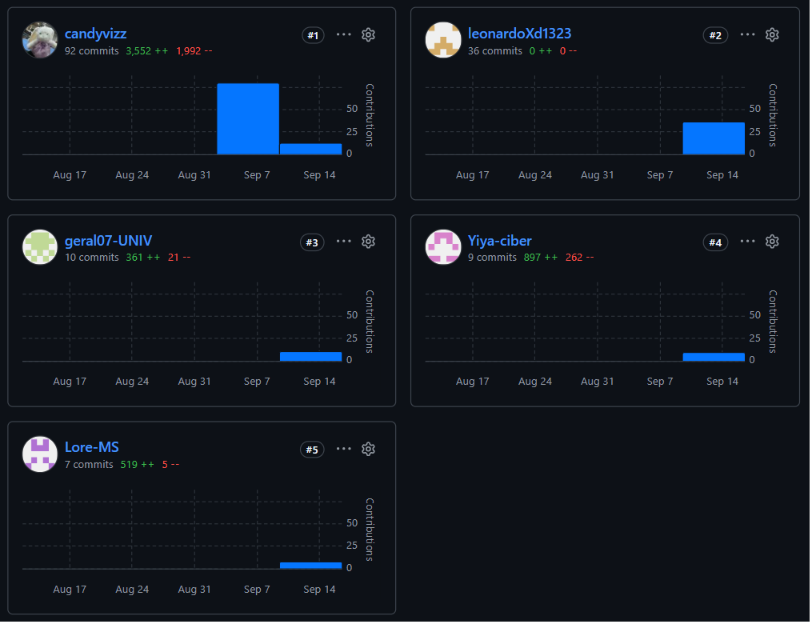
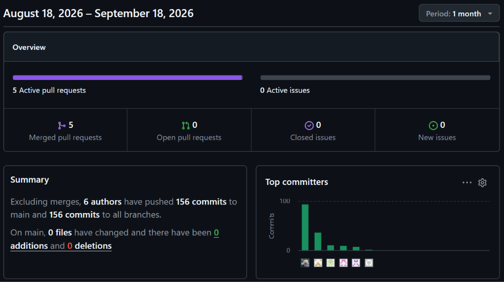
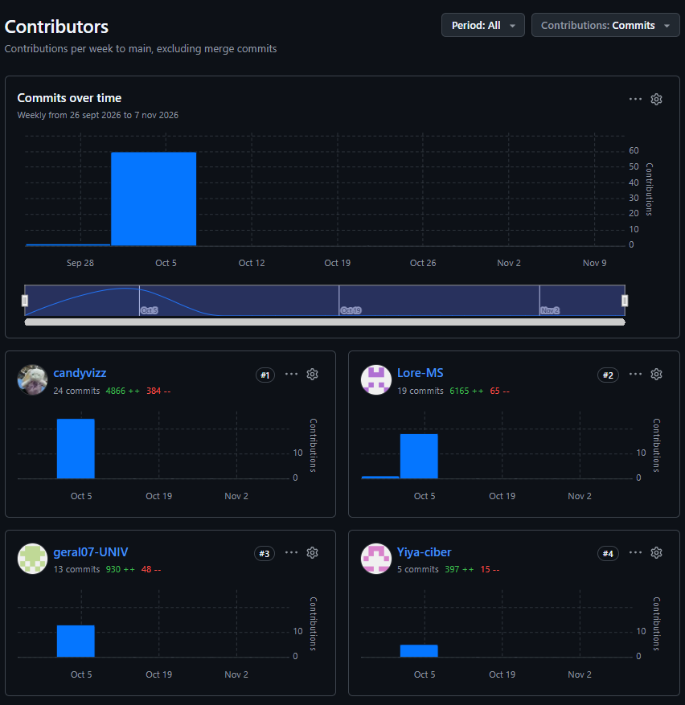
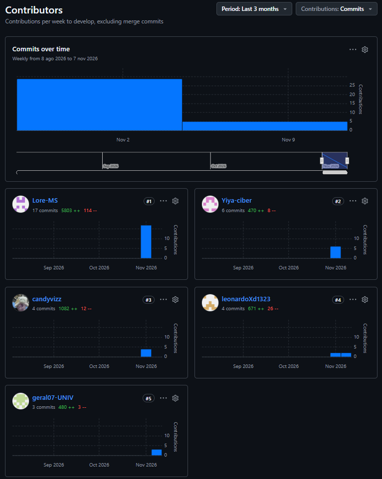
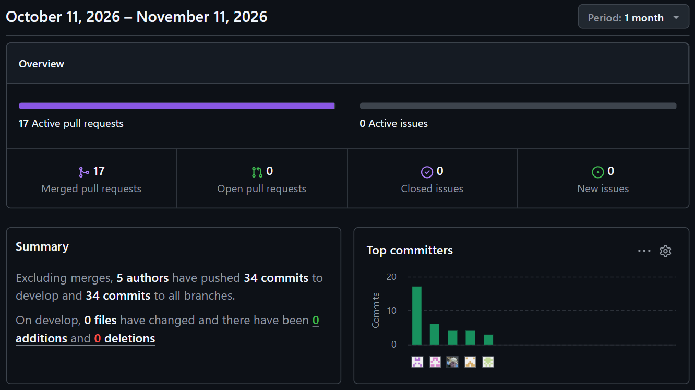

**Project Report Collaboration Insights**

**Repositorio de la documentación del proyecto: https://github.com/InventiaStock**

A continuación, se detallan las actividades realizadas en cada entrega, la participación de los integrantes del equipo y las evidencias correspondientes.

**AV1:**

Durante la primera entrega (AV1), se registran las actividades iniciales de colaboración del equipo, evidenciando la organización, coordinación y participación de los integrantes en el desarrollo del proyecto.

**TB**

En esta etapa (TB), se presentan las evidencias del trabajo colaborativo realizado por los integrantes, reflejando la continuidad de las actividades y la coordinación para cumplir con los objetivos establecidos.

**AV2**

Durante la segunda entrega (AV2), se evidencia la continuidad del trabajo en equipo, la participación de los integrantes y el avance de las actividades correspondientes al desarrollo del proyecto SmartStock.

