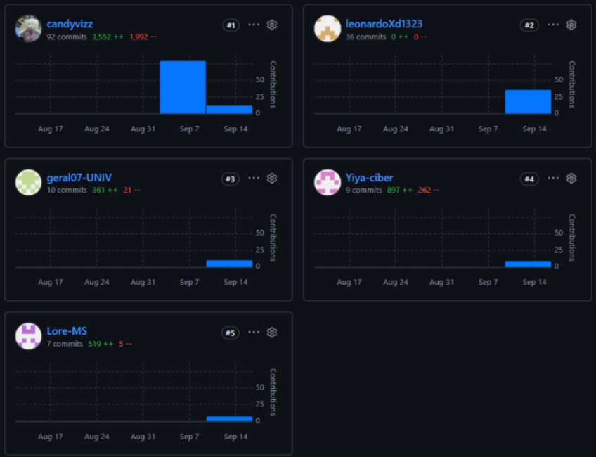
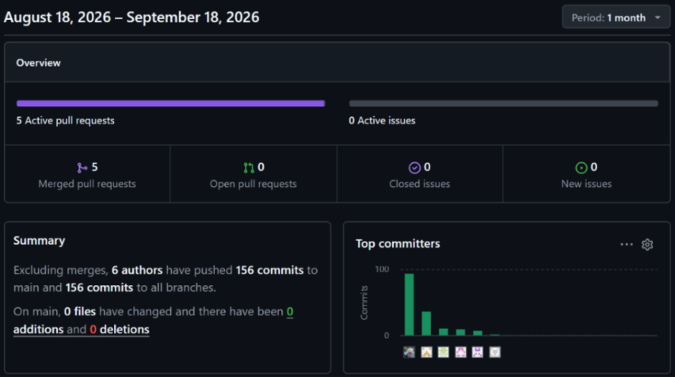

# Project Report Collaboration Insights

**Repositorio de la documentación del proyecto:** https://github.com/InventiaStock/smartstock-docs

A continuación, se presentan las evidencias de colaboración del equipo durante las diferentes entregas del proyecto, mostrando la participación de sus integrantes, la organización del trabajo y el seguimiento de las actividades desarrolladas.

## AV1

Durante la primera entrega (AV1), se registran las actividades iniciales de colaboración del equipo, evidenciando la organización, coordinación y participación de los integrantes en el desarrollo del proyecto.

## TB

En esta etapa (TB), se presentan las evidencias del trabajo colaborativo realizado por los integrantes, reflejando la continuidad de las actividades y la coordinación para cumplir con los objetivos establecidos.

## AV2

Durante la segunda entrega (AV2), se evidencia la continuidad del trabajo en equipo, la participación de los integrantes y el avance de las actividades correspondientes al desarrollo del proyecto SmartStock.

