# Capítulo II: Requirements Elicitation & Analysis

## 2.1. Competidores

- **FacilVenta:**

FacilVenta es una solución orientada a la gestión comercial y al control de operaciones de pequeños y medianos negocios. Su propuesta incluye funcionalidades relacionadas con ventas, productos, clientes e inventario, permitiendo centralizar información básica del establecimiento y facilitar el seguimiento de las operaciones diarias. Frente a SmartStock, FacilVenta se enfoca principalmente en la gestión administrativa y comercial, mientras que SmartStock incorpora monitoreo físico del inventario mediante sensores IoT, alertas de stock y funcionalidades orientadas a mejorar la reposición de productos.

- **Adiasoft:**

Adiasoft ofrece soluciones de software para la administración de negocios, incluyendo funcionalidades vinculadas con ventas, inventario, facturación y control de productos. Su plataforma busca mejorar la organización de la información comercial y facilitar el registro de operaciones dentro del establecimiento. A diferencia de SmartStock, Adiasoft se orienta principalmente al control administrativo del inventario, mientras que SmartStock propone complementar el registro digital con información proveniente del stock físico mediante sensores de peso IoT y alertas automáticas. .

- **PACAY:**

PACAY es una solución tecnológica orientada a la gestión de negocios y al control de procesos comerciales e inventario. Sus funcionalidades permiten registrar productos, operaciones y movimientos relacionados con la actividad del establecimiento, ofreciendo herramientas para organizar y consultar información del negocio. En comparación con SmartStock, PACAY se concentra en la gestión digital de las operaciones, mientras que SmartStock busca diferenciarse mediante la integración con sensores IoT, la comparación entre stock físico y registrado, y la generación de alertas para apoyar decisiones de reposición.

A partir del análisis de estas soluciones, se observa que los competidores ofrecen funcionalidades relevantes para la gestión comercial y el control de inventarios. Sin embargo, SmartStock busca diferenciarse mediante la integración del monitoreo físico del stock con sensores IoT, la detección de diferencias entre inventario físico y registrado, la generación de alertas y el apoyo a los procesos de reposición en bodegas de barrio y minimarkets.

### 2.1.1. Análisis competitivo

**  
Competitive Analysis Landscape**

*¿Por qué llevar a cabo este análisis?*

Permite identificar cómo funcionan las soluciones actuales de gestión de inventarios, reconocer sus limitaciones y diferenciar a SmartStock mediante el monitoreo con sensores IoT, alertas de stock y una mejor coordinación con proveedores.

**Tabla 3**

*Logos de SmartStock y de sus competidores*

| **SmartStock**                                                                     | **FacilVenta**                                                                    | **Adiasoft**                                                                       | **PACAY**                                                                          |
|------------------------------------------------------------------------------------|-----------------------------------------------------------------------------------|------------------------------------------------------------------------------------|------------------------------------------------------------------------------------|
| 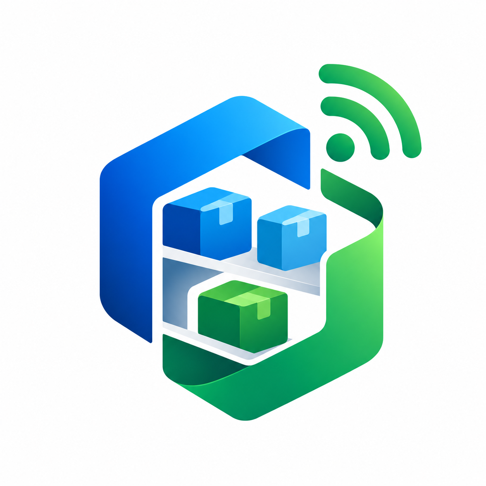 |  |  |  |

*Nota*. Elaboración propia

**Tabla 4**

*Perfil general y ventaja competitiva de SmartStock y de sus competidores*

<table>
<thead>
<tr class="header">
<th></th>
<th><strong>SmartStock</strong></th>
<th><strong>FacilVenta</strong></th>
<th><strong>Adiasoft</strong></th>
<th><strong>PACAY</strong></th>
</tr>
<tr class="odd">
<th>Overview</th>
<th>SmartStock es una plataforma web orientada a bodegas y minimarkets que utiliza sensores de peso IoT para monitorear el inventario físico, compararlo con el stock registrado y generar alertas ante faltantes o niveles bajos. Además, incorpora funcionalidades para facilitar la coordinación con proveedores.</th>
<th>FacilVenta es un sistema POS con facturación electrónica e inventario orientado a bodegas, minimarkets y tiendas en Perú. Permite gestionar ventas, compras, proveedores, stock, productos, caja y facturación, además de trabajar con lectores de código de barras.</th>
<th>Adiasoft es un ERP orientado, entre otros sectores , a minimarkets, bodegas y comercios retail. Integra ventas, compras, inventario, POS, facturación, Kardex, almacenes y reportes. También contempla integraciones opcionales con balanzas, lectores de código de barras y cámaras.</th>
<th>PACAY es un ERP dirigido a MYPE peruanas que integra ventas, compras, inventario, caja, bancos, contabilidad, producción y reportes en una sola plataforma. Está orientado a emprendedores y negocios peruanos.</th>
</tr>
<tr class="header">
<th>Ventaja competitiva ¿Qué valor ofrece a los clientes?</th>
<th>
• Monitoreo mediante sensores de peso IoT.

• Alertas de stock bajo.

• Comparación entre inventario físico y registrado.

• Gestión de reposición mediante alertas y notificaciones automáticas

• Enfoque específico en bodegas y minimarkets.
</th>
<th>
• POS para ventas rápidas.

• Control de inventario en tiempo real.

• Compras y proveedores.

• Alertas de stock mínimo y vencimientos.

• Facturación electrónica SUNAT.

• Contabilidad con lectores de código de barras.
</th>
<th>
• Gestión integrada de ventas, compras e inventario.

• POS con código de barras.

• Stock en tiempo real.

• Reposición automática.

• Kardex valorizado.

• Predicción de demanda y reposición con IA en planes superiores.

• Integración IoT opcional con balanzas, lectores y cámaras
</th>
<th>
• Integración de ventas, compras e inventario.

• Stock en tiempo real.

• Alertas de reorden.

• Facturación electrónica SUNAT.

• Gestión de caja, bancos y contabilidad.

• Acceso desde cualquier dispositivo
</th>
</tr>
</thead>
<tbody>
</tbody>
</table>

*Nota*. Elaboración propia

**Tabla 5**

*Perfil de marketing de SmartStock y de sus competidores*

<table>
<thead>
<tr class="header">
<th></th>
<th><strong>SmartStock</strong></th>
<th><strong>FacilVenta</strong></th>
<th><strong>Adiasoft</strong></th>
<th><strong>PACAY</strong></th>
</tr>
<tr class="odd">
<th>Mercado Objetivo</th>
<th>Propietarios y administradores de minimarkets como segmento principal y propietarios y administradores de bodegas de barrio como segmento secundario. Ambos requieren mejorar el control del inventario físico y detectar oportunamente productos con bajo stock.</th>
<th>Propietarios y administradores de bodegas, minimarkets, tiendas y pequeños comercios en Perú que necesitan gestionar ventas, inventario, compras y facturación</th>
<th>Propietarios y administradores de minimarkets, bodegas y comercios retail que requieren una solución integrada para ventas, compras, inventario y administración del negocio.</th>
<th>Emprendedores y propietarios de MYPE peruanas que buscan centralizar ventas, compras, inventario, facturación y administración financiera en una sola plataforma.</th>
</tr>
<tr class="header">
<th>Estrategias de Marketing</th>
<th>
• Marketing digital mediante redes sociales y contenido sobre gestión de inventarios.

•Demostraciones del producto.

• Pruebas piloto en establecimientos.

• Alianzas con proveedores y distribuidores.

• Modelo de suscripción adaptable al tamaño del negocio.
</th>
<th>
.• Marketing digital dirigido a negocios peruanos.

• Pruebas gratuitas.

• Contenido orientado a bodegas, minimarkets y comercios.

• Prueba/demo del sistema.

• Soporte local y comunicación mediante WhatsApp.
</th>
<th>
• Marketing B2B.

• Pruebas comerciales.

• Segmentación por rubro.

• Oferta de planes según tamaño del negocio.

• Postura como ERP multirubro.

• Soporte y asesoría comercial.
</th>
<th>
• Prueba gratuita de 15 días.

• Marketing digital dirigido a emprendedores.

• Pruebas de los módulos.

• Propuesta de planes según el régimen tributario.

• Comunicación directa mediante WhatsApp y correo.
</th>
</tr>
</thead>
<tbody>
</tbody>
</table>

*Nota*. Elaboración propia

**Tabla 6**

*Perfil de producto de SmartStock y de sus competidores*

<table>
<thead>
<tr class="header">
<th></th>
<th><strong>SmartStock</strong></th>
<th><strong>FacilVenta</strong></th>
<th><strong>Adiasoft</strong></th>
<th><strong>PACAY</strong></th>
</tr>
<tr class="odd">
<th>Productos y Servicios</th>
<th>Plataforma web para monitorear inventarios mediante sensores de peso IoT. Incluye niveles de stock, comparación entre inventario físico y registrado, alertas, historial de movimientos, reportes de rotación y mermas, y funcionalidades para gestionar la reposición y coordinar pedidos con proveedores externos.</th>
<th>Sistema POS y de gestión para bodegas y minimarkets. Incluye ventas, compras y proveedores, inventario, kardex, stock mínimo, control de vencimientos, caja, facturación electrónica SUNAT y compatibilidad con lectores de código de barras.</th>
<th>ERP para minimarkets, bodegas y retail que incluye POS, ventas, compras, inventario, kardex, almacenes, facturación, promociones, reportes y reposición. En planes superiores contempla predicción de demanda, control de balanza e integración IoT opcional.</th>
<th>ERP para MYPE que incluye ventas, compras, inventario, caja, bancos, cuentas por cobrar y pagar, contabilidad, producción, facturación SUNAT y reportes. También ofrece POS y alertas de reorden del inventario.</th>
</tr>
<tr class="header">
<th>Precios y costos</th>
<th>SmartStock se vende por suscripción mensual por tienda, con tres planes: Starter S/ 49 (hasta 20 productos monitoreados, alertas por correo y panel en tiempo real), Growth S/ 129 (hasta 120 productos, alertas por correo y WhatsApp, comparación de inventario físico contra registrado y dashboard) y Business S/ 279 (productos ilimitados, varias tiendas en una cuenta y acceso completo a la API). Los sensores se pagan una sola vez.</th>
<th>
Plan Lite: S/140/mes.

Plan Pro: S/210/mes.

Plan Enterprise: S/380/mes.

Los precios incluyen IGV. El plan Pro incorpora compras y proveedores, inventario completo, kardex valorizado y control de stock mínimo.
</th>
<th>
Plan Elemental: desde S/150/mes.

Plan Pyme: desde S/350/mes.

Plan Corporativo: desde S/750/mes.

La integración IoT se cotiza según los equipos y operación de la empresa.
</th>
<th>Planes publicados desde S/29/mes. Cuenta con prueba gratuita de 15 días y permite contratar módulos adicionales según las necesidades del negocio.</th>
</tr>
<tr class="odd">
<th>Canales de distribución (Web y/o móvil)</th>
<th>
Web: plataforma principal para propietarios y administradores de minimarkets y bodegas de barrio.

IoT: sensores instalados físicamente en los establecimientos.
</th>
<th>
Web/POS: sistema de gestión y punto de venta.

Hardware: lectores de códigos de barras y dispositivos compatibles. También ofrece funcionamiento offline.
</th>
<th>
Web/Cloud: plataforma ERP y POS.

Móvil: aplicación móvil disponible según plan/integración.

Hardware/IoT: balanzas, lectores de código de barras y cámaras mediante integración opcional.
</th>
<th>Web/Cloud: plataforma ERP accesible desde dispositivos conectados a Internet. La empresa indica acceso desde cualquier dispositivo.</th>
</tr>
</thead>
<tbody>
</tbody>
</table>

*Nota*. Elaboración propia

**Tabla 7**

*Análisis SWOT de SmartStock y de sus competidores*

<table>
<thead>
<tr class="header">
<th></th>
<th><strong>SmartStock</strong></th>
<th><strong>FacilVenta</strong></th>
<th><strong>Adiasoft</strong></th>
<th><strong>PACAY</strong></th>
</tr>
<tr class="odd">
<th>Fortalezas</th>
<th>
• Sensores IoT para monitorear directamente cambios en el inventario físico.

• Enfoque específico en bodegas y minimarkets.

• Alertas automáticas de stock bajo.

• Integración entre inventario físico y digital. • Coordinación con proveedores durante el proceso de reposición.

• Plataforma web sencilla y accesible
</th>
<th>
•Especialización en bodegas y minimarkets.

• Compras, ventas e inventario integrados.

• Modo offline.

• Alertas de stock mínimo y vencimientos.

• Facturación SUNAT integrada.

• Compatible con lectores de códigos de barras.
</th>
<th>
• Amplia integración de módulos empresariales.

• Compras, ventas e inventario.

• POS y código de barras.

• Stock en tiempo real y reposición automática.

• Integración IoT opcional.

• Multisucursal.
</th>
<th>
• Amplia cobertura administrativa.

• Ventas, compras e inventario integrados.

• Facturación SUNAT.

• Contabilidad, caja y bancos.

• Alertas de reorden.

• Orientación específica al mercado peruano.
</th>
</tr>
<tr class="header">
<th>Debilidades</th>
<th>
• Dependencia de sensores físicos.

• Necesidad de instalación y calibración adecuada.

• No todos los tipos de productos pueden monitorearse fácilmente mediante peso.

• Menor experiencia y volumen de datos al ser una propuesta nueva.
</th>
<th>
• El monitoreo del stock depende principalmente del registro de operaciones comerciales.

• No se identifica un sistema propio de sensores de peso IoT para verificar automáticamente el stock físico.

• Algunas funciones de compras y gestión avanzada requieren planes superiores.
</th>
<th>
• La propuesta puede resultar más amplia de lo necesario para negocios pequeños.

• Algunas funciones avanzadas requieren planes superiores.

• La integración IoT depende de equipos y una implementación adicional.

• El costo puede aumentar según las necesidades de implementación.
</th>
<th>
• Su alcance como ERP puede incluir funciones que no todos los pequeños negocios necesitan.

• La propuesta está más orientada a la administración integral que al monitoreo físico mediante sensores.

• No se identifica una funcionalidad propia equivalente al monitoreo de peso IoT de SmartStock.
</th>
</tr>
<tr class="odd">
<th>Oportunidades</th>
<th>
• Crecimiento de la digitalización de bodegas y minimarkets.

• Mayor disponibilidad y reducción de costos de dispositivos IoT.

• Necesidad de mejorar el control de inventarios en pequeños negocios.

• Alianzas con distribuidores y proveedores.

• Expansión futura hacia recomendaciones automáticas y análisis predictivo.

• Integración con nuevos tipos de sensores
</th>
<th>
• Crecimiento de la digitalización de pequeños comercios.

• Mayor adopción de facturación electrónica.

• Expansión hacia nuevos tipos de negocios.

• Incorporación de nuevas herramientas de análisis e inventario.
</th>
<th>
• Crecimiento del comercio digital y la gestión omnicanal.

• Mayor adopción de soluciones ERP en pequeños negocios.

• Integración de nuevas tecnologías IoT e IA.

• Expansión hacia nuevos mercados y sectores.
</th>
<th>
• Crecimiento de la digitalización de las MYPE peruanas.

• Mayor necesidad de automatización contable y tributaria.

• Expansión de módulos especializados.

• Mayor adopción de soluciones de gestión en la nube.
</th>
</tr>
<tr class="header">
<th>Amenazas</th>
<th>
• Aparición de nuevas soluciones de inventario IoT a bajo costo.

• Competidores consolidados con mayor capacidad tecnológica y financiera.

• Resistencia de pequeños comerciantes a invertir en dispositivos adicionales.

• Fallos o deterioro de sensores.

• Rápida evolución de tecnologías de visión artificial que podrían ofrecer alternativas sin sensores de peso.
</th>
<th>
• Aparición de soluciones gratuitas o de menor costo.

• Evolución de tecnologías de automatización e IoT.

• Cambios en las necesidades de pequeños comercios.
</th>
<th>
• Competencia de otros ERP y plataformas especializadas.

• Rápida evolución de soluciones de IA e IoT.

• Costos de implementación para empresas pequeñas.

• Aparición de soluciones más simples y económicas.
</th>
<th>
• Alta competencia entre ERP y sistemas de gestión para MYPE.

• Aparición de soluciones gratuitas o de bajo costo.

• Cambios en requisitos tributarios y tecnológicos.

• Necesidad de mantener actualizados múltiples módulos y servicios.
</th>
</tr>
</thead>
<tbody>
</tbody>
</table>

*Nota*. Elaboración propia

### 2.1.2. Estrategias y tácticas frente a competidores

1.  **Gestión integrada de compras, ventas e inventario como núcleo de la solución:** Smartstock tendrá como núcleo la gestión de las operaciones que generan el movimiento del stock: compras y ventas. Las compras permitirán incrementar las existencias registradas, mientras las ventas disminuirán el stock disponible. De esta manera, el sistema mantendrá un sistema actualizado.

Esta información se puede observar en soluciones como FácilVenta, Adiasoft Y PACAY, que integran módulos de ventas, compras e inventario dentro de sus plataformas.

SmartStock completará este núcleo con las siguientes caracteristicas:

- Registro y seguimiento de compras.

- Registro de ventas y actualización automática del stock.

- Integración posterior con información obtenida mediante sensores IoT.

- Consulta del stock registrado en tiempo real.

De esta manera, la solución no se limita al monitoreo físico de productos, sino que aparte de la gestión que origina el movimiento del stock y posteriormente incorpora el monitoreo físico mediante IoT.

2.  **Diferenciación mediante sensores IoT y comparación del inventario físico:** Aunque las soluciones analizadas ofrecen funcionalidades de gestión de ventas, compras e inventario, SmartStock busca diferenciarse mediante el monitoreo físico del inventario utilizando sensores de peso IoT.

Los sensores estarán instalados en espacios destinados al almacenamiento o exhibición de determinados productos y permitirán obtener información sobre las existencias físicas. Esta información podrá compararse con el stock registrado en la plataforma.

SmartStock permitirá:

- Monitorear las existencias físicas mediante sensores de peso.

- Obtener información del inventario físico.

- Comparar el stock físico con el stock registrado.

- Detectar posibles diferencias o faltantes.

- Generar alertas cuando se identifiquen niveles críticos.

Así, el IoT funcionará como una capa complementaria al sistema de compras, ventas e inventario, permitiendo contrastar lo que el sistema registra con lo que realmente existe físicamente en el negocio.

3.  **Solución accesible y escalable para pequeños comercios:** Smartstock estará orientado principalmente a bodegas y minimarkets, considerando que estos negocios requieren controlar sus compras ventas e inventario sin incorporar procesos tecnológicos excesivamente complejos.

La estrategia consiste en permitir una implementación progresiva de la solución:

- Inicio con una cantidad limitada de productos y sensores

- Incorporación gradual de nuevos sensores IoT.

- Ampliación de números de productos monitoreados.

- Adaptación de la solución al tamaño del establecimiento.

- Crecimiento progresivo de las funcionalidades utilizadas.

Este enfoque busca facilitar la adopción de SmartStock por pequeños comercios, manteniendo como base las operaciones de compras, ventas e inventario y permitiendo incorporar capacidades IoT conforme me aumenten las necesidades del negocio.

4.  **Experiencia de usuario centrada en información inmediata:** La plataforma busca facilitar la toma de decisiones mediante una interfaz web sencilla e intuitiva que permita consultar rápidamente:

- Productos con stock suficiente, bajo o agotado.

- Alertas pendientes de reposición.

- Diferencias entre el inventario físico y el registrado.

- Estado de los dispositivos IoT.

- Información relevante según el tipo de usuario.

De esta manera, los propietarios y administradores de minimarkets y bodegas de barrio podrán acceder a la información necesaria sin realizar procesos complejos de consulta.

5.  **Gestión preventiva del inventario mediante alertas**: SmartStock busca reemplazar un modelo reactivo de reposición por uno preventivo mediante la detección anticipada de niveles bajos de inventario. El sistema permitirá:

- Configurar niveles mínimos de stock por producto.

- Generar alertas cuando las existencias alcancen dichos niveles.

- Identificar diferencias entre el inventario registrado y el físico.

- Anticipar necesidades de reposición antes de que un producto se agote.

Este enfoque puede contribuir a reducir quiebres de stock y mejorar la disponibilidad de productos en bodegas y minimarkets.

6.  **Analítica de inventario y apoyo a la toma de decisiones**: SmartStock incorporará información histórica que permita a los administradores analizar el comportamiento de sus productos mediante:

- Reportes de rotación de productos.

- Registro de mermas.

- Historial de alertas y movimientos.

- Identificación de productos con mayor necesidad de reposición.

- Seguimiento del comportamiento del inventario.

Esta información permitirá complementar el monitoreo en tiempo real con datos que apoyen la planificación del abastecimiento y la toma de decisiones.

En precio, el plan de entrada de SmartStock, Starter (S/ 49 al mes), queda por debajo de los planes iniciales de los sistemas POS y ERP para minimarkets analizados (S/ 140 y S/ 150 al mes), cuya integración con sensores es opcional y se cotiza aparte. Solo el ERP general para MYPE tiene un plan inicial menor (desde S/ 29 al mes), pero no ofrece monitoreo con sensores ni comparación del stock físico con el registrado. Los sensores de SmartStock se pagan una sola vez, por lo que el costo mensual recurrente se mantiene bajo. La ventaja de precio se orienta por segmento: Starter para bodegas de barrio, que necesitan un control simple de pocos productos; y Growth (S/ 129) para minimarkets, que requieren alertas por WhatsApp y comparación de inventario físico contra registrado, a un precio menor que los planes intermedios de los competidores (S/ 210 y S/ 350).

## 2.2. Entrevistas

### 2.2.1. Diseño de entrevistas

Las guías de entrevista para ambos segmentos combinan preguntas demográficas con preguntas sobre gestión del inventario y comportamiento del negocio, orientadas a sustentar la construcción de los User Persona.

**Primer Segmento Objetivo (Propietarios y administradores de minimarkets)**

**Preguntas demográficas**

1.  ¿Cuál es su nombre completo?

2.  ¿Qué edad tiene?

3.  ¿En qué distrito reside?

4.  ¿Cuál es su estado civil?

5.  ¿A qué se dedica usted (ocupación) y qué rol cumple en el negocio (dueño, administrador, etc.)?

6.  ¿Hace cuánto tiempo tiene o administra el negocio?

7.  ¿Qué dispositivo usa con más frecuencia para temas del negocio (celular, laptop, computadora de escritorio)?

8.  ¿Qué aplicaciones o redes sociales usa habitualmente?

**Preguntas sobre gestión del inventario / comportamiento del negocio**

9.  ¿Cómo realiza actualmente el control del inventario de los productos de su minimarket?

10. ¿Con qué frecuencia revisa físicamente las existencias disponibles?

11. ¿Qué dificultades encuentra al mantener actualizado el inventario?

12. ¿Con qué frecuencia encuentra diferencias entre el stock registrado y la cantidad física disponible?

13. ¿Qué problemas se presentan cuando un producto se agota sin ser detectado a tiempo?

14. ¿Cómo determina cuándo debe realizar una reposición de productos?

15. ¿Qué productos o categorías son más difíciles de controlar por su rotación?

16. ¿Cómo se comunica actualmente con sus proveedores para solicitar reposiciones?

17. ¿Qué herramientas o sistemas utiliza actualmente para gestionar el inventario?

18. ¿Qué limitaciones encuentra en esas herramientas o métodos?

19. ¿Qué información considera más importante visualizar al revisar el inventario?

20. ¿Qué tipo de alertas le resultarían útiles para detectar productos con bajo stock?

21. ¿Qué importancia tendría para usted saber en todo momento si existen diferencias entre lo que su sistema registra y lo que realmente tiene en tienda?

22. ¿Qué le gustaría que una herramienta de inventario le resuelva o facilite, sin importar la tecnología que use?

23. ¿Qué haría que usted decida invertir en una nueva herramienta para gestionar su negocio?

**Segundo Segmento Objetivo (Propietarios y administradores de bodegas de barrio)**

**Preguntas demográficas**

1.  ¿Cuál es su nombre completo?

2.  ¿Qué edad tiene?

3.  ¿En qué distrito reside?

4.  ¿Cuál es su estado civil?

5.  ¿A qué se dedica y qué rol cumple en la bodega?

6.  ¿Hace cuánto tiempo tiene o administra la bodega?

7.  ¿Atiende sola/o o con apoyo? Más o menos, ¿cuántos productos tiene?

8.  ¿Qué hace con el celular en su bodega?

**Preguntas sobre gestión del inventario / comportamiento del negocio**

9.  ¿Cómo controla actualmente los productos disponibles en su bodega?

10. ¿Utiliza cuaderno, Excel, sistema digital u otro método para registrar su inventario?

11. ¿Con qué frecuencia realiza conteos o revisiones manuales de sus productos?

12. ¿Qué dificultades tiene para saber qué productos están por agotarse?

13. ¿Le ha ocurrido que el stock registrado no coincida con la cantidad real disponible? ¿Con qué frecuencia?

14. ¿Qué problemas genera en su negocio quedarse sin un producto de alta demanda?

15. ¿Cómo decide qué productos debe reponer y en qué momento?

16. ¿Cómo realiza actualmente sus pedidos a proveedores?

17. ¿Qué parte del control de inventario le toma más tiempo o le resulta más complicada?

18. ¿Qué tan cómodo se siente utilizando aplicaciones o plataformas web para gestionar su negocio?

19. ¿Qué información le gustaría ver en una pantalla para conocer rápidamente el estado de sus productos?

20. ¿Qué tipo de alerta le sería útil cuando un producto está por agotarse?

21. ¿Qué tan importante sería para usted enterarse automáticamente cuando un producto está por agotarse, sin tener que revisarlo usted mismo?

22. ¿Qué beneficio tendría que ofrecer una herramienta de inventario para que usted la use de manera frecuente?

23. ¿Qué haría que usted decida invertir en una nueva herramienta para gestionar su negocio?

### 2.2.2. Registro de entrevistas

**Needfinding Interviews Link:** https://upcedupe-my.sharepoint.com/&#58;v&#58;/g/personal/u20241f205_upc_edu_pe/IQA4IrqakYdsTrXGXwgxBfpMAeXZO4Qjy8iYst_cz5SgEwQ?nav=eyJyZWZlcnJhbEluZm8iOnsicmVmZXJyYWxBcHAiOiJTdHJlYW1XZWJBcHAiLCJyZWZlcnJhbFZpZXciOiJTaGFyZURpYWxvZy1MaW5rIiwicmVmZXJyYWxBcHBQbGF0Zm9ybSI6IldlYiIsInJlZmVycmFsTW9kZSI6InZpZXcifX0%3D&e=WkYEGd

Entrevista 01: 0:06 - 17:16

Entrevista 02: 17:21 - 23:46

Entrevista 03: 23:51 - 31:07

Entrevista 04: 31:14 - 37:51

Entrevista 05: 37:58 - 43:05

Entrevista 06: 43:10 - 51:37

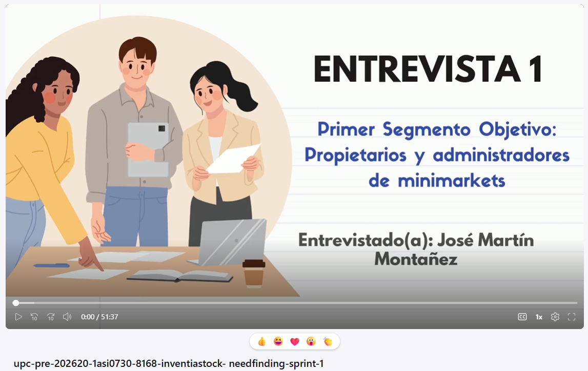

**Primer Segmento Objetivo (Propietarios y administradores de minimarkets)**

**Tabla 8**

*Registro de la entrevista 1 a propietarios y administradores de minimarkets*

| Screenshot:      |                                                                                                                                                                                                                                                                                                                                                                                                                                                                                                                                                                                                                                                                                                                                                                                                                                                                                                                                                                                                                                                                                                                                                                                                                                                                                                                                                                                                                                                                                                                                                                                                                                                                                                                      |
|------------------|--------------------------------------------------------------------------------------------------------------------------------------------------------------------------------------------------------------------------------------------------------------------------------------------------------------------------------------------------------------------------------------------------------------------------------------------------------------------------------------------------------------------------------------------------------------------------------------------------------------------------------------------------------------------------------------------------------------------------------------------------------------------------------------------------------------------------------------------------------------------------------------------------------------------------------------------------------------------------------------------------------------------------------------------------------------------------------------------------------------------------------------------------------------------------------------------------------------------------------------------------------------------------------------------------------------------------------------------------------------------------------------------------------------------------------------------------------------------------------------------------------------------------------------------------------------------------------------------------------------------------------------------------------------------------------------------------------------------------------------------------------------------------------------------------------|
| Inicia:          | 00:00                                                                                                                                                                                                                                                                                                                                                                                                                                                                                                                                                                                                                                                                                                                                                                                                                                                                                                                                                                                                                                                                                                                                                                                                                                                                                                                                                                                                                                                                                                                                                                                                                                                                                                                                                                                                  |
| Duración:        | 17:10                                                                                                                                                                                                                                                                                                                                                                                                                                                                                                                                                                                                                                                                                                                                                                                                                                                                                                                                                                                                                                                                                                                                                                                                                                                                                                                                                                                                                                                                                                                                                                                                                                                                                                                                                                                                  |
| Nombre completo: | José Martín Montañez                                                                                                                                                                                                                                                                                                                                                                                                                                                                                                                                                                                                                                                                                                                                                                                                                                                                                                                                                                                                                                                                                                                                                                                                                                                                                                                                                                                                                                                                                                                                                                                                                                                                                                                                                                                   |
| Edad:            | 52 años                                                                                                                                                                                                                                                                                                                                                                                                                                                                                                                                                                                                                                                                                                                                                                                                                                                                                                                                                                                                                                                                                                                                                                                                                                                                                                                                                                                                                                                                                                                                                                                                                                                                                                                                                                                                |
| Distrito:        | Pueblo Libre                                                                                                                                                                                                                                                                                                                                                                                                                                                                                                                                                                                                                                                                                                                                                                                                                                                                                                                                                                                                                                                                                                                                                                                                                                                                                                                                                                                                                                                                                                                                                                                                                                                                                                                                                                                           |
| Resumen:         | José nos indica que está a cargo de la administración de un mini market desde hace aproximadamente 1 año. Utiliza principalmente el celular y la laptop, y actualmente cuenta con un sistema de inventario adaptado a las necesidades de su negocio. Realiza revisiones físicas del stock semanalmente y también de manera aleatoria durante la semana para mantener un mayor control. Entre las principales dificultades menciona posibles fallas de hardware o software, problemas logísticos y diferencias entre el stock registrado y el stock físico, las cuales dependen de la rotación de los productos y del manejo del personal. Cuando se agota un producto de alta rotación, puede afectar las ventas y generar molestias en los clientes, especialmente cuando se trata de productos que generan venta cruzada. Para decidir las reposiciones utiliza reportes del sistema sobre consumos diarios, semanales y productos de alta rotación, contrastándolos con el stock físico. Los pedidos a proveedores se realizan principalmente mediante WhatsApp y llamadas. Los productos más difíciles de controlar son los pequeños, como caramelos y chocolates, debido a que están al alcance de los clientes. Considera importante visualizar el stock y los productos de alta rotación, además de contar con alertas de bajo stock y reportes de consumos máximos y mínimos. También considera muy importante detectar diferencias entre el stock registrado y el físico para evitar compras innecesarias. Finalmente, señala que una nueva herramienta debería ser amigable, eficiente, accesible desde diferentes plataformas, permitir consultar información y reportes en cualquier momento, facilitar la comunicación con proveedores y ayudar a controlar el stock de manera eficiente. |

*Nota*. Elaboración propia

**Tabla 9**

*Registro de la entrevista 2 a propietarios y administradores de minimarkets*

| Screenshot:      |                                                                                                                                                                                                                                                                                                                                                                                                                                                                                                                                                                                                                                                                                                                                                                                                                                                                                                                                                                                          |
|------------------|----------------------------------------------------------------------------------------------------------------------------------------------------------------------------------------------------------------------------------------------------------------------------------------------------------------------------------------------------------------------------------------------------------------------------------------------------------------------------------------------------------------------------------------------------------------------------------------------------------------------------------------------------------------------------------------------------------------------------------------------------------------------------------------------------------------------------------------------------------------------------------------------------------------------------------------------------------------------------------------------------------------------------------------------------------------------------|
| Inicia:          | 17:16                                                                                                                                                                                                                                                                                                                                                                                                                                                                                                                                                                                                                                                                                                                                                                                                                                                                                                                                                                                                                                                                      |
| Duración:        | 06:25                                                                                                                                                                                                                                                                                                                                                                                                                                                                                                                                                                                                                                                                                                                                                                                                                                                                                                                                                                                                                                                                      |
| Nombre completo: | Cristopher Benavides                                                                                                                                                                                                                                                                                                                                                                                                                                                                                                                                                                                                                                                                                                                                                                                                                                                                                                                                                                                                                                                       |
| Edad:            | 23 años                                                                                                                                                                                                                                                                                                                                                                                                                                                                                                                                                                                                                                                                                                                                                                                                                                                                                                                                                                                                                                                                    |
| Distrito:        | Jesus Maria                                                                                                                                                                                                                                                                                                                                                                                                                                                                                                                                                                                                                                                                                                                                                                                                                                                                                                                                                                                                                                                                |
| Resumen:         | Cristopher nos indica que la gestión del inventario se realiza principalmente de manera manual, mediante revisiones físicas y anotaciones, complementandose con Excel, aunque este no siempre se encuentra actualizado. Señala que las principales dificultades aparecen cuando las ventas no se registran inmediatamente o se cometen errores al anotar las cantidades, generando diferencias entre el stock registrado y el físico, especialmente en productos de alta rotación. Las bebidas, snacks y productos de consumo son los más difíciles de controlar debido a su rápida salida. Para realizar reposiciones, se comunica con sus proveedores mediante WhatsApp y llamadas, enviándoles la lista de productos necesarios. Considera útil contar con alertas cuando un producto llegue a una cantidad mínima de stock y poder detectar diferencias entre el inventario registrado y el real. Finalmente, considera importante que una nueva herramienta sea fácil de usar, ahorre tiempo, tenga un precio accesible y ayude a evitar el agotamiento de productos. |

*Nota*. Elaboración propia

**Tabla 10**

*Registro de la entrevista 3 a propietarios y administradores de minimarkets*

| Screenshot:      |                                                                                                                                                                                                                                                                                                                                                                                                                                                                                                                                                                                                                                                                                                                                                                                                                                                                                                                                                                                                                                                                                                                                                                                                                                                                                              |
|------------------|-------------------------------------------------------------------------------------------------------------------------------------------------------------------------------------------------------------------------------------------------------------------------------------------------------------------------------------------------------------------------------------------------------------------------------------------------------------------------------------------------------------------------------------------------------------------------------------------------------------------------------------------------------------------------------------------------------------------------------------------------------------------------------------------------------------------------------------------------------------------------------------------------------------------------------------------------------------------------------------------------------------------------------------------------------------------------------------------------------------------------------------------------------------------------------------------------------------------------------------------------------------------------------------------------------------------------------------------------------------------------------|
| Inicia:          | 23:46                                                                                                                                                                                                                                                                                                                                                                                                                                                                                                                                                                                                                                                                                                                                                                                                                                                                                                                                                                                                                                                                                                                                                                                                                                                                                                                                                                         |
| Duración:        | 07:16                                                                                                                                                                                                                                                                                                                                                                                                                                                                                                                                                                                                                                                                                                                                                                                                                                                                                                                                                                                                                                                                                                                                                                                                                                                                                                                                                                         |
| Nombre completo: | Yngrid Ruiz                                                                                                                                                                                                                                                                                                                                                                                                                                                                                                                                                                                                                                                                                                                                                                                                                                                                                                                                                                                                                                                                                                                                                                                                                                                                                                                                                                   |
| Edad:            | 23 años                                                                                                                                                                                                                                                                                                                                                                                                                                                                                                                                                                                                                                                                                                                                                                                                                                                                                                                                                                                                                                                                                                                                                                                                                                                                                                                                                                       |
| Distrito:        | Pueblo Libre                                                                                                                                                                                                                                                                                                                                                                                                                                                                                                                                                                                                                                                                                                                                                                                                                                                                                                                                                                                                                                                                                                                                                                                                                                                                                                                                                                  |
| Resumen:         | Yngrid nos indica que es administradora de un minimarket y cuenta con aproximadamente 2 años de experiencia en el negocio. Actualmente controla el inventario comparando los productos disponibles en tienda con las ventas registradas en el sistema y realizando conteos manuales. Revisa físicamente el inventario una o dos veces por semana, dando mayor atención a los productos de mayor venta. Señala que la gran cantidad de productos y el movimiento diario pueden generar diferencias entre el inventario registrado y el físico, especialmente en productos de alta rotación. Las bebidas, snacks, productos de limpieza y alimentos básicos son los más difíciles de controlar. Para comunicarse con los proveedores utiliza principalmente WhatsApp y llamadas, mediante las cuales consulta precios, disponibilidad y realiza pedidos. Considera importante visualizar las unidades disponibles y los productos próximos a agotarse, además de recibir alertas cuando lleguen a una cantidad mínima. Finalmente, considera que una herramienta de inventario debería ayudar a ahorrar tiempo, reducir errores, detectar productos que necesitan reposición y mostrar información clara y ordenada. Estaría dispuesta a invertir si la herramienta permite reducir pérdidas, ahorrar tiempo y evitar quiebres de stock, siempre que tenga un precio razonable. |

*Nota*. Elaboración propia

**Segundo Segmento Objetivo (Propietarios y administradores de bodegas de barrio)**

**Tabla 11**

*Registro de la entrevista 1 a propietarios y administradores de bodegas de barrio*

| Screenshot:      |                                                                                                                                                                                                                                                                                                                                                                                                                                                                                                                                                                                                                                                                                                                                                                                                                                                                                                                                                                                                                                                                                                                          |
|------------------|-----------------------------------------------------------------------------------------------------------------------------------------------------------------------------------------------------------------------------------------------------------------------------------------------------------------------------------------------------------------------------------------------------------------------------------------------------------------------------------------------------------------------------------------------------------------------------------------------------------------------------------------------------------------------------------------------------------------------------------------------------------------------------------------------------------------------------------------------------------------------------------------------------------------------------------------------------------------------------------------------------------------------------------------------------------------------------------------------------------------------------------------------------------------------------------------------------------|
| Inicia:          | 31:08                                                                                                                                                                                                                                                                                                                                                                                                                                                                                                                                                                                                                                                                                                                                                                                                                                                                                                                                                                                                                                                                                                                                                                                                     |
| Duración:        | 06:39                                                                                                                                                                                                                                                                                                                                                                                                                                                                                                                                                                                                                                                                                                                                                                                                                                                                                                                                                                                                                                                                                                                                                                                                     |
| Nombre completo: | Lincoln Bruno                                                                                                                                                                                                                                                                                                                                                                                                                                                                                                                                                                                                                                                                                                                                                                                                                                                                                                                                                                                                                                                                                                                                                                                             |
| Edad:            | 49 años                                                                                                                                                                                                                                                                                                                                                                                                                                                                                                                                                                                                                                                                                                                                                                                                                                                                                                                                                                                                                                                                                                                                                                                                   |
| Distrito:        | Comas                                                                                                                                                                                                                                                                                                                                                                                                                                                                                                                                                                                                                                                                                                                                                                                                                                                                                                                                                                                                                                                                                                                                                                                                     |
| Resumen:         | Lincoln nos indica que es dueño de una bodega y cuenta con 10 años de experiencia en el negocio. Actualmente utiliza un sistema de caja, pero mantiene gran parte del control del inventario de manera manual. Los productos de mayor venta son revisados casi todos los días, mientras que los demás se revisan durante la semana. Señala que pueden existir diferencias entre el stock registrado y la cantidad real debido a errores durante las ventas o al registrar los productos. Cuando un producto de alta demanda se agota, se pueden perder ventas y afectar la atención al cliente. Los pedidos a proveedores se realizan mediante WhatsApp o llamadas. Considera que lo que más tiempo requiere es contar y verificar los productos con lo registrado, especialmente cuando existe bastante movimiento. Le gustaría visualizar el stock disponible, los productos con bajo stock y aquellos que necesitan reposición, además de recibir alertas cuando un producto esté por agotarse. Finalmente, considera importante que una nueva herramienta sea fácil de usar, tenga un precio accesible, permita ahorrar tiempo, reducir pérdidas y muestre la información de manera clara y sencilla. |

*Nota*. Elaboración propia

**Tabla 12**

*Registro de la entrevista 2 a propietarios y administradores de bodegas de barrio*

| Screenshot:      |                                                                                                                                                                                                                                                                                                                                                                                                                                                                                                                                                                                                                                                                                                                                                                                                                                                                                                                                                                                                                                                                                                           |
|------------------|---------------------------------------------------------------------------------------------------------------------------------------------------------------------------------------------------------------------------------------------------------------------------------------------------------------------------------------------------------------------------------------------------------------------------------------------------------------------------------------------------------------------------------------------------------------------------------------------------------------------------------------------------------------------------------------------------------------------------------------------------------------------------------------------------------------------------------------------------------------------------------------------------------------------------------------------------------------------------------------------------------------------------------------------------------------------------------------------------------------------------------------------------------------------------------------------|
| Inicia:          | 37:52                                                                                                                                                                                                                                                                                                                                                                                                                                                                                                                                                                                                                                                                                                                                                                                                                                                                                                                                                                                                                                                                                                                                                                                       |
| Duración:        | 05:07                                                                                                                                                                                                                                                                                                                                                                                                                                                                                                                                                                                                                                                                                                                                                                                                                                                                                                                                                                                                                                                                                                                                                                                       |
| Nombre completo: | Marleny Araujo                                                                                                                                                                                                                                                                                                                                                                                                                                                                                                                                                                                                                                                                                                                                                                                                                                                                                                                                                                                                                                                                                                                                                                              |
| Edad:            | 42 años                                                                                                                                                                                                                                                                                                                                                                                                                                                                                                                                                                                                                                                                                                                                                                                                                                                                                                                                                                                                                                                                                                                                                                                     |
| Distrito:        | San Juan de Lurigancho                                                                                                                                                                                                                                                                                                                                                                                                                                                                                                                                                                                                                                                                                                                                                                                                                                                                                                                                                                                                                                                                                                                                                                      |
| Resumen:         | Marleny nos indica que es técnica en enfermería y dueña de una bodega, la cual administra desde hace 2 años. Actualmente utiliza principalmente su celular para temas del negocio y controla el inventario de manera manual mediante un cuaderno. Realiza revisiones mensualmente, lo que le toma bastante tiempo debido a que debe revisar los productos uno por uno. También señala que en ocasiones existen diferencias entre el stock registrado y la cantidad real, además de tener productos próximos a vencer. Para decidir qué productos reponer, considera principalmente aquellos que tienen mayor demanda. Los pedidos a proveedores los realiza mediante el celular, de manera manual o con apoyo del personal que visita el negocio. Considera que una aplicación facilitaría y haría más efectivo el control del inventario, siempre que sea didáctica, sencilla y fácil de utilizar. Le gustaría recibir alertas notorias, incluso con sonido, que indiquen cuándo un producto está por agotarse o próximo a vencer. Finalmente, considera importante que la herramienta sea automática debido a la gran cantidad de productos que maneja y que cumpla con sus expectativas. |

*Nota*. Elaboración propia

**Tabla 13**

*Registro de la entrevista 3 a propietarios y administradores de bodegas de barrio*

| Screenshot:      |                                                                                                                                                                                                                                                                                                                                                                                                                                                                                                                                                                                                                                                                                                                                                                                                                                                                                                                                                                                                                                                                                                                                                                                                                                                                                                                                                                                                                                |
|------------------|-----------------------------------------------------------------------------------------------------------------------------------------------------------------------------------------------------------------------------------------------------------------------------------------------------------------------------------------------------------------------------------------------------------------------------------------------------------------------------------------------------------------------------------------------------------------------------------------------------------------------------------------------------------------------------------------------------------------------------------------------------------------------------------------------------------------------------------------------------------------------------------------------------------------------------------------------------------------------------------------------------------------------------------------------------------------------------------------------------------------------------------------------------------------------------------------------------------------------------------------------------------------------------------------------------------------------------------------------------------------------------------------------------------------------------------------------------------------------------------------------------------------|
| Inicia:          | 43:05                                                                                                                                                                                                                                                                                                                                                                                                                                                                                                                                                                                                                                                                                                                                                                                                                                                                                                                                                                                                                                                                                                                                                                                                                                                                                                                                                                                                                                                                                                           |
| Duración:        | 08:27                                                                                                                                                                                                                                                                                                                                                                                                                                                                                                                                                                                                                                                                                                                                                                                                                                                                                                                                                                                                                                                                                                                                                                                                                                                                                                                                                                                                                                                                                                           |
| Nombre completo: | Ruth Osorio                                                                                                                                                                                                                                                                                                                                                                                                                                                                                                                                                                                                                                                                                                                                                                                                                                                                                                                                                                                                                                                                                                                                                                                                                                                                                                                                                                                                                                                                                                     |
| Edad:            | 42 años                                                                                                                                                                                                                                                                                                                                                                                                                                                                                                                                                                                                                                                                                                                                                                                                                                                                                                                                                                                                                                                                                                                                                                                                                                                                                                                                                                                                                                                                                                         |
| Distrito:        | San Juan de Lurigancho                                                                                                                                                                                                                                                                                                                                                                                                                                                                                                                                                                                                                                                                                                                                                                                                                                                                                                                                                                                                                                                                                                                                                                                                                                                                                                                                                                                                                                                                                          |
| Resumen:         | Ruth nos indica que es dueña de una bodega y se encarga de atender a los clientes, revisar productos y realizar pedidos a proveedores. Utiliza principalmente el celular y WhatsApp para sus actividades del negocio. Actualmente controla el inventario de manera visual y mediante un cuaderno, registrando productos faltantes, pedidos, entradas y productos fiados. Realiza revisiones prácticamente todos los días, aunque de manera gradual, y señala que a veces no detecta a tiempo cuando un producto está por agotarse. También ha tenido diferencias entre el stock registrado y la cantidad real disponible. Cuando un producto de alta demanda se agota, existe el riesgo de perder clientes, ya que pueden acudir a otra tienda. Los pedidos a proveedores los realiza mediante WhatsApp, indicando la marca y cantidad que necesita. Considera que lo más complicado es tener un registro del inventario en tiempo real. Estaría dispuesta a utilizar una aplicación siempre que sea sencilla y fácil de aprender. Le gustaría visualizar rápidamente los productos disponibles, los que tienen bajo stock, los agotados y los de mayor venta. También considera útil recibir alertas cuando queden pocas unidades para poder realizar nuevos pedidos antes de quedarse sin productos. Finalmente, considera que una herramienta de inventario debería ahorrarle tiempo, mostrar rápidamente qué productos debe reponer, ser fácil de usar y tener un precio accesible para una bodega pequeña. |

*Nota*. Elaboración propia

### 2.2.3. Análisis de entrevistas

**Primer Segmento Objetivo (Propietarios y administradores de minimarkets)**

En este segmento se entrevistó a José Martín Montañez, Cristopher Benavides y Yngrid Ruiz, con edades de 52, 23 y 23 años, respectivamente. Los entrevistados pertenecen a los distritos de Pueblo Libre u Jesús Maria. En la muestra, el 66.7% tiene 23 años y el 66,7% reside en Pueblo Libre. Asimismo, el segmento está conformado por personas que participan directamente en la administración y control del minimarket.

Respecto a las herramientas utilizadas, se identificó una combinación de medios digitales y métodos manuales. Los entrevistados utilizan principalmente celular, y también recurren a laptop, sistema de inventario o ventas, excel y registros manuales, dependiendo de las características de cada negocio. Para comunicarse con los proveedores utilizan principalmente WhatsApp y llamadas telefónicas.

**Tabla 14**

*Características subjetivas de propietarios y administradores de minimarkets*

| **Características subjetivas** |                                                                                                                                                          |
|--------------------------------|----------------------------------------------------------------------------------------------------------------------------------------------------------|
| **Característica**             | **Hallazgos identificados en las entrevistas**                                                                                                           |
| Preocupaciones                 | Existe preocupación por las diferencias entre el stock registrado y las cantidades disponibles físicamente, especialmente en productos de alta rotación. |
| Frustraciones                  | Las revisiones y conteos manuales requieren tiempo y pueden generar errores o diferencias en el inventario.                                              |
| Necesidades                    | Necesitan conocer rápidamente las unidades disponibles y detectar productos próximos a agotarse.                                                         |
| Preferencias                   | Prefieren una herramienta sencilla, clara, organizada y fácil de utilizar.                                                                               |
| Expectativas                   | Esperan que la herramienta permita ahorrar tiempo, reducir errores y facilitar la identificación de productos que necesitan reposición.                  |
| Motivaciones                   | Existe interés en utilizar una solución que permita reducir pérdidas y evitar quiebres de stock.                                                         |
| Valoración de alertas          | Consideran útil recibir alertas cuando un producto alcanza un nivel mínimo de stock.                                                                     |
| Percepción del precio          | Existe disposición a invertir en una herramienta si genera beneficios para el negocio y mantiene un precio razonable.                                    |

*Nota*. Elaboración propia

En conclusión los resultados muestran que las principales características subjetivas de los propietarios y administradores de minimarkets están relacionadas con la preocupación por las diferencias de inventario y los quiebres de stock, así como con la necesidad de ahorrar tiempo, reducir errores y facilitar la renovación de los productos. El 100% de los entrevistados manifestaron necesidades relacionadas con estos aspectos. Por ello, Smartstock debe proporcionar información clara y actualizada, acompañada de alertas que permitan el reabastecimiento y disminuir las pérdidas ocasionadas por productos agotados.

**Segundo Segmento Objetivo (Propietarios y administradores de bodegas de barrio)**

Se entrevistó a Lincoln Bruno, Marleny Araujo y Ruth Osorio, con edades de 49, 42 y 42 años respectivamente. En la muestra, el 66.7% tiene 42 años y el 66.7% reside en San Juan de Lurigancho.

En cuanto a las características objetivas, los entrevistados utilizan principalmente el celular y presentan una mayor dependencia de herramientas manuales como cuadernos, inspección visual y conteos físicos, aunque también se identificó el uso de un sistema de caja. La comunicación con proveedores se realiza principalmente mediante WhatsApp y llamadas.

**Tabla 15**

*Características subjetivas de propietarios y administradores de bodegas de barrio*

| **Características subjetivas** |                                                                                                                                               |
|--------------------------------|-----------------------------------------------------------------------------------------------------------------------------------------------|
| **Característica**             | **Hallazgos identificados en las entrevistas**                                                                                                |
| Preocupaciones                 | Existen preocupaciones por detectar tarde los productos próximos a agotarse y por las diferencias entre el inventario registrado y el físico. |
| Frustraciones                  | El control manual y la revisión de los productos uno por uno pueden consumir una cantidad considerable de tiempo.                             |
| Necesidades                    | Necesitan conocer rápidamente qué productos están disponibles, cuáles tienen bajo stock y cuales requieren reabastecimiento.                  |
| Preferencias                   | Prefieren una herramienta sencilla, didáctica , rápida y fácil de aprender                                                                    |
| Expectativas                   | Esperan que la solución facilite el control del inventario y reduzca el tiempo dedicado a revisiones manuales.                                |
| Motivaciones                   | Buscan reducir pérdidas y evitar quedarse sin productos de alta demanda que puedan ocasionar pérdida de ventas.                               |
| Valoración de alertas          | Consideran útiles las alertas automáticas para conocer cuándo un producto está próximo a agotarse.                                            |
| Percepción del precio          | Consideran importante que la solución tenga un precio accesible para las características de una pequeña bodega.                               |

*Nota*. Elaboración propia

En conclusión, los resultados muestran que el 100% de los entrevistados presentan preocupación por las diferencias entre el stock registrado y el físico, consideran útiles las alertas de bajo stock, prefieren una herramienta sencilla y fácil de aprender y buscan ahorrar tiempo durante el control del inventario. Además, el 66.7% manifestó preocupación por las pérdidas ocasionadas por productos agotados o de alta demanda y consideró importante que la solución tenga un precio accesible.

## 2.3. Needfinding

### 2.3.1. User Personas

**Primer Segmento Objetivo (Propietarios y administradores de minimarkets)**

**Figura 7**

*User Persona 1 (propietarios y administradores de minimarkets)  
*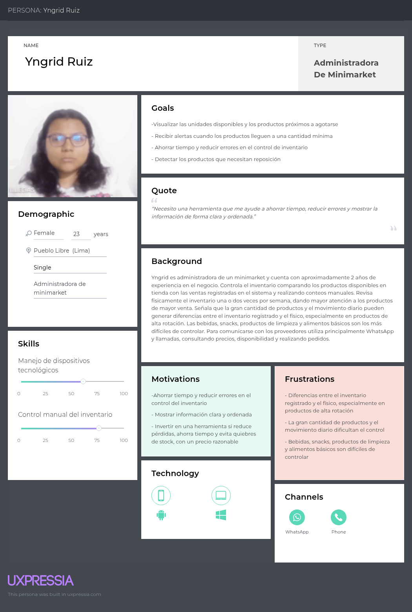

*Nota*. Elaboración propia

**Segundo Segmento Objetivo (Propietarios y administradores de bodegas de barrio)**

***Figura 8***

*User Persona 2 (propietarios y administradores de bodegas de barrio)*

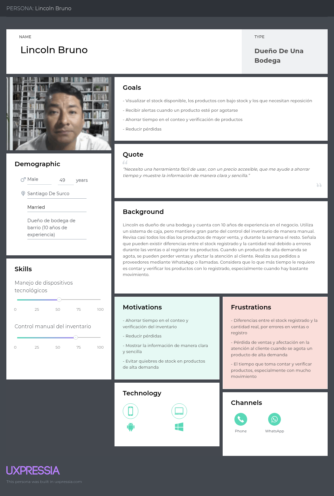

*Nota*. Elaboración propia

### 2.3.2. User Task Matrix

**Primer Segmento Objetivo (Propietarios y administradores de minimarkets)**

**Figura 9**

*User Task Matrix 1 (propietarios y administradores de minimarkets)*

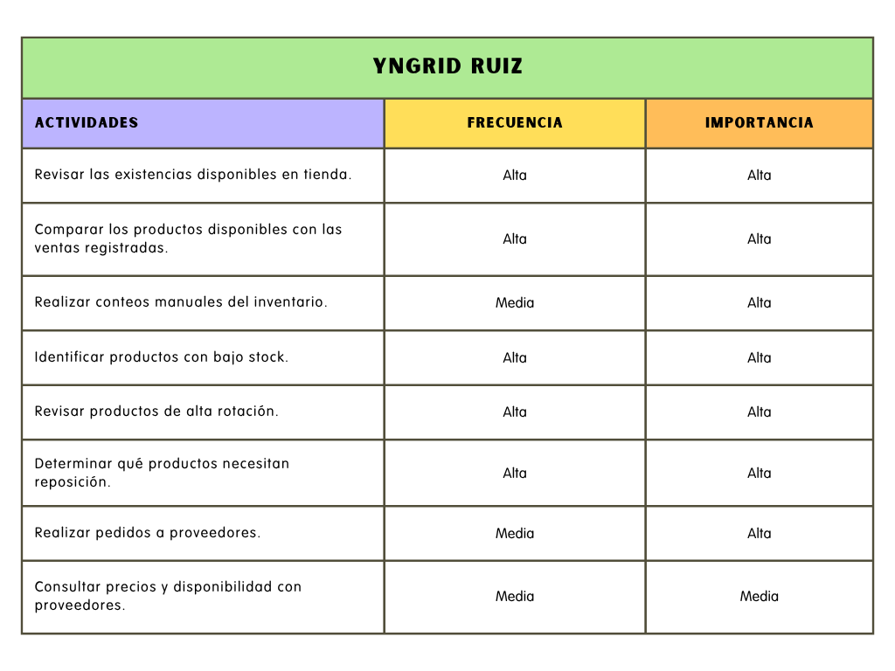

*Nota*. Elaboración propia

**Segundo Segmento Objetivo (Propietarios y administradores de bodegas de barrio)**

***Figura 10***

*User Task Matrix 2 (propietarios y administradores de bodegas de barrio)*

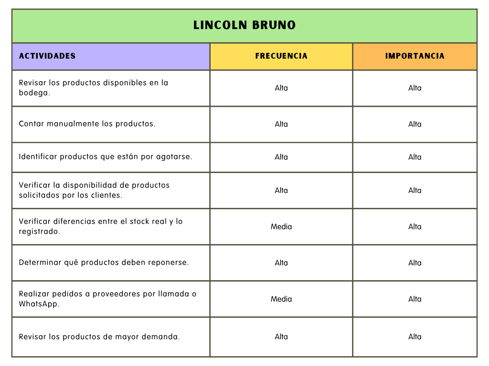

*Nota*. Elaboración propia

### 2.3.3. User Journey Mapping

**Primer Segmento Objetivo (Propietarios y administradores de minimarkets)**

**Figura 11**

*User Journey Map 1 (propietarios y administradores de minimarkets)*

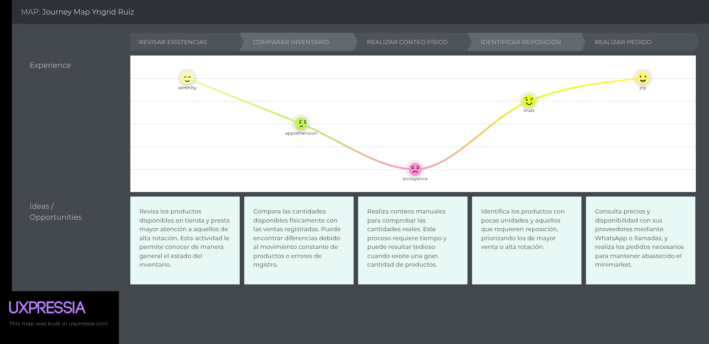

*Nota*. Elaboración propia

**Segundo Segmento Objetivo (Propietarios y administradores de bodegas de barrio)**

**Figura 12**

*User Journey Map 2 (propietarios y administradores de bodegas de barrio)*

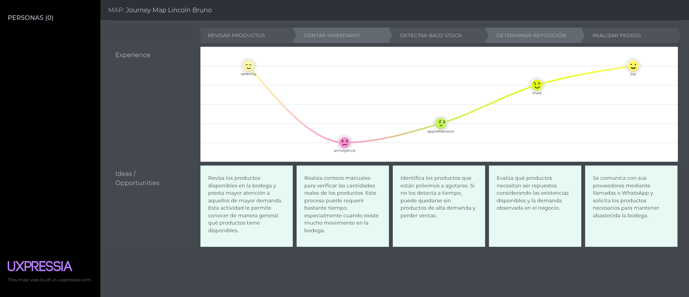

*Nota*. Elaboración propia

### 2.3.4. Empathy Mapping

**Figura 13**

*Empathy Map 1 (propietarios y administradores de minimarkets)*

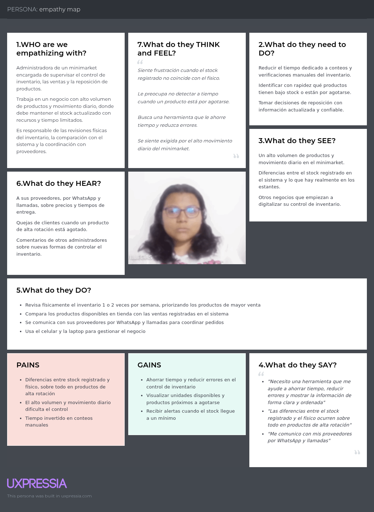

*Nota*. Elaboración propia

**Figura 14**

*Empathy Map 2 (propietarios y administradores de bodegas de barrio)*

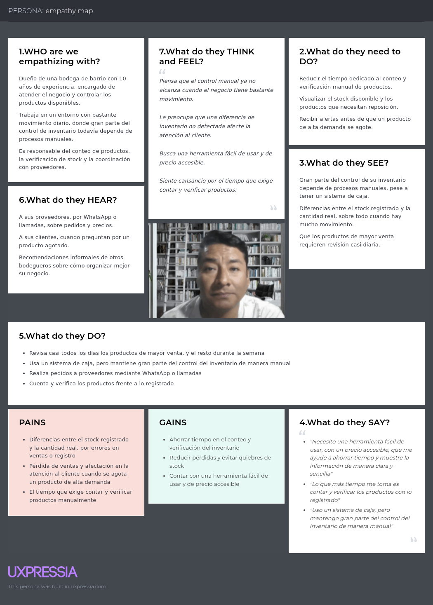

*Nota*. Elaboración propia

## 2.4. Big Picture Event Storming

Para el desarrollo del Big Picture Event Storming se aplicó la guía *Step-by-Step Guide* de Philippe Bourgault, indicada en la rúbrica del Final Problem Statement, siguiendo sus tres etapas:

- Open

- Explore

- Close

**Enlace al tablero de Miro:  
**https://miro.com/welcomeonboard/UHk1SzhpUVZrN1hGMDFlMnpHa2NUOUJMbHBId2xlc2YydGhaYmxUcC96S2hnOWpMWmdwaUVkbGRMWHFlSkhiS0t2TXR6V0JXWEhDU0JKWUNhRWFWRncyeXpmaS84aTEyUHJyU1VmcDNrWWhLd1BTZ09xNlphNUFlVWsxb1h1UXVNakdSWkpBejJWRjJhRnhhb1UwcS9BPT0hdjE=?share_link_id=472690857440

**Figura 15**

*Big Picture Event Storming de SmartStock*

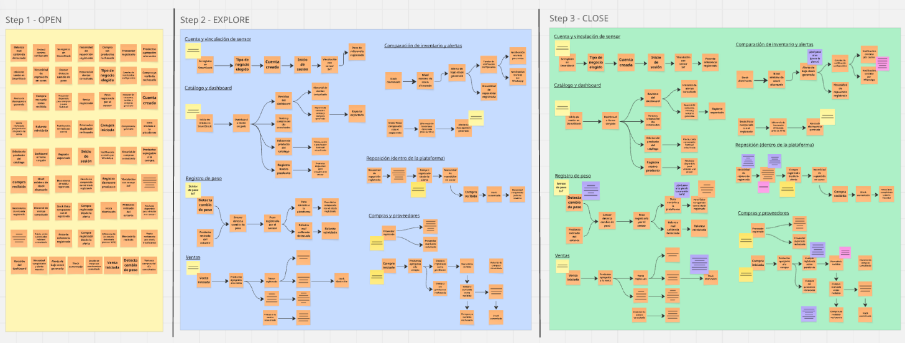

*Nota.* Elaboración propia

## 2.5. Ubiquitous Language

- **IoT Weight Sensor (Sensor de peso IoT):** Dispositivo físico instalado bajo un producto en el punto de venta que mide su peso de forma continua y envía esa lectura a la plataforma SmartStock para inferir el nivel de existencias disponibles.

- **Physical Stock (Stock físico):** Cantidad real de un producto presente físicamente en el minimarket o bodega en un momento determinado, obtenida a partir de la lectura del Sensor de peso IoT.

- **Registered Stock (Stock registrado):** Cantidad de un producto que figura almacenada en el sistema como existencia disponible, la cual puede o no coincidir con el Physical Stock.

- **Inventory Discrepancy (Diferencia de inventario):** Desajuste detectado entre el Physical Stock y el Registered Stock de un producto, que evidencia un posible error de conteo, venta no registrada o pérdida.

- **Minimum Stock Level (Nivel mínimo de stock):** Umbral configurado por el propietario o administrador para cada producto, a partir del cual el sistema considera que las existencias son insuficientes y debe generarse una alerta.

- **Low-Stock Alert (Alerta de bajo stock):** Notificación automática generada por SmartStock cuando el Physical Stock de un producto alcanza o desciende por debajo de su Minimum Stock Level.

- **Restocking Need (Necesidad de reposición):** Registro que identifica que un producto requiere ser abastecido nuevamente, generado a partir de una Low-Stock Alert o de la revisión del Inventory Dashboard por parte del usuario.

- **Inventory Dashboard (Panel de inventario):** Interfaz web principal donde el propietario o administrador visualiza el estado general de sus productos, las alertas activas y las diferencias de inventario detectadas.

- **Rotation Report (Reporte de rotación):** Informe generado por la plataforma que muestra el comportamiento histórico de un producto (frecuencia de venta o consumo) para apoyar la toma de decisiones de reposición.

- **Alert and Movement History (Historial de alertas y movimientos):** Registro histórico de todas las alertas generadas y los cambios de stock detectados para un producto, utilizado como respaldo analítico dentro del dashboard.

- **Store Owner / Manager (Propietario/Administrador):** Usuario principal de SmartStock, responsable del control del inventario, la revisión de alertas y la coordinación de la reposición en un minimarket o bodega de barrio.

- **Supplier (Proveedor):** Actor externo a la plataforma con quien el Store Owner coordina manualmente el reabastecimiento de productos una vez identificada una Restocking Need; esta coordinación ocurre fuera de SmartStock.

- **Third-Party Notification Service (Servicio de notificaciones de terceros):** Sistema externo (correo electrónico o WhatsApp) mediante el cual SmartStock envía las Low-Stock Alerts al Store Owner fuera de la propia plataforma web.

