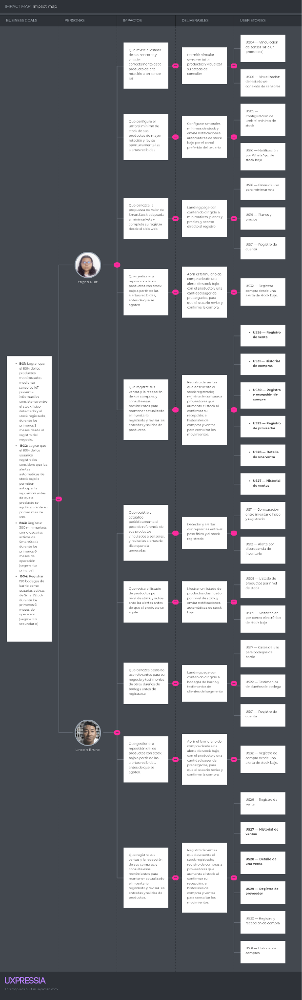
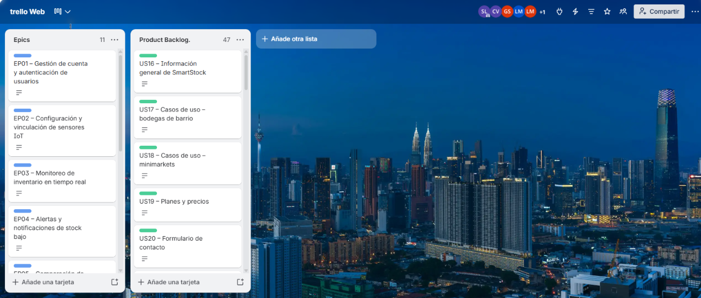
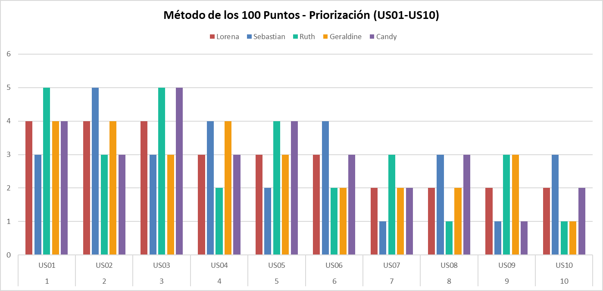
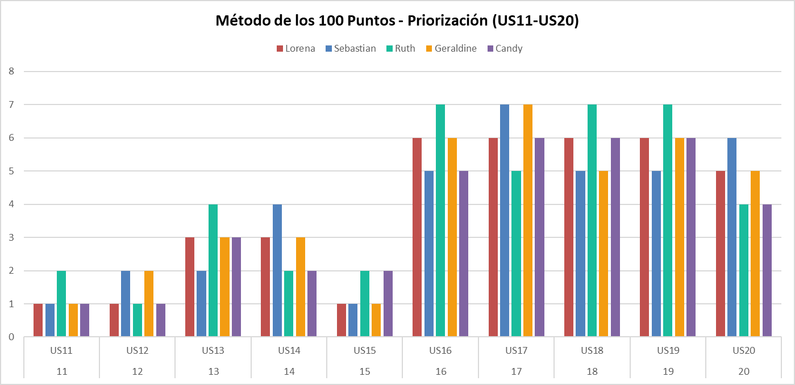
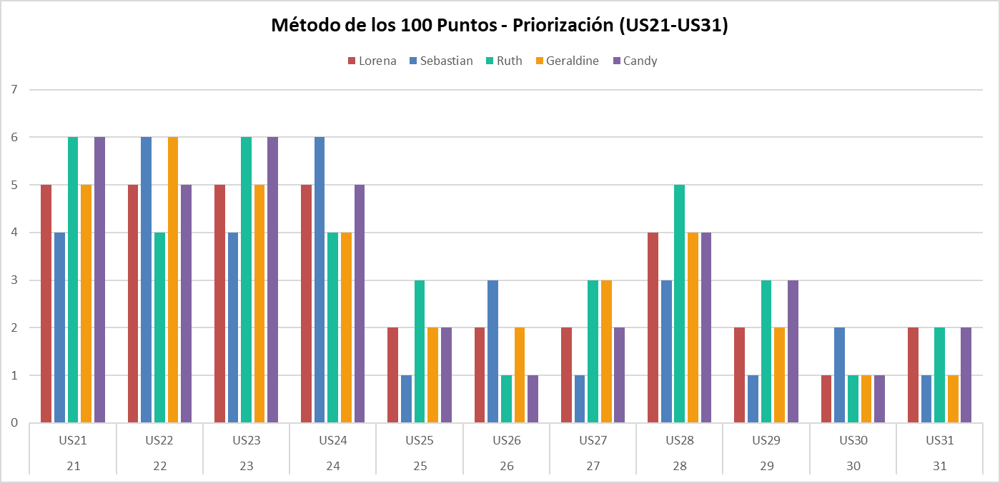

## Capítulo III: Requirements Specification 

## 3.1. User Stories

Nota sobre roles: SmartStock cuenta con un único actor real, el Store Owner/Manager (Propietario/Administrador del negocio). Por ello, las historias cuyo comportamiento es idéntico para bodega de barrio y minimarket usan el rol superior “administrador de mi negocio”, evitando mezclar segmentos en una misma historia. Las historias cuyo comportamiento sí difiere por segmento (US11, US25) especifican el rol concreto (“administrador de minimarket”). Las historias del sitio web estático (US16 a US24) usan el rol “visitante”, y las Technical Stories (TS01 a TS15) usan el rol “developer”, porque describen trabajo técnico que sostiene a las User Stories.

- **Epics:**

**Tabla 16**

*Epics de SmartStock*

| **Epic ID** | **Título**                                      | **Descripción**                                                                                                                                                                                                                                                                                                                                                             |
|-------------|-------------------------------------------------|-----------------------------------------------------------------------------------------------------------------------------------------------------------------------------------------------------------------------------------------------------------------------------------------------------------------------------------------------------------------------------|
| **EP01**    | Gestión de cuenta y autenticación de usuarios   | **Como** administrador de mi negocio, **quiero** registrarme, iniciar sesión y recuperar el acceso a mi cuenta de forma segura, **para** gestionar mi inventario en SmartStock en cualquier momento.                                                                                                                                                                        |
| **EP02**    | Configuración y vinculación de sensores IoT     | **Como** administrador de mi negocio, **quiero** vincular y configurar mis sensores de peso IoT sobre cada producto, **para** que el sistema monitoree automáticamente mi inventario físico.                                                                                                                                                                                |
| **EP03**    | Monitoreo de inventario en tiempo real          | **Como** administrador de mi negocio, **quiero** visualizar el nivel de stock de mis productos en tiempo real a partir de las lecturas de los sensores, **para** tomar decisiones oportunas de reposición.                                                                                                                                                                  |
| **EP04**    | Alertas y notificaciones de stock bajo          | **Como** administrador de mi negocio, **quiero** recibir notificaciones automáticas por correo electrónico o WhatsApp cuando el stock de un producto llegue al umbral mínimo, **para** coordinar su reposición a tiempo.                                                                                                                                                    |
| **EP05**    | Comparación de inventario físico vs. registrado | **Como** administrador de minimarket, **quiero** comparar el peso físico detectado por los sensores con la cantidad registrada en el sistema, **para** detectar mermas o errores de conteo a tiempo. Para bodegas de barrio, esta detección se resuelve de forma automática mediante alertas de discrepancia (EP04), sin necesidad de una pantalla de comparación dedicada. |
| **EP06**    | Gestión de catálogo de productos                | **Como** administrador de mi negocio, **quiero** registrar y editar los productos de mi catálogo, **para** mantener actualizada la información monitoreada por SmartStock.                                                                                                                                                                                                  |
| **EP07**    | Reportes y dashboard de inventario              | **Como** administrador de mi negocio, **quiero** visualizar un dashboard con el resumen general del estado de mi inventario y, en el caso de minimarkets, generar reportes de consumo, ventas, compras y movimientos de inventario, **para** tener una vista rápida de mi negocio y tomar mejores decisiones de reposición y compra.                                        |
| **EP08**    | Sitio web estático (Landing Page)               | **Como** visitante del sitio web de SmartStock, general o de un segmento específico (bodegas de barrio o minimarkets), **quiero** conocer la propuesta de valor, casos de uso, planes y evidencia social del producto, **para** decidir si me registro o solicito una demostración.                                                                                         |
| **EP09**    | Servicios RESTful de la API                     | **Como** developer, **quiero** exponer los servicios RESTful necesarios para la recepción de lecturas de sensores, autenticación, consulta de stock, estado de sensores, notificaciones, comparación de inventario, ventas, compras, proveedores y movimientos de stock, **para** soportar el funcionamiento de las aplicaciones web y de los dispositivos IoT.             |
| **EP10**    | Gestión de ventas                               | **Como** administrador de mi negocio, **quiero** registrar y consultar mis ventas, **para** controlar lo que sale de mi inventario y mantener mi stock registrado actualizado.                                                                                                                                                                                              |
| **EP11**    | Gestión de compras y proveedores                | **Como** administrador de mi negocio, **quiero** registrar a mis proveedores y las compras que les hago, **para** controlar lo que entra a mi inventario y reponer a tiempo los productos con stock bajo.                                                                                                                                                                   |

*Nota.* Elaboración propia

**Tabla 17**

*User Stories y Technical Stories de SmartStock*

<table>
<colgroup>
<col style="width: 6%" />
<col style="width: 12%" />
<col style="width: 34%" />
<col style="width: 34%" />
<col style="width: 11%" />
</colgroup>
<thead>
<tr class="header">
<th><strong>Story ID</strong></th>
<th><strong>Título</strong></th>
<th><strong>Descripción</strong></th>
<th><strong>Criterios de Aceptación</strong></th>
<th><strong>Relacionado con (Epic ID)</strong></th>
</tr>
<tr class="odd">
<th><strong>US01</strong></th>
<th>Registro de cuenta</th>
<th><strong>Como</strong> administrador de mi negocio, <strong>quiero</strong> registrarme en la plataforma SmartStock con mi correo electrónico, los datos de mi negocio y el tipo de negocio (bodega de barrio o minimarket), <strong>para</strong> poder acceder a los servicios de monitoreo de inventario adecuados a mi negocio.</th>
<th>
<strong>Scenario 1: Registro exitoso</strong>

<strong>Given</strong> el usuario ingresa un correo electrónico válido, una contraseña y los datos de su negocio,

<strong>When</strong> el usuario confirma el registro,

<strong>Then</strong> el sistema crea la cuenta y la asocia al negocio registrado,

<strong>And</strong> envía un correo de confirmación de registro.

<strong>Scenario 2: Correo ya registrado</strong>

<strong>Given</strong> el correo electrónico ingresado ya está registrado en el sistema,

<strong>When</strong> el usuario intenta completar el registro,

<strong>Then</strong> el sistema rechaza el registro e indica que el correo ya se encuentra en uso.

<strong>Scenario 3: Selección de tipo de negocio</strong>

<strong>Given</strong> el usuario selecciona el tipo de negocio (bodega de barrio o minimarket) durante el registro,

<strong>When</strong> el usuario confirma el registro,

<strong>Then</strong> el sistema asocia el tipo de negocio a la cuenta y habilita el conjunto de funcionalidades correspondiente a dicho tipo de negocio.
</th>
<th><strong>EP01</strong></th>
</tr>
<tr class="header">
<th><strong>US02</strong></th>
<th>Inicio de sesión</th>
<th><strong>Como</strong> administrador de mi negocio, <strong>quiero</strong> iniciar sesión con mi correo electrónico y contraseña, <strong>para</strong> acceder al panel de monitoreo de mi inventario.</th>
<th>
<strong>Scenario 1: Inicio de sesión exitoso</strong>

<strong>Given</strong> el usuario cuenta con una cuenta registrada y activa,

<strong>When</strong> el usuario ingresa su correo y contraseña correctos,

<strong>Then</strong> el sistema lo autentica y otorga acceso al panel de monitoreo.

<strong>Scenario 2: Credenciales incorrectas</strong>

<strong>Given</strong> el usuario ingresa una contraseña incorrecta,

<strong>When</strong> el usuario intenta iniciar sesión,

<strong>Then</strong> el sistema rechaza el inicio de sesión e indica que las credenciales son incorrectas.
</th>
<th><strong>EP01</strong></th>
</tr>
<tr class="odd">
<th><strong>US03</strong></th>
<th>Recuperación de contraseña</th>
<th><strong>Como</strong> administrador de mi negocio, <strong>quiero</strong> recuperar mi contraseña mediante un enlace enviado a mi correo electrónico, <strong>para</strong> volver a acceder a mi cuenta cuando la olvide.</th>
<th>
<strong>Scenario 1: Solicitud de recuperación válida</strong>

<strong>Given</strong> el usuario ingresa el correo electrónico asociado a su cuenta,

<strong>When</strong> el usuario solicita la recuperación de contraseña,

<strong>Then</strong> el sistema envía un enlace de restablecimiento al correo registrado, el cual expira transcurridas 24 horas desde su generación. 
 
<strong>Escenario 2: Restablecimiento con enlace vigente 
Given</strong> el usuario abre el enlace de restablecimiento antes de que transcurran 24 horas desde su generación, 
<strong>When</strong> ingresa una nueva contraseña válida y la confirma, 
<strong>Then</strong> el sistema actualiza la contraseña y permite iniciar sesión con ella.

<strong>Scenario 3: Enlace vencido 
Given</strong> el enlace de restablecimiento fue generado hace más de 24 horas, 
<strong>When</strong> el usuario intenta usarlo, 
<strong>Then</strong> el sistema rechaza el restablecimiento e indica que el enlace expiró.
</th>
<th><strong>EP01</strong></th>
</tr>
<tr class="header">
<th><strong>US04</strong></th>
<th>Vinculación de sensor IoT a un producto</th>
<th><strong>Como</strong> administrador de mi negocio, <strong>quiero</strong> vincular un sensor de peso IoT a un producto específico de mi inventario, <strong>para</strong> que el sistema registre su peso de referencia.</th>
<th>
<strong>Scenario 1: Vinculación exitosa</strong>

<strong>Given</strong> el usuario selecciona un sensor disponible y un producto sin sensor asignado,

<strong>When</strong> el usuario confirma la vinculación,

<strong>Then</strong> el sistema asocia el sensor al producto y registra el peso inicial detectado como referencia.

<strong>Scenario 2: Sensor ya vinculado</strong>

<strong>Given</strong> el sensor seleccionado ya está vinculado a otro producto,

<strong>When</strong> el usuario intenta vincularlo a un nuevo producto,

<strong>Then</strong> el sistema rechaza la vinculación e indica que el sensor ya se encuentra en uso.
</th>
<th><strong>EP02</strong></th>
</tr>
<tr class="odd">
<th><strong>US05</strong></th>
<th>Configuración de umbral mínimo de stock</th>
<th><strong>Como</strong> administrador de mi negocio, <strong>quiero</strong> configurar el umbral mínimo de stock para cada producto vinculado a un sensor, <strong>para</strong> que el sistema me alerte cuando el nivel sea bajo.</th>
<th>
<strong>Scenario 1: Validación de umbral máximo permitido (Regla de negocio)</strong>

<strong>Given</strong> el usuario intenta configurar un umbral mínimo mayor a la capacidad máxima registrada para el producto,

<strong>When</strong> el usuario guarda la configuración,

<strong>Then</strong> el sistema rechaza la configuración e indica que el umbral no puede superar la capacidad máxima del producto.

<strong>Scenario 2: Configuración válida</strong>

<strong>Given</strong> el usuario ingresa un valor numérico mayor a cero y menor o igual a la capacidad máxima del producto,

<strong>When</strong> el usuario guarda la configuración,

<strong>Then</strong> el sistema almacena el umbral y lo aplica para la generación de futuras alertas.
</th>
<th><strong>EP02</strong></th>
</tr>
<tr class="header">
<th><strong>US06</strong></th>
<th>Visualización del estado de conexión de sensores</th>
<th><strong>Como</strong> administrador de mi negocio, <strong>quiero</strong> ver el estado de conexión de cada sensor IoT instalado, <strong>para</strong> saber si alguno requiere revisión técnica.</th>
<th>
<strong>Scenario 1: Sensor conectado</strong>

<strong>Given</strong> un sensor envió una lectura en los últimos 5 minutos,

<strong>When</strong> el usuario consulta el estado de sus sensores,

<strong>Then</strong> el sistema muestra el sensor con estado "en línea".

<strong>Scenario 2: Sensor desconectado</strong>

<strong>Given</strong> un sensor no envió ninguna lectura en los últimos 5 minutos,

<strong>When</strong> el usuario consulta el estado de sus sensores,

<strong>Then</strong> el sistema muestra el sensor con estado "desconectado".
</th>
<th><strong>EP02</strong></th>
</tr>
<tr class="odd">
<th><strong>US07</strong></th>
<th>Visualización del peso actual de un producto</th>
<th><strong>Como</strong> administrador de mi negocio, <strong>quiero</strong> visualizar el peso actual registrado por el sensor de cada producto, <strong>para</strong> conocer el nivel de stock físico en tiempo real.</th>
<th>
<strong>Scenario 1: Lectura disponible</strong>

<strong>Given</strong> el sensor de un producto envió al menos una lectura de peso,

<strong>When</strong> el usuario consulta el nivel de stock del producto,

<strong>Then</strong> el sistema muestra el peso más reciente recibido y su cantidad equivalente en unidades.
</th>
<th><strong>EP03</strong></th>
</tr>
<tr class="header">
<th><strong>US08</strong></th>
<th>Listado de productos por nivel de stock</th>
<th><strong>Como</strong> administrador de mi negocio, <strong>quiero</strong> visualizar un listado de todos mis productos monitoreados junto con su nivel de stock actual, <strong>para</strong> identificar cuáles necesitan reposición.</th>
<th>
<strong>Scenario 1: Listado con productos en distintos niveles</strong>

<strong>Given</strong> el usuario tiene productos con sensores vinculados,

<strong>When</strong> el usuario consulta el listado de productos,

<strong>Then</strong> el sistema muestra cada producto con su nivel de stock clasificado como bajo, normal o sin datos.

<strong>Scenario 2: Stock registrado actualizado por movimientos</strong>

<strong>Given</strong> el usuario registró una venta o una compra recibida de un producto,

<strong>When</strong> consulta el listado de productos,

<strong>Then</strong> el sistema muestra el stock registrado actualizado junto con el nivel de stock del producto.
</th>
<th><strong>EP03</strong></th>
</tr>
<tr class="odd">
<th><strong>US09</strong></th>
<th>Notificación por correo electrónico de stock bajo</th>
<th><strong>Como</strong> administrador de mi negocio, <strong>quiero</strong> recibir una notificación por correo electrónico cuando el stock de un producto llegue al umbral mínimo, <strong>para</strong> coordinar su reposición con mi proveedor a tiempo.</th>
<th>
<strong>Scenario 1: Stock alcanza el umbral mínimo</strong>

<strong>Given</strong> el nivel de stock de un producto es igual o menor al umbral mínimo configurado,

<strong>And</strong> el usuario tiene configurado el correo electrónico como canal de notificación,

<strong>When</strong> el sistema detecta la condición de stock bajo,

<strong>Then</strong> el sistema envía una notificación por correo electrónico a la dirección registrada y registra la necesidad de reposición del producto.
</th>
<th><strong>EP04</strong></th>
</tr>
<tr class="header">
<th><strong>US10</strong></th>
<th>Notificación por WhatsApp de stock bajo</th>
<th><strong>Como</strong> administrador de mi negocio, <strong>quiero</strong> recibir una notificación por WhatsApp cuando el stock de un producto llegue al umbral mínimo, <strong>para</strong> gestionar la reposición sin estar frente al sistema.</th>
<th>
<strong>Scenario 1: Stock alcanza el umbral mínimo</strong>

<strong>Given</strong> el nivel de stock de un producto es igual o menor al umbral mínimo configurado,

<strong>And</strong> el usuario tiene configurado WhatsApp como canal de notificación,

<strong>When</strong> el sistema detecta la condición de stock bajo,

<strong>Then</strong> el sistema envía una notificación por WhatsApp al número registrado y registra la necesidad de reposición del producto.
</th>
<th><strong>EP04</strong></th>
</tr>
<tr class="odd">
<th><strong>US11</strong></th>
<th>Comparación entre inventario físico y registrado</th>
<th><strong>Como</strong> administrador de minimarket, <strong>quiero</strong> comparar el peso físico detectado por los sensores con la cantidad registrada en el sistema (actualizada por ventas, compras y ajustes), <strong>para</strong> detectar diferencias por mermas o errores de conteo.</th>
<th>
<strong>Scenario 1: Diferencia detectada</strong>

<strong>Given</strong> existe una cantidad registrada manualmente para un producto,

<strong>When</strong> el sistema recibe una nueva lectura del sensor asociado al producto,

<strong>Then</strong> el sistema calcula la diferencia porcentual entre el peso físico y la cantidad registrada,

<strong>And</strong> muestra el resultado al usuario.

<strong>Scenario 2: Comparación con ventas y compras registradas</strong>

<strong>Given</strong> el producto tiene ventas o compras recibidas registradas,

<strong>When</strong> el sistema recibe una nueva lectura del sensor asociado al producto,

<strong>Then</strong> el sistema calcula la diferencia entre el peso físico y el stock registrado actualizado por los movimientos,

<strong>And</strong> muestra el resultado al usuario.
</th>
<th><strong>EP05</strong></th>
</tr>
<tr class="header">
<th><strong>US12</strong></th>
<th>Alerta por discrepancia de inventario</th>
<th><strong>Como</strong> administrador de mi negocio, <strong>quiero</strong> recibir una alerta automática cuando exista una discrepancia mayor al 10% entre el inventario físico y el registrado, <strong>para</strong> investigar la causa de la diferencia sin tener que revisarlo manualmente.</th>
<th>
<strong>Scenario 1: Discrepancia mayor al umbral</strong>

<strong>Given</strong> la diferencia calculada entre el inventario físico y el registrado supera el 10%,

<strong>When</strong> el sistema finaliza el cálculo de comparación,

<strong>Then</strong> el sistema genera una alerta de discrepancia, notifica al usuario por su canal configurado y registra la necesidad de reposición del producto.
</th>
<th><strong>EP05</strong></th>
</tr>
<tr class="odd">
<th><strong>US13</strong></th>
<th>Registro de nuevo producto en el catálogo</th>
<th><strong>Como</strong> administrador de mi negocio, <strong>quiero</strong> registrar un nuevo producto en mi catálogo con su nombre, categoría y peso unitario, <strong>para</strong> empezar a monitorear su stock con un sensor IoT.</th>
<th>
<strong>Scenario 1: Registro exitoso</strong>

<strong>Given</strong> el usuario ingresa un nombre, categoría y peso unitario válidos para el producto,

<strong>When</strong> el usuario confirma el registro,

<strong>Then</strong> el sistema agrega el producto al catálogo del negocio y queda disponible para ser vinculado a un sensor.
</th>
<th><strong>EP06</strong></th>
</tr>
<tr class="header">
<th><strong>US14</strong></th>
<th>Edición de producto del catálogo</th>
<th><strong>Como</strong> administrador de mi negocio, <strong>quiero</strong> editar la información de un producto existente en mi catálogo, <strong>para</strong> mantener actualizados sus datos.</th>
<th>
<strong>Scenario 1: Edición exitosa</strong>

<strong>Given</strong> el usuario modifica uno o más datos de un producto existente,

<strong>When</strong> el usuario confirma los cambios,

<strong>Then</strong> el sistema actualiza la información del producto y conserva el historial de lecturas asociado.

<strong>Scenario 2: Edición de precios y proveedor habitual</strong>

<strong>Given</strong> el usuario modifica el precio de venta, el costo de compra o el proveedor habitual de un producto,

<strong>When</strong> confirma los cambios,

<strong>Then</strong> el sistema actualiza esos datos para las próximas ventas y compras,

<strong>And</strong> conserva intactas las ventas y compras ya registradas.
</th>
<th><strong>EP06</strong></th>
</tr>
<tr class="odd">
<th><strong>US15</strong></th>
<th>Visualización de dashboard resumen de inventario</th>
<th><strong>Como</strong> administrador de mi negocio, <strong>quiero</strong> visualizar un resumen con el estado general de mi inventario (productos en stock bajo, normal y sin sensor asignado), <strong>para</strong> tener una vista rápida de mi negocio sin revisar producto por producto.</th>
<th>
<strong>Scenario 1: Dashboard con datos disponibles</strong>

<strong>Given</strong> el negocio tiene al menos un producto registrado,

<strong>When</strong> el usuario consulta el dashboard,

<strong>Then</strong> el sistema muestra la cantidad de productos en stock bajo, stock normal y sin sensor asignado.

<strong>Scenario 2: Dashboard con ventas y compras</strong>

<strong>Given</strong> existen ventas o compras registradas en el día,

<strong>When</strong> el usuario consulta el dashboard,

<strong>Then</strong> el sistema muestra el total vendido y el total comprado del día.
</th>
<th><strong>EP07</strong></th>
</tr>
<tr class="header">
<th><strong>US16</strong></th>
<th>Información general de SmartStock</th>
<th><strong>Como</strong> visitante, <strong>quiero</strong> conocer en la página de inicio qué es SmartStock y qué problema resuelve, <strong>para</strong> evaluar rápidamente si el producto es útil para mi negocio.</th>
<th>
<strong>Scenario 1: Consulta de la página de inicio</strong>

<strong>Given</strong> un visitante ingresa al sitio web de SmartStock,

<strong>When</strong> accede a la página de inicio,

<strong>Then</strong> el sistema muestra una descripción del producto y del problema de control de inventario que resuelve.

<strong>Scenario 2:</strong> <strong>Consulta de la sección de problemática</strong>

<strong>Given</strong> un visitante navega la página de inicio,

<strong>When</strong> llega a la sección de problemática,

<strong>Then</strong> el sistema muestra los tres problemas principales del control manual de inventario (quiebres de stock detectados tarde, registros que no coinciden con la realidad, y tiempo perdido revisando estantes).
</th>
<th><strong>EP08</strong></th>
</tr>
<tr class="odd">
<th><strong>US17</strong></th>
<th>Casos de uso para bodegas de barrio</th>
<th><strong>Como</strong> visitante del segmento bodegas de barrio, <strong>quiero</strong> ver una sección con casos de uso enfocados en negocios pequeños, <strong>para</strong> identificar si SmartStock se ajusta al tamaño de mi negocio.</th>
<th>
<strong>Scenario 1: Consulta de la sección de casos de uso</strong>

<strong>Given</strong> un visitante del segmento bodegas de barrio navega el sitio web,

<strong>When</strong> accede a la sección de casos de uso,

<strong>Then</strong> el sistema muestra, dentro de dicha sección, un apartado con contenido dirigido a negocios de tipo bodega de barrio, presentado junto al apartado de minimarkets.
</th>
<th><strong>EP08</strong></th>
</tr>
<tr class="header">
<th><strong>US18</strong></th>
<th>Casos de uso para minimarkets</th>
<th><strong>Como</strong> visitante del segmento minimarkets, <strong>quiero</strong> ver una sección con casos de uso enfocados en negocios de mayor volumen, <strong>para</strong> evaluar si SmartStock puede manejar la escala de mi minimarket.</th>
<th>
<strong>Scenario 1: Consulta de la sección de casos de uso</strong>

<strong>Given</strong> un visitante del segmento minimarkets navega el sitio web,

<strong>When</strong> accede a la sección de casos de uso,

<strong>Then</strong> el sistema muestra, dentro de dicha sección, un apartado con contenido dirigido a negocios de tipo minimarket, presentado junto al apartado de bodegas de barrio.
</th>
<th><strong>EP08</strong></th>
</tr>
<tr class="odd">
<th><strong>US19</strong></th>
<th>Planes y precios</th>
<th><strong>Como</strong> visitante, <strong>quiero</strong> ver una sección con los planes y precios de SmartStock, <strong>para</strong> decidir cuál se ajusta a mi presupuesto antes de contactar al equipo comercial.</th>
<th>
<strong>Scenario 1: Consulta de planes</strong>

<strong>Given</strong> un visitante navega el sitio web,

<strong>When</strong> el visitante accede a la sección de planes y precios,

<strong>Then</strong> el sistema muestra los planes disponibles con sus características y costos.
</th>
<th><strong>EP08</strong></th>
</tr>
<tr class="header">
<th><strong>US20</strong></th>
<th>Formulario de contacto para solicitar demostración</th>
<th><strong>Como</strong> visitante, <strong>quiero</strong> completar un formulario con mi nombre, negocio, correo electrónico y tipo de negocio, <strong>para</strong> solicitar una demostración del producto.</th>
<th>
<strong>Scenario 1: Envío exitoso del formulario</strong>

<strong>Given</strong> un visitante completa el nombre, el negocio, un correo electrónico válido y selecciona el tipo de negocio (bodega de barrio o minimarket) en el formulario de contacto,

<strong>When</strong> el visitante envía el formulario,

<strong>Then</strong> el sistema registra la solicitud de demostración incluyendo el tipo de negocio y envía una confirmación al correo ingresado.

<strong>Scenario 2: Datos incompletos</strong>

<strong>Given</strong> un visitante deja al menos un campo obligatorio vacío en el formulario de contacto,

<strong>When</strong> el visitante intenta enviar el formulario,

<strong>Then</strong> el sistema rechaza el envío e indica qué campos faltan por completar.
</th>
<th><strong>EP08</strong></th>
</tr>
<tr class="odd">
<th><strong>US21</strong></th>
<th>Preguntas frecuentes sobre instalación de sensores</th>
<th><strong>Como</strong> visitante, <strong>quiero</strong> ver una sección de preguntas frecuentes sobre la instalación de los sensores IoT, <strong>para</strong> resolver mis dudas técnicas antes de contratar el servicio.</th>
<th>
<strong>Scenario 1: Consulta de preguntas frecuentes</strong>

<strong>Given</strong> un visitante navega el sitio web,

<strong>When</strong> el visitante accede a la sección de preguntas frecuentes,

<strong>Then</strong> el sistema muestra las preguntas relacionadas con la instalación de sensores IoT junto con sus respuestas.
</th>
<th><strong>EP08</strong></th>
</tr>
<tr class="header">
<th><strong>US22</strong></th>
<th>Testimonios de dueños de bodega</th>
<th><strong>Como</strong> visitante del segmento bodegas de barrio, <strong>quiero</strong> ver testimonios de otros dueños de bodega que usan SmartStock, <strong>para</strong> generar confianza antes de registrarme.</th>
<th>
<strong>Scenario 1: Consulta de testimonios</strong>

<strong>Given</strong> un visitante del segmento bodegas de barrio navega el sitio web,

<strong>When</strong> el visitante accede a la sección de testimonios,

<strong>Then</strong> el sistema muestra, dentro de dicha sección, testimonios de clientes del segmento bodegas de barrio, presentados junto a los testimonios de minimarkets.
</th>
<th><strong>EP08</strong></th>
</tr>
<tr class="odd">
<th><strong>US23</strong></th>
<th>Comparación frente a otras soluciones</th>
<th><strong>Como</strong> visitante del segmento minimarkets, <strong>quiero</strong> ver una comparación de SmartStock frente a otras soluciones de control de inventario, <strong>para</strong> justificar la elección frente a mis socios o jefes.</th>
<th>
<strong>Scenario 1: Consulta de comparación</strong>

<strong>Given</strong> un visitante del segmento minimarkets navega el sitio web,

<strong>When</strong> el visitante accede a la sección de comparación de soluciones,

<strong>Then</strong> el sistema muestra una tabla comparativa entre SmartStock y otras soluciones del mercado, visible también para visitantes de bodegas de barrio.
</th>
<th><strong>EP08</strong></th>
</tr>
<tr class="header">
<th><strong>US24</strong></th>
<th>Acceso a registro desde el sitio web</th>
<th><strong>Como</strong> visitante, <strong>quiero</strong> acceder a la opción de registro desde cualquier sección del sitio web, <strong>para</strong> crear mi cuenta sin necesidad de buscarla.</th>
<th>
<strong>Scenario 1: Acceso a la opción de registro</strong>

<strong>Given</strong> un visitante se encuentra en cualquier sección del sitio web,

<strong>When</strong> el visitante selecciona la opción de registro,

<strong>Then</strong> el sistema redirige al visitante al formulario de creación de cuenta.
</th>
<th><strong>EP08</strong></th>
</tr>
<tr class="odd">
<th><strong>US25</strong></th>
<th>Reportes de consumo y movimientos de inventario</th>
<th><strong>Como</strong> administrador de minimarket, <strong>quiero</strong> generar reportes de consumo, ventas, compras y movimientos de inventario por periodo, <strong>para</strong> analizar tendencias y tomar mejores decisiones de reposición y compra.</th>
<th>
<strong>Scenario 1: Reporte con datos disponibles</strong>

<strong>Given</strong> existen movimientos de inventario registrados en el periodo seleccionado,

<strong>When</strong> el administrador solicita el reporte de consumo,

<strong>Then</strong> el sistema muestra el consumo total y los movimientos por producto.

<strong>Scenario 2: Periodo sin movimientos</strong>

<strong>Given</strong> no existen movimientos registrados en el periodo,

<strong>When</strong> el administrador solicita el reporte,

<strong>Then</strong> el sistema indica que no hay datos disponibles para dicho periodo.

<strong>Scenario 3: Reporte con ventas y compras</strong>

<strong>Given</strong> existen ventas y compras registradas en el periodo seleccionado,

<strong>When</strong> el administrador solicita el reporte,

<strong>Then</strong> el sistema muestra el total vendido, el total comprado y las entradas y salidas de stock por producto.
</th>
<th><strong>EP07</strong></th>
</tr>
<tr class="header">
<th><strong>US26</strong></th>
<th>Registro de venta</th>
<th><strong>Como</strong> administrador de mi negocio, <strong>quiero</strong> registrar una venta indicando los productos y las cantidades vendidas, <strong>para</strong> llevar el control de lo que sale de mi inventario y mantener mi stock actualizado.</th>
<th>
<strong>Scenario 1: Venta registrada con stock suficiente</strong>

<strong>Given</strong> el usuario selecciona uno o más productos con precio de venta y cantidades menores o iguales a su stock registrado,

<strong>When</strong> el usuario confirma la venta,

<strong>Then</strong> el sistema registra la venta con su total, descuenta las cantidades del stock registrado y deja un movimiento de salida por cada producto.

<strong>Scenario 2: Rechazo por stock insuficiente</strong>

<strong>Given</strong> la cantidad de un producto supera su stock registrado,

<strong>When</strong> el usuario confirma la venta,

<strong>Then</strong> el sistema rechaza la venta e indica el producto y el stock disponible,

<strong>And</strong> no modifica el stock.

<strong>Scenario 3: Producto sin precio de venta</strong>

<strong>Given</strong> un producto seleccionado no tiene precio de venta configurado,

<strong>When</strong> el usuario intenta agregarlo a la venta,

<strong>Then</strong> el sistema solicita configurar su precio de venta en el catálogo antes de venderlo.
</th>
<th><strong>EP10</strong></th>
</tr>
<tr class="odd">
<th><strong>US27</strong></th>
<th>Historial de ventas</th>
<th><strong>Como</strong> administrador de mi negocio, <strong>quiero</strong> consultar el historial de mis ventas por rango de fechas, <strong>para</strong> revisar lo que vendí y el total del periodo.</th>
<th>
<strong>Scenario 1: Historial con ventas</strong>

<strong>Given</strong> existen ventas registradas en el rango de fechas seleccionado,

<strong>When</strong> el usuario consulta el historial,

<strong>Then</strong> el sistema muestra las ventas de la más reciente a la más antigua, con su fecha, cantidad de productos y total, junto con el total acumulado del periodo.

<strong>Scenario 2: Periodo sin ventas</strong>

<strong>Given</strong> no existen ventas en el rango de fechas seleccionado,

<strong>When</strong> el usuario consulta el historial,

<strong>Then</strong> el sistema indica que no hay ventas registradas en ese periodo.
</th>
<th><strong>EP10</strong></th>
</tr>
<tr class="header">
<th><strong>US28</strong></th>
<th>Detalle de una venta</th>
<th><strong>Como</strong> administrador de mi negocio, <strong>quiero</strong> ver el detalle de una venta, <strong>para</strong> verificar qué productos, cantidades y precios se registraron.</th>
<th>
<strong>Scenario 1: Detalle de venta</strong>

<strong>Given</strong> el usuario selecciona una venta del historial,

<strong>When</strong> abre su detalle,

<strong>Then</strong> el sistema muestra la fecha, los productos con su cantidad, precio unitario y subtotal, el total y los movimientos de stock generados.
</th>
<th><strong>EP10</strong></th>
</tr>
<tr class="odd">
<th><strong>US29</strong></th>
<th>Registro de proveedor</th>
<th><strong>Como</strong> administrador de mi negocio, <strong>quiero</strong> registrar a mis proveedores con su nombre, teléfono y correo opcional, <strong>para</strong> asociarlos a mis compras y a mis productos.</th>
<th>
<strong>Scenario 1: Registro exitoso</strong>

<strong>Given</strong> el usuario ingresa un nombre y un teléfono válidos,

<strong>When</strong> confirma el registro,

<strong>Then</strong> el sistema agrega al proveedor al listado de proveedores del negocio.

<strong>Scenario 2: Proveedor duplicado</strong>

<strong>Given</strong> ya existe un proveedor con el mismo nombre y teléfono en el negocio,

<strong>When</strong> el usuario intenta registrarlo,

<strong>Then</strong> el sistema rechaza el registro e indica que el proveedor ya existe.
</th>
<th><strong>EP11</strong></th>
</tr>
<tr class="header">
<th><strong>US30</strong></th>
<th>Registro y recepción de compra</th>
<th><strong>Como</strong> administrador de mi negocio, <strong>quiero</strong> registrar una compra a un proveedor con los productos, cantidades y costos, y marcarla como recibida, <strong>para</strong> que mi stock aumente cuando la mercadería llegue.</th>
<th>
<strong>Scenario 1: Compra registrada</strong>

<strong>Given</strong> el usuario selecciona un proveedor y uno o más productos con su cantidad y costo unitario,

<strong>When</strong> confirma el registro,

<strong>Then</strong> el sistema guarda la compra en estado pendiente con su total, sin modificar el stock.

<strong>Scenario 2: Recepción de la compra</strong>

<strong>Given</strong> existe una compra en estado pendiente,

<strong>When</strong> el usuario la marca como recibida,

<strong>Then</strong> el sistema suma las cantidades al stock registrado y deja un movimiento de entrada por cada producto.

<strong>Scenario 3: Compra sin productos</strong>

<strong>Given</strong> el usuario no ha agregado ningún producto a la compra,

<strong>When</strong> intenta confirmarla,

<strong>Then</strong> el sistema rechaza el registro e indica que debe agregar al menos un producto.
</th>
<th><strong>EP11</strong></th>
</tr>
<tr class="odd">
<th><strong>US31</strong></th>
<th>Historial de compras</th>
<th><strong>Como</strong> administrador de mi negocio, <strong>quiero</strong> consultar el historial de mis compras por rango de fechas, <strong>para</strong> revisar lo que compré, a qué proveedor y en qué estado está cada compra.</th>
<th>
<strong>Scenario 1: Historial con compras</strong>

<strong>Given</strong> existen compras registradas en el rango de fechas seleccionado,

<strong>When</strong> el usuario consulta el historial,

<strong>Then</strong> el sistema muestra las compras con su fecha, proveedor, estado y total, junto con el total acumulado del periodo.

<strong>Scenario 2: Periodo sin compras</strong>

<strong>Given</strong> no existen compras en el rango de fechas seleccionado,

<strong>When</strong> el usuario consulta el historial,

<strong>Then</strong> el sistema indica que no hay compras registradas en ese periodo.
</th>
<th><strong>EP11</strong></th>
</tr>
<tr class="header">
<th><strong>US32</strong></th>
<th>Registro de compra desde una alerta de stock bajo</th>
<th><strong>Como</strong> administrador de mi negocio, <strong>quiero</strong> registrar una compra directamente desde una alerta de stock bajo, <strong>para</strong> reponer el producto sin volver a ingresar sus datos.</th>
<th>
<strong>Scenario 1: Compra iniciada desde la alerta</strong>

<strong>Given</strong> existe una alerta de stock bajo con una necesidad de reposición pendiente,

<strong>When</strong> el usuario elige registrar una compra desde la alerta,

<strong>Then</strong> el sistema abre el formulario de compra con el producto y su proveedor habitual precargados,

<strong>And</strong> al confirmar, marca la necesidad de reposición como en curso.

<strong>Scenario 2: Cierre de la necesidad de reposición</strong>

<strong>Given</strong> una compra creada desde una alerta se marca como recibida,

<strong>When</strong> el stock del producto aumenta,

<strong>Then</strong> el sistema marca la necesidad de reposición como completada y la alerta como resuelta.
</th>
<th><strong>EP11</strong></th>
</tr>
<tr class="odd">
<th><strong>TS01</strong></th>
<th>Endpoint de recepción de lecturas de sensores</th>
<th><strong>Como</strong> developer, <strong>quiero</strong> exponer un endpoint POST /api/sensores/{id}/lecturas que reciba las lecturas de peso enviadas por el microcontrolador, <strong>para</strong> almacenar el dato en la base de datos.</th>
<th>
<strong>Scenario 1: Lectura válida</strong>

<strong>Given</strong> el microcontrolador envía una solicitud POST a /api/sensores/{id}/lecturas con un valor de peso numérico y un identificador de sensor existente,

<strong>When</strong> el sistema procesa la solicitud,

<strong>Then</strong> el sistema almacena la lectura asociada al sensor y responde con el código de estado 201 y el identificador de la lectura creada.

<strong>Scenario 2: Sensor inexistente</strong>

<strong>Given</strong> el microcontrolador envía una solicitud POST a /api/sensores/{id}/lecturas con un identificador de sensor que no existe,

<strong>When</strong> el sistema procesa la solicitud,

<strong>Then</strong> el sistema responde con el código de estado 404 y no almacena ninguna lectura.
</th>
<th><strong>EP09</strong></th>
</tr>
<tr class="header">
<th><strong>TS02</strong></th>
<th>Endpoint de consulta de stock de un producto</th>
<th><strong>Como</strong> developer, <strong>quiero</strong> exponer un endpoint GET /api/productos/{id}/stock que retorne el nivel de stock actual de un producto, <strong>para</strong> que el frontend lo muestre en el panel de monitoreo.</th>
<th>
<strong>Scenario 1: Producto existente con lecturas</strong>

<strong>Given</strong> el cliente envía una solicitud GET a /api/productos/{id}/stock con un identificador de producto existente,

<strong>When</strong> el sistema procesa la solicitud,

<strong>Then</strong> el sistema responde con el código de estado 200 y el nivel de stock actual del producto.

<strong>Scenario 2: Producto sin lecturas registradas</strong>

<strong>Given</strong> el producto consultado no tiene lecturas de sensor asociadas,

<strong>When</strong> el sistema procesa la solicitud GET a /api/productos/{id}/stock,

<strong>Then</strong> el sistema responde con el código de estado 200 y un nivel de stock indicado como "sin datos".
</th>
<th><strong>EP09</strong></th>
</tr>
<tr class="odd">
<th><strong>TS03</strong></th>
<th>Endpoint de envío de notificaciones de stock bajo</th>
<th><strong>Como</strong> developer, <strong>quiero</strong> exponer un endpoint POST /api/notificaciones/stock-bajo que dispare el envío de una alerta cuando el stock de un producto cruce el umbral mínimo, <strong>para</strong> automatizar las notificaciones del sistema.</th>
<th>
<strong>Scenario 1: Umbral cruzado</strong>

<strong>Given</strong> el sistema recibe una solicitud POST a /api/notificaciones/stock-bajo con un identificador de producto cuyo stock es igual o menor al umbral configurado,

<strong>When</strong> el sistema procesa la solicitud,

<strong>Then</strong> el sistema envía la notificación por el canal configurado por el usuario y responde con el código de estado 200.

<strong>Scenario 2: Umbral no cruzado</strong>

<strong>Given</strong> el sistema recibe una solicitud POST a /api/notificaciones/stock-bajo con un identificador de producto cuyo stock es mayor al umbral configurado,

<strong>When</strong> el sistema procesa la solicitud,

<strong>Then</strong> el sistema no envía ninguna notificación y responde con el código de estado 200 indicando que no se cumple la condición de alerta.
</th>
<th><strong>EP09</strong></th>
</tr>
<tr class="header">
<th><strong>TS04</strong></th>
<th>Endpoint de autenticación de usuarios <strong>(Sprint 4)</strong></th>
<th><strong>Como</strong> developer, <strong>quiero</strong> exponer un endpoint POST /api/auth/login que valide las credenciales del usuario y retorne un token de autenticación, <strong>para</strong> proteger el acceso a los servicios de la API.</th>
<th>
<strong>Scenario 1: Credenciales válidas</strong>

<strong>Given</strong> el cliente envía una solicitud POST a /api/auth/login con un correo electrónico y una contraseña que coinciden con una cuenta registrada,

<strong>When</strong> el sistema valida las credenciales,

<strong>Then</strong> el sistema responde con el código de estado 200 y un token de autenticación.

<strong>Scenario 2: Credenciales inválidas</strong>

<strong>Given</strong> el cliente envía una solicitud POST a /api/auth/login con una contraseña que no coincide con la cuenta registrada,

<strong>When</strong> el sistema valida las credenciales,

<strong>Then</strong> el sistema responde con el código de estado 401 y no genera ningún token.
</th>
<th><strong>EP09</strong></th>
</tr>
<tr class="odd">
<th><strong>TS05</strong></th>
<th>Endpoint de estado de conexión de un sensor</th>
<th><strong>Como</strong> developer, <strong>quiero</strong> exponer un endpoint GET /api/sensores/{id}/estado que retorne si un sensor está en línea o desconectado, <strong>para</strong> que el frontend muestre el estado de conexión en tiempo real.</th>
<th>
<strong>Scenario 1: Sensor con lectura reciente</strong>

<strong>Given</strong> el sensor consultado envió una lectura en los últimos 5 minutos,

<strong>When</strong> el cliente envía una solicitud GET a /api/sensores/{id}/estado,

<strong>Then</strong> el sistema responde con el código de estado 200 y el estado "en línea".

<strong>Scenario 2: Sensor sin lectura reciente</strong>

<strong>Given</strong> el sensor consultado no envió ninguna lectura en los últimos 5 minutos,

<strong>When</strong> el cliente envía una solicitud GET a /api/sensores/{id}/estado,

<strong>Then</strong> el sistema responde con el código de estado 200 y el estado "desconectado".
</th>
<th><strong>EP09</strong></th>
</tr>
<tr class="header">
<th><strong>TS06</strong></th>
<th>Endpoint de comparación de inventario físico y registrado</th>
<th><strong>Como</strong> developer, <strong>quiero</strong> exponer un endpoint GET /api/inventario/comparacion/{productoId} que retorne la diferencia entre el peso físico detectado y la cantidad registrada, <strong>para</strong> que el sistema calcule automáticamente posibles mermas.</th>
<th>
<strong>Scenario 1: Diferencia calculada correctamente</strong>

<strong>Given</strong> el producto consultado tiene una cantidad registrada manualmente y al menos una lectura de sensor,

<strong>When</strong> el cliente envía una solicitud GET a /api/inventario/comparacion/{productoId},

<strong>Then</strong> el sistema responde con el código de estado 200 y el porcentaje de diferencia entre ambos valores.

<strong>Scenario 2: Producto sin cantidad registrada</strong>

<strong>Given</strong> el producto consultado no tiene una cantidad registrada manualmente,

<strong>When</strong> el cliente envía una solicitud GET a /api/inventario/comparacion/{productoId},

<strong>Then</strong> el sistema responde con el código de estado 409 e indica que no puede calcularse la comparación sin una cantidad registrada.
</th>
<th><strong>EP09</strong></th>
</tr>
<tr class="odd">
<th><strong>TS07</strong></th>
<th>Endpoint de registro de ventas</th>
<th><strong>Como</strong> developer, <strong>quiero</strong> exponer un endpoint POST /api/ventas que registre una venta con sus ítems, <strong>para</strong> que la aplicación web pueda guardar las ventas del negocio.</th>
<th>
<strong>Scenario 1: Venta válida</strong>

<strong>Given</strong> el cliente envía una solicitud POST a /api/ventas con productos existentes y cantidades menores o iguales a su stock registrado,

<strong>When</strong> el sistema procesa la solicitud,

<strong>Then</strong> el sistema registra la venta y responde con el código de estado 201 y el identificador de la venta.

<strong>Scenario 2: Stock insuficiente</strong>

<strong>Given</strong> el cliente envía una solicitud POST a /api/ventas con una cantidad mayor al stock registrado de un producto,

<strong>When</strong> el sistema procesa la solicitud,

<strong>Then</strong> el sistema responde con el código de estado 422, no registra la venta y no modifica el stock.
</th>
<th><strong>EP09</strong></th>
</tr>
<tr class="header">
<th><strong>TS08</strong></th>
<th>Endpoints de consulta de ventas</th>
<th><strong>Como</strong> developer, <strong>quiero</strong> exponer los endpoints GET /api/ventas y GET /api/ventas/{id}, <strong>para</strong> que la aplicación web muestre el historial y el detalle de las ventas.</th>
<th>
<strong>Scenario 1: Historial por fechas</strong>

<strong>Given</strong> el cliente envía una solicitud GET a /api/ventas con un rango de fechas,

<strong>When</strong> el sistema procesa la solicitud,

<strong>Then</strong> el sistema responde con el código de estado 200, la lista de ventas del rango y su total acumulado.

<strong>Scenario 2: Venta inexistente</strong>

<strong>Given</strong> el cliente envía una solicitud GET a /api/ventas/{id} con un identificador que no existe,

<strong>When</strong> el sistema procesa la solicitud,

<strong>Then</strong> el sistema responde con el código de estado 404.
</th>
<th><strong>EP09</strong></th>
</tr>
<tr class="odd">
<th><strong>TS09</strong></th>
<th>Endpoints de proveedores</th>
<th><strong>Como</strong> developer, <strong>quiero</strong> exponer los endpoints POST /api/proveedores y GET /api/proveedores, <strong>para</strong> que la aplicación web registre y liste los proveedores del negocio.</th>
<th>
<strong>Scenario 1: Proveedor válido</strong>

<strong>Given</strong> el cliente envía una solicitud POST a /api/proveedores con un nombre y un teléfono válidos,

<strong>When</strong> el sistema procesa la solicitud,

<strong>Then</strong> el sistema registra al proveedor y responde con el código de estado 201 y su identificador.

<strong>Scenario 2: Datos incompletos</strong>

<strong>Given</strong> el cliente envía una solicitud POST a /api/proveedores sin nombre o sin teléfono,

<strong>When</strong> el sistema procesa la solicitud,

<strong>Then</strong> el sistema responde con el código de estado 400 y no registra al proveedor.
</th>
<th><strong>EP09</strong></th>
</tr>
<tr class="header">
<th><strong>TS10</strong></th>
<th>Endpoint de registro de compras</th>
<th><strong>Como</strong> developer, <strong>quiero</strong> exponer un endpoint POST /api/compras que registre una compra con sus ítems, <strong>para</strong> que la aplicación web pueda guardar las compras a proveedores, incluidas las iniciadas desde una alerta de stock bajo.</th>
<th>
<strong>Scenario 1: Compra válida</strong>

<strong>Given</strong> el cliente envía una solicitud POST a /api/compras con un proveedor existente y productos con cantidad y costo,

<strong>When</strong> el sistema procesa la solicitud,

<strong>Then</strong> el sistema registra la compra en estado pendiente, no modifica el stock y responde con el código de estado 201.

<strong>Scenario 2: Proveedor inexistente</strong>

<strong>Given</strong> el cliente envía una solicitud POST a /api/compras con un proveedor que no existe,

<strong>When</strong> el sistema procesa la solicitud,

<strong>Then</strong> el sistema responde con el código de estado 404 y no registra la compra.
</th>
<th><strong>EP09</strong></th>
</tr>
<tr class="odd">
<th><strong>TS11</strong></th>
<th>Endpoint de recepción de compras</th>
<th><strong>Como</strong> developer, <strong>quiero</strong> exponer un endpoint PATCH /api/compras/{id}/recepcion que marque una compra como recibida, <strong>para</strong> aumentar el stock y cerrar la necesidad de reposición asociada.</th>
<th>
<strong>Scenario 1: Recepción de compra pendiente</strong>

<strong>Given</strong> el cliente envía una solicitud PATCH a /api/compras/{id}/recepcion de una compra pendiente,

<strong>When</strong> el sistema procesa la solicitud,

<strong>Then</strong> el sistema suma las cantidades al stock registrado, genera los movimientos de entrada, completa la necesidad de reposición asociada si existe y responde con el código de estado 200.

<strong>Scenario 2: Compra ya recibida</strong>

<strong>Given</strong> la compra ya fue marcada como recibida,

<strong>When</strong> el cliente envía nuevamente la solicitud,

<strong>Then</strong> el sistema responde con el código de estado 409 y no vuelve a sumar el stock.
</th>
<th><strong>EP09</strong></th>
</tr>
<tr class="header">
<th><strong>TS12</strong></th>
<th>Endpoints de consulta de compras</th>
<th><strong>Como</strong> developer, <strong>quiero</strong> exponer los endpoints GET /api/compras y GET /api/compras/{id}, <strong>para</strong> que la aplicación web muestre el historial de compras.</th>
<th>
<strong>Scenario 1: Historial por fechas</strong>

<strong>Given</strong> el cliente envía una solicitud GET a /api/compras con un rango de fechas,

<strong>When</strong> el sistema procesa la solicitud,

<strong>Then</strong> el sistema responde con el código de estado 200, la lista de compras del rango con su proveedor y estado, y su total acumulado.

<strong>Scenario 2: Compra inexistente</strong>

<strong>Given</strong> el cliente envía una solicitud GET a /api/compras/{id} con un identificador que no existe,

<strong>When</strong> el sistema procesa la solicitud,

<strong>Then</strong> el sistema responde con el código de estado 404.
</th>
<th><strong>EP09</strong></th>
</tr>
<tr class="odd">
<th><strong>TS13</strong></th>
<th>Modelo de datos y migraciones de ventas y compras</th>
<th><strong>Como</strong> developer, <strong>quiero</strong> crear las tablas y columnas de ventas, compras, proveedores y movimientos de stock mediante migraciones, <strong>para</strong> persistir las operaciones del negocio de forma consistente.</th>
<th>
<strong>Scenario 1: Migraciones aplicadas</strong>

<strong>Given</strong> la base de datos tiene el esquema actual,

<strong>When</strong> se ejecutan las migraciones,

<strong>Then</strong> existen las tablas sales, sale_items, purchases, purchase_items, suppliers y stock_movements,

<strong>And</strong> existen las columnas sale_price, purchase_cost y supplier_id en products.

<strong>Scenario 2: Integridad referencial</strong>

<strong>Given</strong> se intenta guardar un ítem que referencia un producto inexistente,

<strong>When</strong> el sistema escribe en la base de datos,

<strong>Then</strong> la base de datos rechaza el registro por clave foránea.
</th>
<th><strong>EP09</strong></th>
</tr>
<tr class="header">
<th><strong>TS14</strong></th>
<th>Registro automático de movimientos de stock</th>
<th><strong>Como</strong> developer, <strong>quiero</strong> que cada venta registrada, compra recibida o ajuste genere un movimiento de stock y actualice el stock registrado, <strong>para</strong> mantener la trazabilidad del inventario y disparar la revisión de alertas.</th>
<th>
<strong>Scenario 1: Movimiento de salida por venta</strong>

<strong>Given</strong> se registra una venta,

<strong>When</strong> el sistema la confirma,

<strong>Then</strong> el sistema crea un movimiento de salida por cada producto, disminuye el stock registrado y emite el evento StockDecreased.

<strong>Scenario 2: Movimiento de entrada por compra</strong>

<strong>Given</strong> se marca una compra como recibida,

<strong>When</strong> el sistema la confirma,

<strong>Then</strong> el sistema crea un movimiento de entrada por cada producto, aumenta el stock registrado y emite el evento StockIncreased.

<strong>Scenario 3: Ajuste manual</strong>

<strong>Given</strong> el usuario registra manualmente la cantidad de un producto,

<strong>When</strong> el sistema guarda el valor,

<strong>Then</strong> el sistema crea un movimiento de ajuste con la diferencia.
</th>
<th><strong>EP09</strong></th>
</tr>
<tr class="odd">
<th><strong>TS15</strong></th>
<th>Endpoint de movimientos de stock</th>
<th><strong>Como</strong> developer, <strong>quiero</strong> exponer un endpoint GET /api/movimientos-stock con filtro por periodo, <strong>para</strong> que el dashboard y los reportes muestren las ventas, compras y ajustes.</th>
<th>
<strong>Scenario 1: Movimientos del periodo</strong>

<strong>Given</strong> existen movimientos de stock en el periodo consultado,

<strong>When</strong> el cliente envía una solicitud GET a /api/movimientos-stock con un rango de fechas,

<strong>Then</strong> el sistema responde con el código de estado 200 y los movimientos con su tipo, origen y cantidad.

<strong>Scenario 2: Periodo sin movimientos</strong>

<strong>Given</strong> no existen movimientos en el periodo,

<strong>When</strong> el cliente realiza la consulta,

<strong>Then</strong> el sistema responde con el código de estado 200 y una lista vacía.
</th>
<th><strong>EP09</strong></th>
</tr>
</thead>
<tbody>
</tbody>
</table>

*Nota.* Elaboración propia

## 3.2. Impact Mapping

El Impact Mapping de SmartStock relaciona las metas del negocio con las personas, los cambios esperados en su comportamiento, los entregables y las historias de usuario.

**Business Goals (¿Por qué?):** Se mantienen cuatro metas propuestas: alcanzar información consistente entre el stock físico y registrado en el 80 % de los productos monitoreados durante los primeros tres meses de cada negocio (BG1); lograr que el 80 % de los usuarios considere que las alertas permiten anticipar la reposición durante su primer mes de uso (BG2); y alcanzar 300 minimarkets y 150 bodegas como negocios activos durante los primeros seis meses de operación (BG3 y BG4). Estas metas orientan la evaluación futura y no representan resultados alcanzados.

**Actors (¿Quiénes?):** Yngrid Ruiz representa al segmento de minimarkets y Lincoln Bruno al segmento de bodegas de barrio.

**Impacts (¿Cómo?):** Se busca que los usuarios revisen las alertas y gestionen la reposición antes de que los productos se agoten, registren sus ventas y la recepción de compras, y consulten los movimientos de inventario. Para minimarkets, se contempla también revisar los sensores y las discrepancias entre el stock físico y registrado. La comunicación de la propuesta de valor apoya la decisión de registrarse.

**Deliverables (¿Qué?):** Monitoreo de sensores, configuración de umbrales y notificaciones, comparación de inventario para minimarkets y Landing Page. Se incorporan el registro y consulta de compras y ventas (US26–US31), y el inicio de una compra desde una alerta de stock bajo (US32). Las ventas descuentan el stock registrado; las compras lo aumentan al confirmar su recepción.

**Figura 16**

*Impact Map de SmartStock*

*Nota.* Impact mapping de SmartStock elaboración propia

**Medición de las metas**

Para BG1, se propone comparar el stock físico y el registrado de los productos monitoreados, expresados en la misma unidad, y calcular el porcentaje que presenta coincidencia al finalizar los primeros tres meses de cada negocio. Para BG2, se aplicará una encuesta al terminar el primer mes de uso y se calculará el porcentaje de usuarios que afirme que las alertas le permiten anticipar la reposición. Para BG3 y BG4, se propone considerar activo a un negocio que registre al menos una compra o venta durante el último mes, diferenciando minimarkets y bodegas.

**Decisiones eficientes**

Se priorizan Compras y Ventas porque permiten registrar las entradas y salidas del inventario y explicar sus cambios. La compra iniciada desde una alerta reutiliza el formulario de Compras y precarga los datos del producto, reduciendo el ingreso repetido de información. Las alertas utilizan el stock del sensor cuando está en línea y el stock registrado cuando no hay sensor o está desconectado, permitiendo operar sin depender permanentemente del dispositivo. En el Sprint 2 se utiliza una Fake API para comprobar los flujos del frontend antes de implementar los Web Services en ASP.NET Core en el Sprint 3.

SmartStock plantea un modelo de suscripción cuyo precio dependerá de las funcionalidades y la cantidad de sensores contratados. Para evaluar su viabilidad económica se deberán considerar los costos de alojamiento, mantenimiento, soporte, notificaciones y adquisición e instalación de dispositivos IoT. El uso del inventario registrado permite comenzar sin sensores e incorporarlos posteriormente, reduciendo la inversión inicial del negocio. El beneficio esperado es disminuir faltantes y tiempo de control manual. La rentabilidad deberá validarse comparando los ingresos por suscripción con los costos operativos y la disposición a pagar de los usuarios; todavía no se cuenta con cifras suficientes para afirmarla.

## 3.3. Product Backlog

El Product Backlog de SmartStock se estructuró a partir de las User Stories y las Technical Stories definidas para el proyecto, organizándolas según sus funcionalidades y prioridades. Para la estimación del esfuerzo se utilizó Planning Poker, empleando la secuencia de Fibonacci modificada (1, 2, 3, 5 y 8 puntos), mientras que la priorización se realizó mediante el Método de los 100 Puntos, permitiendo identificar y consensuar las historias que tendrían mayor prioridad dentro del desarrollo del producto.

Las 32 User Stories y las 15 Technical Stories fueron organizadas en el Product Backlog y registradas en Trello, incluyendo su respectiva descripción y Story Points. Las historias relacionadas con la construcción del sitio web estático (Landing Page) fueron consideradas dentro de las prioridades iniciales debido a que forman parte del alcance establecido para el Sprint 1. Posteriormente, el equipo incorporó las historias de Compras y Ventas (US26 a US32) y sus Technical Stories, y las ubicó en la parte alta del backlog pendiente, por ser el núcleo funcional del producto: el registro de lo que entra y sale del inventario, que luego el sensor IoT verifica.

Como evidencia de la organización y gestión del Product Backlog, se presenta a continuación la captura del tablero utilizado en Trello y el enlace de acceso correspondiente.

**Enlace del Product Backlog en Trello:** https://trello.com/invite/b/6aa988a0941a5fb8c814af43/ATTI5eecabb28fdc9c85d7ba8336b688a97353B8B08C/trello-web

**Tabla 18**

*Product Backlog de SmartStock*

| **\#** | **User Story ID** | **Título**                                        | **Descripción**                                                                                                                                                       | **Story Points** |
|--------|-------------------|---------------------------------------------------|-----------------------------------------------------------------------------------------------------------------------------------------------------------------------|------------------|
| **1**  | US16              | Información general de SmartStock                 | Como visitante, deseo conocer qué es SmartStock y qué problema resuelve, para evaluar si es útil para mi negocio.                                                     | **2**            |
| **2**  | US17              | Casos de uso – bodegas de barrio                  | Como visitante del segmento bodegas, deseo ver casos de uso enfocados en negocios pequeños.                                                                           | **2**            |
| **3**  | US18              | Casos de uso – minimarkets                        | Como visitante del segmento minimarkets, deseo ver casos de uso de mayor volumen.                                                                                     | **2**            |
| **4**  | US19              | Planes y precios                                  | Como visitante, deseo ver los planes y precios, para decidir cuál se ajusta a mi presupuesto.                                                                         | **3**            |
| **5**  | US20              | Formulario de contacto                            | Como visitante, deseo completar un formulario para solicitar una demostración.                                                                                        | **3**            |
| **6**  | US21              | FAQ instalación de sensores                       | Como visitante, deseo ver preguntas frecuentes sobre instalación de sensores.                                                                                         | **2**            |
| **7**  | US22              | Testimonios de dueños de bodega                   | Como visitante del segmento bodegas, deseo ver testimonios de otros clientes.                                                                                         | **2**            |
| **8**  | US23              | Comparación frente a otras soluciones             | Como visitante del segmento minimarkets, deseo ver una comparación frente a otras soluciones.                                                                         | **3**            |
| **9**  | US24              | Acceso a registro desde el sitio web              | Como visitante, deseo acceder a la opción de registro desde cualquier sección.                                                                                        | **1**            |
| **10** | US01              | Registro de cuenta                                | Como administrador de mi negocio, deseo registrarme con mi correo y datos de mi negocio.                                                                              | **5**            |
| **11** | US02              | Inicio de sesión                                  | Como administrador de mi negocio, deseo iniciar sesión para acceder al panel.                                                                                         | **3**            |
| **12** | US03              | Recuperación de contraseña                        | Como administrador de mi negocio, deseo recuperar mi contraseña vía correo.                                                                                           | **3**            |
| **13** | TS04              | Endpoint de autenticación (API)                   | Como developer, deseo exponer POST /api/auth/login para validar credenciales.                                                                                         | **3**            |
| **14** | US13              | Registro de nuevo producto                        | Como administrador de mi negocio, deseo registrar un producto con nombre, categoría y peso.                                                                           | **3**            |
| **15** | US14              | Edición de producto del catálogo                  | Como administrador de mi negocio, deseo editar la información de un producto existente, incluido su precio de venta, costo y proveedor habitual.                      | **2**            |
| **16** | US29              | Registro de proveedor                             | Como administrador de mi negocio, deseo registrar a mis proveedores con su nombre, teléfono y correo opcional.                                                        | **2**            |
| **17** | US30              | Registro y recepción de compra                    | Como administrador de mi negocio, deseo registrar una compra a un proveedor y marcarla como recibida para aumentar mi stock.                                          | **5**            |
| **18** | US26              | Registro de venta                                 | Como administrador de mi negocio, deseo registrar una venta con productos y cantidades para mantener mi stock actualizado.                                            | **5**            |
| **19** | TS13              | Modelo de datos y migraciones de ventas y compras | Como developer, deseo crear las tablas de ventas, compras, proveedores y movimientos de stock mediante migraciones.                                                   | **5**            |
| **20** | TS14              | Registro automático de movimientos de stock       | Como developer, deseo que cada venta, compra recibida o ajuste genere un movimiento de stock.                                                                         | **5**            |
| **21** | TS09              | Endpoints de proveedores                          | Como developer, deseo exponer POST y GET /api/proveedores.                                                                                                            | **2**            |
| **22** | TS10              | Endpoint de registro de compras                   | Como developer, deseo exponer POST /api/compras.                                                                                                                      | **3**            |
| **23** | TS11              | Endpoint de recepción de compras                  | Como developer, deseo exponer PATCH /api/compras/{id}/recepcion.                                                                                                      | **3**            |
| **24** | TS07              | Endpoint de registro de ventas                    | Como developer, deseo exponer POST /api/ventas.                                                                                                                       | **3**            |
| **25** | US32              | Registro de compra desde una alerta de stock bajo | Como administrador de mi negocio, deseo registrar una compra desde una alerta de stock bajo, con el producto y proveedor precargados.                                 | **3**            |
| **26** | US27              | Historial de ventas                               | Como administrador de mi negocio, deseo consultar el historial de mis ventas por rango de fechas.                                                                     | **3**            |
| **27** | US28              | Detalle de una venta                              | Como administrador de mi negocio, deseo ver el detalle de una venta.                                                                                                  | **2**            |
| **28** | US31              | Historial de compras                              | Como administrador de mi negocio, deseo consultar el historial de mis compras por rango de fechas.                                                                    | **3**            |
| **29** | TS08              | Endpoints de consulta de ventas                   | Como developer, deseo exponer GET /api/ventas y GET /api/ventas/{id}.                                                                                                 | **3**            |
| **30** | TS12              | Endpoints de consulta de compras                  | Como developer, deseo exponer GET /api/compras y GET /api/compras/{id}.                                                                                               | **2**            |
| **31** | US04              | Vinculación de sensor IoT a un producto           | Como administrador de mi negocio, deseo vincular un sensor de peso a un producto.                                                                                     | **5**            |
| **32** | US05              | Configuración de umbral mínimo de stock           | Como administrador de mi negocio, deseo configurar el umbral mínimo por producto.                                                                                     | **3**            |
| **33** | US06              | Estado de conexión de sensores                    | Como administrador de mi negocio, deseo ver el estado de conexión de cada sensor.                                                                                     | **3**            |
| **34** | TS01              | Endpoint de recepción de lecturas (API)           | Como developer, deseo exponer POST /api/sensores/{id}/lecturas.                                                                                                       | **3**            |
| **35** | TS05              | Endpoint de estado de sensor (API)                | Como developer, deseo exponer GET /api/sensores/{id}/estado.                                                                                                          | **2**            |
| **36** | US07              | Visualización del peso actual                     | Como administrador de mi negocio, deseo ver el peso actual registrado por el sensor.                                                                                  | **3**            |
| **37** | US08              | Listado de productos por nivel de stock           | Como administrador de mi negocio, deseo ver un listado con el nivel de stock de mis productos.                                                                        | **3**            |
| **38** | TS02              | Endpoint de consulta de stock (API)               | Como developer, deseo exponer GET /api/productos/{id}/stock.                                                                                                          | **2**            |
| **39** | US09              | Notificación por correo de stock bajo             | Como administrador de mi negocio, deseo recibir un correo cuando el stock llegue al umbral.                                                                           | **5**            |
| **40** | US10              | Notificación por WhatsApp de stock bajo           | Como administrador de mi negocio, deseo recibir WhatsApp cuando el stock llegue al umbral.                                                                            | **5**            |
| **41** | TS03              | Endpoint de notificación de stock bajo (API)      | Como developer, deseo exponer POST /api/notificaciones/stock-bajo.                                                                                                    | **3**            |
| **42** | US11              | Comparación inventario físico vs. registrado      | Como administrador de minimarket, deseo comparar el peso físico con lo registrado.                                                                                    | **5**            |
| **43** | US12              | Alerta por discrepancia de inventario             | Como administrador de mi negocio, deseo recibir alerta si la discrepancia supera 10%.                                                                                 | **3**            |
| **44** | TS06              | Endpoint de comparación de inventario (API)       | Como developer, deseo exponer GET /api/inventario/comparacion/{productoId}.                                                                                           | **3**            |
| **45** | US15              | Dashboard resumen de inventario                   | Como administrador de mi negocio, deseo ver un dashboard resumen del inventario, con las ventas y compras del día.                                                    | **5**            |
| **46** | US25              | Reportes de consumo y movimientos de inventario   | Como administrador de minimarket, deseo generar reportes de consumo, ventas, compras y movimientos por periodo, para tomar mejores decisiones de reposición y compra. | **5**            |
| **47** | TS15              | Endpoint de movimientos de stock                  | Como developer, deseo exponer GET /api/movimientos-stock con filtro por periodo.                                                                                      | **3**            |

*Nota.* Tabla a base de la info de US elaboración propia

- **Evidencia de la técnica de priorización - Método de los 100 puntos**

El equipo aplicó Dot Voting mediante el Método de los 100 Puntos en 3 sesiones, una por lote de historias. Cada integrante distribuyó su propio total de 100 puntos entre las 31 historias vigentes a la fecha de la votación (25 User Stories y las 6 historias de API que luego se reclasificaron como TS01–TS06). Las historias de Compras y Ventas (US26–US32) y las Technical Stories TS07–TS15 se incorporaron después de la votación y se ubicaron en la parte alta del backlog por ser el núcleo del producto, por lo que no figuran en los gráficos.

**Figura 17**

*Lote 1: Método de los 100 puntos (US01–US011)*

*Nota.* Evidencia de priorización mediante el Método de los 100 puntos - Lote 1.

**Figura 18**

*Lote 2: Método de los 100 puntos (US11–US20)*

*Nota.* Evidencia de priorización mediante el Método de los 100 puntos - Lote 2.

**Figura 19**

*Lote 3: Método de los 100 puntos (US21–US31)*

*Nota.* Evidencia de priorización mediante el Método de los 100 puntos - Lote 3.

