# Capítulo IV: Product Design

## 4.1. Style Guidelines

En este apartado estableceremos los criterios visuales y de comunicación que se utilizarán en el diseño del Landing Page y de la Web Application,. El diseño estará centrado en transmitir una imagen simple, moderna y confiable, utilizando colores, tipografías, botones e iconos que permitan entender fácilmente la información. Como SmartStock está dirigido a propietarios y administradores de minimarkets y bodegas de barrio, se evitará un diseño demasiado complejo y se priorizará una interfaz sencilla y fácil de usar para los usuarios

### 4.1.1. General Style Guidelines

**Branding**

SmartStock es operado por InventiaStock. El logo se usa como ícono de 42 x 42px junto al nombre de marca en la cabecera (reducido a 34 x 34px en pantallas móviles menores a 720px), manteniendo consistencia en todas las vistas.

**Typography.**

Para la identidad visual del producto, se seleccionó una tipografía que combine claridad, accesibilidad y un estilo tecnológico.

- **Tipografía:** Manrope, disponible en Google Fonts.

- **Peso 400 (Regular):** utilizado para el texto de cuerpo.

- **Peso 600 (Semibold):** aplicado en labels, botones y elementos de navegación.

- **Peso 700 (Bold):** utilizado en los títulos principales.

- **Estilo:** sans-serif geométrica, elegida para transmitir un tono técnico pero accesible.

- **Enfoque:** busca adaptarse a un producto de monitoreo IoT dirigido a dueños de bodegas, quienes no necesariamente cuentan con conocimientos técnicos.

**Colors**

La paleta se construyó sobre un azul marino como color de marca, con dos acentos adicionales (cian y verde menta) incorporados para reforzar puntos de interés visual en etiquetas, testimonios y elementos decorativos:

**Tabla 19**

*Paleta de colores y tokens de diseño de SmartStock*

| **Token** | **Valor** | **Uso**                                                              |
|-----------|-----------|----------------------------------------------------------------------|
| --navy    | \#082b4c  | Titulares, marca, botón primario, foco de navegación                 |
| --blue    | \#1266d4  | Enlaces, acentos, estado hover de botones                            |
| --cyan    | \#0ea5a8  | Etiquetas destacadas (eyebrow) y acentos secundarios                 |
| --mint    | \#2fcf78  | Detalles decorativos (blobs de fondo, indicador de tarjeta al hover) |
| --ink     | \#172033  | Texto de cuerpo                                                      |
| --muted   | \#667085  | Texto secundario / descripciones                                     |
| --border  | \#dce6ef  | Bordes y separadores                                                 |
| --soft    | \#f5f9fd  | Fondos alternos de sección                                           |

*Nota.* Elaboración propia

El blanco (#ffffff) es el fondo dominante, reforzando una identidad limpia y confiable, apropiada para un producto que maneja datos de inventario de un negocio.

Estas decisiones se sustentan en los principios de claridad, confianza y accesibilidad: el azul marino como color dominante transmite seriedad y profesionalismo sin resultar frío; los acentos cian y verde menta se reservan para elementos puntuales de refuerzo visual (etiquetas, indicadores de interacción), evitando sobrecargar la interfaz; y el uso del blanco como fondo dominante prioriza la legibilidad de los datos de inventario que el producto presenta al usuario.

**Figura 20**

*Paleta de colores de SmartStock*

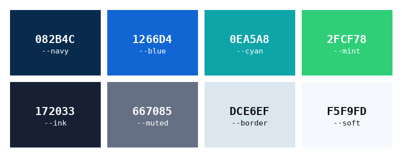

*Nota.* Elección y elaboración propia

**Spacing**

Para mantener una interfaz consistente y facilitar la lectura, se establecieron criterios de espaciado y dimensiones para los componentes.

- **Border-radius:** escala de 12px como base (inputs y contenedores generales), 10px en botones y 14px en tarjetas y tablas, dando mayor presencia visual a los elementos interactivos y a los contenedores de datos.

- **Ancho máximo de contenido:** 1040px.

- **Propósito:** mantener líneas de lectura cómodas y evitar que el contenido se extienda demasiado en pantallas grandes.

**Tono de comunicación**

El tono de comunicación definido es cercano, práctico y directo, priorizando la confianza y la facilidad de comprensión sobre el lenguaje técnico.

- **Testimonios:** se utilizan testimonios en primera persona para generar identificación con los usuarios.

  - "Antes me enteraba de que el arroz se había acabado cuando un cliente lo pedía…"

- **Llamadas a la acción:** son directas y orientadas a la acción.

  - "Empezar prueba gratuita"

  - "Sin tarjeta · Instalación en menos de un día"

- **Enfoque:** en las cuatro dimensiones de tono definidas para el producto:

  - **Divertido – Serio:** más cerca de Serio, priorizando la confianza sobre el humor, dado que se maneja información de inventario y ventas del negocio.

  - **Formal – Casual:** más cerca de Casual, evitando lenguaje corporativo rígido para conectar con dueños de bodegas y minimarkets.

  - **Respetuoso – Irreverente:** más cerca de Respetuoso, reconociendo que el usuario no necesariamente cuenta con conocimientos técnicos y evitando minimizar sus dudas.

  - **Entusiasta – Sereno:** más cerca de Entusiasta, transmitiendo confianza y motivación para adoptar la solución.

- **Objetivo:** facilitar la comprensión del producto y conectar con los usuarios sin recurrir a tecnicismos innecesarios.

### 4.1.2. Web Style Guidelines

- **Botones:** se definieron tres variantes: .btn como botón primario, con relleno en degradado de navy y estado hover con elevación (desplazamiento sutil hacia arriba) y sombra reforzada; .btn.ghost como botón secundario, con borde y sin relleno; y .btn.block como botón de ancho completo, utilizado en las tarjetas de planes. Las tres variantes cuentan con un estado hover definido.

**Figura 21**

*Botones del Landing Page: primario, secundario y de selección de plan*

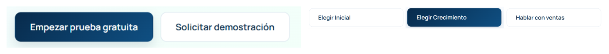

*Nota.* Elaboración propia

- **Formularios:** los campos de entrada utilizan un borde de 1px y un radio de 8px. El estado de error se identifica mediante aria-invalid="true", acompañado de un borde rojo \#c0392b y un mensaje de error asociado mediante aria-describedby. La validación se ejecuta en el evento blur, en lugar de realizarse mientras el usuario escribe, evitando marcar como inválido un campo que aún se encuentra en proceso de completarse.

**Figura 22**

*Estado de error de validación en el formulario de demostración del Landing Page*

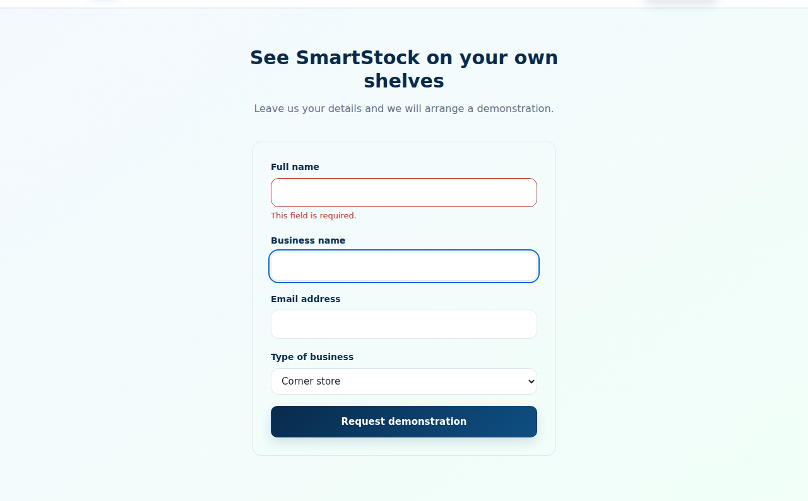

*Nota.* Elaboración propia

- **Foco visible:** se define :focus-visible con un outline azul de 2px en toda la interfaz, facilitando la navegación mediante teclado como parte de los criterios de accesibilidad.

- **Avatares de testimonios:** cada testimonio incorpora un avatar circular con las iniciales de la persona sobre un fondo en degradado (rosa, azul o verde según el caso), reforzando la identificación visual de cada historia sin depender de fotografías reales.

- **Responsive breakpoints:** se establecen dos puntos de quiebre principales: 900px, donde las grillas de 3 o 2 columnas se reducen a una sola columna; y 720px, donde la barra de navegación se transforma en un menú hamburguesa y el botón "Crear cuenta" se incorpora dentro del menú móvil. Adicionalmente, se definieron puntos de quiebre intermedios (850px, 980px y 1180px) para ajustar con mayor precisión el espaciado y la disposición de secciones específicas como testimonios y tarjetas.

- **Reduced motion:** se respeta la configuración prefers-reduced-motion: reduce, desactivando las transiciones y animaciones para los usuarios que tienen activada esta preferencia en su sistema, como parte del compromiso de accesibilidad e inclusión declarado en el propio sitio (sección 6 de Términos y Condiciones).

## 4.2. Information Architecture

La arquitectura de información de SmartStock integra tanto el Landing Page como la Web Application dentro de una misma estructura, debido a que ambos productos comparten una lógica de navegación coherente, una misma preferencia de idioma almacenada en el navegador y un lenguaje visual y de interacción consistente.

Ambos productos utilizan la misma preferencia de idioma mediante localStorage, utilizando la clave smartstock.lang, lo cual permite mantener el idioma seleccionado por el usuario al navegar entre ambos sistemas.

**Mapa de Arquitectura de Información**

**Figura 23**

*Mapa de arquitectura de información de SmartStock*

### 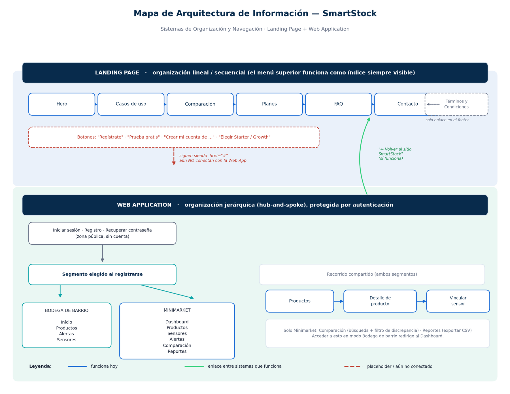

*Nota.* Elaboración propia

El mapa de arquitectura de información representa la organización de ambos productos y muestra también las conexiones existentes entre ellos. Asimismo, permite identificar visualmente la navegación que ya se encuentra implementada y aquella integración que todavía se encuentra pendiente.

### 4.2.1. Organization Systems

Para la organización visual del contenido, SmartStock utiliza diferentes esquemas dependiendo del tipo de información y del flujo que realiza el usuario.

**Organización jerárquica**

La organización jerárquica se utiliza principalmente en la Web Application.

El Dashboard funciona como el punto central de navegación y, desde ahí, el usuario puede acceder a las principales funcionalidades del sistema.

Dentro de la sección de productos existe una jerarquía más profunda:

**Dashboard → Productos → Detalle de producto → Vincular sensor**

Esto permite que el usuario avance desde una sección general hacia información cada vez más específica.

Además, dentro del sidebar, las funcionalidades principales se muestran primero, mientras que opciones secundarias como Configuración y Cerrar sesión se encuentran ubicadas al final del menú.

**Figura 24**

*Dashboard con barra lateral de la Web Application para minimarkets*

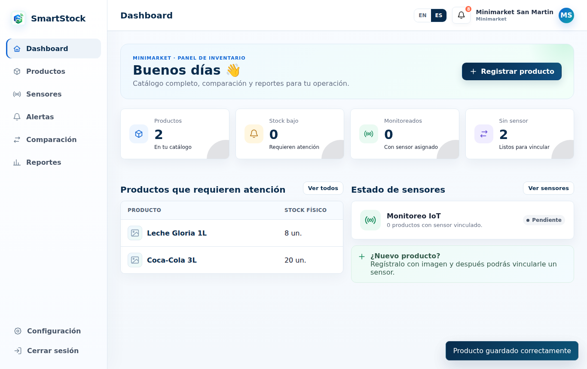

*Nota.* Elaboración propia

**Figura 25**

*Pantalla de inicio de la Web Application para bodegas de barrio*

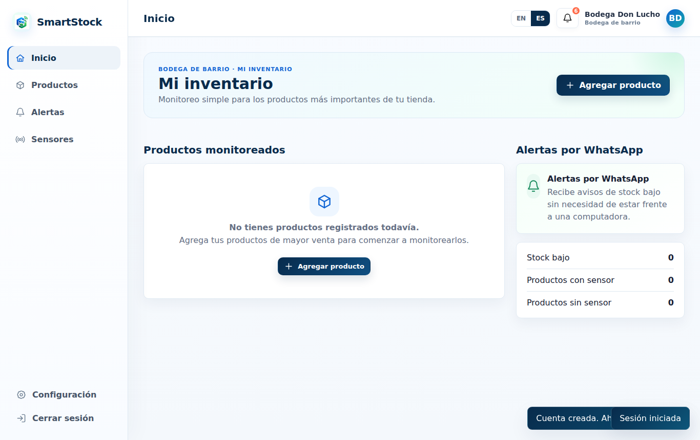

*Nota.* Elaboración propia

**Organización secuencial**

La organización secuencial se utiliza en los procesos que requieren que el usuario complete una serie de pasos en un orden determinado.

Por ejemplo, durante el proceso de incorporación del usuario se sigue el siguiente flujo:

**Registro → Elección de segmento → Inicio de sesión → Registro del primer producto**

De esta manera, el usuario es guiado paso a paso hasta comenzar a utilizar el sistema.

Este mismo principio también se aplica en el Landing Page, cuya información está organizada para ser recorrida de arriba hacia abajo:

**Hero → Casos de uso → Comparación → Planes → FAQ → Contacto**

**Organización matricial**

La organización matricial se utiliza principalmente en las tablas de Productos y Comparación.

En la sección **Productos**, cada producto se relaciona con diferentes atributos como:

- Categoría.

- Estado.

- Stock.

- Umbral.

- Sensor.

En la sección **Comparación**, cada producto se relaciona principalmente con:

- Stock físico.

- Stock registrado.

- Diferencia entre ambos valores.

Este tipo de organización permite visualizar diferentes atributos de un mismo producto dentro de una sola fila y aplicar filtros sin perder el contexto de la información.

**Organización por audiencia**

La organización por audiencia representa una de las decisiones más importantes dentro de SmartStock.

**Figura 26**

*Pantalla de creación de cuenta con selección de segmento*

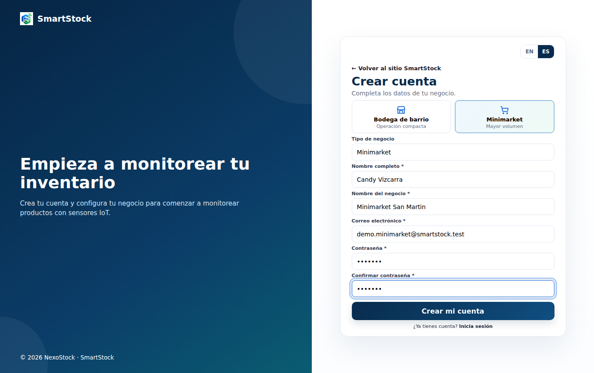

*Nota.* Elaboración propia

Las funcionalidades disponibles se organizan dependiendo del segmento seleccionado por el usuario durante el registro.

Los segmentos utilizados son:

- Bodega de barrio.

- Minimarket.

Esta diferenciación se aplica tanto en el menú lateral como en las rutas disponibles dentro de la aplicación.

De esta manera, cada tipo de usuario visualiza únicamente las funcionalidades correspondientes a las necesidades de su negocio.

**Organización por tópicos**

El Landing Page utiliza una organización por tópicos.

Cada sección presenta un tema específico dentro de la página, por ejemplo:

- Casos de uso.

- Comparación.

- Planes.

- FAQ.

Estas secciones pueden ser accedidas directamente desde el menú mediante enlaces internos.

**Organización cronológica**

La organización cronológica se utiliza en la sección de Alertas.

Los eventos más recientes aparecen primero mediante referencias de tiempo como:

- Hace 4 min.

- Hace 12 min.

- Hace 30 min.

Esto permite que el usuario pueda identificar primero los eventos más recientes y atender rápidamente las situaciones que puedan requerir su atención.

**Organización alfabética**

Actualmente no se utiliza una organización alfabética dentro del producto.

Debido a que los catálogos manejados durante el alcance actual del proyecto son relativamente pequeños, se priorizó la organización basada en el estado de los productos.

Por ejemplo, los productos con stock bajo pueden mostrarse antes que los productos con niveles normales, ya que esta información resulta más relevante para la gestión del inventario.

**Limitación actual de integración**

Actualmente existe una limitación de integración entre el Landing Page y la Web Application.

Desde la Web Application, el usuario puede regresar hacia el Landing Page utilizando el logo de SmartStock o mediante el enlace:

**“← Volver al sitio SmartStock”**

Sin embargo, actualmente el Landing Page todavía no redirige hacia la Web Application.

Los siguientes botones continúan utilizando enlaces temporales href="#":

- Regístrate.

- Prueba gratis.

- Crear mi cuenta de bodega.

- Crear mi cuenta de minimarket.

- Elegir Starter.

- Elegir Growth.

Por este motivo, esta funcionalidad se considera una limitación conocida del alcance actual del proyecto y no una integración completamente implementada.

### 4.2.2. Labeling Systems

Las etiquetas utilizadas en SmartStock fueron diseñadas buscando mantener textos simples, cortos y fáciles de comprender.

**Landing Page**

En el Landing Page, las etiquetas del menú corresponden directamente con los títulos de las diferentes secciones.

Por ejemplo:

- Casos de uso.

- Comparación.

- Planes.

- FAQ.

Estas etiquetas utilizan una o dos palabras y funcionan al mismo tiempo como enlaces internos hacia las secciones correspondientes.

Esto evita inconsistencias entre el nombre mostrado en el menú y el contenido al cual dirige cada opción.

**Web Application**

En la Web Application, los elementos del sidebar combinan un ícono con una etiqueta corta.

Entre las principales etiquetas se encuentran:

- Dashboard.

- Productos.

- Sensores.

- Alertas.

- Comparación.

- Reportes.

Los íconos ayudan a complementar visualmente el significado de cada opción, permitiendo mantener textos cortos sin perder claridad.

**Figura 27**

*Pantalla de registro de producto de la Web Application*

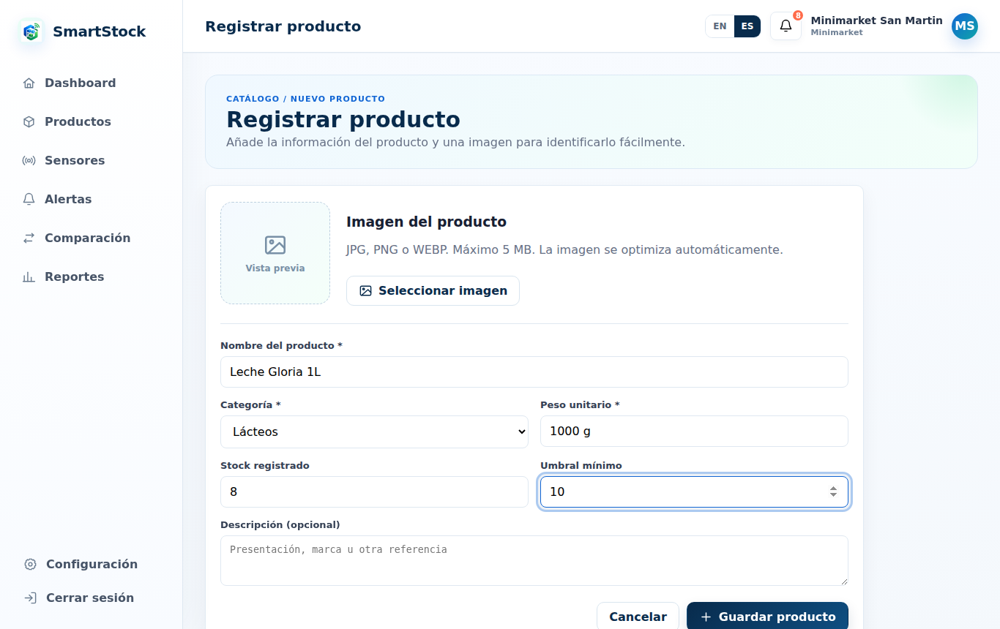

*Nota.* Elaboración propia

Además, tanto el Landing Page como la Web Application se encuentran disponibles en inglés y español.

Ambos productos comparten la misma preferencia de idioma mediante:

localStorage

Clave utilizada:

smartstock.lang

Esto permite que el idioma seleccionado por el usuario permanezca activo al desplazarse entre ambos productos.

**Diferencia de etiquetado según el segmento**

Existe una diferencia intencional en la etiqueta utilizada para la ruta interna \#dashboard.

Para usuarios del segmento **Bodega de barrio**, esta sección se denomina:

**Inicio**

Mientras que para los usuarios del segmento **Minimarket**, la misma sección se denomina:

**Dashboard**

Esta diferencia fue implementada de manera intencional para utilizar una terminología más sencilla en el segmento de negocio más pequeño.

### 4.2.3. SEO Tags and Meta Tags

**Landing Page**

El Landing Page incluye las principales etiquetas SEO y Meta Tags solicitadas.

Tanto index.html como terms-of-service.html cuentan con:

- \<title\>

- \<meta name="description"\>

- \<meta name="keywords"\>

- \<meta name="author"\>

La etiqueta \<title\> contiene un título descriptivo de la página.

La etiqueta \<meta name="description"\> contiene una descripción del contenido y puede mostrarse de acuerdo con el idioma seleccionado.

La etiqueta \<meta name="keywords"\> contiene términos relacionados con el proyecto como:

- minimarket.

- corner store.

- SmartStock.

- InventiaStock.

Finalmente, la etiqueta de autor utiliza:

\<meta name="author" content="InventiaStock"\>

**Web Application**

ctualmente, la Web Application cuenta únicamente con la etiqueta \<title\>. Por ello, se identificó la necesidad de incorporar las etiquetas de descripción, palabras clave y autor para completar la configuración de SEO y Meta Tags.

Se propone agregar las siguientes etiquetas:

\<meta name="description" content="SmartStock Web Application — gestiona tu inventario monitoreado por sensores IoT, alertas y comparaciones de stock."\>

\<meta name="keywords" content="SmartStock, Inventia, gestión de inventario, sensores IoT, monitoreo de stock"\>

\<meta name="author" content="Inventia"\>

De manera opcional, también puede utilizarse:

\<meta name="robots" content="noindex"\>

Esta etiqueta puede emplearse para indicar que la Web Application, al tratarse de un sistema protegido o autenticado, no está destinada a ser indexada por los motores de búsqueda.

### 4.2.4. Searching Systems

El sistema de búsqueda de SmartStock se encuentra implementado principalmente dentro de la Web Application, mientras que el Landing Page no requiere un mecanismo de búsqueda debido a su estructura de navegación por secciones.

**Landing Page**

El Landing Page no incorpora un sistema de búsqueda, debido a que presenta una estructura de una sola página con secciones claramente diferenciadas y un menú superior que permite acceder directamente a cada una de ellas.

**Web Application**

La Web Application incorpora sistemas de búsqueda y filtrado en las secciones de Productos, Comparación y Alertas, permitiendo al usuario localizar información específica de manera más rápida.

**Productos**

La sección Productos dispone de un campo de búsqueda que filtra los resultados en tiempo real.

La búsqueda puede realizarse utilizando:

- Nombre del producto.

- Categoría.

Además, el buscador puede combinarse con un filtro de estado que contiene las siguientes opciones:

- Todos los estados.

- Stock bajo.

- Normal.

- Sin sensor.

**Figura 28**

*Sección Productos con búsqueda y filtro por estado*

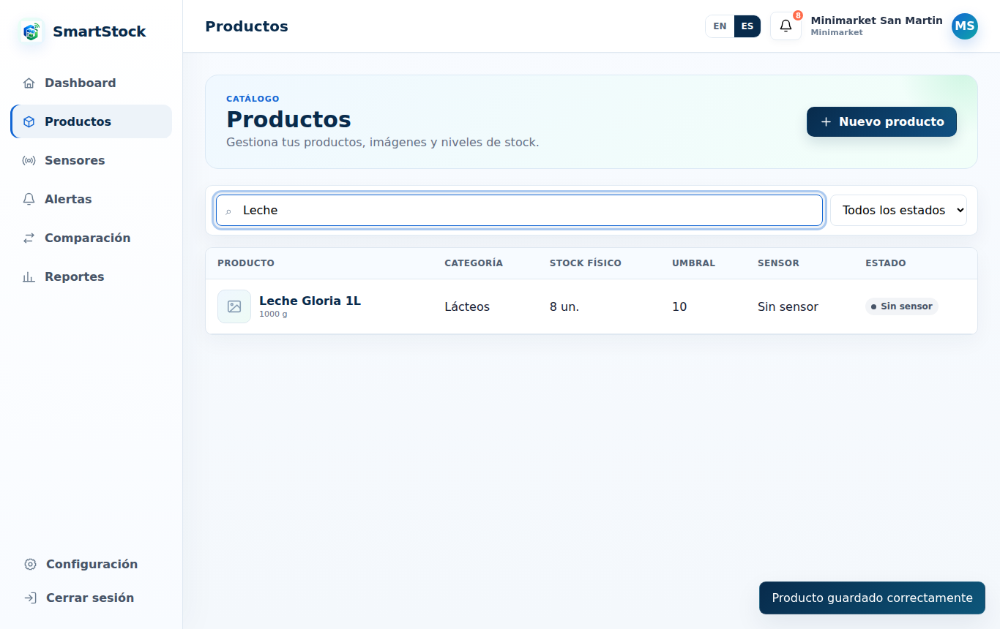

*Nota.* Elaboración propia

Después de realizar una búsqueda, las filas que no coinciden con los criterios ingresados se ocultan.

Las filas que sí coinciden continúan mostrando toda su información correspondiente, como:

- Imagen.

- Categoría.

- Stock.

- Umbral.

- Sensor.

- Estado.

De esta manera, el usuario puede encontrar rápidamente un producto sin perder información relevante de los resultados encontrados.

**Comparación**

La sección Comparación incorpora un sistema de búsqueda por prefijo y filtros que permiten organizar los productos según su situación.

Los filtros disponibles son:

- Todos.

- Con discrepancia.

- Sin discrepancia.

Después de realizar una búsqueda o aplicar un filtro, el sistema recalcula automáticamente:

- El número de productos visibles.

- El número de productos que superan el 10 % de diferencia entre el stock registrado y el stock físico.

Esto permite que los indicadores mostrados se mantengan consistentes con los resultados actualmente visibles.

**Figura 29**

*Sección Comparación con búsqueda y filtro de discrepancias*

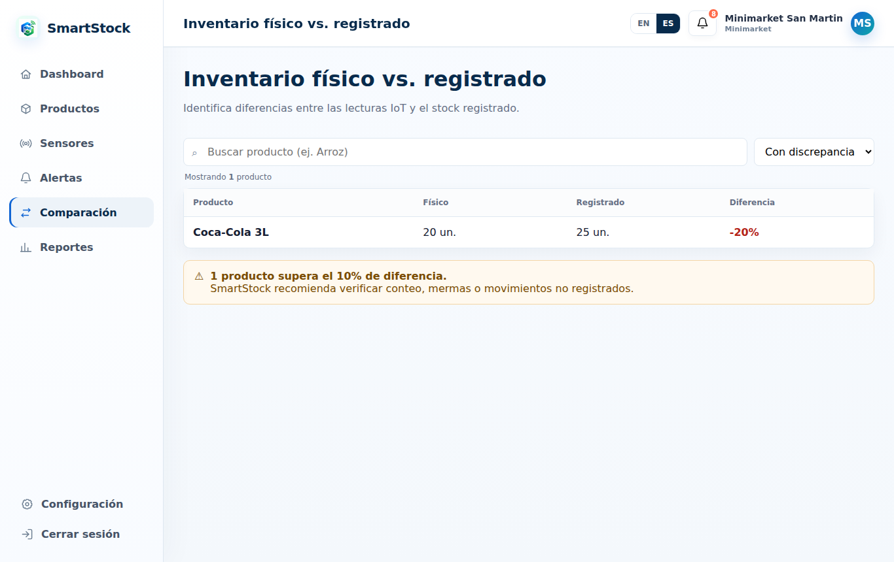

*Nota.* Elaboración propia

**Alertas**

La sección Alertas utiliza pestañas que funcionan como filtros por categoría.

Las opciones disponibles son:

- Todas.

- Stock bajo.

- Discrepancias.

- Sensores.

Los contadores de cada categoría se actualizan según las alertas disponibles. Cada alerta conserva información relevante como:

- Icono.

- Mensaje.

- Tiempo relativo desde su generación

**Figura 30**

*Sección Alertas con pestañas por categoría*

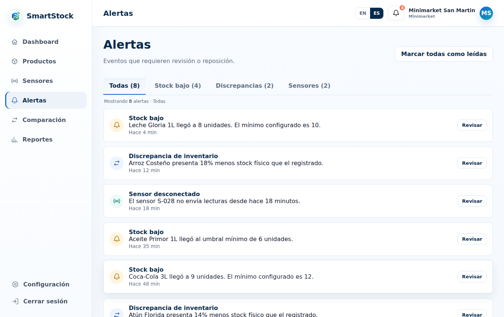

*Nota.* Elaboración propia

### 4.2.5. Navigation Systems

SmartStock utiliza diferentes sistemas de navegación para facilitar el desplazamiento del usuario tanto dentro del Landing Page como dentro de la Web Application.

**Landing Page**

El Landing Page utiliza un menú superior persistente como sistema de navegación global. Este menú permite acceder directamente a las diferentes secciones de la página mediante enlaces internos.

También se cuenta con un pie de página que incorpora navegación contextual mediante enlaces legales, información secundaria y enlaces a redes sociales.

La navegación mediante anclas permite acceder directamente a secciones como:

- Casos de uso.

- Comparación.

- Planes.

- FAQ.

- Contacto.

**Web Application**

La Web Application utiliza un sidebar persistente como sistema de navegación global.

Las opciones disponibles dentro del sidebar cambian dependiendo del segmento del usuario.

Para pantallas pequeñas se utiliza un menú hamburguesa que contiene las mismas opciones disponibles en el menú lateral.

La barra superior también incorpora diferentes elementos de navegación y orientación, entre ellos:

- Selector de idioma.

- Campana de notificaciones.

- Contador de notificaciones no leídas.

- Nombre del negocio.

- Tipo de negocio.

- Avatar con las iniciales del usuario.

La campana de notificaciones permite acceder directamente hacia la sección de Alertas.

El bloque que contiene la información del negocio funciona además como un indicador de identidad, ayudando al usuario a reconocer qué cuenta y qué tipo de negocio está utilizando.

Dentro del Detalle de producto también se proporciona contexto adicional mediante una navegación similar a un breadcrumb:

**Figura 31**

*Sección Sensores IoT de la Web Application*

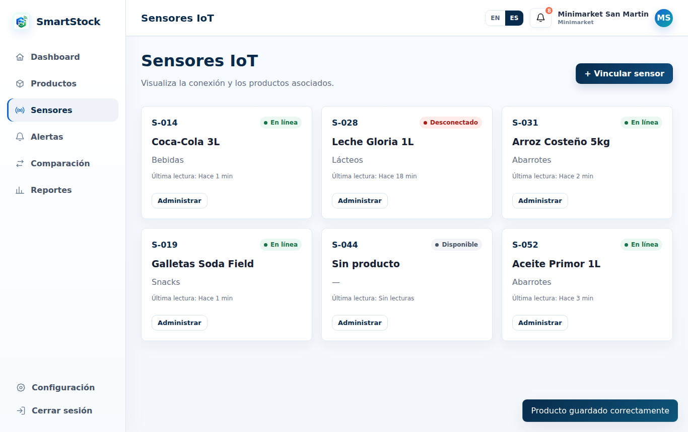

*Nota.* Elaboración propia

Esto permite identificar la ubicación actual dentro de la aplicación y regresar hacia niveles anteriores.

**Navegación entre el Landing Page y la Web Application**

Actualmente, la Web Application permite regresar al Landing Page mediante:

- El logotipo de SmartStock.

- La opción ← Volver al sitio SmartStock.

**Figura 32**

*Pantalla de inicio de sesión de la Web Application*

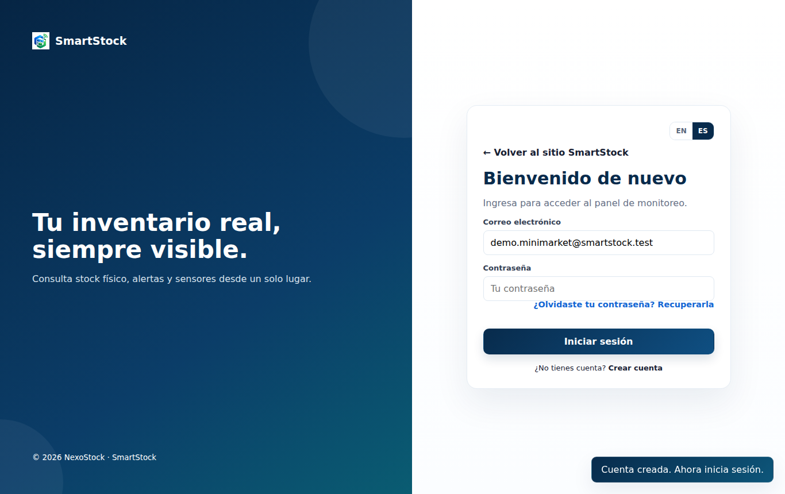

*Nota.* Elaboración propia

Sin embargo, desde el Landing Page todavía no existe una conexión funcional hacia la Web Application, debido a que los principales botones Call to Action continúan utilizando enlaces temporales.

Esta situación se considera una limitación conocida correspondiente al estado actual del proyecto.

## 4.3. Landing Page UI Design

El diseño de la interfaz de usuario (UI) de la página de inicio de SmartStock es clave para captar la atención de los administradores y propietarios de bodegas y minimarkets, ya que los guía hacia una acción clara: comprender y adoptar una solución inteligente de gestión de inventarios. Se ha priorizado una experiencia continua, de modo que cada elemento de la página sea accesible, interactivo y fácil de usar, transmitiendo confianza, mientras refleja el compromiso de SmartStock con la innovación tecnológica y la claridad en la comunicación.

### 4.3.1. Landing Page Wireframe

El wireframe de SmartStock organiza de forma clara la página de inicio, mostrando la secuencia lógica de secciones: desde el problema de la gestión del inventario, pasando por las funcionalidades principales, hasta los beneficios que ofrece la plataforma.

- **Desktop:**

**Figura 33**

*Interfaz principal de bienvenida del landing page de SmartStock*

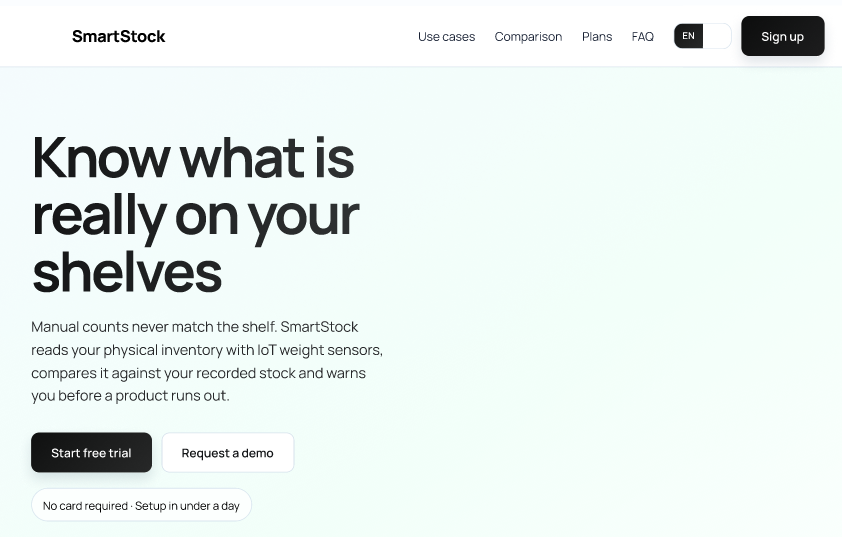

*Nota.* Wireframe de la estructura principal de inicio del landing page de SmartStock en versión de escritorio.

**Figura 34**

*Interfaz sección de problemas y beneficios de SmartStock en versión de escritorio*

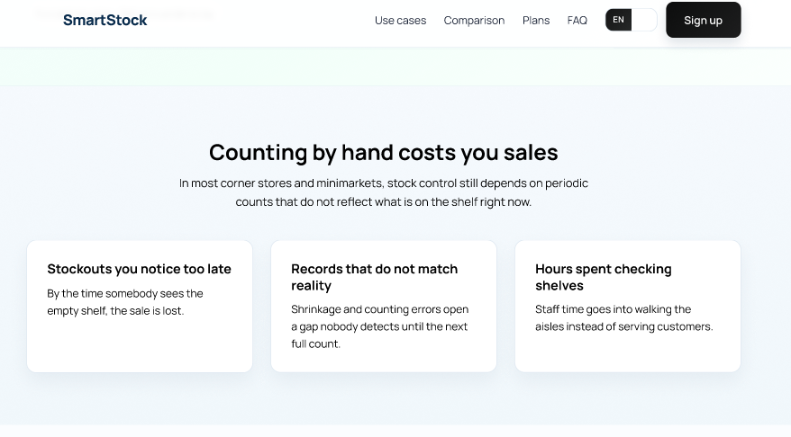

*Nota.* Wireframe de la estructura de la sección de problemas y beneficios de SmartStock en versión de escritorio.

**Figura 35**

*Interfaz de la sección de casos de uso de SmartStock en versión de escritorio*

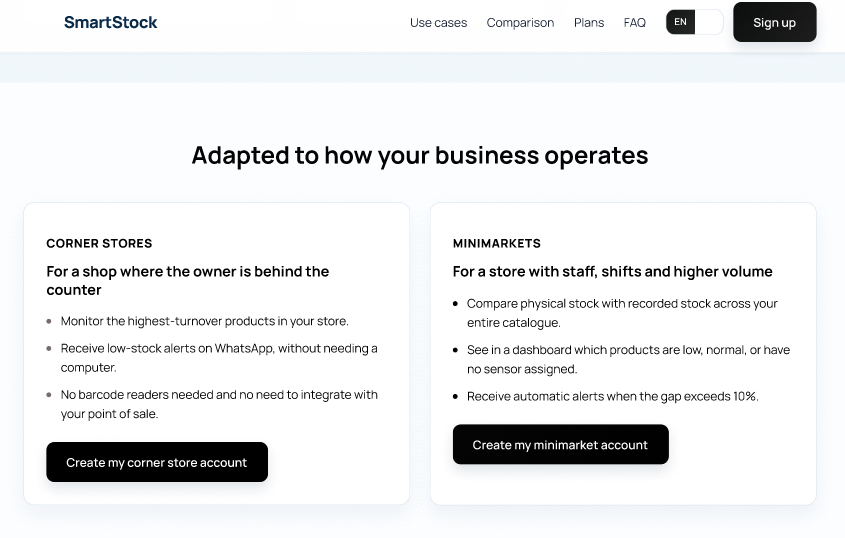

*Nota.* Wireframe de la estructura de la sección de casos de uso de SmartStock en versión de escritorio.

**Figura 36**

*Interfaz de la sección comparativa de SmartStock en versión de escritorio*

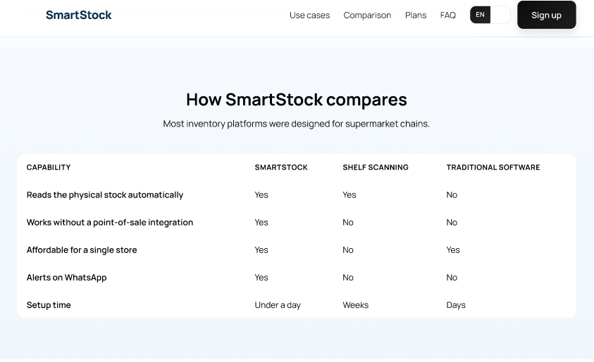

*Nota.* Wireframe de la estructura de la sección comparativa de SmartStock en versión de escritorio.

**Figura 37**

*Interfaz de la sección de planes de SmartStock en versión de escritorio*

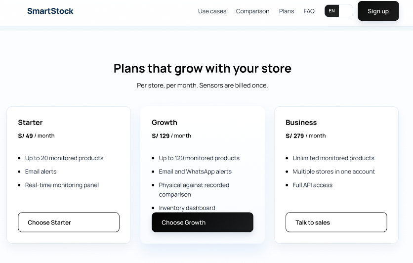

*Nota.* Wireframe de la estructura de la sección de planes de SmartStock en versión de escritorio.

**Figura 38**

*Interfaz de la sección de testimonios de SmartStock en versión de escritorio*

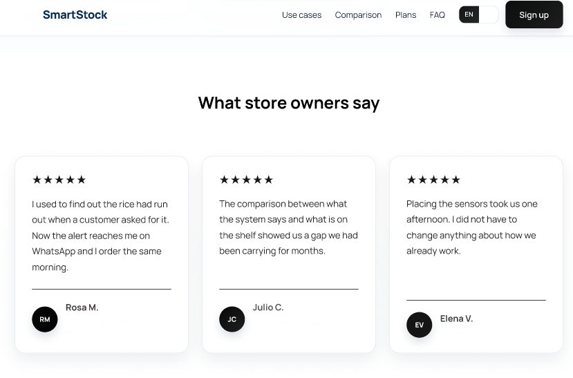

*Nota.* Wireframe de la estructura de la sección de testimonios de SmartStock en versión de escritorio.

**Figura 39**

*Interfaz de la sección de preguntas frecuentes de SmartStock en versión de escritorio*

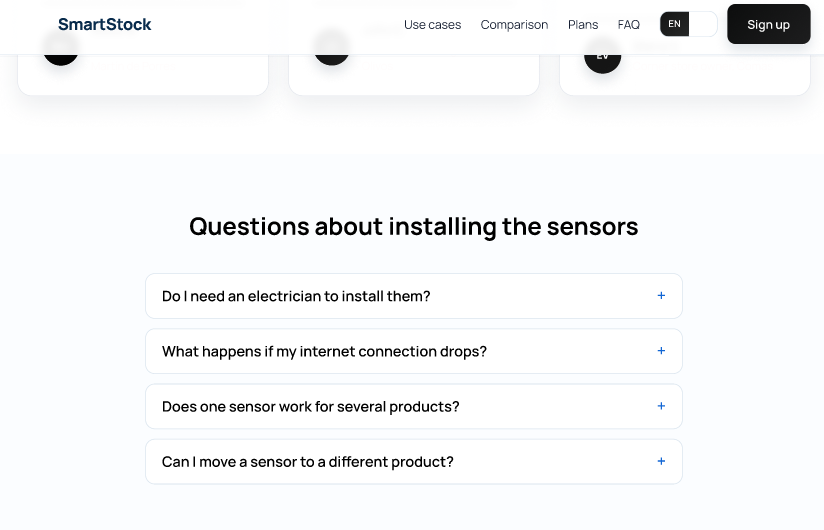

*Nota.* Wireframe de la estructura de la sección de preguntas frecuentes de SmartStock en versión de escritorio.

**Figura 40**

*Interfaz del formulario de demostración de SmartStock en versión de escritorio*

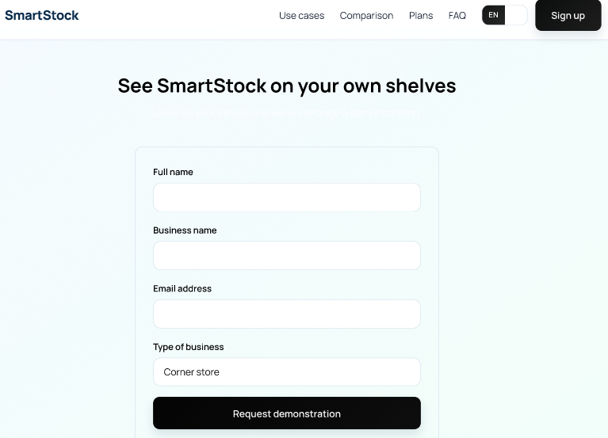

*Nota.* Wireframe de la estructura del formulario de demostración de SmartStock en versión de escritorio.

**Figura 41**

*Pie de página del landing page de SmartStock*

*Nota.* Wireframe del pie de página del landing page de SmartStock

- **Mobile:**

**Figura 42**

*Interfaz de la interfaz principal de inicio de SmartStock en versión móvil*

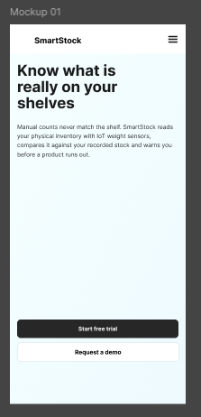

*Nota.* Wireframe de la estructura principal de inicio del landing page de SmartStock adaptada para dispositivos móviles.

**Figura 43**

*Interfaz de la sección de problemas y beneficios de SmartStock en versión móvil*

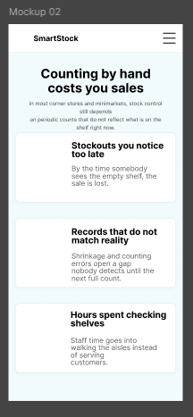

*Nota.* Wireframe de la estructura de la sección de problemas y beneficios de SmartStock adaptada para dispositivos móviles.

**Figura 44**

*Interfaz de la sección de casos de uso de SmartStock en versión móvil*

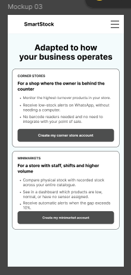

*Nota.* Wireframe de la estructura de la sección de casos de uso de SmartStock adaptada para dispositivos móviles.

**Figura 45**

*Interfazde la sección comparativa de SmartStock en versión móvil*

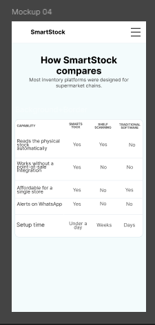

*Nota.* Wireframe de la estructura de la sección comparativa de SmartStock adaptada para dispositivos móviles.

**Figura 46**

*Interfaz de la sección de planes de SmartStock en versión móvil*

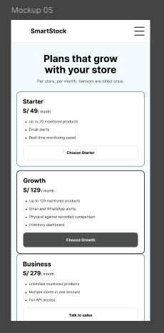

*Nota.* Wireframe de la estructura de la sección de planes de SmartStock adaptada para dispositivos móviles.

**Figura 47**

*Interfazde la sección de testimonios de SmartStock en versión móvil*

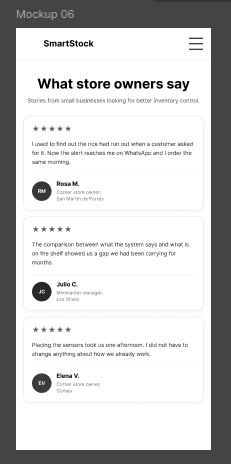

*Nota.* Wireframe de la estructura de la sección de testimonios de SmartStock adaptada para dispositivos móviles.

**Figura 48**

*Interfaz de la sección de preguntas frecuentes de SmartStock en versión móvil*

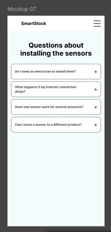

*Nota.* Wireframe de la estructura de la sección de preguntas frecuentes de SmartStock adaptada para dispositivos móviles.

**Figura 49**

*Interfaz del formulario de demostración de SmartStock en versión móvil*

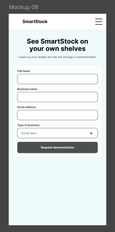

*Nota.* Wireframe de la estructura del formulario de demostración de SmartStock adaptada para dispositivos móviles.

**Figura 50**

*Interfaz del menú de navegación de SmartStock en versión móvil*

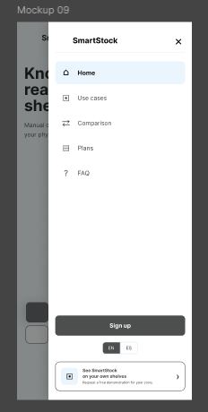

*Nota.*Wireframe de la estructura del menú de navegación de SmartStock adaptado para dispositivos móviles.

### 4.3.2. Landing Page Mock-up

El mock-up de la página de inicio de SmartStock actúa como un mapa visual que organiza la estructura y el flujo de la información, mientras cada sección conduce al usuario desde la identificación del problema hasta la presentación de las funcionalidades y beneficios de la plataforma.

- **Desktop:**

**Figura 51**

*Interfaz principal de inicio del landing page de SmartStock en versión de escritorio*

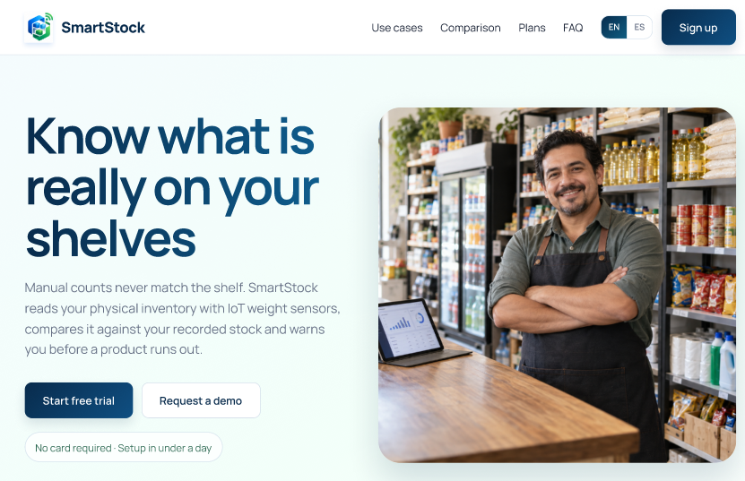

*Nota.* Mockup de la interfaz principal de inicio del landing page de SmartStock en versión de escritorio.

**Figura 52**

*Interfaz de problemas y beneficios de SmartStock en versión de escritorio*

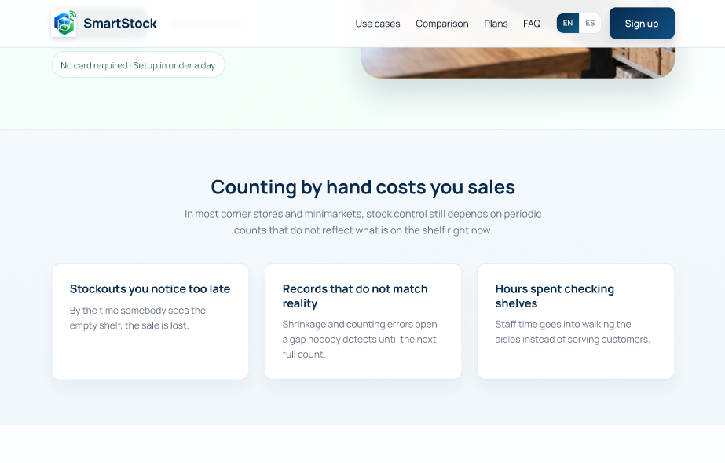

*Nota.*Mockup de la interfaz de problemas y beneficios de SmartStock en versión de escritorio.

**Figura 53**

*Interfaz de casos de uso de SmartStock en versión de escritorio*

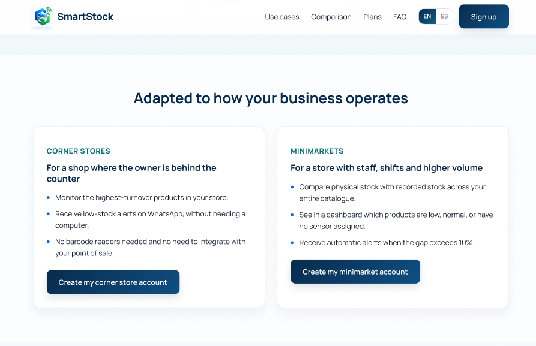

*Nota.* Mockup de la interfaz de casos de uso de SmartStock en versión de escritorio.

**Figura 54**

*Interfaz de planes de SmartStock en versión de escritorio*

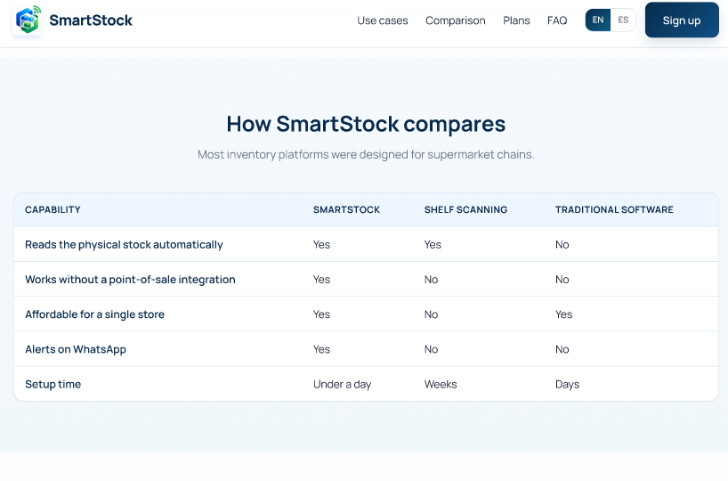

*Nota.* Mockup de la interfaz de planes de SmartStock en versión de escritorio.

**Figura 55**

*Interfaz principal de bienvenida del landing page de SmartStock*

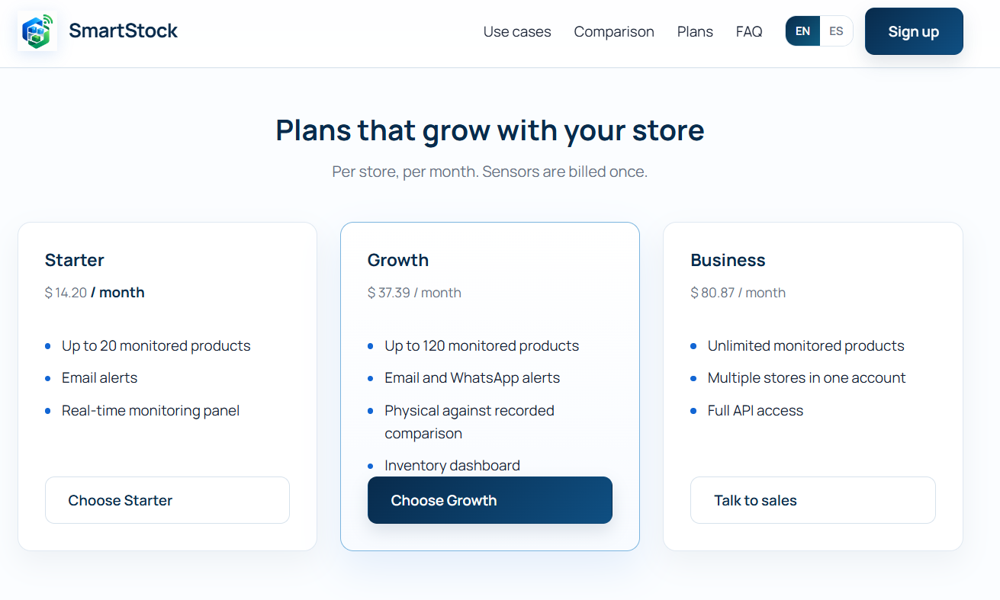

*Nota.* Imagen de la interfaz principal de bienvenida del landing page de SmartStock

**Figura 56**

*Interfaz de testimonios de SmartStock en versión de escritorio*

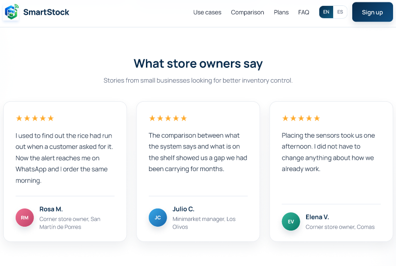

*Nota.* Mockup de la interfaz de testimonios de SmartStock en versión de escritorio.

**Figura 57**

*Interfaz de preguntas frecuentes de SmartStock en versión de escritorio*

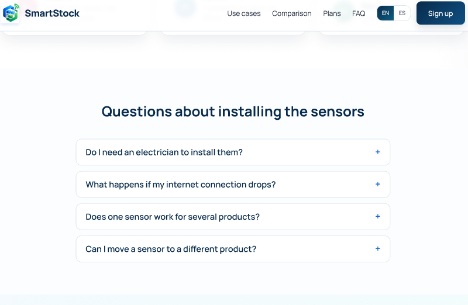

*Nota.* Mockup de la interfaz de preguntas frecuentes de SmartStock en versión de escritorio.

**Figura 58**

*Interfaz del formulario de demostración de SmartStock en versión de escritorio*

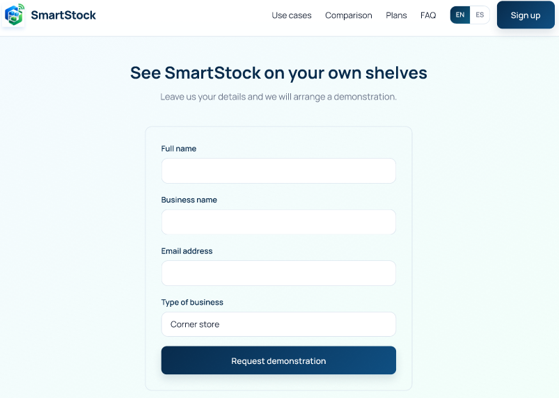

*Nota.* Mockup de la interfaz del formulario de demostración de SmartStock en versión de escritorio.

**Figura 59**

*Pie de página de la verizon de escritorio de SmartStock*

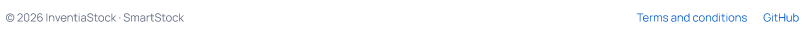

*Nota*. Mockup del pie de página de SmartStock

- **Mobile:**

**Figura 60**

*Interfaz principal de inicio del landing page de SmartStock en versión móvil*

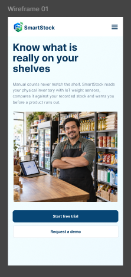

*Nota*. Mockup de la interfaz principal de inicio del landing page de SmartStock adaptada para dispositivos móviles.

**Figura 61**

*Interfaz de problemas y beneficios de SmartStock en versión de móvil*

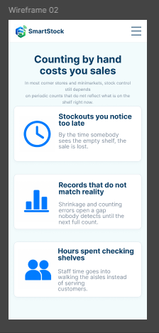

*Nota*. Mockup de la interfaz de problemas y beneficios de SmartStock adaptada para dispositivos móviles.

**Figura 62**

*Interfaz de casos de uso de SmartStock en versión móvil*

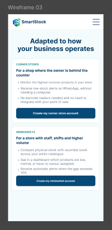

*Nota*. Mockup de la interfaz de casos de uso de SmartStock para dispositivos móviles.

**Figura 63**

*Interfaz comparativa de SmartStock en versión móvil*

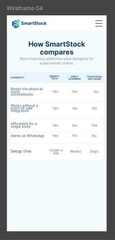

*Nota*. Mockup de la interfaz comparativa de SmartStock adaptada para dispositivos móviles.

**Figura 64**

*Interfaz de planes de SmartStock en versión móvil*

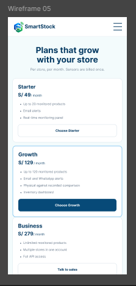

*Nota*. Mockup de la interfaz de planes de SmartStock adaptada para dispositivos móviles.

**Figura 65**

*Interfaz de testimonios de SmartStock en versión de escritorio*

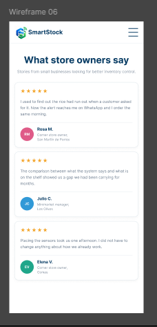

*Nota*. Mockup de la interfaz de testimonios de SmartStock para dispositivos móviles.

**Figura 66**

*Interfaz de preguntas frecuentes de SmartStock en versión de escritorio*

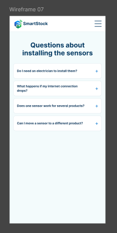

*Nota*. Mockup de la interfaz de preguntas frecuentes de SmartStock adaptada para dispositivos móviles.

**Figura 67**

*Interfaz del formulario de demostración de SmartStock en versión de escritorio*

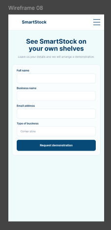

*Nota*. Mockup de la interfaz del formulario de demostración de SmartStock adaptada para dispositivos móviles.

**Figura 68**

*Interfaz del menú de navegación de SmartStock en versión móvil*

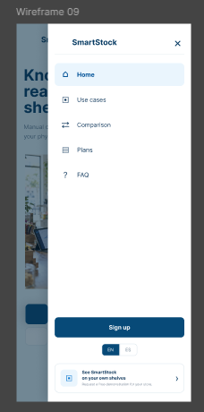

*Nota.* Mockup del menú de navegación del landing page de SmartStock adaptado para dispositivos móviles.

## 4.4. Web Applications UX/UI Design

En esta sección se presentan los wireframes, wireflows, mock-ups y diagramas de flujo de usuario desarrollados para los dos segmentos objetivo de SmartStock: propietarios y administradores de minimarkets, y propietarios y administradores de bodegas de barrio.

### 4.4.1. Web Applications Wireframes

- **Dueños y administradores de Minimarkets**

**Figura 69**

*Wireframe 1 de la aplicación web para propietarios y administradores de minimarkets*

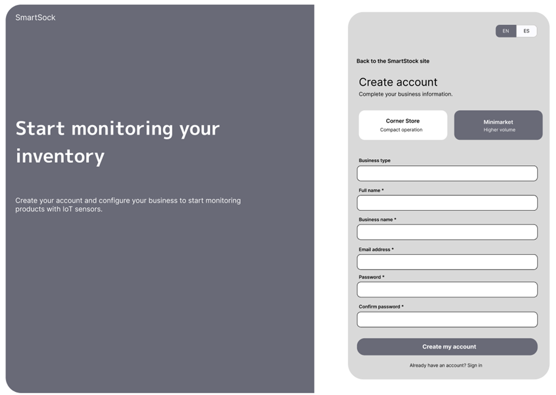

*Nota*. Elaboración propia.

**Figura 70**

*Wireframe 2 de la aplicación web para propietarios y administradores de minimarkets*

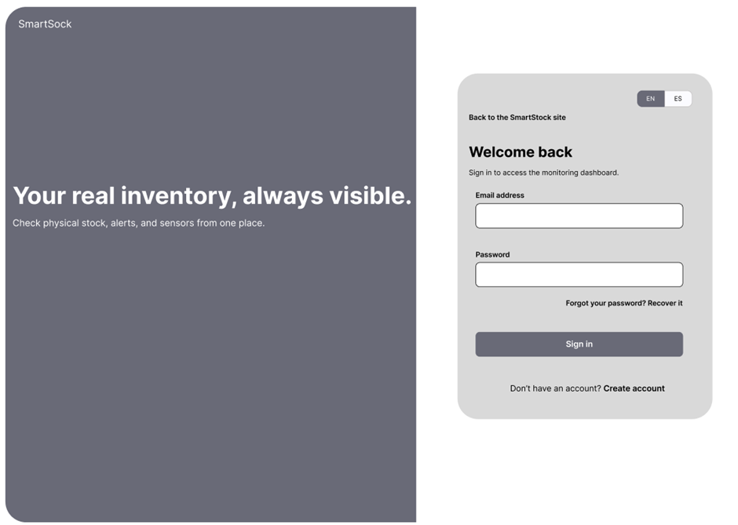

*Nota.* Elaboración propia.

**Figura 71**

*Wireframe 3 de la aplicación web para propietarios y administradores de minimarkets*

*Nota.* Elaboración propia.

**Figura 72**

*Wireframe 4 de la aplicación web para propietarios y administradores de minimarkets*

*Nota.* Elaboración propia.

**Figura 73**

*Wireframe 5 de la aplicación web para propietarios y administradores de minimarkets*

*Nota.* Elaboración propia.

**Figura 74**

*Wireframe 6 de la aplicación web para propietarios y administradores de minimarkets*

*Nota.* Elaboración propia.

**Figura 75**

*Wireframe 7 de la aplicación web para propietarios y administradores de minimarkets*

*Nota.* Elaboración propia.

**Figura 76**

*Wireframe 8 de la aplicación web para propietarios y administradores de minimarkets*

*Nota.* Elaboración propia.

**Figura 77**

*Wireframe 9 de la aplicación web para propietarios y administradores de minimarkets*

*Nota.* Elaboración propia.

**Figura 78**

*Wireframe 10 de la aplicación web para propietarios y administradores de minimarkets*

*Nota.* Elaboración propia.

**Figura 79**

*Wireframe 11 de la aplicación web para propietarios y administradores de minimarkets*

*Nota.* Elaboración propia.

**Figura 80**

*Wireframe 12 de la aplicación web para propietarios y administradores de minimarkets*

*Nota.* Elaboración propia.

**Figura 81**

*Wireframe 13 de la aplicación web para propietarios y administradores de minimarkets*

*Nota.* Elaboración propia.

**Figura 82**

*Wireframe 14 de la aplicación web para propietarios y administradores de minimarkets*

*Nota.* Elaboración propia.

**Figura 83**

*Wireframe 15 de la aplicación web para propietarios y administradores de minimarkets*

*Nota.* Elaboración propia.

**Figura 84**

*Wireframe 16 de la aplicación web para propietarios y administradores de minimarkets*

*Nota.* Elaboración propia.

**Figura 85**

*Wireframe 17 de la aplicación web para propietarios y administradores de minimarkets*

*Nota.* Elaboración propia.

**Figura 86**

*Wireframe 18 de la aplicación web para propietarios y administradores de minimarkets*

*Nota.* Elaboración propia.

**Figura 87**

*Wireframe 19 de la aplicación web para propietarios y administradores de minimarkets*

*Nota.* Elaboración propia.

- **Dueños y administradores de Bodegas**

**Figura 88**

*Wireframe 1 de la aplicación web para propietarios y administradores de bodegas de barrio*

*Nota.* Elaboración propia.

**Figura 89**

*Wireframe 2 de la aplicación web para propietarios y administradores de bodegas de barrio*

*Nota.* Elaboración propia.

**Figura 90**

*Wireframe 3 de la aplicación web para propietarios y administradores de bodegas de barrio*

*Nota.* Elaboración propia.

**Figura 91**

*Wireframe 4 de la aplicación web para propietarios y administradores de bodegas de barrio*

*Nota.* Elaboración propia.

**Figura 92**

*Wireframe 5 de la aplicación web para propietarios y administradores de bodegas de barrio*

*Nota.* Elaboración propia.

**Figura 93**

*Wireframe 6 de la aplicación web para propietarios y administradores de bodegas de barrio*

*Nota.* Elaboración propia.

**Figura 94**

*Wireframe 7 de la aplicación web para propietarios y administradores de bodegas de barrio*

*Nota.* Elaboración propia.

**Figura 95**

*Wireframe 8 de la aplicación web para propietarios y administradores de bodegas de barrio*

*Nota.* Elaboración propia.

**Figura 96**

*Wireframe 9 de la aplicación web para propietarios y administradores de bodegas de barrio*

*Nota.* Elaboración propia.

**Figura 97**

*Wireframe 10 de la aplicación web para propietarios y administradores de bodegas de barrio*

*Nota.* Elaboración propia.

**Figura 98**

*Wireframe 11 de la aplicación web para propietarios y administradores de bodegas de barrio*

*Nota.* Elaboración propia.

**Figura 99**

*Wireframe 12 de la aplicación web para propietarios y administradores de bodegas de barrio*

*Nota.* Elaboración propia.

**Figura 100**

*Wireframe 13 de la aplicación web para propietarios y administradores de bodegas de barrio*

*Nota.* Elaboración propia.

**Figura 101**

*Wireframe 14 de la aplicación web para propietarios y administradores de bodegas de barrio*

*Nota.* Elaboración propia.

**Figura 102**

*Wireframe 15 de la aplicación web para propietarios y administradores de bodegas de barrio*

*Nota.* Elaboración propia.

**Figura 103**

*Wireframe 16 de la aplicación web para propietarios y administradores de bodegas de barrio*

*Nota.* Elaboración propia.

### 4.4.2. Web Applications Wireflow Diagrams

Los wireflows muestran las rutas que siguen los usuarios entre las diferentes pantallas de la aplicación según su segmento. Cada wireflow parte de un objetivo del usuario (User Goal), presenta las pantallas involucradas con su código, indica la ruta esperada con una línea azul y las rutas alternativas o de error con una línea roja discontinua, y se acompaña de una explicación del flujo y de su condición principal.

Se elaboraron wireflows para los dos segmentos objetivo de SmartStock: propietarios y administradores de minimarkets, y propietarios y administradores de bodegas de barrio. Por razones de extensión, en este informe se presentan únicamente los flujos más importantes de cada segmento, es decir, aquellos que cubren las funciones centrales del producto: acceso a la cuenta, gestión del catálogo, monitoreo del stock con sensores IoT, registro de compras y ventas, y atención de alertas de reposición. El conjunto completo de wireflows puede consultarse en el siguiente enlace.

Link: https://www.figma.com/board/Tdon4igryTEOc1wl7f5I15/Wireflow-diagrams-SmartStock?node-id=0-1&t=ik1xWHtOIA29fNXh-1

- **Dueños y administradores de Minimarkets**

Para este segmento se presentan 11 wireflows, que cubren el acceso a la cuenta, la gestión del catálogo, el monitoreo del stock con sensores IoT, el registro de compras, ventas y proveedores, y la reposición desde una alerta de stock bajo. Las pantallas se adaptan al tipo de negocio, de modo que el menú y las funciones disponibles corresponden al segmento de bodegas.

**Figura 129**

*Wireflow 1 de la aplicación web para propietarios y administradores de minimarkets: iniciar sesión (US02)*

*Nota.* Elaboración propia.

**Figura 130**

*Wireflow 2 de la aplicación web para propietarios y administradores de minimarkets: registrar una cuenta (US01)*

*Nota.* Elaboración propia.

**Figura 131**  
*Wireflow 3 de la aplicación web para propietarios y administradores de minimarkets: consultar el resumen del negocio y navegar a sus módulos (US15)*

*Nota.* Elaboración propia.

**Figura 132**

*Wireflow 4 de la aplicación web para propietarios y administradores de minimarkets: registrar un producto en el catálogo (US13)*

*Nota.* Elaboración propia.

**Figura 133**

*Wireflow 5 de la aplicación web para propietarios y administradores de minimarkets: consultar el stock de un producto y su peso en el sensor (US07, US08, US06)*

*Nota.* Elaboración propia.

**Figura 134**

*Wireflow 6 de la aplicación web para propietarios y administradores de minimarkets: vincular un sensor IoT a un producto (US04)*

*Nota.* Elaboración propia.

**Figura 135**

*Wireflow 7 de la aplicación web para propietarios y administradores de minimarkets: configurar el umbral mínimo de stock (US05)*

*Nota.* Elaboración propia.

**Figura 136**

*Wireflow 8 de la aplicación web para propietarios y administradores de minimarkets: registrar una compra (US30)*

*Nota.* Elaboración propia.

**Figura 137**

*Wireflow 9 de la aplicación web para propietarios y administradores de minimarkets: registrar una venta (US26)*

*Nota.* Elaboración propia.

**Figura 138**

*Wireflow 10 de la aplicación web para propietarios y administradores de minimarkets: registrar un proveedor (US29)*

*Nota.* Elaboración propia.

**Figura 139**

*Wireflow 11 de la aplicación web para propietarios y administradores de minimarkets: reponer un producto desde una alerta de stock bajo (US32)*

*Nota.* Elaboración propia.

**Figura 140**

*Wireflow 12 de la aplicación web para propietarios y administradores de minimarkets: comparar el inventario físico con el registrado (US11, US12)*

*Nota.* Elaboración propia.

- **Dueños y administradores de Bodegas**

Para este segmento se presentan 11 wireflows. Son los mismos flujos que en minimarkets, salvo la comparación entre inventario físico y registrado, que no forma parte del recorrido de este segmento. Las pantallas se adaptan al tipo de negocio, de modo que cambian el menú y las funciones disponibles.

**Figura 141**

*Wireflow 1 de la aplicación web para propietarios y administradores de bodegas de barrio: iniciar sesión (US02)*

*Nota.* Elaboración propia.

**Figura 142**

*Wireflow 2 de la aplicación web para propietarios y administradores de bodegas de barrio: registrar una cuenta (US01)*

*Nota.* Elaboración propia.

**Figura 143**

*Wireflow 3 de la aplicación web para propietarios y administradores de bodegas de barrio: consultar el resumen del negocio y navegar a sus módulos (US15)*

*Nota.* Elaboración propia.

**Figura 144**

*Wireflow 4 de la aplicación web para propietarios y administradores de bodegas de barrio: registrar un producto en el catálogo (US13)*

*Nota.* Elaboración propia.

**Figura 145**

*Wireflow 5 de la aplicación web para propietarios y administradores de bodegas de barrio: consultar el stock de un producto y su peso en el sensor (US07, US08, US06)*

*Nota.* Elaboración propia.

**Figura 146**

*Wireflow 6 de la aplicación web para propietarios y administradores de bodegas de barrio: vincular un sensor IoT a un producto (US04)*

*Nota.* Elaboración propia.

**Figura 147**

*Wireflow 7 de la aplicación web para propietarios y administradores de bodegas de barrio: configurar el umbral mínimo de stock (US05)*

*Nota.* Elaboración propia.

**Figura 148**

*Wireflow 8 de la aplicación web para propietarios y administradores de bodegas de barrio: registrar una compra (US30)*

*Nota.* Elaboración propia.

**Figura 149**

*Wireflow 9 de la aplicación web para propietarios y administradores de bodegas de barrio: registrar una venta (US26)*

*Nota.* Elaboración propia.

**Figura 150**

*Wireflow 10 de la aplicación web para propietarios y administradores de bodegas de barrio: registrar un proveedor (US29)*

*Nota.* Elaboración propia.

**Figura 151**

*Wireflow 11 de la aplicación web para propietarios y administradores de bodegas de barrio: reponer un producto desde una alerta de stock bajo (US32)*

*Nota.* Elaboración propia.

### 4.4.3. Web Applications Mock-ups

- **Dueños y administradores de minimarkets**

**Figura 104**

*Mockup 1 de la aplicación web para propietarios y administradores de minimarkets*

Nota. Elaboración propia.

**Figura 105**

*Mockup 2 de la aplicación web para propietarios y administradores de minimarkets*

Nota. Elaboración propia.

**Figura 106**

*Mockup 3 de la aplicación web para propietarios y administradores de minimarkets*

Nota. Elaboración propia.

**Figura 107**

*Mockup 4 de la aplicación web para propietarios y administradores de minimarkets*

Nota. Elaboración propia.

**Figura 108**

*Mockup 5 de la aplicación web para propietarios y administradores de minimarkets*

Nota. Elaboración propia.

**Figura 109**

*Mockup 6 de la aplicación web para propietarios y administradores de minimarkets*

Nota. Elaboración propia.

**Figura 110**

*Mockup 7 de la aplicación web para propietarios y administradores de minimarkets*

Nota. Elaboración propia.

***Figura 111***

*Mockup 8 de la aplicación web para propietarios y administradores de minimarkets*

Nota. Elaboración propia.

**Figura 112**

*Mockup 9 de la aplicación web para propietarios y administradores de minimarkets*

Nota. Elaboración propia.

**Figura 113**

*Mockup 10 de la aplicación web para propietarios y administradores de minimarkets*

Nota. Elaboración propia.

**Figura 114**

*Mockup 11 de la aplicación web para propietarios y administradores de minimarkets*

Nota. Elaboración propia.

**Figura 115**

*Mockup 12 de la aplicación web para propietarios y administradores de minimarkets*

Nota. Elaboración propia.

**Figura 116**

*Mockup 13 de la aplicación web para propietarios y administradores de minimarkets*

Nota. Elaboración propia.

**Figura 117**

*Mockup 14 de la aplicación web para propietarios y administradores de minimarkets*

Nota. Elaboración propia.

**Figura 118**

*Mockup 15 de la aplicación web para propietarios y administradores de minimarkets*

Nota. Elaboración propia.

**Figura 119**

*Mockup 16 de la aplicación web para propietarios y administradores de minimarkets*

Nota. Elaboración propia.

**Figura 120**

*Mockup 17 de la aplicación web para propietarios y administradores de minimarkets*

Nota. Elaboración propia.

**Figura 121**

*Mockup 18 de la aplicación web para propietarios y administradores de minimarkets*

Nota. Elaboración propia.

**Figura 122**

*Mockup 19 de la aplicación web para propietarios y administradores de minimarkets*

Nota. Elaboración propia.

*Owners and managers of corner stores*

***Figura 123***

*Mockup 1 de la aplicación web para propietarios y administradores de bodegas de barrio*

Nota. Elaboración propia.

**Figura 124**

*Mockup 2 de la aplicación web para propietarios y administradores de bodegas de barrio*

Nota. Elaboración propia.

**Figura 125**

*Mockup 3 de la aplicación web para propietarios y administradores de bodegas de barrio*

Nota. Elaboración propia.

**Figura 126**

*Mockup 4 de la aplicación web para propietarios y administradores de bodegas de barrio*

Nota. Elaboración propia.

**Figura 127**

*Mockup 5 de la aplicación web para propietarios y administradores de bodegas de barrio*

Nota. Elaboración propia.

**Figura 128**

*Mockup 6 de la aplicación web para propietarios y administradores de bodegas de barrio*

Nota. Elaboración propia.

**Figura 129**

*Mockup 7 de la aplicación web para propietarios y administradores de bodegas de barrio*

Nota. Elaboración propia.

**Figura 130**

*Mockup 8 de la aplicación web para propietarios y administradores de bodegas de barrio*Nota. Elaboración propia.

**Figura 131**

*Mockup 9 de la aplicación web para propietarios y administradores de bodegas de barrio*

*Nota.* Elaboración propia.

**Figura 132**

*Mockup 10 de la aplicación web para propietarios y administradores de bodegas de barrio*

*Nota.* Elaboración propia.

**Figura 133**

*Mockup 11 de la aplicación web para propietarios y administradores de bodegas de barrio*

*Nota.* Elaboración propia.

**Figura 134**

*Mockup 12 de la aplicación web para propietarios y administradores de bodegas de barrio*

*Nota.* Elaboración propia.

**Figura 135**

*Mockup 13 de la aplicación web para propietarios y administradores de bodegas de barrio*

Nota. Elaboración propia.

**Figura 136**

*Mockup 14 de la aplicación web para propietarios y administradores de bodegas de barrio*

Nota. Elaboración propia.

**Figura 137**

*Mockup 15 de la aplicación web para propietarios y administradores de bodegas de barrio*

*Nota.* Elaboración propia.

### 4.4.4. Web Applications User Flow Diagrams

Los user flows muestran, desde el punto de vista del usuario, el recorrido que sigue para lograr un objetivo concreto dentro de la aplicación según su segmento. Cada user flow parte de un objetivo del usuario (User Goal) e indica las pantallas por las que pasa con su código, la ruta esperada con una línea azul y las rutas alternativas o de error con una línea roja discontinua, además de una explicación del flujo y su condición principal.

Se elaboraron user flows para los dos segmentos objetivo de SmartStock: propietarios y administradores de minimarkets, y propietarios y administradores de bodegas de barrio. Por razones de extensión, en este informe se presentan únicamente los más importantes de cada segmento, es decir, los que cubren las funciones centrales del producto: acceso a la cuenta, gestión del catálogo, monitoreo del stock con sensores IoT, registro de compras y ventas, y atención de alertas de reposición. El conjunto completo puede consultarse en el siguiente enlace.

Link: https://www.figma.com/board/Q4SExEhBOi9wb1iWULW9ce/User-Flow-diagrams-SmartStock?node-id=0-1&t=GD9ioBq6MAOymx5J-1

- **Dueños y administradores de Minimarkets**

Para este segmento se presentan 12 user flows. Los de acceso corresponden al inicio de sesión y al registro de la cuenta; los de gestión, al registro de productos, la consulta del stock, la vinculación de sensores y la configuración del umbral mínimo; y los de operación, al registro de compras, ventas y proveedores, la reposición desde una alerta y la comparación entre el inventario físico y el registrado.

**Figura 106**

*User Flow 1 de la aplicación web para propietarios y administradores de minimarkets: iniciar sesión (US02)*

*Nota.* Elaboración propia.

**Figura 107**

*User Flow 2 de la aplicación web para propietarios y administradores de minimarkets: registrar una cuenta (US01)*

*Nota.* Elaboración propia.

**Figura 108**

*User Flow 3 de la aplicación web para propietarios y administradores de minimarkets: consultar el resumen del negocio y navegar a sus módulos (US15)*

*Nota.* Elaboración propia.

**Figura 109**

*User Flow 4 de la aplicación web para propietarios y administradores de minimarkets: registrar un producto en el catálogo (US13)*

*Nota.* Elaboración propia.

**Figura 110**

*User Flow 5 de la aplicación web para propietarios y administradores de minimarkets: consultar el stock de un producto y su peso en el sensor (US07, US08, US06)*

*Nota.* Elaboración propia.

**Figura 111**

*User Flow 6 de la aplicación web para propietarios y administradores de minimarkets: vincular un sensor IoT a un producto (US04)*

*Archivo:* 

*Nota.* Elaboración propia.

**Figura 112**

*User Flow 7 de la aplicación web para propietarios y administradores de minimarkets: configurar el umbral mínimo de stock (US05)*

*Nota.* Elaboración propia.

**Figura 113**

*User Flow 8 de la aplicación web para propietarios y administradores de minimarkets: registrar una compra (US30)*

*Nota.* Elaboración propia.

**Figura 114**

*User Flow 9 de la aplicación web para propietarios y administradores de minimarkets: registrar una venta (US26)*

*Nota.* Elaboración propia.

**Figura 115**

*User Flow 10 de la aplicación web para propietarios y administradores de minimarkets: registrar un proveedor (US29)*

*Nota.* Elaboración propia.

**Figura 116**

*User Flow 11 de la aplicación web para propietarios y administradores de minimarkets: reponer un producto desde una alerta de stock bajo (US32)*

*Nota.* Elaboración propia.

**Figura 117**

*User Flow 12 de la aplicación web para propietarios y administradores de minimarkets: comparar el inventario físico con el registrado (US11, US12)*

*Nota.* Elaboración propia.

En cada una, el título completo termina con “…de la aplicación web para propietarios y administradores de minimarkets: \[flujo\]”. Debajo de cada imagen va *Nota.* Elaboración propia.

- **Dueños y administradores de Bodegas**

Para este segmento se presentan 11 user flows, que cubren el acceso a la cuenta, la gestión del catálogo, el monitoreo del stock con sensores IoT, el registro de compras, ventas y proveedores, y la reposición desde una alerta de stock bajo. Las pantallas se adaptan al tipo de negocio, de modo que el menú y las funciones disponibles corresponden al segmento de bodegas.

**Figura 118**

*User Flow 1 de la aplicación web para propietarios y administradores de bodegas de barrio: iniciar sesión (US02)*

*Nota.* Elaboración propia.

**Figura 119**

*User Flow 2 de la aplicación web para propietarios y administradores de bodegas de barrio: registrar una cuenta (US01)*

*Nota.* Elaboración propia.

**Figura 120**

*User Flow 3 de la aplicación web para propietarios y administradores de bodegas de barrio: consultar el resumen del negocio y navegar a sus módulos (US15)*

*Nota.* Elaboración propia.

**Figura 121**

*User Flow 4 de la aplicación web para propietarios y administradores de bodegas de barrio: registrar un producto en el catálogo (US13)*

*Nota.* Elaboración propia.

**Figura 122**

*User Flow 5 de la aplicación web para propietarios y administradores de bodegas de barrio: consultar el stock de un producto y su peso en el sensor (US07, US08, US06)*

*Nota.* Elaboración propia.

**Figura 123**

*User Flow 6 de la aplicación web para propietarios y administradores de bodegas de barrio: vincular un sensor IoT a un producto (US04)*

*Nota.* Elaboración propia.

**Figura 124**

*User Flow 7 de la aplicación web para propietarios y administradores de bodegas de barrio: configurar el umbral mínimo de stock (US05)*

*Nota.* Elaboración propia.

**Figura 125**

*User Flow 8 de la aplicación web para propietarios y administradores de bodegas de barrio: registrar una compra (US30)*

*Nota.* Elaboración propia.

**Figura 126**

*User Flow 9 de la aplicación web para propietarios y administradores de bodegas de barrio: registrar una venta (US26)*

*Nota.* Elaboración propia.

**Figura 127**

*User Flow 10 de la aplicación web para propietarios y administradores de bodegas de barrio: registrar un proveedor (US29)*

*Nota.* Elaboración propia.

**Figura 128**

*User Flow 11 de la aplicación web para propietarios y administradores de bodegas de barrio: reponer un producto desde una alerta de stock bajo (US32)*

*Nota.* Elaboración propia.

## 4.5. Web Applications Prototyping

**Prototipo Desktop**

- **Segmento 1 -** Propietarios y administradores de minimarkets

Link: https://www.figma.com/proto/2LwKTN6fwKJFIL49MOMgnh/Untitled?node-id=77-7527&t=GDY486wi86Ivvvax-1&scaling=min-zoom&content-scaling=fixed&page-id=0%3A1&starting-point-node-id=77%3A6562&show-proto-sidebar=1

- **Segmento 2 - Propietarios y administradores de bodegas de barrio**

Link: https://www.figma.com/proto/2LwKTN6fwKJFIL49MOMgnh/Untitled?node-id=77-11053&p=f&t=sKhI7uDZF4sUaseH-1&scaling=min-zoom&content-scaling=fixed&page-id=77%3A3&starting-point-node-id=77%3A10208&show-proto-sidebar=1

**Prototipo Mobile**

Link: https://www.figma.com/design/ZXJ7Yk6gBQYIItE5B7hcvj/Wireframes-y-mockup-Mobile?node-id=0-1&t=gTdd0STYXGH6kUgr-1

## 4.6. Domain-Driven Software Architecture

### 4.6.1. Design-Level Event Storming

Se utilizó la guía de Philippe Bourgau, proporcionada en la rúbrica del Final Problem Statement, para llevar a cabo el proceso de Design-Level EventStorming, con el objetivo de identificar los Bounded Contexts, siguiendo sus etapas:

- Unstructured Exploration

- Timelines

- Pain Points

- Pivotal Points

- Commands

- Policies

- Read Models

- External Systems

- Aggregates

- Bounded Contexts

**Miro Board Link:**

https://miro.com/welcomeonboard/WXlEQy9hRngvZnRPQkVlR3pJMDN5M25TTmpLSUY1Rk1kckJOVU15UnczNVNWQURZN3dUVFAxcitFSFJsUXJFaU5ET1JCc2VweWsrNytLZFliMGRLeEU2Y0VkT2ZMMEZSQmZXeXFHL3dBZ1VuR1Y3emdReUdaZHV1WFFLd3BrWDVNakdSWkpBejJWRjJhRnhhb1UwcS9BPT0hdjE=?share_link_id=815705743217

**Figura 138**

*Design-Level Event Storming de SmartStock*

*Nota.* Elaboración propia.

### 4.6.2. Software Architecture Context Diagram

**Figura 139**

*Diagrama de contexto C4 de SmartStock*

Nota. Elaboración propia.

**Descripción:** El diagrama de contexto muestra a SmartStock como un único sistema de software que utiliza el propietario de un minimarket o bodega para registrar ventas y compras, gestionar su inventario, vincular sensores IoT y consultar su estado. El microcontrolador con balanza IoT envía lecturas de peso para verificar el stock físico frente al registrado, sin modificarlo. SmartStock se comunica con dos sistemas externos: un servicio de notificaciones que envía alertas por correo o WhatsApp, y un servicio de correo para la confirmación de cuenta y la recuperación de contraseña.

### 4.6.3. Software Architecture Container Diagrams

**Figura 140**

*Diagrama de contenedores C4 de SmartStock*

*Nota.* Elaboración propia.

**Descripción:** SmartStock se compone de tres contenedores. La interfaz web, implementada en Vue 3 con PrimeVue, es utilizada por el propietario del negocio y consume el Backend API mediante solicitudes HTTP. El Backend API, implementado en ASP.NET Core, es un monolito modular que integra los seis contextos delimitados (IAM, Product Catalog, Inventory Monitoring, IoT Device, Alerts & Restocking y Analytics & Reporting) y expone sus servicios documentados con OpenAPI. La base de datos MySQL, desplegada en Aiven, almacena usuarios, productos, ventas, compras, proveedores, movimientos de inventario, sensores y alertas. Los sensores IoT envían sus lecturas de peso al Backend API y no modifican el stock registrado. El Backend API envía las alertas por correo (SMTP) y por WhatsApp (Twilio).

### 4.6.4. Software Architecture Components Diagrams

**Figura 141**

*Diagrama de componentes C4 de SmartStock, parte 1*

*Nota.* Elaboración propia.

**Descripción:** IAM es un módulo del Backend API implementado en ASP.NET Core en el Sprint 3, con la persistencia de negocios, usuarios y recuperación de contraseña. El registro y la autenticación se completan en el Sprint 4. Gestiona el registro, la autenticación y la recuperación de contraseña desde Vue, con persistencia en MySQL y un servicio externo de correo. BusinessType determina el menú según el negocio. En el Sprint 2 se utiliza una Fake API.

**Leyenda:** Azul oscuro: frontend; azul claro: componentes IAM; verde: base de datos; amarillo: servicio externo. Los recuadros delimitan el sistema, contenedor y módulo; las flechas indican sus relaciones.

**Figura 142**

*Diagrama de componentes C4 de SmartStock, parte 2*

*Nota.* Elaboración propia.

**Descripción:** Product Catalog es un módulo del Backend API implementado en ASP.NET Core en el Sprint 3. Gestiona los productos, sus precios de venta, costos de compra, referencias al proveedor habitual y umbrales mínimos, con persistencia en MySQL. Proporciona información a Inventory Monitoring para Compras y Ventas, y a IoT Device para vincular y monitorear sensores. Los proveedores se gestionan en Inventory Monitoring.

**Leyenda:** Azul oscuro: frontend Vue; azul claro: componentes del catálogo; morado: módulos relacionados; verde: base de datos MySQL. Los recuadros delimitan el sistema, el contenedor y los módulos; las flechas indican solicitudes y dependencias.

**Figura 143**

*Diagrama de componentes C4 de SmartStock, parte 3*

*Nota.* Elaboración propia.

**Descripción:** IoT Device es un módulo del Backend API implementado en ASP.NET Core en el Sprint 3. Gestiona la vinculación de sensores con productos, registra sus lecturas y considera desconectado un sensor tras cinco minutos sin recibir datos. Consulta el peso unitario en Product Catalog y comunica las lecturas a Inventory Monitoring para comparar el stock físico con el registrado, sin modificar este último. Los datos se almacenan en MySQL.

**Leyenda:** Azul oscuro: frontend Vue; azul claro: componentes IoT; morado: módulos relacionados; amarillo: sensores externos; verde: base de datos MySQL. Los recuadros delimitan el sistema, el contenedor y los módulos; las flechas indican solicitudes, lecturas y eventos internos.

**Figura 144**

*Diagrama de componentes C4 de SmartStock, parte 4*

*Nota.* Elaboración propia.

**Descripción:** Inventory Monitoring es un módulo del Backend API implementado en ASP.NET Core en el Sprint 3. Gestiona Compras, Ventas, Proveedores y movimientos de inventario, con persistencia en MySQL. Las ventas generan salidas de stock y las compras generan entradas al confirmar su recepción. Recibe lecturas de IoT Device para comparar el stock físico con el registrado, sin modificar este último, y comunica los cambios y discrepancias a Alerts & Restocking.

**Leyenda:** Azul oscuro: frontend Vue; azul claro: componentes de inventario; morado: módulos relacionados; verde: base de datos MySQL. Los recuadros delimitan el sistema, el contenedor y los módulos; las flechas indican solicitudes y eventos internos.

**Figura 145**

*Diagrama de componentes C4 de SmartStock, parte 5*

*Nota.* Elaboración propia.

**Descripción:** Alerts & Restocking es un módulo del Backend API implementado en ASP.NET Core en el Sprint 3. Evalúa los umbrales del catálogo usando el stock físico cuando el sensor está en línea y el registrado cuando no hay sensor o está desconectado. Gestiona alertas, notificaciones por correo y WhatsApp y necesidades de reposición vinculadas con Compras en Inventory Monitoring. El usuario confirma la compra; su registro y recepción permiten actualizar la reposición y resolver la alerta asociada. Los datos se almacenan en MySQL.

**Leyenda:** Azul oscuro: frontend Vue; azul claro: componentes de alertas y reposición; morado: módulos relacionados; amarillo: servicio externo de notificaciones; verde: base de datos MySQL. Los recuadros delimitan el sistema, el contenedor y los módulos; las flechas indican solicitudes y eventos internos.

**Figura 146**

*Diagrama de componentes C4 de SmartStock, parte 6*

*Nota.* Elaboración propia.

**Analytics** & Reporting es un módulo de consulta del Backend API implementado en ASP.NET Core en el Sprint 3. Construye el dashboard y los reportes por periodo con información de stock, Compras, Ventas y movimientos de Inventory Monitoring, y alertas activas de Alerts & Restocking. Consulta los datos mediante estos módulos, sin modificar el inventario ni mantener agregados propios.

**Leyenda:** Azul oscuro: frontend Vue; azul claro: componentes de análisis y reportes; morado: módulos consultados; verde: base de datos MySQL. Los recuadros delimitan el sistema, el contenedor y los módulos; las flechas indican solicitudes y consultas.

## 4.7. Software Object-Oriented Design

### 4.7.1. Class Diagrams

**Figura 147**

*Diagrama de clases del Bounded Context 1*

*Nota.* Elaboración propia

**Figura 148**

*Diagrama de clases del Bounded Context 2*

*Nota.* Elaboración propia

**Figura 149**

*Diagrama de clases del Bounded Context 3*

*Nota.* Elaboración propia

**Figura 150**

*Diagrama de clases del Bounded Context 4*

*Nota.* Elaboración propia

**Figura 151**

*Diagrama de clases del Bounded Context 5*

*Nota.* Elaboración propia

**Figura 152**

*Diagrama de clases del Bounded Context 6*

*Nota.* Elaboración propia

## 4.8. Database Design

### 4.8.1. Database Diagrams

**Figura 153**

*Diagrama de base de datos de SmartStock*

*Nota.* Elaboración propia

El diseño de la base de datos organiza las tablas por bounded context. Los negocios se relacionan con usuarios, productos, proveedores y operaciones de inventario. Cada venta y compra contiene sus ítems, que conservan el precio o costo de la operación: las ventas generan movimientos de salida y las compras generan entradas al confirmar su recepción. Los sensores registran lecturas para verificar el stock físico, sin modificar el registrado. Las alertas se vinculan con necesidades de reposición y compras asociadas, mientras que las preferencias y notificaciones permiten gestionar los canales de aviso. Analytics & Reporting consulta estos datos para construir el dashboard y los reportes.

