# Capítulo V: Product Implementation, Validation & Deployment

En este capítulo se explica y evidencia el proceso de implementar, comprobar, desplegar y validar la solución de SmartStock, compuesta por el Landing Page, los RESTful Web Services y la Frontend Web Application, todos ellos con diseño web responsive. El Landing Page presenta el modelo de negocio y da acceso a la aplicación web. Los procesos del negocio digital, tanto los procesos core como los de soporte (autenticación y autorización, suscripciones, entre otros), están soportados por la Frontend Web Application y los RESTful Web Services.

## 5.1. Software Configuration Management

En esta sección se establecen las decisiones y convenciones que permiten mantener la consistencia del producto durante todo su ciclo de vida, abarcando la configuración del ambiente de desarrollo, la gestión del código fuente, las convenciones de estilo de código y la configuración del despliegue.

### 5.1.1. Software Development Environment Configuration

A continuación se detallan los productos de software que utilizan los miembros del equipo para colaborar en el ciclo de vida del producto digital, agrupados por tipo de actividad, indicando el propósito de uso en el proyecto y la ruta de referencia o de descarga según corresponda.

**Project Management**

**Tabla 20**

*Herramientas de Project Management*

| **Producto**    | **Propósito de uso en el proyecto**                                                                                               | **Ruta**                                                                                      |
|-----------------|-----------------------------------------------------------------------------------------------------------------------------------|-----------------------------------------------------------------------------------------------|
| Trello          | Gestión del Product Backlog y de los Sprint Backlogs mediante tableros por sprint, con el registro de los work-items y su estado. | https://trello.com                                              |
| Microsoft Teams | Realización de las sesiones síncronas del equipo, incluyendo Sprint Planning, Sprint Review y Retrospective.                      | https://www.microsoft.com/microsoft-teams |

*Nota.* Elaboración propia

**Requirements Management**

**Tabla 21**

*Herramientas de Requirements Management*

| Producto  | Propósito de uso en el proyecto                                                                            | Ruta                                                   |
|-----------|------------------------------------------------------------------------------------------------------------|--------------------------------------------------------|
| UXPressia | Elaboración de los User Personas, Empathy Maps, User Journey Maps e Impact Maps de los segmentos objetivo. | https://uxpressia.com |
| Miro      | Realización de las sesiones de Big Picture Event Storming y Design-Level Event Storming.                   | https://miro.com           |

*Nota.* Elaboración propia

**Product UX/UI Design**

**Tabla 22**

*Herramientas de Product UX/UI Design*

| Producto    | Propósito de uso en el proyecto                                                                                                                    | Ruta                                                                |
|-------------|----------------------------------------------------------------------------------------------------------------------------------------------------|---------------------------------------------------------------------|
| Figma       | Elaboración de los wireframes, mock-ups y prototipos del Landing Page y de la Web Application, en sus versiones para Desktop y Mobile Web Browser. | https://www.figma.com              |
| FigJam      | Elaboración de los Wireflow Diagrams y de los User Flow Diagrams de la Web Application.                                                            | https://www.figma.com/figjam |
| LucidChart  | Elaboración de los Class Diagrams de UML y de los Database Diagrams de cada bounded context.                                                       | https://www.lucidchart.com    |
| Structurizr | Elaboración de los diagramas de C4 Model en sus niveles de Context, Container y Component.                                                         | https://structurizr.com          |

*Nota.* Elaboración propia

**Software Development**

**Tabla 23**

*Herramientas de Software Development*

| **Producto**                               | **Propósito de uso en el proyecto**                                              | **Ruta**                                                                                                                                            |
|--------------------------------------------|----------------------------------------------------------------------------------|-----------------------------------------------------------------------------------------------------------------------------------------------------|
| JetBrains Rider (o Visual Studio 2022)     | IDE para implementar los Web Services en C# con ASP.NET Core. Licencia educativa | https://www.jetbrains.com/rider/                                                                         |
| WebStorm (o Visual Studio Code)            | IDE de la Frontend Web Application en Vue y del Landing Page                     | https://www.jetbrains.com/webstorm/                                                                   |
| .NET 9 SDK                                 | Compilación y ejecución de los Web Services                                      | https://dotnet.microsoft.com/download/dotnet/9.0                                         |
| ASP.NET Core 9 y Entity Framework Core 9   | Framework del RESTful API y persistencia de datos                                | https://learn.microsoft.com/aspnet/core                                                           |
| Pomelo.EntityFrameworkCore.MySql           | Proveedor de EF Core para MySQL                                                  | https://github.com/PomeloFoundation/Pomelo.EntityFrameworkCore.MySql |
| MySQL Community Server 8 y MySQL Workbench | Base de datos relacional y diagramas de base de datos                            | https://dev.mysql.com/downloads/                                                                         |
| Node.js y npm                              | Entorno de ejecución del frontend y del simulador IoT                            | https://nodejs.org/en/download                                                                             |
| Vue 3 y Vite                               | Framework y empaquetador de la Frontend Web Application                          | https://vuejs.org                                                                                                       |
| PrimeVue                                   | Biblioteca de componentes de interfaz basada en Material Design                  | https://primevue.org                                                                                                 |
| Postman y archivos .http                   | Verificación manual de solicitudes y respuestas de los endpoints                 | https://www.postman.com/downloads                                                                       |
| xUnit                                      | Pruebas unitarias de las reglas de negocio                                       | https://xunit.net                                                                                                       |

*Nota.* Elaboración propia

**Software Documentation**

**Tabla 24**

*Herramientas de Software Documentation*

| **Producto**                                    | **Propósito de uso en el proyecto**                                                                                 | **Ruta**                                                                        |
|-------------------------------------------------|---------------------------------------------------------------------------------------------------------------------|---------------------------------------------------------------------------------|
| OpenAPI (Microsoft.AspNetCore.OpenApi) y Scalar | Generación y publicación de la documentación del RESTful API bajo la especificación OpenAPI, visualizada con Scalar | https://scalar.com/docs-for/dotnet |
| GitHub                                          | Alojamiento del informe en Markdown y de la documentación de cada repositorio                                       | https://github.com/InventiaStock     |

*Nota.* Elaboración propia

**Software Deployment**

**Tabla 25**

*Herramientas de Software Deployment*

| **Producto**                  | **Propósito de uso en el proyecto**                              | **Ruta**                                                              |
|-------------------------------|------------------------------------------------------------------|-----------------------------------------------------------------------|
| GitHub Pages y GitHub Actions | Publicación del Landing Page y de la Frontend Web Application    | https://pages.github.com           |
| Render (Docker)               | Despliegue de los Web Services                                   | https://render.com                       |
| Aiven for MySQL               | Base de datos MySQL gestionada para los Web Services desplegados | https://aiven.io                           |
| Docker                        | Contenedor de los Web Services y entorno local con MySQL         | https://www.docker.com               |
| Git                           | Sistema de control de versiones de cada integrante               | https://git-scm.com/downloads |

*Nota.* Elaboración propia

### 5.1.2. Source Code Management

El equipo utiliza GitHub como plataforma de alojamiento y Git como sistema de control de versiones. Los repositorios del proyecto pertenecen a la organización pública InventiaStock y se organizan en un repositorio por producto, además del repositorio de documentación del informe.

**Tabla 26**

*Repositorios del proyecto por producto*

| **Producto**             | **Repositorio**                                                                                                                     |
|--------------------------|-------------------------------------------------------------------------------------------------------------------------------------|
| Project Report           | https://github.com/InventiaStock/smartstock-docs.git                 |
| Landing Page             | https://github.com/InventiaStock/smartstock-landing-page.git |
| Frontend Web Application | https://github.com/InventiaStock/smartstock-frontend                 |
| Web Services             | https://github.com/InventiaStock/smartstock-backend                   |

*Nota.* Elaboración propia

**GitFlow como workflow de control de versiones**

El equipo aplica GitFlow, siguiendo el modelo de ramificación descrito por Vincent Driessen. Cada repositorio mantiene las siguientes ramas:

**Tabla 27**

*Ramas de GitFlow y convención de nombres*

| Rama             | Propósito                                                                                                                                               | Convención de nombre                                                                        |
|------------------|---------------------------------------------------------------------------------------------------------------------------------------------------------|---------------------------------------------------------------------------------------------|
| main             | Rama principal. Contiene únicamente las versiones entregadas y estables del producto. Cada integración a esta rama corresponde a un release etiquetado. | main                                                                                        |
| develop          | Rama de integración. Concentra el avance acumulado de las features completadas que aún no forman parte de un release.                                   | develop                                                                                     |
| Feature branches | Una rama por cada feature o sección en desarrollo. Nace de develop y se integra a develop mediante Pull Request.                                        | feature/\<nombre-en-kebab-case\>, por ejemplo feature/user-stories o feature/sensor-linking |
| Release branches | Rama de preparación de una versión a entregar. Nace de develop y se integra tanto a main como a develop.                                                | release/\<major\>.\<minor\>.\<patch\>, por ejemplo release/1.0.0                            |
| Hotfix branches  | Rama de corrección urgente sobre una versión ya publicada. Nace de main y se integra tanto a main como a develop.                                       | hotfix/\<nombre-en-kebab-case\>, por ejemplo hotfix/broken-toc-links                        |

*Nota.* Elaboración propia

**Semantic Versioning**

Los releases se nombran aplicando Semantic Versioning 2.0.0, bajo el formato MAJOR.MINOR.PATCH. Se incrementa la versión MAJOR ante cambios incompatibles con versiones previas, la versión MINOR ante la incorporación de funcionalidad compatible con versiones previas, y la versión PATCH ante correcciones compatibles con versiones previas. Cada release se registra como un tag de Git sobre main, bajo el formato vMAJOR.MINOR.PATCH.

**Conventional Commits**

Los mensajes de commit siguen la especificación de Conventional Commits, bajo la estructura \<type\>(\<scope\>): \<description\>. Los tipos utilizados por el equipo son los siguientes:

**Tabla 28**

*Tipos de commit según Conventional Commits*

| Tipo     | Uso                                                                                     |
|----------|-----------------------------------------------------------------------------------------|
| feat     | Incorporación de una nueva funcionalidad al producto o de una nueva sección al informe. |
| fix      | Corrección de un defecto en el producto o de un error en el informe.                    |
| docs     | Cambios que afectan únicamente a la documentación.                                      |
| style    | Cambios que no alteran el significado del código, como formato o espaciado.             |
| refactor | Cambios en el código que no corrigen defectos ni agregan funcionalidad.                 |
| test     | Incorporación o corrección de pruebas.                                                  |
| chore    | Cambios en la configuración del proyecto o en las herramientas de soporte.              |

*Nota.* Elaboración propia

La descripción se redacta en inglés, en modo imperativo y en minúsculas, sin punto final. El scope identifica la sección del informe o el módulo del producto afectado.

### 5.1.3. Source Code Style Guide & Conventions

El equipo adopta la nomenclatura en inglés para todos los lenguajes utilizados en la solución, así como las siguientes convenciones estándar de codificación:

**Tabla 29**

*Convenciones de codificación por lenguaje*

| **Lenguaje**                      | **Convención adoptada**                                                                               |
|-----------------------------------|-------------------------------------------------------------------------------------------------------|
| HTML                              | HTML Style Guide and Coding Conventions (W3Schools) / Google HTML/CSS Style Guide                     |
| CSS                               | Google HTML/CSS Style Guide                                                                           |
| JavaScript                        | Google JavaScript Style Guide / MDN JavaScript Guidelines / Vue Style Guide                           |
| C#                                | C# Coding Conventions (Microsoft) / Microsoft ASP.NET (http://asp.net) Core Coding Guidelines |
| Gherkin (criterios de aceptación) | Gherkin Conventions for Readable Specifications                                                       |

*Nota.* Elaboración propia

### 5.1.4. Software Deployment Configuration

**Landing Page**

El Landing Page se publica como sitio web estático en GitHub Pages, a partir del repositorio correspondiente de la organización InventiaStock. Los pasos de configuración fueron los siguientes:

1.  Se integró a la rama main del repositorio del Landing Page la versión a publicar, mediante el flujo GitFlow (ramas feature/, fix/ y chore/ integradas a develop, y develop integrada a main).

2.  En la configuración del repositorio, se accedió a la sección **Settings → Pages** y se seleccionó como fuente la rama main y el directorio raíz (/root).

3.  Se confirmó la publicación y se verificó el sitio en la URL asignada por GitHub Pages: **https://inventiastock.github.io/smartstock-landing-page/** (https://inventiastock.github.io/smartstock-landing-page/)

4.  Se verificó el correcto funcionamiento del selector de idioma, la navegación por anclas y el enlace a los términos y condiciones del footer.

**Figura 154**

*Configuración de GitHub Pages del repositorio smartstock-landing-page*

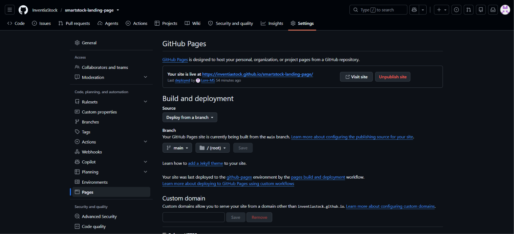

Nota: *Configuración de GitHub Pages para el repositorio smartstock-landing-page, publicando desde la rama main.*

**Figura 155**

*Landing Page de SmartStock desplegado en GitHub Pages*

Nota*:* *Landing page de SmartStock desplegada y accesible públicamente en GitHub Pages.*

## 5.2. Landing Page, Services & Applications Implementation

En esta sección se explica y evidencia el proceso de implementación, pruebas, documentación y despliegue del Landing Page, los Web Services y la Frontend Web Application, organizado por sprints.

### 5.2.1. Sprint 1

#### 5.2.1.1. Sprint Planning 1

**Tabla 30**

*Sprint Planning 1*

| **Campo**                            | **Detalle**                                                                                                                                                                                                                                                                                                                                                                                                                     |
|--------------------------------------|---------------------------------------------------------------------------------------------------------------------------------------------------------------------------------------------------------------------------------------------------------------------------------------------------------------------------------------------------------------------------------------------------------------------------------|
| **Sprint \#**                        | 1                                                                                                                                                                                                                                                                                                                                                                                                                               |
| **Date**                             | 2026-09-12                                                                                                                                                                                                                                                                                                                                                                                                                      |
| **Time**                             | 4:00 PM                                                                                                                                                                                                                                                                                                                                                                                                                         |
| **Location**                         | Reunión virtual                                                                                                                                                                                                                                                                                                                                                                                                                 |
| **Prepared By**                      | Montañez Salinas, Lorena Ariana                                                                                                                                                                                                                                                                                                                                                                                                 |
| **Attendees**                        | Lopez Rimachi, Sebastian Leonardo; Montañez Salinas, Lorena Ariana; Sanchez Osorio, Ruth Yanira; Suarez Chinga, Geraldine; Vizcarra Mamani, Candy Milagros                                                                                                                                                                                                                                                                      |
| **Sprint 0 – Review Summary**        | N/A (Primer Sprint del proyecto. Se establecieron las bases de la arquitectura, infraestructura en la nube y repositorios).                                                                                                                                                                                                                                                                                                     |
| **Sprint 0 – Retrospective Summary** | N/A (Primer Sprint. El equipo acordó usar GitFlow y Conventional Commits rigurosamente desde el primer día).                                                                                                                                                                                                                                                                                                                    |
| **Sprint 1 Goal**                    | Our focus is on delivering a fast, static Landing Page (HTML/CSS/JS) with language support to attract clients and validate our value proposition. We believe it delivers a clear, accessible introduction to our product's value proposition to minimarket and bodega owners exploring inventory solutions. This will be confirmed when the Landing Page is deployed and fully navigable by users, in both supported languages. |
| **Sprint 1 Velocity**                | 10 Story Points (Velocidad estimada para el primer ciclo del equipo).                                                                                                                                                                                                                                                                                                                                                           |
| **Sum of Story Points**              | 10                                                                                                                                                                                                                                                                                                                                                                                                                              |

*Nota.* Elaboración propia

#### 5.2.1.2. Aspect Leaders and Collaborators

A continuación, se presenta la matriz de liderazgo y colaboración (LACX), cuyo objetivo es facilitar una comunicación clara y organizada entre los integrantes del equipo durante el desarrollo de las tareas correspondientes a este Sprint.

**Tabla 31**

*Matriz de liderazgo y colaboración (LACX) del Sprint 1*

<table>
<colgroup>
<col style="width: 26%" />
<col style="width: 19%" />
<col style="width: 27%" />
<col style="width: 25%" />
</colgroup>
<thead>
<tr class="header">
<th>Team Member</th>
<th>
GitHub

Username
</th>
<th>
Landing Page

Structure
</th>
<th>
Landing

Page UI/UX
</th>
</tr>
<tr class="odd">
<th>Lopez Rimachi, Sebastian Leonardo</th>
<th>@leonardoXd1323</th>
<th>C</th>
<th>C</th>
</tr>
<tr class="header">
<th>Montañez Salinas, Lorena Ariana</th>
<th>@Lore-MS</th>
<th>C</th>
<th>C</th>
</tr>
<tr class="odd">
<th>Sanchez Osorio, Ruth Yanira</th>
<th>@Yiya-ciber</th>
<th>L</th>
<th>C</th>
</tr>
<tr class="header">
<th>Suarez Chinga, Geraldine</th>
<th>@geral07-UNIV</th>
<th>C</th>
<th>L</th>
</tr>
<tr class="odd">
<th>Vizcarra Mamani, Candy Milagros</th>
<th>@candyvizz</th>
<th>C</th>
<th>C</th>
</tr>
</thead>
<tbody>
</tbody>
</table>

*Nota.* Elaboración propia

#### 5.2.1.3. Sprint Backlog 1

El Sprint Backlog 1 se estructuró en torno a la construcción del sitio web estático (Landing Page) de SmartStock, encargado de comunicar la propuesta de valor del producto, los casos de uso diferenciados para bodegas de barrio y minimarkets, los planes y precios, la comparación frente a otras soluciones del mercado, y el flujo de contacto y registro de nuevos usuarios. Cada User Story del Epic EP08 se descompuso en tareas técnicas concretas, asignadas a los integrantes del subequipo de Landing Page (Ruth Sánchez y Geraldine Suárez) según su rol de diseño y desarrollo dentro del proyecto."

Trello link: https://trello.com/invite/b/6aa988a0941a5fb8c814af43/ATTI5eecabb28fdc9c85d7ba8336b688a97353B8B08C/trello-web

**Figura 156**

*Tablero de Trello del Sprint Backlog 1*

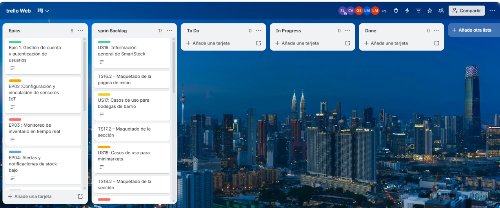

*Nota.* Elaboración propia

**Sprint \# Sprint 1**

**Tabla 32**

*Sprint Backlog 1*

| **Story Id** | **Story Title**                                           | **Task Id** | **Task Title**                                    | **Task Description**                                                                                                                                               | **Estimation (Hours)** | **Assigned To**         | **Status** |
|--------------|-----------------------------------------------------------|-------------|---------------------------------------------------|--------------------------------------------------------------------------------------------------------------------------------------------------------------------|------------------------|-------------------------|------------|
| US16         | Información general de SmartStock                         | T01         | Construir sección Hero con información general    | Maquetar la propuesta de valor y el problema que resuelve SmartStock en la página de inicio, incluyendo los estilos base del sitio (colores y tipografía).         | 5                      | Ruth Sanchez Osorio     | Done       |
| US16         | Información general de SmartStock                         | T02         | Rediseñar la sección Hero                         | Reestructurar el Hero en dos columnas (copy + imagen), agregar el kicker y la imagen del dueño de tienda, junto con los CTA "Start free trial" y "Request a demo". | 4                      | Lorena Montañez Salinas | Done       |
| US17         | Casos de uso para bodegas de barrio                       | T03         | Construir sección de casos de uso — bodegas       | Maquetar el contenido dirigido al segmento bodegas de barrio.                                                                                                      | 3                      | Ruth Sanchez Osorio     | Done       |
| US17         | Casos de uso para bodegas de barrio                       | T04         | Refinar el copy de casos de uso — bodegas         | Ajustar la redacción del contenido de bodegas para mayor claridad.                                                                                                 | 1                      | Lorena Montañez Salinas | Done       |
| US18         | Casos de uso para minimarkets                             | T05         | Construir sección de casos de uso — minimarkets   | Maquetar el contenido dirigido al segmento minimarkets.                                                                                                            | 3                      | Ruth Sanchez Osorio     | Done       |
| US18         | Casos de uso para minimarkets                             | T06         | Refinar el copy de casos de uso — minimarkets     | Ajustar la redacción del contenido de minimarkets para mayor claridad.                                                                                             | 1                      | Lorena Montañez Salinas | Done       |
| US19         | Planes y precios                                          | T07         | Construir sección de planes y precios             | Maquetar los planes disponibles con sus características y costos.                                                                                                  | 3                      | Ruth Sanchez Osorio     | Done       |
| US19         | Planes y precios                                          | T08         | Agregar botones de selección de plan              | Implementar los CTA "Choose Starter" y "Choose Growth" en la sección de planes.                                                                                    | 2                      | Candy Vizcarra Mamani   | Done       |
| US20         | Formulario de contacto para solicitar demostración        | T09         | Construir formulario de contacto y validación     | Maquetar el formulario (nombre, negocio, correo) e implementar la validación de campos obligatorios.                                                               | 4                      | Ruth Sanchez Osorio     | Done       |
| US21         | Preguntas frecuentes sobre instalación de sensores        | T10         | Construir sección de preguntas frecuentes         | Maquetar el listado de preguntas y respuestas sobre instalación de sensores IoT.                                                                                   | 2                      | Ruth Sanchez Osorio     | Done       |
| US22         | Testimonios de dueños de bodega                           | T11         | Construir sección de testimonios (base)           | Maquetar la sección inicial de testimonios de clientes.                                                                                                            | 2                      | Ruth Sanchez Osorio     | Done       |
| US22         | Testimonios de dueños de bodega                           | T12         | Rediseñar testimonios como grid de tarjetas       | Reestructurar la sección en un grid de tarjetas, con avatares, calificación de 5 estrellas y el rol de cada persona.                                               | 4                      | Geraldine Suarez Chinga | Done       |
| US22         | Testimonios de dueños de bodega                           | T13         | Estilizar el nuevo grid de testimonios            | Agregar los estilos CSS del nuevo diseño de testimonios.                                                                                                           | 2                      | Geraldine Suarez Chinga | Done       |
| US23         | Comparación frente a otras soluciones                     | T14         | Construir tabla comparativa                       | Maquetar la tabla comparativa entre SmartStock y otras soluciones del mercado.                                                                                     | 3                      | Ruth Sanchez Osorio     | Done       |
| US24         | Acceso a registro desde el sitio web                      | T15         | Agregar acceso a registro permanente en el header | Incorporar el enlace de registro visible desde cualquier sección del sitio.                                                                                        | 2                      | Ruth Sanchez Osorio     | Done       |
| US24         | Acceso a registro desde el sitio web                      | T16         | Ajustar logo y etiquetas aria del navbar          | Redimensionar el logo (28px→42px) y añadir etiquetas aria descriptivas en la navegación.                                                                           | 2                      | Candy Vizcarra Mamani   | Done       |
| US24         | Acceso a registro desde el sitio web                      | T17         | Dar visibilidad persistente al enlace de registro | Incorporar el enlace "Sign up" visible de forma persistente en el header.                                                                                          | 2                      | Candy Vizcarra Mamani   | Done       |
| US24         | Acceso a registro desde el sitio web                      | T18         | Reparar navegación en pantallas angostas          | Corregir el comportamiento del menú y el acceso al registro en viewports menores a 720px.                                                                          | 3                      | Sebastian Lopez Rimachi | Done       |
| —            | Tarea adicional (no ligada a un User Story en particular) | T19         | Implementar selector de idioma (inglés/español)   | Añadir el switch de idioma con inglés por defecto y diccionario para español (es_419), aplicado a todas las secciones.                                             | 4                      | Ruth Sanchez Osorio     | Done       |
| —            | Tarea adicional (no ligada a un User Story en particular) | T20         | Redactar términos y condiciones                   | Elaborar la página de términos y condiciones enlazada desde el footer, siguiendo el código de ética ACM/IEEE y del Colegio de Ingenieros del Perú.                 | 3                      | Ruth Sanchez Osorio     | Done       |
| —            | Tarea adicional (no ligada a un User Story en particular) | T21         | Eliminar rutas hardcodeadas del script            | Quitar la URL y las rutas de la app hardcodeadas en script.js.                                                                                                     | 2                      | Sebastian Lopez Rimachi | Done       |
| —            | Tarea adicional (no ligada a un User Story en particular) | T22         | Forzar idioma por defecto (inglés)                | Configurar inglés como locale por defecto según requisito del curso.                                                                                               | 1                      | Sebastian Lopez Rimachi | Done       |
| —            | Tarea adicional (no ligada a un User Story en particular) | T23         | Documentar el proyecto (README)                   | Redactar el README con el propósito del proyecto, el stack utilizado y la estructura de archivos.                                                                  | 2                      | Lorena Montañez Salinas | Done       |

*Nota.* Elaboración propia

**Resumen de carga por integrante:** Ruth Sanchez Osorio (11 tasks, 34h) · Lorena Montañez Salinas (4 tasks, 8h) · Candy Vizcarra Mamani (3 tasks, 6h) · Geraldine Suarez Chinga (2 tasks, 6h) · Sebastian Lopez Rimachi (3 tasks, 6h).

#### 5.2.1.4. Development Evidence for Sprint Review

Durante el Sprint 1 se implementó la primera versión del sitio web estático (Landing Page) de SmartStock, cubriendo las secciones de propuesta de valor, problemática, casos de uso por segmento, comparación frente a otras soluciones, planes y precios, testimonios, preguntas frecuentes y formulario de contacto. A continuación se presenta la tabla de commits relacionados con la implementación, organizados por rama según GitFlow y redactados bajo la convención de Conventional Commits.

**Tabla 33**

*Commits relacionados con la implementación del Sprint 1*

| **Repository**          | **Branch**                    | **Commit Id** | **Commit Message**                                                | **Commit Message Body**                                                                                                                                                                                                                                                                                                                                                             | **Commited on (Date)** |
|-------------------------|-------------------------------|---------------|-------------------------------------------------------------------|-------------------------------------------------------------------------------------------------------------------------------------------------------------------------------------------------------------------------------------------------------------------------------------------------------------------------------------------------------------------------------------|------------------------|
| smartstock-landing-page | feature/landing-page          | 8f8baff       | feat(landing): add base styles                                    | White as the dominant background, navy for headings and actions. Only the tokens the page actually uses are declared.                                                                                                                                                                                                                                                               | 10/09/2026             |
| smartstock-landing-page | feature/landing-page          | 083b61e       | feat(landing): add the home page sections                         | Cover the user stories of the static web site: general information and the problem it solves (US16), use cases for corner stores (US17) and minimarkets (US18), comparison against other solutions (US23), plans and pricing (US19), testimonials (US22), sensor installation FAQ (US21), demonstration request form (US20) and permanent access to sign-up from the header (US24). | 10/09/2026             |
| smartstock-landing-page | feature/landing-page          | a3d57f5       | feat(landing): add language switch, menu, faq and form validation | English is the default language and its copy lives in the markup, so the page still reads complete if this script fails to load. Spanish (es_419) comes from a flat dictionary. The call-to-action links to the web application are built from a single URL constant.                                                                                                               | 11/09/2026             |
| smartstock-landing-page | feature/landing-page          | f1fd4da       | feat(landing): add terms and conditions linked from the footer    | Written following the ACM/IEEE Software Engineering Code of Ethics and the code of ethics of the Colegio de Ingenieros del Perú.                                                                                                                                                                                                                                                    | 11/09/2026             |
| smartstock-landing-page | fix/mobile-navbar             | 519a06f       | fix(landing): repair the navigation bar on narrow screens         | Below 720px the sign-up button moves into the collapsible menu so the bar keeps only the brand, language switch and menu button. Sign-up stays reachable from every section (US24) and the language switch stays visible.                                                                                                                                                           | 12/09/2026             |
| smartstock-landing-page | feature/header-navbar         | 5dcbdb0       | feat(landing): resize brand logo and improve navbar aria labels   | Se ajustó el tamaño del logo (28px→42px) y se añadieron etiquetas aria descriptivas en el selector de idioma y la navegación. Aplica en index.html y terms-of-service.html.                                                                                                                                                                                                         | 12/09/2026             |
| smartstock-landing-page | feature/header-navbar         | e08146f       | feat(landing): add persistent sign up link in header              | Se agregó el enlace "Sign up" visible en el header.                                                                                                                                                                                                                                                                                                                                 | 13/09/2026             |
| smartstock-landing-page | feature/pricing-cta           | 4496ea1       | feat(landing): add plan selection CTA buttons                     | Se agregaron los botones "Choose Starter" y "Choose Growth" en la sección de planes.                                                                                                                                                                                                                                                                                                | 13/09/2026             |
| smartstock-landing-page | feature/usecase-content       | bc2072c       | content: refine corner store and minimarket copy                  | Se ajustó la redacción de los casos de uso de bodega y minimarket.                                                                                                                                                                                                                                                                                                                  | 14/09/2026             |
| smartstock-landing-page | feature/hero-redesign         | 9a8b222       | feat(landing): redesign hero section with visual and kicker       | Se reestructuró el hero en dos columnas (copy + imagen), añadiendo el kicker y la imagen del dueño de tienda.                                                                                                                                                                                                                                                                       | 14/09/2026             |
| smartstock-landing-page | feature/hero-redesign         | ec752f4       | feat(landing): add hero CTAs and supporting copy                  | Se agregaron los botones "Start free trial" y "Request a demo" junto con el texto de nota.                                                                                                                                                                                                                                                                                          | 15/09/2026             |
| smartstock-landing-page | feature/testimonials-redesign | 3ceb77f       | feat(landing): rebuild testimonials as card grid                  | Se reestructuró la sección de testimonios en un grid de tarjetas.                                                                                                                                                                                                                                                                                                                   | 15/09/2026             |
| smartstock-landing-page | feature/testimonials-redesign | 21f1118       | feat(landing): add avatars, ratings and roles to testimonials     | Se añadieron avatares, calificación de 5 estrellas y el rol de cada persona.                                                                                                                                                                                                                                                                                                        | 16/09/2026             |
| smartstock-landing-page | feature/testimonials-redesign | aed1e38       | style(landing): add testimonials grid and card styles             | Se agregaron los estilos CSS del nuevo diseño de testimonios.                                                                                                                                                                                                                                                                                                                       | 16/09/2026             |
| smartstock-landing-page | chore/script-cleanup          | 871c162       | chore(landing): remove hardcoded app routes from script           | Se eliminaron la URL y las rutas de la app hardcodeadas en script.js.                                                                                                                                                                                                                                                                                                               | 16/09/2026             |
| smartstock-landing-page | chore/script-cleanup          | eb3dc3c       | fix(landing): set English as default locale                       | Se forzó inglés como idioma por defecto según requisito del curso.                                                                                                                                                                                                                                                                                                                  | 16/09/2026             |
| smartstock-landing-page | develop                       | bb44d80       | docs: add project README                                          | Se documenta el propósito del proyecto, el stack utilizado y la estructura de archivos del landing page.                                                                                                                                                                                                                                                                            | 16/09/2026             |

*Nota.* Elaboración propia

#### 5.2.1.5. Execution Evidence for Sprint Review

Durante el Sprint 1 se implementó y desplegó la primera versión del Landing Page, que cubre las User Stories del sitio web estático especificadas en la sección 3.1. El sitio se encuentra accesible en https://inventiastock.github.io/smartstock-landing-page/ .

Landing Page Demonstration Video: https://upcedupe-my.sharepoint.com/&#58;v&#58;/g/personal/u20241f205_upc_edu_pe/IQA-Q3weXz9fQKE42Q-KkgoIAadgYrZxWARopglSvgvHunk?e=hNwpTf&nav=eyJyZWZlcnJhbEluZm8iOnsicmVmZXJyYWxBcHAiOiJTdHJlYW1XZWJBcHAiLCJyZWZlcnJhbFZpZXciOiJTaGFyZURpYWxvZy1MaW5rIiwicmVmZXJyYWxBcHBQbGF0Zm9ybSI6IldlYiIsInJlZmVycmFsTW9kZSI6InZpZXcifX0%3D

A continuación se presentan las principales vistas implementadas.

**Encabezado principal y propuesta de valor (US16, US24)**

El encabezado principal se organiza en dos columnas: a la izquierda la propuesta de valor, que presenta qué es SmartStock y qué problema resuelve, y a la derecha una fotografía de un propietario de tienda utilizando la plataforma junto a sus estantes abastecidos. La imagen permite que el visitante reconozca el segmento al que se dirige el producto antes de leer una sola línea, y cuenta con un texto alternativo descriptivo que se traduce junto con el resto de la página.

La barra superior mantiene visibles de forma permanente el selector de idioma y la acción de crear cuenta, en cumplimiento de la regla de negocio de la US24.

**Figura 157**

*Encabezado principal y propuesta de valor del Landing Page (US16, US24)*

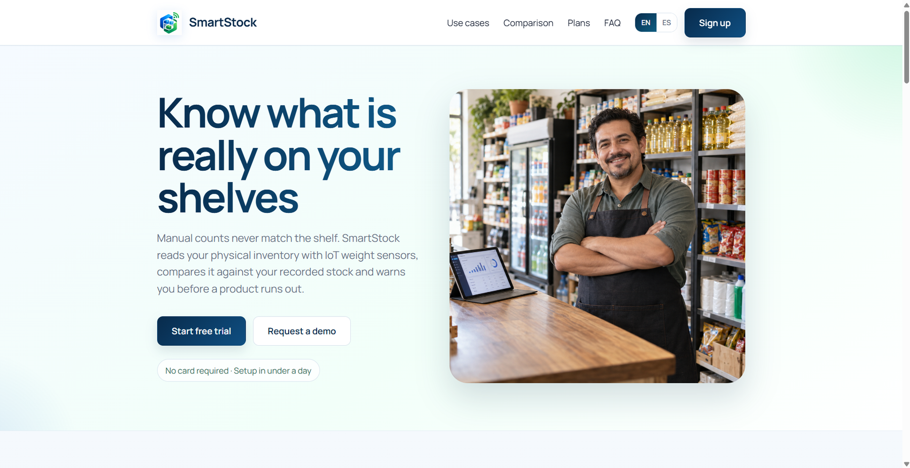

*Nota.* Elaboración propia

**Figura 158**

*Sección de problemática del Landing Page (US16)*

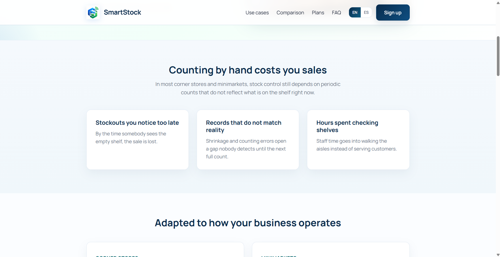

*Nota.* Elaboración propia

**Casos de uso por segmento objetivo (US17, US18)**

La sección de casos de uso separa el contenido dirigido a bodegas de barrio del dirigido a minimarkets. Cada bloque enumera los beneficios propios del segmento y cierra con un call-to-action que redirige a la vista de registro de la Web Application transportando el segmento correspondiente. La captura se presenta con la experiencia conmutada a español latinoamericano, de modo que evidencie además el alcance de la traducción sobre el contenido de esta sección.

**Figura 159**

*Sección de casos de uso por segmento objetivo del Landing Page (US17, US18)*

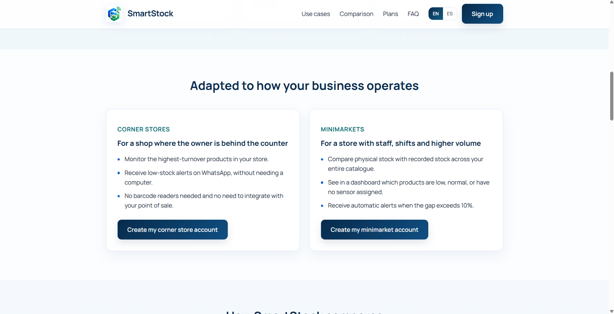

*Nota.* Elaboración propia

**Figura 160**

*Sección comparativa frente a otras soluciones del Landing Page (US23)*

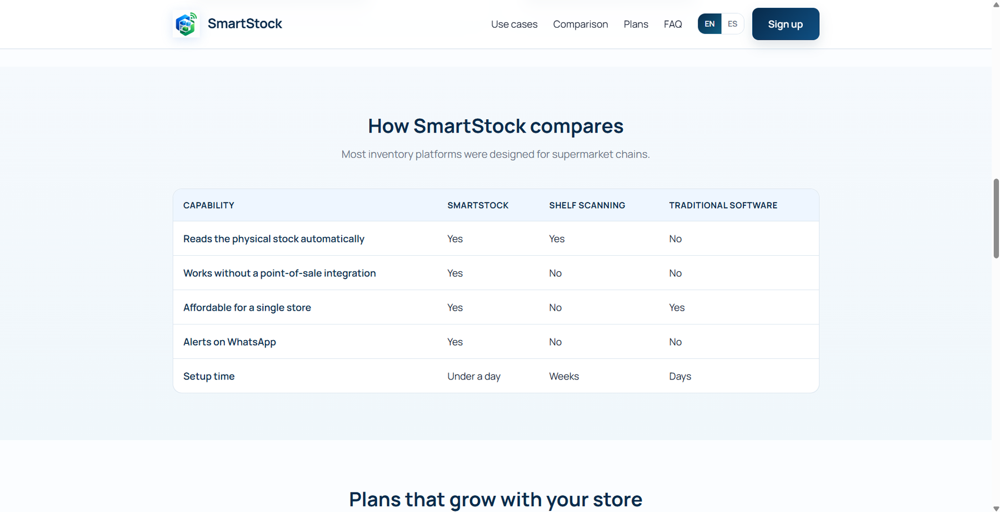

*Nota.* Elaboración propia

**Planes y precios (US19)**

Los tres planes se presentan sobre el mismo conjunto de características, ordenados de menor a mayor capacidad, y el plan intermedio se destaca mediante un borde de mayor peso. Cada plan conduce al registro con el plan preseleccionado. Las tarjetas aplican el refresco visual del design system: radio de esquina de 14 píxeles, elevación tenue en reposo y un filete de acento que se revela al pasar el cursor.

**Figura 161**

*Sección de planes y precios del Landing Page (US19)*

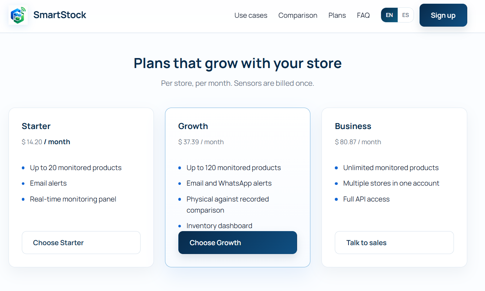

*Nota.* Elaboración propia

**Testimonios de clientes (US22)**

La sección de testimonios presenta las opiniones recogidas durante las entrevistas, cada una acompañada de una valoración y de un avatar con las iniciales del entrevistado. La valoración se expone además mediante aria-label, de modo que un lector de pantalla anuncie la calificación en lugar de leer una sucesión de símbolos.

**Figura 162**

*Sección de testimonios y preguntas frecuentes del Landing Page (US22)*

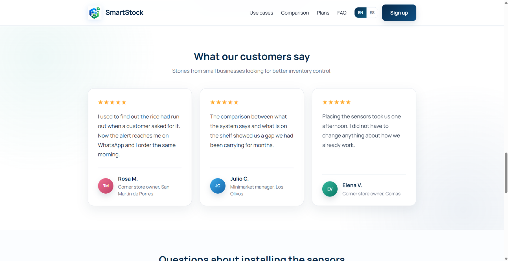

*Nota.* Elaboración propia

**Formulario de solicitud de demostración (US20)**

El formulario valida los campos obligatorios al abandonar cada campo y expone los mensajes de error mediante role="alert", de modo que un lector de pantalla los anuncie. Los campos adoptan el radio de esquina y el color de borde definidos en la sección 4.1, y el botón de envío emplea el degradado de marca.

**Figura 163**

*Formulario de solicitud de demostración del Landing Page (US20)*

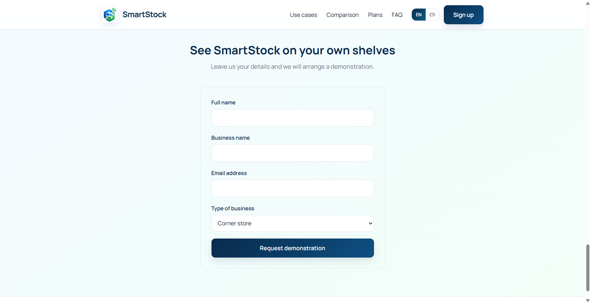

*Nota.* Elaboración propia

**Internacionalización de la experiencia (en_US / es_419)**

El idioma por defecto del sitio es el inglés, conforme a lo establecido en el enunciado. El sitio no adopta el idioma del navegador en la primera visita, precisamente para que el idioma por defecto del producto sea siempre el inglés; a partir de ahí, la preferencia elegida por el visitante queda registrada en el navegador.

El selector de idioma de la barra superior conmuta toda la experiencia al español latinoamericano, incluyendo el título del documento, los textos de la interfaz, los mensajes de validación del formulario y los atributos aria-label de la navegación, del selector de idioma y de la imagen del encabezado principal. El atributo lang del documento se actualiza en cada conmutación, de modo que un lector de pantalla emplee la pronunciación correcta.

**Figura 164**

*Formulario de demostración y pie de página del Landing Page*

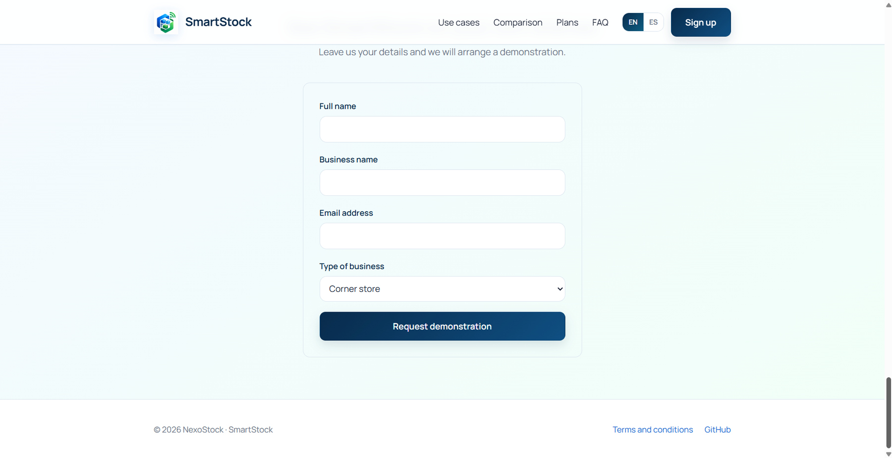

*Nota.* Elaboración propia

**Diseño web adaptable (responsive web design)**

La experiencia se adapta a las dimensiones del dispositivo cliente. En navegador móvil, las rejillas de tarjetas colapsan a una sola columna, la escala tipográfica de los titulares se reduce y la navegación se repliega tras un botón de menú.

La barra superior conserva en pantallas estrechas únicamente la marca, el selector de idioma y el botón de menú. La acción de crear cuenta se traslada al interior del menú desplegable, de modo que la barra no compita por el ancho disponible y se mantenga el cumplimiento de la regla de negocio de la US24, que establece que la opción de registro está disponible de forma permanente en todas las secciones del sitio web estático.

***Figura 165***

*Mockup de la pantalla principal del Landing Page en versión móvil*

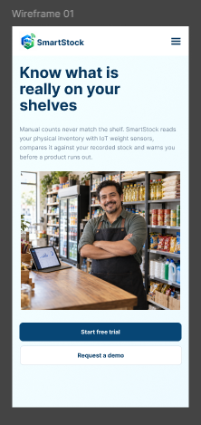

*Nota.* *Mockup de la interfaz principal de inicio del landing page de SmartStock adaptada para dispositivos móviles.*

#### 5.2.1.6. Services Documentation Evidence for Sprint Review

N/A. Durante el Sprint 1 el esfuerzo de desarrollo se enfocó exclusivamente en la creación del sitio web estático promocional (Landing Page), por lo que aún no se han implementado APIs RESTful ni Endpoints backend que requieran ser documentados a través de Swagger/OpenAPI. Esta documentación se estructurará a partir del Sprint 2.

#### 5.2.1.7. Software Deployment Evidence for Sprint Review

Durante el Sprint 1, el alcance de despliegue correspondió al Landing Page. El equipo creó el repositorio smartstock-landing-page dentro de la organización InventiaStock, aplicó sobre él el flujo de trabajo GitFlow e integró la versión 1.0.0 a la rama main mediante una release branch. A continuación, habilitó GitHub Pages tomando como fuente dicha rama y el directorio raíz del repositorio.

**Tabla 34**

*Evidencia de despliegue del Sprint 1*

| **Producto**             | **Repositorio**                                                                                                             | **URL desplegado**                                                                                                          | **Estado**                     |
|--------------------------|-----------------------------------------------------------------------------------------------------------------------------|-----------------------------------------------------------------------------------------------------------------------------|--------------------------------|
| Landing Page             | https://github.com/InventiaStock/smartstock-landing-page | https://inventiastock.github.io/smartstock-landing-page/ | Desplegado                     |
| Frontend Web Application | https://github.com/InventiaStock/smartstock-frontend         | —                                                                                                                           | Desplegado                     |
| Web Services             | Pendiente de despliegue.                                                                                                    | —                                                                                                                           | Fuera del alcance del Sprint 2 |

*Nota.* Elaboración propia

La configuración aplicada en el repositorio se muestra a continuación. La fuente de publicación es la rama main y el directorio raíz, y GitHub confirma la publicación del sitio. En el selector de ramas se aprecian además las ramas main y develop, que evidencian la aplicación de GitFlow sobre el repositorio.

**Figura 166**

*Configuración de GitHub Pages del repositorio smartstock-landing-page*

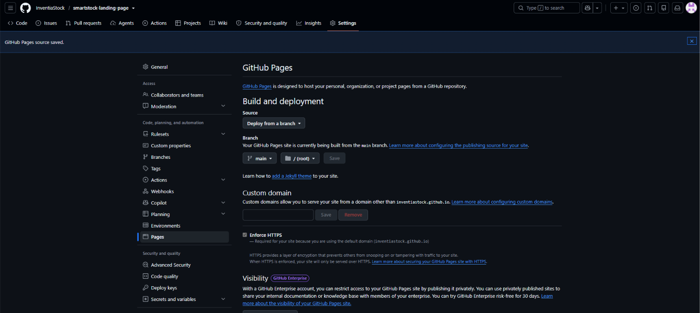

*Nota.* Elaboración propia

**Figura 167**

*Publicación del sitio confirmada en GitHub Pages*

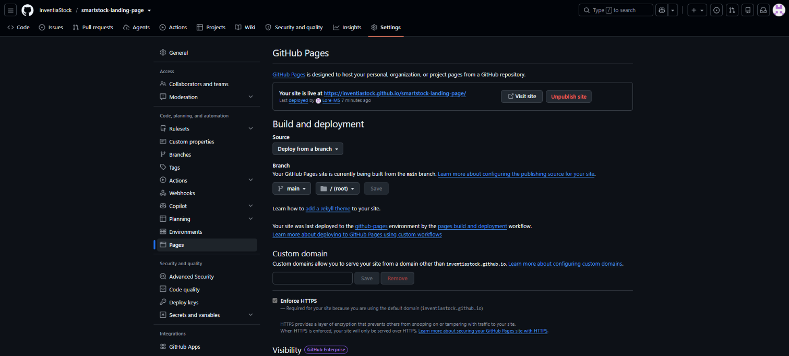

*Nota.* Elaboración propia

Se verificó que el sitio publicado responde correctamente tanto en la página de inicio como en la página de términos y condiciones, y que la hoja de estilos y el archivo de comportamiento se sirven sin errores.

**Figura 168**

*Landing Page de SmartStock publicado en GitHub Pages*

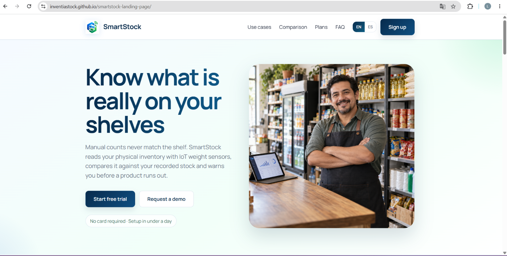

*Nota.* Elaboración propia

#### 5.2.1.8. Team Collaboration Insights during Sprint

Durante el Sprint 1, el equipo organizó la implementación del Landing Page según los aspectos definidos en la sección 5.2.1.2. Cada integrante trabajó sobre el aspecto que lideraba y registró su aporte mediante commits propios en el repositorio smartstock-landing-page, aplicando GitFlow y Conventional Commits.

El flujo de trabajo seguido fue el siguiente: la rama develop concentró el avance acumulado, cada conjunto de cambios se desarrolló en una rama feature/ que se integró a develop sin avance rápido (--no-ff), de modo que el historial conserve visible el punto de integración de cada aporte, y la versión entregada se publicó desde main mediante una release branch.

**Analíticos de colaboración del repositorio del Landing Page**

La vista de contribuyentes evidencia la participación de los cinco integrantes del equipo, con el detalle de commits y de líneas agregadas y eliminadas por cada uno.

**Figura 169**

*Contribuyentes del repositorio smartstock-landing-page*

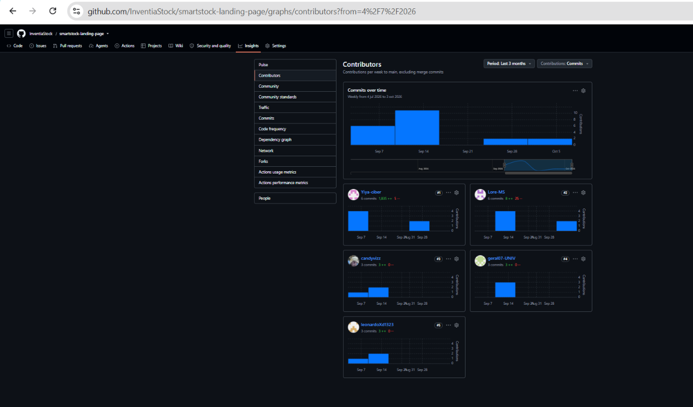

Nota: *Contribuyentes del repositorio smartstock-landing-page, los cinco integrantes del equipo registran commits propios.*

**Historial de ramas del repositorio**

El grafo de red muestra la aplicación efectiva de GitFlow: las ramas de feature nacen de develop, se integran nuevamente a ella y la rama main recibe únicamente las versiones publicadas.

**Figura 170**

*Historial de commits del repositorio smartstock-landing-page*

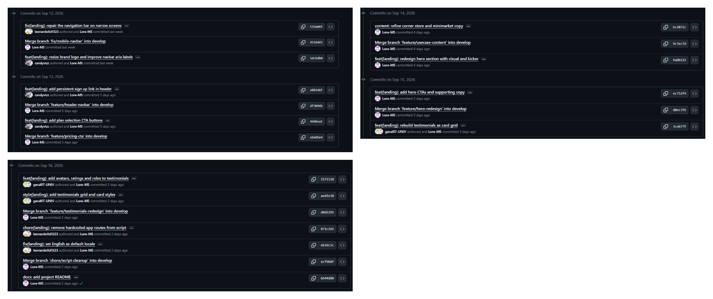

Nota: *Comparación de commits entre la primera rama de trabajo y main, mostrando la autoría real de cada commit (autor original y quien lo integró).*

### 5.2.2. Sprint 2

#### 5.2.2.1. Sprint Planning 2

En el Sprint Planning 2 el equipo definió como meta entregar la primera versión desplegada de la Frontend Web Application de SmartStock, con las historias de Compras y Ventas como núcleo del producto y el IoT como verificación del stock físico. El sprint incluye las 23 User Stories del Product Backlog que no son del Landing Page; las 15 Technical Stories (endpoints y modelo de datos) pasan al Sprint 3, junto con los Web Services reales.

**Tabla 35**

*Sprint Planning 2*

| **Campo**                        | **Detalle**                                                                                                                                                                                                                                                                                                                                                                                                                                                                                                                                                                                                                                                                                                                                                                                                                                                                                                                                                                                                                                                                                                             |
|----------------------------------|-------------------------------------------------------------------------------------------------------------------------------------------------------------------------------------------------------------------------------------------------------------------------------------------------------------------------------------------------------------------------------------------------------------------------------------------------------------------------------------------------------------------------------------------------------------------------------------------------------------------------------------------------------------------------------------------------------------------------------------------------------------------------------------------------------------------------------------------------------------------------------------------------------------------------------------------------------------------------------------------------------------------------------------------------------------------------------------------------------------------------|
| Sprint \#                        | Sprint 2                                                                                                                                                                                                                                                                                                                                                                                                                                                                                                                                                                                                                                                                                                                                                                                                                                                                                                                                                                                                                                                                                                                |
| Date                             | 2026-10-01                                                                                                                                                                                                                                                                                                                                                                                                                                                                                                                                                                                                                                                                                                                                                                                                                                                                                                                                                                                                                                                                                                              |
| Time                             | 02:00 PM                                                                                                                                                                                                                                                                                                                                                                                                                                                                                                                                                                                                                                                                                                                                                                                                                                                                                                                                                                                                                                                                                                                |
| Location                         | Reunión virtual                                                                                                                                                                                                                                                                                                                                                                                                                                                                                                                                                                                                                                                                                                                                                                                                                                                                                                                                                                                                                                                                                                         |
| Prepared By                      | Montañez Salinas, Lorena Ariana                                                                                                                                                                                                                                                                                                                                                                                                                                                                                                                                                                                                                                                                                                                                                                                                                                                                                                                                                                                                                                                                                         |
| Attendees (to planning meeting)  | Lopez Rimachi, Sebastian Leonardo / Montañez Salinas, Lorena Ariana / Sanchez Osorio, Ruth Yanira / Suarez Chinga, Geraldine / Vizcarra Mamani, Candy Milagros                                                                                                                                                                                                                                                                                                                                                                                                                                                                                                                                                                                                                                                                                                                                                                                                                                                                                                                                                          |
| Sprint 1 – Review Summary        | Durante el Sprint 1 se implementó y desplegó la primera versión del Landing Page (versión 1.0.0) en GitHub Pages, cubriendo las User Stories US16 a US24 (20 Story Points). En la revisión del Sprint 1, el docente no indicó correcciones pendientes sobre el Landing Page. Para el Sprint 2 se incorpora una actualización del Landing Page, cuyo botón de registro pasa a redirigir a la aplicación web desplegada.                                                                                                                                                                                                                                                                                                                                                                                                                                                                                                                                                                                                                                                                                                  |
| Sprint 1 – Retrospective Summary | Durante el Sprint 1 funcionó bien la aplicación de GitFlow, con ramas de feature integradas a develop y la versión 1.0.0 publicada desde main mediante una release branch, así como el uso de Conventional Commits y la organización del trabajo en Trello. Como aspecto a mejorar, el equipo identificó la necesidad de verificar las URLs antes de cada entrega. Para el Sprint 2, el equipo acordó: (1) construir las pantallas de Compras y Ventas desde las historias ya definidas (US26 a US32); (2) identificar las historias como US y TS y las tareas como T-US## y T-TS##; (3) trabajar cada tarea en una rama corta feature/\<contexto\>-\<tarea\> creada desde develop e integrada mediante pull request con merge commit (--no-ff), sin commits directos en main ni en develop; (4) no modificar archivos compartidos (rutas, stores, estilos y modelos) sin avisar al equipo; (5) usar datos simulados mientras los Web Services estén en desarrollo; y (6) actualizar el Landing Page para que el registro redirija a la Frontend Web Application desplegada, en lugar de apuntar a una dirección local. |
| Sprint 2 Goal                    | Our focus is on delivering the first deployed version of the SmartStock web application, where owners of minimarkets and bodegas register their sales and purchases and see their stock. We believe it delivers control over what enters and leaves their inventory, verified by IoT sensors, to minimarket and bodega owners. This will be confirmed when a user can sign up, register a product, a purchase and a sale, and then see the updated stock, the low-stock alert and the dashboard in the deployed frontend, without help from the development team.                                                                                                                                                                                                                                                                                                                                                                                                                                                                                                                                                       |
| Sprint 2 Velocity                | 84 Story Points                                                                                                                                                                                                                                                                                                                                                                                                                                                                                                                                                                                                                                                                                                                                                                                                                                                                                                                                                                                                                                                                                                         |
| Sum of Story Points              | 84 (todas de User Stories)                                                                                                                                                                                                                                                                                                                                                                                                                                                                                                                                                                                                                                                                                                                                                                                                                                                                                                                                                                                                                                                                                              |

*Nota.* Elaboración propia

Durante el Sprint 1 funcionó bien la aplicación de GitFlow, con ramas de feature integradas a develop y la versión 1.0.0 publicada desde main mediante una release branch, así como el uso de Conventional Commits y la organización del trabajo en Trello. Como aspecto a mejorar, el equipo identificó la necesidad de verificar las URLs antes de cada entrega.

Para el Sprint 2, el equipo acordó: (1) construir las pantallas de Compras y Ventas desde las historias ya definidas (US26 a US32); (2) identificar las historias como US y TS y las tareas como T-US## y T-TS##; (3) trabajar cada tarea en una rama corta feature/\<contexto\>-\<tarea\> creada desde develop e integrada mediante pull request con merge commit (--no-ff), sin commits directos en main ni en develop; (4) no modificar archivos compartidos (rutas, stores, estilos y modelos) sin avisar al equipo; (5) usar datos simulados mientras los Web Services estén en desarrollo; y (6) actualizar el Landing Page para que el registro redirija a la Frontend Web Application desplegada, en lugar de apuntar a una dirección local.

#### 5.2.2.2. Aspect Leaders and Collaborators

Los aspectos de este sprint son los seis bounded contexts del frontend: IAM (registro, inicio de sesión y recuperación de contraseña); IoT Device (vinculación de sensores y estado de conexión); Alerts & Restocking (notificaciones de stock bajo, alertas por discrepancia y compra desde una alerta); Product Catalog (registro y edición de productos y umbral mínimo); Inventory Monitoring (peso actual, listado por nivel de stock, comparación físico vs. registrado, y ventas, compras y proveedores con sus movimientos de stock); y Analytics & Reporting (dashboard y reportes). Cada integrante lidera el contexto que eligió y colabora en los demás (L = líder, C = colaborador); esta distribución se refleja en la selección de tasks de la sección 5.2.2.3 y en la autoría de los commits. Dentro de Inventory Monitoring, Lorena construye Ventas, Candy construye Proveedores y Compras, y Leonardo conecta la alerta de stock bajo con registrar una compra (US32).

**Tabla 36**

*Matriz de liderazgo y colaboración (LACX) del Sprint 2*

| **Team Member**                   | **GitHub Username** | **IAM** | **IoT Device** | **Alerts & Restocking** | **Product Catalog** | **Inventory Monitoring** | **Analytics & Reporting** |
|-----------------------------------|---------------------|---------|----------------|-------------------------|---------------------|--------------------------|---------------------------|
| Montañez Salinas, Lorena Ariana   | Lore-MS             | L       | C              | C                       | C                   | C                        | C                         |
| Sanchez Osorio, Ruth Yanira       | Yiya-ciber          | C       | L              | C                       | C                   | C                        | C                         |
| Lopez Rimachi, Sebastian Leonardo | leonardoXd1323      | C       | C              | L                       | C                   | C                        | C                         |
| Vizcarra Mamani, Candy Milagros   | candyvizz           | C       | C              | C                       | L                   | C                        | C                         |
| Suarez Chinga, Geraldine          | geral07-UNIV        | C       | C              | C                       | C                   | L                        | L                         |

*Nota.* Elaboración propia

Geraldine lidera dos aspectos y el resto uno. Ventas y Compras viven dentro de Inventory Monitoring, pero sus pantallas se reparten: Lorena construye Ventas, Candy construye Proveedores y Compras, y Leonardo conecta la alerta de stock bajo con registrar una compra (US32).

#### 5.2.2.3. Sprint Backlog 2

El objetivo del Sprint 2 es entregar la primera versión navegable y desplegada del frontend de SmartStock, con Compras y Ventas como núcleo. El sprint contiene las 23 User Stories del Product Backlog que no son del Landing Page (84 Story Points); las Technical Stories pasan al Sprint 3 con los Web Services reales, y en este sprint solo se incluyen sus tareas de simulación (mock), marcadas como "(mock)" y sin Story Points propios. El tablero del sprint está en Trello y su URL pública es https://trello.com/invite/b/6ac4b28dd414f036520b5f47/ATTI194967e117cc1b0e83906e9d86df8680619E986C/sprint-backlog-2-web

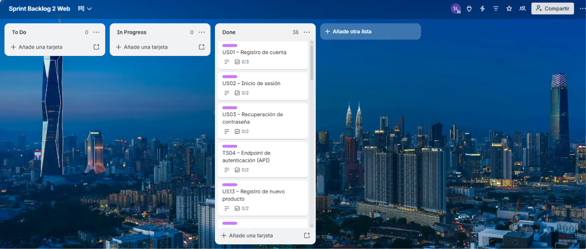

La tabla resume la carga por integrante. Las tareas se identifican como T-US##.# (historias de usuario), T-TS##.# (contratos simulados, sin puntos) y T-SH.# (setup compartido, sin historia). Los 84 Story Points corresponden solo a User Stories.

**Tabla 37**

*Carga de trabajo por integrante en el Sprint 2*

| **Integrante** | **Contexto**                                                   | **User Stories**                   | **Story Points** |
|----------------|----------------------------------------------------------------|------------------------------------|------------------|
| Lorena         | IAM y pantallas de Ventas                                      | US01, US02, US03, US26, US27, US28 | 21               |
| Ruth           | IoT Device                                                     | US04, US06                         | 8                |
| Leonardo       | Alerts & Restocking                                            | US09, US10, US12, US32             | 16               |
| Candy          | Product Catalog, Proveedores y Compras (+ setup y mock server) | US05, US13, US14, US29, US30, US31 | 18               |
| Geraldine      | Inventory Monitoring y Analytics & Reporting                   | US07, US08, US11, US15, US25       | 21               |
| **Total**      |                                                                |                                    | **84**           |

*Nota.* Elaboración propia

**Tabla 38**

*Sprint Backlog 2*

| **Sprint \#** | **Story Id** | **Story Title**                                   | **Task Id** | **Task Title**                                         | **Task Description**                                                                               | **Estimation (Hours)** | **Assigned To** | **Status** |
|---------------|--------------|---------------------------------------------------|-------------|--------------------------------------------------------|----------------------------------------------------------------------------------------------------|------------------------|-----------------|------------|
| 2             | Soporte      | Setup compartido                                  | T-SH.1      | Separar traducciones por contexto y ampliar el entorno | Una carpeta de traducciones por bounded context y endpoints del Sprint 2 en el environment.        | 4                      | Candy           | Done       |
| 2             | Soporte      | Setup compartido                                  | T-SH.2      | Helpers y componentes compartidos                      | Helpers de error y rango de fechas; alert banner, summary card y page header; estilos compartidos. | 6                      | Candy           | Done       |
| 2             | Soporte      | Setup compartido                                  | T-SH.3      | Modelo de movimiento de stock                          | Entidad StockMovement (R17) usada por ventas, compras y reportes.                                  | 4                      | Candy           | Done       |
| 2             | TS14         | Registro automático de movimientos (mock)         | T-TS14.1    | Motor de movimientos y reglas de alerta del mock       | Movimientos de stock, reglas de alerta R19–R21 y proyección de producto con estado del sensor.     | 6                      | Candy           | Done       |
| 2             | TS01         | Recepción de lecturas (mock)                      | T-TS01.1    | Mock POST /sensores/{id}/lecturas                      | Servidor json-server con token, rutas automáticas y simulador IoT.                                 | 5                      | Candy           | Done       |
| 2             | TS05         | Estado de sensor (mock)                           | T-TS05.1    | Mock GET /sensores/{id}/estado                         | Estado en línea/desconectado (R11) y endpoints de vinculación.                                     | 4                      | Candy           | Done       |
| 2             | US04         | Vinculación de sensor IoT a un producto           | T-US04.1    | Diseñar vista de vinculación                           | Sensores disponibles, flujo de vinculación y caso de sensor ya vinculado.                          | 5                      | Ruth            | Done       |
| 2             | US04         | Vinculación de sensor IoT a un producto           | T-US04.2    | Modelo, API y store de dispositivos                    | Entidades Sensor y LinkableProduct, DevicesApi y store (R9).                                       | 6                      | Ruth            | Done       |
| 2             | US04         | Vinculación de sensor IoT a un producto           | T-US04.3    | Validar sensor ya en uso                               | Rechazar vinculación e indicar que el sensor ya está en uso.                                       | 3                      | Ruth            | Done       |
| 2             | US06         | Estado de conexión de sensores                    | T-US06.1    | Vista de listado de estado                             | Lista de sensores con estado en línea o desconectado.                                              | 4                      | Ruth            | Done       |
| 2             | US06         | Estado de conexión de sensores                    | T-US06.2    | Regla de 5 minutos                                     | Desconectado si no hay lecturas en 5 minutos (R11).                                                | 3                      | Ruth            | Done       |
| 2             | US01         | Registro de cuenta                                | T-US01.1    | Formulario de registro                                 | Datos del negocio y selector de tipo de negocio.                                                   | 5                      | Lorena          | Done       |
| 2             | US01         | Registro de cuenta                                | T-US01.2    | Validaciones y correo repetido                         | Validar campos y mostrar error de correo ya registrado.                                            | 4                      | Lorena          | Done       |
| 2             | US01         | Registro de cuenta                                | T-US01.3    | Estado de registro exitoso                             | Mensaje de éxito y redirección.                                                                    | 3                      | Lorena          | Done       |
| 2             | US02         | Inicio de sesión                                  | T-US02.1    | Vista de login                                         | Formulario con mensaje de error genérico (R3).                                                     | 4                      | Lorena          | Done       |
| 2             | US02         | Inicio de sesión                                  | T-US02.2    | Modelo, API y store de IAM                             | UserSession, IamApi y store con signIn y signUp.                                                   | 6                      | Lorena          | Done       |
| 2             | TS04         | Login (mock)                                      | T-TS04.1    | Mock POST /auth/login                                  | Endpoints de login, registro y recuperación en el mock.                                            | 4                      | Lorena          | Done       |
| 2             | US03         | Recuperación de contraseña                        | T-US03.1    | Formulario de recuperación                             | Solicitud con el mismo mensaje neutro para cualquier correo.                                       | 4                      | Lorena          | Done       |
| 2             | US03         | Recuperación de contraseña                        | T-US03.2    | Nueva contraseña y enlace vencido                      | Confirmación de envío con el aviso de que el enlace vence en 24 horas (R4).                        | 4                      | Lorena          | Done       |
| 2             | US26         | Registro de venta                                 | T-US26.1    | Formulario de nueva venta                              | Productos, cantidades y total.                                                                     | 6                      | Lorena          | Done       |
| 2             | US26         | Registro de venta                                 | T-US26.2    | Modelo y API de ventas                                 | Sale, SaleItem, SaleProductOption y SalesApi.                                                      | 5                      | Lorena          | Done       |
| 2             | US26         | Registro de venta                                 | T-US26.3    | Store y validaciones de stock                          | Store de ventas; stock suficiente (R13) y producto sin precio (R14).                               | 5                      | Lorena          | Done       |
| 2             | US27         | Historial de ventas                               | T-US27.1    | Listado de ventas                                      | Lista con total del período.                                                                       | 4                      | Lorena          | Done       |
| 2             | US27         | Historial de ventas                               | T-US27.2    | Filtro por fechas y período vacío                      | Filtro por rango y estado vacío.                                                                   | 3                      | Lorena          | Done       |
| 2             | US28         | Detalle de una venta                              | T-US28.1    | Vista de detalle de venta                              | Detalle con los movimientos de stock generados.                                                    | 4                      | Lorena          | Done       |
| 2             | TS07         | Registro de ventas (mock)                         | T-TS07.1    | Mock POST /ventas                                      | Cada venta crea movimientos de salida (R17).                                                       | 4                      | Lorena          | Done       |
| 2             | TS08         | Consulta de ventas (mock)                         | T-TS08.1    | Mock GET /ventas y /ventas/{id}                        | Listado y detalle de ventas.                                                                       | 3                      | Lorena          | Done       |
| 2             | US09         | Notificación por correo de stock bajo             | T-US09.1    | Vista de configuración de notificaciones               | Canal correo electrónico y textos en inglés y español.                                             | 5                      | Leonardo        | Done       |
| 2             | US09         | Notificación por correo de stock bajo             | T-US09.2    | Store de alertas                                       | Store con alertas y preferencias.                                                                  | 4                      | Leonardo        | Done       |
| 2             | US09         | Notificación por correo de stock bajo             | T-US09.3    | Modelo y API de alertas                                | Alert, resource, assembler y AlertsApi.                                                            | 5                      | Leonardo        | Done       |
| 2             | US10         | Notificación por WhatsApp de stock bajo           | T-US10.1    | Canal WhatsApp en configuración                        | Preferencia de canal y número de WhatsApp.                                                         | 4                      | Leonardo        | Done       |
| 2             | TS03         | Notificación de stock bajo (mock)                 | T-TS03.1    | Mock POST /notificaciones/stock-bajo                   | Endpoint de notificaciones en alerts.js.                                                           | 4                      | Leonardo        | Done       |
| 2             | TS14         | Registro automático de movimientos (mock)         | T-TS14.2    | Mock de alertas con movimientos                        | Alertas activas ligadas a los movimientos de stock.                                                | 3                      | Leonardo        | Done       |
| 2             | TS15         | Consulta de movimientos (mock)                    | T-TS15.1    | Mock GET /movimientos-stock                            | Listado de movimientos.                                                                            | 3                      | Leonardo        | Done       |
| 2             | US12         | Alerta por discrepancia de inventario             | T-US12.2    | Lista de alertas activas                               | Alertas con discrepancia mayor al 10 %.                                                            | 5                      | Leonardo        | Done       |
| 2             | US32         | Registro de compra desde una alerta de stock bajo | T-US32.1    | Botón de compra en la alerta                           | Acción desde la alerta de stock bajo.                                                              | 3                      | Leonardo        | Done       |
| 2             | US32         | Registro de compra desde una alerta de stock bajo | T-US32.2    | Precarga de producto y proveedor                       | Enviar producto y proveedor al formulario de compra.                                               | 4                      | Leonardo        | Done       |
| 2             | US32         | Registro de compra desde una alerta de stock bajo | T-US32.3    | Marcar necesidad atendida                              | Actualizar el estado de la alerta tras registrar la compra.                                        | 3                      | Leonardo        | Done       |
| 2             | US13         | Registro de nuevo producto                        | T-US13.1    | Formulario de producto                                 | Validaciones, precio de venta opcional y banner de error.                                          | 5                      | Candy           | Done       |
| 2             | US13         | Registro de nuevo producto                        | T-US13.2    | Modelo, API y store de catálogo                        | Product, CatalogApi y store (R5, R7).                                                              | 6                      | Candy           | Done       |
| 2             | TS13         | Modelo de datos: productos (mock)                 | T-TS13.2    | Mock de productos (GET/POST/PUT /productos)            | Validaciones R5 y R7 en el mock.                                                                   | 4                      | Candy           | Done       |
| 2             | US14         | Edición de producto                               | T-US14.1    | Formulario de edición                                  | Precio de venta, costo de compra y proveedor habitual.                                             | 4                      | Candy           | Done       |
| 2             | US14         | Edición de producto                               | T-US14.2    | Stock de solo lectura                                  | El stock solo cambia por movimientos (R17).                                                        | 3                      | Candy           | Done       |
| 2             | US05         | Configuración de umbral mínimo de stock           | T-US05.1    | Vista de umbral mínimo                                 | Formulario por producto con sensor.                                                                | 4                      | Candy           | Done       |
| 2             | US05         | Configuración de umbral mínimo de stock           | T-US05.2    | Validar capacidad máxima                               | Rechazar umbral mayor a la capacidad (R7).                                                         | 3                      | Candy           | Done       |
| 2             | US29         | Registro de proveedor                             | T-US29.1    | Formulario y listado de proveedores                    | Alta y lista de proveedores.                                                                       | 5                      | Candy           | Done       |
| 2             | US29         | Registro de proveedor                             | T-US29.2    | Proveedor duplicado                                    | Error por proveedor repetido (R8).                                                                 | 3                      | Candy           | Done       |
| 2             | US30         | Registro y recepción de compra                    | T-US30.1    | Formulario de nueva compra                             | Productos, total y precarga desde reposición.                                                      | 6                      | Candy           | Done       |
| 2             | US30         | Registro y recepción de compra                    | T-US30.2    | Modelo y API de compras                                | Purchase, PurchaseItem, Supplier y PurchasesApi.                                                   | 5                      | Candy           | Done       |
| 2             | US30         | Registro y recepción de compra                    | T-US30.3    | Detalle y recepción                                    | Recepción de mercadería que crea movimientos de entrada.                                           | 6                      | Candy           | Done       |
| 2             | US30         | Registro y recepción de compra                    | T-US30.4    | Store de compras                                       | Compras, proveedores y recepción (R15, R16).                                                       | 4                      | Candy           | Done       |
| 2             | US31         | Historial de compras                              | T-US31.1    | Listado de compras                                     | Lista con filtro por fechas.                                                                       | 4                      | Candy           | Done       |
| 2             | US31         | Historial de compras                              | T-US31.2    | Estado vacío                                           | Mensaje cuando no hay compras en el período.                                                       | 3                      | Candy           | Done       |
| 2             | TS09         | Proveedores (mock)                                | T-TS09.1    | Mock POST/GET /proveedores                             | Alta y consulta de proveedores.                                                                    | 3                      | Candy           | Done       |
| 2             | TS10         | Registro de compras (mock)                        | T-TS10.1    | Mock POST /compras                                     | Alta de compras.                                                                                   | 3                      | Candy           | Done       |
| 2             | TS11         | Recepción de compras (mock)                       | T-TS11.1    | Mock PATCH /compras/{id}/recepcion                     | Recepción con movimientos de entrada.                                                              | 3                      | Candy           | Done       |
| 2             | TS12         | Consulta de compras (mock)                        | T-TS12.1    | Mock GET /compras y /compras/{id}                      | Listado y detalle.                                                                                 | 3                      | Candy           | Done       |
| 2             | US15         | Dashboard de inventario                           | T-US15.1    | Vista de dashboard                                     | Tarjetas de resumen y Home de bodega.                                                              | 6                      | Geraldine       | Done       |
| 2             | US15         | Dashboard de inventario                           | T-US15.2    | Tarjetas de ventas y compras del día                   | Totales del día en el dashboard.                                                                   | 4                      | Geraldine       | Done       |
| 2             | US15         | Dashboard de inventario                           | T-US15.3    | Modelo, API y store de analítica                       | DashboardSummary, Report y AnalyticsApi.                                                           | 5                      | Geraldine       | Done       |
| 2             | US15         | Dashboard de inventario                           | T-US15.4    | Traducciones y estados vacíos                          | Textos en inglés y español.                                                                        | 3                      | Geraldine       | Done       |
| 2             | US15         | Dashboard de inventario                           | T-US15.5    | Mock GET /dashboard y /reportes                        | Reportes solo para minimarket.                                                                     | 4                      | Geraldine       | Done       |
| 2             | US25         | Reportes de consumo y movimientos                 | T-US25.1    | Selector de período                                    | Rango de fechas del reporte.                                                                       | 3                      | Geraldine       | Done       |
| 2             | US25         | Reportes de consumo y movimientos                 | T-US25.2    | Reporte de consumo                                     | Consumo por producto.                                                                              | 5                      | Geraldine       | Done       |
| 2             | US25         | Reportes de consumo y movimientos                 | T-US25.3    | Movimientos con ventas y compras                       | Tabla de movimientos con ventas y compras.                                                         | 5                      | Geraldine       | Done       |
| 2             | US25         | Reportes de consumo y movimientos                 | T-US25.4    | Reporte sin datos                                      | Estado vacío del período.                                                                          | 3                      | Geraldine       | Done       |
| 2             | US11         | Comparación inventario físico vs. registrado      | T-US11.1    | Vista de comparación                                   | Peso del sensor frente al stock registrado.                                                        | 6                      | Geraldine       | Done       |
| 2             | US11         | Comparación inventario físico vs. registrado      | T-US11.3    | Resaltar discrepancia                                  | Diferencia mayor al 10 % resaltada.                                                                | 4                      | Geraldine       | Done       |
| 2             | US11         | Comparación inventario físico vs. registrado      | T-US11.4    | Modelo, API y store de stock                           | Comparison, SensorReading y StockApi.                                                              | 5                      | Geraldine       | Done       |
| 2             | TS02         | Consulta de stock (mock)                          | T-TS02.1    | Mock GET /productos/{id}/stock                         | Stock y detalle de producto.                                                                       | 3                      | Geraldine       | Done       |
| 2             | TS06         | Comparación de inventario (mock)                  | T-TS06.1    | Mock GET /inventario/comparacion/{productoId}          | Comparación con ventas y compras.                                                                  | 3                      | Geraldine       | Done       |
| 2             | US08         | Listado de productos por nivel de stock           | T-US08.1    | Listado con búsqueda                                   | Búsqueda y columna de sensor.                                                                      | 4                      | Geraldine       | Done       |
| 2             | US08         | Listado de productos por nivel de stock           | T-US08.2    | Filtro por nivel de stock                              | Bajo, normal o sin datos.                                                                          | 3                      | Geraldine       | Done       |
| 2             | US08         | Listado de productos por nivel de stock           | T-US08.3    | Columna de stock registrado                            | Stock actualizado por movimientos.                                                                 | 3                      | Geraldine       | Done       |
| 2             | US07         | Visualización del peso actual de un producto      | T-US07.1    | Detalle con peso actual                                | Peso del sensor y unidades equivalentes.                                                           | 4                      | Geraldine       | Done       |
| 2             | US07         | Visualización del peso actual de un producto      | T-US07.2    | Últimas cinco lecturas                                 | Historial corto de lecturas.                                                                       | 3                      | Geraldine       | Done       |

*Nota.* Elaboración propia

#### 5.2.2.4. Development Evidence for Sprint Review

Durante el Sprint 2 se implementó la Frontend Web Application de SmartStock en Vue 3 en el repositorio InventiaStock/smartstock-frontend, con las vistas, stores y servicios de IAM, IoT Device, Alerts & Restocking, Product Catalog, Inventory Monitoring (incluidas ventas, compras y proveedores) y Analytics & Reporting, consumiendo servicios simulados. Cada tarea del Sprint Backlog se desarrolló en una rama feature/\<contexto\>-\<tarea\> creada desde develop e integrada mediante pull request con merge commit.

La tabla presenta los commits relacionados con la implementación, organizados por rama según GitFlow y redactados bajo Conventional Commits, en inglés y en minúsculas, con el identificador de la tarea (por ejemplo T-US02.1) en el cuerpo del mensaje.  
**Tabla 39**

*Commits relacionados con la implementación del Sprint 2*

| **Repository**                        | **Branch**                       | **Commit Id** | **Commit Message**                                                          | **Commit Message Body**                                                       | **Commited on (Date)** |
|---------------------------------------|----------------------------------|---------------|-----------------------------------------------------------------------------|-------------------------------------------------------------------------------|------------------------|
| InventiaStock/smartstock-frontend     | feature/shared-sprint2-setup     | ab4d22a       | chore(shared): split translations per bounded context                       | One translations folder per context; owners edit only their own. Task: T-SH.1 | 04/10/2026             |
| InventiaStock/smartstock-frontend     | feature/shared-sprint2-setup     | 8c1e4ab       | chore(shared): add sprint 2 endpoints to environment                        | Notifications, comparison, dashboard and reports endpoints. Task: T-SH.1      | 04/10/2026             |
| InventiaStock/smartstock-frontend     | feature/shared-sprint2-setup     | c787d93       | feat(shared): add api error and date range helpers                          | apiError/apiCode and DateRange helpers. Task: T-SH.2                          | 04/10/2026             |
| InventiaStock/smartstock-frontend     | feature/shared-sprint2-setup     | 991c9a7       | feat(shared): add alert banner, summary card and page header                | Reusable presentation components. Task: T-SH.2                                | 04/10/2026             |
| InventiaStock/smartstock-frontend     | feature/shared-sprint2-setup     | b418324       | refactor(shared): extend date range filter and status tag                   | Initial input, new status tones and shared styles. Task: T-SH.2               | 04/10/2026             |
| InventiaStock/smartstock-frontend     | feature/shared-sprint2-setup     | 7a7f92b       | feat(inventory): add stock movement model                                   | StockMovement entity (R17). Task: T-SH.3                                      | 04/10/2026             |
| InventiaStock/smartstock-frontend     | feature/shared-mock-server       | f08d04c       | chore(shared): add json-server mock backend skeleton                        | Server, helpers, in-memory db and scripts. Refs: T-TS01.1                     | 04/10/2026             |
| InventiaStock/smartstock-frontend     | feature/shared-mock-server       | 924cf3c       | feat(shared): add stock movement, alert rules and product view for the mock | Movement engine, alert rules R19-R21. Refs: T-TS14.1                          | 04/10/2026             |
| InventiaStock/smartstock-frontend     | feature/shared-mock-server       | 7ac6ec1       | feat(devices): add sensor readings and status mock endpoints                | Readings, status and IoT simulator. Refs: T-TS01.1, T-TS05.1                  | 04/10/2026             |
| InventiaStock/smartstock-frontend     | feature/catalog-register-product | e1e5428       | feat(catalog): add product model and api layer                              | Task: T-US13.2                                                                | 04/10/2026             |
| InventiaStock/smartstock-frontend     | feature/catalog-register-product | 9820b9d       | feat(catalog): add catalog store                                            | Task: T-US13.2                                                                | 04/10/2026             |
| InventiaStock/smartstock-frontend     | feature/catalog-register-product | cf0a1f9       | feat(catalog): add catalog translations                                     | Task: T-US13.1                                                                | 04/10/2026             |
| InventiaStock/smartstock-frontend     | feature/catalog-register-product | 07d8133       | feat(catalog): add register product view                                    | Tasks: T-US13.1, T-US13.2                                                     | 04/10/2026             |
| InventiaStock/smartstock-frontend     | feature/catalog-register-product | 8e169d6       | feat(catalog): add catalog mock endpoints                                   | Refs: T-TS13.2                                                                | 04/10/2026             |
| InventiaStock/smartstock-frontend     | feature/inventory-purchases      | 3732be9       | feat(inventory): add purchase and supplier model and api layer              | Task: T-US30.2                                                                | 04/10/2026             |
| InventiaStock/smartstock-frontend     | feature/inventory-purchases      | 7708a9f       | feat(inventory): add purchases store                                        | Task: T-US30.4                                                                | 04/10/2026             |
| InventiaStock/smartstock-frontend     | feature/inventory-purchases      | 647e310       | feat(inventory): add purchases translations                                 | Task: T-US29.1                                                                | 04/10/2026             |
| InventiaStock/smartstock-frontend     | feature/inventory-purchases      | 651a94a       | feat(inventory): add supplier list view                                     | Tasks: T-US29.1, T-US29.2                                                     | 04/10/2026             |
| InventiaStock/smartstock-frontend     | feature/inventory-purchases      | 0512742       | feat(inventory): add purchase list view                                     | Tasks: T-US31.1, T-US31.2                                                     | 04/10/2026             |
| InventiaStock/smartstock-frontend     | feature/inventory-purchases      | 1d07274       | feat(inventory): add new purchase view                                      | Tasks: T-US30.1, T-US30.2, T-US30.4                                           | 04/10/2026             |
| InventiaStock/smartstock-frontend     | feature/inventory-purchases      | 67767bc       | feat(inventory): add purchase details view                                  | Task: T-US30.3                                                                | 04/10/2026             |
| InventiaStock/smartstock-frontend     | feature/inventory-purchases      | 5686709       | feat(inventory): add purchases and suppliers mock endpoints                 | Refs: T-TS09.1, T-TS10.1, T-TS11.1, T-TS12.1                                  | 04/10/2026             |
| InventiaStock/smartstock-frontend     | feature/devices-sensor-linking   | 0fcfc02       | feat(devices): add sensor domain model and api layer                        | Task: T-US04.2                                                                | 05/10/2026             |
| InventiaStock/smartstock-frontend     | feature/devices-sensor-linking   | cc49da9       | feat(devices): add devices store                                            | Task: T-US04.2                                                                | 05/10/2026             |
| InventiaStock/smartstock-frontend     | feature/devices-sensor-linking   | c8fff55       | feat(devices): add devices translations                                     | Task: T-US04.1                                                                | 05/10/2026             |
| InventiaStock/smartstock-frontend     | feature/devices-sensor-linking   | 6448432       | feat(devices): add sensor linking view                                      | Tasks: T-US04.1, T-US04.2, T-US04.3                                           | 05/10/2026             |
| InventiaStock/smartstock-frontend     | feature/analytics-dashboard      | ca31c2a       | feat(analytics): add dashboard and report model and api layer               | Task: T-US15.3                                                                | 05/10/2026             |
| InventiaStock/smartstock-frontend     | feature/analytics-dashboard      | 8510857       | feat(analytics): add analytics store                                        | Task: T-US15.3                                                                | 05/10/2026             |
| InventiaStock/smartstock-frontend     | feature/analytics-dashboard      | de9d94e       | feat(analytics): add analytics translations                                 | Task: T-US15.1                                                                | 05/10/2026             |
| InventiaStock/smartstock-frontend     | feature/analytics-dashboard      | b947557       | feat(analytics): add dashboard view                                         | Tasks: T-US15.1, T-US15.2, T-US15.4                                           | 05/10/2026             |
| InventiaStock/smartstock-frontend     | feature/analytics-dashboard      | 98a5d9a       | feat(analytics): add dashboard and reports mock endpoints                   | Refs: T-US15.5                                                                | 05/10/2026             |
| InventiaStock/smartstock-frontend     | feature/inventory-comparison     | de281d6       | feat(inventory): add stock comparison model and api layer                   | Task: T-US11.4                                                                | 05/10/2026             |
| InventiaStock/smartstock-frontend     | feature/inventory-comparison     | 05e9775       | feat(inventory): add stock store                                            | Task: T-US11.4                                                                | 05/10/2026             |
| InventiaStock/smartstock-frontend     | feature/inventory-comparison     | 1231e51       | feat(inventory): add stock translations                                     | Task: T-US11.1                                                                | 05/10/2026             |
| InventiaStock/smartstock-frontend     | feature/inventory-comparison     | 0d6b028       | feat(inventory): add stock comparison view                                  | Tasks: T-US11.1, T-US11.3                                                     | 05/10/2026             |
| InventiaStock/smartstock-frontend     | feature/inventory-comparison     | a8612a5       | feat(inventory): add stock and comparison mock endpoints                    | Refs: T-TS02.1, T-TS06.1                                                      | 05/10/2026             |
| InventiaStock/smartstock-frontend     | feature/devices-sensor-status    | cf52668       | feat(devices): add sensor status list view                                  | Tasks: T-US06.1, T-US06.2                                                     | 05/10/2026             |
| InventiaStock/smartstock-frontend     | feature/catalog-edit-product     | 38a084d       | feat(catalog): add edit product view                                        | Tasks: T-US14.1, T-US14.2                                                     | 05/10/2026             |
| InventiaStock/smartstock-frontend     | feature/catalog-min-threshold    | 039ef29       | feat(catalog): add minimum threshold view                                   | Tasks: T-US05.1, T-US05.2                                                     | 05/10/2026             |
| InventiaStock/smartstock-frontend     | feature/alerts-email             | 09d74f5       | feat(alerts): add alert model and api layer                                 | Task: T-US09.3                                                                | 05/10/2026             |
| InventiaStock/smartstock-frontend     | feature/alerts-email             | 93adae7       | feat(alerts): add alerts store                                              | Task: T-US09.2                                                                | 05/10/2026             |
| InventiaStock/smartstock-frontend     | feature/alerts-email             | 58411f9       | feat(alerts): add alerts translations                                       | Task: T-US09.1                                                                | 05/10/2026             |
| InventiaStock/smartstock-frontend     | feature/alerts-email             | 3d58c28       | feat(alerts): add notification settings view                                | Tasks: T-US09.1, T-US10.1                                                     | 05/10/2026             |
| InventiaStock/smartstock-frontend     | feature/alerts-email             | 2707a3d       | feat(alerts): add alerts and notifications mock endpoints                   | Refs: T-TS03.1, T-TS14.2, T-TS15.1                                            | 05/10/2026             |
| InventiaStock/smartstock-frontend     | feature/analytics-reports        | 8c113c5       | feat(analytics): add reports view                                           | Tasks: T-US25.1, T-US25.2, T-US25.3, T-US25.4                                 | 05/10/2026             |
| InventiaStock/smartstock-frontend     | feature/inventory-product-list   | b43a5e6       | feat(inventory): add product list view with stock levels                    | Tasks: T-US08.1, T-US08.2, T-US08.3                                           | 05/10/2026             |
| InventiaStock/smartstock-frontend     | feature/inventory-stock-weight   | cb46b1f       | feat(inventory): add product details view with current weight               | Tasks: T-US07.1, T-US07.2                                                     | 05/10/2026             |
| InventiaStock/smartstock-frontend     | feature/alerts-active-list       | 0ecbd35       | feat(alerts): add active alerts list view                                   | Tasks: T-US12.2, T-US32.1, T-US32.2, T-US32.3                                 | 05/10/2026             |
| InventiaStock/smartstock-frontend     | feature/iam-login                | dfe5ad4       | feat(iam): add user session model and auth api                              | Task: T-US02.2                                                                | 05/10/2026             |
| InventiaStock/smartstock-frontend     | feature/iam-login                | 100a89f       | feat(iam): add iam store                                                    | Task: T-US02.2                                                                | 05/10/2026             |
| InventiaStock/smartstock-frontend     | feature/iam-login                | dcb278e       | feat(iam): add iam translations                                             | Task: T-US02.1                                                                | 05/10/2026             |
| InventiaStock/smartstock-frontend     | feature/iam-login                | 067bea8       | feat(iam): add login view                                                   | Tasks: T-US02.1, T-US02.2                                                     | 05/10/2026             |
| InventiaStock/smartstock-frontend     | feature/iam-login                | 3894f21       | feat(iam): add auth mock endpoints                                          | Refs: T-TS04.1                                                                | 05/10/2026             |
| InventiaStock/smartstock-frontend     | feature/inventory-sales          | ae1ffeb       | feat(inventory): add sale model and api layer                               | Task: T-US26.2                                                                | 05/10/2026             |
| InventiaStock/smartstock-frontend     | feature/inventory-sales          | 0989723       | feat(inventory): add sales store                                            | Task: T-US26.3                                                                | 05/10/2026             |
| InventiaStock/smartstock-frontend     | feature/inventory-sales          | 75d10bf       | feat(inventory): add sales translations                                     | Task: T-US26.1                                                                | 05/10/2026             |
| InventiaStock/smartstock-frontend     | feature/inventory-sales          | 2ad80c8       | feat(inventory): add sales list view                                        | Tasks: T-US27.1, T-US27.2                                                     | 05/10/2026             |
| InventiaStock/smartstock-frontend     | feature/inventory-sales          | 287e64a       | feat(inventory): add new sale view                                          | Tasks: T-US26.1, T-US26.2, T-US26.3                                           | 05/10/2026             |
| InventiaStock/smartstock-frontend     | feature/inventory-sales          | e41b69a       | feat(inventory): add sale details view                                      | Task: T-US28.1                                                                | 05/10/2026             |
| InventiaStock/smartstock-frontend     | feature/inventory-sales          | fa72453       | feat(inventory): add sales mock endpoints                                   | Refs: T-TS07.1, T-TS08.1                                                      | 05/10/2026             |
| InventiaStock/smartstock-frontend     | feature/iam-register             | c9f6cac       | feat(iam): add registration view                                            | Tasks: T-US01.1, T-US01.2, T-US01.3                                           | 05/10/2026             |
| InventiaStock/smartstock-frontend     | feature/iam-password-recovery    | 438616d       | feat(iam): add password recovery view                                       | Tasks: T-US03.1, T-US03.2                                                     | 05/10/2026             |
| InventiaStock/smartstock-frontend     | release/1.0.0                    | 77fbb97       | chore(release): set github pages base path                                  | Use /smartstock-frontend/ in build and preview. Task: T-SH.1                  | 06/10/2026             |
| InventiaStock/smartstock-frontend     | release/1.0.0                    | da7d092       | chore(release): add 404 fallback for the vue router                         | Copy index.html to 404.html after the build. Task: T-SH.1                     | 06/10/2026             |
| InventiaStock/smartstock-frontend     | release/1.0.0                    | 1e95fc0       | chore(release): add github pages deployment workflow                        | Build and publish dist/ when main changes. Task: T-SH.1                       | 06/10/2026             |
| InventiaStock/smartstock-frontend     | release/1.0.0                    | 1cd9852       | chore(release): set fake api url for production                             | The api url is read only from VITE_API_BASE_URL. Task: T-SH.1                 | 06/10/2026             |
| InventiaStock/smartstock-landing-page | feature/signup-frontend-link     | d945662       | feat(landing): redirect sign up to deployed frontend                        | —                                                                             | 07/10/2026             |

*Nota.* Elaboración propia

La tabla sigue el orden en que las ramas se integraron a develop: primero las dos ramas compartidas y luego los contextos. En el repositorio del frontend son 20 ramas (19 de feature y release/1.0.0) y 66 commits.

En el repositorio InventiaStock/smartstock-landing-page se registró además un commit en la rama feature/signup-frontend-link, que actualiza el enlace del botón de registro en index.html (menú de navegación y encabezado) para que redirija a https://inventiastock.github.io/smartstock-frontend/sign-up. La rama se integró a develop mediante el PR \#1 y develop se integró a main mediante el PR \#2, con lo que el Landing Page actualizado quedó publicado como v1.1.0.

#### 5.2.2.5. Execution Evidence for Sprint Review

En este sprint el frontend alcanzó las vistas de los seis contextos funcionando con datos simulados: registro e inicio de sesión, ventas, productos, proveedores y compras, sensores, alertas, stock, dashboard y reportes. Cada captura se rotula con la historia que cubre. El video que muestra la visualización y la navegación logradas en el sprint está en upc-pre-202620-1asi0730-8168-inventiastock-product-navigation-sprint-2.mp4 (https://upcedupe-my.sharepoint.com/&#58;v&#58;/g/personal/u202421125_upc_edu_pe/IQA0X9BfccMdRJeE63zaQfNvARW9W4pA0re8x3wlKPuZiqU?e=fPJy8k&nav=eyJyZWZlcnJhbEluZm8iOnsicmVmZXJyYWxBcHAiOiJTdHJlYW1XZWJBcHAiLCJyZWZlcnJhbFZpZXciOiJTaGFyZURpYWxvZy1MaW5rIiwicmVmZXJyYWxBcHBQbGF0Zm9ybSI6IldlYiIsInJlZmVycmFsTW9kZSI6InZpZXcifX0%3D)

**  
Tabla 40**

*Evidencia de ejecución por contexto e historia de usuario del Sprint 2*

| **Contexto**          | **Historia**                              | **Ruta**                                         | **La captura debe mostrar**                                                      | **Figura** |
|-----------------------|-------------------------------------------|--------------------------------------------------|----------------------------------------------------------------------------------|------------|
| IAM                   | US01 Registro de cuenta                   | /sign-up                                         | Formulario con tipo de negocio y el error de correo en uso                       | 161        |
| IAM                   | US02 Inicio de sesión                     | /sign-in                                         | Login y el mensaje de credenciales incorrectas                                   | 162        |
| IAM                   | US03 Recuperación de contraseña           | /forgot-password                                 | Solicitud del enlace y restablecimiento                                          | 163        |
| Ventas                | US26, US27 y US28                         | /sales, /sales/new, /sales/:id                   | Venta registrada, rechazo por stock insuficiente, historial por fechas y detalle | 164        |
| IoT Device            | US04 Vinculación de sensor                | /sensors/link                                    | Selección de sensor y producto, y error de sensor en uso                         | 165        |
| IoT Device            | US06 y US07 Estado y peso actual          | /sensors                                         | Sensores en línea y desconectados, y peso con su equivalente en unidades         | 166        |
| Alerts & Restocking   | US09 y US10 Notificaciones                | /settings                                        | Canales de correo y WhatsApp configurados                                        | 167        |
| Alerts & Restocking   | US12 y US32 Alertas y compra desde alerta | /alerts                                          | Alerta de stock bajo o discrepancia y el botón que abre el registro de compra    | 168        |
| Product Catalog       | US13, US14 y US05 Productos               | /products                                        | Registro, edición y umbral mínimo con su error de validación                     | 169        |
| Proveedores y Compras | US29, US30 y US31                         | /purchases, /purchases/new, /purchases/suppliers | Proveedor creado, compra pendiente, compra recibida e historial por fechas       | 170        |
| Inventory Monitoring  | US08 y US11                               | /products, /comparison                           | Niveles de stock y comparación físico vs. registrado (solo minimarket)           | 171        |
| Analytics & Reporting | US15 y US25                               | /dashboard, /reports                             | Tarjetas del día con ventas y compras, y reporte por periodo                     | 172        |

*Nota.* Elaboración propia

**Figura 171  
** *Registro de cuenta con selección de tipo de negocio (US01)  
*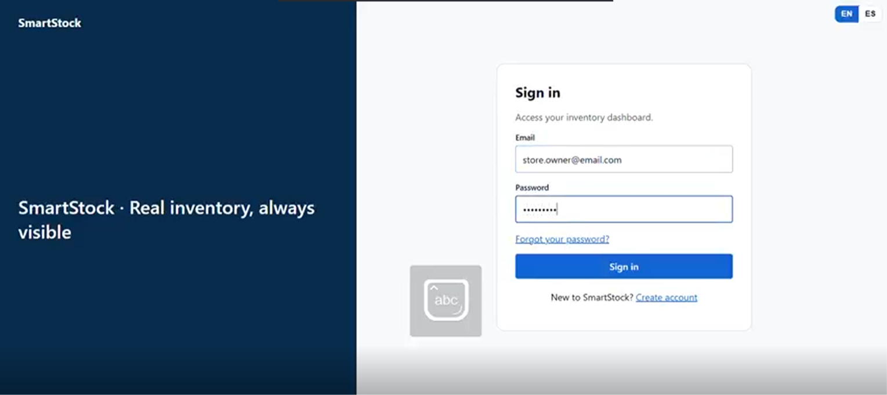  
*Nota. Elaboración propia*

**Figura 172  
** *Inicio de sesión con mensaje de credenciales incorrectas (US02)  
*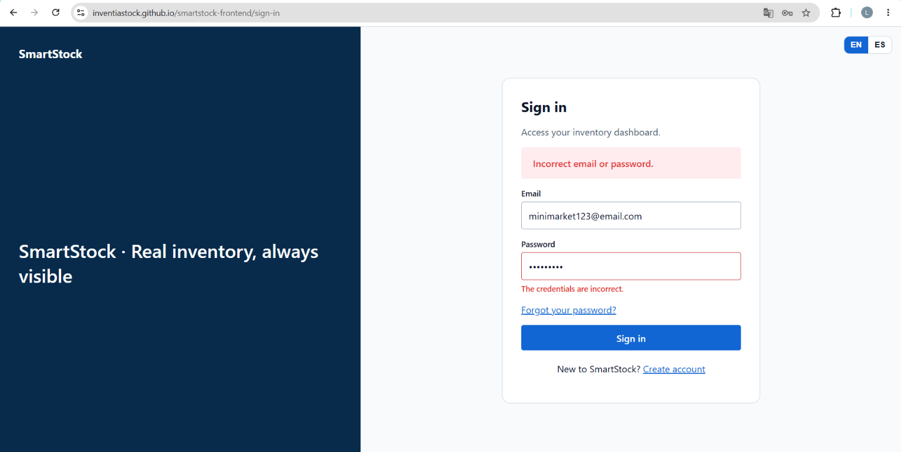  
*Nota. Elaboración propia*

**Figura 173  
** *Recuperación de contraseña: solicitud del enlace y confirmación de envío (US03)  
* 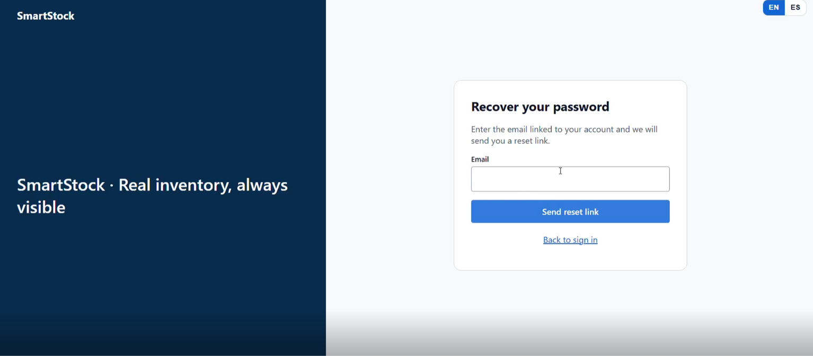  
*Nota. Elaboración propia*

**Figura 174  
** *Ventas: (a) venta registrada, (b) rechazo por stock insuficiente, (c) historial por fechas y (d) detalle con movimiento de salida (US26, US27, US28)  
*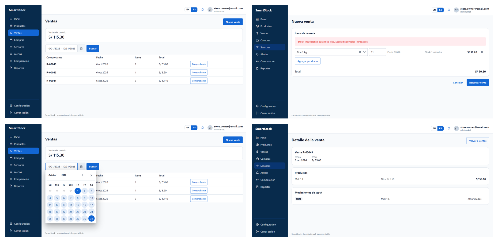  
  

*Nota. Elaboración propia*

**Figura 175  
** *Vinculación de sensor a un producto y error de sensor en uso (US04)  
* 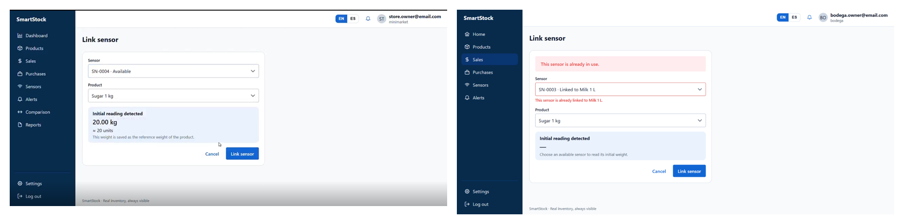

  
*Nota. Elaboración propia*

**Figura 176  
** *Estado de conexión de sensores en línea y desconectados (US06)  
* 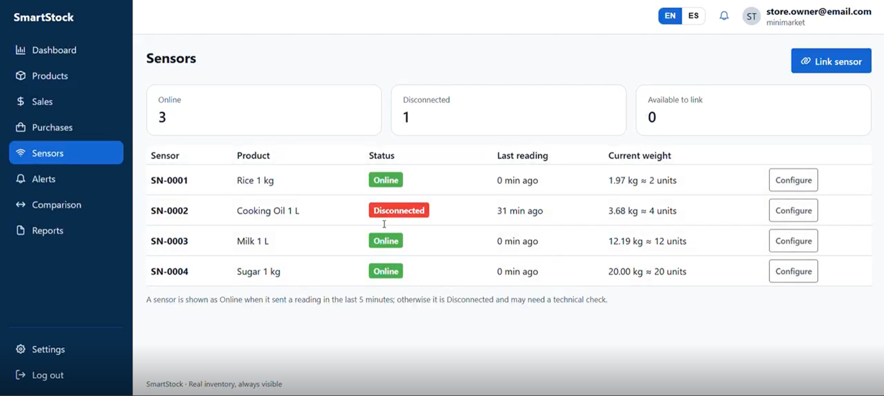  
*Nota. Elaboración propia*

**Figura 177  
** *Configuración de notificaciones por correo y WhatsApp (US09, US10)* 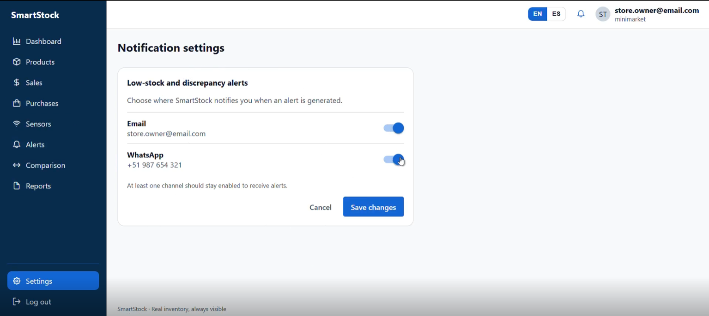  
*Nota. Elaboración propia*

**Figura 178  
** *Alertas activas y botón de compra desde una alerta de stock bajo (US12, US32)  
* 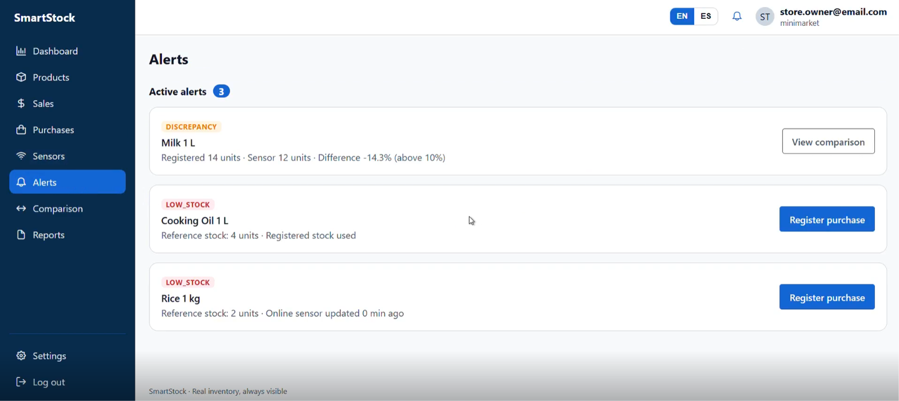  
*Nota. Elaboración propia*

**Figura 179  
** *Catálogo: (a) registro de producto, (b) edición con stock de solo lectura (US13, US14)*

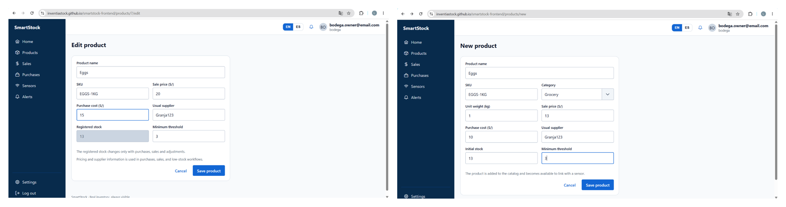*  
*  
*Nota. Elaboración propia*

**Figura 180  
** *Proveedores y compras: (a) proveedor creado, (b) compra pendiente, (c) compra recibida y (d) historial por fechas (US29, US30, US31)  
*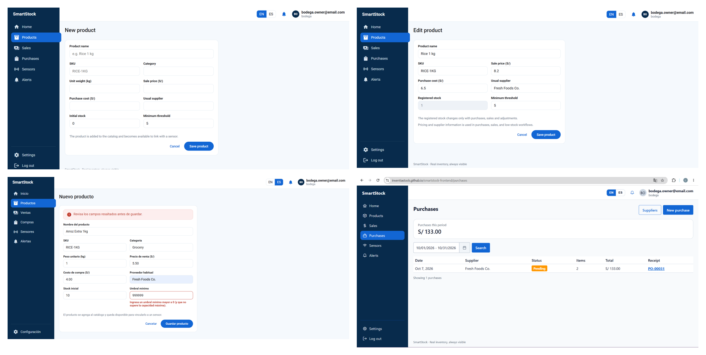

  
*Nota. Elaboración propia*

**Figura 181  
** *Monitoreo de inventario: (a) productos por nivel de stock, (b) detalle con peso actual y (c) comparación físico vs. registrado (US07, US08, US11)  
*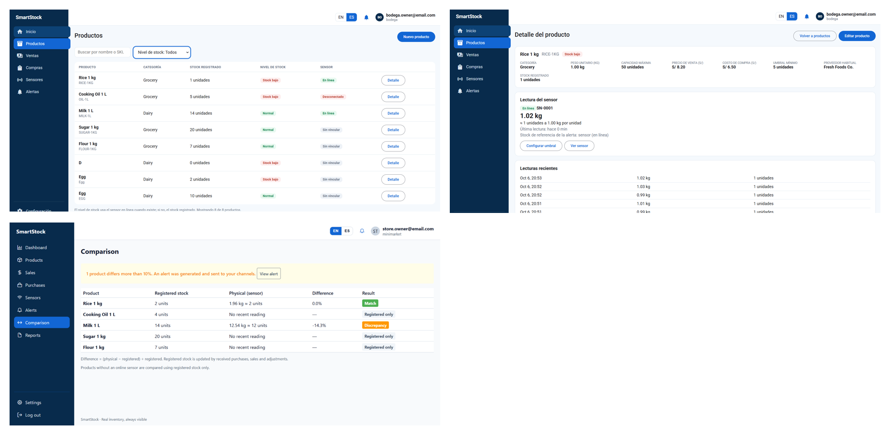*Nota.* Elaboración propia  
**Figura 182  
** *Dashboard con ventas y compras del día, y reporte por período (US15, US25)  
*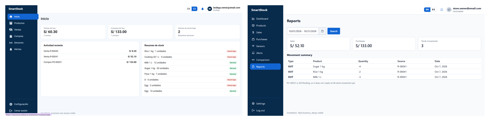

  
*Nota. Elaboración propia*

**Figura 183  
** *Menú lateral según tipo de negocio: (a) bodega y (b) minimarket (US01)  
*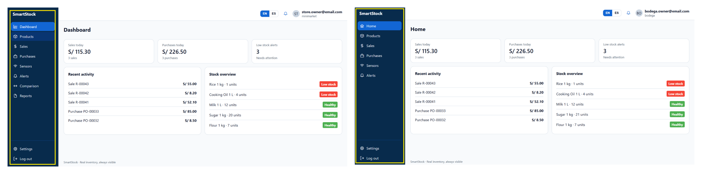

  
*Nota. Elaboración propia*

#### 5.2.2.6. Services Documentation Evidence for Sprint Review

En el Sprint 2 el equipo documentó con OpenAPI los contratos de los endpoints que las pantallas consumen a través de la Fake API: los de las Technical Stories TS01 a TS15 y los de autenticación que usan las pantallas de registro y recuperación (21 operaciones). Los Web Services reales (ASP.NET Core) se implementarán en el Sprint 3 con el mismo contrato; por eso aún no existe el repositorio de Web Services ni hay commits de documentación en este sprint. La especificación de los Web Services se redactó en formato OpenAPI 3.0.3 utilizando Swagger Editor y se visualiza mediante Swagger UI (Figuras 174 y 175). Los endpoints documentados corresponden a los contratos que el frontend consume actualmente a través de la Fake API; su implementación real en el backend se realizará en el Sprint 3. . Los contratos se documentan con el prefijo /api del backend real; la Fake API desplegada los expone en la raíz, sin ese prefijo (por ejemplo, POST /auth/login).

**Tabla 41**

*Documentación de los endpoints de los Web Services del Sprint 2*

| **Endpoint**                             | **Método** | **Acción**                         | **Parámetros**       | **Ejemplo de request**                                                                                                                                  | **Response y explicación**                                                                                                                                                                                           | **TS** |
|------------------------------------------|------------|------------------------------------|----------------------|---------------------------------------------------------------------------------------------------------------------------------------------------------|----------------------------------------------------------------------------------------------------------------------------------------------------------------------------------------------------------------------|--------|
| /api/auth/register                       | POST       | Registra una cuenta                | —                    | { "businessName": "Bodega Luna", "email": "ana@bodega.pe", "password": "•••", "businessType": "bodega" }                                                | 201 con la sesión { token, email, businessName, businessType }; 400 si faltan datos; 409 si el correo ya está registrado                                                                                             | TS04   |
| /api/auth/forgot-password                | POST       | Solicita el enlace de recuperación | —                    | { "email": "ana@bodega.pe" }                                                                                                                            | 200 con { sent: true, email, expiresInHours: 24 }; la respuesta es la misma si el correo no existe (R4)                                                                                                              | TS04   |
| /api/auth/login                          | POST       | Valida credenciales                | —                    | { "email": "ana@bodega.pe", "password": "•••" }                                                                                                         | 200 con la sesión { token, email, businessName, businessType }; 401 INVALID_CREDENTIALS si las credenciales son incorrectas, sin indicar cuál falló (R3)                                                             | TS04   |
| /api/ventas                              | POST       | Registra una venta                 | —                    | { "items": \[{ "productoId": 3, "cantidad": 2, "precioUnitario": 4.5 }\] }. Sin precioUnitario el mock responde 422                                     | 201 con { id } del comprobante (ej. R-00042); 400 si no hay ítems o la cantidad es inválida; 422 si la cantidad supera el stock (indica producto y stock disponible) o si el producto no tiene precio de venta (R14) | TS07   |
| /api/ventas                              | GET        | Lista las ventas                   | desde, hasta (fecha) | —                                                                                                                                                       | 200 con la lista de ventas del rango                                                                                                                                                                                 | TS08   |
| /api/ventas/{id}                         | GET        | Detalle de una venta               | id (ruta)            | —                                                                                                                                                       | 200 con ítems, precios y total; 404 si no existe                                                                                                                                                                     | TS08   |
| /api/proveedores                         | POST       | Registra un proveedor              | —                    | { "nombre": "Distribuidora Sol", "telefono": "987654321" }                                                                                              | 201 con el proveedor; 409 si ya existe el mismo nombre y teléfono                                                                                                                                                    | TS09   |
| /api/proveedores                         | GET        | Lista los proveedores              | —                    | —                                                                                                                                                       | 200 con la lista de proveedores                                                                                                                                                                                      | TS09   |
| /api/compras                             | POST       | Registra una compra pendiente      | —                    | { "proveedorId": 1, "items": \[{ "productoId": 3, "cantidad": 24, "costoUnitario": 2.5 }\] }                                                            | 201 con la orden (PO-00031) en estado pendiente, sin cambiar el stock; 422 si no tiene ítems                                                                                                                         | TS10   |
| /api/compras                             | GET        | Lista las compras                  | desde, hasta (fecha) | —                                                                                                                                                       | 200 con la lista de compras del rango                                                                                                                                                                                | TS12   |
| /api/productos                           | GET        | Lista los productos                | —                    | —                                                                                                                                                       | 200 con la lista de productos, con su stock registrado y su sensor vinculado (si lo tienen)                                                                                                                          | TS13   |
| /api/productos                           | POST       | Registra un producto               | —                    | { "nombre": "Rice 1 kg", "categoria": "Grocery", "pesoUnitario": 1, "precioVenta": 4.5, "costoCompra": 3.2, "umbralMinimo": 5, "capacidadMaxima": 100 } | 201 con el producto creado (el stock arranca en 0 y sin sensor); 400 INVALID_PRODUCT con el detalle de errores por campo si incumple R5 o R7                                                                         | TS13   |
| /api/compras/{id}                        | GET        | Detalle de una compra              | id (ruta)            | —                                                                                                                                                       | 200 con ítems y estado; 404 si no existe                                                                                                                                                                             | TS12   |
| /api/compras/{id}/recepcion              | PATCH      | Recibe la compra                   | id (ruta)            | —                                                                                                                                                       | 200 con la compra recibida y el stock sumado; 409 si ya fue recibida                                                                                                                                                 | TS11   |
| /api/sensores/{id}/lecturas              | POST       | Recibe una lectura de peso         | id (ruta)            | { "pesoKg": 12.4, "fecha": "2026-10-04T10:15:00" }                                                                                                      | 201 con el id de la lectura; 404 si el sensor no existe                                                                                                                                                              | TS01   |
| /api/sensores/{id}/estado                | GET        | Estado del sensor                  | id (ruta)            | —                                                                                                                                                       | 200 con estado (en línea o desconectado) y última lectura                                                                                                                                                            | TS05   |
| /api/productos/{id}                      | PUT        | Edita un producto                  | id (ruta)            | { "precioVenta": 5.2, "costoCompra": 3.5, "proveedorHabitual": "Distribuidora Sol" }                                                                    | 200 con el producto actualizado; 400 INVALID_PRODUCT; 404 si no existe. Nunca cambia el stock ni el sensor: el stock solo se mueve por movimientos (R17)                                                             | TS13   |
| /api/productos/{id}/stock                | GET        | Stock registrado                   | id (ruta)            | —                                                                                                                                                       | 200 con el stock y su nivel                                                                                                                                                                                          | TS02   |
| /api/inventario/comparacion/{productoId} | GET        | Compara peso físico y registrado   | productoId (ruta)    | —                                                                                                                                                       | 200 con ambos valores y la diferencia porcentual                                                                                                                                                                     | TS06   |
| /api/notificaciones/stock-bajo           | POST       | Notifica stock bajo                | —                    | { "productoId": 3, "canal": "email" }                                                                                                                   | 200 con la notificación enviada por los canales activos                                                                                                                                                              | TS03   |
| /api/movimientos-stock                   | GET        | Lista los movimientos de stock     | desde, hasta (fecha) | —                                                                                                                                                       | 200 con entradas, salidas y ajustes del periodo                                                                                                                                                                      | TS15   |

*Nota.* Elaboración propia

**Tabla 42**

*Tabla Relación de endpoints*

| **Contexto**            | **Recurso**                                  | **Acciones**    | **TS**     |
|-------------------------|----------------------------------------------|-----------------|------------|
| IAM                     | /api/auth/login, /register, /forgot-password | POST            | TS04       |
| IoT Device              | /api/sensores/{id}/lecturas                  | POST            | TS01       |
| IoT Device              | /api/sensores/{id}/estado                    | GET             | TS05       |
| Product Catalog         | /api/productos, /api/productos/{id}          | GET, POST, PUT  | TS13       |
| Inventory Monitoring    | /api/productos/{id}/stock                    | GET             | TS02       |
| Inventory Monitoring    | /api/inventario/comparacion/{productoId}     | GET             | TS06       |
| Inventory – Ventas      | /api/ventas, /api/ventas/{id}                | GET, POST / GET | TS07, TS08 |
| Inventory – Compras     | /api/proveedores                             | GET, POST       | TS09       |
| Inventory – Compras     | /api/compras, /api/compras/{id}              | GET, POST / GET | TS10, TS12 |
| Inventory – Compras     | /api/compras/{id}/recepcion                  | PATCH           | TS11       |
| Inventory – Movimientos | /api/movimientos-stock                       | GET             | TS15       |
| Alerts & Restocking     | /api/notificaciones/stock-bajo               | POST            | TS03       |

*Nota.* Elaboración propia

**Figura 184  
** *Documentación OpenAPI de los endpoints del Sprint 2 en Swagger Editor*  
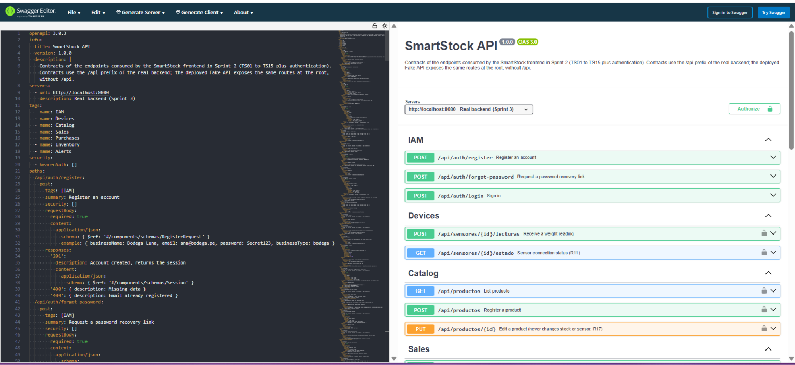  
*Nota.* Elaboración propia

**Figura 185  
** *Detalle del endpoint POST /api/ventas con ejemplo de solicitud y respuestas documentadas*  
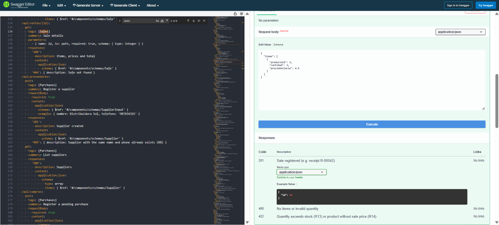  
*Nota.* Elaboración propia

#### 5.2.2.7. Software Deployment Evidence for Sprint Review

Durante el Sprint 2 el alcance de despliegue correspondió a la primera versión de la Frontend Web Application, publicada en GitHub Pages desde la rama main, a la que se integró mediante la rama release/1.0.0 (PR \#20) y quedó etiquetada como v1.0.0. El Landing Page, publicado en el Sprint 1, se actualizó para que su botón de registro redirija a la aplicación desplegada (PR \#1 y PR \#2 del repositorio del Landing Page) y quedó etiquetado como v1.1.0. Los Web Services no forman parte de este sprint.

**Tabla 43**

*Evidencia de despliegue del Sprint 2*

| **Producto**             | **Repositorio**                                                                                                                                       | **URL desplegada**                                                                                                          | **Versión** | **Estado**                                                                         |
|--------------------------|-------------------------------------------------------------------------------------------------------------------------------------------------------|-----------------------------------------------------------------------------------------------------------------------------|-------------|------------------------------------------------------------------------------------|
| Landing Page             | https://github.com/InventiaStock/smartstock-landing-page                           | https://inventiastock.github.io/smartstock-landing-page/ | v1.1.0      | Desplegado en el Sprint 1; actualizado en el Sprint 2 (registro hacia el frontend) |
| Frontend Web Application | https://github.com/InventiaStock/smartstock-frontend                               | https://inventiastock.github.io/smartstock-frontend/         | v1.0.0      | Primera versión desplegada                                                         |
| Fake API (json-server)   | https://github.com/InventiaStock/smartstock-frontend/tree/main/server | https://smartstock-fake-api.onrender.com                                 | v1.0.0      | Desplegada                                                                         |
| Web Services             | \[aún no creado; ASP.NET Core\]                                                                                                                       | —                                                                                                                           | —           | Previsto para el Sprint 3                                                          |

*Nota.* Elaboración propia

Las actividades de despliegue fueron: (1) habilitar GitHub Pages con *Source: GitHub Actions*; (2) crear el workflow deploy.yml («Deploy frontend to GitHub Pages»), que al integrar en main ejecuta un job *build* (Node 22, npm install, npm run build) y un job *deploy*; (3) preparar release/1.0.0 con cuatro commits de la tarea T-SH.1: ruta base /smartstock-frontend/ en vite.config.js y el router, copia de index.html como 404.html mediante el script postbuild, el workflow, y la URL de la Fake API en .env.production; (4) actualizar el Landing Page: en el repositorio del Landing Page se cambió el enlace del botón de registro, que apuntaba a una dirección local, a https://inventiastock.github.io/smartstock-frontend/sign-up, y se integró a main mediante los PR \#1 y \#2; y (5) verificar la URL pública.

Como json-server no corre en GitHub Pages, la Fake API se publicó como Web Service de Node en Render (plan gratuito): repositorio InventiaStock/smartstock-frontend, rama main, build npm install --include=dev, inicio node server/server.js y variables NODE_VERSION=22 y SIMULATE=1. Implementa los contratos documentados en 5.2.2.6 y, al ser plan gratuito, se suspende tras unos 15 minutos sin uso: la primera petición tarda cerca de un minuto y sus datos en memoria se reinician. Cuando exista el backend, solo cambia VITE_API_BASE_URL en .env.production.

El despliegue se verificó abriendo el Landing Page y comprobando que el botón de registro abre la pantalla /sign-up del frontend desplegado, y luego abriendo la URL pública del frontend, iniciando sesión, navegando a Ventas y recargando la página (lo que prueba el 404.html), registrando una venta de prueba y confirmando en la pestaña Network que las peticiones van a la Fake API.

**Figura 186  
Configuración de GitHub Pages con GitHub Actions como fuente.  
**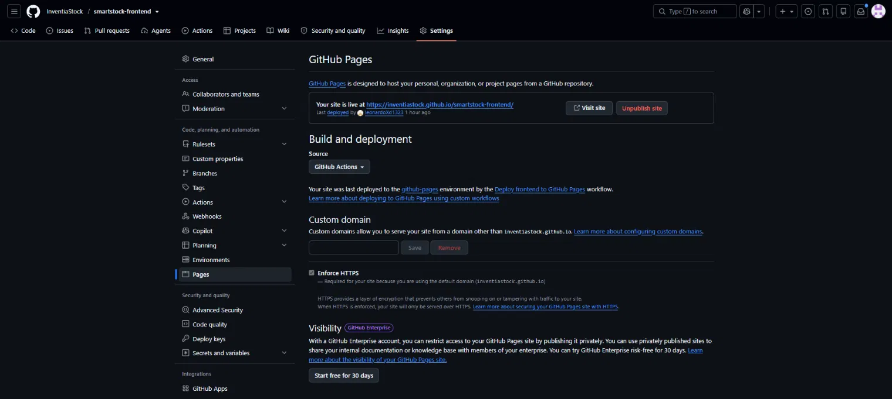**  
** *Nota.* Pages del repositorio InventiaStock/smartstock-frontend; la aplicación se publica con el workflow deploy.yml al integrar en main.*  
***Figura 187  
Ejecución del workflow «Deploy frontend to GitHub Pages» con los jobs build y deploy exitosos.**

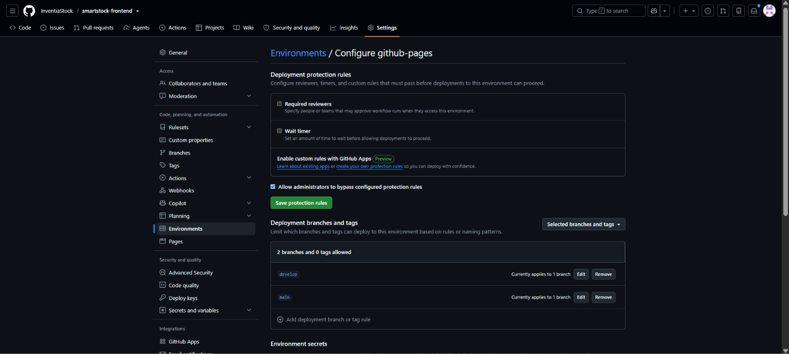**  
** *Nota.* Ejecución disparada por el merge del PR \#20 en main. En la primera corrida, deploy fue rechazado por las reglas del entorno github-pages (no permitían main); tras permitirla, la reejecución terminó con éxito en 19 s.*  
*

**Figura 188  
Fake API desplegada en Render (Live, rama main).**

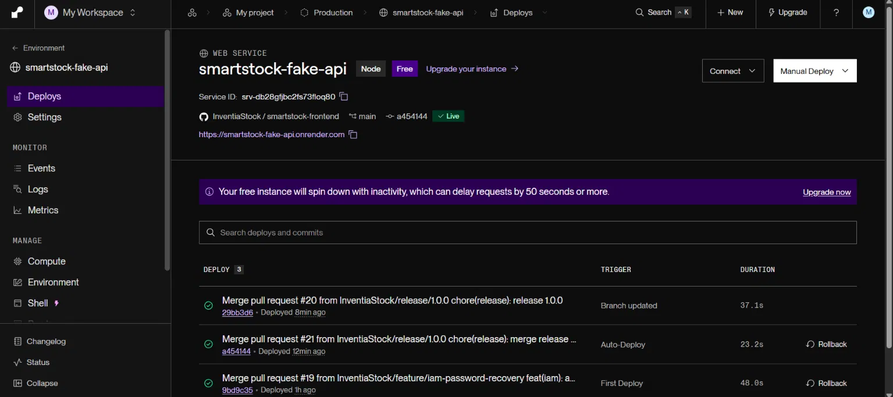**  
** *Nota*. Web Service de Node, plan Free, repositorio InventiaStock/smartstock-frontend, rama main, URL https://smartstock-fake-api.onrender.com.*  
*

**Figura 189  
Verificación de la Fake API desplegada.**

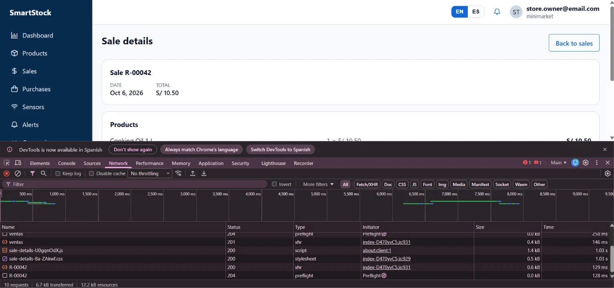**  
** *Nota*. POST /auth/forgot-password responde sent: True y expiresInHours: 24.*  
***Figura 190  
Frontend Web Application funcionando en su URL pública.**

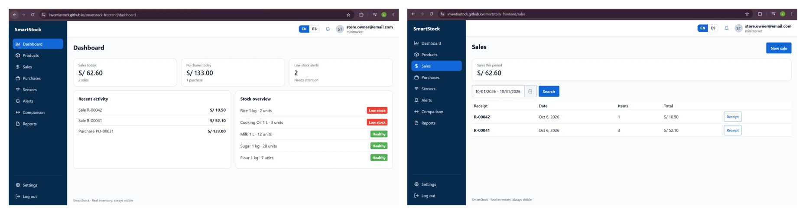

**  
** *Nota*. (a) Dashboard en inventiastock.github.io/smartstock-frontend/dashboard con datos de la Fake API; (b) recarga con F5 en /sales, que funciona gracias a 404.html.*  
*

#### 5.2.2.8. Team Collaboration Insights during Sprint

Durante el Sprint 2, el equipo organizó la implementación según los aspectos definidos en la sección 5.2.2.2. Cada integrante trabajó sobre el contexto que lideraba y registró su aporte mediante commits propios en el repositorio InventiaStock/smartstock-frontend, aplicando GitFlow y Conventional Commits.

El flujo de trabajo seguido se resume en la siguiente tabla:

**Tabla 44**

*Flujo de ramas de GitFlow seguido en el Sprint 2*

| **Rama**                       | **Nace de** | **Se integra en**          | **Regla**                                                                                                                               |
|--------------------------------|-------------|----------------------------|-----------------------------------------------------------------------------------------------------------------------------------------|
| main                           | —           | —                          | Recibe únicamente las versiones publicadas; protegida, solo se modifica mediante pull request.                                          |
| develop                        | —           | —                          | Concentra el avance acumulado del sprint; protegida, solo se modifica mediante pull request.                                            |
| feature/\<contexto\>-\<tarea\> | develop     | develop                    | Una rama corta por tarea del Sprint Backlog; se integra mediante pull request revisado por otro integrante, con merge commit (--no-ff). |
| release/\<x.y.z\>              | develop     | main y de vuelta a develop | Prepara la versión a entregar; al integrarse en main se etiqueta con versionado semántico (vX.Y.Z).                                     |

*Nota.* Elaboración propia

Los mensajes de commit siguen Conventional Commits (feat, fix, docs, refactor, test, chore), en inglés, con el contexto como alcance, por ejemplo feat(iam): add login view.

**Analíticos de colaboración de los repositorios**

La vista de contribuyentes de GitHub muestra a cuatro de los cinco integrantes. Los seis commits de @leonardoXd1323 (ramas feature/alerts-email y feature/alerts-active-list) no se atribuyen a su cuenta porque se realizaron con un correo de git mal configurado; su participación se evidencia en la vista Pulse (cinco autores), en los pull requests \#12 y \#17 y en la tabla 39. El correo ya fue corregido para los siguientes sprints.

**Figura 191**  
Contributors del repositorio InventiaStock/smartstock-frontend  
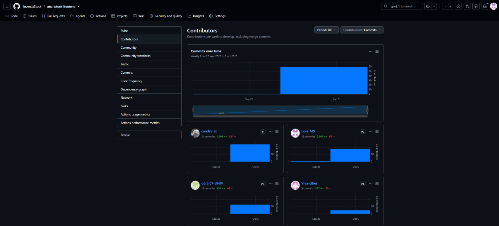  
*Nota*. Elaboración propia  
**Figura 192**  
Pulse del repositorio InventiaStock/smartstock-frontend: cinco autores y 67 commits

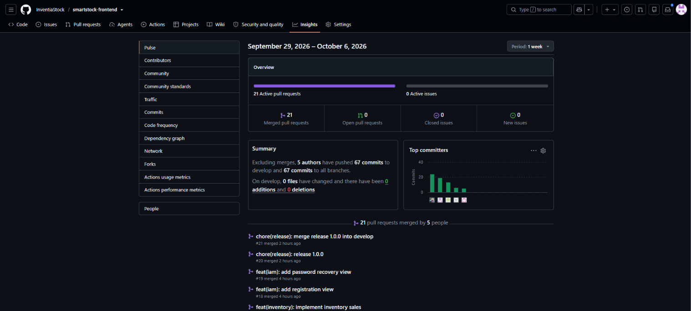

*Nota. Elaboración propia*  
**Historial de ramas de los repositorios**

El grafo de red muestra la aplicación efectiva de GitFlow: las ramas de feature nacen de develop, se integran nuevamente a ella mediante merge commits, y la rama main recibe únicamente las versiones publicadas.

**Figura 193**

Network graph del repositorio InventiaStock/smartstock-frontend

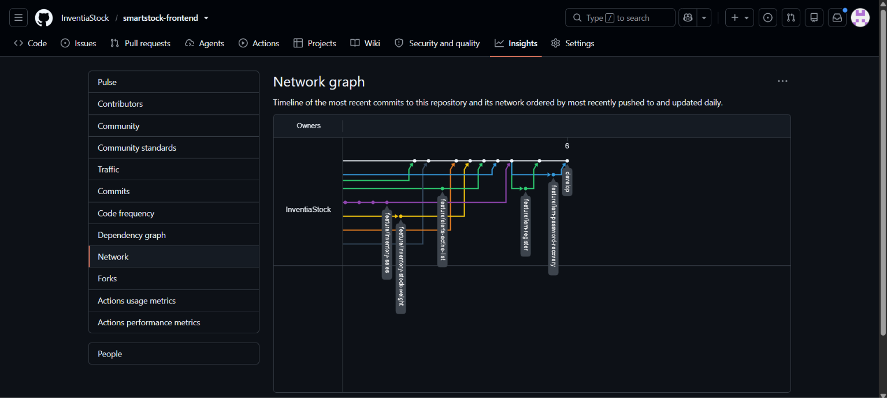

*Nota*. Elaboración propia

### 5.2.3. Sprint 3

#### 5.2.3.1. Sprint Planning 3

En el Sprint Planning 3 el equipo definió como meta entregar la primera versión desplegada de los Web Services de SmartStock (ASP.NET Core 9, Entity Framework Core y MySQL), para que la Frontend Web Application funcione con datos reales y persistentes en lugar de la Fake API. El sprint incluye las 15 Technical Stories (TS01 a TS15) y las 30 operaciones de la API. Por indicación del docente, la autenticación (inicio de sesión y token JWT) pasó al Sprint 4: por ahora los endpoints van abiertos y trabajan con un negocio fijo (id 1). El documento se elaboró el 2026-11-05 y el equipo lo revisó de forma asíncrona, sin reunión.

**Tabla 45**  
Sprint Planning 3

| **Campo**                        | **Detalle**                                                                                                                                                                                                                                                                                                                                                                                                                                                                                                                                                                           |
|----------------------------------|---------------------------------------------------------------------------------------------------------------------------------------------------------------------------------------------------------------------------------------------------------------------------------------------------------------------------------------------------------------------------------------------------------------------------------------------------------------------------------------------------------------------------------------------------------------------------------------|
| Sprint \#                        | Sprint 3                                                                                                                                                                                                                                                                                                                                                                                                                                                                                                                                                                              |
| Date                             | 2026-11-02                                                                                                                                                                                                                                                                                                                                                                                                                                                                                                                                                                            |
| Time                             | 2:00 PM                                                                                                                                                                                                                                                                                                                                                                                                                                                                                                                                                                               |
| Location                         | Reunión virtual                                                                                                                                                                                                                                                                                                                                                                                                                                                                                                                                                                       |
| Prepared By                      | Montañez Salinas, Lorena Ariana                                                                                                                                                                                                                                                                                                                                                                                                                                                                                                                                                       |
| Attendees (to planning meeting)  | Lopez Rimachi, Sebastian Leonardo / Montañez Salinas, Lorena Ariana / Sanchez Osorio, Ruth Yanira / Suarez Chinga, Geraldine / Vizcarra Mamani, Candy Milagros                                                                                                                                                                                                                                                                                                                                                                                                                        |
| Sprint 2 – Review Summary        | El frontend de SmartStock quedó desplegado (v1.0.0) en GitHub Pages con Compras y Ventas como núcleo, consumiendo una Fake API publicada en Render; el Landing Page se actualizó (v1.1.0) para redirigir el registro a la aplicación. En la revisión de TB1 el docente calificó 18/20 y observó que el informe debe estar ligado al README, que los escenarios deben seguir Given-When-Then y que faltaba el precio de nuestro producto en la comparación de competidores. Mejora continua obtuvo 1 de 3 por falta de autocrítica.                                                    |
| Sprint 2 – Retrospective Summary | Funcionó bien: GitFlow con pull request y merge commit, ramas cortas por tarea y datos simulados para avanzar en paralelo. A mejorar: revisar el contenido copiado de otro curso (stack y enlaces), cerrar los textos “pendiente” antes de entregar y dejar evidencia de cada corrección. Para el Sprint 3 el equipo acordó: (1) cada integrante construye el backend del contexto que ya construyó en el frontend; (2) los contextos se comunican solo por fachadas; (3) la base de datos se crea en Aiven con migraciones; y (4) cada corrección queda registrada con su evidencia. |
| Sprint 3 Goal                    | Our focus is on delivering the first deployed version of the SmartStock Web Services, so the Vue application works on real and persistent data instead of the Fake API. We believe it delivers reliable control of sales, purchases and stock, verified by IoT sensors, to minimarket and bodega owners. This will be confirmed when a user can create a product, record a purchase and a sale in the deployed web application, see the stock change with its movements, receive a low stock alert by email, and the 30 operations are documented in Scalar.                          |
| Sprint 3 Velocity                | 45 Story Points                                                                                                                                                                                                                                                                                                                                                                                                                                                                                                                                                                       |
| Sum of Story Points              | 45 (TS01 a TS15)                                                                                                                                                                                                                                                                                                                                                                                                                                                                                                                                                                      |

*Nota.* Elaboración propia

La suma de 45 Story Points incluye los 3 puntos de TS04, aunque en este sprint solo se implementan sus tablas de IAM; el inicio de sesión y el token JWT se completan en el Sprint 4.

Como el Sprint 2 recibió 1 de 3 en Mejora continua por falta de autocrítica, el equipo registra a continuación las observaciones recibidas y los hallazgos propios, con la mejora acordada y el lugar del informe donde se evidencia.

**Tabla 46**  
Autocrítica y mejoras acordadas para AV2

| **Id**         | **Entrega** | **Autocrítica**                                                                                                                                                                          | **Mejora acordada**                                                                                                            | **Evidencia**                           |
|----------------|-------------|------------------------------------------------------------------------------------------------------------------------------------------------------------------------------------------|--------------------------------------------------------------------------------------------------------------------------------|-----------------------------------------|
| M01            | TB1         | El README solo tenía un resumen y el informe vivía aparte.                                                                                                                               | El README contiene el informe completo, generado desde los capítulos del repositorio.                                          | README del repositorio de documentación |
| M02            | TB1         | Los criterios de aceptación no seguían el orden Given-When-Then.                                                                                                                         | Reescribir las User Stories y Technical Stories con Given / When / Then / And en inglés y el resto en español.                 | Sección 3.1                             |
| M03            | TB1         | La comparación de precios no incluía el precio de SmartStock.                                                                                                                            | Agregar los planes Starter (S/ 49), Growth (S/ 129) y Business (S/ 279) y analizarlos frente a la competencia.                 | Secciones 2.1.1 y 2.1.2                 |
| M04 a M06      | TB1         | La tabla de herramientas conservaba el stack de otro curso (Java, Spring Boot, Angular), el enlace apuntaba a otra organización y quedaban textos “pendiente”.                           | Reemplazar por C#, ASP.NET Core, EF Core, MySQL, Vue y PrimeVue; apuntar a InventiaStock; completar repositorios y despliegue. | Secciones 5.1.1, 5.1.2 y 5.1.4          |
| M07, M08 y M17 | TB1         | Los diagramas C4 hablaban de módulos “previstos”, faltaba el diagrama de componentes de Alerts & Restocking y el diagrama de base de datos no coincidía con las 16 tablas implementadas. | Actualizar los textos, dibujar el diagrama faltante y regenerar el diagrama de base de datos desde MySQL.                      | Secciones 4.6.4 y 4.8.1                 |
| M19            | AV1         | La evidencia colaborativa por persona estaba incompleta, persistieron errores y hubo observaciones de ortografía y estructura.                                                           | Capturas de commits, Scalar y Trello por integrante; revisión de ortografía antes de entregar.                                 | Secciones 5.2.3.4 a 5.2.3.8             |

*Nota.* Elaboración propia

#### 5.2.3.2. Aspect Leaders and Collaborators

Los aspectos de este sprint son cinco grupos de trabajo que agrupan los seis bounded contexts del backend y el trabajo compartido: Data Model & Sales (tablas de IAM y de los demás contextos, shared kernel y Ventas); Catalog & Procurement (productos, proveedores y compras); IoT, Analytics & Deployment (sensores, lecturas, dashboard, reportes y despliegue en Render y Aiven); Stock Movements (motor de movimientos, consulta de stock y comparación de inventario); y Alerts & Frontend (alertas, notificaciones por correo y WhatsApp, y conexión de la aplicación Vue con la API real). Cada integrante lidera un aspecto y colabora en los demás (L = líder, C = colaborador), revisando pull requests y probando sus pantallas contra la API; esta distribución se refleja en la selección de tasks de la sección 5.2.3.3 y en la autoría de los commits.

**Tabla 47**  
Matriz de liderazgo y colaboración (LACX) del Sprint 3

| **Team Member**                   | **GitHub Username** | **Data Model & Sales** | **Catalog & Procurement** | **IoT, Analytics & Deployment** | **Stock Movements** | **Alerts & Frontend** |
|-----------------------------------|---------------------|------------------------|---------------------------|---------------------------------|---------------------|-----------------------|
| Montañez Salinas, Lorena Ariana   | Lore-MS             | L                      | C                         | C                               | C                   | C                     |
| Vizcarra Mamani, Candy Milagros   | candyvizz           | C                      | L                         | C                               | C                   | C                     |
| Sanchez Osorio, Ruth Yanira       | Yiya-ciber          | C                      | C                         | L                               | C                   | C                     |
| Suarez Chinga, Geraldine          | geral07-UNIV        | C                      | C                         | C                               | L                   | C                     |
| Lopez Rimachi, Sebastian Leonardo | leonardoXd1323      | C                      | C                         | C                               | C                   | L                     |

*Nota.* Elaboración propia

#### 5.2.3.3. Sprint Backlog 3

El objetivo del Sprint 3 es entregar la primera versión desplegada de los Web Services de SmartStock, para que la aplicación Vue funcione con datos reales y persistentes. El sprint contiene las 15 Technical Stories (TS01 a TS15), que suman 45 Story Points, y 50 tareas con 286 horas en total. Las tareas de autenticación T-TS04.2 (servicios de registro, inicio de sesión y recuperación) y T-TS04.3 (controlador y documentación) pasan al Sprint 4 por indicación del docente. De TS04 solo se implementan las tablas de IAM (T-TS04.1). El tablero del sprint está en Trello (figura 194) y su URL pública es:

URL pública del tablero: https://trello.com/b/KSPnNOWF/sprint-backlog-3-web

**Figura 194**  
Tablero de Trello del Sprint Backlog 3  
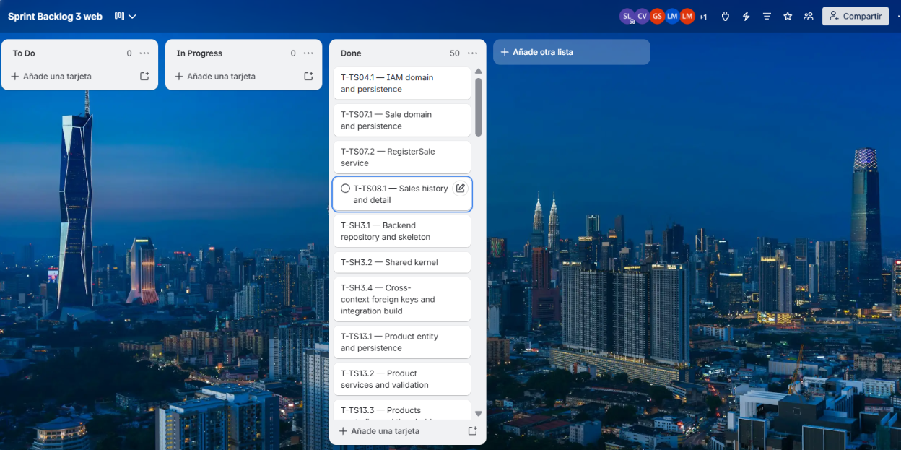*  
* Nota. Elaboración propia

Las tareas se identifican como T-TS##.# (Technical Stories), T-US##.# (endpoints de apoyo a pantallas existentes), T-SH3.# (setup compartido), T-DOC3.# (documentación OpenAPI) y T-QA3.# (pruebas de aceptación). Estas dos últimas familias y las de setup no tienen Story Points propios y se agrupan como “Soporte técnico del sprint”.

**Tabla 48  
**Sprint Backlog 3

| **Sprint \#** | **Story Id** | **Story Title**                                           | **Task Id** | **Task Title**                                              | **Task Description**                                                                                                                                          | **Estimation (Hours)** | **Assigned To** | **Status** |
|---------------|--------------|-----------------------------------------------------------|-------------|-------------------------------------------------------------|---------------------------------------------------------------------------------------------------------------------------------------------------------------|------------------------|-----------------|------------|
| 3             | TS01         | Endpoint de recepción de lecturas de sensores             | T-TS01.1    | Sensor and reading persistence                              | Sensor and SensorReading entities, tables sensors and sensor_readings, repository and demo sensors.                                                           | 6                      | Lorena          | To Do      |
| 3             | TS01         | Endpoint de recepción de lecturas de sensores             | T-TS01.2    | ReceiveReading service and endpoint                         | Public endpoint for the devices with optional X-Device-Key, 404 and 400 rules, triggers rule R20.                                                             | 8                      | Ruth            | To Do      |
| 3             | TS02         | Endpoint de consulta de stock de un producto              | T-TS02.1    | Stock level query                                           | GET /api/productos/{id}/stock with registered stock, reference stock and level.                                                                               | 4                      | Geraldine       | To Do      |
| 3             | TS02         | Endpoint de consulta de stock de un producto              | T-TS02.2    | Product detail with sensor                                  | GET /api/productos/{id}/detalle with the sensor and its last 5 readings.                                                                                      | 5                      | Geraldine       | To Do      |
| 3             | TS03         | Endpoint de envío de notificaciones de stock bajo         | T-TS03.1    | Alert domain and persistence                                | Alert, RestockingNeed, NotificationChannel and SentNotification entities, tables and demo alerts.                                                             | 6                      | Lorena          | To Do      |
| 3             | TS03         | Endpoint de envío de notificaciones de stock bajo         | T-TS03.2    | Alert rules R19, R20 and R21                                | AlertsFacade creates and resolves alerts after movements, readings and purchases.                                                                             | 8                      | Leonardo        | To Do      |
| 3             | TS03         | Endpoint de envío de notificaciones de stock bajo         | T-TS03.3    | Notification service and controller                         | POST /api/notificaciones/stock-bajo and GET/PUT of channels (at least one active).                                                                            | 6                      | Leonardo        | To Do      |
| 3             | TS03         | Endpoint de envío de notificaciones de stock bajo         | T-TS03.4    | Email through SMTP                                          | SmtpEmailSender with MailKit; credentials from secrets, never in the repository.                                                                              | 6                      | Leonardo        | To Do      |
| 3             | TS03         | Endpoint de envío de notificaciones de stock bajo         | T-TS03.5    | WhatsApp through Twilio                                     | TwilioWhatsAppSender with the sandbox; credentials from secrets.                                                                                              | 6                      | Leonardo        | To Do      |
| 3             | TS03         | Endpoint de envío de notificaciones de stock bajo         | T-TS03.6    | Alerts list query                                           | GET /api/alertas with product name, threshold and sensor data.                                                                                                | 4                      | Leonardo        | To Do      |
| 3             | TS04         | Endpoint de autenticación                                 | T-TS04.1    | IAM domain and persistence                                  | IAM tables: Business and User entities, EF Core configuration, repositories and demo business seed.                                                           | 6                      | Lorena          | Done       |
| 3             | TS05         | Endpoint de estado de conexión de un sensor               | T-TS05.1    | Sensor status and list                                      | GET /api/sensores, /{id} and /{id}/estado with the 5-minute rule (R11).                                                                                       | 6                      | Ruth            | To Do      |
| 3             | TS06         | Endpoint de comparación de inventario físico y registrado | T-TS06.1    | Inventory comparison                                        | List and per-product comparison (R20) with 409 NO_REGISTERED_QUANTITY.                                                                                        | 8                      | Geraldine       | To Do      |
| 3             | TS07         | Endpoint de registro de ventas                            | T-TS07.1    | Sale domain and persistence                                 | Sale and SaleItem entities, tables sales and sale_items, repository and demo sale R-00041.                                                                    | 6                      | Lorena          | To Do      |
| 3             | TS07         | Endpoint de registro de ventas                            | T-TS07.2    | RegisterSale service                                        | Validates items, price and stock (R13, R14) and creates one OUT movement per item (R17).                                                                      | 8                      | Lorena          | To Do      |
| 3             | TS08         | Endpoints de consulta de ventas                           | T-TS08.1    | Sales history and detail                                    | GET /api/ventas by date range with total, and GET /api/ventas/{code} with its movements.                                                                      | 6                      | Lorena          | To Do      |
| 3             | TS09         | Endpoints de proveedores                                  | T-TS09.1    | Suppliers service and controller                            | POST and GET /api/proveedores with duplicate detection (R8).                                                                                                  | 6                      | Candy           | To Do      |
| 3             | TS10         | Endpoint de registro de compras                           | T-TS10.1    | Purchase domain and persistence                             | Supplier, Purchase and PurchaseItem entities, tables suppliers, purchases and purchase_items, demo purchase PO-00031.                                         | 6                      | Lorena          | To Do      |
| 3             | TS10         | Endpoint de registro de compras                           | T-TS10.2    | RegisterPurchase service                                    | PENDING purchase that does not change the stock (R15); it can come from an alert (R21).                                                                       | 6                      | Candy           | To Do      |
| 3             | TS11         | Endpoint de recepción de compras                          | T-TS11.1    | ReceivePurchase service                                     | PATCH /api/compras/{code}/recepcion adds stock with IN movements (R16); 409 if repeated.                                                                      | 6                      | Candy           | To Do      |
| 3             | TS12         | Endpoints de consulta de compras                          | T-TS12.1    | Purchases history and detail                                | GET /api/compras by date range with total, and GET /api/compras/{code}.                                                                                       | 6                      | Candy           | To Do      |
| 3             | TS13         | Modelo de datos y migraciones de ventas y compras         | T-TS13.1    | Product entity and persistence                              | Product entity with sale_price and purchase_cost, EF configuration, repository and 5 demo products.                                                           | 6                      | Lorena          | To Do      |
| 3             | TS13         | Modelo de datos y migraciones de ventas y compras         | T-TS13.2    | Product services and validation                             | Create and edit product with rules R5 and R7, INVALID_PRODUCT errors by field, initial stock as movement.                                                     | 8                      | Candy           | To Do      |
| 3             | TS13         | Modelo de datos y migraciones de ventas y compras         | T-TS13.3    | Products controller and threshold                           | GET, POST and PUT /api/productos and PUT /api/sensores/{id}/umbral (US05).                                                                                    | 6                      | Candy           | To Do      |
| 3             | TS13         | Modelo de datos y migraciones de ventas y compras         | T-TS13.4    | InitialCreate migration, schema.sql and 16-table diagram    | dotnet ef migration, schema.sql and the ERD exported from MySQL Workbench; shown to the professor on Wed 4 (Leonardo reuses the ERD image for section 4.8.1). | 6                      | Lorena          | To Do      |
| 3             | TS14         | Registro automático de movimientos de stock               | T-TS14.1    | StockMovement entity and persistence                        | StockMovement entity, table stock_movements, repository and demo movements.                                                                                   | 6                      | Lorena          | To Do      |
| 3             | TS14         | Registro automático de movimientos de stock               | T-TS14.2    | Stock movement engine                                       | IStockMovementFacade changes the stock through the catalog, saves the movement and asks Alerts to evaluate R19 (R17).                                         | 8                      | Geraldine       | To Do      |
| 3             | TS15         | Endpoint de movimientos de stock                          | T-TS15.1    | Movements query endpoint                                    | GET /api/movimientos-stock with date filter; empty list when there are no movements.                                                                          | 4                      | Geraldine       | To Do      |
| 3             | Soporte      | Soporte técnico del sprint                                | T-DOC3.1    | OpenAPI evidence of Sales                                   | Scalar screenshots and endpoint table for sales (section 5.2.3.6).                                                                                            | 4                      | Lorena          | To Do      |
| 3             | Soporte      | Soporte técnico del sprint                                | T-DOC3.2    | OpenAPI evidence of Catalog and Procurement                 | Scalar screenshots and endpoint table (section 5.2.3.6).                                                                                                      | 4                      | Candy           | To Do      |
| 3             | Soporte      | Soporte técnico del sprint                                | T-DOC3.3    | OpenAPI evidence of Stock and section 5.2.3.6               | Scalar screenshots of Stock and the endpoint table of Stock (Lorena compiles the whole section 5.2.3.6).                                                      | 6                      | Geraldine       | To Do      |
| 3             | Soporte      | Soporte técnico del sprint                                | T-DOC3.4    | OpenAPI evidence of IoT and Analytics                       | Scalar screenshots and endpoint table (section 5.2.3.6).                                                                                                      | 4                      | Ruth            | To Do      |
| 3             | Soporte      | Soporte técnico del sprint                                | T-DOC3.5    | OpenAPI evidence of Alerts                                  | Scalar screenshots and endpoint table (section 5.2.3.6).                                                                                                      | 4                      | Leonardo        | To Do      |
| 3             | Soporte      | Soporte técnico del sprint                                | T-DOC3.6    | Sprint Backlog 3 table and Trello board                     | Task table of the report, public Trello board and final states (section 5.2.3.3).                                                                             | 4                      | Leonardo        | To Do      |
| 3             | Soporte      | Soporte técnico del sprint                                | T-QA3.1     | Acceptance test of sales screens                            | Run the Vue screens against the real API and register defects.                                                                                                | 4                      | Lorena          | To Do      |
| 3             | Soporte      | Soporte técnico del sprint                                | T-QA3.2     | Acceptance test of catalog, suppliers and purchases screens | Run the Vue screens against the real API and register defects.                                                                                                | 4                      | Candy           | To Do      |
| 3             | Soporte      | Soporte técnico del sprint                                | T-QA3.3     | Acceptance test of stock and comparison screens             | Run the Vue screens against the real API and register defects.                                                                                                | 4                      | Geraldine       | To Do      |
| 3             | Soporte      | Soporte técnico del sprint                                | T-QA3.4     | Acceptance test of sensors, dashboard and reports screens   | Run the Vue screens against the real API and register defects.                                                                                                | 4                      | Ruth            | To Do      |
| 3             | Soporte      | Soporte técnico del sprint                                | T-QA3.5     | Acceptance test of alerts and notification screens          | Run the Vue screens against the real API and register defects.                                                                                                | 4                      | Leonardo        | To Do      |
| 3             | Soporte      | Soporte técnico del sprint                                | T-SH3.1     | Backend repository and skeleton                             | Repository smartstock-backend, protected main and develop, skeleton, README.                                                                                  | 6                      | Lorena          | To Do      |
| 3             | Soporte      | Soporte técnico del sprint                                | T-SH3.2     | Shared kernel                                               | AppDbContext with tenant filter, error middleware, JSON names, open endpoints with fixed business 1 and contracts between contexts.                           | 8                      | Lorena          | Done       |
| 3             | Soporte      | Soporte técnico del sprint                                | T-SH3.3     | Local environment and CI                                    | docker-compose, Dockerfile and GitHub Actions build and tests.                                                                                                | 5                      | Ruth            | To Do      |
| 3             | Soporte      | Soporte técnico del sprint                                | T-SH3.4     | Cross-context foreign keys and integration build            | CrossContextRelations.cs: foreign keys from sale_items, purchase_items, stock_movements, sensors and alerts to products (done together with the 16 tables).   | 6                      | Lorena          | To Do      |
| 3             | Soporte      | Soporte técnico del sprint                                | T-SH3.5     | Deploy Web Services and MySQL                               | Render (Docker) and Aiven MySQL, environment variables, CORS and health check.                                                                                | 8                      | Ruth            | To Do      |
| 3             | Soporte      | Soporte técnico del sprint                                | T-SH3.6     | Connect the Vue app to the real API                         | Change VITE_API_BASE_URL, regression of the main flows and release v1.1.0 of the frontend.                                                                    | 8                      | Leonardo        | To Do      |
| 3             | Soporte      | Soporte técnico del sprint                                | T-SH3.7     | Unit tests of business rules                                | xUnit project with tests for R8, R11, R12, R13, R15, R16, R17, R20 and JSON names.                                                                            | 6                      | Geraldine       | To Do      |
| 3             | Soporte      | Soporte técnico del sprint                                | T-SH3.8     | IoT simulator and HTTP collection                           | iot-simulator.mjs and the .http files of sensors and analytics.                                                                                               | 4                      | Ruth            | To Do      |
| 3             | Soporte      | Soporte técnico del sprint                                | T-US04.3    | Link sensor to product endpoint                             | POST /api/sensores/vincular with the conflicts of rule R9.                                                                                                    | 5                      | Ruth            | To Do      |
| 3             | Soporte      | Soporte técnico del sprint                                | T-US15.3    | Dashboard endpoint                                          | GET /api/dashboard aggregating sales, purchases, alerts and stock level.                                                                                      | 6                      | Ruth            | To Do      |
| 3             | Soporte      | Soporte técnico del sprint                                | T-US25.3    | Reports endpoint                                            | GET /api/reportes with totals and movements of a period.                                                                                                      | 5                      | Ruth            | To Do      |

*Nota.* Elaboración propia

#### 5.2.3.4. Development Evidence for Sprint Review

Durante el Sprint 3 se implementaron los Web Services de SmartStock en ASP.NET Core 9 en el repositorio InventiaStock/smartstock-backend, organizados como un monolito modular con seis bounded contexts (IAM, Product Catalog, IoT Device, Inventory Monitoring, Alerts & Restocking y Analytics & Reporting) y persistencia en MySQL mediante Entity Framework Core. Cada tarea del Sprint Backlog se desarrolló en una rama feature/\<nombre-descriptivo\> creada desde develop e integrada mediante pull request con merge commit.

Además, en el repositorio InventiaStock/smartstock-landing-page se incorporó la sección de video del producto y del equipo.

La tabla presenta los commits relacionados con la implementación, organizados por rama según GitFlow y redactados bajo Conventional Commits, en inglés y en minúsculas, con el identificador de la tarea (por ejemplo T-TS07.2) en el cuerpo del mensaje. Se exceptúan los merge commits generados por GitHub y los commits del landing page, que no incluyen el identificador de tarea.

De los commits listados, 34 pertenecen al repositorio smartstock-backend y 3 al repositorio smartstock-landing-page.

**Tabla 49**  
Commits relacionados con la implementación del Sprint 3

| **Repository**          | **Branch**                              | **Commit Id** | **Commit Message**                                                                 | **Commit Message Body**                      | **Committed on (Date)** |
|-------------------------|-----------------------------------------|---------------|------------------------------------------------------------------------------------|----------------------------------------------|-------------------------|
| smartstock-backend      | main                                    | 74c0df8       | Initial commit                                                                     | —                                            | 03/11/2026              |
| smartstock-backend      | feature/shared-skeleton                 | 02f4b75       | chore(repo): add gitignore, readme and docker compose                              | Task: T-SH3.1                                | 03/11/2026              |
| smartstock-backend      | feature/shared-skeleton                 | ecd53b5       | feat(shared): add business rules and contracts between contexts                    | Task: T-SH3.2                                | 03/11/2026              |
| smartstock-backend      | feature/shared-skeleton                 | ed4482a       | feat(shared): add database context, tenant filter, errors, json names and security | Task: T-SH3.2                                | 03/11/2026              |
| smartstock-backend      | feature/shared-skeleton                 | 01db8e1       | chore(api): add project file, entry point, settings and module stubs               | Task: T-SH3.1, T-SH3.2                       | 03/11/2026              |
| smartstock-backend      | feature/shared-skeleton                 | 61a22c9       | chore(repo): add solution file                                                     | Task: T-SH3.1                                | 03/11/2026              |
| smartstock-backend      | feature/data-16-tables                  | 4ed3bb7       | feat(iam): add business, user and password reset persistence                       | Task: T-TS04.1                               | 03/11/2026              |
| smartstock-backend      | feature/data-16-tables                  | 5b88ff3       | feat(data): add catalog and iot tables                                             | Task: T-TS13.1, T-TS01.1                     | 03/11/2026              |
| smartstock-backend      | feature/data-16-tables                  | cec1a47       | feat(data): add stock, sales and procurement tables                                | Task: T-TS14.1, T-TS07.1, T-TS10.1           | 03/11/2026              |
| smartstock-backend      | feature/data-16-tables                  | b3115e4       | feat(data): add alerts and restocking tables                                       | Task: T-TS03.1                               | 03/11/2026              |
| smartstock-backend      | feature/data-16-tables                  | 2f2e369       | feat(shared): add cross-context foreign keys                                       | Task: T-SH3.4                                | 03/11/2026              |
| smartstock-backend      | feature/db-migration                    | 52b9c34       | feat(db): add initial migration, schema script and database diagram                | Task: T-TS13.4                               | 03/11/2026              |
| smartstock-backend      | feature/iam-auth                        | ba89296       | refactor(shared): open endpoints with a fixed business and apply migrations        | Task: T-SH3.2                                | 04/11/2026              |
| smartstock-backend      | feature/iam-auth                        | 9f520ac       | feat(iam): register iam module without authentication                              | Task: T-TS04.1                               | 04/11/2026              |
| smartstock-backend      | feature/sales-register                  | fd4d070       | feat(sales): register sales with stock rules and movements                         | Task: T-TS07.2, T-TS08.1                     | 05/11/2026              |
| smartstock-backend      | feature/sales-register                  | cc1eb2f       | feat(sales): add sales controller with history and detail                          | Task: T-TS08.1                               | 05/11/2026              |
| smartstock-backend      | feature/sales-register                  | a3ee520       | fix(sales): skip the demo sale until the demo products exist                       | Task: T-TS07.1                               | 05/11/2026              |
| smartstock-backend      | feature/iot-sensors                     | f0a2483       | feat(iot): add reading reception, status and sensor linking services               | Task: T-TS01.2, T-TS05.1, T-US04.3           | 05/11/2026              |
| smartstock-backend      | feature/iot-sensors                     | bf83ce6       | feat(iot): add sensors controller with openapi documentation                       | Task: T-TS05.1                               | 05/11/2026              |
| smartstock-backend      | feature/analytics-dashboard             | bd2c4d1       | feat(analytics): add dashboard and reports queries                                 | Task: T-US15.3, T-US25.3                     | 05/11/2026              |
| smartstock-backend      | feature/analytics-dashboard             | fd34d7c       | feat(analytics): add analytics controller                                          | Task: T-US25.3                               | 05/11/2026              |
| smartstock-backend      | feature/tools-local-ci                  | f0d7cee       | feat(tools): add iot sensor simulator                                              | Task: T-SH3.8                                | 05/11/2026              |
| smartstock-backend      | feature/tools-local-ci                  | b95708e       | ci(actions): build and test on every push and pull request                         | Task: T-SH3.3                                | 05/11/2026              |
| smartstock-backend      | feature/catalog-products                | 4548995       | feat(catalog): add product services with validation rules                          | Task: T-TS13.2                               | 06/11/2026              |
| smartstock-backend      | feature/catalog-products                | 0537c1c       | feat(catalog): add products controller and threshold endpoint                      | Task: T-TS13.3                               | 06/11/2026              |
| smartstock-backend      | feature/procurement-suppliers-purchases | 7c90966       | feat(procurement): add supplier, purchase and reception services                   | Task: T-TS09.1, T-TS10.2, T-TS11.1           | 06/11/2026              |
| smartstock-backend      | feature/procurement-suppliers-purchases | 4337dca       | feat(procurement): add suppliers and purchases controllers                         | Task: T-TS12.1                               | 06/11/2026              |
| smartstock-backend      | feature/alerts-rules                    | a160c91       | feat(alerts): add alert rules and list endpoints                                   | Task: T-TS03.2, T-TS03.6, T-TS03.3           | 07/11/2026              |
| smartstock-backend      | feature/alerts-rules                    | 827c7f1       | test(alerts): add wave 1 http requests                                             | Task: T-TS03.6, T-TS03.3                     | 07/11/2026              |
| smartstock-backend      | feature/stock-movements                 | 3b6222d       | feat(stock): add movement engine, stock query and comparison                       | Task: T-TS14.2, T-TS02.1, T-TS02.2, T-TS06.1 | 08/11/2026              |
| smartstock-backend      | feature/stock-movements                 | d69d951       | feat(stock): add stock controller with movements endpoint                          | Task: T-TS15.1                               | 08/11/2026              |
| smartstock-backend      | feature/unit-tests                      | 40274fb       | test(rules): add unit tests for the business rules                                 | Task: T-SH3.7                                | 08/11/2026              |
| smartstock-backend      | feature/external-services               | fcf8c55       | feat(alerts): add notification endpoints and SMTP Twilio services                  | Task: T-TS03.4, T-TS03.5                     | 09/11/2026              |
| smartstock-backend      | hotfix/twilio-content-template          | 1aa8eb4       | fix(alerts): send WhatsApp messages with a Twilio ContentSid                       | Task: T-TS03.5                               | 10/11/2026              |
| smartstock-landing-page | feature/landing-videos                  | 02611c5       | feat(landing): add product and team video section                                  | —                                            | 09/11/2026              |
| smartstock-landing-page | feature/landing-videos                  | 2e5a1a3       | feat(landing): add bilingual video translations                                    | —                                            | 09/11/2026              |
| smartstock-landing-page | feature/landing-videos                  | fbfbe4c       | fix(landing): correct youtube embed URLs                                           | —                                            | 09/11/2026              |
| smartstock-frontend     | feature/real-api                        | b6625de       | feat(frontend): connect real API and add temporary demo access                     | Task: T-SH3.6                                | 11/11/2026              |

*Nota.* Los 34 commits de smartstock-backend coinciden con la actividad del repositorio mostrada en la Figura 240 (sin contar merges). Los 3 commits de smartstock-landing-page pertenecen a otro repositorio. Elaboración propia.

#### 5.2.3.5. Execution Evidence for Sprint Review

En este sprint la Frontend Web Application (v1.1.0) quedó conectada a los Web Services reales: las vistas de IoT Device, Alerts & Restocking, Product Catalog, Inventory Monitoring (incluidas ventas, compras y proveedores) y Analytics & Reporting funcionan con datos persistentes en MySQL en lugar de la Fake API, sin cambios en la interfaz (solo cambió la variable VITE_API_BASE_URL). La autenticación real (login y JWT) está planificada para el Sprint 4; en esta entrega los endpoints son abiertos, la aplicación opera con un negocio fijo y el frontend usa un acceso de demostración. Cada captura se rotula con la historia que cubre. El video que muestra la visualización y la navegación logradas en el sprint está en upc-pre-202620-1asi0730-8168-inventiastock-product-navigation-sprint-3.mp4

Link en Microsoft Stream: https://upcedupe-my.sharepoint.com/&#58;v&#58;/g/personal/u20241f946_upc_edu_pe/IQBdzCqqjN2bRZw1igPd50NKAcr_uPD4Xa5YEMWKscZGjGA?e=OLh1PM&nav=eyJyZWZlcnJhbEluZm8iOnsicmVmZXJyYWxBcHAiOiJTdHJlYW1XZWJBcHAiLCJyZWZlcnJhbFZpZXciOiJTaGFyZURpYWxvZy1MaW5rIiwicmVmZXJyYWxBcHBQbGF0Zm9ybSI6IldlYiIsInJlZmVycmFsTW9kZSI6InZpZXcifX0%3D

**Tabla 50**  
Evidencia de ejecución por contexto e historia de usuario del Sprint 3

| **Contexto**          | **Historia**                              | **Ruta**                                         | **La captura debe mostrar**                                                      | **Figura** |
|-----------------------|-------------------------------------------|--------------------------------------------------|----------------------------------------------------------------------------------|------------|
| Ventas                | US26, US27 y US28                         | /sales, /sales/new, /sales/:id                   | Venta registrada, rechazo por stock insuficiente, historial por fechas y detalle | 185        |
| IoT Device            | US04 Vinculación de sensor                | /sensors/link                                    | Selección de sensor y producto, y error de sensor en uso                         | 186        |
| IoT Device            | US06 y US07 Estado y peso actual          | /sensors                                         | Sensores en línea y desconectados, y peso con su equivalente en unidades         | 187        |
| Alerts & Restocking   | US09 y US10 Notificaciones                | /settings                                        | Canales de correo y WhatsApp configurados                                        | 188        |
| Alerts & Restocking   | US12 y US32 Alertas y compra desde alerta | /alerts                                          | Alerta de stock bajo o discrepancia y el botón que abre el registro de compra    | 189        |
| Product Catalog       | US13, US14 y US05 Productos               | /products                                        | Registro, edición y umbral mínimo con su error de validación                     | 190        |
| Proveedores y Compras | US29, US30 y US31                         | /purchases, /purchases/new, /purchases/suppliers | Proveedor creado, compra pendiente, compra recibida e historial por fechas       | 191        |
| Inventory Monitoring  | US08 y US11                               | /products, /comparison                           | Niveles de stock y comparación físico vs. registrado (solo minimarket)           | 192        |
| Analytics & Reporting | US15 y US25                               | /dashboard, /reports                             | Tarjetas del día con ventas y compras, y reporte por periodo                     | 193        |

*Nota.* Elaboración propia

**Figura 195  
**Pantalla de Ventas: registro, historial y detalle de ventas (US26, US27, US28)  
*  
* Nota. Elaboración propia

**Figura 196**  
Vinculación de sensor a un producto y error de sensor en uso (US04)

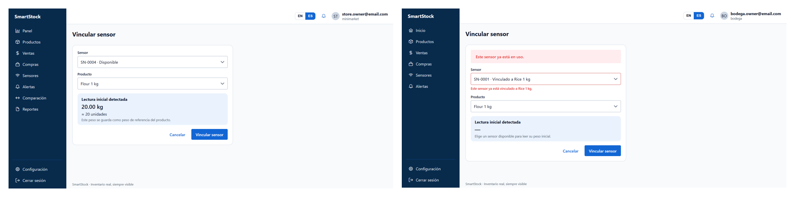  
*  
* Nota. Elaboración propia

**Figura 197**  
Estado de conexión de sensores en línea y desconectados, y peso actual (US06, US07)  
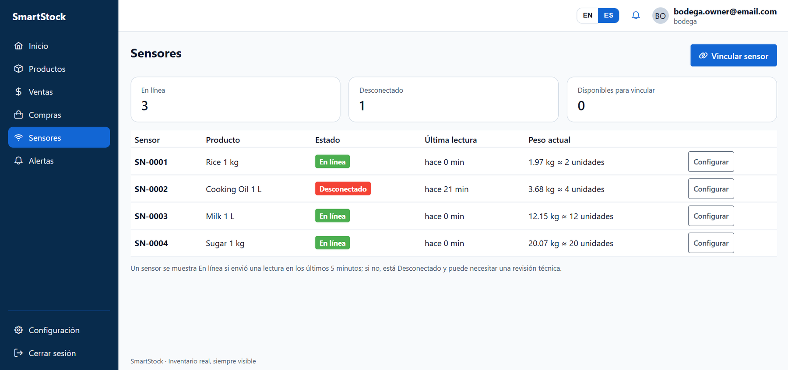*  
* Nota. Elaboración propia

**Figura 198**  
Configuración de notificaciones por correo y WhatsApp (US09, US10)  
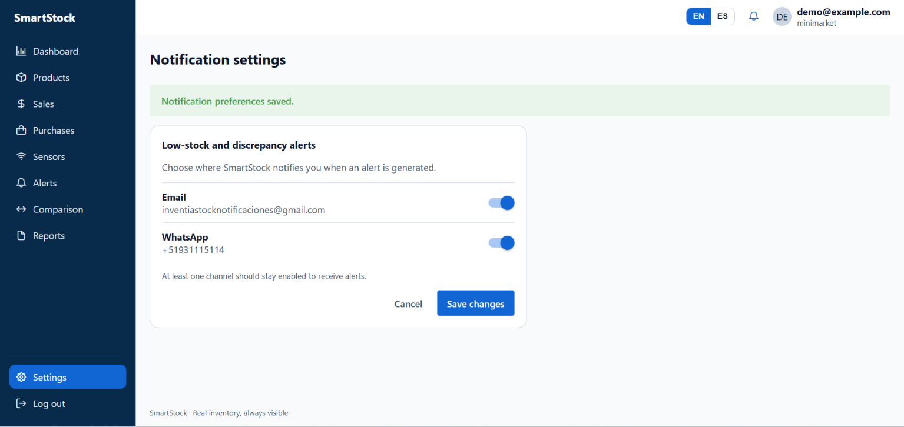*  
* Nota. Elaboración propia

**Figura 199**  
Alertas activas y botón de compra desde una alerta de stock bajo (US12, US32)  
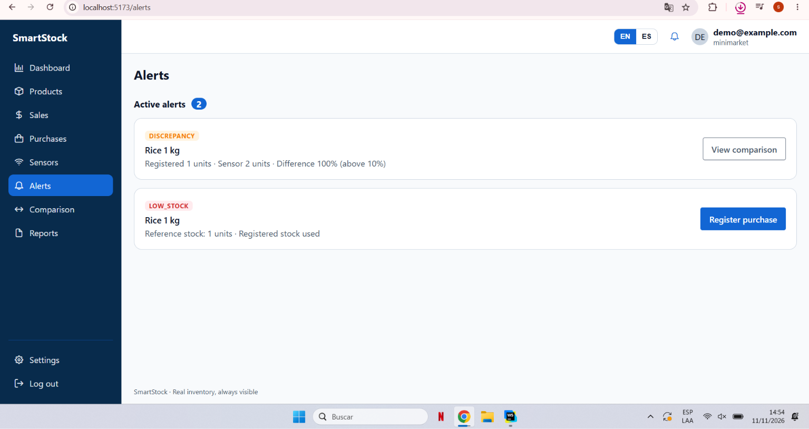*  
* Nota. Elaboración propia

**Figura 200**  
Catálogo: lista de productos con su nivel de stock (US13)  
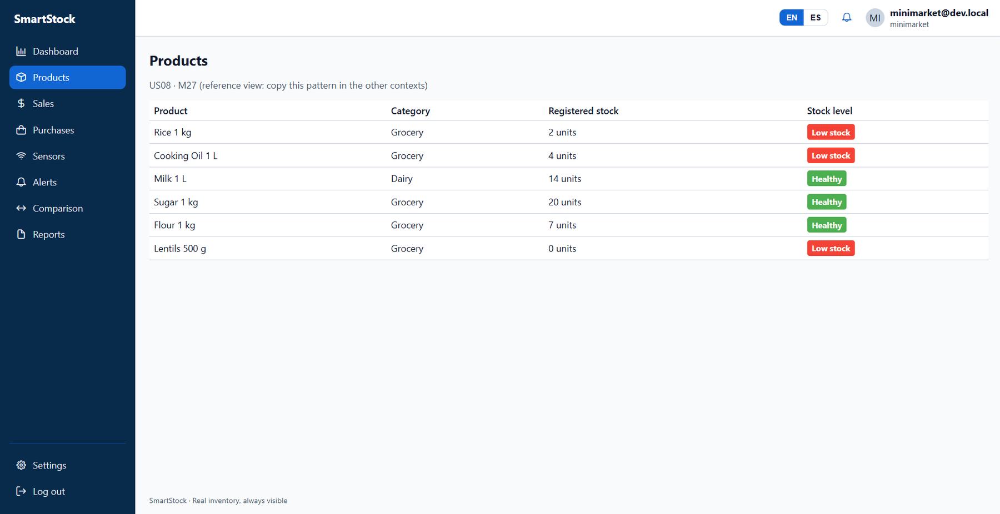*  
* Nota. Elaboración propia

**Figura 201**  
Proveedores y compras: (a) proveedor creado, (b) formulario de nueva compra, (c) compra recibida y (d) historia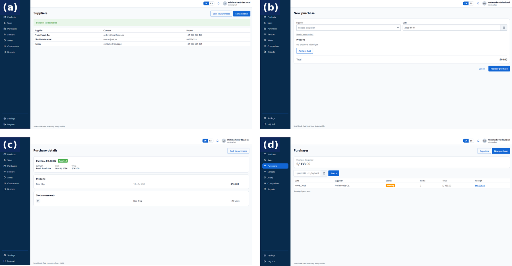l por fechas con una compra pendiente (US29, US30, US31)  
*  
* Nota. Elaboración propia

**Figura 202**

Prueba T-QA3.3-4: lectura de 2.0 kg en el sensor 2, estado online y discrepancia del -50 % (R20) en Scalar y en la Web App, 12/11/2026 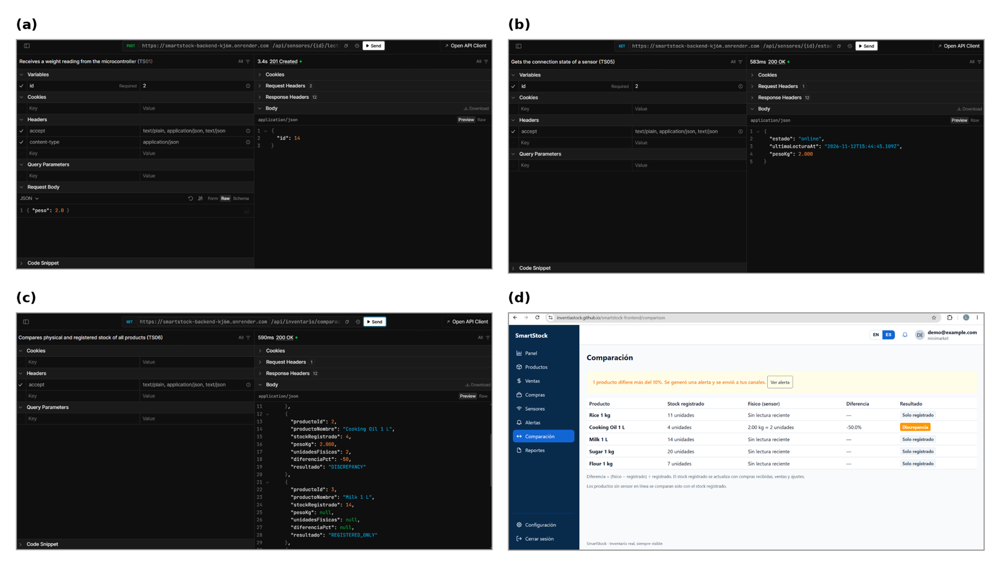*  
* Nota. Elaboración propia

**Figura 203**  
Dashboard con ventas y compras del día, y reporte por período (US15, US25)  
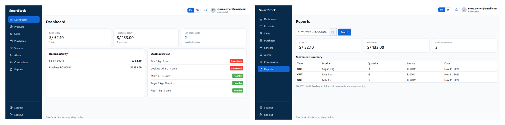

*  
* Nota. Elaboración propia

#### 5.2.3.6. Services Documentation Evidence for Sprint Review

En el Sprint 3 el equipo implementó y documentó con OpenAPI las 30 operaciones de los Web Services de SmartStock, que se visualizan mediante Scalar. Por indicación del docente, los endpoints van abiertos con un negocio fijo (id 1); el inicio de sesión y el token JWT se incorporan en el Sprint 4. Los errores se devuelven con un código (code) y un mensaje en inglés o en español, según el encabezado Accept-Language, sin mostrar el stack trace.

- Repositorio de Web Services: https://github.com/InventiaStock/smartstock-backend

- Documentación desplegada (Scalar): https://smartstock-backend-kj6m.onrender.com/scalar/v1

- Documentación local (referencia): http://localhost:5000/scalar

- Contrato OpenAPI (JSON, 30 endpoints): https://smartstock-backend-kj6m.onrender.com/openapi/v1.json

- Commits de documentación: ver Tabla 49 (sección 5.2.3.4)

**Tabla 51**  
Documentación de los endpoints de los Web Services del Sprint 3

| **Endpoint**                             | **Método** | **Acción**                                                                                                                                             | **Parámetros**                                                                                                                                                                      | **Ejemplo de request**                                                                                                                                                                                                   | **Response y explicación**                                                                                                                                                                                                                                                                                                                                                                                                                                       | **Historia** |
|------------------------------------------|------------|--------------------------------------------------------------------------------------------------------------------------------------------------------|-------------------------------------------------------------------------------------------------------------------------------------------------------------------------------------|--------------------------------------------------------------------------------------------------------------------------------------------------------------------------------------------------------------------------|------------------------------------------------------------------------------------------------------------------------------------------------------------------------------------------------------------------------------------------------------------------------------------------------------------------------------------------------------------------------------------------------------------------------------------------------------------------|--------------|
| /api/ventas                              | POST       | Registra una venta. Valida los ítems y crea un movimiento de stock de salida (OUT) por cada ítem; el stock solo cambia por ese movimiento.             | Cuerpo JSON: items (lista obligatoria). Cada ítem: productoId (entero), cantidad (entero mayor que 0) y precioUnitario (número mayor que 0). Sin parámetros de ruta ni de consulta. | { "items": \[ { "productoId": 1, "cantidad": 1, "precioUnitario": 8.2 } \] }                                                                                                                                             | 201 Created: { "id": "R-00042" }, el código correlativo de la venta. 400 NO_ITEMS si no hay ítems o INVALID_QUANTITY si la cantidad no es válida. 404 PRODUCT_NOT_FOUND si el producto no existe. 422 NO_SALE_PRICE si el producto no tiene precio de venta (R14) o INSUFFICIENT_STOCK si la cantidad supera el stock registrado (R13). Si hay un error no se cambia nada.                                                                                       | TS07         |
| /api/ventas                              | GET        | Lista las ventas de un periodo y calcula el total acumulado de las ventas completadas.                                                                 | Consulta opcional: desde y hasta, con formato yyyy-MM-dd. Sin filtros devuelve todas las ventas.                                                                                    | GET /api/ventas?desde=2026-11-01&hasta=2026-11-30                                                                                                                                                                        | 200 OK: { “ventas”: \[ { “id”: “R-00042”, “fecha”: “2026-11-09”, “estado”: “COMPLETED”, “total”: 8.20, “items”: \[ { “productoId”: 1, “cantidad”: 1, “precioUnitario”: 8.20, “productoNombre”: “Rice 1 kg”, “subtotal”: 8.20 } \] } \], “total”: 60.30 }. El ejemplo muestra una venta; la lista incluye también R-00041 (52.10). total suma solo las ventas completadas. Sin ventas devuelve { “ventas”: \[\], “total”: 0 }.                                    | TS08         |
| /api/ventas/{code}                       | GET        | Consulta el detalle de una venta con sus ítems y los movimientos de stock que generó.                                                                  | Ruta: code, el código de la venta, por ejemplo R-00042.                                                                                                                             | GET /api/ventas/R-00042                                                                                                                                                                                                  | 200 OK: { "id": "R-00042", "fecha": "2026-11-09", "estado": "COMPLETED", "total": 8.20, "items": \[ { "productoId": 1, "cantidad": 1, "precioUnitario": 8.20, "productoNombre": "Rice 1 kg", "subtotal": 8.20 } \], "movimientos": \[ { "id": 4, "productoId": 1, "tipo": "OUT", "origen": "SALE", "origenId": "R-00042", "cantidad": 1, "fecha": "2026-11-09", "productoNombre": "Rice 1 kg" } \] }. 404 NOT_FOUND si el código no existe, por ejemplo R-99999. | TS08         |
| /api/productos                           | GET        | Lista los productos del negocio con el estado de su sensor y su stock de referencia.                                                                   | Consulta opcional: sensorId (entero) para filtrar por el sensor vinculado.                                                                                                          | GET /api/productos?sensorId=1                                                                                                                                                                                            | 200 OK: lista de productos, cada uno con id, nombre, sku, categoria, pesoUnitario, precioVenta, costoCompra, proveedorHabitual, stockRegistrado, umbralMinimo, capacidadMaxima, sensorId, estadoSensor, unidadesSensor, stockReferencia y nivelStock. Sin productos devuelve \[\].                                                                                                                                                                               | TS13         |
| /api/productos/{id}                      | GET        | Consulta un producto por su identificador.                                                                                                             | Ruta: id, identificador del producto (entero).                                                                                                                                      | GET /api/productos/1                                                                                                                                                                                                     | 200 OK: el producto, con los mismos campos que la lista (id, nombre, sku, categoria, precioVenta, stockRegistrado, umbralMinimo, estadoSensor, nivelStock, etc.). 404 NOT_FOUND si el producto no existe.                                                                                                                                                                                                                                                        | TS13         |
| /api/productos                           | POST       | Registra un producto. El stock inicial se registra mediante un movimiento de stock (R17).                                                              | Cuerpo JSON: nombre, sku, categoria, pesoUnitario, precioVenta, costoCompra, proveedorHabitual, umbralMinimo, capacidadMaxima y, opcionalmente, stockRegistrado (stock inicial).    | { "nombre": "Lentils 500 g", "sku": "LENT-500G", "categoria": "Grocery", "pesoUnitario": 0.5, "precioVenta": 6.5, "costoCompra": 4.9, "proveedorHabitual": "Fresh Foods Co.", "umbralMinimo": 5, "capacidadMaxima": 60 } | 201 Created: el producto creado, con su id y los campos de la lista de productos. 400 INVALID_PRODUCT con el detalle de los campos inválidos (por ejemplo nombre vacío, peso unitario 0 o umbral mayor que la capacidad máxima).                                                                                                                                                                                                                                 | TS13         |
| /api/productos/{id}                      | PUT        | Edita los datos de un producto sin modificar su stock registrado (R17).                                                                                | Ruta: id del producto. Cuerpo JSON con los campos a cambiar (por ejemplo precioVenta y costoCompra).                                                                                | PUT /api/productos/1 con { "precioVenta": 8.5, "costoCompra": 6.8 }                                                                                                                                                      | 200 OK: el producto actualizado. 400 INVALID_PRODUCT si algún dato no es válido. 404 NOT_FOUND si el producto no existe.                                                                                                                                                                                                                                                                                                                                         | TS13         |
| /api/sensores/{id}/umbral                | PUT        | Cambia el umbral mínimo del producto vinculado a un sensor.                                                                                            | Ruta: id del sensor. Cuerpo JSON: umbralMinimo (entero).                                                                                                                            | PUT /api/sensores/1/umbral con { "umbralMinimo": 6 }                                                                                                                                                                     | 200 OK: el producto con el nuevo umbralMinimo. 404 NOT_FOUND si el sensor no existe. 422 THRESHOLD_INVALID si el umbral no es válido o THRESHOLD_EXCEEDS_CAPACITY si supera la capacidad máxima del producto.                                                                                                                                                                                                                                                    | US05         |
| /api/proveedores                         | POST       | Registra un proveedor.                                                                                                                                 | Cuerpo JSON: nombre y telefono (obligatorios) y correo (opcional).                                                                                                                  | { "nombre": "Distribuidora Sol", "telefono": "987654321", "correo": "ventas@sol.pe" }                                                                                                                                    | 201 Created: el proveedor creado, con su id numérico asignado por el sistema, nombre, correo y telefono. 400 INCOMPLETE si falta el nombre o el teléfono. 409 DUPLICATE_SUPPLIER si ya existe un proveedor con el mismo nombre y teléfono (R8).                                                                                                                                                                                                                  | TS09         |
| /api/proveedores                         | GET        | Lista los proveedores del negocio.                                                                                                                     | No usa parámetros.                                                                                                                                                                  | GET /api/proveedores                                                                                                                                                                                                     | 200 OK: lista de proveedores, cada uno con id, nombre, correo y telefono. Sin proveedores devuelve \[\].                                                                                                                                                                                                                                                                                                                                                         | TS09         |
| /api/compras                             | POST       | Registra una compra a un proveedor. La compra nace en estado PENDING y no modifica el stock (R15); puede originarse en una alerta de stock bajo (R21). | Cuerpo JSON: proveedorId, items (lista con productoId, cantidad y costoUnitario), y opcionalmente restockingNeedId (necesidad de reposición de la alerta) y fecha.                  | { "proveedorId": 1, "items": \[ { "productoId": 1, "cantidad": 24, "costoUnitario": 2.5 } \] }                                                                                                                           | 201 Created: { "id": "PO-00032" }, el código correlativo de la compra. 400 si faltan datos o hay una cantidad inválida. 404 SUPPLIER_NOT_FOUND si el proveedor no existe.                                                                                                                                                                                                                                                                                        | TS10         |
| /api/compras/{code}/recepcion            | PATCH      | Recibe una compra: suma las cantidades al stock mediante movimientos de entrada (IN) y cierra la reposición asociada (R16, R21).                       | Ruta: code, código de la compra, por ejemplo PO-00031. Sin cuerpo.                                                                                                                  | PATCH /api/compras/PO-00031/recepcion                                                                                                                                                                                    | 200 OK: la compra con estado RECEIVED, sus ítems y su total. 404 NOT_FOUND si el código no existe. 409 ALREADY_RECEIVED si la compra ya fue recibida, para no recibirla dos veces.                                                                                                                                                                                                                                                                               | TS11         |
| /api/compras                             | GET        | Lista las compras de un periodo y calcula el total acumulado.                                                                                          | Consulta opcional: desde y hasta, con formato yyyy-MM-dd.                                                                                                                           | GET /api/compras?desde=2026-11-01&hasta=2026-11-30                                                                                                                                                                       | 200 OK: objeto con producto (los datos del producto), sensor (id, codigo, estado, pesoKg, unidades y ultimaLecturaAt) y lecturas (las últimas 5). Ejemplo de lectura: { “id”: 9, “sensorId”: 3, “pesoKg”: 12.360, “fecha”: “2026-11-09T20:11:37.871Z”, “unidades”: 12 }. 404 NOT_FOUND si el producto no existe.                                                                                                                                                 | TS12         |
| /api/compras/{code}                      | GET        | Consulta el detalle de una compra con sus ítems y los movimientos de stock que generó.                                                                 | Ruta: code, código de la compra, por ejemplo PO-00031.                                                                                                                              | GET /api/compras/PO-00031                                                                                                                                                                                                | 200 OK: la compra con id, proveedorId, proveedorNombre, fecha, estado, total, restockingNeedId, items y movimientos. 404 NOT_FOUND si el código no existe.                                                                                                                                                                                                                                                                                                       | TS12         |
| /api/productos/{id}/stock                | GET        | Consulta el nivel de stock de un producto: stock registrado, stock de referencia (físico si el sensor está en línea) y nivel.                          | Ruta: id del producto.                                                                                                                                                              | GET /api/productos/1/stock                                                                                                                                                                                               | 200 OK: { "productoId": 1, "stockRegistrado": 2, "stockReferencia": 2, "nivelStock": "lowStock", "estadoSensor": "disconnected", "unidadesSensor": null }. nivelStock es lowStock o healthy. 404 NOT_FOUND si el producto no existe.                                                                                                                                                                                                                             | TS02         |
| /api/movimientos-stock                   | GET        | Lista los movimientos de stock de un periodo.                                                                                                          | Consulta opcional: desde y hasta, con formato yyyy-MM-dd.                                                                                                                           | GET /api/movimientos-stock?desde=2026-11-01&hasta=2026-11-30                                                                                                                                                             | 200 OK: lista de movimientos, por ejemplo { "id": 4, "productoId": 1, "tipo": "OUT", "origen": "SALE", "origenId": "R-00042", "cantidad": 1, "fecha": "2026-11-09", "productoNombre": "Rice 1 kg" }. Un periodo sin movimientos devuelve \[\] con 200.                                                                                                                                                                                                           | TS15         |
| /api/productos/{id}/detalle              | GET        | Consulta un producto con su sensor y sus últimas 5 lecturas.                                                                                           | Ruta: id del producto.                                                                                                                                                              | GET /api/productos/3/detalle                                                                                                                                                                                             | 200 OK: el producto con id, nombre, sku, categoria, pesoUnitario, precioVenta, costoCompra, proveedorHabitual, stockRegistrado, umbralMinimo, capacidadMaxima, sensorId, estadoSensor, unidadesSensor, stockReferencia y nivelStock. 404 NOT_FOUND si el producto no existe.                                                                                                                                                                                     | TS02         |
| /api/inventario/comparacion              | GET        | Compara el stock físico (sensor) con el stock registrado de todos los productos.                                                                       | No usa parámetros.                                                                                                                                                                  | GET /api/inventario/comparacion                                                                                                                                                                                          | 200 OK: { “items”: \[ { “productoId”: 3, “productoNombre”: “Milk 1 L”, “stockRegistrado”: 14, “pesoKg”: 12.360, “unidadesFisicas”: 12, “diferenciaPct”: -14.3, “resultado”: “DISCREPANCY” } \], “discrepancias”: 1, “alertaId”: 1 }. items trae un elemento por producto. resultado es MATCH, DISCREPANCY (diferencia mayor a 10 %, R20) o REGISTERED_ONLY (sin sensor en línea).                                                                                | TS06         |
| /api/inventario/comparacion/{productoId} | GET        | Compara el stock físico con el registrado de un producto.                                                                                              | Ruta: productoId, identificador del producto.                                                                                                                                       | GET /api/inventario/comparacion/3                                                                                                                                                                                        | 200 OK: { "productoId": 3, "productoNombre": "Milk 1 L", "stockRegistrado": 14, "pesoKg": 12.360, "unidadesFisicas": 12, "diferenciaPct": -14.3, "resultado": "DISCREPANCY" }. 404 NOT_FOUND si el producto no existe. 409 NO_REGISTERED_QUANTITY si el producto no tiene cantidad registrada.                                                                                                                                                                   | TS06         |
| /api/sensores                            | GET        | Lista los sensores con su estado de conexión.                                                                                                          | No usa parámetros.                                                                                                                                                                  | GET /api/sensores                                                                                                                                                                                                        | 200 OK: lista de sensores, cada uno con id, codigo, productoId, pesoKg, ultimaLecturaAt, pesoReferenciaKg, estado, productoNombre y unidades. estado es online (última lectura de hace 5 minutos o menos, R11), disconnected o available (sin producto).                                                                                                                                                                                                         | US06         |
| /api/sensores/{id}/lecturas              | POST       | Recibe una lectura de peso enviada por el microcontrolador. Es un endpoint público para los dispositivos.                                              | Ruta: id del sensor. Cuerpo JSON: peso (kg, mayor o igual que 0) y opcionalmente fecha. Cabecera X-Device-Key solo si el servidor la tiene configurada.                             | { "peso": 2.0 }                                                                                                                                                                                                          | 201 Created: { "id": 8 }, el identificador de la lectura. 400 INVALID_WEIGHT si el peso es negativo. 404 SENSOR_NOT_FOUND si el sensor no existe. 401 UNAUTHORIZED si falta la clave del dispositivo cuando está configurada. Una lectura con más de 10 % de diferencia respecto al stock registrado crea una alerta de discrepancia (R20).                                                                                                                      | TS01         |
| /api/sensores/{id}                       | GET        | Consulta un sensor con su estado.                                                                                                                      | Ruta: id del sensor.                                                                                                                                                                | GET /api/sensores/1                                                                                                                                                                                                      | 200 OK: el sensor con id, codigo, productoId, pesoKg, ultimaLecturaAt, pesoReferenciaKg, estado, productoNombre y unidades. 404 NOT_FOUND si el sensor no existe.                                                                                                                                                                                                                                                                                                | US06         |
| /api/sensores/{id}/estado                | GET        | Consulta el estado de conexión de un sensor (en línea si su última lectura tiene 5 minutos o menos, R11).                                              | Ruta: id del sensor.                                                                                                                                                                | GET /api/sensores/1/estado                                                                                                                                                                                               | 200 OK: objeto con estado (online si la última lectura tiene 5 minutos o menos, R11; si no, disconnected), ultimaLecturaAt (fecha y hora de la última lectura) y pesoKg (último peso recibido). 404 NOT_FOUND si el sensor no existe.                                                                                                                                                                                                                            | TS05         |
| /api/sensores/vincular                   | POST       | Vincula un sensor libre con un producto (un sensor por producto, R9).                                                                                  | Cuerpo JSON: sensorId y productoId (enteros).                                                                                                                                       | { "sensorId": 4, "productoId": 4 }                                                                                                                                                                                       | 200 OK: el sensor vinculado, con su productoId y productoNombre. 404 NOT_FOUND si el sensor o el producto no existe. 409 SENSOR_IN_USE si el sensor ya tiene un producto o PRODUCT_HAS_SENSOR si el producto ya tiene un sensor.                                                                                                                                                                                                                                 | US04         |
| /api/dashboard                           | GET        | Obtiene el resumen del día: ventas y compras de hoy, alertas de stock bajo activas, las 5 operaciones recientes y el nivel de stock de cada producto.  | No usa parámetros.                                                                                                                                                                  | GET /api/dashboard                                                                                                                                                                                                       | 200 OK: objeto con ventasHoy y comprasHoy (cada uno con total y cantidad), alertasStockBajo (número de alertas activas), actividadReciente (las 5 operaciones más recientes, cada una con tipo, id, total y fecha) y resumenStock (por producto: productoId, nombre, unidades, nivel y sensor).                                                                                                                                                                  | US15         |
| /api/reportes                            | GET        | Obtiene el reporte de un periodo: totales de ventas y compras, movimientos de stock y compras pendientes.                                              | Consulta opcional: desde y hasta, con formato yyyy-MM-dd.                                                                                                                           | GET /api/reportes?desde=2026-11-01&hasta=2026-11-30                                                                                                                                                                      | 200 OK: objeto con desde y hasta (el periodo), ventasTotal, comprasTotal, movimientos (los movimientos de stock del periodo) y comprasPendientes (códigos de las compras PENDING). Una compra PENDING no genera movimiento de entrada.                                                                                                                                                                                                                           | US25         |
| /api/alertas                             | GET        | Lista las alertas activas y las resueltas en las últimas 24 horas.                                                                                     | No usa parámetros.                                                                                                                                                                  | GET /api/alertas                                                                                                                                                                                                         | 200 OK: lista de alertas con id, tipo (LOW_STOCK por R19 o DISCREPANCY por R20), productoId, productoNombre, stockReferencia, fuente (sensor o registered), estado, creadaEn, resueltaEn, necesidadId (para comprar desde la alerta, R21), umbralMinimo y stockActual. Las de discrepancia añaden stockRegistrado, stockFisico y diferenciaPct.                                                                                                                  | US09         |
| /api/canales-notificacion                | GET        | Lista los canales de notificación del negocio (correo y WhatsApp).                                                                                     | No usa parámetros.                                                                                                                                                                  | GET /api/canales-notificacion                                                                                                                                                                                            | 200 OK: lista de canales; cada uno con id, canal (email o whatsapp), destino (correo o número configurado) y activo (true o false). La primera vez se crean los dos canales.                                                                                                                                                                                                                                                                                     | US10         |
| /api/canales-notificacion                | PUT        | Activa o desactiva los canales de notificación.                                                                                                        | Cuerpo JSON: lista de cambios con id y activo (booleano).                                                                                                                           | \[ { "id": 2, "activo": false } \]                                                                                                                                                                                       | 200 OK: la lista de canales actualizada. 422 AT_LEAST_ONE_CHANNEL si el cambio dejaría todos los canales inactivos.                                                                                                                                                                                                                                                                                                                                              | US10         |
| /api/notificaciones/stock-bajo           | POST       | Envía la notificación de la alerta activa de un producto por todos los canales activos (correo y WhatsApp).                                            | Cuerpo JSON: productoId (entero).                                                                                                                                                   | { "productoId": 1 }                                                                                                                                                                                                      | 202 Accepted: { “sent”: true, “at”: fecha y hora del envío }. 404 ALERT_NOT_FOUND si el producto no tiene una alerta activa. Si un canal falla, el error se guarda en las notificaciones enviadas y la operación no se rompe.                                                                                                                                                                                                                                    | TS03         |

*Nota.* Elaboración propia

**Tabla 52**  
Relación de endpoints

| **Contexto**                       | **Recurso**                                                           | **Acciones**   | **Historia** |
|------------------------------------|-----------------------------------------------------------------------|----------------|--------------|
| Inventory Monitoring – Ventas      | /api/ventas, /api/ventas/{code}                                       | POST, GET      | TS07, TS08   |
| Product Catalog                    | /api/productos, /api/productos/{id}                                   | GET, POST, PUT | TS13         |
| Product Catalog                    | /api/sensores/{id}/umbral                                             | PUT            | US05         |
| Inventory Monitoring – Proveedores | /api/proveedores                                                      | GET, POST      | TS09         |
| Inventory Monitoring – Compras     | /api/compras, /api/compras/{code}                                     | POST, GET      | TS10, TS12   |
| Inventory Monitoring – Compras     | /api/compras/{code}/recepcion                                         | PATCH          | TS11         |
| Inventory Monitoring – Stock       | /api/productos/{id}/stock, /api/productos/{id}/detalle                | GET            | TS02         |
| Inventory Monitoring – Movimientos | /api/movimientos-stock                                                | GET            | TS15         |
| Inventory Monitoring – Comparación | /api/inventario/comparacion, /api/inventario/comparacion/{productoId} | GET            | TS06         |
| IoT Device                         | /api/sensores, /api/sensores/{id}                                     | GET            | US06         |
| IoT Device                         | /api/sensores/{id}/lecturas                                           | POST           | TS01         |
| IoT Device                         | /api/sensores/{id}/estado                                             | GET            | TS05         |
| IoT Device                         | /api/sensores/vincular                                                | POST           | US04         |
| Analytics & Reporting              | /api/dashboard, /api/reportes                                         | GET            | US15, US25   |
| Alerts & Restocking                | /api/alertas                                                          | GET            | US09         |
| Alerts & Restocking                | /api/canales-notificacion                                             | GET, PUT       | US10         |
| Alerts & Restocking                | /api/notificaciones/stock-bajo                                        | POST           | TS03         |

*Nota.* Elaboración propia

**Figura 204**  
POST /api/ventas en Scalar (TS07)  
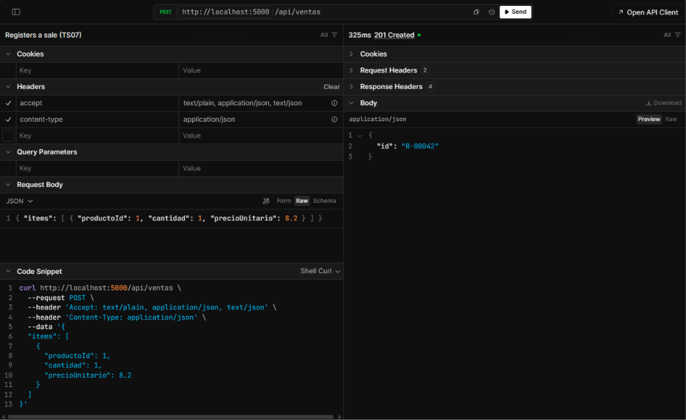*  
* Nota. Elaboración propia

**Figura 205**  
GET /api/ventas en Scalar (TS08)  
*  
* Nota. Elaboración propia

**Figura 206**  
GET /api/ventas/{code} en Scalar (TS08)  
*  
* Nota. Elaboración propia

**Figura 207**  
GET /api/productos en Scalar (TS13)  
*  
*Nota. Elaboración propia

**Figura 208**  
GET /api/productos/{id} en Scalar (TS13)  
*  
*Nota. Elaboración propia

**Figura 209**  
POST /api/productos en Scalar (TS13)  
*  
*Nota. Elaboración propia

**Figura 210**  
PUT /api/productos/{id} en Scalar (TS13)  
*  
*Nota. Elaboración propia

**Figura 211**  
PUT /api/sensores/{id}/umbral en Scalar (US05)  
*  
*Nota. Elaboración propia

**Figura 212**  
POST /api/proveedores en Scalar (TS09)  
*  
*Nota. Elaboración propia

**Figura 213**  
GET /api/proveedores en Scalar (TS09)  
*  
*Nota. Elaboración propia

**Figura 214**  
POST /api/compras en Scalar (TS10)  
*  
*Nota. Elaboración propia

**Figura 215**  
PATCH /api/compras/{code}/recepcion en Scalar (TS11)  
*  
*Nota. Elaboración propia

**Figura 216**  
GET /api/compras en Scalar (TS12)  
*  
*Nota. Elaboración propia

**Figura 217**  
GET /api/compras/{code} en Scalar (TS12)  
*  
*Nota. Elaboración propia

**Figura 218**  
GET /api/productos/{id}/stock en Scalar (TS02)  
*  
* Nota. Elaboración propia

**Figura 219**  
GET /api/movimientos-stock en Scalar (TS15)  
*  
* Nota. Elaboración propia

**Figura 220**  
GET /api/productos/{id}/detalle en Scalar (TS02)  
*  
* Nota. Elaboración propia

**Figura 221**  
GET /api/inventario/comparacion en Scalar (TS06)  
*  
* Nota. Elaboración propia

**Figura 222**  
GET /api/inventario/comparacion/{productoId} en Scalar (TS06)  
*  
* Nota. Elaboración propia

**Figura 223**  
GET /api/sensores en Scalar (US06)  
*  
* Nota. Elaboración propia

**Figura 224**  
POST /api/sensores/{id}/lecturas en Scalar (TS01)  
*  
* Nota. Elaboración propia

**Figura 225**  
GET /api/sensores/{id} en Scalar (US06)  
*  
* Nota. Elaboración propia

**Figura 226**  
GET /api/sensores/{id}/estado en Scalar (TS05)  
*  
* Nota. Elaboración propia

**Figura 227**  
POST /api/sensores/vincular en Scalar (US04)  
*  
* Nota. Elaboración propia

**Figura 228**  
GET /api/dashboard en Scalar (US15)  
*  
* Nota. Elaboración propia

**Figura 229**  
GET /api/reportes en Scalar (US25)  
*  
* Nota. Elaboración propia

**Figura 230**  
GET /api/alertas en Scalar (US09)  
*  
* Nota. Elaboración propia

**Figura 231**  
GET /api/canales-notificacion en Scalar (US10)  
*  
* Nota. Elaboración propia

**Figura 232**  
PUT /api/canales-notificacion en Scalar (US10)  
*  
* Nota. Elaboración propia

**Figura 233**  
POST /api/notificaciones/stock-bajo en Scalar (TS03)  
*  
* Nota. Elaboración propia

#### 5.2.3.7. Software Deployment Evidence for Sprint Review

Durante el Sprint 3 el alcance de despliegue incluyó los Web Services, la base de datos y la nueva versión de la Frontend Web Application. Los Web Services se empaquetaron con Docker y se desplegaron en Render; la base de datos MySQL se alojó en Aiven y sus tablas se crearon por comando mediante las migraciones de Entity Framework Core (dotnet ef database update). La Frontend Web Application y el Landing Page continúan publicados en GitHub Pages; el frontend se actualizó para consumir la API desplegada cambiando la variable VITE_API_BASE_URL. Las actividades de despliegue fueron:  
1. Empaquetar los Web Services con Docker y publicarlos en Render, disponibles en https://smartstock-backend-kj6m.onrender.com con la documentación en Scalar en https://smartstock-backend-kj6m.onrender.com/scalar/v1  
2. Elojar la base de datos MySQL en Aiven y crear sus 16 tablas por comando mediante las migraciones de Entity Framework Core (dotnet ef database update)  
3. Actualizar la Frontend Web Application cambiando la variable VITE_API_BASE_URL para que consuma la API desplegada y publicarla en GitHub Pages, disponible en https://inventiastock.github.io/smartstock-frontend/

**Tabla 53**  
Evidencia de despliegue del Sprint 3

| **Producto**                | **Repositorio**                                                                                                     | **URL desplegada**                                                                                                                                                                                                                     | **Versión**                       | **Estado**                  |
|-----------------------------|---------------------------------------------------------------------------------------------------------------------|----------------------------------------------------------------------------------------------------------------------------------------------------------------------------------------------------------------------------------------|-----------------------------------|-----------------------------|
| Web Services (ASP.NET Core) | https://github.com/InventiaStock/smartstock-backend   | https://smartstock-backend-kj6m.onrender.com (documentación: https://smartstock-backend-kj6m.onrender.com/scalar) | v1.0.0 (+ hotfix PR \#16)         | Desplegado (Live en Render) |
| Base de datos MySQL (Aiven) | https://github.com/InventiaStock/smartstock-backend   | MySQL en Aiven: smartstock-db-sanchezosorioruth4-3d9d.i.aivencloud.com:22200 (http://smartstock-db-sanchezosorioruth4-3d9d.i.aivencloud.com:22200) (servicio smartstock-db, DigitalOcean nyc, conexión con SSL)                | MySQL 8 · migración InitialCreate | Running                     |
| Frontend Web Application    | https://github.com/InventiaStock/smartstock-frontend | https://inventiastock.github.io/smartstock-frontend/                                                                                                                    | v1.1.0                            | Desplegado (GitHub Pages)   |

*Nota.* Elaboración propia

**Figura 234**  
Backend API de SmartStock desplegado en Render  
*  
* Nota. Elaboración propia

**Figura 235**  
Base de datos MySQL creada en Aiven  
*  
* Nota. Elaboración propia

**Figura 236**  
Tablas creadas en Aiven mediante la migración de Entity Framework Core  
*  
* Nota. Elaboración propia

**Figura 237**  
Verificación del despliegue: /health y documentación en /scalar  
*  
* Nota. Elaboración propia

**Figura 238**  
Ejecución del workflow de integración continua en GitHub Actions  
*  
* Nota. Elaboración propia

#### 5.2.3.8. Team Collaboration Insights during Sprint

Durante el Sprint 3, el equipo organizó la implementación según los aspectos definidos en la sección 5.2.3.2. Cada integrante trabajó sobre el contexto que lideraba y registró su aporte mediante commits propios en el repositorio InventiaStock/smartstock-backend, aplicando GitFlow y Conventional Commits.

El flujo de trabajo seguido se resume en la siguiente tabla:

**Tabla 54  
** *Flujo de ramas de GitFlow seguido en el Sprint 3*

| **Rama**                       | **Nace de** | **Se integra en**          | **Regla**                                                                                                                               |
|--------------------------------|-------------|----------------------------|-----------------------------------------------------------------------------------------------------------------------------------------|
| main                           | —           | —                          | Recibe únicamente las versiones publicadas; protegida, solo se modifica mediante pull request.                                          |
| develop                        | —           | —                          | Concentra el avance acumulado del sprint; protegida, solo se modifica mediante pull request.                                            |
| feature/\<nombre-descriptivo\> | develop     | develop                    | Una rama corta por grupo de tareas del Sprint Backlog; se integra mediante pull request revisado por otro integrante, con merge commit. |
| release/\<x.y.z\>              | develop     | main y de vuelta a develop | Prepara la versión a entregar; al integrarse en main se etiqueta con versionado semántico (vX.Y.Z).                                     |
| hotfix/\<nombre\>              | main        | main y de vuelta a develop | Corrige un error detectado en la versión publicada.                                                                                     |

*Nota. Elaboración propia.*

Los mensajes de commit siguen Conventional Commits (feat, fix, docs, refactor, test, chore, ci), en inglés y en minúsculas, con el contexto como alcance y el identificador de la tarea en el cuerpo, por ejemplo feat(sales): register sales with stock rules and movements.

**Analíticos de colaboración de los repositorios**

La vista de contribuyentes de GitHub atribuye commits a los cinco integrantes del equipo: @Lore-MS (17), @Yiya-ciber (6), @candyvizz (4), @leonardoXd1323 (4) y @geral07-UNIV (3), con un total de 34 commits en la rama develop, sin contar los merge commits. A diferencia del Sprint 2, todos los commits se atribuyen a la cuenta de su autor, porque se corrigió el correo de Git configurado en cada equipo.

**Figura 239  
** *Contributors del repositorio InventiaStock/smartstock-backend*

*  
* *Nota.* Elaboración propia.

**Figura 240  
**Resumen de actividad (Pulse) del repositorio smartstock-backend, del 11 de octubre al 11 de noviembre de 2026

*  
* *Nota.* Elaboración propia.

**Historial de ramas de los repositorios**

El grafo de red muestra la aplicación efectiva de GitFlow: las 14 ramas de feature nacen de develop y se integran nuevamente a ella mediante merge commits (pull requests \#1 a \#14), la rama release/1.0.0 prepara la versión v1.0.0 y se integra en main (#15), y una rama hotfix corrige el envío de mensajes de WhatsApp con Twilio (#16).

**Figura 241  
** *Network graph del repositorio InventiaStock/smartstock-backend*

*Nota.* Elaboración propia.

## 5.3. Validation Interviews

### 5.3.1. Diseño de Entrevistas

Las entrevistas de validación evaluarán la comprensión y la facilidad de uso del Landing Page y de la Web Application de SmartStock con propietarios y administradores de minimarkets y bodegas de barrio. El equipo realizará entre tres y cinco entrevistas por segmento, buscando contactar nuevamente a los participantes de TB1. A diferencia de las entrevistas iniciales (2.2.1), que buscaban conocer al usuario y su problema, estas sesiones buscan observar cómo el usuario reacciona ante el producto y qué partes no comprende.

Para agilizar las sesiones, se aplicará una demostración guiada e interactiva: la persona entrevistadora presenta y opera el Landing Page y la Web Application, y el participante interactúa indicando qué opción elegiría, qué dato ingresaría y qué espera que ocurra en cada pantalla. Si el participante desea manejar la aplicación, se le cede el control. Las preguntas de opinión se realizan al final. Cada sesión dura aproximadamente 5 a 6 minutos y se edita en un fragmento de 3 a 5 minutos por entrevista, que se integra en el video único de entrevistas de validación.

Elementos de la sesión de validación

| **Elemento**    | **Qué se evalúa**                                                                                   | **Enlace**                                               |
|-----------------|-----------------------------------------------------------------------------------------------------|----------------------------------------------------------|
| Landing Page    | Comprensión de la propuesta de valor, planes, preguntas frecuentes y acceso al registro o contacto. | https://inventiastock.github.io/smartstock-landing-page/ |
| Web Application | Los cuatro user flows de cada segmento (ver tablas más abajo).                                      | https://inventiastock.github.io/smartstock-frontend/     |

**Preparación de la sesión**

Antes de cada entrevista, la persona entrevistadora comprobará el funcionamiento del Landing Page y de la Web Application. Se prepararán los datos de prueba necesarios: una cuenta ya registrada, un producto de ejemplo, un sensor disponible y una alerta de stock bajo. Se utilizarán datos ficticios para evitar registrar información sensible. Se aplicará únicamente la guía correspondiente al segmento del participante.

**Estructura de la sesión**

| **Fase**                               | **Qué ocurre**                                                                                                             | **Tiempo aproximado** |
|----------------------------------------|----------------------------------------------------------------------------------------------------------------------------|-----------------------|
| 1\. Inicio y datos del participante    | Bienvenida, autorización para grabar, nombre y apellido, edad, distrito y función en el negocio.                           | 1 minuto              |
| 2\. Demostración del Landing Page      | La persona entrevistadora presenta tres secciones y el participante indica su reacción.                                    | 1 minuto              |
| 3\. Demostración de la Web Application | La persona entrevistadora presenta cuatro user flows y el participante indica qué opción elegiría y qué espera que ocurra. | 3 minutos             |
| 4\. Preguntas finales y cierre         | Cuatro preguntas sobre la experiencia, comentario final y agradecimiento.                                                  | 1 a 2 minutos         |

El texto exacto de las fases de inicio y cierre es común para ambos segmentos y se encuentra en el guion de presentación del equipo, para que todas las personas entrevistadoras usen las mismas palabras.

**Primer Segmento Objetivo (Propietarios y administradores de minimarkets)**

**Demostración del Landing Page**

Se mostrará primero el Landing Page y se indicará: «Le voy a mostrar nuestra página como si estuviera buscando una herramienta para su minimarket. Cuénteme qué le llama la atención o qué no entiende.»

| **Sección del Landing Page** | **Qué presenta la persona entrevistadora**       | **Qué indica el participante**                 |
|------------------------------|--------------------------------------------------|------------------------------------------------|
| Propuesta de valor           | Muestra el inicio de la página y los beneficios. | Qué entiende que ofrece SmartStock.            |
| Planes                       | Muestra los planes Crecimiento y Business.       | Qué diferencia ve entre ambos y cuál elegiría. |
| Acceso al registro           | Muestra la parte superior de la página.          | Dónde cree que debería ingresar para comenzar. |

**User flows de la Web Application**

Se indicará: «Ahora le mostraré la aplicación. Iré presentando una pantalla a la vez y le pediré que me diga qué opción elegiría y qué espera que pase. Si prefiere manejarla usted, con gusto.»

| **N.°** | **User flow**                      | **Qué presenta la persona entrevistadora**                  | **Qué indica el participante**                                                                                                                 | **Qué se observa**                                                         |
|---------|------------------------------------|-------------------------------------------------------------|------------------------------------------------------------------------------------------------------------------------------------------------|----------------------------------------------------------------------------|
| 1       | Registro de productos              | Muestra el formulario de un producto de prueba.             | Qué nivel de existencias fijaría para recibir una alerta de stock bajo (la persona entrevistadora lo ingresa).                                 | Si entiende el campo del umbral de stock.                                  |
| 2       | Consulta y vinculación de sensores | Muestra la lista de sensores y el estado de uno disponible. | Qué entiende del estado del sensor y cuál vincularía al producto.                                                                              | Si interpreta el estado y reconoce cómo vincularlo.                        |
| 3       | Registro de ventas                 | Muestra la pantalla de ventas.                              | Qué opción tocaría para registrar la venta de un producto y qué espera que ocurra con las existencias (la persona entrevistadora la registra). | Si identifica la opción correcta y comprende el cambio en las existencias. |
| 4       | Reposición desde una alerta        | Muestra una alerta de stock bajo.                           | Qué significa la alerta y qué opción elegiría para reponer el producto (la persona entrevistadora inicia la compra).                           | Si entiende la alerta y encuentra cómo iniciar la compra.                  |

**Preguntas finales**

Al terminar la demostración, se indicará: «Gracias. Ahora quisiéramos conocer su opinión sobre la experiencia.»

1\. ¿Qué entiende que ofrece SmartStock y qué información le resultó confusa o considera que falta?

2\. ¿Qué parte de la aplicación le resultó más clara y cuál le generó más dudas?

3\. ¿Confiaría en las alertas para decidir cuándo reponer un producto? ¿Por qué?

4\. ¿Qué precio mensual consideraría razonable por esta solución y por qué?

**Segundo Segmento Objetivo (Propietarios y administradores de bodegas de barrio)**

**Demostración del Landing Page**

Se mostrará primero el Landing Page y se indicará: «Le voy a mostrar nuestra página como si estuviera buscando una herramienta para su bodega. Cuénteme qué le llama la atención o qué no entiende.»

| **Sección del Landing Page**                       | **Qué presenta la persona entrevistadora**                                           | **Qué indica el participante**                                         |
|----------------------------------------------------|--------------------------------------------------------------------------------------|------------------------------------------------------------------------|
| Propuesta de valor y casos de uso para bodegas     | Muestra el inicio de la página y los casos de uso.                                   | Para qué cree que podría utilizar SmartStock en su bodega.             |
| Plan Inicial y preguntas frecuentes sobre sensores | Muestra el plan Inicial y las preguntas frecuentes sobre la instalación de sensores. | Qué entiende que incluye el plan y qué dudas tiene sobre los sensores. |
| Acceso al registro                                 | Muestra la parte superior de la página.                                              | Dónde cree que debería ingresar para comenzar.                         |

**User flows de la Web Application**

Se indicará: «Ahora le mostraré la aplicación. Iré presentando una pantalla a la vez y le pediré que me diga qué opción elegiría y qué espera que pase. Si prefiere manejarla usted, con gusto.»

| **N.°** | **User flow**                      | **Qué presenta la persona entrevistadora**                  | **Qué indica el participante**                                                                                            | **Qué se observa**                                                         |
|---------|------------------------------------|-------------------------------------------------------------|---------------------------------------------------------------------------------------------------------------------------|----------------------------------------------------------------------------|
| 1       | Registro de productos              | Muestra el formulario de un producto de prueba.             | Qué nivel de existencias fijaría para recibir una alerta de stock bajo (la persona entrevistadora lo ingresa).            | Si entiende el campo del umbral de stock.                                  |
| 2       | Consulta y vinculación de sensores | Muestra la lista de sensores y el estado de uno disponible. | Qué entiende del estado del sensor y cuál vincularía al producto.                                                         | Si interpreta el estado y reconoce cómo vincularlo.                        |
| 3       | Registro de una venta simple       | Muestra la pantalla de ventas.                              | Qué opción tocaría para registrar una venta y cuántas unidades espera que queden (la persona entrevistadora la registra). | Si identifica la opción con pocos pasos y entiende las unidades restantes. |
| 4       | Consulta de alertas y reposición   | Muestra una alerta de stock bajo.                           | Qué haría al recibirla y qué opción elegiría para reponer el producto (la persona entrevistadora inicia la compra).       | Qué decisión toma ante la alerta y si encuentra cómo iniciar la compra.    |

**Preguntas finales**

Al terminar la demostración, se indicará: «Gracias. Ahora quisiéramos conocer su opinión sobre la experiencia.»

1\. ¿Qué entiende que ofrece SmartStock en su bodega y qué dudas le quedan sobre los sensores?

2\. ¿Qué parte de la aplicación le resultó más clara y cuál le generó más dudas?

3\. ¿Qué entendió de la alerta de stock bajo y qué decisión tomaría al verla?

4\. Viendo el plan Inicial, ¿qué precio mensual consideraría razonable por esta solución y por qué?

**Indicaciones de observación (comunes para ambos segmentos)**

Antes de ejecutar cada acción en la aplicación, la persona entrevistadora esperará a que el participante indique qué opción elegiría, sin señalar botones. Si el participante no sabe cómo continuar, se le ayudará y se registrará. Si desea manejar la aplicación, se le cederá el control y se dejará constancia de esta modalidad. Para el video, de cada entrevista se conservará un fragmento de 3 a 5 minutos con el título del entrevistado, su segmento y la fecha. Las reacciones, las dificultades y la ayuda brindada serán la base de la evaluación según heurísticas (5.3.3).

### 5.3.2. Registro de Entrevistas.

**Needfinding Interviews Link:** https://upcedupe-my.sharepoint.com/&#58;v&#58;/g/personal/u20241f205_upc_edu_pe/IQCD31owQgSgTZFdrCyY4KOZAU7JcAG4oKshYrSLWzAkljE?e=TSODlh&nav=eyJyZWZlcnJhbEluZm8iOnsicmVmZXJyYWxBcHAiOiJTdHJlYW1XZWJBcHAiLCJyZWZlcnJhbFZpZXciOiJTaGFyZURpYWxvZy1MaW5rIiwicmVmZXJyYWxBcHBQbGF0Zm9ybSI6IldlYiIsInJlZmVycmFsTW9kZSI6InZpZXcifX0%3D

Entrevista 01: 00:05 - 07:42

Entrevista 02: 07:47 - 14:23

Entrevista 03: 14:28 - 20:36

Entrevista 04: 20:41 - 27:08

Entrevista 05: 27:13 - 39:48

**Primer Segmento Objetivo (Propietarios y administradores de minimarkets)**

**Tabla 55**

*Registro de la entrevista 1 a propietarios y administradores de minimarkets*

| Screenshot:      |                                                                                                                                                                                                                                                                                                                                                                                                                                                                                                                                                                                                                   |
|------------------|-----------------------------------------------------------------------------------------------------------------------------------------------------------------------------------------------------------------------------------------------------------------------------------------------------------------------------------------------------------------------------------------------------------------------------------------------------------------------------------------------------------------------------------------------------------------------------------------------------------------------------------------------------------------------------------------------------|
| URL:             |                                                                                                                                                                                                                                                                                                                                                                                                                                                                                                                                                                                                                                                                                                     |
| Inicia:          | 00:05                                                                                                                                                                                                                                                                                                                                                                                                                                                                                                                                                                                                                                                                                               |
| Duración:        | 07:37                                                                                                                                                                                                                                                                                                                                                                                                                                                                                                                                                                                                                                                                                               |
| Nombre completo: | José Martín Montañez                                                                                                                                                                                                                                                                                                                                                                                                                                                                                                                                                                                                                                                                                |
| Edad:            | 51 años                                                                                                                                                                                                                                                                                                                                                                                                                                                                                                                                                                                                                                                                                             |
| Distrito:        | Pueblo Libre                                                                                                                                                                                                                                                                                                                                                                                                                                                                                                                                                                                                                                                                                        |
| Resumen:         | José identificó SmartStock como una solución para controlar el inventario, gestionar reposiciones y recibir alertas. Eligió el plan Business y propuso recibir avisos desde diez unidades, considerando la rotación de cada producto. Reconoció las opciones para crear una cuenta, registrar ventas y nuevas compras, pero manifestó dificultad para comprender los estados de los sensores. Consideró útiles las alertas para contactar a sus proveedores y señaló que las revisaría al iniciar y terminar el día. Como mejora principal, sugirió incorporar la lectura de códigos de barras en ventas y compras para evitar digitar numerosos productos. No precisó una tarifa mensual concreta. |

*Nota.* Elaboración propia

**Tabla 56**

*Registro de la entrevista 2 a propietarios y administradores de minimarkets*

| Screenshot:      |                                                                                                                                                                                                                                                                                                                                                                                                                                                                                                                                               |
|------------------|--------------------------------------------------------------------------------------------------------------------------------------------------------------------------------------------------------------------------------------------------------------------------------------------------------------------------------------------------------------------------------------------------------------------------------------------------------------------------------------------------------------------------------------------------------------------------------------------------------------------------------|
| URL:             |                                                                                                                                                                                                                                                                                                                                                                                                                                                                                                                                                                                                                                |
| Inicia:          | 07:47                                                                                                                                                                                                                                                                                                                                                                                                                                                                                                                                                                                                                          |
| Duración:        | 06:36                                                                                                                                                                                                                                                                                                                                                                                                                                                                                                                                                                                                                          |
| Nombre completo: | Cristopher Benavides                                                                                                                                                                                                                                                                                                                                                                                                                                                                                                                                                                                                           |
| Edad:            | 23 años                                                                                                                                                                                                                                                                                                                                                                                                                                                                                                                                                                                                                        |
| Distrito:        | Jesus Maria                                                                                                                                                                                                                                                                                                                                                                                                                                                                                                                                                                                                                    |
| Resumen:         | Cristopher identificó SmartStock como una herramienta para actualizar el stock mediante las entradas y salidas de productos. Eligió el plan Crecimiento y propuso recibir alertas desde cuatro unidades. Consideró el panel la pantalla más clara y destacó el cambio de idioma y las notificaciones. Inicialmente tuvo dificultad para seguir la demostración de compras y, al preguntarle cómo registrar una venta, señaló la opción Comprobante, lo que sugiere revisar la claridad de esa acción. Indicó que confiaría en las alertas para decidir cuándo reponer y consideró razonable un precio mensual cercano a S/100. |

*Nota.* Elaboración propia

**Tabla 57**

*Registro de la entrevista 3 a propietarios y administradores de minimarkets*

| Screenshot:      |                                                                                                                                                                                                                                                                                                                                                                                                                               |
|------------------|----------------------------------------------------------------------------------------------------------------------------------------------------------------------------------------------------------------------------------------------------------------------------------------------------------------------------------------------------------------------------------------------------------------------------------------------------------------------------------------------------------------|
| URL:             | upc-pre-202620-1asi0730-8168-inventiastock- needfinding-sprint-1.mp4 (https://upcedupe-my.sharepoint.com/&#58;v&#58;/g/personal/u20241f205_upc_edu_pe/IQA4IrqakYdsTrXGXwgxBfpMAeXZO4Qjy8iYst_cz5SgEwQ?nav=eyJyZWZlcnJhbEluZm8iOnsicmVmZXJyYWxBcHAiOiJTdHJlYW1XZWJBcHAiLCJyZWZlcnJhbFZpZXciOiJTaGFyZURpYWxvZy1MaW5rIiwicmVmZXJyYWxBcHBQbGF0Zm9ybSI6IldlYiIsInJlZmVycmFsTW9kZSI6InZpZXcifX0%3D&e=WkYEGd)                                                                                                         |
| Inicia:          | 14:28                                                                                                                                                                                                                                                                                                                                                                                                                                                                                                          |
| Duración:        | 06:08                                                                                                                                                                                                                                                                                                                                                                                                                                                                                                          |
| Nombre completo: | Yngrid Ruiz                                                                                                                                                                                                                                                                                                                                                                                                                                                                                                    |
| Edad:            | 23 años                                                                                                                                                                                                                                                                                                                                                                                                                                                                                                        |
| Distrito:        | Pueblo Libre                                                                                                                                                                                                                                                                                                                                                                                                                                                                                                   |
| Resumen:         | Yngrid identificó SmartStock como una solución para registrar y controlar el inventario de su minimarket. Tras la demostración guiada, consideró que la aplicación era completa y señaló el registro de inventario como la función más clara. No manifestó dudas sobre las secciones presentadas y afirmó que confiaría en las alertas para decidir cuándo reponer, porque los productos estarían registrados en la aplicación. Consideró razonable un precio mensual de S/50 y no añadió otras observaciones. |

*Nota.* Elaboración propia

**Segundo Segmento Objetivo (Propietarios y administradores de bodegas de barrio)**

**Tabla 58**

*Registro de la entrevista 1 a propietarios y administradores de bodegas de barrio*

| Screenshot:      |                                                                                                                                                                                                                                                                                                                                                                                                                                                                                                                                                                                                              |
|------------------|-----------------------------------------------------------------------------------------------------------------------------------------------------------------------------------------------------------------------------------------------------------------------------------------------------------------------------------------------------------------------------------------------------------------------------------------------------------------------------------------------------------------------------------------------------------------------------------------------------------------------------------------------------------------------------------------------|
| URL:             |                                                                                                                                                                                                                                                                                                                                                                                                                                                                                                                                                                                                                                                                                               |
| Inicia:          | 20:41                                                                                                                                                                                                                                                                                                                                                                                                                                                                                                                                                                                                                                                                                         |
| Duración:        | 06:27                                                                                                                                                                                                                                                                                                                                                                                                                                                                                                                                                                                                                                                                                         |
| Nombre completo: | Lincoln Bruno                                                                                                                                                                                                                                                                                                                                                                                                                                                                                                                                                                                                                                                                                 |
| Edad:            | 49 años                                                                                                                                                                                                                                                                                                                                                                                                                                                                                                                                                                                                                                                                                       |
| Distrito:        | Comas                                                                                                                                                                                                                                                                                                                                                                                                                                                                                                                                                                                                                                                                                         |
| Resumen:         | Lincoln identificó SmartStock como una herramienta para controlar el stock de su tienda y almacén. Eligió el plan Inicial para conocer su funcionamiento y evaluar posteriormente otros planes según el movimiento del negocio. Propuso recibir alertas desde cinco unidades y señaló que estas le permitirían realizar pedidos para reponer productos. Esperaba acceder directamente desde una alerta al registro de compras. Aunque consideró que la aplicación era clara en general, solicitó una mejor explicación sobre el funcionamiento de los sensores. Al preguntarle cómo registrar una venta, señaló la opción Comprobante, por lo que conviene revisar la claridad de esa acción. |

*Nota.* Elaboración propia

**Tabla 59**

*Registro de la entrevista 2 a propietarios y administradores de bodegas de barrio*

| Screenshot:      |                                                                                                                                                                                                                                                                                                                                                                                            |
|------------------|------------------------------------------------------------------------------------------------------------------------------------------------------------------------------------------------------------------------------------------------------------------------------------------------------------------------------------------------------------------------------------------------------------------------------------------------------------------------------|
| URL:             |                                                                                                                                                                                                                                                                                                                                                                                                                                                                              |
| Inicia:          | 27:13                                                                                                                                                                                                                                                                                                                                                                                                                                                                        |
| Duración:        | 12:35                                                                                                                                                                                                                                                                                                                                                                                                                                                                        |
| Nombre completo: | Ruth Osorio                                                                                                                                                                                                                                                                                                                                                                                                                                                                  |
| Edad:            | 42 años                                                                                                                                                                                                                                                                                                                                                                                                                                                                      |
| Distrito:        | San Juan de Lurigancho                                                                                                                                                                                                                                                                                                                                                                                                                                                       |
| Resumen:         | Ruth identificó SmartStock como una solución para detectar productos próximos a agotarse, controlar el almacén y realizar pedidos a tiempo. Destacó la posibilidad de controlar sus productos sin revisarlos manualmente. Entendió que el plan Inicial incluía el registro de entradas y salidas y las alertas de stock bajo. Solicitó información sobre cómo se colocan los sensores debajo de los productos, cómo funcionan y cuánto costaría implementarlos en su bodega. |

*Nota.* Elaboración propia

**Análisis de entrevistas de validación**

Se analizaron las respuestas de cinco participantes: tres del segmento de propietarios y administradores de minimarkets y dos del segmento de propietarios y administradores de bodegas de barrio. Las sesiones permitieron recoger opiniones sobre la comprensión de SmartStock, la navegación de la aplicación, las alertas y las mejoras esperadas.

Se dispone de la transcripción completa de cuatro entrevistas y de una transcripción parcial de la entrevista de Ruth Osorio. Por ello, los resultados de esta última se limitan a las respuestas disponibles. Los porcentajes describen únicamente a los participantes analizados y no representan a la totalidad de negocios de cada segmento.

Primer segmento objetivo: propietarios y administradores de minimarkets

Participaron José Montañez, Cristopher Benavides y Yngrid Ruiz, con edades declaradas de 51, 23 y 23 años, respectivamente. El 66,7 % de los participantes tiene 23 años. José y Cristopher señalaron residir en Jesús María, mientras que el distrito de Yngrid no se especificó en la sesión disponible.

Los tres participantes relacionaron SmartStock con el control del inventario. José destacó su utilidad para gestionar el stock y las alertas; Cristopher reconoció el registro de entradas y salidas de productos; y Yngrid identificó la solución como una herramienta para registrar y administrar el inventario. Asimismo, los tres expresaron confianza en las alertas para decidir cuándo reponer productos.

Sin embargo, se identificaron oportunidades de mejora. José manifestó que no comprendía el significado de los estados de los sensores y propuso incorporar la lectura de códigos de barras para agilizar las ventas y compras. Cristopher indicó que necesitaba mayor claridad en el recorrido de compras porque no había observado con precisión dónde se hacía clic. Yngrid señaló que el registro de inventario le resultaba claro y no manifestó dudas al finalizar la sesión.

Hallazgos identificados en las entrevistas de validación de minimarkets

**Tabla 60**

<table>
<colgroup>
<col style="width: 25%" />
<col style="width: 55%" />
<col style="width: 19%" />
</colgroup>
<thead>
<tr class="header">
<th><blockquote>

Aspecto evaluado

</blockquote></th>
<th><blockquote>

Hallazgo identificado

</blockquote></th>
<th><blockquote>

Frecuencia

</blockquote></th>
</tr>
<tr class="odd">
<th><blockquote>

Comprensión de la propuesta

</blockquote></th>
<th><blockquote>

Relacionaron SmartStock con el registro o control del inventario.

</blockquote></th>
<th><blockquote>

3 de 3 (100 %)

</blockquote></th>
</tr>
<tr class="header">
<th><blockquote>

Confianza en las alertas

</blockquote></th>
<th><blockquote>

Expresaron que confiarían en las alertas para decidir cuándo reponer productos.

</blockquote></th>
<th><blockquote>

3 de 3 (100 %)

</blockquote></th>
</tr>
<tr class="odd">
<th><blockquote>

Comprensión de los sensores

</blockquote></th>
<th><blockquote>

José manifestó explícitamente que no comprendía los estados mostrados.

</blockquote></th>
<th><blockquote>

1 de 3 (33,3 %)

</blockquote></th>
</tr>
<tr class="header">
<th><blockquote>

Claridad del recorrido de compras

</blockquote></th>
<th><blockquote>

Cristopher solicitó mayor claridad sobre los pasos mostrados durante la demostración.

</blockquote></th>
<th><blockquote>

1 de 3 (33,3 %)

</blockquote></th>
</tr>
<tr class="odd">
<th><blockquote>

Agilidad del registro

</blockquote></th>
<th><blockquote>

José propuso incorporar códigos de barras para reducir la digitación de productos.

</blockquote></th>
<th><blockquote>

1 de 3 (33,3 %)

</blockquote></th>
</tr>
<tr class="header">
<th><blockquote>

Ausencia de dudas declaradas

</blockquote></th>
<th><blockquote>

Yngrid manifestó que no tenía dudas al finalizar la sesión.

</blockquote></th>
<th><blockquote>

1 de 3 (33,3 %)

</blockquote></th>
</tr>
<tr class="odd">
<th><blockquote>

Referencia de precio mensual

</blockquote></th>
<th><blockquote>

Cristopher propuso aproximadamente S/ 100 y Yngrid, S/ 50.

</blockquote></th>
<th><blockquote>

2 de 3 (66,7 %)

</blockquote></th>
</tr>
</thead>
<tbody>
</tbody>
</table>

*Nota.* Elaboración propia a partir de las respuestas de validación. Las frecuencias registran menciones explícitas; la ausencia de una mención no implica una opinión contraria. La respuesta de José sobre el precio no permitió identificar con claridad una tarifa mensual comparable.

En conclusión, los resultados de este segmento muestran una comprensión compartida de la finalidad de SmartStock y una valoración favorable de las alertas de reposición. No obstante, la aceptación general no elimina las dificultades específicas encontradas. Se recomienda explicar los estados de los sensores con lenguaje sencillo, mostrar de forma más clara la secuencia de compras y evaluar la incorporación de códigos de barras. Las referencias de precio presentan diferencias, por lo que no permiten establecer una tarifa única aceptada por el segmento.

Segundo segmento objetivo: propietarios y administradores de bodegas de barrio

Se analizaron las entrevistas de Lincoln Bruno, de 49 años y residente en Comas, y Ruth Osorio, de 42 años y residente en San Juan de Lurigancho. Cada participante representa el 50 % de este grupo. La entrevista de Lincoln cuenta con transcripción completa y la de Ruth dispone únicamente de su parte inicial.

Ambos participantes identificaron beneficios relacionados con el control de productos y la reposición. Lincoln vinculó la solución con la gestión del almacén y del stock de su tienda. Ruth destacó la posibilidad de identificar productos próximos a agotarse, controlar el almacén y realizar pedidos a tiempo, reduciendo la necesidad de revisar todo manualmente.

Las dudas sobre los sensores estuvieron presentes en las dos entrevistas. Lincoln solicitó comprender mejor su funcionamiento y cómo apoyarían el control de estantes con numerosos productos. Ruth preguntó cómo se colocan debajo de los productos, cómo funcionan y cuánto costaría implementarlos en su bodega. Estas respuestas muestran la necesidad de explicar tanto su uso como las condiciones de instalación.

Hallazgos identificados en las entrevistas de validación de bodegas de barrio

**Tabla 61**

| Aspecto evaluado                    | Hallazgo identificado                                                                              | Alcance de la evidencia                                                           |
|-------------------------------------|----------------------------------------------------------------------------------------------------|-----------------------------------------------------------------------------------|
| Comprensión de la propuesta         | Ambos relacionaron SmartStock con el control de productos, almacén o stock.                        | 2 de 2 (100 %)                                                                    |
| Comprensión de los sensores         | Ambos solicitaron explicaciones adicionales sobre su funcionamiento o implementación.              | 2 de 2 (100 %)                                                                    |
| Reposición de productos             | Lincoln indicó que realizaría pedidos al recibir una alerta de stock bajo.                         | Respuesta verificada en Lincoln; sin respuesta disponible de Ruth a esa pregunta. |
| Continuidad entre alertas y compras | Lincoln manifestó que esperaba pasar desde las alertas hacia la compra de los productos faltantes. | Hallazgo individual de Lincoln.                                                   |
| Adopción gradual                    | Lincoln prefirió comenzar con el plan inicial para aprender y evaluar posteriormente otros planes. | Hallazgo individual de Lincoln.                                                   |
| Reducción del trabajo manual        | Ruth destacó el beneficio de controlar productos sin revisar todo manualmente.                     | Hallazgo individual de Ruth.                                                      |
| Instalación y costo de sensores     | Ruth solicitó información sobre su colocación y costo de implementación.                           | Hallazgo individual de Ruth.                                                      |

*Nota.* Elaboración propia. Los porcentajes se utilizan únicamente en aspectos con respuestas disponibles de ambos participantes. No se atribuyen a Ruth opiniones sobre pantallas o preguntas que no aparecen en su transcripción parcial.

En conclusión, los participantes de este segmento reconocieron la utilidad de SmartStock para controlar existencias y apoyar la reposición. La principal necesidad compartida fue comprender el funcionamiento de los sensores, mencionada por el 100 % de los participantes analizados. Se recomienda incorporar explicaciones visuales sobre su instalación, ejemplos de uso y una presentación clara de sus costos. Asimismo, conviene facilitar el paso desde una alerta hacia el registro de una compra y acompañar a los usuarios durante su aprendizaje inicial.

**Conclusión general**

Las entrevistas muestran que la propuesta de control de inventario resulta comprensible para los participantes. En los minimarkets destacó la confianza declarada en las alertas, mientras que en las bodegas se observó una necesidad compartida de información adicional sobre los sensores.

Las mejoras prioritarias son aclarar los estados y el funcionamiento de los dispositivos, hacer más comprensible el recorrido de compras y facilitar el registro de productos. Estos hallazgos sirven como insumo para la evaluación de usabilidad y las propuestas de mejora de la interfaz. Las opiniones favorables expresadas durante una demostración guiada no permiten afirmar, por sí solas, que todos los participantes puedan completar las tareas sin ayuda.

### 5.3.3. Evaluaciones según heurísticas

**Site o app a evaluar**

SmartStock: Landing Page y Aplicación Web, en la versión mostrada durante las sesiones de validación.

**Tareas a evaluar**

El alcance de esta evaluación incluye la revisión de la usabilidad de las siguientes tareas, tomadas de las sesiones de validación (5.3.2):

1.  Identificar qué ofrece SmartStock y elegir un plan en la Landing Page.

2.  Crear una cuenta.

3.  Registrar productos y definir desde cuántas unidades se desea recibir una alerta.

4.  Registrar una venta.

5.  Registrar una compra a un proveedor.

6.  Interpretar el estado de los sensores de peso.

7.  Atender una alerta de stock bajo e iniciar la reposición.

8.  Consultar reportes y la comparación entre lo registrado y lo que pesan los sensores.

No están incluidas en esta versión de la evaluación las siguientes tareas:

1.  Inicio de sesión con credenciales propias y control de acceso (Sprint 4).

2.  Recepción de alertas por correo y WhatsApp.

3.  Instalación física de los sensores de peso en el negocio.

4.  Lectura de códigos de barras (función aún no implementada).

5.  Pago de un plan de suscripción.

**Escala de severidad**

Los errores serán puntuados tomando en cuenta la siguiente escala de severidad:

| **Nivel** | **Descripción**                                                                                                                                                                   |
|-----------|-----------------------------------------------------------------------------------------------------------------------------------------------------------------------------------|
| 1         | Problema superficial: puede ser fácilmente superado por el usuario o se da con muy poca frecuencia. No necesita ser arreglado a menos que exista disponibilidad de tiempo.        |
| 2         | Problema menor: puede ocurrir con un poco más de frecuencia o es algo más difícil de superar para el usuario. Se le debe asignar una prioridad baja de cara al siguiente release. |
| 3         | Problema mayor: ocurre con frecuencia o los usuarios no logran resolverlo. Es importante corregirlo y se le debe asignar una prioridad alta.                                      |
| 4         | Problema muy grave: un error de gran impacto que impide al usuario continuar con el uso de la herramienta. Es imperativo corregirlo antes del lanzamiento.                        |

**Tabla resumen**

| **\#** | **Problema**                                                                                                      | **Escala de severidad** | **Heurística o principio violado**                          |
|--------|-------------------------------------------------------------------------------------------------------------------|-------------------------|-------------------------------------------------------------|
| 1      | El estado de los sensores (En línea, Desconectado, Disponible) no se entiende o se interpreta de formas distintas | 3                       | Usability: Correspondencia entre el sistema y el mundo real |
| 2      | La opción Comprobante se confunde con la acción de registrar una venta                                            | 3                       | Usability: Reconocer antes que recordar                     |
| 3      | No hay explicación accesible de cómo se colocan, funcionan y cuánto cuestan los sensores                          | 2                       | Information Architecture: Is it findable?                   |
| 4      | Registrar ventas y compras exige digitar cada producto; no hay lectura de código de barras                        | 2                       | Usability: Flexibilidad y eficiencia de uso                 |
| 5      | El usuario espera pasar de la alerta de stock bajo directamente a registrar la compra                             | 1                       | Usability: Reconocer antes que recordar                     |

**Descripción de problemas**

**PROBLEMA \#1: El estado de los sensores no se entiende o se interpreta de formas distintas**

**Severidad:** 3

**Heurística violada:** Usability – Correspondencia entre el sistema y el mundo real

**Problema:**

La columna de estado de la pantalla de sensores muestra los valores En línea, Desconectado y Disponible sin explicar qué significan ni qué acción corresponde. José Martín Montañez pudo leer los estados, pero indicó que no los entendía. Cristopher Benavides los interpretó como si el producto estaba siendo contabilizado o si no había datos suficientes. Lincoln Bruno entendió que los sensores estaban "activados". Los tres participantes a quienes se les preguntó por esta columna dieron una lectura distinta o ninguna, lo que muestra que los términos no se corresponden con el lenguaje del usuario. Además, al cierre de su entrevista Lincoln pidió que se explique cómo funciona el sensor.

**Figura 242  
***Pantalla de Sensores con la columna de estado (En línea, Desconectado y Disponible)*

*Nota.* Captura de la entrevista a José Martín Montañez (inicio 00:05). Elaboración propia.

**Recomendación:**

Agregar una breve leyenda junto a la columna de estado que explique cada valor, por ejemplo "En línea: envió una lectura en los últimos 5 minutos". Usar un texto de ayuda o un ícono de información con la acción que corresponde cuando un sensor aparece desconectado.

**PROBLEMA \#2: La opción Comprobante se confunde con la acción de registrar una venta**

**Severidad:** 3

**Heurística violada:** Usability – Reconocer antes que recordar

**Problema**:

Al pedirles que indicaran cómo registrar una venta, Cristopher Benavides y Lincoln Bruno señalaron la opción Comprobante. Cristopher la entendió como el lugar para ver los productos vendidos; Lincoln, como la acción para emitir el comprobante. En cambio, José Martín Montañez encontró el botón Nueva venta. Dos de tres participantes que realizaron esta tarea no encontraron la acción principal de la pantalla, por lo que la acción de registrar y la de consultar una venta no se diferencian con claridad.

**Figura 243  
***Pantalla de Ventas con las opciones Nueva venta y Comprobante*

*Nota.* Captura de la entrevista a Cristopher Benavides (inicio 07:47). Elaboración propia.

**Recomendación:**

Destacar el botón Nueva venta como acción principal, con mayor tamaño y color, y renombrar la opción Comprobante por un texto que indique que es una consulta, por ejemplo "Ver detalle de la venta".

**PROBLEMA \#3: No hay una explicación accesible de los sensores (instalación, funcionamiento y costo)**

**Severidad**: 2

**Heurística violada**: Information Architecture – Is it findable?

**Problema**:

Lincoln Bruno pidió que se explicara mejor cómo funciona el sensor y Ruth Osorio preguntó cómo se colocan debajo de los productos, cómo funcionan y cuánto costaría implementarlos en su bodega. Estas dudas surgieron en ambos segmentos y corresponden a la función que diferencia a SmartStock, por lo que la información de ayuda no resulta fácil de encontrar para el usuario.

**Figura 244  
***Landing Page, sección donde se mencionan los sensores de peso*

*Nota.* Captura de la entrevista a Ruth Osorio (inicio 27:13). Elaboración propia.

**Recomendación:**

Incluir en la Landing Page y en la aplicación una sección breve "Cómo funcionan los sensores" con la instalación, el funcionamiento y una referencia del costo, enlazada desde la pantalla de sensores.

**PROBLEMA \#4: Registrar ventas y compras exige digitar cada producto**

**Severidad**: 2

**Heurística violada**: Usability – Flexibilidad y eficiencia de uso

**Problema**:

José Martín Montañez indicó que lo más importante que faltaba era la lectura del código de barras en ventas y compras, porque las facturas de sus proveedores llegan con 15, 20, 30 y hasta 40 ítems y digitarlos uno por uno toma mucho tiempo. El problema fue señalado por un solo participante, pero afecta a una tarea que el negocio repite a diario.

**Figura 245  
***Formulario Nueva compra de la aplicación web*

*Nota.* Captura de la entrevista a José Martín Montañez (inicio 00:05). Elaboración propia.

**Recomendación:**

Incorporar la lectura de códigos de barras en los formularios de venta y compra, y, mientras tanto, permitir buscar y seleccionar productos desde una lista con búsqueda por nombre.

**PROBLEMA \#5: El usuario espera pasar de la alerta de stock bajo directamente a registrar la compra**

**Severidad**: 1

**Heurística violada**: Usability – Reconocer antes que recordar

**Problema:**

Lincoln Bruno esperaba ir de la alerta directamente a la compra, y Cristopher Benavides dijo que la usaría para registrar una nueva compra. Los participantes entendieron bien qué hacer ante la alerta (contactar al proveedor o hacer el pedido), por lo que el problema es leve: el atajo hacia la compra no fue evidente durante la demostración.

**Figura 246  
***Pantalla de Alertas de stock bajo*

*Nota.* Captura de la entrevista a Lincoln Bruno (inicio 20:41). Elaboración propia.

**Recomendación:**

Mantener visible, junto a cada alerta, el botón "Registrar compra" que lleva al formulario con el producto ya seleccionado.

**Observaciones de diseño inclusivo**

Cristopher Benavides valoró positivamente el cambio de idioma entre español e inglés, las notificaciones y las opciones de sesión. Durante las sesiones no se probó la aplicación con lectores de pantalla ni con navegación por teclado, por lo que no se registraron problemas de este tipo. La Landing Page y la aplicación incorporan atributos ARIA como parte de la mejora continua M11, y se recomienda validarlos con un lector de pantalla en el siguiente sprint.

## 5.4. Video About-the-Product

En esta sección se presenta el video About-the-Product de SmartStock, dirigido a los visitantes de la Landing Page y a los usuarios de la aplicación: propietarios y administradores de minimarkets y bodegas de barrio. El video resume la propuesta de valor del sistema, que permite controlar el inventario comparando el stock registrado con el stock físico medido por sensores IoT, y muestra escenas de interacción con la Web App, como el panel, el registro de compras y ventas, la comparación de inventario y las alertas de stock bajo. Además, incluye la opinión de usuarios de ambos segmentos que participaron en las entrevistas de validación.

**Figura 242**

Captura del video About-the-Product de SmartStock (2:56)

*Nota.* Elaboración propia.

**Nombre del archivo:** upc-pre-202620-1asi0730-8168-inventiastock-about-the-product-sprint-3.mp4

**Duración:** 2:56

**Video About-the-Product (Microsoft Stream):** https://upcedupe-my.sharepoint.com/&#58;v&#58;/g/personal/u20241f205_upc_edu_pe/IQDt74urtMRpQq5e6TGbpgsGAXq2FqEG-uEW2QSq1XAW85Y?e=U39l7V&nav=eyJyZWZlcnJhbEluZm8iOnsicmVmZXJyYWxBcHAiOiJTdHJlYW1XZWJBcHAiLCJyZWZlcnJhbFZpZXciOiJTaGFyZURpYWxvZy1MaW5rIiwicmVmZXJyYWxBcHBQbGF0Zm9ybSI6IldlYiIsInJlZmVycmFsTW9kZSI6InZpZXcifX0%3D

**Video About-the-Product (YouTube):** https://youtu.be/SkEUuXnyouY

